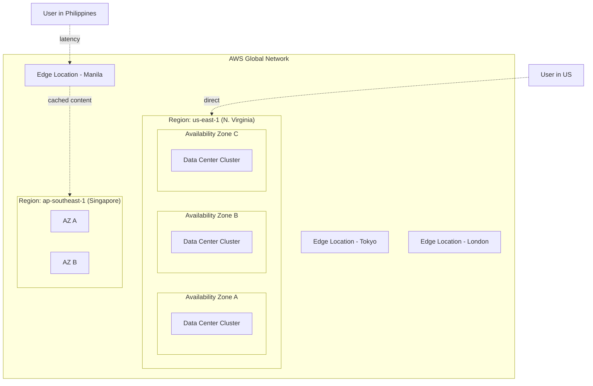

# AWS Global Infrastructure

*Fundamentals · maps to all 3 certs (SAA-C03 Domain 2, DVA-C03 Domain 1 & 4, MLA-C02 Domain 3 & 4)*

## Definition

AWS's global infrastructure is the physical network of data centers around the world that
everything you use on AWS actually runs on. It's organized into three layers: **Regions**,
**Availability Zones (AZs)**, and **Edge Locations**.

## Purpose

Every AWS architecture decision (where to put your database, how to survive an outage, how to
serve users fast worldwide) comes down to how you use these three layers. AWS built this
hierarchy so you can choose, independently, how *close* your infrastructure is to your users,
and how *isolated* your infrastructure is from a single point of failure.

## How It Works



Walking through it:

- **Region** — a physical geographic area (e.g., `us-east-1` = Northern Virginia,
  `ap-southeast-1` = Singapore). Each Region is a completely independent, isolated collection of
  AWS resources. Data doesn't automatically move between Regions — you choose explicitly to
  replicate it. There are 30+ Regions globally as of 2026, each picked for a mix of legal
  jurisdiction, latency to population centers, and power/cooling economics.
- **Availability Zone (AZ)** — one or more discrete data centers *within* a Region, each with
  its own independent power, cooling, and networking, but connected to the other AZs in that
  Region via high-speed, low-latency private links. Most Regions have 3+ AZs. The point of an AZ
  is **failure isolation**: a power outage or fire in one AZ shouldn't take down the others.
- **Edge Location** — a smaller site (there are 600+ worldwide, far more than Regions) used by
  **CloudFront** (CDN) and **Route 53** to cache content and resolve DNS physically close to end
  users, cutting latency. Edge Locations don't run your full application — just cached content,
  DNS resolution, and some lightweight compute (Lambda@Edge / CloudFront Functions).

## Key Features / Components

- **Region** = isolation boundary for compliance/data-residency + the unit you pick for "where do I deploy."
- **AZ** = isolation boundary for fault tolerance *within* a Region — this is what "multi-AZ" means everywhere in AWS docs.
- **Edge Location** = latency-reduction layer, not a deployment target for your full app.
- **Local Zones / Wavelength Zones** — niche extensions that bring AWS compute even closer to specific metro areas or telco 5G networks (good to recognize by name, rarely a deep exam topic).

## Use Cases — When to Use It

- **Pick a Region** close to your primary user base (lower latency) and/or that satisfies a
  legal/data-residency requirement (e.g., EU customer data must stay in an EU Region under GDPR
  interpretations many companies apply).
- **Spread resources across multiple AZs** (e.g., EC2 instances in an Auto Scaling Group, RDS
  Multi-AZ) whenever you need **high availability** — this is the default "correct answer"
  pattern on the SAA-C03 exam for any resiliency question.
- **Use CloudFront + Edge Locations** when you're serving static or cacheable content to users
  spread across a wide geography and latency matters (video, images, APIs with cacheable
  responses).

## When NOT to Use It / Alternatives

- Don't assume multi-Region is automatically "more available" — it adds massive complexity
  (data replication, consistency, cost) and is usually overkill vs. multi-AZ unless you have a
  genuine disaster-recovery requirement (whole-Region outage) or regulatory need for
  georedundancy.
- Edge Locations are not a substitute for Regional compute — you can't run a full stateful
  backend at an Edge Location (Lambda@Edge/CloudFront Functions are intentionally limited,
  short-duration, stateless).

## Why It's Important

- **Real world:** this is the first architecture decision on every project — it sets your
  latency floor, your compliance posture, and your blast radius for failures.
- **Exam:** "how do you make this architecture highly available" questions are answered with
  "spread across AZs"; "how do you reduce latency for global users" is answered with
  "CloudFront/Edge Locations" — recognizing which lever to pull is tested constantly across all
  three certs.

## Pricing Model (summary)

Region/AZ/Edge choice itself is free — you pay for the resources you provision inside them.
Cross-AZ data transfer within a Region is typically free or very cheap; cross-Region data
transfer is billed per GB and is one of the more commonly underestimated costs in real AWS
bills. See `services/networking-content-delivery/data-transfer-pricing.md`.

## Hands-on Lab (Floci)

Floci runs as a single local endpoint, so it won't demonstrate multi-AZ/multi-Region behavior
directly — but you can still practice the CLI patterns:

```bash
# List "regions" floci reports (floci defaults to us-east-1)
awslocal ec2 describe-availability-zones --region us-east-1

# Launch a resource with a Region override, to build the muscle memory of always specifying it
awslocal s3 mb s3://my-test-bucket --region us-east-1
```

## Exam Tips

- If a question says "survive an Availability Zone failure" → answer involves **Multi-AZ**
  (RDS Multi-AZ, ASG across AZs, ELB across AZs).
- If a question says "survive a Region failure" / "disaster recovery" → answer involves
  **cross-Region replication** (S3 Cross-Region Replication, RDS Read Replica in another Region,
  Route 53 failover routing).
- If a question says "reduce latency for users worldwide" → answer involves **CloudFront /
  Edge Locations**, not more EC2 instances in more Regions.
- Don't confuse AZ count with redundancy count — "3 AZs" doesn't mean "3x the compute cost" if
  you're just distributing the same total capacity across them.

## Related Terms

[`glossary/README.md`](../glossary/README.md#a) · [`shared-responsibility-model.md`](shared-responsibility-model.md) · `services/networking-content-delivery/cloudfront.md` · `services/networking-content-delivery/route53.md`
