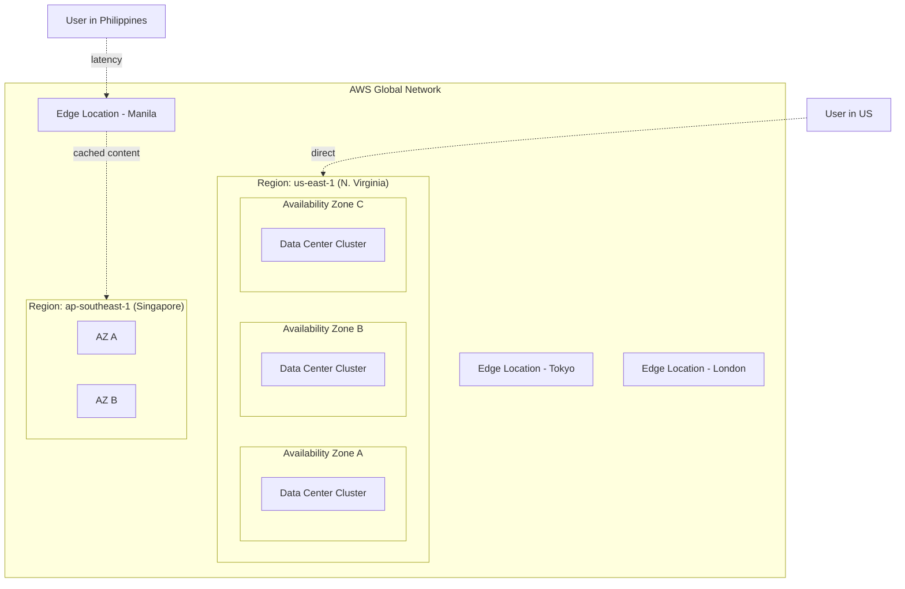
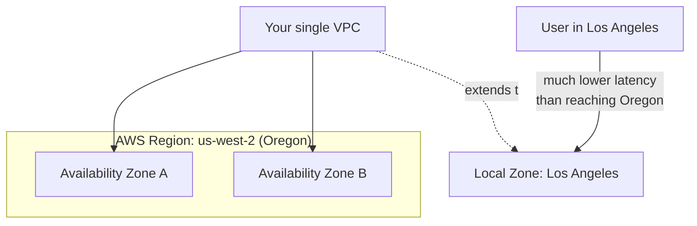
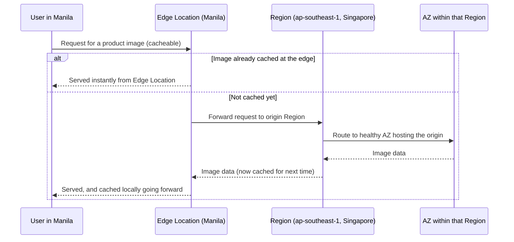
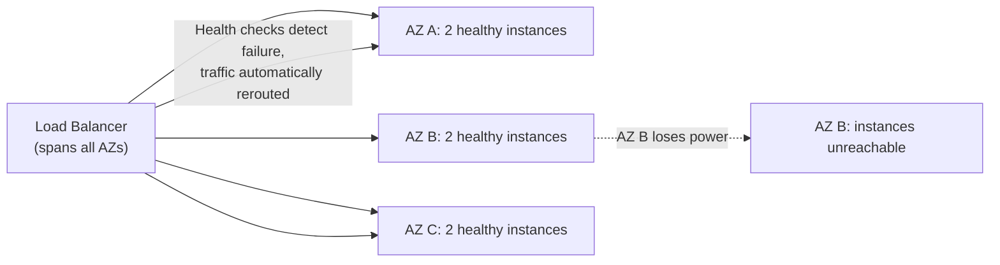
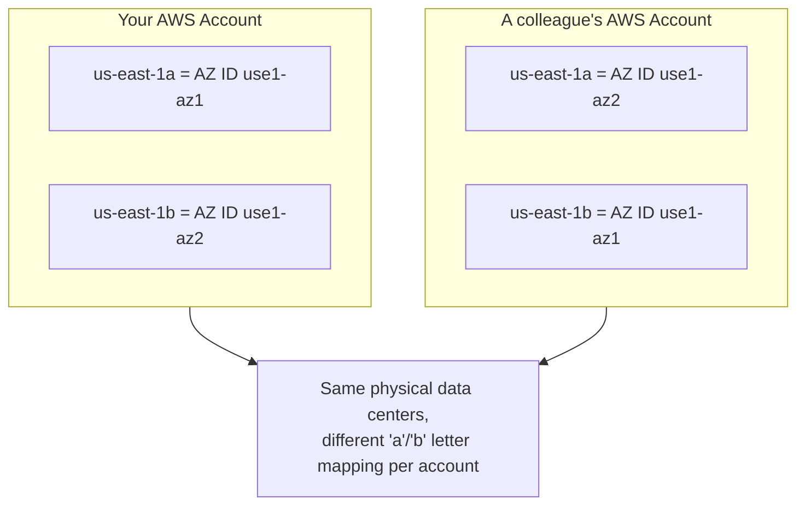

# AWS Global Infrastructure

*Fundamentals · maps to all 3 certs (SAA-C03 Domain 2, DVA-C03 Domain 1 & 4, MLA-C02 Domain 3 & 4)*

## Definition

AWS's global infrastructure is the physical network of data centers around the world that
everything you use on AWS actually runs on. It's organized into three main layers — **Regions**,
**Availability Zones (AZs)**, and **Edge Locations** — plus two newer, more specialized
extensions, **Local Zones** and **Wavelength Zones**. Every single AWS service, no matter how
abstract it feels when you call an API, physically lives somewhere in this hierarchy.

## Purpose

Before cloud computing, if your company wanted a server in Tokyo to serve Japanese customers
quickly, you had to negotiate a lease, ship hardware, hire local technicians, and wait months.
AWS built a permanent, shared, always-on version of that physical footprint — data centers
pre-built, pre-wired, and pre-secured in dozens of countries — so that any customer, including a
solo developer with a credit card, can "rent" a presence in Tokyo in about sixty seconds. But a
single giant data center isn't enough: a fire, flood, or power failure in any one building would
take everything down with it. So AWS deliberately splits its footprint into independent, failure-
isolated chunks (Availability Zones) grouped into geographic areas (Regions), plus a much larger
number of small, lightweight caching points (Edge Locations) that get content physically close to
users without needing a full data center everywhere. Understanding this hierarchy is the first
skill every cloud architect needs, because almost every other AWS decision — where to put a
database, how to survive an outage, how to serve users on the other side of the planet quickly —
is really a question about *which layer of this hierarchy to use, and how.*

## An Analogy Before Any AWS Terms

Imagine a worldwide chain of hospitals. The company doesn't build one enormous hospital that
serves the entire planet — patients in Australia would have to fly to a single building in
Ohio. Instead, it builds **separate hospital campuses** in major countries (this is a **Region**
— a self-contained geographic area). Each campus itself isn't one building either: it has
**multiple separate wings** — say, a north wing and a south wing, each with its own power
generator, its own water supply, its own staff — specifically so a fire or an electrical fault in
one wing never shuts down patient care in the other (this is an **Availability Zone** — an
independent failure domain *within* a Region). Finally, the hospital network also runs a huge
number of small **neighborhood first-aid kiosks** scattered across every city — not full
hospitals, just the fastest possible first point of contact, close enough to reach in minutes,
that either treats something minor directly or quickly routes you to the right campus (this is an
**Edge Location** — a small, numerous, latency-reducing front door, not a full-capability site).

Keep that picture in your head — campus → wing → kiosk — as the plain-English backbone underneath
every term in this document.

## How It Works



Walking through it:

- **Region** — a physical geographic area (e.g., `us-east-1` = Northern Virginia,
  `ap-southeast-1` = Singapore). Each Region is a completely independent, isolated collection of
  AWS resources. Data doesn't automatically move between Regions — you choose explicitly to
  replicate it. There are 30+ Regions globally as of 2026, each picked for a mix of legal
  jurisdiction, latency to population centers, and power/cooling economics.
- **Availability Zone (AZ)** — one or more discrete data centers *within* a Region, each with
  its own independent power, cooling, and networking, but connected to the other AZs in that
  Region via high-speed, low-latency private links. Most Regions have 3+ AZs. The point of an AZ
  is **failure isolation**: a power outage or fire in one AZ shouldn't take down the others.
- **Edge Location** — a smaller site (there are 600+ worldwide, far more than Regions) used by
  **CloudFront** (CDN) and **Route 53** to cache content and resolve DNS physically close to end
  users, cutting latency. Edge Locations don't run your full application — just cached content,
  DNS resolution, and some lightweight compute (Lambda@Edge / CloudFront Functions).

### Zooming into one Region: what an Availability Zone actually looks like

The official AWS documentation illustrates this exact relationship — one Region containing
multiple independent Availability Zones, each hosting its own subnets and instances:


*Source: Amazon EC2 User Guide, "Regions and Zones"
(docs.aws.amazon.com/AWSEC2/latest/UserGuide/using-regions-availability-zones.html)*

Notice Availability Zone C in that diagram: it exists physically (AWS built the data center), but
the account in this example never created a subnet in it, so no instances can launch there. This
is a genuinely common beginner trip-up — **an AZ "existing" in a Region's list and an AZ actually
being used by your application are two different things.** You must deliberately design your VPC
subnets to span multiple AZs; AWS does not do this for you automatically.

### Zooming out further: Local Zones extend a Region physically closer to users



A **Local Zone** is a small extension of a parent Region, placed in a specific metro area that
isn't large enough to justify a full Region, but is latency-sensitive enough (gaming, video
editing, real-time collaboration, live broadcast) to be worth placing compute and storage closer
to. Your VPC literally extends into the Local Zone — it's the same account, same VPC, same
subnetting model, just physically closer hardware. **Wavelength Zones** follow the identical
pattern but are embedded inside telecom carriers' 5G networks instead of a metro area, for
applications needing ultra-low latency to mobile devices (think: a 5G-connected AR/VR app or an
autonomous-vehicle backend).

The official Amazon EC2 User Guide illustrates exactly this "one VPC, extended" relationship for
Local Zones:


*Source: Amazon EC2 User Guide, "Regions and Zones"
(docs.aws.amazon.com/AWSEC2/latest/UserGuide/using-regions-availability-zones.html)*

Notice there's no separate "Local Zone account setup" step pictured here — the same VPC's route
tables and security groups simply extend to cover the new subnet, which is precisely why Local
Zones are approachable even for teams with no prior hybrid-infrastructure experience: from a
networking perspective, it behaves like "just another AZ," even though physically it's a much
smaller, more specialized site than an ordinary Availability Zone.

### How a single web request crosses all three layers



This is the exact mechanism behind "CloudFront speeds up your website": the *first* user from a
given city pays the full round-trip latency to the origin Region, but every subsequent nearby user
gets served directly from the Edge Location's cache — no trip to the origin Region at all.

### A second worked flow: surviving an Availability Zone failure



The Elastic Load Balancer continuously health-checks every instance in every AZ. The moment AZ B
stops responding, the load balancer simply stops sending it traffic — no human intervention, no
DNS change, often no noticeable downtime for end users, *provided* you actually spread your
instances across AZs in the first place (this is the entire point of an Auto Scaling Group
configured with multiple AZs).

### Why the same AZ "letter" can mean different data centers for different accounts



AWS deliberately randomizes which physical AZ gets labeled `a` vs. `b` vs. `c` *per account*, so
that AWS customers as a whole don't all pile their "first" resources onto the exact same physical
building. This is invisible day-to-day, but it becomes directly relevant the moment two AWS
accounts need to coordinate shared infrastructure (e.g., a Transit Gateway or a shared subnet via
AWS Resource Access Manager) — you must compare stable **AZ IDs**, not AZ letters, to confirm
you're really talking about the same physical location.

### Picking a Region — the real factors, side by side

| Factor | Example consideration |
|---|---|
| **Latency to users** | A Region 150ms away "feels" slow for interactive apps; pick the closest Region to your primary user base first. |
| **Data residency / compliance** | GDPR-sensitive EU customer data, government contracts (GovCloud), or industry regulation may legally require a specific Region. |
| **Service availability** | Not every AWS service launches in every Region simultaneously — newer services often appear in a handful of Regions first. Always check before committing to a Region for a brand-new service. |
| **Pricing** | The exact same EC2 instance type can cost meaningfully different amounts in different Regions — `us-east-1` is usually (not always) among the cheapest. |
| **Opt-in requirement** | Some Regions (marked "Required" in AWS's Region table — e.g., several newer Asia-Pacific and Middle East Regions) must be explicitly enabled on your account before you can use them; they don't appear by default. |

## Key Features / Components

- **Region** = isolation boundary for compliance/data-residency + the unit you pick for "where do
  I deploy." Picking a Region is the single most consequential early decision in any architecture.
- **AZ** = isolation boundary for fault tolerance *within* a Region — this is what "multi-AZ"
  means everywhere in AWS docs.
- **Edge Location** = latency-reduction layer, not a deployment target for your full app.
- **Local Zones** — niche extensions that physically place AWS compute/storage closer to a
  specific metro area while remaining part of a parent Region's VPC.
- **Wavelength Zones** — the same idea as Local Zones but embedded directly inside a telecom
  carrier's 5G network, for applications serving mobile devices with minimal latency.
- **Regional Edge Caches** — a tier between Edge Locations and origin Regions that CloudFront uses
  to hold a larger cache of less-frequently-requested content, reducing trips all the way back to
  the origin.
- **AWS Outposts** — a related but distinct concept: actual AWS-managed hardware racks installed
  *inside a customer's own data center*, extending the same APIs on-premises. Worth recognizing by
  name; it's a hybrid-cloud answer, not a Region/AZ/Edge Location variant.

## Use Cases — When to Use It

- **Pick a Region** close to your primary user base (lower latency) and/or that satisfies a
  legal/data-residency requirement (e.g., EU customer data must stay in an EU Region under GDPR
  interpretations many companies apply).
- **Spread resources across multiple AZs** (e.g., EC2 instances in an Auto Scaling Group, RDS
  Multi-AZ) whenever you need **high availability** — this is the default "correct answer"
  pattern on the SAA-C03 exam for any resiliency question.
- **Use CloudFront + Edge Locations** when you're serving static or cacheable content to users
  spread across a wide geography and latency matters (video, images, APIs with cacheable
  responses).
- **Use a Local Zone** when a specific metro area (not a whole country) has latency-sensitive
  users and a full Region isn't justified — e.g., a media production studio needing low-latency
  rendering access in Los Angeles.
- **Use Wavelength** when your application specifically serves devices connected over a telecom
  carrier's 5G network and every millisecond of network hop matters (e.g., connected-vehicle
  telemetry, AR navigation).

## When NOT to Use It / Alternatives

- Don't assume multi-Region is automatically "more available" — it adds massive complexity
  (data replication, consistency, cost) and is usually overkill vs. multi-AZ unless you have a
  genuine disaster-recovery requirement (whole-Region outage) or regulatory need for
  georedundancy.
- Edge Locations are not a substitute for Regional compute — you can't run a full stateful
  backend at an Edge Location (Lambda@Edge/CloudFront Functions are intentionally limited,
  short-duration, stateless).
- Don't reach for Local Zones or Wavelength by default — they solve a narrow latency problem for
  a specific metro/carrier, and most workloads are perfectly well served by an ordinary Region and
  CloudFront.
- Don't pick a Region purely because it's cheapest — if your users are in Europe and you deploy
  only to `us-east-1` to save a few cents per GB, you will pay it back many times over in latency
  complaints and, potentially, compliance violations.

## Common Misconceptions

- **"More Availability Zones used = proportionally more cost."** Spreading the *same* total
  compute capacity across 3 AZs instead of 1 does not triple your bill — you're distributing
  existing capacity, not multiplying it. The marginal cost is mostly cross-AZ data transfer
  (often small) and a little operational complexity, not 3x compute cost.
- **"An Availability Zone is the same physical location across every AWS account."** It isn't
  automatically — the *letter* you see (e.g., `us-east-1a`) can map to a *different* physical data
  center depending on the AWS account, specifically so that AWS can spread load evenly instead of
  every customer piling onto the same "first" AZ. AWS exposes a stable **AZ ID** (e.g.,
  `use1-az1`) that *is* consistent across accounts, which matters when coordinating shared
  resources across accounts.
- **"Edge Locations run my application."** They don't run your full backend — they cache content
  and run small, stateless, short-duration functions (Lambda@Edge, CloudFront Functions). Thinking
  of an Edge Location as "a tiny Region" is the most common beginner misunderstanding here.
- **"A Region failing is a realistic everyday risk I should always architect for."** Whole-Region
  failures are exceedingly rare compared to single-AZ failures. Over-architecting every workload
  for multi-Region disaster recovery, when the actual risk you face is far more mundane (a single
  host or AZ issue), wastes money and engineering effort that multi-AZ alone would have solved.
- **Local Zones and Wavelength Zones are separate from my existing Region/VPC.** They're not —
  they extend your *existing* Region's VPC. You don't create a brand-new account or networking
  setup; you simply add a subnet that happens to live in the Local Zone or Wavelength Zone.
- **"Every Region has the exact same services available."** New AWS services frequently launch
  in a handful of Regions first (often `us-east-1`, sometimes a couple of others) and expand over
  following months. A design that assumes "any Region will have the service I need" can fail
  during actual implementation — always check the AWS Regional Services List before committing an
  architecture to a less-common Region.
- **"AWS Outposts is just another Region."** It isn't a Region at all — it's AWS-owned hardware
  physically installed inside a customer's own on-premises data center, running a subset of AWS
  APIs locally. It solves a fundamentally different problem (hybrid cloud, strict on-premises data
  requirements) than anything in the Region/AZ/Edge Location hierarchy, and mixing it up with a
  Local Zone (which is still inside an AWS-owned facility) is a common beginner confusion.

## Why It's Important

- **Real world:** this is the first architecture decision on every project — it sets your
  latency floor, your compliance posture, and your blast radius for failures. A startup that
  picks the wrong Region for its user base will spend years fighting latency complaints that a
  single correct decision on day one would have avoided entirely.
- **Exam — SAA-C03 style scenario:** "A company's application experiences a complete outage
  whenever a single data center in their chosen Region has a power failure. The application
  currently runs on EC2 instances in a single Availability Zone behind an Application Load
  Balancer. What is the MOST appropriate change to improve availability with the least
  operational overhead?" → The correct answer is **deploy instances across multiple Availability
  Zones within the same Region and let the existing ALB distribute traffic across them** — not
  "move to a different Region" (overkill, doesn't address the actual stated failure mode) and not
  "add more instances in the same AZ" (doesn't address the isolation problem at all).
- **Exam — DVA-C03 style scenario:** "A developer's Lambda function needs to serve personalized
  HTML fragments with sub-10ms added latency to users across multiple continents, and the logic
  is simple header-based routing." → This points to **Lambda@Edge or CloudFront Functions**,
  running at Edge Locations, rather than deploying the same Lambda function redundantly into every
  Region — the exam is testing whether you reach for the Edge layer instead of over-provisioning
  Regional compute for a problem Edge solves more cheaply.
- **Exam — MLA-C02 style scenario:** "A company trains ML models in `us-east-1` but serves
  real-time inference to users in the EU, and EU regulations require inference data to stay within
  EU borders." → The correct pattern is **deploy a separate SageMaker endpoint (or equivalent
  inference infrastructure) in an EU Region**, keeping training in `us-east-1` if no compliance
  issue applies there, while routing EU user traffic only to the EU Region's endpoint — testing
  whether you understand that Regions are real compliance/data-residency boundaries, not just a
  performance knob.

## Worked Scenario: Designing for a Global Product Launch

A retail company is launching a new e-commerce site simultaneously in the US, Germany, and
Singapore. Walking through the Region/AZ/Edge decision end-to-end:

1. **Database and core backend placement (Region choice):** Because the company's legal team
   requires EU customer order data to stay within the EU, they cannot run one single global
   database in `us-east-1` and call it done. They choose **three separate Regional deployments**
   (`us-east-1`, `eu-central-1`, `ap-southeast-1`), each with its own copy of the backend and
   database — not because performance demands it everywhere, but because *data residency* forces
   it for the EU leg specifically; US and Singapore get Regional deployments mainly for latency.
2. **Availability within each Region (AZ choice):** Within *each* of those three Regions, the
   backend EC2 fleet and RDS database are deployed Multi-AZ — this protects each Region's
   deployment from a single data center failure, independent of the cross-Region decision made in
   step 1.
3. **Static assets and product images (Edge choice):** Product photos, CSS, and JavaScript are
   identical for every region and highly cacheable, so they're placed in S3 and served through a
   single CloudFront distribution with a global footprint of Edge Locations — a shopper in Manila
   gets the product photo from a nearby Edge Location in milliseconds, without ever touching any
   of the three origin Regions directly.
4. **DNS routing (tying it together):** Route 53 uses latency-based routing so a user's request
   automatically resolves to whichever of the three Regional backends is physically closest,
   while CloudFront handles the static-asset layer globally regardless of which Region answers the
   dynamic request.

The lesson this scenario teaches: **a single global application routinely uses all three layers
simultaneously, for three different reasons** — Regions for compliance/latency-of-dynamic-content,
AZs for intra-Region fault tolerance, and Edge Locations for latency-of-static-content — and a
good architecture review explicitly justifies each layer's use rather than defaulting to "just use
one Region for everything" or "just use every layer everywhere" without reasoning about why.

## Worked Scenario Two: Disaster Recovery Across Regions

A financial services company runs its core trading platform in `us-east-1`, fully Multi-AZ. A
new regulatory requirement mandates the company prove it can recover operations within four hours
even if an entire AWS Region becomes unavailable (an exceedingly rare event, but one the regulator
explicitly requires a documented plan for). Walking through the design:

1. **Pilot light in a second Region:** Rather than running a full, expensive duplicate stack
   24/7 in `us-west-2`, the team keeps only the critical core (a minimal database replica kept in
   sync via cross-Region replication, and the account/network scaffolding already defined as
   infrastructure-as-code) running at all times — a "pilot light" that can be scaled up quickly
   if needed, instead of a full always-on duplicate.
2. **Automated scale-up runbook:** The CloudFormation/Terraform templates for the full
   application stack are kept ready in `us-west-2` but not deployed; a tested, automated runbook
   (not a manual checklist) deploys the full stack and promotes the replica database to primary
   within the required four-hour window.
3. **Route 53 health-check failover:** DNS is configured with a health check against the primary
   Region; if it fails sustained checks, Route 53 automatically shifts traffic to the secondary
   Region's endpoint once it's confirmed healthy.
4. **Game day testing:** Twice a year, the team deliberately simulates a `us-east-1` outage and
   times the actual recovery, rather than assuming the runbook works because it looks correct on
   paper — directly reflecting the Well-Architected Reliability pillar's principle of testing
   recovery procedures, not just writing them.

The lesson: **this is categorically different from the AZ-level resilience built into step 1 of
the previous scenario.** Multi-AZ protects against a single data-center-level failure
automatically and near-instantly; multi-Region disaster recovery protects against a whole-Region
failure, requires deliberate design (data doesn't replicate across Regions unless you explicitly
configure it to), and almost always involves a real, documented trade-off between recovery speed
and ongoing cost (a "pilot light" is cheaper but slower to fully recover than a fully warm
standby, which is cheaper but slower than a fully active-active multi-Region deployment).

## Pricing Model (summary)

Region/AZ/Edge choice itself is free — you pay for the resources you provision inside them.
Cross-AZ data transfer within a Region is typically free or very cheap; cross-Region data
transfer is billed per GB and is one of the more commonly underestimated costs in real AWS
bills. See [`pricing-and-billing.md`](pricing-and-billing.md) for the full billing picture, and
`services/networking-content-delivery/data-transfer-pricing.md` for the data-transfer specifics.

## Hands-on Lab (Floci)

Floci runs as a single local endpoint, so it won't demonstrate multi-AZ/multi-Region behavior
directly — but you can still practice the CLI patterns:

```bash
# List "regions" floci reports (floci defaults to us-east-1)
awslocal ec2 describe-availability-zones --region us-east-1

# Launch a resource with a Region override, to build the muscle memory of always specifying it
awslocal s3 mb s3://my-test-bucket --region us-east-1

# Describe the (simulated) AZs available, to practice reading AZ names and IDs
awslocal ec2 describe-availability-zones --region us-east-1 \
  --query "AvailabilityZones[].{Name:ZoneName,State:State}"
```

**Extended exercise — simulate the "spread across AZs" decision locally:** even though Floci
won't truly isolate failure domains, you can practice the *habit* of always specifying an AZ when
you create a subnet, so the muscle memory transfers directly to a real AWS account:

```bash
# Create two subnets, deliberately placed in two different (simulated) AZs
awslocal ec2 create-subnet --vpc-id vpc-12345 --cidr-block 10.0.1.0/24 \
  --availability-zone us-east-1a
awslocal ec2 create-subnet --vpc-id vpc-12345 --cidr-block 10.0.2.0/24 \
  --availability-zone us-east-1b
```

## Exam Tips

- If a question says "survive an Availability Zone failure" → answer involves **Multi-AZ**
  (RDS Multi-AZ, ASG across AZs, ELB across AZs).
- If a question says "survive a Region failure" / "disaster recovery" → answer involves
  **cross-Region replication** (S3 Cross-Region Replication, RDS Read Replica in another Region,
  Route 53 failover routing).
- If a question says "reduce latency for users worldwide" → answer involves **CloudFront /
  Edge Locations**, not more EC2 instances in more Regions.
- If a question mentions "data must not leave [country/EU/etc.]" → that's a **Region** selection
  constraint, not an AZ or Edge Location question at all.
- If a question mentions "ultra-low latency to a specific metro area" or "5G network" →
  recognize **Local Zones** or **Wavelength Zones** respectively, rather than defaulting to "just
  add another Region."
- Don't confuse AZ count with redundancy count — "3 AZs" doesn't mean "3x the compute cost" if
  you're just distributing the same total capacity across them.
- Know that an **AZ ID** (e.g., `use1-az1`) is the stable, cross-account identifier, while an
  **AZ name** (e.g., `us-east-1a`) can map to different physical locations per account — this
  specific fact has appeared as a direct distractor on exam questions about coordinating
  resources across multiple AWS accounts.

## Further Reading

- AWS Regions and Availability Zones (official User Guide):
  https://docs.aws.amazon.com/global-infrastructure/latest/regions/aws-regions-availability-zones.html
- Amazon EC2 User Guide — Regions and Zones:
  https://docs.aws.amazon.com/AWSEC2/latest/UserGuide/using-regions-availability-zones.html
- AWS Global Infrastructure (interactive map of all Regions/AZs/Edge Locations):
  https://aws.amazon.com/about-aws/global-infrastructure/
- AWS Local Zones: https://aws.amazon.com/about-aws/global-infrastructure/localzones/
- AWS Wavelength: https://aws.amazon.com/wavelength/
- AWS Outposts: https://aws.amazon.com/outposts/

## Related Terms

[`glossary/README.md`](../glossary/README.md#a) · [`shared-responsibility-model.md`](shared-responsibility-model.md) · `services/networking-content-delivery/cloudfront.md` · `services/networking-content-delivery/route53.md`
