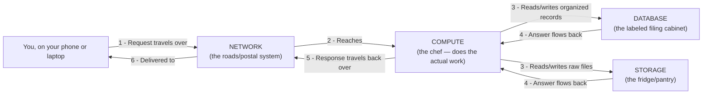

# Compute, Storage, Network & Database — A Zero-Jargon Primer

*Fundamentals · maps to all 3 certs (SAA-C03 Domain 2, DVA-C03 Domain 1, MLA-C02 Domain 2) ·
**start here if you've never touched a cloud platform before** — this doc names zero AWS services
on purpose*

## Definition

Every single thing any computer (and therefore every AWS service) does boils down to four
ingredients: **compute** (doing the thinking/calculating), **storage** (keeping things so they
don't disappear), **network** (getting information from one place to another), and **database**
(keeping organized, searchable collections of information). If you understand these four ideas in
plain terms — with zero technology involved — you understand the skeleton of every cloud
architecture you will ever look at.

## Purpose

People new to cloud computing often get overwhelmed because they start by memorizing service
names (there are hundreds) before understanding what problem each one is even solving. This doc
exists to flip that order: understand the four fundamental *jobs* first, using only real-world
analogies, with no AWS, no code, no acronyms — then every service you encounter later is just "a
specific tool for one of these four jobs," which makes the hundreds of AWS services far less
intimidating.

## The Four Ideas, With Real-World Analogies

### 1. Compute — "doing the thinking"

**What it IS, conceptually:** Compute is the part of a system that actually *does* something —
it takes inputs, follows instructions, and produces outputs. Picture a chef in a kitchen: the
chef doesn't store the ingredients forever (that's the fridge's job) and doesn't deliver the food
to your table (that's the waiter's job) — the chef's entire job is *transforming* raw ingredients
into a finished dish, following a recipe, using their own effort and time.

A computer's "chef" is its processor — the component that executes instructions, one step at a
time, incredibly fast. When you ask a website to calculate a price, resize a photo, or respond to
your click, somewhere a chef (a processor) is cooking that request. "More compute" means either a
faster chef, or more chefs working on different orders in parallel.

**Why it matters:** If you don't have enough "chefs" for the number of orders coming in,
customers (users) wait longer and longer — this is what people mean by a website being "slow" or
"overloaded." The cloud's big promise around compute is: instead of owning exactly N chefs
forever and hoping that's the right number, you can hire more chefs the moment a dinner rush
starts, and send them home the moment it's quiet — paying only for the hours they actually
worked.

### 2. Storage — "keeping things so they don't disappear"

**What it IS, conceptually:** Storage is anywhere information is kept so it still exists after
the immediate moment it was created. Back to the kitchen analogy: the fridge and the pantry are
storage. Ingredients go in, they sit there — unused, not being actively worked on — until a chef
needs them again. Crucially, storage doesn't *do* anything to the food; it just holds it reliably
so it's there later.

In computing terms, storage is anywhere data lives when nobody is actively computing on it right
now: a document you saved, a photo you took, a video file, a customer record. The core promises
storage needs to make are: (1) the thing you put in is still there later, even if the power goes
out — **durability**; and (2) you can get it back quickly when you need it — **availability**.

**Why it matters:** A chef (compute) with no fridge (storage) has to re-buy every ingredient from
scratch for every single dish, which is absurdly wasteful and slow. Similarly, an application
with no storage can't remember anything between one request and the next — every user would
start from zero every time. The entire reason "my data is safe" means something is that storage
is specifically engineered to survive failures — multiple copies, often in multiple physical
locations, so a single broken hard drive (or even a whole building) doesn't mean your photos are
gone forever.

### 3. Network — "getting information from one place to another"

**What it IS, conceptually:** Network is the roads, postal system, and telephone lines connecting
everything else together. The chef needs ingredients delivered to the kitchen (a supplier's
truck, driving on roads) and needs to get the finished dish to your table (a waiter, walking
across the room). Neither of those is the chef's job (compute) or the fridge's job (storage) —
it's the *movement* in between that matters.

In computing terms, network is everything involved in getting a request from your phone or laptop
to wherever the compute/storage lives, and getting the response back to you. This includes: how
fast the "road" is (bandwidth), how long it takes a single trip to complete (latency), whether the
road is open only to people who should be allowed on it (security/firewalls), and how the request
even knows which building to go to in the first place (addressing/routing, similar to how a
postal address tells a letter carrier exactly which house to deliver to).

**Why it matters:** A powerful chef with a fully stocked fridge is useless to you if there's no
road connecting their kitchen to your table — you'd never get the food. Likewise, the fastest
compute and most reliable storage in the world are worthless if the network connecting them to
your users is slow, insecure, or broken. A huge amount of real-world cloud architecture work is
actually about the *network* layer — making sure the right things can reach each other, and the
wrong things (intruders) cannot.

### 4. Database — "organized, searchable collections of information"

**What it IS, conceptually:** A database is a specific, more organized evolution of storage — not
just "a place things are kept" but "a place things are kept *in a structure that makes them easy
to find, filter, and update."* Think of the difference between a messy junk drawer (plain
storage — you can find things, but only by digging) and a well-organized filing cabinet with
labeled folders, cross-referenced by date, name, and category (a database — you can instantly
pull exactly the one document you need out of thousands, without touching the others).

A restaurant's reservation book is a great analogy: it's not just a pile of paper where
reservations are written down in random order (that would be plain storage) — it's organized by
date and time so the host can instantly answer "who's coming in at 7pm tonight?" without reading
every single page. That *structure* — organizing data so specific questions can be answered fast
— is what separates a database from simple storage.

**Why it matters:** Almost everything an application needs to "remember and look up quickly" —
user accounts, orders, inventory counts, messages — lives in a database rather than plain storage,
specifically because applications need to ask precise questions ("find this one user by their
email") and get an instant answer out of potentially millions of records, not search through
every file one by one.

## How It Works — putting all four together



Walking through it, using a real example — you opening a shopping app and searching for a
product:

1. **You** tap "search" on your phone. That request has to physically travel somewhere — over
   the **network**.
2. The network delivers your request to the **compute** — the "chef" whose job is to handle
   search requests. It receives your search term and starts working.
3. The compute doesn't itself know "which products match your search" — it asks the **database**
   (the organized filing cabinet) to look that up, because the database is structured specifically
   to answer exactly this kind of precise question fast. If your search also needs an actual
   product photo, the compute separately fetches that raw file from **storage** (the fridge —
   photos are typically simple, unstructured files, not structured searchable records).
4. The database (and storage) hand their answers back to the compute.
5. The compute assembles the final response (a list of matching products, with photos) and sends
   it back out over the **network**.
6. The network delivers that response back to **you**, and you see your search results.

Every single app, website, or service you have ever used is some variation of this exact same
loop. The only thing that changes from one application to the next is the *specifics* of each
box — but the four jobs themselves never change.

## Key Features / Components

- **Compute** — does the work/calculation; the "chef." Characterized by how fast it is and how
  many things it can do in parallel.
- **Storage** — holds raw files/data reliably over time; the "fridge/pantry." Characterized by
  durability (does it survive failure?) and availability (can you get it back when you need it?).
- **Network** — moves information between places; the "roads/postal system." Characterized by
  bandwidth (how much can travel at once), latency (how long one trip takes), and security
  (who's allowed to use the road).
- **Database** — holds *organized, searchable* data; the "labeled filing cabinet." Characterized
  by how precisely and quickly it can answer specific questions about potentially huge amounts of
  data.

## Use Cases — When to Use It

This primer applies universally — there is no AWS architecture, however complex, that isn't built
from some combination of these four building blocks. Whenever you encounter a new AWS service
name later in this repo, your very first question should be: "which of these four jobs is this
service actually doing — or is it a tool that helps connect two of them?" That single habit will
make unfamiliar service names far less intimidating.

## When NOT to Use It / Alternatives

Not applicable — these four categories aren't something you "choose to use"; they're the
underlying physics of every computing system, cloud or otherwise. The only "alternative" is not
understanding them, which makes every subsequent AWS topic harder than it needs to be.

## Why It's Important

- **Real world:** every single troubleshooting conversation ("why is the app slow," "why did we
  lose data," "why can't this server reach that database") boils down to isolating *which one of
  these four* is the actual bottleneck or failure point. Experienced engineers debug by asking
  "is this a compute problem, a storage problem, a network problem, or a database problem?" before
  diving into any specific tool.
- **Exam:** every AWS service in this entire repo's `services/` folder slots into one (or a
  combination) of these four categories. The exams constantly test whether you've picked the
  *right category* of service for a scenario (e.g., recognizing that a "fast, structured lookup"
  need calls for a database-category service, not a storage-category one) before even getting to
  which specific service within that category is best.

## Pricing Model (summary)

Not applicable at this conceptual level — but it's worth knowing upfront that, in general across
AWS, you'll find **compute** billed by time used (per second/hour), **storage** billed by amount
kept over time (per GB per month) plus how often you access it, **network** billed mostly for data
leaving AWS toward the internet, and **database** billed as a combination of compute (to run the
database engine) and storage (to hold the data) together. See
[`pricing-and-billing.md`](pricing-and-billing.md) for the full picture.

## Hands-on Lab (Floci)

There's no single command for "conceptual understanding," but here's one call from each category
against Floci, just to see the shape of each:

```bash
# COMPUTE: launch something that *does* work
awslocal ec2 run-instances --image-id ami-12345 --instance-type t2.micro

# STORAGE: keep a raw file reliably
awslocal s3 mb s3://my-primer-bucket
awslocal s3 cp ./photo.jpg s3://my-primer-bucket/photo.jpg

# DATABASE: keep organized, searchable records
awslocal dynamodb create-table --table-name Products \
  --attribute-definitions AttributeName=ProductId,AttributeType=S \
  --key-schema AttributeName=ProductId,KeyType=HASH \
  --billing-mode PAY_PER_REQUEST

# NETWORK: define who's allowed to reach what
awslocal ec2 create-security-group --group-name demo-sg --description "primer demo"
```

Notice each command is clearly doing one of the four jobs — that pattern-matching is the whole
point of this primer.

## Exam Tips

- When a scenario describes a need to "process/transform/calculate," think **compute** first.
- When it describes a need to "keep a file/object/backup safely," think **storage** first.
- When it describes a need to "look up/filter/query specific records fast," think **database**
  first (and notice: this is a stronger, more specific need than plain storage).
- When it describes "latency," "bandwidth," "reachability," "firewall," or "connect service A to
  service B," think **network** first.
- Many exam questions combine two or more of these (e.g., "a web app's backend compute needs fast
  access to a structured product catalog" = compute + database) — identifying *both* categories
  correctly before picking a specific service is the real skill being tested.

## Related Terms

[`glossary/README.md`](../glossary/README.md) ·
[`aws-global-infrastructure.md`](aws-global-infrastructure.md) ·
[`shared-responsibility-model.md`](shared-responsibility-model.md) ·
`services/compute/` · `services/storage/` · `services/database/` ·
`services/networking-content-delivery/`
