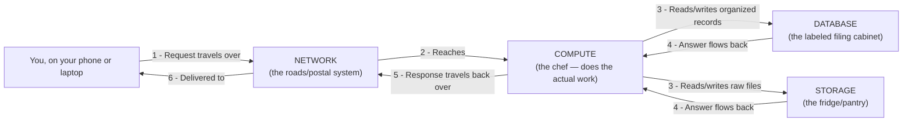
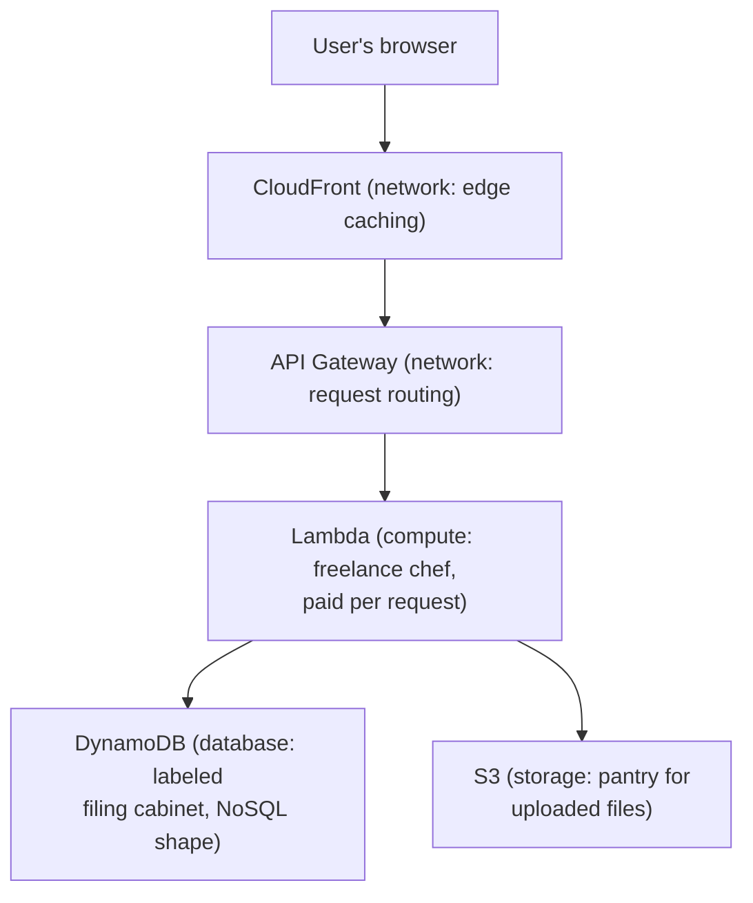
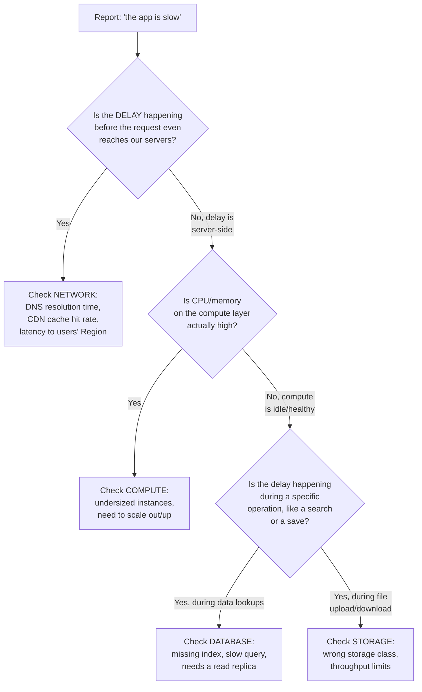
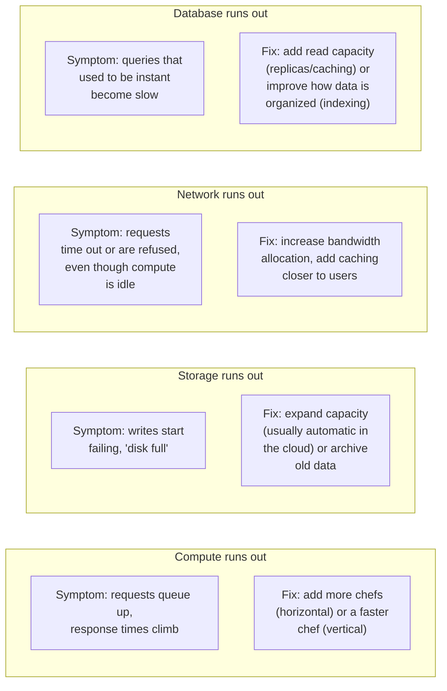

# Compute, Storage, Network & Database — A Zero-Jargon Primer

*Fundamentals · maps to all 3 certs (SAA-C03 Domain 2, DVA-C03 Domain 1, MLA-C02 Domain 2) ·
**start here if you've never touched a cloud platform before** — this doc names zero AWS services
on purpose*

## Definition

Every single thing any computer (and therefore every AWS service) does boils down to four
ingredients: **compute** (doing the thinking/calculating), **storage** (keeping things so they
don't disappear), **network** (getting information from one place to another), and **database**
(keeping organized, searchable collections of information). If you understand these four ideas in
plain terms — with zero technology involved — you understand the skeleton of every cloud
architecture you will ever look at.

## Purpose

People new to cloud computing often get overwhelmed because they start by memorizing service
names (there are hundreds) before understanding what problem each one is even solving. This doc
exists to flip that order: understand the four fundamental *jobs* first, using only real-world
analogies, with no AWS, no code, no acronyms — then every service you encounter later is just "a
specific tool for one of these four jobs," which makes the hundreds of AWS services far less
intimidating.

## The Four Ideas, With Real-World Analogies

### 1. Compute — "doing the thinking"

**What it IS, conceptually:** Compute is the part of a system that actually *does* something —
it takes inputs, follows instructions, and produces outputs. Picture a chef in a kitchen: the
chef doesn't store the ingredients forever (that's the fridge's job) and doesn't deliver the food
to your table (that's the waiter's job) — the chef's entire job is *transforming* raw ingredients
into a finished dish, following a recipe, using their own effort and time.

A computer's "chef" is its processor — the component that executes instructions, one step at a
time, incredibly fast. When you ask a website to calculate a price, resize a photo, or respond to
your click, somewhere a chef (a processor) is cooking that request. "More compute" means either a
faster chef, or more chefs working on different orders in parallel.

**Why it matters:** If you don't have enough "chefs" for the number of orders coming in,
customers (users) wait longer and longer — this is what people mean by a website being "slow" or
"overloaded." The cloud's big promise around compute is: instead of owning exactly N chefs
forever and hoping that's the right number, you can hire more chefs the moment a dinner rush
starts, and send them home the moment it's quiet — paying only for the hours they actually
worked.

**A second angle on the same idea — two different kinds of chef:** not every chef works the same
way. Some kitchens have a **dedicated chef who shows up for an entire shift** regardless of how
many orders come in — they're paid for the whole shift whether the kitchen is slammed or empty
(this is the "always-on server" style of compute). Other kitchens use a **pool of freelance chefs
who are called in only when an order actually arrives**, cook exactly that one dish, and leave the
moment it's done — paid only for the minutes they actually worked, with nobody paid at all during
quiet periods (this is the "serverless function" style of compute). Both are still compute — both
are still "doing the thinking" — they just differ in *how* you pay for the chef's time and *how
quickly* a brand-new chef can show up when a sudden rush begins.

### 2. Storage — "keeping things so they don't disappear"

**What it IS, conceptually:** Storage is anywhere information is kept so it still exists after
the immediate moment it was created. Back to the kitchen analogy: the fridge and the pantry are
storage. Ingredients go in, they sit there — unused, not being actively worked on — until a chef
needs them again. Crucially, storage doesn't *do* anything to the food; it just holds it reliably
so it's there later.

In computing terms, storage is anywhere data lives when nobody is actively computing on it right
now: a document you saved, a photo you took, a video file, a customer record. The core promises
storage needs to make are: (1) the thing you put in is still there later, even if the power goes
out — **durability**; and (2) you can get it back quickly when you need it — **availability**.

**Why it matters:** A chef (compute) with no fridge (storage) has to re-buy every ingredient from
scratch for every single dish, which is absurdly wasteful and slow. Similarly, an application
with no storage can't remember anything between one request and the next — every user would
start from zero every time. The entire reason "my data is safe" means something is that storage
is specifically engineered to survive failures — multiple copies, often in multiple physical
locations, so a single broken hard drive (or even a whole building) doesn't mean your photos are
gone forever.

**A second angle — not all storage is the same shape:** a pantry (shelves of individually labeled
jars, grabbed whole, one at a time) is a different *shape* of storage than a walk-in freezer
organized into neat, uniformly-sized drawers that can be sliced into precise portions on demand.
Some computing storage is "object" shaped — whole files, grabbed and put back as complete units,
like jars on a shelf (good for photos, videos, backups). Other storage is "block" shaped — raw,
uniformly-sliced chunks that a chef can read and rewrite in small precise pieces extremely fast,
like a walk-in freezer's organized drawers (good for a database's working files, where tiny,
frequent updates matter more than retrieving one whole object at a time). Neither shape is
"better" in general — they're suited to different *patterns* of use, and recognizing which shape a
problem calls for is a skill every cloud architecture question eventually tests.

### 3. Network — "getting information from one place to another"

**What it IS, conceptually:** Network is the roads, postal system, and telephone lines connecting
everything else together. The chef needs ingredients delivered to the kitchen (a supplier's
truck, driving on roads) and needs to get the finished dish to your table (a waiter, walking
across the room). Neither of those is the chef's job (compute) or the fridge's job (storage) —
it's the *movement* in between that matters.

In computing terms, network is everything involved in getting a request from your phone or laptop
to wherever the compute/storage lives, and getting the response back to you. This includes: how
fast the "road" is (bandwidth), how long it takes a single trip to complete (latency), whether the
road is open only to people who should be allowed on it (security/firewalls), and how the request
even knows which building to go to in the first place (addressing/routing, similar to how a
postal address tells a letter carrier exactly which house to deliver to).

**Why it matters:** A powerful chef with a fully stocked fridge is useless to you if there's no
road connecting their kitchen to your table — you'd never get the food. Likewise, the fastest
compute and most reliable storage in the world are worthless if the network connecting them to
your users is slow, insecure, or broken. A huge amount of real-world cloud architecture work is
actually about the *network* layer — making sure the right things can reach each other, and the
wrong things (intruders) cannot.

**A second angle — the restaurant's floor plan, not just the road outside:** picture the
restaurant itself has an internal layout — a kitchen door that only staff can use, a dining room
open to any paying customer, and a back office that's locked to everyone except the manager.
That's *internal* networking: deciding which rooms of your own building can talk to which other
rooms, independent of the public road outside. Computing networks work the same way at two
different scales simultaneously — the *public* road connecting your application to the entire
internet, and a *private*, deliberately restricted set of internal paths connecting your own
compute and database to each other but to nothing else. Both scales matter, and confusing "is this
reachable from the internet" with "is this reachable from my own other servers" is one of the most
common real-world security mistakes.

### 4. Database — "organized, searchable collections of information"

**What it IS, conceptually:** A database is a specific, more organized evolution of storage — not
just "a place things are kept" but "a place things are kept *in a structure that makes them easy
to find, filter, and update.*" Think of the difference between a messy junk drawer (plain
storage — you can find things, but only by digging) and a well-organized filing cabinet with
labeled folders, cross-referenced by date, name, and category (a database — you can instantly
pull exactly the one document you need out of thousands, without touching the others).

A restaurant's reservation book is a great analogy: it's not just a pile of paper where
reservations are written down in random order (that would be plain storage) — it's organized by
date and time so the host can instantly answer "who's coming in at 7pm tonight?" without reading
every single page. That *structure* — organizing data so specific questions can be answered fast
— is what separates a database from simple storage.

**Why it matters:** Almost everything an application needs to "remember and look up quickly" —
user accounts, orders, inventory counts, messages — lives in a database rather than plain storage,
specifically because applications need to ask precise questions ("find this one user by their
email") and get an instant answer out of potentially millions of records, not search through
every file one by one.

**A second angle — two different filing systems for two different needs:** imagine two
reservation books. Book A is a rigid, pre-printed ledger with a fixed column for every reservation
— name, party size, time, table number — and every single entry *must* fill in every column the
same way, which makes cross-referencing extremely fast and reliable, but makes it awkward to
suddenly add a "dietary restriction" column for just a few guests without redesigning the whole
ledger. Book B is a stack of individual index cards, one per reservation, where each card can have
a completely different set of notes scribbled on it — easy to add anything to any single card, but
harder to answer a question like "list every reservation sorted by party size" at a glance across
all the cards. Book A is the shape of a **relational database** (fixed, consistent structure,
excellent at complex cross-referencing); Book B is the shape of a **non-relational/NoSQL
database** (flexible, inconsistent structure per record, excellent at simple, extremely fast
individual lookups at massive scale). Neither book is objectively better — the right choice
depends entirely on what kinds of questions you'll actually need to ask of the data later.

## How It Works — putting all four together



Walking through it, using a real example — you opening a shopping app and searching for a
product:

1. **You** tap "search" on your phone. That request has to physically travel somewhere — over
   the **network**.
2. The network delivers your request to the **compute** — the "chef" whose job is to handle
   search requests. It receives your search term and starts working.
3. The compute doesn't itself know "which products match your search" — it asks the **database**
   (the organized filing cabinet) to look that up, because the database is structured specifically
   to answer exactly this kind of precise question fast. If your search also needs an actual
   product photo, the compute separately fetches that raw file from **storage** (the fridge —
   photos are typically simple, unstructured files, not structured searchable records).
4. The database (and storage) hand their answers back to the compute.
5. The compute assembles the final response (a list of matching products, with photos) and sends
   it back out over the **network**.
6. The network delivers that response back to **you**, and you see your search results.

Every single app, website, or service you have ever used is some variation of this exact same
loop. The only thing that changes from one application to the next is the *specifics* of each
box — but the four jobs themselves never change.

### Seeing all four boxes in one real, official reference architecture

So this isn't purely an abstract diagram, here's an official AWS reference architecture for an
ordinary web application — notice it has exactly the same four ingredients, just drawn with real
service icons instead of labeled boxes:


*Source: AWS Reference Architecture Diagrams, "Web Application Architecture on AWS"
(docs.aws.amazon.com/reference-architecture-diagrams/latest/web-application-architecture/web-application-architecture.html)*

Even without recognizing a single service name yet, you can already identify the four jobs in
this diagram using only the primer above: the **EC2** boxes are compute (the chefs), the **RDS**
box is the database (the labeled filing cabinet), the **S3** box is storage (the pantry — holding
static files like images), and **Route 53 / CloudFront / the Load Balancers** are the network layer
(the roads, the postal routing, and the front door). This single observation — "I can already
read this diagram's shape before learning any service names" — is the entire point of this
primer.

### A second real reference architecture, this time serverless



Compare this to the previous diagram: the *shape* of the four jobs is identical, but every single
specific tool filling each job has changed — a "freelance chef paid per request" (Lambda) instead
of an "always-on chef" (EC2), and an "index-card style" database (DynamoDB) instead of a
"ledger-style" one (RDS). Neither architecture is more correct in general — they represent two
different answers to the same four underlying questions, chosen based on the specific workload's
actual shape (steady and predictable vs. spiky and unpredictable; complex cross-referencing needs
vs. simple high-speed lookups).

## Key Features / Components

- **Compute** — does the work/calculation; the "chef." Characterized by how fast it is and how
  many things it can do in parallel, and by *how* you pay for its time (always-on vs. per-request).
- **Storage** — holds raw files/data reliably over time; the "fridge/pantry." Characterized by
  durability (does it survive failure?), availability (can you get it back when you need it?),
  and *shape* (whole-object retrieval vs. finely-sliced block access).
- **Network** — moves information between places; the "roads/postal system." Characterized by
  bandwidth (how much can travel at once), latency (how long one trip takes), and security
  (who's allowed to use the road) — at both the public-internet scale and the private,
  internal-rooms scale.
- **Database** — holds *organized, searchable* data; the "labeled filing cabinet." Characterized
  by how precisely and quickly it can answer specific questions about potentially huge amounts of
  data, and by its *structural rigidity* (fixed-ledger shape vs. flexible-index-card shape).

## Use Cases — When to Use It

This primer applies universally — there is no AWS architecture, however complex, that isn't built
from some combination of these four building blocks. Whenever you encounter a new AWS service
name later in this repo, your very first question should be: "which of these four jobs is this
service actually doing — or is it a tool that helps connect two of them?" That single habit will
make unfamiliar service names far less intimidating.

- Use the **"always-on chef vs. freelance chef"** lens whenever a scenario describes "steady,
  predictable traffic" (points toward always-on-style compute) vs. "spiky, unpredictable, or
  rarely-used" (points toward per-request-style compute).
- Use the **"ledger vs. index cards"** lens whenever a scenario describes "complex relationships
  between records, need to cross-reference many tables" (points toward the ledger/relational
  shape) vs. "simple, extremely high-speed single-record lookups at massive scale" (points toward
  the index-card/NoSQL shape).
- Use the **"public road vs. internal rooms"** lens whenever a scenario describes "reachable from
  the internet" vs. "should only be reachable by our own other servers, never directly by the
  public" — this distinction underlies nearly every network-security exam question across all
  three certs.

## When NOT to Use It / Alternatives

Not applicable — these four categories aren't something you "choose to use"; they're the
underlying physics of every computing system, cloud or otherwise. The only "alternative" is not
understanding them, which makes every subsequent AWS topic harder than it needs to be.

## Common Misconceptions

- **"Compute and database are basically the same thing, since a database 'runs' somewhere."** A
  database service bundles compute (the engine executing your queries) and storage (where the
  data actually sits) together into one product, but they remain conceptually and, on your bill,
  *financially* separate meters — exactly as demonstrated in `pricing-and-billing.md`'s worked
  bill example. A "database" is really "compute + storage, with an organizational structure layered
  on top," not a fifth, unrelated category.
- **"More storage always means slower access, and more compute always means faster access."**
  Neither is automatically true — a small amount of block storage can be extremely fast, while a
  huge amount of object storage can also be retrieved quickly if accessed in the pattern it's
  designed for (whole objects, not tiny random slices). Speed depends on matching the *shape* of
  storage to the *shape* of your access pattern, not on raw size.
- **"Network is just 'the internet' — it only matters for public-facing traffic."** A large
  fraction of real network design work is entirely internal — deciding which of your own servers
  can talk to which others, with zero involvement from the public internet at all. Many real
  security incidents stem from treating "internal" traffic as automatically safe, when it still
  needs deliberate access rules.
- **"A relational (ledger-style) database is always the 'proper' or 'more serious' choice, and
  NoSQL is a shortcut for simple projects."** Some of the largest, most demanding systems in the
  world (real-time ad bidding, massive-scale user session storage) are built on NoSQL databases
  specifically *because* of their speed and scale characteristics, not despite some assumed lack
  of seriousness — the right choice depends on the access pattern, not on perceived
  sophistication.
- **"These four categories are an AWS invention."** They aren't — compute, storage, network, and
  database are universal computing concepts that predate cloud computing entirely; AWS (and every
  other cloud provider) simply offers managed, elastic, pay-as-you-go products for each of the
  four categories instead of you buying and running the physical hardware yourself.

## Why It's Important

- **Real world:** every single troubleshooting conversation ("why is the app slow," "why did we
  lose data," "why can't this server reach that database") boils down to isolating *which one of
  these four* is the actual bottleneck or failure point. Experienced engineers debug by asking
  "is this a compute problem, a storage problem, a network problem, or a database problem?" before
  diving into any specific tool.
- **Exam — SAA-C03 style scenario:** "An application experiences slow response times. Monitoring
  shows CPU utilization on the application servers is consistently under 20%, but database query
  response times have increased tenfold over the past month as the user base has grown. Which
  category of the architecture is the bottleneck, and what general class of fix addresses it?" →
  This is a **database** bottleneck, not a compute one (the low CPU utilization rules out compute
  as the cause) — the general fix class is improving database read capacity (e.g., read replicas,
  caching layer, or indexing improvements), not adding more application servers, which would do
  nothing for a database-layer slowdown.
- **Exam — DVA-C03 style scenario:** "A developer's application intermittently fails with
  connection timeout errors when calling an internal microservice hosted in the same VPC, even
  though both services show healthy CPU and memory metrics. Which category should be
  investigated first?" → **Network** — healthy compute metrics on both sides point away from a
  compute problem, directing attention toward network-layer causes (security group rules, NACL
  rules, route table misconfiguration, or DNS resolution issues) rather than application code.
- **Exam — MLA-C02 style scenario:** "An ML team needs to store millions of small feature vectors
  and retrieve individual vectors by ID with single-digit-millisecond latency during real-time
  inference, but does not need complex multi-table joins." Which general category and *shape* of
  solution fits best? → A **database**, specifically the flexible/NoSQL ("index card") shape
  rather than the rigid/relational ("ledger") shape — the described access pattern (simple,
  extremely fast single-record lookups, no complex joins) is the textbook signal pointing away
  from a relational database and toward a key-value-style NoSQL database.

## Worked Scenario: Diagnosing "The App Is Slow" From Scratch

A support ticket arrives: "our app has gotten slower over the past two weeks." Using nothing but
the four-category framework, here's the actual diagnostic order an experienced engineer follows,
and why:



1. **Rule out network first**, because it's the most "upstream" category — if users in one
   geographic region report the issue far more than others, or if the delay happens before the
   request even reaches the application, the fix lives in CDN/DNS/latency territory, not inside
   the application at all.
2. **Check compute second**, because it's cheap to verify (CPU/memory graphs) and definitively
   rules itself in or out — healthy compute metrics mean the slowdown is happening somewhere
   *else* in the loop, which is an important, confidence-building negative result.
3. **Narrow between database and storage last**, based on *which specific operation* is slow —
   search/filter/lookup-style slowness points to the database; upload/download-of-whole-files
   slowness points to storage, because these are the two different "shapes" of data access
   described earlier in this primer.

This exact "network → compute → database/storage" ordering, driven entirely by which category's
metrics are cheapest and fastest to check first, is a transferable debugging habit that applies
far beyond any single exam question — and it's precisely the mental model
`systematic-debugging`-style root-cause investigation is built on, applied specifically to cloud
infrastructure.

## A Fifth Angle: What Happens When You Scale Each Category

A primer isn't complete without understanding what "running out of" each category actually feels
like, and the general shape of the fix — because this is exactly the pattern real troubleshooting
and exam scenarios test:



Notice the fixes are *not* interchangeable — adding more chefs (compute) does nothing for a
database query that's slow because it isn't indexed, and expanding storage capacity does nothing
for a network bottleneck. Correctly matching the *symptom* to the *right category's* fix, rather
than reflexively "adding more servers" to every problem, is one of the most valuable instincts
this primer is trying to build.

## A Sixth Angle: The Restaurant, Fully Scaled Up

Push the single-kitchen analogy to its logical extreme, because this is genuinely how large
real-world systems look once you stop thinking of "the app" as one building:

- A wildly popular restaurant chain doesn't open one enormous kitchen that serves the entire
  country — it opens **many kitchens in many cities** (this maps directly to spreading compute
  across [`aws-global-infrastructure.md`](aws-global-infrastructure.md)'s Regions and Availability
  Zones), each with its own chefs (compute), its own fridges (storage), and its own reservation
  book (database), all able to serve customers independently so one kitchen's bad night doesn't
  shut down the whole chain.
- The chain's central office keeps a **master, synchronized reservation system** so a booking made
  through any city's phone line shows up correctly everywhere — this is the real-world shape of a
  database that needs to stay consistent across multiple physical locations, a genuinely hard
  problem that entire AWS services (and entire certification exam domains) are built around
  solving well.
- A courier network (network) connects every kitchen to a central supply warehouse, and a
  separate, smaller, much faster courier service exists purely for delivering orders to nearby
  customers quickly (this maps to the Region vs. Edge Location distinction) — notice this is the
  exact same four-category framework, just operating at a much larger, geographically distributed
  scale, with nothing conceptually new added.

This "zoom all the way out" exercise is worth revisiting any time a new AWS service feels
overwhelming: no matter how distributed, how many Regions, how many microservices an architecture
has, it is still built from nothing but these same four ingredients, repeated and connected many
times over.

## Worked Scenario Two: Choosing the Right Shape for a New Feature

A team is building a brand-new feature: a live leaderboard for a mobile game, showing the top 100
players' scores, updated in real time as millions of players submit scores per minute. Walking
through each of the four categories using only the lenses from this primer, *before* naming any
specific AWS service:

1. **Compute shape:** Score submissions arrive in unpredictable bursts (a viral moment could spike
   traffic 50x in minutes) — this points toward the "freelance chef, paid per request" style of
   compute rather than a fixed number of "always-on chefs" sized for peak load that would sit
   mostly idle the rest of the time.
2. **Database shape:** The access pattern is simple and extremely high-volume: "update this one
   player's score" and "read the current top 100," with no need for complex joins across many
   related tables — this points toward the flexible, "index card" (NoSQL) shape rather than the
   rigid "ledger" (relational) shape, specifically because NoSQL-shaped databases are built to
   handle exactly this kind of massive, simple-lookup volume.
3. **Storage shape:** Player profile images are occasionally displayed next to leaderboard
   entries — whole files, rarely changed, retrieved as complete units — this points toward
   object-shaped storage (the pantry/jar shape), not block-shaped storage.
4. **Network shape:** Players are distributed worldwide, and leaderboard reads vastly outnumber
   writes — this points toward aggressively caching the *read* path close to users (an Edge
   Location-style pattern), while writes still travel back to a central, authoritative location to
   avoid score-update conflicts.

The exercise deliberately never named a single AWS service — and that's the point: **a correct
architecture decision starts with correctly identifying the shape of each of the four categories
the workload actually needs**, and only afterward do you go shopping for the specific AWS service
that best matches each shape (a step this primer's companion `services/` folder exists to help
with).

## Pricing Model (summary)

Not applicable at this conceptual level — but it's worth knowing upfront that, in general across
AWS, you'll find **compute** billed by time used (per second/hour) or per invocation for the
"freelance chef" style, **storage** billed by amount kept over time (per GB per month) plus how
often you access it, **network** billed mostly for data leaving AWS toward the internet, and
**database** billed as a combination of compute (to run the database engine) and storage (to hold
the data) together — exactly as the worked bill example in
[`pricing-and-billing.md`](pricing-and-billing.md) demonstrates line by line.

## Hands-on Lab (Floci)

There's no single command for "conceptual understanding," but here's one call from each category
against Floci, just to see the shape of each:

```bash
# COMPUTE: launch something that *does* work
awslocal ec2 run-instances --image-id ami-12345 --instance-type t2.micro

# STORAGE: keep a raw file reliably
awslocal s3 mb s3://my-primer-bucket
awslocal s3 cp ./photo.jpg s3://my-primer-bucket/photo.jpg

# DATABASE: keep organized, searchable records
awslocal dynamodb create-table --table-name Products \
  --attribute-definitions AttributeName=ProductId,AttributeType=S \
  --key-schema AttributeName=ProductId,KeyType=HASH \
  --billing-mode PAY_PER_REQUEST

# NETWORK: define who's allowed to reach what
awslocal ec2 create-security-group --group-name demo-sg --description "primer demo"
```

Notice each command is clearly doing one of the four jobs — that pattern-matching is the whole
point of this primer.

**Extended exercise — simulate the "freelance chef" style of compute, for contrast with the
EC2 command above:**

```bash
# COMPUTE, the other shape: a function that only runs (and is only billed)
# for the exact duration of one invocation, not an entire always-on instance
cat > index.py << 'EOF'
def handler(event, context):
    return {"statusCode": 200, "body": "freelance chef, paid per order"}
EOF
zip function.zip index.py
awslocal lambda create-function --function-name primer-demo \
  --runtime python3.12 --handler index.handler \
  --role arn:aws:iam::000000000000:role/lambda-role \
  --zip-file fileb://function.zip
```

Comparing this Lambda command to the EC2 command above is the hands-on version of the
"always-on chef vs. freelance chef" analogy — notice the EC2 command provisions a persistent
resource that keeps running (and billing) until you stop it, while the Lambda function only
exists in an active, billed state for the brief moment it's actually invoked.

## Exam Tips

- When a scenario describes a need to "process/transform/calculate," think **compute** first.
- When it describes a need to "keep a file/object/backup safely," think **storage** first.
- When it describes a need to "look up/filter/query specific records fast," think **database**
  first (and notice: this is a stronger, more specific need than plain storage).
- When it describes "latency," "bandwidth," "reachability," "firewall," or "connect service A to
  service B," think **network** first.
- Many exam questions combine two or more of these (e.g., "a web app's backend compute needs fast
  access to a structured product catalog" = compute + database) — identifying *both* categories
  correctly before picking a specific service is the real skill being tested.
- When a scenario gives you **healthy metrics on one category**, use that as a *negative* result
  to rule that category out and move to the next one — this "process of elimination" reasoning
  (shown in the worked scenario above) is directly transferable to real troubleshooting questions
  across all three certs.
- When a scenario describes "steady, predictable usage" vs. "unpredictable, spiky, or rarely
  used," that's testing the always-on vs. per-invocation compute distinction, not a database or
  storage question.
- When a scenario describes "complex relationships between many types of records" vs. "simple,
  extremely fast single-record lookups at massive scale," that's testing the relational vs.
  NoSQL database shape distinction.

## Further Reading

- What Is Cloud Computing? (AWS's own zero-jargon starting point):
  https://aws.amazon.com/what-is-cloud-computing/
- AWS Architecture Center (reference architectures combining all four categories):
  https://aws.amazon.com/architecture/
- Web Application Architecture on AWS (source of the reference diagram above):
  https://docs.aws.amazon.com/reference-architecture-diagrams/latest/web-application-architecture/web-application-architecture.html
- Overview of Amazon Web Services (the official whitepaper covering every service category):
  https://docs.aws.amazon.com/whitepapers/latest/aws-overview/introduction.html

## Related Terms

[`glossary/README.md`](../glossary/README.md) ·
[`aws-global-infrastructure.md`](aws-global-infrastructure.md) ·
[`shared-responsibility-model.md`](shared-responsibility-model.md) ·
`services/compute/` · `services/storage/` · `services/database/` ·
`services/networking-content-delivery/`
