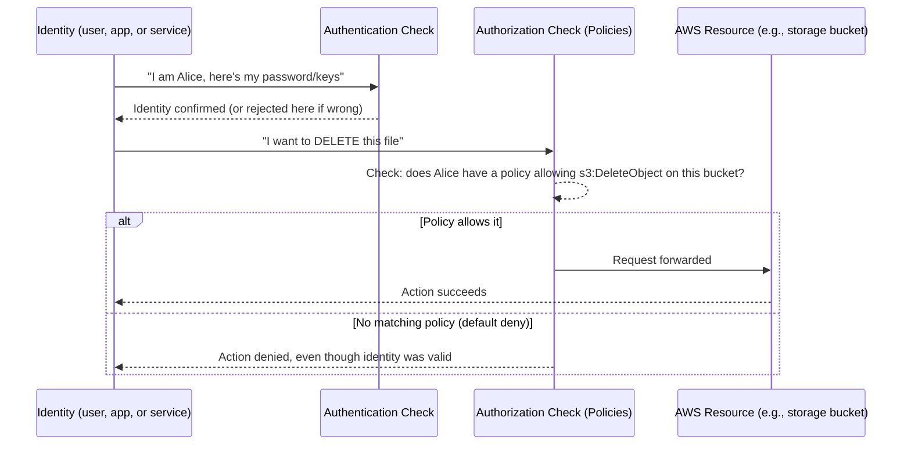

# Identity, Authentication & Authorization — IAM Fundamentals


*Fundamentals · maps to all 3 certs (SAA-C03 Domain 1 & 4, DVA-C03 Domain 4, MLA-C02 Domain 4) ·
this is the beginner on-ramp — the deep technical doc lives at
`services/security-identity-compliance/iam.md`*

## Definition

Before you can even log into a house, three separate questions have to be answered: **who are
you** (identity), **can you prove it** (authentication), and **what are you allowed to do once
you're inside** (authorization). AWS Identity and Access Management (IAM) is the system that
answers all three questions for every single thing that happens in your AWS account.

This doc is the plain-English starting point. Once these three ideas are solid, read
[`services/security-identity-compliance/iam.md`](../services/security-identity-compliance/iam.md)
for the full technical depth (users, roles, policies, policy evaluation logic, etc.).

## Purpose

Imagine an office building with thousands of rooms — some are open lobbies, some hold sensitive
files, some have dangerous machinery. You wouldn't give every employee a master key to every
room. You'd want: (1) a way to know who each person is, (2) a way to check their ID at the door,
and (3) a list, per person, of which rooms they're allowed into. AWS built IAM because an AWS
account is exactly that building, except the "rooms" are things like databases, storage buckets,
and servers, and the "people" include not just humans but also applications, scripts, and other
AWS services acting on your behalf. Without IAM, there's no way to say "this person can read
data but not delete it" or "this application can write to this one storage bucket and nothing
else."

## The three ideas, explained with zero jargon

### 1. Identity — "who are you?"

An identity is simply a named *thing* that can take actions. In the real world, your identity
might be your name plus your employee badge number. In AWS, an identity is one of:

- **A person** — a human being who logs in (e.g., a developer, an administrator).
- **An application** — a piece of software running somewhere (e.g., your website's backend
  server) that needs to talk to AWS services on its own, without a human typing a password.
- **An AWS service itself** — e.g., Amazon EC2 sometimes needs to read a file from storage on
  your behalf; it needs its own identity to be allowed to do that.

Every one of these gets represented in AWS as either an **IAM User** (for a specific, individual
person or app, with long-lived credentials — think of it like a personal employee badge that
doesn't expire) or an **IAM Role** (a temporary identity that anyone or anything can "put on" for
a while and then take off — think of it like a visitor badge you check out at the front desk and
return when you leave the building). Roles are strongly preferred over long-lived user
credentials in nearly every real-world AWS setup, because a temporary badge that expires is much
safer than a permanent key that could be lost or stolen.

### 2. Authentication — "can you prove it?"

Authentication is the "ID check at the door." It's the step where you prove you really are who
you say you are. In everyday life, this is a password, a physical key, a fingerprint, or showing
your ID badge to a security guard. In AWS, authentication happens through things like:

- A **username and password** typed into the AWS Console login screen (for humans).
- A pair of **access keys** (a long, random ID and a long, random secret) that software uses
  instead of a password, the same way a building might issue a numeric keypad code to a delivery
  service instead of a physical badge.
- **Multi-Factor Authentication (MFA)** — an extra proof layer, like a security guard asking not
  just for your badge but also a one-time code from your phone. This is the cloud equivalent of
  "something you know" (password) plus "something you have" (your phone).

The critical point: authentication only answers "are you who you claim to be?" It says **nothing
yet** about what you're allowed to do once you're confirmed. That's the next, separate question.

### 3. Authorization — "what are you allowed to do?"

Authorization is the list of permissions tied to your now-confirmed identity. Back to the office
building analogy: once the guard confirms your badge is real (authentication), the building's
access control system checks a separate list — "does this badge open the server room door?" —
before the door actually unlocks. Proving who you are and being allowed to do something are two
completely different checks, and conflating them is the most common beginner mistake.

In AWS, authorization is expressed as **policies** — documents (written in JSON) that say,
explicitly, "this identity is allowed/denied to perform these specific actions on these specific
resources." No policy granting an action = that action is denied by default. This "deny unless
explicitly allowed" default is one of the most important security properties of the entire AWS
platform.

## How It Works — putting all three together



Walking through it:

- The identity (Alice, or an application, or a service) first goes through **authentication** —
  proving she is who she claims to be. If this fails, nothing else happens; she never gets past
  the door.
- Once authenticated, **every single action** she attempts (read, write, delete, list, etc.) is
  separately checked against **authorization** — her attached policies. Authentication happens
  once per session; authorization is re-checked on literally every API call.
- Notice the "default deny" branch: even a correctly authenticated, real person is **blocked** if
  no policy explicitly grants that specific action. This is why a huge number of real-world AWS
  support tickets are "I logged in fine but got Access Denied" — that's authorization working as
  designed, not a bug.

## Key Features / Components

- **Identity** — IAM Users (long-lived, for specific people/apps) and IAM Roles (temporary,
  assumable by people, apps, or AWS services).
- **Authentication** — passwords, access keys, and MFA; the "prove it" step.
- **Authorization** — policies attached to identities (or resources) that explicitly allow or
  deny specific actions on specific resources; the "what can you do" step.
- **Groups** — a way to bundle multiple IAM Users together and attach one shared set of policies,
  so you manage permissions for a team once instead of per-person (e.g., all "Developers" get the
  same baseline access).
- **Least privilege** — the guiding principle behind all of this: grant the smallest set of
  permissions that still lets someone do their job, nothing more.

## Use Cases — When to Use It

- Any time more than one person touches your AWS account, you need IAM Users (or, better,
  federated identities) instead of everyone sharing one login.
- Any time an application running on EC2, Lambda, or elsewhere needs to talk to another AWS
  service (e.g., a web server reading from a storage bucket), use an IAM Role attached to that
  compute resource instead of hardcoding long-lived access keys into your code.
- Any time you're unsure whether to grant broad or narrow permissions, default to narrow —
  you can always widen access later; narrowing access after a breach is too late.

## When NOT to Use It / Alternatives

- Never use the **AWS account root user** (the very first login created when the account was
  made) for day-to-day work — it has unrestricted power over the entire account and cannot be
  permission-limited. Create an IAM User or role immediately and lock the root user away (MFA +
  rarely used) instead.
- Don't hardcode long-lived access keys into application code or commit them to source control —
  use IAM Roles, which hand out short-lived, automatically-rotating credentials instead.
- For large organizations with an existing corporate identity system (e.g., Active Directory),
  look into **IAM Identity Center** (federated single sign-on) rather than creating hundreds of
  individual IAM Users by hand — covered in the deep IAM doc.

## Why It's Important

- **Real world:** misconfigured identity/authorization is the single largest category of
  real-world cloud security incidents — far more common than AWS infrastructure failures (see
  [`shared-responsibility-model.md`](shared-responsibility-model.md)).
- **Exam:** every one of the three certs leans heavily on IAM. SAA-C03 tests IAM in nearly every
  architecture scenario; DVA-C03 tests it for how applications should authenticate to AWS
  services; MLA-C02 tests it for how ML pipelines and services get scoped, least-privilege access
  to data and models.

## Pricing Model (summary)

IAM itself is **completely free** — there's no charge for creating users, roles, groups, or
policies, no matter how many you have. You only ever pay for the actual AWS resources those
identities use (e.g., the EC2 instance, the storage, the database) — never for the
identity/permission layer itself.

## Hands-on Lab (Floci)

```bash
# Create an IAM user (an identity)
awslocal iam create-user --user-name alice

# Create an access key for that user (authentication material)
awslocal iam create-access-key --user-name alice

# Attach a policy granting a specific, narrow permission (authorization)
awslocal iam attach-user-policy --user-name alice \
  --policy-arn arn:aws:iam::aws:policy/AmazonS3ReadOnlyAccess

# Confirm: alice can now READ from S3 but still cannot delete anything,
# because no policy grants s3:DeleteObject — default deny in action.
```

## Exam Tips

- If a question describes a *person or app proving who they are*, that's **authentication**. If
  it describes *what they're allowed to do once confirmed*, that's **authorization** — these are
  frequently tested as a pair to see if you conflate them.
- "Access Denied" even though login succeeded almost always means a **missing policy**, not a
  broken authentication system — default deny is the expected, secure behavior.
- Whenever a scenario involves an application (not a human) needing AWS access, the textbook
  correct answer is an **IAM Role**, never a long-lived access key embedded in code.
- Root user should basically never appear as the correct answer choice for day-to-day operations
  — it's a huge exam red flag if "use the root account" is the chosen answer.

## Related Terms

[`glossary/README.md`](../glossary/README.md) ·
[`shared-responsibility-model.md`](shared-responsibility-model.md) ·
`services/security-identity-compliance/iam.md` (the full deep-dive: policy JSON structure,
policy evaluation logic, resource-based vs. identity-based policies, permission boundaries,
IAM Identity Center, and more) ·
[`well-architected-framework.md`](well-architected-framework.md)
