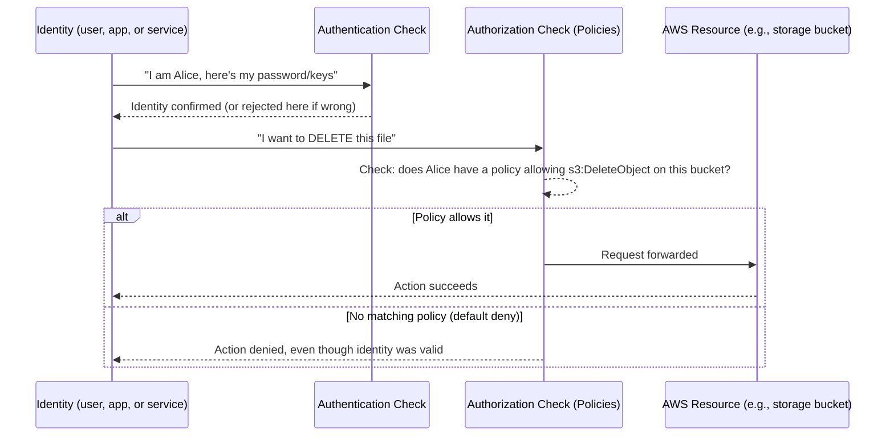
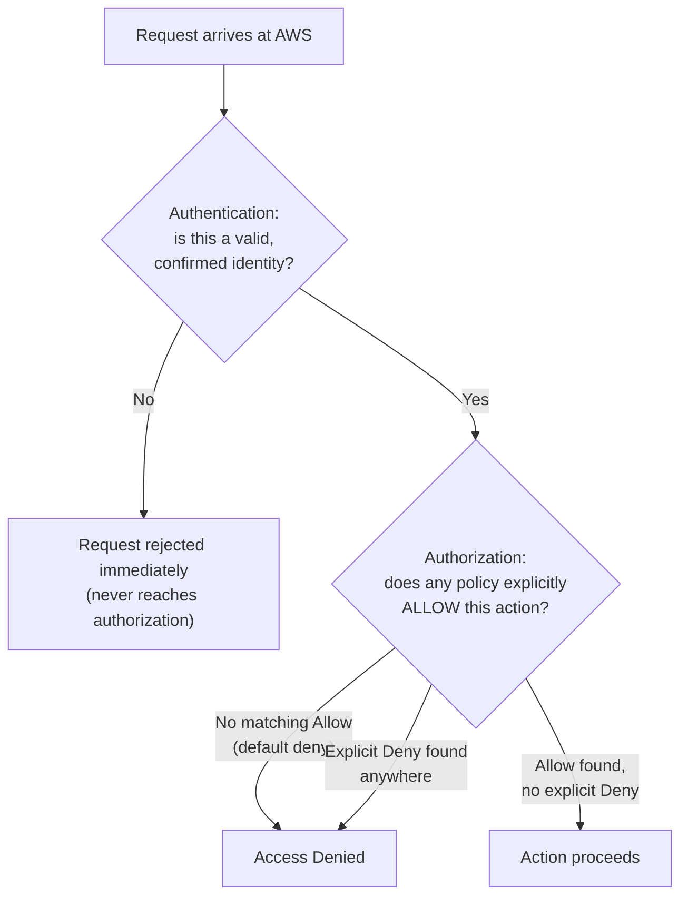
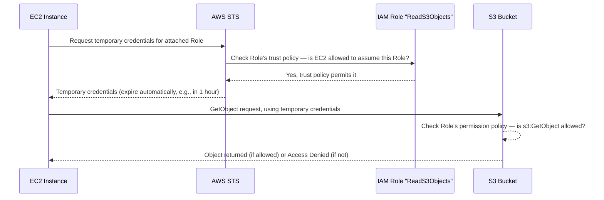
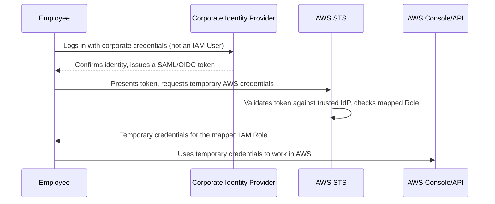
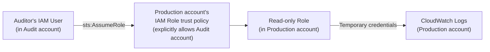

# Identity, Authentication & Authorization — IAM Fundamentals


*Fundamentals · maps to all 3 certs (SAA-C03 Domain 1 & 4, DVA-C03 Domain 4, MLA-C02 Domain 4) ·
this is the beginner on-ramp — the deep technical doc lives at
`services/security-identity-compliance/iam.md`*

## Definition

Before you can even log into a house, three separate questions have to be answered: **who are
you** (identity), **can you prove it** (authentication), and **what are you allowed to do once
you're inside** (authorization). AWS Identity and Access Management (IAM) is the system that
answers all three questions for every single thing that happens in your AWS account.

This doc is the plain-English starting point. Once these three ideas are solid, read
[`services/security-identity-compliance/iam.md`](../services/security-identity-compliance/iam.md)
for the full technical depth (users, roles, policies, policy evaluation logic, etc.).

## Purpose

Imagine an office building with thousands of rooms — some are open lobbies, some hold sensitive
files, some have dangerous machinery. You wouldn't give every employee a master key to every
room. You'd want: (1) a way to know who each person is, (2) a way to check their ID at the door,
and (3) a list, per person, of which rooms they're allowed into. AWS built IAM because an AWS
account is exactly that building, except the "rooms" are things like databases, storage buckets,
and servers, and the "people" include not just humans but also applications, scripts, and other
AWS services acting on your behalf. Without IAM, there's no way to say "this person can read
data but not delete it" or "this application can write to this one storage bucket and nothing
else."

## The three ideas, explained with zero jargon

### 1. Identity — "who are you?"

An identity is simply a named *thing* that can take actions. In the real world, your identity
might be your name plus your employee badge number. In AWS, an identity is one of:

- **A person** — a human being who logs in (e.g., a developer, an administrator).
- **An application** — a piece of software running somewhere (e.g., your website's backend
  server) that needs to talk to AWS services on its own, without a human typing a password.
- **An AWS service itself** — e.g., Amazon EC2 sometimes needs to read a file from storage on
  your behalf; it needs its own identity to be allowed to do that.

Every one of these gets represented in AWS as either an **IAM User** (for a specific, individual
person or app, with long-lived credentials — think of it like a personal employee badge that
doesn't expire) or an **IAM Role** (a temporary identity that anyone or anything can "put on" for
a while and then take off — think of it like a visitor badge you check out at the front desk and
return when you leave the building). Roles are strongly preferred over long-lived user
credentials in nearly every real-world AWS setup, because a temporary badge that expires is much
safer than a permanent key that could be lost or stolen.

### 2. Authentication — "can you prove it?"

Authentication is the "ID check at the door." It's the step where you prove you really are who
you say you are. In everyday life, this is a password, a physical key, a fingerprint, or showing
your ID badge to a security guard. In AWS, authentication happens through things like:

- A **username and password** typed into the AWS Console login screen (for humans).
- A pair of **access keys** (a long, random ID and a long, random secret) that software uses
  instead of a password, the same way a building might issue a numeric keypad code to a delivery
  service instead of a physical badge.
- **Multi-Factor Authentication (MFA)** — an extra proof layer, like a security guard asking not
  just for your badge but also a one-time code from your phone. This is the cloud equivalent of
  "something you know" (password) plus "something you have" (your phone).

The critical point: authentication only answers "are you who you claim to be?" It says **nothing
yet** about what you're allowed to do once you're confirmed. That's the next, separate question.

Here's exactly what that moment looks like in the real AWS Console — notice this screen only ever
asks about *who you are*, never about *what you're allowed to do*:


*Source: AWS IAM User Guide, "Creating access keys for the AWS account root user"
(docs.aws.amazon.com/IAM/latest/UserGuide/access-key-self-managed.html)*

### 3. Authorization — "what are you allowed to do?"

Authorization is the list of permissions tied to your now-confirmed identity. Back to the office
building analogy: once the guard confirms your badge is real (authentication), the building's
access control system checks a separate list — "does this badge open the server room door?" —
before the door actually unlocks. Proving who you are and being allowed to do something are two
completely different checks, and conflating them is the most common beginner mistake.

In AWS, authorization is expressed as **policies** — documents (written in JSON) that say,
explicitly, "this identity is allowed/denied to perform these specific actions on these specific
resources." No policy granting an action = that action is denied by default. This "deny unless
explicitly allowed" default is one of the most important security properties of the entire AWS
platform.

## An Analogy Before Any AWS Terms, Expanded

Picture an airport instead of an office building, because an airport makes the three-step
sequence even more obvious: at check-in, you prove who you are with a passport (**authentication**
— the passport confirms your identity, nothing more). At the gate, the airline checks whether
*this specific person* actually has a ticket for *this specific flight* (**authorization** — a
valid passport does not let you board a flight you didn't buy a ticket for). And notice the gate
agent never re-checks your passport photo against your face *and* separately re-verifies you
bought a ticket in one combined step — they're always two distinct checks, done one after the
other, and failing either one independently stops you. This is exactly how AWS processes every
single API call: authenticate first (who is this?), then authorize separately (is this specific
action, on this specific resource, allowed for this specific identity?).

## How It Works — putting all three together



Walking through it:

- The identity (Alice, or an application, or a service) first goes through **authentication** —
  proving she is who she claims to be. If this fails, nothing else happens; she never gets past
  the door.
- Once authenticated, **every single action** she attempts (read, write, delete, list, etc.) is
  separately checked against **authorization** — her attached policies. Authentication happens
  once per session; authorization is re-checked on literally every API call.
- Notice the "default deny" branch: even a correctly authenticated, real person is **blocked** if
  no policy explicitly grants that specific action. This is why a huge number of real-world AWS
  support tickets are "I logged in fine but got Access Denied" — that's authorization working as
  designed, not a bug.

### The same flow, shown as a decision flowchart



This flowchart makes a subtle but important detail visible: an explicit **Deny** always wins, even
over an explicit **Allow** elsewhere. If one policy says "allow Alice to read this bucket" and a
*different* policy says "deny Alice all S3 access," the deny wins. This single rule — explicit
deny beats everything — is one of the most frequently tested specific facts about IAM across all
three certifications.

### A day in the life of one IAM Role, end to end



This is the mechanism behind "never hardcode access keys in your application" — an EC2 instance
(or Lambda function, or ECS task) is given a **Role**, and AWS's Security Token Service (STS)
automatically hands out short-lived credentials behind the scenes, which are automatically rotated
without any code change on your part. The application code never sees a long-lived secret at all.

## Key Features / Components

- **Identity** — IAM Users (long-lived, for specific people/apps) and IAM Roles (temporary,
  assumable by people, apps, or AWS services).
- **Authentication** — passwords, access keys, and MFA; the "prove it" step.
- **Authorization** — policies attached to identities (or resources) that explicitly allow or
  deny specific actions on specific resources; the "what can you do" step.
- **Groups** — a way to bundle multiple IAM Users together and attach one shared set of policies,
  so you manage permissions for a team once instead of per-person (e.g., all "Developers" get the
  same baseline access).
- **Least privilege** — the guiding principle behind all of this: grant the smallest set of
  permissions that still lets someone do their job, nothing more.
- **AWS Security Token Service (STS)** — the behind-the-scenes service that actually issues the
  short-lived, automatically-expiring credentials every time a Role is assumed; worth knowing by
  name even at the fundamentals level because it's the mechanism, not magic, behind Roles.
- **Permission boundaries** — a more advanced guardrail (covered fully in the deep-dive doc) that
  caps the *maximum* permissions an identity can ever have, even if someone later attaches a more
  permissive policy by mistake.

A simplified preview of that last concept, straight from the official IAM documentation, because
it's a visual idea even a beginner benefits from seeing early:


*Source: AWS IAM User Guide, "Policy evaluation logic"
(docs.aws.amazon.com/IAM/latest/UserGuide/reference_policies_evaluation-logic.html)*

The overlapping-circles idea in that diagram — "effective permission = the *intersection* of two
separate limits, not just the sum of both" — is worth internalizing now, even before you've seen a
single line of policy JSON, because it's the same shape of reasoning IAM uses throughout its
entire permission model.

## Use Cases — When to Use It

- Any time more than one person touches your AWS account, you need IAM Users (or, better,
  federated identities) instead of everyone sharing one login.
- Any time an application running on EC2, Lambda, or elsewhere needs to talk to another AWS
  service (e.g., a web server reading from a storage bucket), use an IAM Role attached to that
  compute resource instead of hardcoding long-lived access keys into your code.
- Any time you're unsure whether to grant broad or narrow permissions, default to narrow —
  you can always widen access later; narrowing access after a breach is too late.
- Any time you need to let a *person* from outside your AWS account (a contractor, an auditor, an
  employee at a partner company) access specific resources temporarily, use a Role they can
  assume, rather than creating them a permanent IAM User in your account.

## When NOT to Use It / Alternatives

- Never use the **AWS account root user** (the very first login created when the account was
  made) for day-to-day work — it has unrestricted power over the entire account and cannot be
  permission-limited. Create an IAM User or role immediately and lock the root user away (MFA +
  rarely used) instead.
- Don't hardcode long-lived access keys into application code or commit them to source control —
  use IAM Roles, which hand out short-lived, automatically-rotating credentials instead.
- For large organizations with an existing corporate identity system (e.g., Active Directory),
  look into **IAM Identity Center** (federated single sign-on) rather than creating hundreds of
  individual IAM Users by hand — covered in the deep IAM doc.
- Don't create one giant, shared IAM User for "the whole dev team to use" — even if it seems
  convenient, it makes it impossible to know *which* person actually performed any given action,
  which destroys your ability to investigate an incident later.

## Common Misconceptions

- **"If I'm logged in, I should be able to do anything in my own account."** Not true even for
  the account owner in some organizational setups, and definitely not true for any identity other
  than the root user — authentication (logging in) and authorization (being allowed to perform a
  specific action) are always separate checks, and a valid login with no matching policy still
  results in Access Denied.
- **"IAM Roles are a type of IAM User, just temporary."** They're conceptually related but
  structurally distinct: a Role has no long-lived credentials at all and is *assumed* (temporarily
  put on) rather than *logged into* directly; a User has persistent credentials tied to one
  specific identity indefinitely.
- **"More permissions are safer because they prevent 'access denied' errors from blocking real
  work."** This is backwards — over-permissioning is the single most common root cause of real
  cloud security incidents (see [`shared-responsibility-model.md`](shared-responsibility-model.md)).
  The correct response to a legitimate Access Denied error is to grant the *specific* missing
  permission, not to grant broad administrative access to make the error disappear.
- **"Groups can have policies attached directly to perform actions, just like Users."** A Group
  itself is not an identity that can authenticate or take actions — it's purely a management
  convenience for attaching the same set of policies to multiple Users at once. You can't "log in
  as a Group" or have a Group "assume" anything.
- **"MFA alone is authorization."** MFA strengthens *authentication* (proving who you are with
  more confidence) — it has no bearing on *what* that now-more-confidently-confirmed identity is
  allowed to do. A beginner occasionally assumes "I enabled MFA, so my account is now properly
  permissioned" — these are two entirely separate security properties.
- **"Federation means AWS trusts my corporate identity provider completely, with no further
  controls."** AWS only ever hands out credentials for the *specific Role* an admin has pre-mapped
  to that external identity — federation changes *how* you authenticate, not *what* you're
  authorized to do once in. The authorization policy on the mapped Role still applies in full.
- **"Assuming a Role in another account means you now have a password for that account."** You
  never receive a password at all — `sts:AssumeRole` only ever returns temporary, auto-expiring
  credentials scoped to exactly the permission policy attached to that Role, which is precisely
  why cross-account access can be revoked instantly by editing a single trust policy.

## Why It's Important

- **Real world:** misconfigured identity/authorization is the single largest category of
  real-world cloud security incidents — far more common than AWS infrastructure failures (see
  [`shared-responsibility-model.md`](shared-responsibility-model.md)).
- **Exam — SAA-C03 style scenario:** "An application running on an EC2 instance needs to write
  log files to an S3 bucket. A developer suggests hardcoding the AWS access key and secret key
  directly into the application's configuration file for simplicity. What is the recommended
  alternative, and why?" → The recommended alternative is an **IAM Role attached to the EC2
  instance**, because it avoids a long-lived, hardcodable secret entirely — AWS automatically
  rotates short-lived credentials behind the scenes via STS, and the credentials are never exposed
  in a file that could be accidentally committed to source control.
- **Exam — DVA-C03 style scenario:** "A developer's application receives an `AccessDenied` error
  when calling `dynamodb:PutItem`, even though the application successfully authenticated using
  valid IAM credentials. What is the most likely cause?" → The most likely cause is that **no
  policy attached to the identity explicitly allows the `dynamodb:PutItem` action** on that table
  — this tests whether a developer correctly distinguishes a successful authentication from a
  missing authorization grant, rather than assuming the credentials themselves are broken.
- **Exam — MLA-C02 style scenario:** "A SageMaker training job needs to read training data from
  one S3 bucket and write model artifacts to a different S3 bucket, and nothing else. What IAM
  construct should be attached to the training job, and what should its policy contain?" → An
  **IAM Role** (specifically, a SageMaker execution role) scoped to exactly `s3:GetObject` on the
  training-data bucket and `s3:PutObject` on the output bucket — nothing broader — directly testing
  least privilege applied to an ML-specific pipeline component.

## Worked Scenario: Onboarding a New Engineering Team Member

A company hires a new backend engineer, Priya, who needs to work on a specific microservice that
reads from one DynamoDB table and writes logs to CloudWatch — nothing else. Walking through the
IAM decisions end to end:

1. **Identity:** The admin creates an **IAM User** for Priya (not a shared team login), because
   she's a specific, individual human who will log into the AWS Console directly.
2. **Authentication:** Priya is required to set a strong password and enable **MFA** before her
   first login completes — a company-wide policy enforced through IAM's password policy settings.
3. **Authorization — least privilege, not "developer access":** Instead of attaching the broad
   `PowerUserAccess` managed policy (tempting, because it "just works" and avoids access-denied
   tickets), the admin writes a narrow custom policy granting only `dynamodb:GetItem`,
   `dynamodb:PutItem`, and `dynamodb:Query` on the one specific table Priya's microservice uses,
   plus `logs:CreateLogStream` and `logs:PutLogEvents` on the one relevant CloudWatch Log Group.
4. **Group membership for maintainability:** Rather than attaching this policy directly to
   Priya's individual User, the admin attaches it to a **Group** called `BackendTeam-ServiceX`,
   and adds Priya to that Group — so when a second engineer joins the same microservice team next
   month, they're added to the Group instead of having the policy re-written from scratch.
5. **What happens when Priya's role changes:** Six months later, Priya moves to a different team
   working on a different service. The admin removes her from `BackendTeam-ServiceX` and adds her
   to the new team's Group — her *old* permissions disappear automatically because they were never
   attached to her personally, only inherited through Group membership.

The lesson: **least privilege and maintainability aren't in tension here** — a few extra minutes
writing a narrow, Group-based policy up front saves far more time later than the alternative
(broad access now, followed by a panicked permissions audit after an incident).

## Users vs. Roles, Side by Side

| | IAM User | IAM Role |
|---|---|---|
| Credentials | Long-lived (password and/or access keys) | Temporary, auto-expiring (issued by STS) |
| Who/what it represents | One specific person or app, permanently | Anyone/anything that's allowed to "assume" it |
| Typical lifetime | Until manually deleted | Minutes to hours per assumption, re-issued as needed |
| Best used for | Rare cases: individual humans needing persistent console access | Applications, cross-account access, federated humans, AWS services acting on your behalf |
| Security best practice | Enable MFA, rotate access keys regularly if any exist | Prefer over Users whenever possible — nothing to leak long-term |

A simple rule of thumb that covers the overwhelming majority of real-world AWS Role usage: **if a
computer is the one authenticating (an EC2 instance, a Lambda function, another AWS account, a
CI/CD pipeline), it should be a Role. If a human is the one typing a password into a browser, a
User (or better, a federated identity) is appropriate — but even then, that human's day-to-day
work should mostly happen through Roles they assume, not permissions attached directly to their
User.**

## Federated Identity: A Preview of "Logging In Without an IAM User"

Many organizations don't actually create an IAM User for every employee at all. Instead, they use
**federation** — letting employees log in with credentials they already have (their corporate
Active Directory account, or a third-party identity provider) and mapping that external identity
to a temporary IAM Role on the fly:



Notice the employee never has an AWS password at all — authentication happens entirely against
the *corporate* identity provider, and AWS only ever hands out a temporary Role's credentials
after confirming that external token. This is exactly the mechanism **IAM Identity Center** (the
modern, AWS-native implementation of this pattern) and **Amazon Cognito** (more commonly used for
customer-facing apps rather than employee access) are built around — both are covered in full
depth in `services/security-identity-compliance/iam-identity-center-sso.md` and
`services/security-identity-compliance/cognito.md`, but the underlying three-step idea (authenticate
elsewhere → get a token → exchange it for temporary AWS credentials) is exactly the same pattern
as the EC2-Role sequence diagram shown earlier in this document, just with a human and an external
identity provider standing in for the EC2 instance.

## Worked Scenario Two: Cross-Account Access Without Sharing Credentials

A company has two AWS accounts: `Production` and `Audit`. A security auditor in the `Audit`
account needs to inspect (read-only) specific logs stored in the `Production` account, without
ever being given a password or access key that exists inside `Production` itself.



The `Production` account creates a Role with a **trust policy** that explicitly names the `Audit`
account as allowed to assume it, and a **permission policy** scoped to only `logs:GetLogEvents`
and `logs:DescribeLogStreams` — nothing else. The auditor's existing IAM User in the `Audit`
account calls `sts:AssumeRole`, receives temporary credentials scoped to exactly those two
actions, and never at any point holds a password or long-lived key that belongs to the
`Production` account. If the auditor's assignment ends, revoking access is a single trust-policy
edit in `Production` — nothing to rotate or delete inside `Audit` at all.

## Pricing Model (summary)

IAM itself is **completely free** — there's no charge for creating users, roles, groups, or
policies, no matter how many you have. You only ever pay for the actual AWS resources those
identities use (e.g., the EC2 instance, the storage, the database) — never for the
identity/permission layer itself.

## Hands-on Lab (Floci)

```bash
# Create an IAM user (an identity)
awslocal iam create-user --user-name alice

# Create an access key for that user (authentication material)
awslocal iam create-access-key --user-name alice

# Attach a policy granting a specific, narrow permission (authorization)
awslocal iam attach-user-policy --user-name alice \
  --policy-arn arn:aws:iam::aws:policy/AmazonS3ReadOnlyAccess

# Confirm: alice can now READ from S3 but still cannot delete anything,
# because no policy grants s3:DeleteObject — default deny in action.
```

**Extended exercise — simulate the Group-based onboarding workflow from the worked scenario:**

```bash
# Create a Group representing one team's shared permission set
awslocal iam create-group --group-name BackendTeam-ServiceX

# Attach a narrow, purpose-specific policy to the Group, not to any individual User
cat > servicex-policy.json << 'EOF'
{
  "Version": "2012-10-17",
  "Statement": [
    {"Effect": "Allow", "Action": ["dynamodb:GetItem", "dynamodb:PutItem", "dynamodb:Query"],
     "Resource": "arn:aws:dynamodb:us-east-1:000000000000:table/ServiceXTable"}
  ]
}
EOF
awslocal iam put-group-policy --group-name BackendTeam-ServiceX \
  --policy-name ServiceXAccess --policy-document file://servicex-policy.json

# Add the new engineer to the Group — she inherits the policy automatically
awslocal iam create-user --user-name priya
awslocal iam add-user-to-group --user-name priya --group-name BackendTeam-ServiceX
```

## Exam Tips

- If a question describes a *person or app proving who they are*, that's **authentication**. If
  it describes *what they're allowed to do once confirmed*, that's **authorization** — these are
  frequently tested as a pair to see if you conflate them.
- "Access Denied" even though login succeeded almost always means a **missing policy**, not a
  broken authentication system — default deny is the expected, secure behavior.
- Whenever a scenario involves an application (not a human) needing AWS access, the textbook
  correct answer is an **IAM Role**, never a long-lived access key embedded in code.
- Root user should basically never appear as the correct answer choice for day-to-day operations
  — it's a huge exam red flag if "use the root account" is the chosen answer.
- Remember: **an explicit Deny always overrides an explicit Allow**, no matter where either one is
  defined — this single rule is tested directly and repeatedly across all three certs.
- Groups are a *management convenience* for attaching policies to many Users at once — a Group
  itself can never be "logged into" or "assumed"; don't let an exam answer imply otherwise.
- Know **STS (Security Token Service)** by name as the mechanism issuing temporary credentials
  whenever a Role is assumed — a question describing "temporary, automatically-expiring
  credentials" is pointing at STS-issued Role credentials, not a User's long-lived access key.
- A question describing "an employee logs in with their existing corporate credentials" is
  pointing at **federation** (via IAM Identity Center or a third-party SAML/OIDC provider), not
  at creating that employee a brand-new IAM User.
- A question describing "an auditor in one AWS account needs temporary, read-only access to
  resources in another AWS account" is pointing at **cross-account Role assumption**
  (`sts:AssumeRole` with a trust policy naming the other account) — never at sharing an IAM User's
  credentials between accounts, which should never appear as a correct answer choice.

## Further Reading

- AWS IAM User Guide (official hub): https://docs.aws.amazon.com/IAM/latest/UserGuide/introduction.html
- How IAM users sign in to AWS:
  https://docs.aws.amazon.com/IAM/latest/UserGuide/id_users_sign-in.html
- AWS Multi-factor authentication in IAM:
  https://docs.aws.amazon.com/IAM/latest/UserGuide/id_credentials_mfa.html
- Policy evaluation logic (the deep technical reference behind the sequence diagrams above):
  https://docs.aws.amazon.com/IAM/latest/UserGuide/reference_policies_evaluation-logic.html
- Security best practices in IAM:
  https://docs.aws.amazon.com/IAM/latest/UserGuide/best-practices.html

## Related Terms

[`glossary/README.md`](../glossary/README.md) ·
[`shared-responsibility-model.md`](shared-responsibility-model.md) ·
`services/security-identity-compliance/iam.md` (the full deep-dive: policy JSON structure,
policy evaluation logic, resource-based vs. identity-based policies, permission boundaries,
IAM Identity Center, and more) ·
[`well-architected-framework.md`](well-architected-framework.md)
