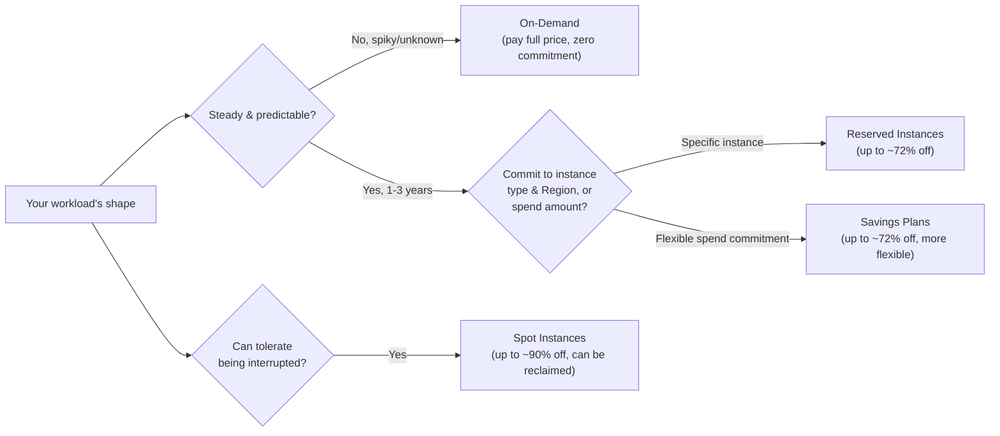

# Pricing & Billing Fundamentals


*Fundamentals · maps to all 3 certs (SAA-C03 Domain 1 & 4, DVA-C03 Domain 4, MLA-C02 Domain 4)*

## Definition

AWS pricing is **pay-for-what-you-use**, billed in small, metered increments (per second, per
request, per GB), instead of paying a fixed amount upfront for hardware you may or may not fully
use. On top of that base model, AWS offers several **purchasing options** — On-Demand, Reserved,
Spot, and Savings Plans — that trade flexibility for discounts, plus tools (Cost Explorer,
Budgets) to see and control what you're actually spending.

## Purpose

Before cloud computing, buying compute capacity meant buying physical servers months in advance,
guessing how much you'd need, and eating the cost whether you used them or not. AWS built a
metered, consumption-based billing model specifically to remove that guesswork — you provision
what you need right now, and release it the moment you don't, paying only for the time/volume you
actually consumed. But a pure pay-as-you-go model isn't always the cheapest option for *steady,
predictable* workloads — so AWS layered discount programs (Reserved Instances, Savings Plans) on
top for customers willing to commit, and a deep-discount spot market (Spot Instances) for
customers who can tolerate interruption, so nearly every workload shape has a pricing model that
fits it.

## How It Works

Think of renting a car. **On-Demand** is like walking into a rental counter and paying the full
daily rate with zero commitment — maximum flexibility, highest price. **Reserved** is like
signing a 1-year lease on a car — you commit upfront and get a much lower monthly rate, but you're
locked in. **Spot** is like a car-sharing app that lets you borrow a car for very cheap, but the
owner can reclaim it with short notice if they need it back. **Savings Plans** are like
committing to spend a certain dollar amount per month on "transportation in general" and getting
a discount on whatever rides you take, rather than committing to one specific car.



Walking through it:

- The first fork is about **predictability**: if you genuinely don't know how much capacity
  you'll need, or it changes constantly, On-Demand's flexibility is worth paying full price for.
- If your usage is steady (e.g., a database running 24/7 for the next two years), committing
  upfront via **Reserved Instances** or **Savings Plans** unlocks a large discount, because AWS
  can plan its own capacity around your guaranteed usage.
- The second fork is about **interruption tolerance**: if your workload can pause and resume
  without breaking anything (e.g., batch data processing, rendering jobs), **Spot Instances**
  offer the deepest discount by using AWS's spare, otherwise-idle capacity — in exchange, AWS can
  take that capacity back with roughly a two-minute warning if another customer needs it at
  full price.

## Key Features / Components

- **On-Demand** — pay the published rate, per second/hour, with no upfront commitment and no
  discount. Maximum flexibility; use for unpredictable or short-lived workloads, or when just
  starting out.
- **Reserved Instances (RIs)** — commit to a specific instance type/Region for a 1 or 3-year
  term, in exchange for up to ~72% off the On-Demand rate. Less flexible: tied to a specific
  instance family unless you use Convertible RIs.
- **Savings Plans** — commit to a specific **dollar amount per hour** of usage (not a specific
  instance type) for 1 or 3 years, in exchange for similar discounts to RIs but with far more
  flexibility to change instance types, sizes, or even shift between EC2/Lambda/Fargate under
  Compute Savings Plans.
- **Spot Instances** — bid for AWS's unused spare capacity at up to ~90% off On-Demand, with the
  trade-off that AWS can reclaim the instance with about a 2-minute warning if it's needed
  elsewhere. Best for fault-tolerant, interruptible workloads.
- **AWS Free Tier** — a set of services usable at no cost up to certain limits, for up to 12
  months after account creation (for some services) or indefinitely for others (e.g., a
  perpetual free tier for low-volume Lambda invocations). Designed so newcomers can learn and
  prototype without risking a bill.
- **Cost Explorer** — a visual tool to see where your money is going: filter and group historical
  spend by service, Region, tag, or time period, and forecast future spend based on trends.
- **AWS Budgets** — proactive alerting: set a dollar (or usage) threshold and get notified by
  email/SNS when you're approaching or exceeding it, before the bill arrives as a surprise.

## How AWS bills you, in general

- **Granular, metered usage** — most services bill per-second or per-request, not per fixed
  monthly block, so stopping a resource stops the meter (with some exceptions — storage usually
  keeps billing even when compute is off, since the data still sits somewhere).
- **No charge for most control-plane actions** — creating an IAM user, writing a policy, or
  setting up a VPC configuration is free; you pay for the underlying compute, storage, and
  network resources that configuration provisions or moves.
- **Data transfer OUT costs money; data transfer IN is usually free** — moving data from AWS to
  the internet (or to another Region) is billed per GB; uploading data into AWS is generally
  free. This asymmetry surprises a lot of newcomers.
- **One consolidated monthly bill** — even if you use dozens of services across multiple
  Regions, AWS combines it into a single monthly invoice, broken down by service and usage type
  in Cost Explorer.
- **Taxes and support plans are added on top** — the raw usage total isn't necessarily your final
  invoice amount.

## Use Cases — When to Use It

- **On-Demand:** a brand-new project, unpredictable traffic, or short-term experiments — anything
  where you don't yet know the usage pattern.
- **Reserved Instances / Savings Plans:** a production database or application server you know
  will run continuously for the next 1-3 years.
- **Spot Instances:** big data processing jobs, CI/CD build fleets, rendering, or any
  horizontally-scaled batch workload that can checkpoint and resume if interrupted.
- **Free Tier:** learning AWS, building a portfolio project, or prototyping before committing
  real budget.

## When NOT to Use It / Alternatives

- Don't use Reserved Instances/Savings Plans for workloads you're not confident will run that
  long — the discount isn't worth it if you end up paying for unused committed capacity.
- Don't use Spot Instances for anything stateful and interruption-sensitive (e.g., a primary
  database) — the instance can disappear with little warning.
- Don't rely on Free Tier limits for production traffic — they're sized for learning/prototyping,
  not real user load, and you'll exceed them (and start getting billed) quickly under real usage.

## Why It's Important

- **Real world:** unexpected AWS bills are one of the most common complaints from new cloud
  users — usually caused by forgetting to turn off a resource, leaving data transfer
  uncontrolled, or not understanding that storage keeps billing even when compute is stopped.
  Budgets and Cost Explorer exist specifically to prevent that surprise.
- **Exam:** cost-optimization questions appear across all three certs, usually framed as "which
  purchasing option minimizes cost for this workload pattern" — correctly matching workload shape
  (steady vs. spiky vs. interruptible) to purchasing option (Reserved/Savings Plan vs. On-Demand
  vs. Spot) is directly tested.

## Pricing Model (summary)

This doc *is* the pricing model overview. For exact, current numbers (which change frequently
and vary by Region/instance type), always check the official AWS Pricing pages and the
**AWS Pricing Calculator** (https://calculator.aws/) rather than memorizing specific dollar
figures — the exam tests the *concepts and trade-offs*, not exact prices.

## Hands-on Lab (Floci)

Floci doesn't simulate real billing (it's a free local emulator with no actual charges), but you
can practice the commands you'd use against the real AWS Cost Explorer/Budgets APIs:

```bash
# Set a monthly budget alert (structure only — Floci won't actually charge you)
awslocal budgets create-budget --account-id 000000000000 --budget file://budget.json

# Query cost and usage data (against real AWS, this reads actual billing data)
aws ce get-cost-and-usage \
  --time-period Start=2026-01-01,End=2026-02-01 \
  --granularity MONTHLY \
  --metrics "UnblendedCost"
```

## Exam Tips

- "Steady-state, predictable, long-running workload, want to save money" → **Reserved
  Instances** or **Savings Plans** (Savings Plans if flexibility across instance families/compute
  types is mentioned).
- "Fault-tolerant, flexible timing, batch processing, want the cheapest option" → **Spot
  Instances**.
- "Unpredictable or brand-new workload, just starting out" → **On-Demand**.
- "Need to be alerted before overspending" → **AWS Budgets**. "Need to analyze/visualize past
  spend" → **Cost Explorer**. Don't swap these two — Budgets is forward-looking/alerting,
  Cost Explorer is backward-looking/analysis.
- Free Tier limits and expiration (12 months for some offers vs. indefinite for others) are
  occasionally tested directly — know that it's not a blanket "everything free forever."

## Related Terms

[`glossary/README.md`](../glossary/README.md) ·
[`well-architected-framework.md`](well-architected-framework.md) (Cost Optimization pillar) ·
`services/cloud-financial-management/` · [`shared-responsibility-model.md`](shared-responsibility-model.md)
