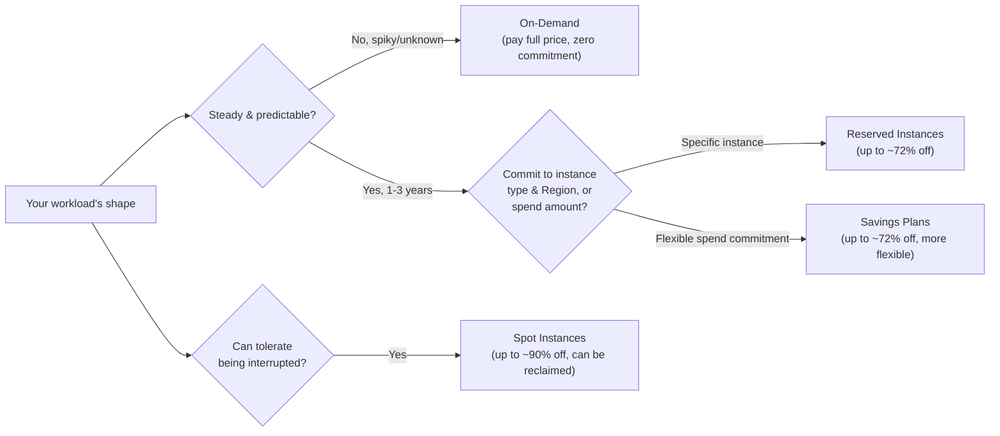
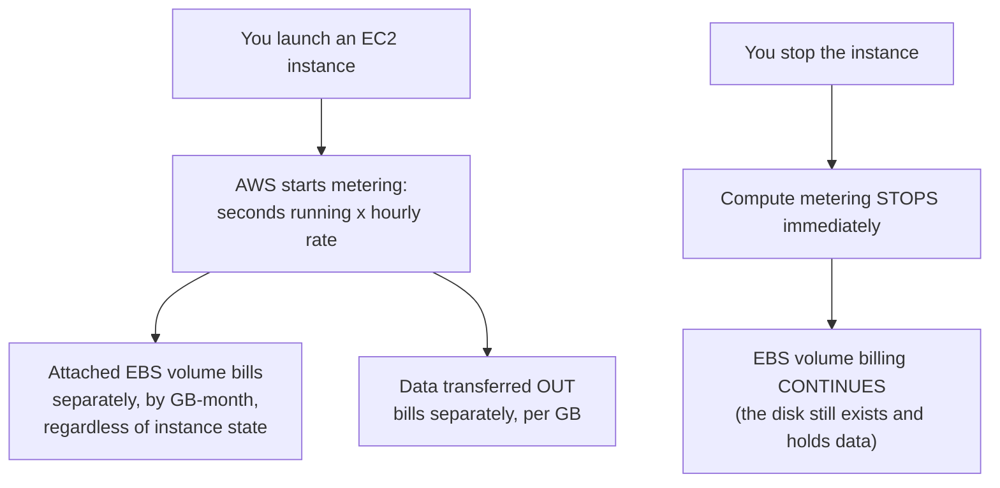
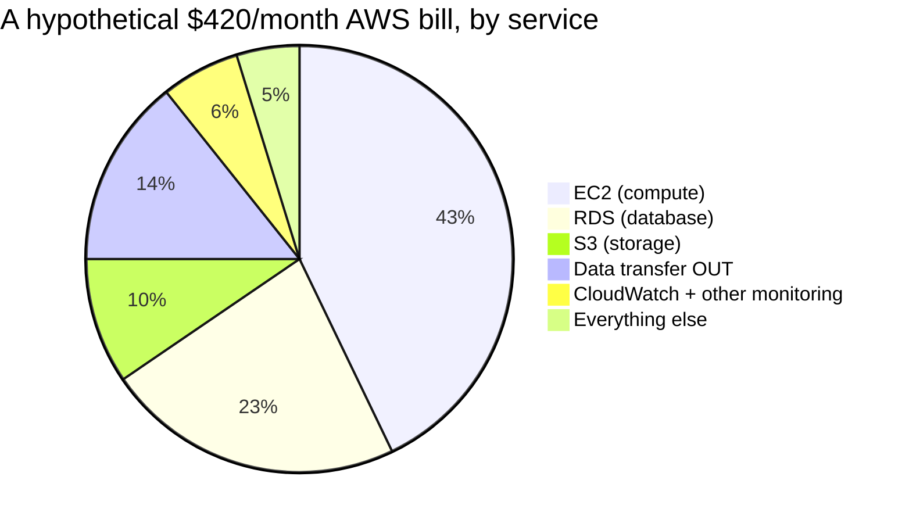
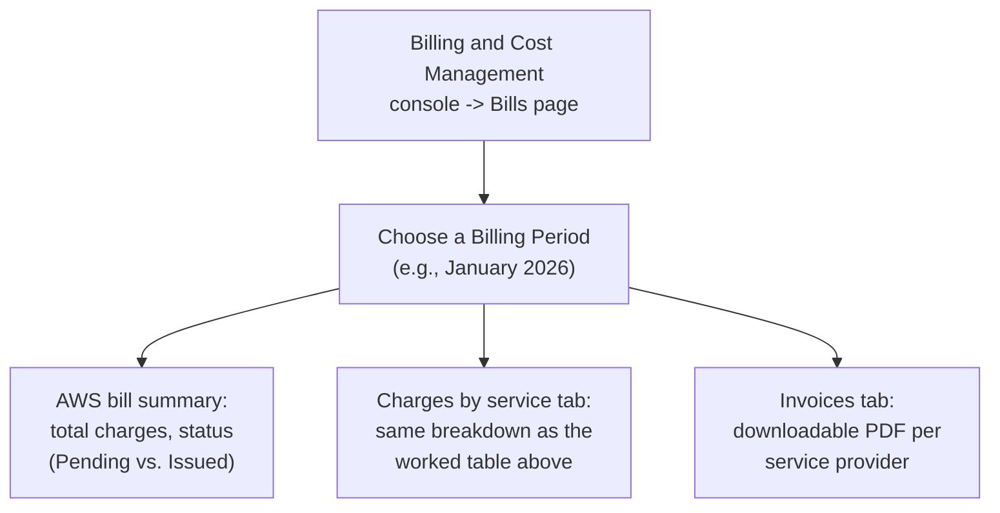

# Pricing & Billing Fundamentals


*Fundamentals · maps to all 3 certs (SAA-C03 Domain 1 & 4, DVA-C03 Domain 4, MLA-C02 Domain 4)*

## Definition

AWS pricing is **pay-for-what-you-use**, billed in small, metered increments (per second, per
request, per GB), instead of paying a fixed amount upfront for hardware you may or may not fully
use. On top of that base model, AWS offers several **purchasing options** — On-Demand, Reserved,
Spot, and Savings Plans — that trade flexibility for discounts, plus tools (Cost Explorer,
Budgets) to see and control what you're actually spending.

## Purpose

Before cloud computing, buying compute capacity meant buying physical servers months in advance,
guessing how much you'd need, and eating the cost whether you used them or not. AWS built a
metered, consumption-based billing model specifically to remove that guesswork — you provision
what you need right now, and release it the moment you don't, paying only for the time/volume you
actually consumed. But a pure pay-as-you-go model isn't always the cheapest option for *steady,
predictable* workloads — so AWS layered discount programs (Reserved Instances, Savings Plans) on
top for customers willing to commit, and a deep-discount spot market (Spot Instances) for
customers who can tolerate interruption, so nearly every workload shape has a pricing model that
fits it.

## An Analogy Before Any AWS Terms

Think of renting a car. **On-Demand** is like walking into a rental counter and paying the full
daily rate with zero commitment — maximum flexibility, highest price. **Reserved** is like
signing a 1-year lease on a car — you commit upfront and get a much lower monthly rate, but you're
locked in. **Spot** is like a car-sharing app that lets you borrow a car for very cheap, but the
owner can reclaim it with short notice if they need it back. **Savings Plans** are like
committing to spend a certain dollar amount per month on "transportation in general" and getting
a discount on whatever rides you take, rather than committing to one specific car.

Push the analogy further, because the billing *structure* itself also has a real-world parallel:
think of your monthly electricity bill. You don't pay a flat fee regardless of usage, and you
don't get a single undifferentiated number either — your bill is itemized by meter reading
(kilowatt-hours used), time-of-day rate tiers, and any fixed service charges, all rolled into one
invoice at the end of the month. AWS's bill works the same way: dozens of individually metered
usage line items (EC2 instance-hours, S3 GB-months, data transferred out, API requests made) are
all tracked independently throughout the month and combined into one consolidated invoice — the
skill of "reading an AWS bill" is really the skill of knowing which meter is actually running for
each service you use.

## How It Works



Walking through it:

- The first fork is about **predictability**: if you genuinely don't know how much capacity
  you'll need, or it changes constantly, On-Demand's flexibility is worth paying full price for.
- If your usage is steady (e.g., a database running 24/7 for the next two years), committing
  upfront via **Reserved Instances** or **Savings Plans** unlocks a large discount, because AWS
  can plan its own capacity around your guaranteed usage.
- The second fork is about **interruption tolerance**: if your workload can pause and resume
  without breaking anything (e.g., batch data processing, rendering jobs), **Spot Instances**
  offer the deepest discount by using AWS's spare, otherwise-idle capacity — in exchange, AWS can
  take that capacity back with roughly a two-minute warning if another customer needs it at
  full price.

### How a single resource's bill is actually calculated, start to finish



This is the single most common beginner surprise in real AWS bills: **stopping an EC2 instance
stops the compute charge, but does not stop the storage charge for its attached EBS volume.** The
volume still exists, still holds your data, and AWS still has to keep it durable and available —
so it keeps billing by GB-month regardless of whether the instance using it is running. Only
*terminating* the instance (and separately deleting the volume, if it isn't set to auto-delete)
fully stops all associated charges.

### Visualizing where a typical small-business monthly bill actually goes



Notice **data transfer OUT** is a meaningfully large slice here, not a rounding error — it's one
of the most commonly underestimated line items precisely because, unlike compute or storage,
there's no single console page titled "your data transfer usage" that most beginners think to
check before they're surprised by the invoice.

## A Full Worked Example: Walking Through One Real AWS Bill

Let's build a complete, itemized example bill for a small startup running a simple web
application for one month, and understand *exactly* why each line item has the value it does.

**The setup:** one `t3.medium` EC2 instance running 24/7 all month, one attached 50 GB EBS volume,
one `db.t3.small` RDS MySQL database running 24/7, one S3 bucket holding 200 GB of user-uploaded
images, and 150 GB of data transferred out to the internet over the month (users downloading those
images).

| Line item | How it's metered | Illustrative monthly total* |
|---|---|---|
| EC2 `t3.medium`, On-Demand, 730 hours | Billed per second, rate x hours running | **~$30.37** |
| EBS gp3 volume, 50 GB, all month | Billed per GB-month, regardless of instance state | **~$4.00** |
| RDS `db.t3.small` MySQL, 730 hours | Billed per hour, includes engine licensing where applicable | **~$24.82** |
| RDS storage, 20 GB gp3 | Billed per GB-month, separately from the compute hours above | **~$2.30** |
| S3 Standard storage, 200 GB | Billed per GB-month | **~$4.60** |
| S3 PUT/GET requests, ~500k/month | Billed per 1,000 requests | **~$2.00** |
| Data transfer OUT to internet, 150 GB | First 100 GB/month often free tier or low-cost; remainder billed per GB | **~$9.00** (for the portion beyond any free allowance) |
| CloudWatch (basic monitoring + a few custom metrics) | Billed per metric/alarm/dashboard beyond free tier | **~$3.00** |
| **Total before tax** | | **~$80.09** |

*(Illustrative figures only, to demonstrate the *shape* of a bill — always check the AWS Pricing
Calculator for exact, current, Region-specific numbers; this table is for building intuition about
which meters exist, not for memorizing dollar amounts.)*

Walking through the lessons this single bill teaches:

1. **Compute and its attached storage are two separate meters.** The EC2 instance-hours and the
   EBS volume's GB-months appear as two distinct line items, because they're billed completely
   independently — stopping the instance overnight to save money would zero out the ~$30 compute
   line while the ~$4 storage line kept running regardless.
2. **A "database" bill is actually at least two meters, too** — compute (the `db.t3.small`
   instance hours) and storage (the GB of data held), exactly mirroring the EC2 + EBS split, which
   is why `compute-storage-network-database-primer.md` teaches these as fundamentally separate
   categories even when one AWS service (RDS) bundles them into a single product name.
3. **S3 isn't "just storage" on the bill either** — it has *two* separate meters of its own:
   GB-months stored, and the *number of requests* made against it. A bucket with very little data
   but an extremely high request rate (e.g., a busy API backend using S3 as a cache) can cost more
   in requests than in storage.
4. **Data transfer OUT is real money, every single month, at scale** — and it's the one line item
   newcomers most often forget exists until they see it on an invoice, because there's no single
   "data transfer service" with its own dedicated console dashboard the way EC2 or S3 have.
5. **Nothing in this bill involved a Reserved Instance or Savings Plan** — this is a pure
   On-Demand bill. If this exact workload is expected to run steadily for the next year, switching
   the EC2 and RDS line items to a 1-year Savings Plan could realistically cut those two line
   items by roughly a third to over half, without changing anything else about the architecture —
   which is exactly the kind of decision Cost Explorer's recommendations surface automatically
   once you have a month or two of usage history to analyze.

### What the real AWS Cost Explorer actually looks like, reading this kind of bill back


*Source: Amazon CloudWatch User Guide, "Analyzing, optimizing, and reducing CloudWatch costs"
(docs.aws.amazon.com/AmazonCloudWatch/latest/monitoring/cloudwatch_billing.md)*

This is precisely the tool you'd open to go from "my bill was $420 this month" to "and here's
*exactly* which of the line items in the worked table above grew compared to last month" — Cost
Explorer lets you filter and group by service, Region, usage type, or tag, turning one opaque
total into the same kind of itemized breakdown built by hand above.

### Tracking Free Tier usage before it quietly turns into a real charge


*Source: Amazon EC2 User Guide, "Track your Free Tier usage for Amazon EC2"
(docs.aws.amazon.com/AWSEC2/latest/UserGuide/ec2-free-tier-usage.md)*

Notice this widget explicitly warns about two different risk states: **"End of month forecast"**
(you're on track to exceed Free Tier if current usage continues) and **"Exceeds Free Tier"** (you
already have). A beginner's very first AWS bill surprise is almost always one of these two
warnings going unnoticed for a few weeks — checking this dashboard periodically during your first
few months on AWS is one of the highest-value five-minute habits you can build.

### Reading the real AWS Bills page, after the fact

Once a billing period closes, the actual place to see an issued invoice (not just Cost
Explorer's forecasted estimate) is the **Bills** page in the Billing and Cost Management console.
It presents the exact same kind of breakdown built by hand in the worked table above, but as a
real, downloadable invoice:



Notice the **Pending vs. Issued** distinction: a billing period that hasn't closed yet shows
*estimated* charges based on metering so far — exactly like Cost Explorer's forecast — while a
closed, **Issued** period is the final, immutable invoice. A beginner confusion worth heading off
early: checking the Bills page mid-month and seeing a lower total than expected doesn't mean
you're being undercharged — it usually just means the month isn't over yet.

### Purchasing options compared side by side, with illustrative numbers

Using a single `m5.large` EC2 instance running 24/7 for a year as a concrete reference point
(illustrative figures only — always confirm current rates with the Pricing Calculator):

| Purchasing option | Commitment | Illustrative annual cost (24/7 for 1 year) | Best fit |
|---|---|---|---|
| On-Demand | None | ~$840/year | Unpredictable or brand-new workloads |
| Reserved Instance (1-year, No Upfront) | 1 year, specific instance family | ~$530/year (~37% off) | Steady workload, instance type already known |
| Compute Savings Plan (1-year) | 1 year, dollar-per-hour commitment | ~$500/year (~40% off), flexible across instance types/Lambda/Fargate | Steady workload, but instance type may change |
| Spot Instance | None, but interruptible | ~$250/year (~70% off), highly variable | Fault-tolerant batch/rendering workloads |

The pattern worth internalizing from this table, beyond the specific numbers: **flexibility and
discount size trade off against each other in a predictable order** — On-Demand (most flexible,
least discount) → Savings Plans (flexible across instance types, strong discount) → Reserved
Instances (locked to an instance family, similar discount to Savings Plans) → Spot (least
guaranteed, deepest discount). Recognizing this ordering, rather than memorizing exact percentages,
is what the exam actually rewards.

## Key Features / Components

- **On-Demand** — pay the published rate, per second/hour, with no upfront commitment and no
  discount. Maximum flexibility; use for unpredictable or short-lived workloads, or when just
  starting out.
- **Reserved Instances (RIs)** — commit to a specific instance type/Region for a 1 or 3-year
  term, in exchange for up to ~72% off the On-Demand rate. Less flexible: tied to a specific
  instance family unless you use Convertible RIs.
- **Savings Plans** — commit to a specific **dollar amount per hour** of usage (not a specific
  instance type) for 1 or 3 years, in exchange for similar discounts to RIs but with far more
  flexibility to change instance types, sizes, or even shift between EC2/Lambda/Fargate under
  Compute Savings Plans.
- **Spot Instances** — bid for AWS's unused spare capacity at up to ~90% off On-Demand, with the
  trade-off that AWS can reclaim the instance with about a 2-minute warning if it's needed
  elsewhere. Best for fault-tolerant, interruptible workloads.
- **AWS Free Tier** — a set of services usable at no cost up to certain limits, for up to 12
  months after account creation (for some services) or indefinitely for others (e.g., a
  perpetual free tier for low-volume Lambda invocations). Designed so newcomers can learn and
  prototype without risking a bill.
- **Cost Explorer** — a visual tool to see where your money is going: filter and group historical
  spend by service, Region, tag, or time period, and forecast future spend based on trends.
- **AWS Budgets** — proactive alerting: set a dollar (or usage) threshold and get notified by
  email/SNS when you're approaching or exceeding it, before the bill arrives as a surprise.
- **AWS Pricing Calculator** — a standalone tool (calculator.aws) for estimating costs *before* you
  build anything, by describing a hypothetical architecture and letting AWS compute the expected
  monthly cost — the correct first stop before committing to an architecture, not after.
- **Cost allocation tags** — labels (key/value pairs) attached to resources specifically so Cost
  Explorer can group spend by project, team, or environment, turning one undifferentiated total
  bill into an attributable breakdown.

## How AWS bills you, in general

- **Granular, metered usage** — most services bill per-second or per-request, not per fixed
  monthly block, so stopping a resource stops the meter (with some exceptions — storage usually
  keeps billing even when compute is off, since the data still sits somewhere, exactly as shown
  in the worked example above).
- **No charge for most control-plane actions** — creating an IAM user, writing a policy, or
  setting up a VPC configuration is free; you pay for the underlying compute, storage, and
  network resources that configuration provisions or moves.
- **Data transfer OUT costs money; data transfer IN is usually free** — moving data from AWS to
  the internet (or to another Region) is billed per GB; uploading data into AWS is generally
  free. This asymmetry surprises a lot of newcomers.
- **One consolidated monthly bill** — even if you use dozens of services across multiple
  Regions, AWS combines it into a single monthly invoice, broken down by service and usage type
  in Cost Explorer.
- **Taxes and support plans are added on top** — the raw usage total isn't necessarily your final
  invoice amount.

## A Second Worked Example: Diagnosing an Unexpected Bill Spike

A month after the bill walkthrough above, the same startup's invoice unexpectedly jumps from
~$80 to ~$310. Walking through the investigation using Cost Explorer, exactly as a real engineer
would:

1. **Group by service first.** The breakdown shows EC2 and RDS roughly unchanged, but **S3**
   jumped from ~$6.60 total to **~$140**. The investigation immediately narrows to one service.
2. **Group by usage type within S3.** This reveals the increase is almost entirely in
   **requests**, not storage GB-months — storage only grew from 200 GB to 215 GB (barely moved),
   but request count exploded from ~500k to ~40 million for the month.
3. **Correlate with a recent deploy.** The team recalls shipping a bug three weeks earlier that
   caused a background job to re-check (via repeated `HeadObject` calls) every image in the bucket
   once per minute instead of once per hour — a 60x increase in request volume that storage
   metrics alone never would have revealed, because the actual *data* barely changed at all.
4. **Fix and verify.** After deploying a fix and waiting a few days, the team re-runs the same
   Cost Explorer grouped query and confirms the S3 request-count line item has returned to its
   previous baseline before considering the incident closed.

The lesson: **a spike in total spend without first grouping by usage type is nearly unreadable** —
this exact workflow (service → usage type → correlate with a recent change) is the real-world
version of several "the bill is larger than expected, what is the FIRST step to investigate"
style exam questions, and the answer is consistently "use Cost Explorer to drill down by
dimension," never "contact AWS support" as a first step.

## Use Cases — When to Use It

- **On-Demand:** a brand-new project, unpredictable traffic, or short-term experiments — anything
  where you don't yet know the usage pattern.
- **Reserved Instances / Savings Plans:** a production database or application server you know
  will run continuously for the next 1-3 years.
- **Spot Instances:** big data processing jobs, CI/CD build fleets, rendering, or any
  horizontally-scaled batch workload that can checkpoint and resume if interrupted.
- **Free Tier:** learning AWS, building a portfolio project, or prototyping before committing
  real budget.
- **Cost allocation tags:** the moment more than one team or project shares a single AWS account
  — without tags, the bill is one undifferentiated number nobody can attribute responsibly.

## When NOT to Use It / Alternatives

- Don't use Reserved Instances/Savings Plans for workloads you're not confident will run that
  long — the discount isn't worth it if you end up paying for unused committed capacity.
- Don't use Spot Instances for anything stateful and interruption-sensitive (e.g., a primary
  database) — the instance can disappear with little warning.
- Don't rely on Free Tier limits for production traffic — they're sized for learning/prototyping,
  not real user load, and you'll exceed them (and start getting billed) quickly under real usage.
- Don't try to memorize exact dollar figures for the exam — purchasing option *trade-offs* are
  tested far more than specific prices, which change too often to be reliable exam content anyway.

## Common Misconceptions

- **"Stopping an EC2 instance stops all charges for it."** Stopping the instance stops the
  *compute* meter, but its attached EBS volume continues billing by GB-month as long as it
  exists — this exact gap is responsible for a large share of "why am I still being billed for a
  resource I turned off" support tickets.
- **"On-Demand is always the most expensive option, so it should be avoided."** On-Demand is the
  most expensive *per hour*, but for a genuinely short-lived or unpredictable workload it's often
  the *cheapest overall*, because you avoid paying for a 1-3 year commitment on capacity you may
  not actually use for that long.
- **"Reserved Instances and Savings Plans are the same thing with different names."** They solve
  the same underlying "commit for a discount" problem but differently: RIs commit to a *specific
  instance configuration*, Savings Plans commit to a *dollar amount of usage* regardless of
  instance type — this flexibility difference is a frequently tested distinction.
- **"The AWS Free Tier means certain services are free forever."** Only the **Always Free**
  category is indefinite; the **12-month Free Tier** category expires exactly one year after
  account creation regardless of how little you've used it, and short-term trial offers expire
  even sooner.
- **"Cost Explorer and Budgets do the same thing."** Cost Explorer is backward-looking analysis
  (what did I spend, and on what); Budgets is forward-looking alerting (notify me before/when I
  cross a threshold) — conflating the two is a common and frequently tested mistake.

## Why It's Important

- **Real world:** unexpected AWS bills are one of the most common complaints from new cloud
  users — usually caused by forgetting to turn off a resource, leaving data transfer
  uncontrolled, or not understanding that storage keeps billing even when compute is stopped.
  Budgets and Cost Explorer exist specifically to prevent that surprise.
- **Exam — SAA-C03 style scenario:** "A company runs a batch video-transcoding job every night
  that takes about four hours, can be safely restarted if interrupted, and currently runs on
  On-Demand EC2 instances. Which purchasing option would most reduce cost with the least risk to
  the workload?" → **Spot Instances** — the workload's fault tolerance and short runtime make it a
  textbook Spot use case, and the exam is testing whether you connect "can be safely restarted" to
  "interruption-tolerant" to "Spot," rather than defaulting to Reserved Instances just because
  it's a recurring, scheduled job.
- **Exam — DVA-C03 style scenario:** "A developer notices their monthly AWS bill includes a line
  item for 'DataTransfer-Out-Bytes' that's larger than expected, even though their application's
  compute usage hasn't changed. What is the most likely explanation, and what tool should they use
  to investigate further?" → The most likely explanation is **increased outbound data transfer**
  (e.g., larger API responses, more frequent client polling, or a CDN cache miss rate increase),
  and the tool to investigate is **Cost Explorer**, filtered/grouped by usage type, to confirm
  exactly which resource or Region is generating the spike.
- **Exam — MLA-C02 style scenario:** "An ML team trains large models on GPU instances that often
  sit idle between experiments, and separately runs a always-on, low-traffic inference endpoint.
  Which purchasing strategies best fit each of these two workloads?" → **Spot Instances (or
  SageMaker Managed Spot Training)** for the interruption-tolerant training runs, and a
  **Savings Plan** (or a right-sized always-on instance) for the steady, predictable inference
  endpoint — testing whether you can apply different purchasing strategies to two different
  workload shapes *within a single team's architecture*, rather than picking one strategy for
  everything.

## Pricing Model (summary)

This doc *is* the pricing model overview. For exact, current numbers (which change frequently
and vary by Region/instance type), always check the official AWS Pricing pages and the
**AWS Pricing Calculator** (https://calculator.aws/) rather than memorizing specific dollar
figures — the exam tests the *concepts and trade-offs*, not exact prices.

## Hands-on Lab (Floci)

Floci doesn't simulate real billing (it's a free local emulator with no actual charges), but you
can practice the commands you'd use against the real AWS Cost Explorer/Budgets APIs:

```bash
# Set a monthly budget alert (structure only — Floci won't actually charge you)
awslocal budgets create-budget --account-id 000000000000 --budget file://budget.json

# Query cost and usage data (against real AWS, this reads actual billing data)
aws ce get-cost-and-usage \
  --time-period Start=2026-01-01,End=2026-02-01 \
  --granularity MONTHLY \
  --metrics "UnblendedCost"
```

**Extended exercise — practice the exact commands behind the worked bill example above, against
real AWS (read-only, won't modify anything):**

```bash
# Group last month's real cost by SERVICE, to reproduce the pie-chart breakdown
aws ce get-cost-and-usage \
  --time-period Start=2026-01-01,End=2026-02-01 \
  --granularity MONTHLY \
  --metrics "UnblendedCost" \
  --group-by Type=DIMENSION,Key=SERVICE

# Group by USAGE_TYPE specifically, to separate compute-hours from GB-month storage
# from data-transfer-out within a single service like EC2
aws ce get-cost-and-usage \
  --time-period Start=2026-01-01,End=2026-02-01 \
  --granularity MONTHLY \
  --metrics "UnblendedCost" \
  --filter '{"Dimensions":{"Key":"SERVICE","Values":["Amazon Elastic Compute Cloud - Compute"]}}' \
  --group-by Type=DIMENSION,Key=USAGE_TYPE
```

## Exam Tips

- "Steady-state, predictable, long-running workload, want to save money" → **Reserved
  Instances** or **Savings Plans** (Savings Plans if flexibility across instance families/compute
  types is mentioned).
- "Fault-tolerant, flexible timing, batch processing, want the cheapest option" → **Spot
  Instances**.
- "Unpredictable or brand-new workload, just starting out" → **On-Demand**.
- "Need to be alerted before overspending" → **AWS Budgets**. "Need to analyze/visualize past
  spend" → **Cost Explorer**. Don't swap these two — Budgets is forward-looking/alerting,
  Cost Explorer is backward-looking/analysis.
- Free Tier limits and expiration (12 months for some offers vs. indefinite for others) are
  occasionally tested directly — know that it's not a blanket "everything free forever."
- Remember that **storage keeps billing even when attached compute is stopped** — a scenario
  describing "why does my bill still show charges after stopping an instance" is testing exactly
  this specific, commonly-missed fact.
- **Cost allocation tags** are the specific named mechanism for attributing shared-account spend
  to individual teams/projects — a question about "how do we see which team is spending the most"
  points to tags plus Cost Explorer's group-by-tag view, not to creating separate AWS accounts as
  the first/only answer.

## Further Reading

- AWS Pricing Calculator: https://calculator.aws/
- AWS Billing and Cost Management — Understanding your bill:
  https://docs.aws.amazon.com/awsaccountbilling/latest/aboutv2/getting-viewing-bill.html
- Getting started with AWS Cost Explorer:
  https://docs.aws.amazon.com/cost-management/latest/userguide/ce-getting-started.html
- AWS Free Tier: https://aws.amazon.com/free/
- AWS Savings Plans: https://aws.amazon.com/savingsplans/
- Amazon EC2 Spot Instances: https://aws.amazon.com/ec2/spot/

## Related Terms

[`glossary/README.md`](../glossary/README.md) ·
[`well-architected-framework.md`](well-architected-framework.md) (Cost Optimization pillar) ·
`services/cloud-financial-management/` · [`shared-responsibility-model.md`](shared-responsibility-model.md)
