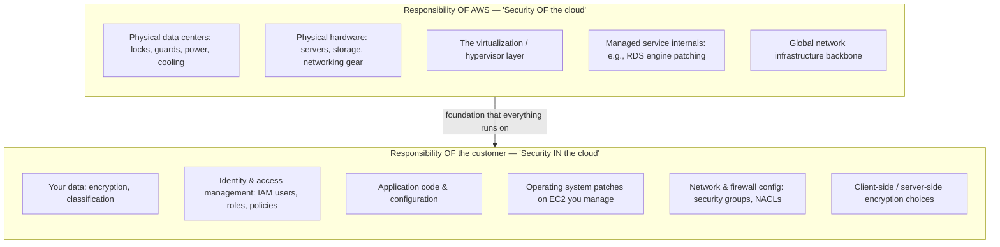
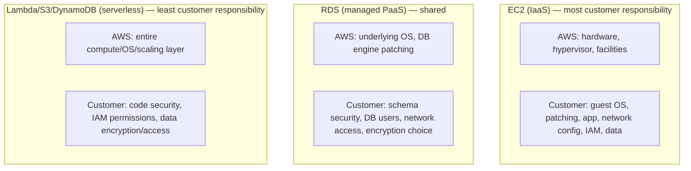
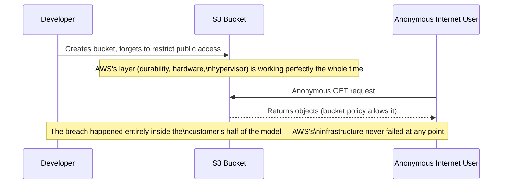
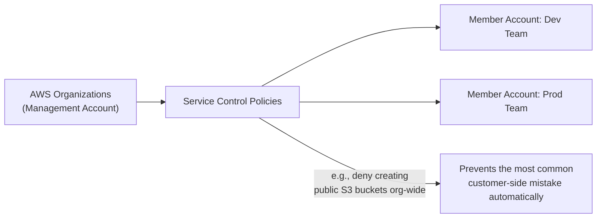
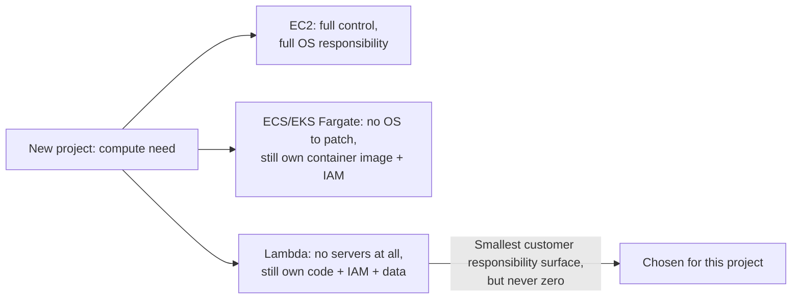
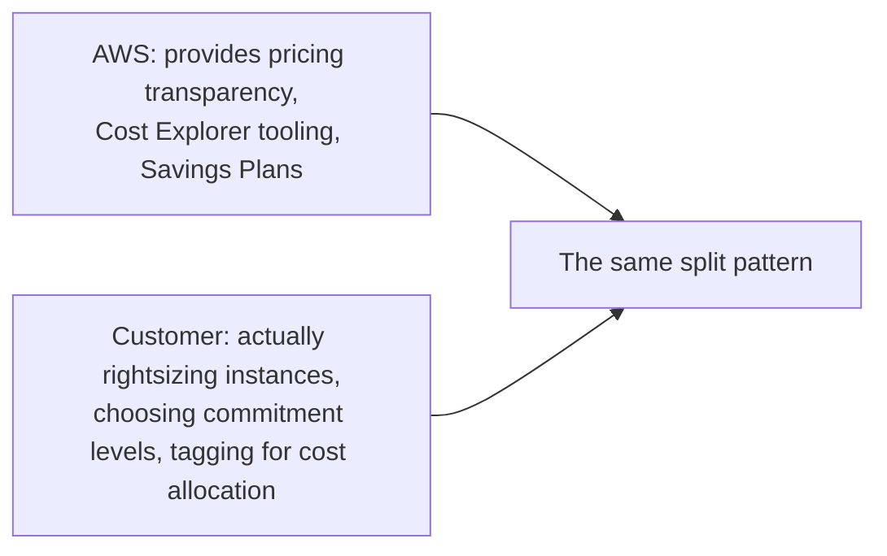
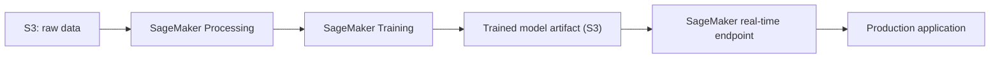

# The Shared Responsibility Model


*Fundamentals · maps to all 3 certs (SAA-C03 Domain 1 & 4, DVA-C03 Domain 4, MLA-C02 Domain 4) ·
the single most-tested concept across every AWS exam*

## Definition

The Shared Responsibility Model is the line AWS draws between what **AWS secures for you** and
what **you must secure yourself**. Nobody is ever 100% responsible for security in the cloud —
it's always split, and knowing exactly where the split falls for the service you're using is the
difference between a secure architecture and a breach.

## Purpose

Before cloud computing, if your server got hacked, it was unambiguously your fault — you owned
the data center, the hardware, the OS, everything. Cloud computing changes who owns what, but it
does **not** make security someone else's problem entirely. AWS built this model to make the
split explicit and contractual, because the single most common cloud security failure isn't an
AWS data center getting breached (that almost never happens) — it's a customer leaving an S3
bucket public, an IAM key unrotated, or a security group open to the world. AWS needed a clear,
repeatable way to say: "we've got the building, the power, the physical servers, the hypervisor —
you've got everything you put on top of it."

## An Analogy Before Any AWS Terms

Think of it like renting an apartment versus owning a house. If you rent an apartment, the
landlord is responsible for the building's structure, the roof, the plumbing infrastructure, and
the front door of the building. You are responsible for locking your own apartment door, not
leaving your windows open, and not handing your keys to strangers. The landlord can't save you
from leaving your own door unlocked — and AWS can't save you from leaving your own S3 bucket
public.

Push the analogy one step further, because it reveals something most beginners miss: imagine
three different kinds of housing — a **house you own outright** (you handle literally everything,
from the roof down to your own front door lock), a **rented apartment** (the landlord handles the
building, you handle your unit), and a **hotel room** (the hotel handles nearly everything —
cleaning, security staff, fire systems — but you *still* have to actually lock your own door and
not leave your valuables sitting in plain sight with the door propped open). These three housing
types map almost exactly onto EC2 (house you own), RDS (rented apartment), and S3/DynamoDB/Lambda
(hotel room) — and notice that in **every single one** of these three situations, locking your own
door is still your job. That part of the responsibility never moves to the landlord or the hotel,
no matter how much service they provide around you.

## How It Works



Walking through it:

- **Bottom layer (AWS's job):** AWS guarantees the physical building is locked down, the
  hardware works, the hypervisor that separates one customer's virtual machine from another's is
  not exploitable, and the network backbone connecting it all is resilient. You cannot audit
  AWS's data center in person, and you don't need to — AWS publishes third-party compliance
  certifications (SOC 2, ISO 27001, PCI-DSS, etc.) as proof this layer is handled.
- **Top layer (your job):** Everything you configure, upload, or write is yours to secure. Your
  IAM policies, your application's code, whether your database is publicly reachable, whether
  your data is encrypted, whether your access keys are rotated — all of it is on you, regardless
  of how "managed" the service is.
- **The arrow pointing up** shows that AWS's layer is the foundation your layer sits on — but it
  is a floor, not a ceiling. A perfectly secure AWS data center does nothing for you if you leave
  your database password as `admin123` in public source code.

### The official AWS diagram

AWS itself publishes a horizontal split diagram that matches the flowchart above almost exactly —
customer responsibility stacked visually "in" the cloud, AWS responsibility stacked "of" the
cloud underneath it:


*Source: AWS WAF Developer Guide, "AWS Shield"
(docs.aws.amazon.com/waf/latest/developerguide/shield-chapter.html)*

### The split is a sliding scale, not a fixed 50/50



- **Infrastructure as a Service (IaaS) — e.g., EC2, EBS:** AWS secures the physical host and
  hypervisor. **You** are responsible for the guest operating system (patching!), any software
  you install, your firewall rules (security groups), and your data. This is the most
  customer-responsibility-heavy category.
- **Platform as a Service (PaaS) / managed services — e.g., RDS, ElastiCache:** AWS now also
  manages the underlying OS and database engine patching. **You** are still responsible for
  your schema, your data, your IAM access policies, and network reachability configuration
  (e.g., don't put your RDS instance in a public subnet with a public security group).
- **Software as a Service (SaaS) — e.g., S3, DynamoDB, Lambda:** AWS manages almost the entire
  stack, including scaling and availability. **You** are still fully responsible for *who can
  access it* (IAM policies, bucket policies, resource policies) and *what data you put in it*
  (classification, encryption settings). Notice the pattern: **no matter how managed the service
  is, your data and your access control are never AWS's responsibility.**

### How a misconfiguration actually becomes a breach



This sequence is, almost verbatim, how a large fraction of real-world cloud data breach headlines
actually happen. Nothing AWS owns ever misbehaves in this picture — the hardware runs fine, the
hypervisor isolates correctly, the storage durability guarantee is honored exactly as promised.
The entire failure is a single customer-side configuration choice.

### Zooming into one real security tool as a worked example: enforcing the model at scale



The official AWS Prescriptive Guidance reference architecture shows exactly this kind of
org-wide security enforcement sitting above the individual AWS accounts:


*Source: AWS Prescriptive Guidance, Security Reference Architecture — "Organization management
account" (docs.aws.amazon.com/prescriptive-guidance/latest/security-reference-architecture/org-management.html)*

This matters because it shows the model isn't purely "AWS does X, you do Y" in a vacuum — AWS
also *provides tools* (Organizations, Service Control Policies, Control Tower) that help you fulfil
your own half of the model more reliably at scale, without AWS ever taking that responsibility
away from you.

### A quick-reference table across common services

Before diving into the technical deep-dive doc, it helps to see the pattern repeat across several
familiar services side by side:

| Service | AWS handles | You handle |
|---|---|---|
| EC2 | Physical host, hypervisor | Guest OS patches, installed software, security groups, data |
| RDS | Host OS, DB engine patching | Schema, DB user accounts, network access rules, encryption choice |
| S3 | Storage durability, infrastructure scaling | Bucket policy, public access settings, encryption, object lifecycle |
| Lambda | Runtime, OS, auto-scaling | Function code, IAM execution role scope, environment variable secrets |
| DynamoDB | Infrastructure, replication, scaling | Table access policy (IAM), encryption settings, item-level data |
| Bedrock | Foundation model hosting infrastructure | Prompt content, invocation IAM scoping, guardrail configuration |

Notice the right-hand column is never empty — this single observation, more than any individual
service fact, is what the exam is actually testing throughout every version of this question.

## Key Features / Components

- **"Security OF the cloud" (AWS)** — physical security, hardware, networking, and the
  virtualization layer that isolates customers from each other.
- **"Security IN the cloud" (you)** — data, identity, OS-level patching (where applicable),
  firewall rules, encryption choices, and application logic.
- **The split moves depending on the service type** — this is the part that trips people up (see
  below).
- **Compliance inheritance** — because AWS handles the physical/infrastructure layer to
  recognized standards, you can "inherit" parts of your own compliance story (e.g., PCI-DSS,
  HIPAA) for the layers AWS owns, as long as you hold up your side.
- **AWS Artifact** — the specific, named self-service portal where you download AWS's own
  compliance evidence (SOC 2, ISO 27001, PCI-DSS reports) — this is how you "verify" AWS is
  holding up its half without ever physically auditing an AWS data center yourself.

## The split changes by service category — this is the exam trap

The model isn't one fixed line; it slides depending on *how much AWS manages* for a given
service — see the three-way comparison diagram above. The single most commonly tested fact in
this entire topic is that **IAM configuration, data classification, and encryption choices never
move to AWS's side, no matter how abstracted the service is.**

## Use Cases — When to Use It

- Use this model as your **mental checklist** any time you design an architecture: "which parts
  of this stack did AWS just hand to me to secure?"
- Use it to answer **audit and compliance questions** — e.g., "who patches the OS on our RDS
  database?" (AWS) vs. "who patches the OS on our self-managed EC2 database?" (you).
- Use it to explain to a non-technical stakeholder why a breach caused by a misconfigured S3
  bucket is not "AWS's fault," even though it happened "in AWS."
- Use it when choosing between service abstraction levels for a *new* project — picking Fargate
  or Lambda over raw EC2 specifically *because* it shrinks your own half of the responsibility
  surface is a legitimate, common, and exam-relevant design decision.

## When NOT to Use It / Alternatives

This isn't a service you choose to use or not — it's a framing that applies universally. The
only "mistake" is misapplying it: assuming a fully-managed service means *zero* security work on
your side. There is no AWS service, no matter how abstracted, where you have zero responsibility
— access control and data protection are always yours.

## Common Misconceptions

- **"AWS secures everything, so I don't need to think about security."** This is the single most
  dangerous misreading of the model. AWS's guarantee covers the *infrastructure*, never your
  identity configuration, your data's access policy, or your application's code.
- **"A fully-managed service like S3 or Lambda means I have basically zero responsibility."**
  Wrong — your responsibility *shrinks* as abstraction increases, but it never reaches zero.
  Access control (who can read/write/invoke) and data protection (encryption, classification) stay
  with you at every single abstraction level, including the most "serverless" ones.
  Internalizing this is more important than memorizing the IaaS/PaaS/SaaS labels themselves.
- **"If AWS is SOC 2 / ISO 27001 certified, our compliance audit is automatically covered."**
  AWS's certification covers AWS's half only. Your organization's own access controls, encryption
  configuration, and logging still need to be independently documented and verified by your own
  auditor — AWS Artifact's reports explicitly do not (and cannot) cover your side of the line.
- **"Using a newer, AI-powered managed service (like Bedrock) means AWS secures the AI too."**
  AWS secures the model-hosting infrastructure; you remain responsible for what you put into
  prompts, who is allowed to invoke the model, and how sensitive any fine-tuning data is. This
  specific nuance is explicitly called out in newer AWS guidance for the DVA-C03 and MLA-C02
  exams, precisely because it's a natural place for the classic misconception to resurface in a
  new form.
- **"The Shared Responsibility Model is only about security."** The same "AWS builds the
  foundation, you make your own usage decisions on top" pattern recurs in AWS's own documentation
  for cost optimization (AWS gives you Cost Explorer and Savings Plans; you decide what to
  actually commit to and right-size) and for environmental sustainability — recognizing the
  pattern outside a pure security context is occasionally tested directly.

## Why It's Important

- **Real world:** Gartner and multiple industry breach reports consistently find that the large
  majority of cloud security incidents are *customer-side misconfiguration* (public buckets,
  overly permissive IAM policies, exposed secrets) — not AWS infrastructure failures. Knowing
  your responsibility boundary is the single highest-leverage security habit you can build.
- **Exam — SAA-C03 style scenario:** "A company discovers that customer data stored in an S3
  bucket was accessible to the public internet for several weeks. Who is responsible for this
  exposure, and what AWS feature should have prevented it?" → The answer is **the customer** is
  responsible (bucket policy/ACL misconfiguration), and **S3 Block Public Access** (a
  customer-configured setting) is the feature that should have been enabled — this tests both the
  conceptual model and a concrete, named preventive control in the same question.
- **Exam — DVA-C03 style scenario:** "A developer integrates their application with Amazon
  Bedrock to add a GenAI chat feature. During a security review, the team assumes Bedrock's fully
  managed nature means prompt content doesn't need additional handling. Is this assumption
  correct?" → **No** — prompt/data content, IAM scoping over who can invoke the model, and
  guardrail configuration remain squarely the customer's responsibility regardless of how managed
  the underlying foundation model service is; this is a newer but increasingly common question
  shape on DVA-C03.
- **Exam — MLA-C02 style scenario:** "A machine learning team uses SageMaker to train a model on
  sensitive healthcare data. Which of the following remains the customer's responsibility: (a) the
  physical security of the training hardware, (b) patching the underlying training instance OS,
  (c) classifying and encrypting the training dataset, (d) the availability of the SageMaker
  service itself?" → **(c)** is the customer's responsibility; (a), (b), and (d) are AWS's for a
  managed SageMaker training job — this tests whether you can correctly map a familiar list of
  tasks onto the model even inside an ML-specific context you may not have seen phrased this way
  before.

## Worked Scenario: Tracing a Real Incident Through the Responsibility Lens

A company's RDS database was accessed by an unauthorized party. Post-incident investigation
found: the database was encrypted at rest (AWS-managed encryption working correctly), the
underlying host OS had been patched on schedule (AWS's responsibility, functioning correctly),
but the database's security group allowed inbound traffic from `0.0.0.0/0` on the database port,
and the database credential had been reused from another, previously-breached system.

Walking the responsibility split explains the incident completely without needing to question
AWS's own infrastructure at all:

| Factor in the incident | Whose side of the model? | Was it functioning correctly? |
|---|---|---|
| Encryption at rest | AWS (KMS/storage layer) | Yes — working as designed |
| Host OS patching | AWS (managed RDS patching) | Yes — up to date |
| Security group rule (`0.0.0.0/0`) | **Customer** | **No — misconfigured** |
| Credential reuse across systems | **Customer** | **No — poor credential hygiene** |
| IAM-based access control on top of network access | **Customer** | **Missing — not configured at all** |

**Every single failure point sits on the customer's side of the line for an RDS (managed
database) deployment.** This is the realistic shape almost every real breach investigation takes,
and it's precisely why the exam tests this model so heavily: understanding it correctly predicts,
in advance, where to focus security effort, rather than learning it only in hindsight after an
incident.

## A Second Worked Scenario: Choosing a Compute Option to Shrink Your Own Responsibility Surface

A startup is building a new internal tool and needs to decide between three compute options:
EC2, ECS on Fargate, and Lambda. The team explicitly wants to minimize how much ongoing security
work falls on their small, two-person engineering team.



The team picks Lambda specifically *because* of the Shared Responsibility Model: with only two
engineers, they cannot realistically keep up with guest-OS patching cadences on self-managed EC2
instances, so they deliberately choose the abstraction level that removes that specific
responsibility from their plate — while fully accepting that their code's security, their IAM
permission scoping, and their data's encryption are still entirely their job no matter which
option they'd picked. This is exactly the kind of reasoning SAA-C03 rewards: not "which service is
newest or coolest," but "which abstraction level correctly matches our team's actual operational
capacity."

## A Non-Security Example: The Same Pattern Applied to Cost



Recognizing that AWS's "we provide the tools, you make the decisions" pattern recurs identically
in cost optimization (not just security) reinforces the underlying principle the model teaches:
AWS consistently builds capability and infrastructure, while decisions about *how* to use that
capability responsibly remain with the customer, across domains far beyond security alone. See
[`well-architected-framework.md`](well-architected-framework.md) for how this same idea shows up
as the Cost Optimization pillar.

## A Third Worked Scenario: Responsibility Across an ML Pipeline (MLA-C02 Flavor)

A data science team builds an ML pipeline: raw data lands in S3, a SageMaker Processing job
cleans it, SageMaker Training produces a model, and a SageMaker real-time endpoint serves
predictions to a production application. Walking responsibility through every stage:



| Stage | AWS's responsibility | Customer's responsibility |
|---|---|---|
| S3 raw data | Storage durability, infrastructure | Classifying sensitive fields, encryption, bucket access policy |
| SageMaker Processing | Underlying compute infrastructure | IAM role scope for the job, what data it's allowed to touch |
| SageMaker Training | Training infrastructure, instance provisioning | Training data sensitivity, hyperparameter/data leakage risks |
| Model artifact in S3 | Storage durability | Who can read/deploy the model (IAM), encryption at rest |
| Real-time endpoint | Endpoint infrastructure, auto-scaling | Endpoint-invoking IAM policy, input validation, monitoring for drift |

The most commonly missed item in a real ML pipeline review: teams assume that because SageMaker
is "fully managed," the *data* flowing through every stage is automatically protected to the same
standard. It isn't — each S3 bucket, each IAM role attached to each pipeline stage, and each
endpoint's invocation policy is an individual, separate customer decision, and a gap at any single
stage (e.g., an overly permissive Processing job role that can read unrelated production data) is
exactly the kind of finding a real security review — and an MLA-C02 exam question — is built to
catch.

## Troubleshooting Mindset: Reasoning Failures, Not Code Errors

Because this is a conceptual model rather than a running service, there's no stack trace to
debug — but there are common **reasoning** failures worth explicitly training yourself out of:

- **"We used a managed service, so we assumed AWS handled the security incident."** Walk back
  through exactly which layer the incident occurred at. If it was a misconfigured IAM policy, an
  unencrypted data store, or application code logic, that's customer-side regardless of how
  managed the underlying compute/storage layer was.
- **"Our compliance audit failed despite AWS being SOC 2 certified."** AWS's own certification
  covers AWS's half of the model only; a failed audit almost always traces to the customer's own
  configuration not being independently documented/verified — which AWS Artifact's reports
  explicitly do not cover on the customer's behalf.
- **"We assumed a fully-managed AI service meant our GenAI feature was secure by default."**
  This is the GenAI-era version of the classic shared-responsibility misreading — prompt content,
  invocation access control, and guardrail configuration remain customer responsibilities no
  matter how fully-managed the underlying foundation model service is.

Training yourself to ask "which half of the line does this sit on?" *before* assuming a root
cause is a transferable debugging habit that shows up well beyond the exam — in real incident
response, this question is almost always the fastest way to narrow down where to actually look.

## Pricing Model (summary)

Not applicable — this is a conceptual/legal framework, not a billed service. However, it
indirectly affects cost: offloading more responsibility to AWS (choosing a more managed service,
like RDS over self-hosted MySQL on EC2) generally costs more per hour but reduces your
operational burden. See
[`pricing-and-billing.md`](pricing-and-billing.md) for how that trade-off plays out in practice.

## Hands-on Lab (Floci)

There's no API call that "shows" the shared responsibility model — it's demonstrated by
contrast. Try this exercise locally against Floci to feel the difference between the two
categories:

```bash
# IaaS-style: you'd be responsible for OS patching, security group rules, etc.
awslocal ec2 run-instances --image-id ami-12345 --instance-type t2.micro

# SaaS-style: AWS/Floci manages the entire stack — your only job is access control
awslocal s3 mb s3://my-responsibility-demo
awslocal s3api put-bucket-policy --bucket my-responsibility-demo --policy file://policy.json
```

Notice the EC2 command gives you a bare virtual machine you must configure and patch yourself;
the S3 commands only ever ask you about *access* (the policy file) — never about patching or
infrastructure. That's the model made concrete.

**Extended exercise — simulating the "shrink your responsibility surface" decision locally:**

```bash
# Enable S3 Block Public Access — a customer-side control that prevents the single
# most common real-world breach pattern described in the worked scenario above.
awslocal s3api put-public-access-block --bucket my-responsibility-demo \
  --public-access-block-configuration \
  BlockPublicAcls=true,IgnorePublicAcls=true,BlockPublicPolicy=true,RestrictPublicBuckets=true

# Enable default server-side encryption — another customer-side decision that's
# never automatic, even on a fully-managed service.
awslocal s3api put-bucket-encryption --bucket my-responsibility-demo \
  --server-side-encryption-configuration \
  '{"Rules":[{"ApplyServerSideEncryptionByDefault":{"SSEAlgorithm":"AES256"}}]}'
```

Both commands represent deliberate customer decisions a fully-managed service never makes for you
automatically — the exact point this entire topic is built around.

## Exam Tips

- If a scenario describes a security incident, ask yourself first: "was this AWS's layer or the
  customer's layer?" Public S3 buckets, weak IAM policies, unencrypted data, unpatched
  self-managed EC2 OS, and open security groups are **always** the customer's responsibility.
- Physical security, hypervisor isolation, and the global network backbone are **always** AWS's
  responsibility — no answer choice should ever make the customer responsible for these.
- Watch for **service-type-specific** nuance: for RDS, the exam expects you to know AWS patches
  the *database engine and underlying OS*, but *you* still manage the *schema, user accounts
  inside the DB, and network access*.
- Keywords like "who is responsible for..." or "whose job is it to..." are a dead giveaway this
  model is being tested.
- **"Security OF the cloud" = AWS. "Security IN the cloud" = customer.** This exact phrasing
  appears verbatim in AWS's own materials and is often quoted directly in exam questions —
  memorize it precisely.
- For GenAI/Bedrock-flavored questions (increasingly common on DVA-C03 and MLA-C02): using a
  managed foundation model still leaves prompt content, invocation access control, and guardrail
  configuration on the customer's side — a question implying "the managed AI service handles all
  of the security" is wrong.
- **AWS Artifact** is the specific, named tool for retrieving AWS's own compliance reports — a
  question about "how do I get evidence AWS meets compliance standard X" points to Artifact, not
  to manually auditing AWS's data centers.

## Further Reading

- AWS Shared Responsibility Model (official page):
  https://aws.amazon.com/compliance/shared-responsibility-model/
- AWS Well-Architected Framework — Security Pillar, "Shared responsibility":
  https://docs.aws.amazon.com/wellarchitected/latest/security-pillar/shared-responsibility.html
- AWS WAF Developer Guide — AWS Shield (includes the official Shared Responsibility diagram):
  https://docs.aws.amazon.com/waf/latest/developerguide/shield-chapter.html
- AWS Well-Architected Framework — Sustainability Pillar, "The shared responsibility model"
  (the same pattern applied to environmental sustainability):
  https://docs.aws.amazon.com/wellarchitected/latest/sustainability-pillar/the-shared-responsibility-model.html
- AWS Artifact: https://aws.amazon.com/artifact/
- AWS Prescriptive Guidance — Security Reference Architecture, "Organization management account":
  https://docs.aws.amazon.com/prescriptive-guidance/latest/security-reference-architecture/org-management.html

## Related Terms

[`glossary/README.md`](../glossary/README.md) ·
[`aws-global-infrastructure.md`](aws-global-infrastructure.md) ·
[`iam-fundamentals.md`](iam-fundamentals.md) ·
`services/security-identity-compliance/iam.md` ·
`services/security-identity-compliance/shared-responsibility-model-deep-dive.md` (the full
technical deep-dive, with per-service responsibility mapping tables) ·
[`well-architected-framework.md`](well-architected-framework.md)
