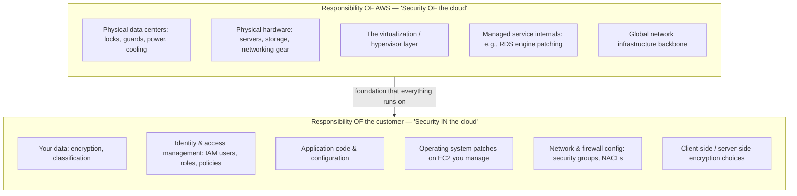

# The Shared Responsibility Model


*Fundamentals · maps to all 3 certs (SAA-C03 Domain 1 & 4, DVA-C03 Domain 4, MLA-C02 Domain 4) ·
the single most-tested concept across every AWS exam*

## Definition

The Shared Responsibility Model is the line AWS draws between what **AWS secures for you** and
what **you must secure yourself**. Nobody is ever 100% responsible for security in the cloud —
it's always split, and knowing exactly where the split falls for the service you're using is the
difference between a secure architecture and a breach.

## Purpose

Before cloud computing, if your server got hacked, it was unambiguously your fault — you owned
the data center, the hardware, the OS, everything. Cloud computing changes who owns what, but it
does **not** make security someone else's problem entirely. AWS built this model to make the
split explicit and contractual, because the single most common cloud security failure isn't an
AWS data center getting breached (that almost never happens) — it's a customer leaving an S3
bucket public, an IAM key unrotated, or a security group open to the world. AWS needed a clear,
repeatable way to say: "we've got the building, the power, the physical servers, the hypervisor —
you've got everything you put on top of it."

## How It Works

Think of it like renting an apartment versus owning a house. If you rent an apartment, the
landlord is responsible for the building's structure, the roof, the plumbing infrastructure, and
the front door of the building. You are responsible for locking your own apartment door, not
leaving your windows open, and not handing your keys to strangers. The landlord can't save you
from leaving your own door unlocked — and AWS can't save you from leaving your own S3 bucket
public.



Walking through it:

- **Bottom layer (AWS's job):** AWS guarantees the physical building is locked down, the
  hardware works, the hypervisor that separates one customer's virtual machine from another's is
  not exploitable, and the network backbone connecting it all is resilient. You cannot audit
  AWS's data center in person, and you don't need to — AWS publishes third-party compliance
  certifications (SOC 2, ISO 27001, PCI-DSS, etc.) as proof this layer is handled.
- **Top layer (your job):** Everything you configure, upload, or write is yours to secure. Your
  IAM policies, your application's code, whether your database is publicly reachable, whether
  your data is encrypted, whether your access keys are rotated — all of it is on you, regardless
  of how "managed" the service is.
- **The arrow pointing up** shows that AWS's layer is the foundation your layer sits on — but it
  is a floor, not a ceiling. A perfectly secure AWS data center does nothing for you if you leave
  your database password as `admin123` in public source code.

## Key Features / Components

- **"Security OF the cloud" (AWS)** — physical security, hardware, networking, and the
  virtualization layer that isolates customers from each other.
- **"Security IN the cloud" (you)** — data, identity, OS-level patching (where applicable),
  firewall rules, encryption choices, and application logic.
- **The split moves depending on the service type** — this is the part that trips people up (see
  below).
- **Compliance inheritance** — because AWS handles the physical/infrastructure layer to
  recognized standards, you can "inherit" parts of your own compliance story (e.g., PCI-DSS,
  HIPAA) for the layers AWS owns, as long as you hold up your side.

## The split changes by service category — this is the exam trap

The model isn't one fixed line; it slides depending on *how much AWS manages* for a given
service:

- **Infrastructure as a Service (IaaS) — e.g., EC2, EBS:** AWS secures the physical host and
  hypervisor. **You** are responsible for the guest operating system (patching!), any software
  you install, your firewall rules (security groups), and your data. This is the most
  customer-responsibility-heavy category.
- **Platform as a Service (PaaS) / managed services — e.g., RDS, ElastiCache:** AWS now also
  manages the underlying OS and database engine patching. **You** are still responsible for
  your schema, your data, your IAM access policies, and network reachability configuration
  (e.g., don't put your RDS instance in a public subnet with a public security group).
- **Software as a Service (SaaS) — e.g., S3, DynamoDB, Lambda:** AWS manages almost the entire
  stack, including scaling and availability. **You** are still fully responsible for *who can
  access it* (IAM policies, bucket policies, resource policies) and *what data you put in it*
  (classification, encryption settings). Notice the pattern: **no matter how managed the service
  is, your data and your access control are never AWS's responsibility.**

## Use Cases — When to Use It

- Use this model as your **mental checklist** any time you design an architecture: "which parts
  of this stack did AWS just hand to me to secure?"
- Use it to answer **audit and compliance questions** — e.g., "who patches the OS on our RDS
  database?" (AWS) vs. "who patches the OS on our self-managed EC2 database?" (you).
- Use it to explain to a non-technical stakeholder why a breach caused by a misconfigured S3
  bucket is not "AWS's fault," even though it happened "in AWS."

## When NOT to Use It / Alternatives

This isn't a service you choose to use or not — it's a framing that applies universally. The
only "mistake" is misapplying it: assuming a fully-managed service means *zero* security work on
your side. There is no AWS service, no matter how abstracted, where you have zero responsibility
— access control and data protection are always yours.

## Why It's Important

- **Real world:** Gartner and multiple industry breach reports consistently find that the large
  majority of cloud security incidents are *customer-side misconfiguration* (public buckets,
  overly permissive IAM policies, exposed secrets) — not AWS infrastructure failures. Knowing
  your responsibility boundary is the single highest-leverage security habit you can build.
- **Exam:** Nearly every security-flavored question across SAA-C03, DVA-C03, and MLA-C02 is
  secretly testing this model. "A company's data was exposed because an S3 bucket was public —
  whose fault/fix is this?" → always the customer. "Who is responsible for patching the
  hypervisor?" → always AWS. If you internalize this one model, a large fraction of security
  questions become easy pattern-matches.

## Pricing Model (summary)

Not applicable — this is a conceptual/legal framework, not a billed service. However, it
indirectly affects cost: offloading more responsibility to AWS (choosing a more managed service,
like RDS over self-hosted MySQL on EC2) generally costs more per hour but reduces your
operational burden. See
[`pricing-and-billing.md`](pricing-and-billing.md) for how that trade-off plays out in practice.

## Hands-on Lab (Floci)

There's no API call that "shows" the shared responsibility model — it's demonstrated by
contrast. Try this exercise locally against Floci to feel the difference between the two
categories:

```bash
# IaaS-style: you'd be responsible for OS patching, security group rules, etc.
awslocal ec2 run-instances --image-id ami-12345 --instance-type t2.micro

# SaaS-style: AWS/Floci manages the entire stack — your only job is access control
awslocal s3 mb s3://my-responsibility-demo
awslocal s3api put-bucket-policy --bucket my-responsibility-demo --policy file://policy.json
```

Notice the EC2 command gives you a bare virtual machine you must configure and patch yourself;
the S3 commands only ever ask you about *access* (the policy file) — never about patching or
infrastructure. That's the model made concrete.

## Exam Tips

- If a scenario describes a security incident, ask yourself first: "was this AWS's layer or the
  customer's layer?" Public S3 buckets, weak IAM policies, unencrypted data, unpatched
  self-managed EC2 OS, and open security groups are **always** the customer's responsibility.
- Physical security, hypervisor isolation, and the global network backbone are **always** AWS's
  responsibility — no answer choice should ever make the customer responsible for these.
- Watch for **service-type-specific** nuance: for RDS, the exam expects you to know AWS patches
  the *database engine and underlying OS*, but *you* still manage the *schema, user accounts
  inside the DB, and network access*.
- Keywords like "who is responsible for..." or "whose job is it to..." are a dead giveaway this
  model is being tested.

## Related Terms

[`glossary/README.md`](../glossary/README.md) ·
[`aws-global-infrastructure.md`](aws-global-infrastructure.md) ·
[`iam-fundamentals.md`](iam-fundamentals.md) ·
`services/security-identity-compliance/iam.md` ·
[`well-architected-framework.md`](well-architected-framework.md)
