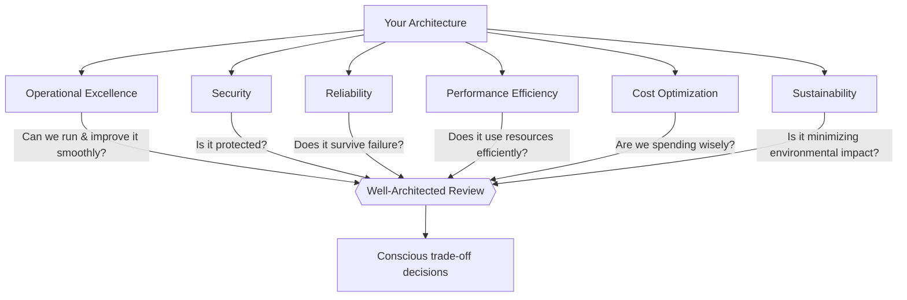

# The AWS Well-Architected Framework


*Fundamentals · maps to all 3 certs (SAA-C03 Domain 1, DVA-C03 Domain 4, MLA-C02 Domain 4) ·
conceptual doc covering all 6 pillars, not a single service*

## Definition

The Well-Architected Framework is AWS's checklist of **questions and best practices** for
judging whether a cloud architecture is good. It's organized into **6 pillars**: Operational
Excellence, Security, Reliability, Performance Efficiency, Cost Optimization, and
Sustainability. It is not a service you turn on — it's a lens AWS (and the exams) use to
evaluate *any* architecture decision.

## Purpose

Early cloud adopters kept making the same category of mistakes over and over: no monitoring, no
redundancy, insecure defaults, massive overspend on unused capacity, architectures that worked in
a demo but fell over under real load. AWS distilled thousands of customer engagements (through
their Solutions Architects) into a reusable framework so that instead of learning these lessons
the hard way — in production, during an outage — teams can self-review against a known-good
checklist *before* something breaks. It also gives AWS a consistent vocabulary to reason about
architecture trade-offs, because the 6 pillars constantly pull against each other (e.g., more
redundancy for Reliability usually costs more, working against Cost Optimization) and good
architecture is about consciously choosing those trade-offs, not ignoring them.

## How It Works

Think of designing a building. An architect doesn't just ask "will it stand up?" — they also ask
"can we maintain it easily? Is it safe from intruders? Will it survive an earthquake? Is it
energy-efficient? Did we build to budget? Is it good for the environment?" The Well-Architected
Framework is that same multi-angle review, applied to software systems instead of buildings.



Walking through it:

- Every real architecture is pulled on from **all six directions simultaneously** — the diagram
  shows each pillar feeding into a single review process, not six separate silos.
- The review isn't about maximizing every pillar to 100% — that's usually impossible (maximum
  Reliability often costs more, working against Cost Optimization; maximum Security can add
  friction, working against Operational Excellence's goal of smooth operations).
- The output of a Well-Architected Review is a set of **conscious trade-offs**: "we accept lower
  redundancy on this non-critical service to save cost" is a valid, well-architected decision —
  as long as it was made deliberately, not by accident.

## The 6 Pillars, One at a Time

### 1. Operational Excellence

**Purpose:** Being able to run, monitor, and continuously improve your systems with minimum
manual effort and maximum confidence when something goes wrong. It's about *how your team works*
as much as the technology itself.

**Key design principles:**
- Perform operations as code — automate infrastructure changes (e.g., CloudFormation/Terraform)
  instead of manual console clicks, so changes are repeatable and reviewable.
- Make frequent, small, reversible changes instead of rare, giant, risky deployments.
- Refine operations procedures frequently and anticipate failure — run "game days" that
  simulate outages before they happen for real.
- Learn from all operational failures — every incident should produce a documented lesson, not
  just a fix.

### 2. Security

**Purpose:** Protecting data, systems, and assets through risk assessment and mitigation
strategies, while still letting the business operate (security that blocks everything isn't
useful security).

**Key design principles:**
- Implement a strong identity foundation — least privilege, no shared credentials, use roles
  instead of long-lived keys wherever possible (this is where
  [`iam-fundamentals.md`](iam-fundamentals.md) plugs in directly).
- Enable traceability — log and monitor every action so you can reconstruct what happened after
  an incident (CloudTrail, CloudWatch).
- Apply security at all layers — don't rely on a single firewall; defend the network edge, the
  host, the application, and the data itself.
- Automate security best practices — e.g., automatically scan for misconfigurations instead of
  relying on manual review.
- Protect data in transit and at rest — encryption is a default assumption, not an afterthought.
- Keep people away from direct data access — build tooling and automation so humans rarely need
  direct, manual access to production data.
- Prepare for security events — have an incident response plan *before* you need it.

### 3. Reliability

**Purpose:** The ability of a system to recover from infrastructure or service disruptions,
dynamically acquire resources to meet demand, and mitigate disruptions like misconfigurations or
transient network issues.

**Key design principles:**
- Automatically recover from failure — monitor systems for key performance indicators and
  trigger automation when a threshold is breached, rather than waiting for a human to notice.
- Test recovery procedures regularly — don't assume your failover works; actually trigger it in
  a controlled way and verify.
- Scale horizontally to increase aggregate system availability — many smaller, replaceable
  resources beat one large, irreplaceable one.
- Stop guessing capacity — use auto-scaling driven by real demand instead of over-provisioning
  "just in case" or under-provisioning and hoping.
- Manage change through automation — infrastructure changes should go through automated,
  repeatable pipelines, not manual one-off edits.

### 4. Performance Efficiency

**Purpose:** Using computing resources efficiently to meet system requirements, and maintaining
that efficiency as demand changes and technology evolves.

**Key design principles:**
- Make advanced technology accessible to your team — let AWS manage the undifferentiated heavy
  lifting (e.g., use a managed database instead of hand-tuning your own database server).
- Go global in minutes — deploy to multiple AWS Regions around the world with minimal extra
  effort, reducing latency for a global user base.
- Use serverless architectures where it fits — remove the operational burden of running and
  scaling servers yourself.
- Experiment more often — because cloud resources are provisioned on-demand, it's cheap and fast
  to try multiple instance types/configurations and measure which actually performs best.
- Consider mechanical sympathy — understand how the service you've chosen actually works
  under the hood (e.g., a database's indexing strategy) so you use it the way it's designed to
  be used, not against its grain.

### 5. Cost Optimization

**Purpose:** Running systems to deliver business value at the lowest price point, and
understanding where money is being spent so you can make informed trade-offs.

**Key design principles:**
- Implement cloud financial management — treat cost as an ongoing discipline with ownership and
  tools, not an annual surprise (see [`pricing-and-billing.md`](pricing-and-billing.md) for the
  concrete tools: Cost Explorer, Budgets).
- Adopt a consumption model — pay for what you use, when you use it, instead of guessing capacity
  years in advance and buying hardware upfront.
- Measure overall efficiency — track business output against cloud spend, not just the raw bill.
- Stop spending money on undifferentiated heavy lifting — let AWS manage things like data center
  operations and base infrastructure so your team focuses on what makes your product unique.
- Analyze and attribute expenditure — use tagging so you know exactly which team/project/feature
  is generating which cost, enabling accurate accountability.

### 6. Sustainability

**Purpose:** Minimizing the environmental impact of running cloud workloads — energy, water, and
resource consumption — and is the newest pillar, added as climate impact became a measurable
design consideration, not just a corporate-responsibility talking point.

**Key design principles:**
- Understand your impact — measure the resources your workloads consume and the downstream
  impact of every architectural choice, establishing goals to improve over time.
- Establish sustainability goals for long-term workloads and hold the team accountable to them,
  the same way you would for cost or performance goals.
- Maximize utilization — right-size resources so you're not running idle capacity; an idle
  server still burns power.
- Anticipate and adopt new, more efficient hardware and software offerings as AWS releases them
  (e.g., AWS Graviton processors are more power-efficient per unit of compute).
- Use managed services — because AWS operates shared infrastructure at massive scale, a managed
  service is almost always more resource-efficient in aggregate than many customers each running
  their own dedicated, under-utilized hardware.
- Reduce the downstream impact of your cloud workloads — e.g., send less data over the network,
  compress data, and avoid unnecessary duplication/retention of data you don't need.

## Use Cases — When to Use It

- Run a **Well-Architected Review** before launching a new production workload, and periodically
  afterward (quarterly/yearly) as the system evolves — AWS provides a free **Well-Architected
  Tool** in the console that walks you through pillar-by-pillar questions and flags risks.
- Use it as a **structured way to justify architecture decisions** to stakeholders: "we chose
  Multi-AZ RDS over single-AZ because Reliability outweighs the marginal Cost Optimization loss
  for this workload."
- Use it during **post-incident reviews** to categorize what went wrong (was it a Reliability
  gap? An Operational Excellence gap in monitoring? Both?).

## When NOT to Use It / Alternatives

The framework is a review lens, not a rulebook that must be applied with equal weight every
time. For a small side project or proof-of-concept, running a full formal review across all 6
pillars is overkill — the point is to use judgment about which pillars matter most for a given
workload's actual risk profile, not to mechanically check every box regardless of context.

## Why It's Important

- **Real world:** this is literally the structure AWS Solutions Architects use in paid
  engagements with enterprise customers — internalizing it means you're thinking the way AWS
  itself evaluates architecture.
- **Exam:** SAA-C03 in particular is built almost entirely around trade-offs between these
  pillars — a huge fraction of questions present two or more valid-sounding answers, and the
  "most correct" one is the one that best balances the pillar(s) the question is emphasizing
  (commonly Reliability vs. Cost, or Security vs. Operational Excellence).

## Pricing Model (summary)

Reviewing your architecture against the framework is free — the **AWS Well-Architected Tool** in
the console costs nothing to use. The cost implications come from the *decisions* you make as a
result (e.g., adding Multi-AZ redundancy costs more; right-sizing instances saves money). See
[`pricing-and-billing.md`](pricing-and-billing.md).

## Hands-on Lab (Floci)

The Well-Architected Tool itself isn't something Floci emulates (it's a console-driven review
process, not an API-heavy service), but you can practice the underlying levers it evaluates:

```bash
# Reliability lever: tagging resources so cost/ownership is traceable (Cost Optimization pillar)
awslocal ec2 create-tags --resources i-0123456789 --tags Key=Project,Value=well-architected-demo

# Operational Excellence lever: treating infra as code instead of manual clicks
awslocal cloudformation deploy --template-file template.yaml --stack-name demo-stack
```

## Exam Tips

- When a question gives you a scenario and multiple valid-looking answers, identify which
  pillar(s) the question is actually testing — words like "survive a failure" point to
  Reliability; "reduce spend" points to Cost Optimization; "least privilege" and "encrypt" point
  to Security; "automate deployments" points to Operational Excellence; "reduce latency" or
  "right-size" points to Performance Efficiency; "reduce environmental footprint" or "maximize
  utilization" points to Sustainability.
- The pillars **trade off against each other** — the exam rewards recognizing *which* trade-off a
  question is emphasizing, not maximizing every pillar simultaneously (that's usually not a
  realistic answer choice).
- Sustainability is the newest pillar (added 2021) and the least tested historically, but it
  does appear, especially around Graviton, right-sizing, and managed-service-over-self-hosted
  questions.

## Related Terms

[`glossary/README.md`](../glossary/README.md) ·
[`shared-responsibility-model.md`](shared-responsibility-model.md) ·
[`iam-fundamentals.md`](iam-fundamentals.md) ·
[`pricing-and-billing.md`](pricing-and-billing.md)
