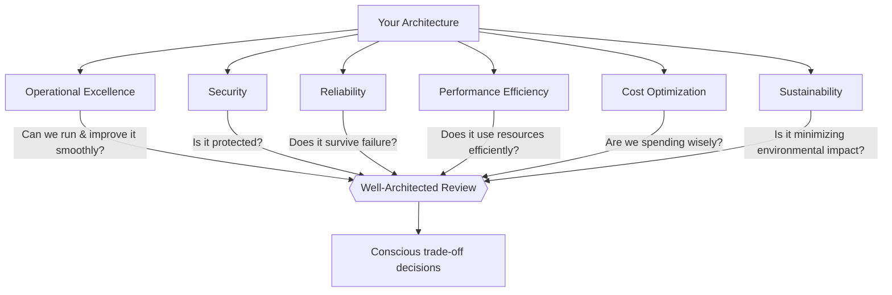
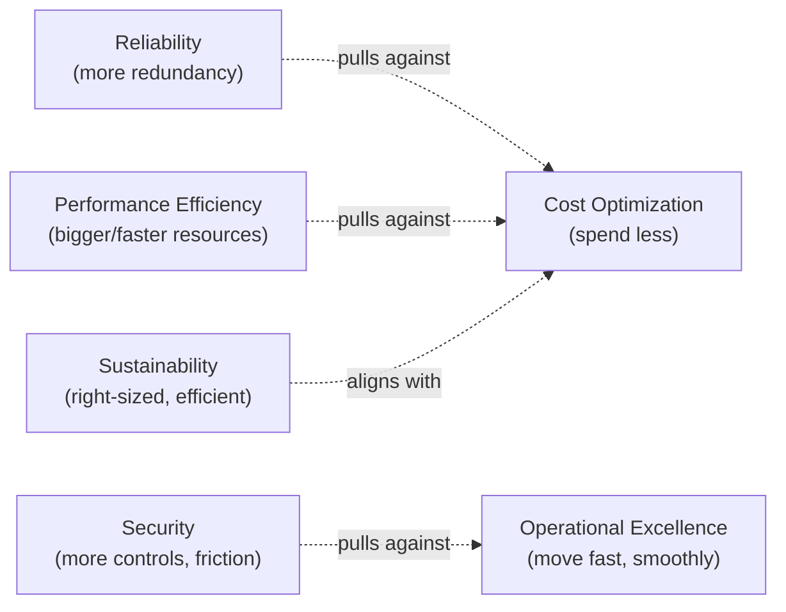
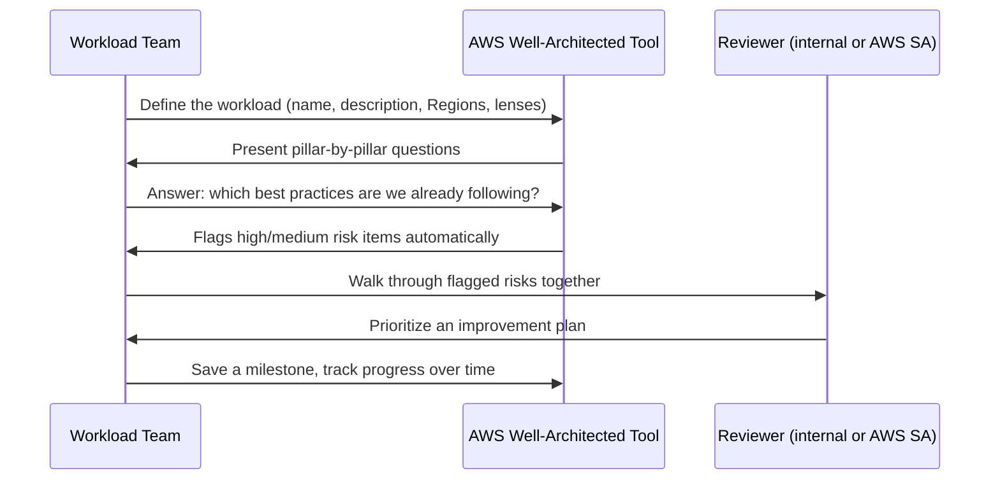
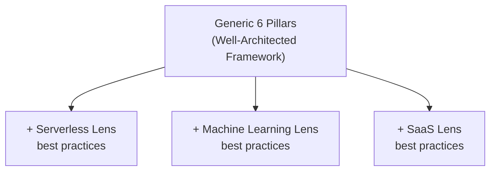
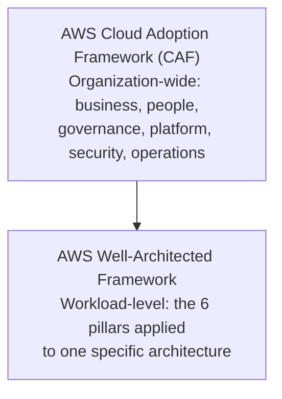
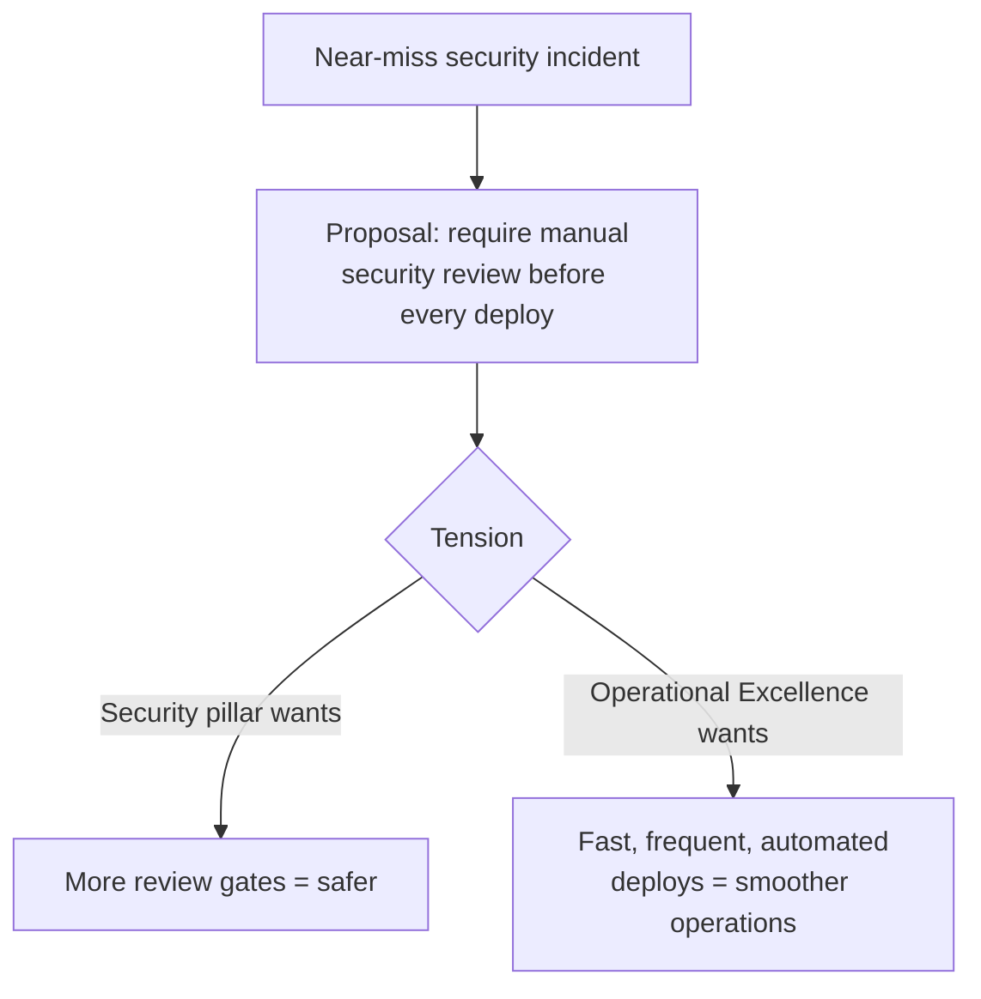

# The AWS Well-Architected Framework


*Fundamentals · maps to all 3 certs (SAA-C03 Domain 1, DVA-C03 Domain 4, MLA-C02 Domain 4) ·
conceptual doc covering all 6 pillars, not a single service*

## Definition

The Well-Architected Framework is AWS's checklist of **questions and best practices** for
judging whether a cloud architecture is good. It's organized into **6 pillars**: Operational
Excellence, Security, Reliability, Performance Efficiency, Cost Optimization, and
Sustainability. It is not a service you turn on — it's a lens AWS (and the exams) use to
evaluate *any* architecture decision.

## Purpose

Early cloud adopters kept making the same category of mistakes over and over: no monitoring, no
redundancy, insecure defaults, massive overspend on unused capacity, architectures that worked in
a demo but fell over under real load. AWS distilled thousands of customer engagements (through
their Solutions Architects) into a reusable framework so that instead of learning these lessons
the hard way — in production, during an outage — teams can self-review against a known-good
checklist *before* something breaks. It also gives AWS a consistent vocabulary to reason about
architecture trade-offs, because the 6 pillars constantly pull against each other (e.g., more
redundancy for Reliability usually costs more, working against Cost Optimization) and good
architecture is about consciously choosing those trade-offs, not ignoring them.

## An Analogy Before Any AWS Terms

Think of designing a building. An architect doesn't just ask "will it stand up?" — they also ask
"can we maintain it easily? Is it safe from intruders? Will it survive an earthquake? Is it
energy-efficient? Did we build to budget? Is it good for the environment?" No single one of
those questions is "the most important" in isolation — a beautifully earthquake-proof building
that costs ten times the client's budget is still a failed design, and a cheap building that
collapses in a storm is an even bigger failure. A good architect holds all six questions in mind
*simultaneously* and makes deliberate trade-offs between them. The Well-Architected Framework is
that same multi-angle review, applied to software systems instead of buildings — and just like a
building architect, a cloud architect who optimizes for only one pillar while ignoring the other
five tends to produce something that looks fine in a demo and fails in the real world.

## How It Works



Walking through it:

- Every real architecture is pulled on from **all six directions simultaneously** — the diagram
  shows each pillar feeding into a single review process, not six separate silos.
- The review isn't about maximizing every pillar to 100% — that's usually impossible (maximum
  Reliability often costs more, working against Cost Optimization; maximum Security can add
  friction, working against Operational Excellence's goal of smooth operations).
- The output of a Well-Architected Review is a set of **conscious trade-offs**: "we accept lower
  redundancy on this non-critical service to save cost" is a valid, well-architected decision —
  as long as it was made deliberately, not by accident.

### How the pillars actively pull against each other



This diagram is the part most newcomers skip past too quickly: notice that **Sustainability and
Cost Optimization often align** (an idle, oversized server wastes both money and power), while
**Reliability and Cost Optimization genuinely conflict** (true multi-Region redundancy is
expensive). A well-architected review's entire value is making these tensions *visible* and
*deliberate*, rather than pretending they don't exist.

### The actual review process, step by step



Here's a real screenshot from the official AWS Well-Architected Tool user guide, showing one step
of that "define a workload" flow in the actual console:


*Source: AWS Well-Architected Tool User Guide, "Activating AWS Trusted Advisor for a workload"
(docs.aws.amazon.com/wellarchitected/latest/userguide/activate-ta-for-workload.html)*

Notice this isn't an abstract whitepaper exercise — the Well-Architected Tool is a real, free,
console-driven product that literally asks you these questions interactively and tracks your
answers as "milestones" over time, exactly like a recurring performance review for your
architecture instead of for a person.

## The 6 Pillars, One at a Time

### Quick-reference table: the key question and the exam trap for each pillar

| Pillar | Core question it answers | Common exam trap |
|---|---|---|
| Operational Excellence | Can we run and improve this smoothly? | Confusing "automation" with "more tooling for its own sake" rather than actual process improvement |
| Security | Is it protected, without blocking the business? | Assuming more security controls always wins, ignoring the Operational Excellence friction cost |
| Reliability | Does it survive failure and meet demand? | Treating "more redundancy" as free, ignoring the Cost Optimization trade-off |
| Performance Efficiency | Are we using resources well as demand/tech changes? | Picking the biggest/fastest resource by default instead of measuring actual requirements |
| Cost Optimization | Are we spending wisely for the value delivered? | Treating "cheapest" and "most cost-optimized" as the same thing — they aren't |
| Sustainability | Are we minimizing environmental impact? | Assuming this pillar is unrelated to Cost Optimization, when right-sizing usually serves both |

### 1. Operational Excellence

**Purpose:** Being able to run, monitor, and continuously improve your systems with minimum
manual effort and maximum confidence when something goes wrong. It's about *how your team works*
as much as the technology itself.

**Key design principles:**
- Perform operations as code — automate infrastructure changes (e.g., CloudFormation/Terraform)
  instead of manual console clicks, so changes are repeatable and reviewable.
- Make frequent, small, reversible changes instead of rare, giant, risky deployments.
- Refine operations procedures frequently and anticipate failure — run "game days" that
  simulate outages before they happen for real.
- Learn from all operational failures — every incident should produce a documented lesson, not
  just a fix.

**A concrete beginner example:** imagine two teams both run the same website. Team A deploys by
having an engineer manually SSH into a server and copy new files over on a Friday afternoon. Team
B deploys by pushing code, which triggers an automated pipeline that runs tests, deploys to a
small percentage of traffic first, and automatically rolls back if error rates spike. Team B is
practicing Operational Excellence; Team A is accumulating risk that will eventually surface as an
outage nobody can quickly diagnose, because nobody wrote down exactly what changed.

### 2. Security

**Purpose:** Protecting data, systems, and assets through risk assessment and mitigation
strategies, while still letting the business operate (security that blocks everything isn't
useful security).

**Key design principles:**
- Implement a strong identity foundation — least privilege, no shared credentials, use roles
  instead of long-lived keys wherever possible (this is where
  [`iam-fundamentals.md`](iam-fundamentals.md) plugs in directly).
- Enable traceability — log and monitor every action so you can reconstruct what happened after
  an incident (CloudTrail, CloudWatch).
- Apply security at all layers — don't rely on a single firewall; defend the network edge, the
  host, the application, and the data itself.
- Automate security best practices — e.g., automatically scan for misconfigurations instead of
  relying on manual review.
- Protect data in transit and at rest — encryption is a default assumption, not an afterthought.
- Keep people away from direct data access — build tooling and automation so humans rarely need
  direct, manual access to production data.
- Prepare for security events — have an incident response plan *before* you need it.

### 3. Reliability

**Purpose:** The ability of a system to recover from infrastructure or service disruptions,
dynamically acquire resources to meet demand, and mitigate disruptions like misconfigurations or
transient network issues.

**Key design principles:**
- Automatically recover from failure — monitor systems for key performance indicators and
  trigger automation when a threshold is breached, rather than waiting for a human to notice.
- Test recovery procedures regularly — don't assume your failover works; actually trigger it in
  a controlled way and verify.
- Scale horizontally to increase aggregate system availability — many smaller, replaceable
  resources beat one large, irreplaceable one.
- Stop guessing capacity — use auto-scaling driven by real demand instead of over-provisioning
  "just in case" or under-provisioning and hoping.
- Manage change through automation — infrastructure changes should go through automated,
  repeatable pipelines, not manual one-off edits.

The official Well-Architected Framework documentation illustrates exactly this pillar's baseline
production pattern with a real reference diagram:


*Source: AWS Well-Architected Framework, "REL10-BP01 Deploy the workload to multiple locations"
(docs.aws.amazon.com/wellarchitected/latest/framework/rel10-bp01.html)*

Notice this single diagram embodies three separate Reliability design principles at once:
horizontal scaling (multiple instances behind the load balancer), automatic recovery (the managed
data services replicate without manual intervention), and the AZ-spanning pattern covered in
[`aws-global-infrastructure.md`](aws-global-infrastructure.md) — Reliability is rarely a single
feature; it's usually several small decisions stacked together.

### 4. Performance Efficiency

**Purpose:** Using computing resources efficiently to meet system requirements, and maintaining
that efficiency as demand changes and technology evolves.

**Key design principles:**
- Make advanced technology accessible to your team — let AWS manage the undifferentiated heavy
  lifting (e.g., use a managed database instead of hand-tuning your own database server).
- Go global in minutes — deploy to multiple AWS Regions around the world with minimal extra
  effort, reducing latency for a global user base.
- Use serverless architectures where it fits — remove the operational burden of running and
  scaling servers yourself.
- Experiment more often — because cloud resources are provisioned on-demand, it's cheap and fast
  to try multiple instance types/configurations and measure which actually performs best.
- Consider mechanical sympathy — understand how the service you've chosen actually works
  under the hood (e.g., a database's indexing strategy) so you use it the way it's designed to
  be used, not against its grain.

### 5. Cost Optimization

**Purpose:** Running systems to deliver business value at the lowest price point, and
understanding where money is being spent so you can make informed trade-offs.

**Key design principles:**
- Implement cloud financial management — treat cost as an ongoing discipline with ownership and
  tools, not an annual surprise (see [`pricing-and-billing.md`](pricing-and-billing.md) for the
  concrete tools: Cost Explorer, Budgets).
- Adopt a consumption model — pay for what you use, when you use it, instead of guessing capacity
  years in advance and buying hardware upfront.
- Measure overall efficiency — track business output against cloud spend, not just the raw bill.
- Stop spending money on undifferentiated heavy lifting — let AWS manage things like data center
  operations and base infrastructure so your team focuses on what makes your product unique.
- Analyze and attribute expenditure — use tagging so you know exactly which team/project/feature
  is generating which cost, enabling accurate accountability.

### 6. Sustainability

**Purpose:** Minimizing the environmental impact of running cloud workloads — energy, water, and
resource consumption — and is the newest pillar, added as climate impact became a measurable
design consideration, not just a corporate-responsibility talking point.

**Key design principles:**
- Understand your impact — measure the resources your workloads consume and the downstream
  impact of every architectural choice, establishing goals to improve over time.
- Establish sustainability goals for long-term workloads and hold the team accountable to them,
  the same way you would for cost or performance goals.
- Maximize utilization — right-size resources so you're not running idle capacity; an idle
  server still burns power.
- Anticipate and adopt new, more efficient hardware and software offerings as AWS releases them
  (e.g., AWS Graviton processors are more power-efficient per unit of compute).
- Use managed services — because AWS operates shared infrastructure at massive scale, a managed
  service is almost always more resource-efficient in aggregate than many customers each running
  their own dedicated, under-utilized hardware.
- Reduce the downstream impact of your cloud workloads — e.g., send less data over the network,
  compress data, and avoid unnecessary duplication/retention of data you don't need.

## Key Features / Components

- **Pillars** — the six lenses described above: Operational Excellence, Security, Reliability,
  Performance Efficiency, Cost Optimization, Sustainability.
- **Design principles** — per-pillar, actionable guidance (listed above) that translates each
  pillar's abstract goal into concrete habits.
- **The AWS Well-Architected Tool** — a free console tool that walks you through pillar-by-pillar
  questions for a defined "workload" and flags high/medium risk items automatically.
- **Lenses** — specialized variants of the framework tailored to a particular technology domain
  (e.g., the Serverless Applications Lens, the Machine Learning Lens, the SaaS Lens) — these apply
  the same six pillars but with domain-specific best practices layered on top.
- **Milestones** — saved snapshots of a workload's review state over time, letting you measure
  concrete improvement between reviews rather than just reviewing once and forgetting about it.
- **Improvement plan** — the prioritized, risk-ranked list of recommendations the tool generates
  after a review, which is the actual actionable output most teams walk away with.

## Use Cases — When to Use It

- Run a **Well-Architected Review** before launching a new production workload, and periodically
  afterward (quarterly/yearly) as the system evolves — AWS provides a free **Well-Architected
  Tool** in the console that walks you through pillar-by-pillar questions and flags risks.
- Use it as a **structured way to justify architecture decisions** to stakeholders: "we chose
  Multi-AZ RDS over single-AZ because Reliability outweighs the marginal Cost Optimization loss
  for this workload."
- Use it during **post-incident reviews** to categorize what went wrong (was it a Reliability
  gap? An Operational Excellence gap in monitoring? Both?).
- Use a specialized **Lens** (e.g., the Machine Learning Lens) when your workload has domain-
  specific concerns the generic six pillars don't fully capture on their own — MLA-C02 candidates
  in particular should recognize this lens exists even if the generic pillars remain the tested
  core.

## When NOT to Use It / Alternatives

The framework is a review lens, not a rulebook that must be applied with equal weight every
time. For a small side project or proof-of-concept, running a full formal review across all 6
pillars is overkill — the point is to use judgment about which pillars matter most for a given
workload's actual risk profile, not to mechanically check every box regardless of context.

## Lenses: Applying the Same Six Pillars to a Specific Domain

A **Lens** doesn't change the six pillars — it adds domain-specific best practices on top of them,
for a particular kind of workload. Recognizing when a question is really pointing at a Lens
(rather than the generic framework) is a useful skill, especially for MLA-C02:

| Lens | Who it's for | Example domain-specific addition |
|---|---|---|
| Serverless Applications Lens | Teams building with Lambda, API Gateway, Step Functions, etc. | Cold-start latency considerations, event-driven error handling patterns |
| Machine Learning Lens | ML/AI teams (directly relevant to MLA-C02) | Training data lineage, model versioning, bias/fairness evaluation |
| SaaS Lens | Multi-tenant software vendors | Tenant isolation strategies, per-tenant cost attribution |
| Financial Services Industry Lens | Regulated financial workloads | Additional compliance and audit-trail best practices |



The Machine Learning Lens, in particular, is worth remembering by name for MLA-C02: it asks
ML-specific questions *within* the same six pillars (e.g., "does your Reliability plan account for
model drift causing silently degraded — not failed — predictions?") rather than inventing a
seventh, ML-only pillar.

## Relationship to the AWS Cloud Adoption Framework (CAF)

It's easy to confuse the Well-Architected Framework with the separate **AWS Cloud Adoption
Framework (CAF)** — they sound similar and are both AWS-authored guidance documents, but they
operate at different altitudes:



CAF is about an *entire organization's* journey to the cloud (culture, skills, governance,
business strategy) — it's the conversation a CTO has with a CEO. The Well-Architected Framework
is about *one specific workload's* technical design — it's the conversation an architect has with
an engineering team. A company typically uses CAF once, at a strategic level, and the
Well-Architected Framework repeatedly, workload by workload, as part of normal engineering
practice. For the three certs covered in this repo, **the Well-Architected Framework is the one
that's directly and heavily tested; CAF is worth recognizing by name but rarely tested in depth.**

## Keyword Cheat Sheet: Mapping Exam Language to Pillars

| If the question says... | It's testing... |
|---|---|
| "survive a failure," "recover automatically," "fault tolerant" | Reliability |
| "reduce spend," "lowest cost," "right-size," "unused capacity" | Cost Optimization |
| "least privilege," "encrypt," "protect data," "detect threats" | Security |
| "automate deployments," "infrastructure as code," "learn from incidents" | Operational Excellence |
| "reduce latency," "improve throughput," "choose the right instance type" | Performance Efficiency |
| "reduce carbon footprint," "maximize utilization," "energy-efficient hardware" | Sustainability |

Keep this table in mind during practice exams: a large fraction of Well-Architected-flavored
questions can be answered correctly just by matching the question's keywords to the right row,
*before* even reading the answer choices in detail.

## Common Misconceptions

- **"A well-architected system maximizes every pillar."** This is impossible and not even the
  goal — maximum Reliability usually costs more (hurting Cost Optimization), and maximum Security
  can add operational friction (hurting Operational Excellence). The goal is *deliberate,
  documented trade-offs*, not six perfect scores.
- **"The Well-Architected Tool is only for huge enterprise workloads."** It's free, applies to
  workloads of any size, and is equally useful for a side project as for a multi-million-dollar
  production system — the questions simply scale in relevance, not in applicability.
- **"Sustainability is just a marketing pillar with no real engineering content."** It has
  concrete, testable design principles (right-sizing, choosing efficient processor architectures
  like Graviton, maximizing utilization) that directly overlap with — and often directly save
  money via — Cost Optimization, making it more actionable than it first appears.
- **"A Well-Architected Review is an audit, and a bad score is a failure."** AWS explicitly frames
  reviews as a *constructive conversation about trade-offs*, not a pass/fail audit — a workload
  that deliberately accepts lower Reliability on a non-critical internal tool to save cost is a
  legitimate, well-architected outcome, not a failed review.
- **"Lenses replace the six pillars."** They don't — a Lens (e.g., the Machine Learning Lens)
  adds domain-specific best practices *on top of* the same six pillars; it never substitutes a
  different set of evaluation criteria.

## Why It's Important

- **Real world:** this is literally the structure AWS Solutions Architects use in paid
  engagements with enterprise customers — internalizing it means you're thinking the way AWS
  itself evaluates architecture.
- **Exam — SAA-C03 style scenario:** "A company runs a non-critical internal reporting tool on a
  single EC2 instance with no redundancy. During a cost review, a team member proposes adding
  Multi-AZ redundancy to 'follow best practices.' Is this the correct recommendation?" → **Not
  necessarily** — if the tool is genuinely non-critical and downtime is tolerable, the
  well-architected answer may be to *consciously accept* the lower Reliability to preserve Cost
  Optimization, as long as that decision is documented and deliberate, not accidental. This tests
  whether you understand trade-offs are the point, not blanket rule-following.
- **Exam — DVA-C03 style scenario:** "A development team wants to deploy changes directly from
  their laptops to production via manual console edits to move faster. Which Well-Architected
  pillar does this violate, and what's the recommended alternative?" → This violates **Operational
  Excellence** ("perform operations as code"); the recommended alternative is an automated CI/CD
  pipeline (CodePipeline/CodeBuild/CodeDeploy or equivalent) with repeatable, reviewable
  deployments.
- **Exam — MLA-C02 style scenario:** "An ML team trains a large model on expensive GPU instances
  that sit idle for most of the day between training runs. Which pillar most directly addresses
  this, and what's the fix?" → This is squarely **Cost Optimization** (and, secondarily,
  **Sustainability**, since idle GPU capacity wastes both money and power) — the fix is using
  on-demand/Spot-backed training jobs that only provision compute for the actual training window,
  rather than keeping instances running continuously.

## Worked Scenario: A Full Well-Architected Review Walkthrough

A small company runs a customer-facing order-tracking web app: a single EC2 instance, a single-AZ
RDS database, and static assets served directly from the same EC2 instance (no CDN). They decide
to run a full Well-Architected Review before a big marketing push expected to triple traffic.
Walking through each pillar's findings:

1. **Operational Excellence — risk found:** Deployments are manual (SSH + git pull). *Fix:* move
   to an automated CodePipeline deployment with a staging environment, so the upcoming
   traffic-sensitive period isn't the first time a new deployment process is tested under
   pressure.
2. **Security — risk found:** The RDS security group allows inbound access from `0.0.0.0/0` on
   the database port (a leftover from early testing nobody removed). *Fix:* restrict the security
   group to only the application server's security group, and enable IAM database authentication.
3. **Reliability — risk found:** Single EC2 instance and single-AZ RDS mean *any* AZ-level
   failure takes the whole app down — exactly during the highest-traffic period they're
   preparing for. *Fix:* move to an Auto Scaling Group spanning 3 AZs behind an ALB, and enable
   RDS Multi-AZ.
4. **Performance Efficiency — risk found:** Static assets are served directly from the
   application server, competing for the same CPU/network capacity as dynamic requests. *Fix:*
   move static assets to S3 + CloudFront, offloading that traffic entirely off the origin server.
5. **Cost Optimization — finding:** The current single On-Demand instance is actually
   *under*-costed for the traffic spike about to arrive — the team models expected Auto Scaling
   costs under the new traffic level and sets a Budget alert at 80% of the new expected spend.
6. **Sustainability — finding:** The current instance type is an older, less power-efficient
   generation. *Fix:* the Auto Scaling Group launch template is updated to use a newer,
   Graviton-based instance type, which is both cheaper and more power-efficient per unit of
   compute — a rare case where all six pillars actually point in the same direction at once.

The most important lesson from this worked scenario: **every single fix traces back to an
explicit pillar, and several fixes serve multiple pillars simultaneously** (moving to Graviton
helps both Cost Optimization and Sustainability; CloudFront helps both Performance Efficiency and,
indirectly, Reliability by reducing origin load). A real Well-Architected Review rarely produces
six cleanly separate action items — it produces a handful of changes, each one justified by
reference to the framework, which is exactly the skill the exam is testing when it asks "which
pillar does this scenario violate?"

## A Second Worked Scenario: Security vs. Operational Excellence Tension

A healthcare startup handling sensitive patient data wants to tighten security after a near-miss
incident, while their engineering team is simultaneously under pressure to ship features faster
for an upcoming investor demo. The two goals visibly pull against each other:



A naive fix (requiring a human security reviewer to manually approve every single deployment)
solves the Security concern but actively damages Operational Excellence — deploys slow down,
engineers batch changes into larger, riskier releases to avoid the review bottleneck, and the
review itself becomes a rubber stamp nobody has time to do properly. The well-architected fix
instead **automates** the security check: static code analysis and dependency vulnerability
scanning run automatically on every pull request, and only findings above a defined severity
threshold trigger a human review — satisfying "apply security at all layers" and "automate
security best practices" *without* sacrificing "make frequent, small, reversible changes." This is
the textbook shape of a well-handled pillar tension: not picking one pillar and ignoring the
other, but finding the specific mechanism (automation) that serves both simultaneously.

## A Third Worked Scenario: Performance Efficiency vs. Cost Optimization

An analytics team runs nightly batch jobs on a fixed fleet of eight large EC2 instances, sized to
handle the single heaviest night of the month (month-end reporting), even though most nights need
only two instances' worth of capacity. Pillar tension, made concrete:

| Approach | Performance Efficiency | Cost Optimization |
|---|---|---|
| Fixed 8-instance fleet, always on | Always has headroom | Wastes money on 28+ idle nights per month |
| Auto-scale 2–8 instances based on actual queue depth | Matches capacity to real demand | Pays only for capacity actually used |

The well-architected answer is the auto-scaling approach: it doesn't sacrifice Performance
Efficiency (month-end still gets all 8 instances when the workload genuinely needs them) while
directly serving Cost Optimization (the other 28 nights no longer pay for 6 unused instances).
This scenario is deliberately designed to look, at first glance, like "more performance always
costs more" — the well-architected insight is that the fixed-fleet approach wasn't actually buying
*more* performance on the quiet nights, it was buying unused capacity, which is pure waste from
every pillar's perspective simultaneously.

## Pricing Model (summary)

Reviewing your architecture against the framework is free — the **AWS Well-Architected Tool** in
the console costs nothing to use. The cost implications come from the *decisions* you make as a
result (e.g., adding Multi-AZ redundancy costs more; right-sizing instances saves money). See
[`pricing-and-billing.md`](pricing-and-billing.md).

## Hands-on Lab (Floci)

The Well-Architected Tool itself isn't something Floci emulates (it's a console-driven review
process, not an API-heavy service), but you can practice the underlying levers it evaluates:

```bash
# Reliability lever: tagging resources so cost/ownership is traceable (Cost Optimization pillar)
awslocal ec2 create-tags --resources i-0123456789 --tags Key=Project,Value=well-architected-demo

# Operational Excellence lever: treating infra as code instead of manual clicks
awslocal cloudformation deploy --template-file template.yaml --stack-name demo-stack
```

**Extended exercise — simulate the Reliability pillar's "spread across AZs" principle locally:**

```bash
# Create a launch template that could back an Auto Scaling Group spanning multiple AZs
awslocal ec2 create-launch-template --launch-template-name demo-template \
  --version-description "well-architected demo" \
  --launch-template-data '{"ImageId":"ami-12345","InstanceType":"t3.micro"}'

# Describe it back, to practice the pattern of defining infrastructure declaratively
awslocal ec2 describe-launch-templates --launch-template-names demo-template
```

## Exam Tips

- When a question gives you a scenario and multiple valid-looking answers, identify which
  pillar(s) the question is actually testing — words like "survive a failure" point to
  Reliability; "reduce spend" points to Cost Optimization; "least privilege" and "encrypt" point
  to Security; "automate deployments" points to Operational Excellence; "reduce latency" or
  "right-size" points to Performance Efficiency; "reduce environmental footprint" or "maximize
  utilization" points to Sustainability.
- The pillars **trade off against each other** — the exam rewards recognizing *which* trade-off a
  question is emphasizing, not maximizing every pillar simultaneously (that's usually not a
  realistic answer choice).
- Sustainability is the newest pillar (added 2021) and the least tested historically, but it
  does appear, especially around Graviton, right-sizing, and managed-service-over-self-hosted
  questions.
- Know that a **Lens** (Serverless Applications Lens, Machine Learning Lens, SaaS Lens, etc.)
  applies the same six pillars with domain-specific best practices layered on top — don't confuse
  it with a seventh pillar or a replacement framework.
- A question that frames a deliberate, documented trade-off (e.g., "the team chose to accept
  lower redundancy for a non-critical workload to save cost") is usually testing whether you
  understand the framework is about *conscious* decisions, not "always pick maximum Reliability."

## Further Reading

- AWS Well-Architected Documentation (official hub): https://docs.aws.amazon.com/wellarchitected/
- The pillars of the Well-Architected Framework:
  https://docs.aws.amazon.com/wellarchitected/latest/framework/the-pillars-of-the-framework.html
- AWS Well-Architected Tool User Guide:
  https://docs.aws.amazon.com/wellarchitected/latest/userguide/intro.html
- REL10-BP01 "Deploy the workload to multiple locations" (source of the Reliability diagram
  above): https://docs.aws.amazon.com/wellarchitected/latest/framework/rel10-bp01.html
- AWS Architecture Center (reference architectures and Well-Architected guidance):
  https://aws.amazon.com/architecture/

## Related Terms

[`glossary/README.md`](../glossary/README.md) ·
[`shared-responsibility-model.md`](shared-responsibility-model.md) ·
[`iam-fundamentals.md`](iam-fundamentals.md) ·
[`pricing-and-billing.md`](pricing-and-billing.md)
