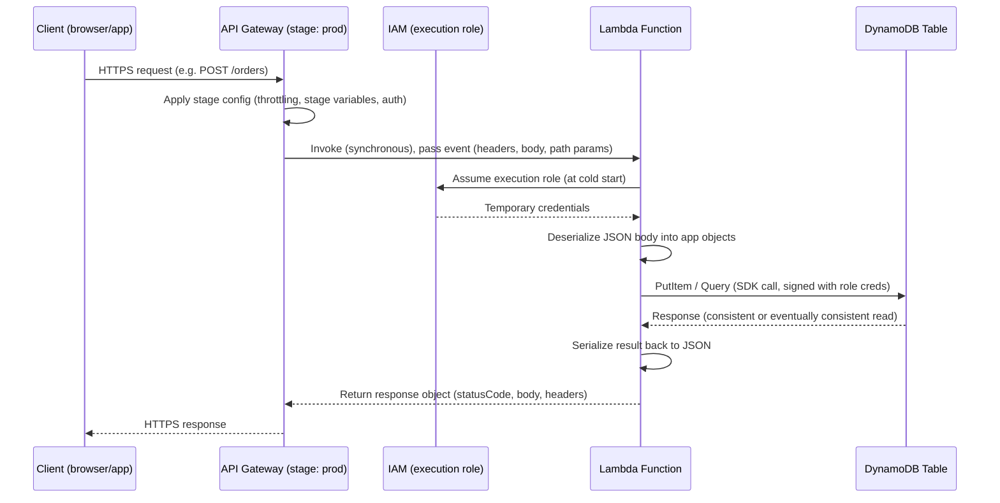

# Domain 1: Development with AWS Services (30%)

This is the biggest single domain on DVA-C03 — nearly a third of the exam. It's the "can you
actually write the application code" domain: calling AWS services from your code, writing Lambda
functions correctly, and picking/using the right data store. Everything in Domains 2-4 (security,
testing/deployment, troubleshooting) assumes you can already do what's in this domain.

## Task statements (verbatim from the exam guide)

**Task 1.1 — Develop code for applications hosted on AWS**
- Use AWS SDKs/APIs to interact with AWS services from application code
- Work with streaming data
- Serialize and deserialize data
- Build event-driven applications (EventBridge, S3 event notifications)
- Use API Gateway stages correctly (dev/test/prod promotion, stage variables)

**Task 1.2 — Develop code for AWS Lambda**
- Configure Lambda to access resources inside a VPC (private RDS, ElastiCache, etc.)
- Use Lambda layers to share code/dependencies across functions
- Manage concurrency (reserved, provisioned, account/region limits)
- Configure triggers (synchronous, asynchronous, poll-based event sources)

**Task 1.3 — Use data stores in application development**
- Choose and use DynamoDB, S3, and RDS/Aurora correctly from application code
- Understand access patterns (how you query/write, not just "what the service does")
- Understand consistency models (DynamoDB eventual vs strong, RDS/Aurora ACID transactions)
- Use the AWS SDK correctly against each (client config, retries, pagination, batching)

## Every task, mapped to a doc

| Task | What to read | Where |
|---|---|---|
| 1.1 — SDK/API calls, retries, pagination | AWS Lambda doc covers SDK-from-handler patterns; also see IAM for the credentials the SDK uses | [`services/compute/lambda.md`](../../../services/compute/lambda.md), [`services/security-identity-compliance/iam.md`](../../../services/security-identity-compliance/iam.md) |
| 1.1 — Streaming data | Kinesis family for stream ingestion patterns | [`services/analytics/kinesis-family.md`](../../../services/analytics/kinesis-family.md) |
| 1.1 — Event-driven apps (EventBridge, S3 events) | EventBridge is the central event bus; S3 event notifications are covered in the S3 doc | [`services/application-integration/eventbridge.md`](../../../services/application-integration/eventbridge.md), [`services/storage/s3.md`](../../../services/storage/s3.md) |
| 1.1 — Messaging/decoupling patterns feeding event-driven code | SQS/SNS/Step Functions patterns | [`services/application-integration/messaging-patterns-overview.md`](../../../services/application-integration/messaging-patterns-overview.md), [`services/application-integration/sqs.md`](../../../services/application-integration/sqs.md), [`services/application-integration/sns.md`](../../../services/application-integration/sns.md), [`services/application-integration/step-functions.md`](../../../services/application-integration/step-functions.md) |
| 1.1 — API Gateway stages | Stage variables, deployment promotion, throttling per stage | [`services/networking-content-delivery/api-gateway.md`](../../../services/networking-content-delivery/api-gateway.md) |
| 1.1 — GraphQL APIs (alternative to REST/HTTP APIs) | AppSync for managed GraphQL | [`services/application-integration/appsync.md`](../../../services/application-integration/appsync.md) |
| 1.2 — Lambda + VPC | Covered inside the Lambda doc's "VPC access" section | [`services/compute/lambda.md`](../../../services/compute/lambda.md) (see also [`services/networking-content-delivery/vpc.md`](../../../services/networking-content-delivery/vpc.md)) |
| 1.2 — Lambda layers, concurrency, triggers | Same doc — Lambda is a single deep-dive covering all of Task 1.2 | [`services/compute/lambda.md`](../../../services/compute/lambda.md) |
| 1.3 — DynamoDB access patterns & consistency | Full deep-dive including partition key design and consistency model | [`services/database/dynamodb.md`](../../../services/database/dynamodb.md) |
| 1.3 — S3 from application code | Object operations, consistency, multipart upload | [`services/storage/s3.md`](../../../services/storage/s3.md) |
| 1.3 — RDS/Aurora access patterns & ACID | [`services/database/rds.md`](../../../services/database/rds.md), [`services/database/aurora.md`](../../../services/database/aurora.md) |
| 1.3 — Choosing between data stores | Decision framework when a question gives you requirements instead of a service name | [`services/database/database-selection-guide.md`](../../../services/database/database-selection-guide.md) |

## New in DVA-C03: AI-assisted development

Task 1.1 (and parts of Domains 3 and 4) now expect you to recognize AI coding assistants
(Amazon Q Developer, Kiro, GitHub Copilot-style tools) as part of the normal dev workflow —
code generation, code review, and later test generation and error analysis. This pattern repeats
across all four domains, so it gets one canonical doc here, cross-linked everywhere else:

➡️ **[`ai-assisted-development.md`](ai-assisted-development.md)** — code generation/review here in
Domain 1; also referenced from [Domain 2](../domain-2-security/README.md#ai-assisted-development-cross-link),
[Domain 3](../domain-3-testing-deployment/README.md#ai-assisted-development-cross-link), and
[Domain 4](../domain-4-troubleshooting-optimization/README.md#ai-assisted-development-cross-link).

## How it fits together: a Lambda + API Gateway + DynamoDB request

This is the single most common request shape tested in Domain 1 — a REST API backed by a
serverless function backed by a NoSQL table. Nearly every Task 1.1/1.2/1.3 concept shows up
somewhere in this flow.

Step by step:
1. **Client calls API Gateway**, not Lambda directly — API Gateway is the front door, handling
   TLS termination, request validation, throttling, and routing.
2. **The stage matters** — the same API definition can have a `dev` stage and a `prod` stage with
   different throttle limits, different stage variables (e.g. which Lambda alias to call), and
   different deployment history. This is exactly Task 1.1's "use API Gateway stages correctly."
3. **API Gateway invokes Lambda synchronously** for a REST/HTTP API integration — the caller is
   waiting, so Lambda must respond within the configured timeout or API Gateway returns a 504.
4. **Lambda assumes its execution role via IAM** to get temporary credentials — this role, not the
   caller's identity, is what authorizes the DynamoDB call. Get the IAM policy wrong (missing
   `dynamodb:PutItem`) and the function fails with an `AccessDeniedException`, not a Lambda error.
5. **The handler deserializes the incoming JSON** into whatever objects the application code
   uses — Task 1.1's "serialize/deserialize data" skill.
6. **The SDK call to DynamoDB** uses the credentials from step 4. Whether the read is strongly or
   eventually consistent is a parameter you choose per-call — exam questions test whether you know
   which one a given scenario needs (e.g. "must read your own write immediately" → strong).
7. **The result is serialized back to JSON** and returned in the specific shape API Gateway's Lambda
   proxy integration expects (`statusCode`, `headers`, `body` as a string) — a very common exam trap
   is forgetting that `body` must be a JSON *string*, not a raw object.
8. **API Gateway relays the response** to the client, applying any configured response mapping.

## Common exam scenarios

- *"A Lambda function needs to read from an RDS instance in a private subnet"* → Lambda must be
  attached to that VPC (ENI in the private subnet) with a security group allowing the DB port; add
  NAT if the function also needs internet access.
- *"Multiple Lambda functions share the same third-party SDK/dependency and you want to avoid
  duplicating it in every deployment package"* → Lambda layers.
- *"A burst of traffic is causing cold starts to hurt p99 latency on a latency-sensitive API"* →
  provisioned concurrency, not just reserved concurrency (reserved only caps/guarantees capacity,
  it doesn't pre-warm).
- *"An application must process an object immediately after it's uploaded to S3"* → S3 event
  notification → Lambda (or to SQS/SNS/EventBridge first if you need fan-out, retry buffering, or
  filtering before Lambda).
- *"You need an item read immediately after writing it to reflect the latest value, every time"* →
  DynamoDB strongly consistent read (`ConsistentRead=true`), at roughly double the read-capacity cost.
- *"An application needs multi-table joins and guaranteed ACID transactions across them"* → that's
  a relational workload → RDS/Aurora, not DynamoDB (DynamoDB transactions exist but are limited to
  25 items and don't do SQL joins).
- *"Decouple a producer and consumer so a traffic spike on one side doesn't overwhelm the other"* →
  SQS queue in between (buffer + backpressure), not a direct synchronous call.
- *"The exam scenario mentions Amazon Q suggesting code changes in the IDE, or reviewing a pull
  request"* → that's the AI-assisted development pattern — see
  [`ai-assisted-development.md`](ai-assisted-development.md).

## Labs

See [`labs.md`](labs.md) for hands-on Floci exercises covering this domain.
