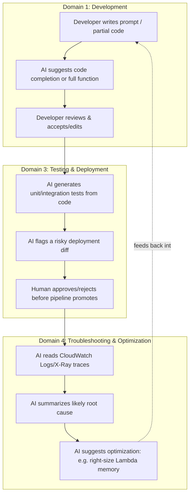

# AI-Assisted Development (cross-domain pattern)

> This doc lives in Domain 1 because code generation/review is where the pattern starts, but the
> same underlying idea — an AI assistant doing part of a workflow a human used to do entirely by
> hand — repeats in [Domain 2](../domain-2-security/README.md#ai-assisted-development-cross-link)
> (reviewing AI-service security risks), [Domain 3](../domain-3-testing-deployment/README.md#ai-assisted-development-cross-link)
> (test generation, deployment approvals), and [Domain 4](../domain-4-troubleshooting-optimization/README.md#ai-assisted-development-cross-link)
> (error analysis, optimization suggestions). Read this once; recognize it everywhere.

## Definition

AI-assisted development means using an AI coding tool — **Amazon Q Developer**, **Kiro**, or a
similar assistant — inline in your IDE or CLI to generate code, review it, write tests for it,
help decide whether a deployment is safe, or explain why something broke. DVA-C03 is new in
testing this explicitly: you're expected to recognize *which part of the SDLC* a given AI
interaction fits into, and what its real limits are, not to know how to operate any specific tool.

## Purpose

Writing, testing, deploying, and debugging code are all time-consuming and error-prone when done
entirely by hand. AWS added these assistants (and the exam added this topic) because developer
workflows increasingly include an AI step at each stage — and because using one safely/well is now
a distinct, testable skill: knowing what to trust, what to double-check, and what never to hand
an assistant (secrets, production credentials, unreviewed auto-merges).

## How It Works — the pattern across the SDLC

Step by step:
1. **Domain 1 — generation & review**: you describe intent (a comment, a prompt, a partial
   function signature); the assistant proposes code. You, the developer, remain responsible for
   correctness — the assistant is a fast first draft, not a final reviewer. Exam angle: a question
   describing "a developer uses an AI tool suggestion in their IDE to speed up writing a Lambda
   handler" is Task 1.1 territory, not magic — same IAM, same error handling rules apply to the
   generated code.
2. **Domain 3 — test generation & deployment approvals**: the same kind of assistant can read your
   function and propose unit tests or regression tests (Task 3.2), or evaluate a pipeline's planned
   change and flag something that looks risky for a human to approve before CodePipeline/CodeDeploy
   promotes it (Task 3.3). The AI never *replaces* the approval gate — it informs it.
3. **Domain 4 — root cause & optimization**: an assistant can ingest CloudWatch Logs/Metrics, X-Ray
   trace data, and CloudTrail events and propose a likely root cause or a specific tuning change
   (e.g. "this Lambda is memory-constrained, not CPU-constrained — increase memory") (Task 4.1, 4.3).
   You still verify against the actual metrics before acting.

## Key capabilities tested

- **Code generation/completion** — inline suggestions, full function scaffolds, boilerplate (IAM
  policy JSON, CloudFormation/CDK snippets, SDK calls).
- **Code review** — flagging obvious bugs, insecure patterns (hardcoded secrets, overly broad IAM),
  or style inconsistencies before a human merges.
- **Test generation / regression automation** — proposing unit tests, edge cases, or mock event
  payloads for Lambda test events.
- **Deployment approvals** — surfacing risk in a change (e.g. "this CDK diff deletes a DynamoDB
  table") so a human approver has more context before clicking approve in CodePipeline.
- **Error analysis** — summarizing logs/traces into a plain-English likely cause.
- **Optimization recommendations** — Lambda memory/timeout tuning, identifying overprovisioned
  resources, suggesting caching opportunities.

## Use Cases — When to Use It

- Scaffolding repetitive boilerplate (SDK client setup, CRUD handlers, IaC resource blocks) so a
  developer's time goes to the logic that's actually novel.
- Generating a first pass at unit tests immediately after writing a function, before a human adds
  the edge cases the AI missed.
- Summarizing a wall of CloudWatch Logs into "here are the three requests that errored and why"
  during an incident, to shortcut triage.
- Getting a second opinion on an IAM policy or security group rule before it ships.

## When NOT to Use It / Limits

- **Never feed secrets, credentials, customer PII, or proprietary source you don't have rights to
  share into a third-party-hosted assistant** unless you've confirmed the specific tool's data
  handling (see [Task 2.3 security doc](../domain-2-security/ai-service-security-risks.md) for how
  this is modeled for Bedrock-style AI services specifically).
- **Never let an AI-proposed change auto-deploy to production without a human approval gate** —
  Task 3.3 still expects CodeDeploy/CodePipeline manual approval actions or equivalent guardrails.
- **Don't trust AI-generated root-cause explanations as ground truth** — always cross-check against
  the actual CloudWatch/X-Ray data; the assistant can hallucinate a plausible-sounding but wrong
  explanation.
- Generated code still needs the same code review rigor as human-written code — faster to produce
  is not the same as more correct.

## Why It's Important

Real-world: these tools are now a default part of how teams at AWS-using companies build software;
not knowing their failure modes (over-trusting output, leaking data into prompts) is a genuine
operational risk. Exam weight: this is explicitly called out as new in DVA-C03 across Tasks 1.1,
3.2, 3.3, and 4.1/4.3 — expect at least one question per domain that's really testing "do you know
where the human judgment still has to sit."

## Exam Tips

- If a question describes an AI tool *doing* something irreversible (deploying, deleting, merging)
  with zero human check — that's the wrong answer. The correct pattern always keeps a human gate.
- If a question is about *generating* code/tests/explanations to *assist* a human — that's the
  right usage pattern.
- Don't memorize specific tool names' feature lists — the exam tests the *pattern* (generation,
  review, test-gen, approval-assist, error-analysis, optimization-assist), not product trivia.

## Related Terms

- [`../domain-2-security/ai-service-security-risks.md`](../domain-2-security/ai-service-security-risks.md) — the security-specific risks of AI *services* (Bedrock/Q), distinct from this dev-workflow pattern.
- [`services/machine-learning-ai/bedrock.md`](../../../services/machine-learning-ai/bedrock.md)
- [`services/machine-learning-ai/amazon-q.md`](../../../services/machine-learning-ai/amazon-q.md)
- [`services/developer-tools/codepipeline.md`](../../../services/developer-tools/codepipeline.md) — where deployment approval gates live.
- [`services/management-governance/cloudwatch.md`](../../../services/management-governance/cloudwatch.md) — the data AI-assisted error analysis reads.
