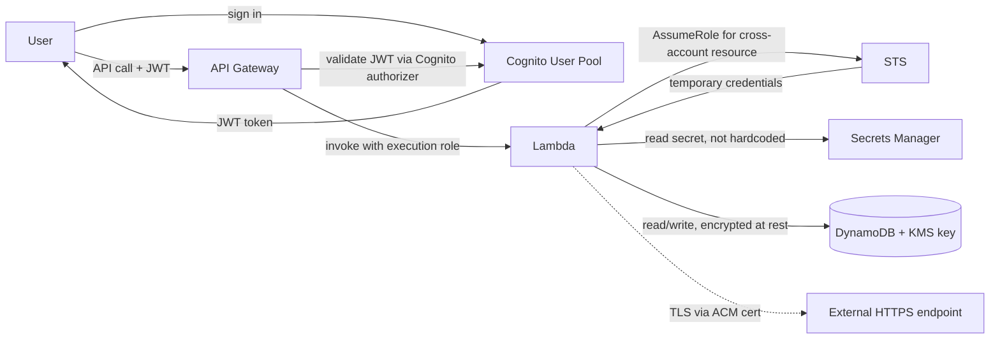

# Domain 2: Security (26%)

The second-largest domain. Where Domain 1 is "make it work," Domain 2 is "make it safe" — who's
allowed to call what, how data is protected at rest and in transit, and (brand new for DVA-C03)
how to not get burned by the new class of risks that come with AI services.

## Task statements (verbatim from the exam guide)

**Task 2.1 — Implement authentication/authorization for applications and AWS services**
- IAM users, roles, and policies for application-to-AWS authorization
- Amazon Cognito for application user authentication (user pools, identity pools)
- AWS STS for temporary credentials and cross-account/cross-service role assumption

**Task 2.2 — Implement encryption and manage sensitive data**
- Encryption in transit (TLS, ACM-issued certificates, Private CA for internal trust)
- Encryption at rest (KMS-managed keys, envelope encryption)
- Managing sensitive data/secrets (Secrets Manager vs. Parameter Store, PII masking)

**Task 2.3 — *(new)* Identify and mitigate security risks of using/integrating AI services**
- Access control for AI services (who can invoke Bedrock models, agents, Amazon Q)
- Data privacy controls for AI services — VPC endpoints for private connectivity
- Keeping your inputs/outputs out of a provider's model training data
- Content filtering (Bedrock Guardrails) for harmful/unwanted output
- Prompt injection protection
- AI agent security (scoping what an autonomous agent is allowed to actually do)
- Sensitive data appearing in logs from AI service calls

## Every task, mapped to a doc

| Task | What to read | Where |
|---|---|---|
| 2.1 — IAM users/roles/policies | [`services/security-identity-compliance/iam.md`](../../../services/security-identity-compliance/iam.md) |
| 2.1 — Application user auth (sign-up/sign-in, social IdPs, MFA) | [`services/security-identity-compliance/cognito.md`](../../../services/security-identity-compliance/cognito.md) |
| 2.1 — Workforce SSO across accounts | [`services/security-identity-compliance/iam-identity-center-sso.md`](../../../services/security-identity-compliance/iam-identity-center-sso.md) |
| 2.1 — Temporary credentials, AssumeRole, cross-account access | [`services/security-identity-compliance/sts-and-role-switching.md`](../../../services/security-identity-compliance/sts-and-role-switching.md) |
| 2.1 — Account-wide guardrails (SCPs) that bound what any role can do | [`services/security-identity-compliance/organizations-and-scps.md`](../../../services/security-identity-compliance/organizations-and-scps.md) |
| 2.2 — TLS certificates, private trust | [`services/security-identity-compliance/acm-and-private-ca.md`](../../../services/security-identity-compliance/acm-and-private-ca.md) |
| 2.2 — Encryption at rest, envelope encryption, key policies | [`services/security-identity-compliance/kms.md`](../../../services/security-identity-compliance/kms.md) |
| 2.2 — Secrets vs. config parameters | [`services/security-identity-compliance/secrets-manager-vs-parameter-store.md`](../../../services/security-identity-compliance/secrets-manager-vs-parameter-store.md) |
| 2.2 — Finding/classifying PII at rest in S3 | [`services/security-identity-compliance/macie.md`](../../../services/security-identity-compliance/macie.md) |
| 2.2 — Shared responsibility for what AWS vs. you must encrypt/patch | [`services/security-identity-compliance/shared-responsibility-model-deep-dive.md`](../../../services/security-identity-compliance/shared-responsibility-model-deep-dive.md) |
| 2.3 *(new)* — all of the above, AI-specific | **No existing service doc covers this — new standalone doc below** | [`ai-service-security-risks.md`](ai-service-security-risks.md) |
| 2.3 — private network path to AI services | [`services/networking-content-delivery/vpc-endpoints-privatelink.md`](../../../services/networking-content-delivery/vpc-endpoints-privatelink.md) |
| 2.3 — the AI service itself (Bedrock) | [`services/machine-learning-ai/bedrock.md`](../../../services/machine-learning-ai/bedrock.md), [`services/machine-learning-ai/ai-services-overview.md`](../../../services/machine-learning-ai/ai-services-overview.md), [`services/machine-learning-ai/amazon-q.md`](../../../services/machine-learning-ai/amazon-q.md) |
| Supporting: internet-facing app layer protection (not Task 2.3 itself, but often paired in scenarios) | [`services/security-identity-compliance/waf.md`](../../../services/security-identity-compliance/waf.md), [`services/security-identity-compliance/shield.md`](../../../services/security-identity-compliance/shield.md) |
| Supporting: detecting a security event after the fact | [`services/security-identity-compliance/guardduty.md`](../../../services/security-identity-compliance/guardduty.md), [`services/security-identity-compliance/security-hub-and-inspector.md`](../../../services/security-identity-compliance/security-hub-and-inspector.md) |

### AI-assisted development cross-link

Domain 2 doesn't test the *development workflow* pattern itself (that's Domain 1), but Task 2.3's
"AI agent security" item overlaps conceptually: if an AI coding assistant is itself acting as an
agent with access to your AWS account (e.g. an agent that can run CLI commands), the same
over-privileged-agent risk discussed in [`ai-service-security-risks.md`](ai-service-security-risks.md#ai-agent-security)
applies. See [`../domain-1-development/ai-assisted-development.md`](../domain-1-development/ai-assisted-development.md)
for the dev-workflow side of AI assistance.

## How it fits together: authN/authZ + encryption around a request

Step by step:
1. **The user authenticates against a Cognito User Pool**, getting back a JWT — this is
   *application user* authentication (Task 2.1), distinct from AWS service-to-service auth.
2. **API Gateway validates that JWT** using a Cognito authorizer before it ever reaches your code
   — bad/expired tokens never invoke Lambda at all, saving cost and attack surface.
3. **Lambda runs under its own execution role** (IAM) — this is *AWS service* authorization,
   separate from the user's identity. The function's permissions are whatever the role grants,
   not whatever the calling user could theoretically do.
4. **If the function needs to touch a resource in another account**, it calls STS to assume a role
   there, getting short-lived credentials instead of a long-lived cross-account key.
5. **Secrets (DB passwords, API keys) are fetched from Secrets Manager at runtime**, never
   hardcoded or passed as plaintext environment variables — this is Task 2.2's "manage sensitive
   data."
6. **Data written to DynamoDB is encrypted at rest** using a KMS key — either AWS-owned (free,
   default) or a customer-managed key (CMK, when you need audit control over who can use/rotate it).
7. **Any outbound call to an external HTTPS endpoint** validates/presents certificates issued by
   ACM — this is encryption *in transit*, the other half of Task 2.2.

## Common exam scenarios

- *"Mobile app users need to sign up/sign in and the app needs temporary AWS credentials scoped
  to each user"* → Cognito User Pool (auth) + Identity Pool (exchanges the user token for
  temporary IAM credentials via STS).
- *"A Lambda function in Account A needs to read an S3 bucket in Account B"* → cross-account IAM
  role + STS AssumeRole, not a shared access key.
- *"An application must not hardcode a database password anywhere, and the password rotates
  automatically"* → Secrets Manager (built-in rotation), not Parameter Store (no native rotation).
- *"Data must be encrypted at rest and a security team needs to control and audit exactly who can
  decrypt it"* → KMS customer-managed key with a tightly scoped key policy, not the default
  AWS-managed key.
- *"An internal service needs a trusted TLS certificate that isn't from a public CA (e.g. internal
  hostnames)"* → ACM Private CA.
- *"A generative AI feature must never send customer prompts back to the model provider for
  training"* → check the specific Bedrock model's training opt-out behavior / use a provider that
  contractually excludes it — see [`ai-service-security-risks.md`](ai-service-security-risks.md#keeping-inputsoutputs-out-of-model-training).
- *"A chatbot built on Bedrock needs to reject attempts to override its system instructions via
  user input"* → prompt injection protection via Guardrails + input validation, see
  [`ai-service-security-risks.md`](ai-service-security-risks.md#prompt-injection-protection).
- *"An AI agent is given broad IAM permissions 'to be safe' so it doesn't fail partway through a
  task"* → wrong answer; the right pattern is least-privilege scoping per
  [`ai-service-security-risks.md`](ai-service-security-risks.md#ai-agent-security).

## Labs

See [`labs.md`](labs.md) for hands-on Floci exercises covering this domain.
