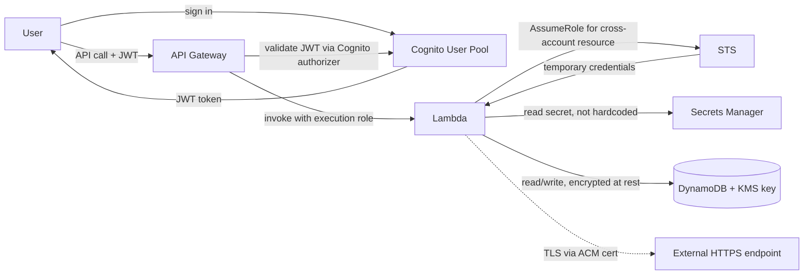
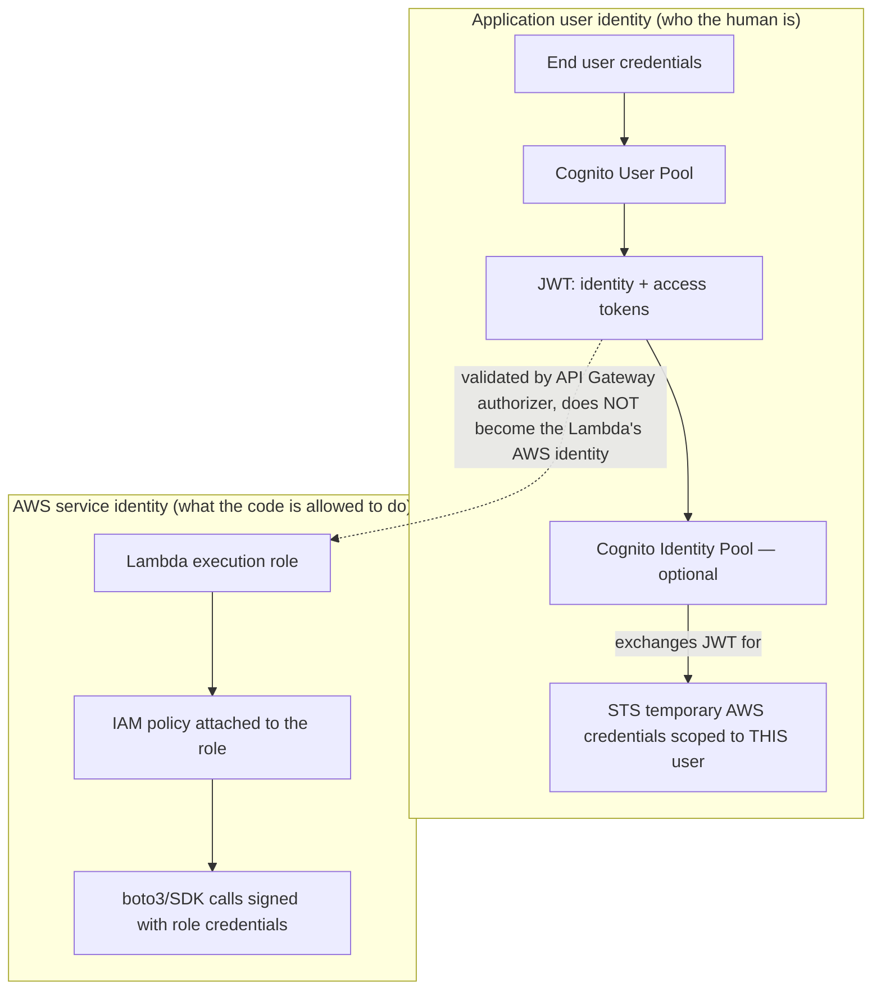
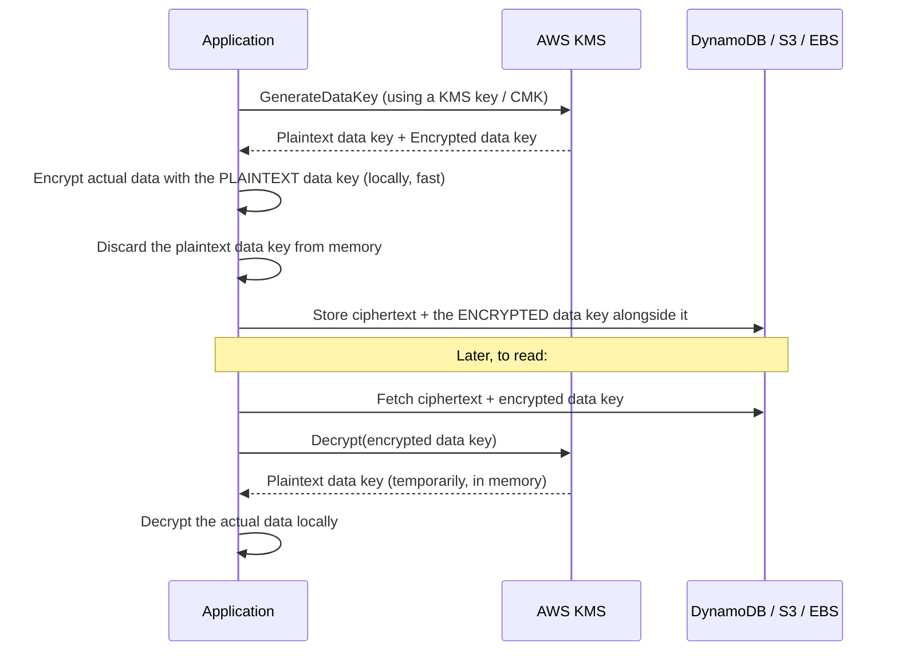
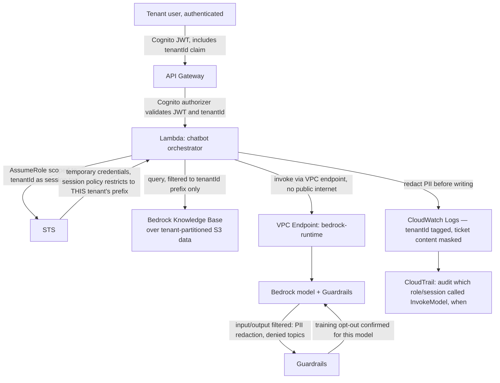
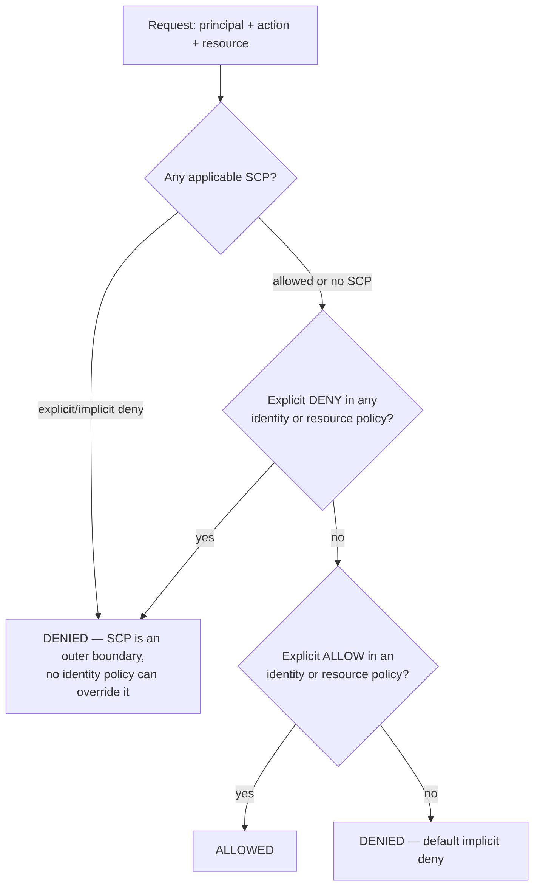
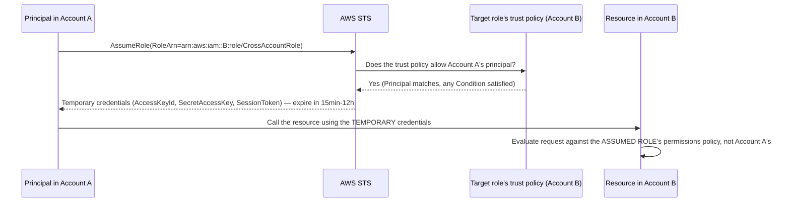
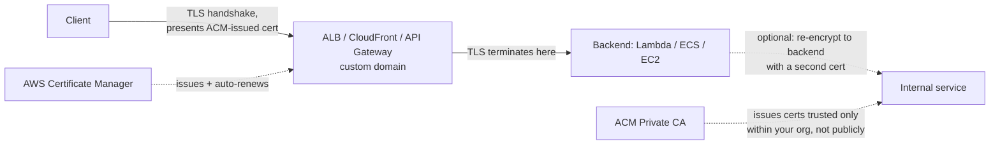

# Domain 2: Security (26%)


*Source: [AWS Documentation — What is Amazon Cognito?](https://docs.aws.amazon.com/cognito/latest/developerguide/what-is-amazon-cognito.html). User pools are the application-user-authentication half of Task 2.1; identity pools (not pictured here) are the half that turns a user-pool token into temporary AWS credentials via STS.*

The second-largest domain. Where Domain 1 is "make it work," Domain 2 is "make it safe" — who's
allowed to call what, how data is protected at rest and in transit, and (brand new for DVA-C03)
how to not get burned by the new class of risks that come with AI services. If Domain 1's mental
model is "the SDK call that works," Domain 2's is "the SDK call that fails safely when it
*shouldn't* work" — nearly every Domain 2 exam question is really asking whether a specific
request should be denied, and by what mechanism.

## Task statements (verbatim from the exam guide)

**Task 2.1 — Implement authentication/authorization for applications and AWS services**
- IAM users, roles, and policies for application-to-AWS authorization
- Amazon Cognito for application user authentication (user pools, identity pools)
- AWS STS for temporary credentials and cross-account/cross-service role assumption

**Task 2.2 — Implement encryption and manage sensitive data**
- Encryption in transit (TLS, ACM-issued certificates, Private CA for internal trust)
- Encryption at rest (KMS-managed keys, envelope encryption)
- Managing sensitive data/secrets (Secrets Manager vs. Parameter Store, PII masking)

**Task 2.3 — *(new)* Identify and mitigate security risks of using/integrating AI services**
- Access control for AI services (who can invoke Bedrock models, agents, Amazon Q)
- Data privacy controls for AI services — VPC endpoints for private connectivity
- Keeping your inputs/outputs out of a provider's model training data
- Content filtering (Bedrock Guardrails) for harmful/unwanted output
- Prompt injection protection
- AI agent security (scoping what an autonomous agent is allowed to actually do)
- Sensitive data appearing in logs from AI service calls

## Every task, mapped to a doc

| Task | What to read | Where |
|---|---|---|
| 2.1 — IAM users/roles/policies | [`services/security-identity-compliance/iam.md`](../../../services/security-identity-compliance/iam.md) |
| 2.1 — Application user auth (sign-up/sign-in, social IdPs, MFA) | [`services/security-identity-compliance/cognito.md`](../../../services/security-identity-compliance/cognito.md) |
| 2.1 — Workforce SSO across accounts | [`services/security-identity-compliance/iam-identity-center-sso.md`](../../../services/security-identity-compliance/iam-identity-center-sso.md) |
| 2.1 — Temporary credentials, AssumeRole, cross-account access | [`services/security-identity-compliance/sts-and-role-switching.md`](../../../services/security-identity-compliance/sts-and-role-switching.md) |
| 2.1 — Account-wide guardrails (SCPs) that bound what any role can do | [`services/security-identity-compliance/organizations-and-scps.md`](../../../services/security-identity-compliance/organizations-and-scps.md) |
| 2.2 — TLS certificates, private trust | [`services/security-identity-compliance/acm-and-private-ca.md`](../../../services/security-identity-compliance/acm-and-private-ca.md) |
| 2.2 — Encryption at rest, envelope encryption, key policies | [`services/security-identity-compliance/kms.md`](../../../services/security-identity-compliance/kms.md) |
| 2.2 — Secrets vs. config parameters | [`services/security-identity-compliance/secrets-manager-vs-parameter-store.md`](../../../services/security-identity-compliance/secrets-manager-vs-parameter-store.md) |
| 2.2 — Finding/classifying PII at rest in S3 | [`services/security-identity-compliance/macie.md`](../../../services/security-identity-compliance/macie.md) |
| 2.2 — Shared responsibility for what AWS vs. you must encrypt/patch | [`services/security-identity-compliance/shared-responsibility-model-deep-dive.md`](../../../services/security-identity-compliance/shared-responsibility-model-deep-dive.md) |
| 2.3 *(new)* — all of the above, AI-specific | **No existing service doc covers this — new standalone doc below** | [`ai-service-security-risks.md`](ai-service-security-risks.md) |
| 2.3 — private network path to AI services | [`services/networking-content-delivery/vpc-endpoints-privatelink.md`](../../../services/networking-content-delivery/vpc-endpoints-privatelink.md) |
| 2.3 — the AI service itself (Bedrock) | [`services/machine-learning-ai/bedrock.md`](../../../services/machine-learning-ai/bedrock.md), [`services/machine-learning-ai/ai-services-overview.md`](../../../services/machine-learning-ai/ai-services-overview.md), [`services/machine-learning-ai/amazon-q.md`](../../../services/machine-learning-ai/amazon-q.md) |
| Supporting: internet-facing app layer protection (not Task 2.3 itself, but often paired in scenarios) | [`services/security-identity-compliance/waf.md`](../../../services/security-identity-compliance/waf.md), [`services/security-identity-compliance/shield.md`](../../../services/security-identity-compliance/shield.md) |
| Supporting: detecting a security event after the fact | [`services/security-identity-compliance/guardduty.md`](../../../services/security-identity-compliance/guardduty.md), [`services/security-identity-compliance/security-hub-and-inspector.md`](../../../services/security-identity-compliance/security-hub-and-inspector.md) |
| Supporting: Lambda's own execution-role identity, which every Domain 2 control ultimately governs | [`services/compute/lambda.md`](../../../services/compute/lambda.md) |
| Supporting: where encrypted data actually lands for Task 1.3's data-store choices | [`services/database/dynamodb.md`](../../../services/database/dynamodb.md), [`services/storage/s3.md`](../../../services/storage/s3.md) |

### AI-assisted development cross-link

Domain 2 doesn't test the *development workflow* pattern itself (that's Domain 1), but Task 2.3's
"AI agent security" item overlaps conceptually: if an AI coding assistant is itself acting as an
agent with access to your AWS account (e.g. an agent that can run CLI commands), the same
over-privileged-agent risk discussed in [`ai-service-security-risks.md`](ai-service-security-risks.md#ai-agent-security)
applies. See [`../domain-1-development/ai-assisted-development.md`](../domain-1-development/ai-assisted-development.md)
for the dev-workflow side of AI assistance.

## How it fits together: authN/authZ + encryption around a request



Step by step:
1. **The user authenticates against a Cognito User Pool**, getting back a JWT — this is
   *application user* authentication (Task 2.1), distinct from AWS service-to-service auth.
2. **API Gateway validates that JWT** using a Cognito authorizer before it ever reaches your code
   — bad/expired tokens never invoke Lambda at all, saving cost and attack surface.
3. **Lambda runs under its own execution role** (IAM) — this is *AWS service* authorization,
   separate from the user's identity. The function's permissions are whatever the role grants,
   not whatever the calling user could theoretically do.
4. **If the function needs to touch a resource in another account**, it calls STS to assume a role
   there, getting short-lived credentials instead of a long-lived cross-account key.
5. **Secrets (DB passwords, API keys) are fetched from Secrets Manager at runtime**, never
   hardcoded or passed as plaintext environment variables — this is Task 2.2's "manage sensitive
   data."
6. **Data written to DynamoDB is encrypted at rest** using a KMS key — either AWS-owned (free,
   default) or a customer-managed key (CMK, when you need audit control over who can use/rotate it).
7. **Any outbound call to an external HTTPS endpoint** validates/presents certificates issued by
   ACM — this is encryption *in transit*, the other half of Task 2.2.

## The identity chain: user identity vs. AWS service identity

Task 2.1's hardest conceptual point, visualized — these are **two separate identity chains that
meet at API Gateway but never merge**:



A function's AWS permissions almost always come from its **execution role**, not from the calling
user's Cognito identity — unless you've deliberately built a Cognito Identity Pool exchange to get
*user-scoped* temporary credentials (common for direct-from-mobile-app S3/DynamoDB access that
skips a backend entirely). The exam tests whether you can tell these two chains apart: "a user who
is authenticated via Cognito tries to call an AWS API directly from a mobile app" needs an Identity
Pool exchange; "a user calls your API, and your Lambda calls AWS APIs on the user's behalf" needs
only the Lambda's own execution role — the user's identity never needs AWS credentials at all.

## Encryption at rest: envelope encryption in one picture



This is **envelope encryption**, and it's why KMS can protect data far larger than the
4KB-per-call it will actually encrypt/decrypt directly: KMS only ever touches the small *data key*,
never the bulk payload. Most AWS services that integrate with KMS (S3 SSE-KMS, EBS, DynamoDB
encryption at rest) implement this pattern for you transparently — you choose the KMS key, the
service handles the envelope mechanics. Exam angle: a question asking "why doesn't encrypting a
10GB object directly with KMS work" is testing whether you know KMS `Encrypt`/`Decrypt` API calls
are capped at 4KB of data and are meant for keys, not bulk payloads.

## Full worked case study: securing a multi-tenant SaaS app with an AI support chatbot

**Requirement.** A B2B SaaS company serves multiple customer organizations ("tenants") from one
AWS account. Each tenant's data must be strictly isolated from every other tenant's. The product
team is adding a Bedrock-powered support chatbot that can answer questions using each tenant's own
support tickets as context (a RAG pattern), but the chatbot must never let Tenant A's prompt
surface Tenant B's data, must never send ticket content to the model provider for training, and
security needs an audit trail of every chatbot interaction without customer PII landing in plain
text in logs.

**Architecture.**



**Why each choice:**
- **Cognito JWT carries a `tenantId` claim**, and **STS `AssumeRole` is called with a session tag
  for that tenant**, combined with a session policy that further restricts the resulting temporary
  credentials to that tenant's S3 prefix. This is Task 2.1's cross-account/role-assumption pattern
  used *within* one account for tenant isolation — the mechanism (STS, scoped session policies) is
  identical to cross-account use, just applied to multi-tenancy instead.
- **The Bedrock Knowledge Base query is filtered to the tenant's own data prefix** before it ever
  reaches the model — isolation is enforced at the data-retrieval layer, not just hoped for via
  prompt instructions (which prompt injection could defeat — see
  [`ai-service-security-risks.md#prompt-injection-protection`](ai-service-security-risks.md#prompt-injection-protection)).
  Never rely on "the model was told not to mix tenant data" as the only control.
- **A VPC endpoint for `bedrock-runtime`** keeps every model call on the AWS private network path,
  satisfying the company's requirement that customer support data never traverses the public
  internet — Task 2.3's data-privacy-via-VPC-endpoints bullet, applied directly.
- **Guardrails handles both PII redaction and training opt-out verification** — the former so a
  ticket containing a customer's email/phone doesn't leak into a response to a different agent
  session, the latter because the business requirement explicitly forbids training use.
- **CloudWatch Logs are written with ticket content masked/redacted and tagged by `tenantId`**, so
  an incident investigation can scope its search to one tenant without ever exposing PII in the
  log stream itself — Task 2.3's "sensitive data in logs" bullet.
- **CloudTrail captures every `InvokeModel`/`Retrieve` API call** with the calling role/session
  identity, giving the audit trail the security team asked for — distinct from the CloudWatch
  Logs, which capture *application* behavior, not *who called the AWS API*.

This case study is intentionally a composite of nearly every Task 2.1/2.2/2.3 bullet point in one
scenario — if you can explain why each piece is there, you can handle almost any Domain 2 scenario
question built from a subset of it.

## Use Cases — Real Scenarios

Concrete developer/security situations where Task 2.1/2.2/2.3 decisions actually get made, with
app type / requirement / implementation decision spelled out:

1. **App type:** Consumer fitness-tracking mobile app. **Requirement:** users sign up/sign in with
   email+password or Google, and the app writes workout data directly to DynamoDB from the mobile
   client without a backend in between. **Decision:** Cognito User Pool for authentication plus a
   Cognito Identity Pool to exchange the user's JWT for temporary, user-scoped STS credentials —
   the mobile client never embeds a long-lived AWS access key.
2. **App type:** B2B logistics platform with a partner-facing API. **Requirement:** a partner's
   Lambda function (running in their own AWS account) needs read access to a shipment-status S3
   bucket in your account, and the access must be revocable without rotating any shared secret.
   **Decision:** a cross-account IAM role with a trust policy naming the partner's account/role ARN,
   assumed via STS — revoking access means removing the trust statement, not rotating a key.
3. **App type:** Subscription SaaS billing service. **Requirement:** the database password must
   rotate automatically on a schedule without any manual intervention or application downtime
   during rotation. **Decision:** Secrets Manager with native rotation (a Lambda rotation function
   for RDS), not Parameter Store — rotation support is the deciding feature, not just "it's a
   secret."
4. **App type:** Healthcare records API. **Requirement:** patient data at rest must be encrypted
   with a key the security team can audit (who used it, when) and revoke independently of the
   data store itself. **Decision:** a KMS customer-managed key (CMK) with a tightly scoped key
   policy and CloudTrail-logged key usage, not the default AWS-owned key — the audit/control
   requirement is the deciding factor, since both options encrypt the data equally well.
5. **App type:** Internal microservices mesh. **Requirement:** service-to-service TLS between
   internal hostnames that should never appear in a public certificate transparency log.
   **Decision:** ACM Private CA issuing certs trusted only within the internal trust chain, instead
   of public ACM certificates, which log every issued hostname publicly.
6. **App type:** B2B SaaS support chatbot built on Bedrock (see the case study above).
   **Requirement:** each tenant's data must never leak into another tenant's chatbot session, even
   via the model itself. **Decision:** scope data retrieval at the IAM/session-policy layer (STS
   AssumeRole with a tenant session tag, Knowledge Base query filtered to the tenant's own prefix)
   rather than relying on a system prompt instruction, which prompt injection could defeat.
7. **App type:** Regulated financial-services AI assistant. **Requirement:** compliance requires
   that no customer prompt or document ever touches the public internet on its way to the model.
   **Decision:** a VPC interface endpoint for `bedrock-runtime` with no NAT/internet gateway route
   from the calling Lambda at all — the strongest version of the requirement, not just "it's over
   TLS."
8. **App type:** Customer-support AI agent with order-management tool access. **Requirement:** the
   agent should be able to look up order status freely but must never issue a refund without a
   human confirming it first. **Decision:** scope the agent's action-group IAM role to read-only
   lookup actions, and gate the refund action behind an explicit human-approval step — treating the
   agent's tool-access grant with the same scrutiny as an IAM policy review.
9. **App type:** Enterprise workforce accessing a dozen AWS accounts (not application end-users).
   **Requirement:** employees sign in once and get console/CLI access scoped per account/role
   without a separate IAM user in every account. **Decision:** IAM Identity Center (SSO), not
   Cognito — Cognito is for an *application's* end users, Identity Center is for a workforce
   accessing AWS itself.
10. **App type:** AI support bot logging pipeline. **Requirement:** a security audit must be able
    to reconstruct which IAM principal invoked which Bedrock model and when, independent of what
    the application logged about its own behavior. **Decision:** rely on CloudTrail for the
    `InvokeModel` audit trail (who/when), and keep CloudWatch Logs scoped to redacted application
    telemetry (what happened) — using each tool for the question it actually answers.

## Common exam scenarios

- *"Mobile app users need to sign up/sign in and the app needs temporary AWS credentials scoped
  to each user"* → Cognito User Pool (auth) + Identity Pool (exchanges the user token for
  temporary IAM credentials via STS).
- *"A Lambda function in Account A needs to read an S3 bucket in Account B"* → cross-account IAM
  role + STS AssumeRole, not a shared access key.
- *"An application must not hardcode a database password anywhere, and the password rotates
  automatically"* → Secrets Manager (built-in rotation), not Parameter Store (no native rotation).
- *"Data must be encrypted at rest and a security team needs to control and audit exactly who can
  decrypt it"* → KMS customer-managed key with a tightly scoped key policy, not the default
  AWS-managed key.
- *"An internal service needs a trusted TLS certificate that isn't from a public CA (e.g. internal
  hostnames)"* → ACM Private CA.
- *"A generative AI feature must never send customer prompts back to the model provider for
  training"* → check the specific Bedrock model's training opt-out behavior / use a provider that
  contractually excludes it — see [`ai-service-security-risks.md`](ai-service-security-risks.md#keeping-inputsoutputs-out-of-model-training).
- *"A chatbot built on Bedrock needs to reject attempts to override its system instructions via
  user input"* → prompt injection protection via Guardrails + input validation, see
  [`ai-service-security-risks.md`](ai-service-security-risks.md#prompt-injection-protection).
- *"An AI agent is given broad IAM permissions 'to be safe' so it doesn't fail partway through a
  task"* → wrong answer; the right pattern is least-privilege scoping per
  [`ai-service-security-risks.md`](ai-service-security-risks.md#ai-agent-security).
- *"Multiple tenants in one AWS account must never see each other's data, even via a shared AI
  feature"* → scope data access at retrieval time (STS session policies / Knowledge Base filtering),
  not via prompt instructions alone — see the case study above.
- *"A security team needs to know which IAM principal called a specific Bedrock model and when"*
  → CloudTrail, not CloudWatch Logs (CloudTrail is the API-call audit trail; CloudWatch is
  application telemetry).
- *"Encrypting a large file directly with a KMS API call fails or is impractical"* → KMS has a
  4KB-per-call limit for `Encrypt`/`Decrypt`; use envelope encryption (`GenerateDataKey` + local
  encryption of the bulk payload).
- *"A workforce needs single sign-on across many AWS accounts, not application end-user login"* →
  IAM Identity Center (SSO), not Cognito — Cognito is for *your application's* end users, Identity
  Center is for *your organization's workforce* accessing AWS accounts/consoles.
- *"An account-wide guardrail must prevent any role, even an admin's, from disabling CloudTrail"*
  → a Service Control Policy (SCP) at the Organizations level, not an IAM policy (IAM policies
  can't restrict what a sufficiently-privileged principal in the same account could otherwise
  change; SCPs set an outer boundary no identity-based policy can expand past).
- *"A company wants to find out if PII already exists unencrypted in an S3 bucket, not prevent it
  going forward"* → Macie (discovers/classifies existing sensitive data), a detective control, as
  distinct from the preventive controls (KMS, bucket policies) that stop new exposure.
- *"A customer support bot must never reveal another customer's SSN even if directly asked"* →
  Bedrock Guardrails' sensitive-information filter, configured to redact/block PII in both the
  input and the output direction.

## IAM policy evaluation, precisely

Task 2.1 assumes you can reason about what a *combination* of policies actually allows, not just
read a single policy document. The evaluation logic the exam tests:



Three rules that resolve most Domain 2 "will this call succeed" questions:
1. **Explicit deny always wins**, no matter how many other policies grant access. There is no
   "most-permissive-wins" rule in IAM.
2. **Everything is denied by default** unless something explicitly allows it. A principal with no
   attached policy can do nothing, not "basic" things.
3. **An SCP (Organizations) only ever narrows what's possible** — it can never grant a permission,
   only restrict the maximum an identity policy inside that account could otherwise allow, even for
   a root/admin principal in the account.

```json
// A policy that LOOKS permissive but is actually fully blocked by one Deny statement:
{
  "Version": "2012-10-17",
  "Statement": [
    { "Effect": "Allow", "Action": "s3:*", "Resource": "*" },
    { "Effect": "Deny",  "Action": "s3:DeleteObject", "Resource": "arn:aws:s3:::prod-data/*" }
  ]
}
```
Exam angle: a question showing a policy like this and asking "can this principal delete an object
in `prod-data`" is testing rule #1 above — the answer is no, regardless of how broad the Allow
statement looks.

## Secrets Manager vs. Parameter Store, the decision in one table

Task 2.2 loves testing this exact choice with a scenario instead of naming the service directly:

| Need | Secrets Manager | Parameter Store (Standard) |
|---|---|---|
| Automatic rotation (DB passwords, API keys) | ✅ built-in, with Lambda rotation functions for RDS/Aurora/Redshift/DocumentDB out of the box | ❌ no native rotation — you'd build it yourself |
| Cost | Per-secret monthly charge + API call charges | Free for Standard tier parameters |
| Cross-account sharing via resource policy | ✅ | Limited |
| Fine-grained versioning with staged labels (`AWSCURRENT`/`AWSPENDING`) during rotation | ✅ | ❌ |
| Simple config values (log level, feature flags, non-secret settings) | Overkill — extra cost for no benefit | ✅ exactly what it's for |
| Encrypted at rest with KMS | ✅ always | ✅ (SecureString type) |

A scenario that says "the secret rotates automatically on a schedule and nothing else about it
matters" is Secrets Manager, full stop — rotation support is the single most-tested differentiator.
A scenario that says "store a non-secret config value, cost-consciously" is Parameter Store.

## AI service security risks, condensed into one table

The full breakdown lives in [`ai-service-security-risks.md`](ai-service-security-risks.md); here's
the one-table version for quick review once you've read it in full:

| Risk area | The control | Common wrong answer |
|---|---|---|
| Access control | IAM policy scoped to specific model ARNs, not `bedrock:*` on `*` | Granting broad Bedrock access "to unblock development" and never tightening it |
| Data privacy (network path) | VPC endpoint (PrivateLink) for `bedrock-runtime` | Assuming TLS alone is enough and skipping the private network path requirement |
| Training opt-out | Verify/configure the specific model's no-training-use setting | Assuming it's automatic/universal across every AI service |
| Content filtering | Bedrock Guardrails content filters (both directions) | Relying only on the base model's built-in safety behavior |
| Prompt injection | Separate system instructions from user content; validate retrieved RAG documents | Trusting a prompt instruction alone ("never reveal X") as a security boundary |
| Agent security | Least-privilege, scoped agent execution role; human approval for irreversible actions | Broad agent permissions "in case it needs them" |
| Logs | Redact/mask sensitive fields before writing to CloudWatch | Logging full raw request/response payloads by default |

## Domain 2 study checklist

- [ ] Explain the IAM policy evaluation order (explicit deny > SCP boundary > explicit allow >
      implicit deny) and apply it to a policy-combination question.
- [ ] Pick Cognito User Pools vs. Identity Pools vs. IAM Identity Center correctly for a given
      "who is authenticating" scenario.
- [ ] Explain envelope encryption and why KMS's 4KB limit matters for large payloads.
- [ ] Pick Secrets Manager vs. Parameter Store based on rotation need, not just "it's a secret."
- [ ] List all seven Task 2.3 AI-service risk areas from memory and give one mitigation for each.
- [ ] Explain the difference between CloudTrail (who called an API) and CloudWatch Logs
      (what the application did) in the context of an AI-service security investigation.
- [ ] Explain why a VPC endpoint matters for Bedrock even though the API call is already over TLS.

## Cross-account STS AssumeRole, step by step

Task 2.1's "cross-account/cross-service role assumption" bullet is one sequence worth memorizing
cold, because it's tested from several different angles (a Lambda needing cross-account S3 access,
a CI/CD pipeline deploying into multiple accounts, a federated user getting console access):



Two documents govern this, and mixing them up is the single most common Domain 2 exam trap:
- **The trust policy** (attached to the role in Account B) answers "who is allowed to assume me?"
- **The permissions policy** (also attached to that role) answers "what can someone who has
  assumed me actually do?"

Getting cross-account access to "not work" is almost always one of these two being wrong — either
the trust policy doesn't list Account A's principal, or the permissions policy doesn't grant the
specific action needed, even though the AssumeRole call itself succeeded.

## Encryption in transit: where ACM certificates actually sit



The exam-relevant distinction: **public ACM certificates** (free, auto-renewing, issued by a
publicly trusted CA) are for anything internet-facing — a CloudFront distribution, an ALB, a
custom API Gateway domain. **ACM Private CA** issues certificates trusted only by clients that
have been configured to trust your private CA — used for internal service-to-service TLS where a
publicly trusted certificate would be unnecessary (and sometimes undesirable, since public CAs
log issued certificate hostnames to public transparency logs, which can leak internal naming).
A scenario mentioning "internal-only hostnames that should never appear in a public certificate
transparency log" is pointing at Private CA specifically, not regular ACM.

## Labs

See [`labs.md`](labs.md) for hands-on Floci exercises covering this domain.
