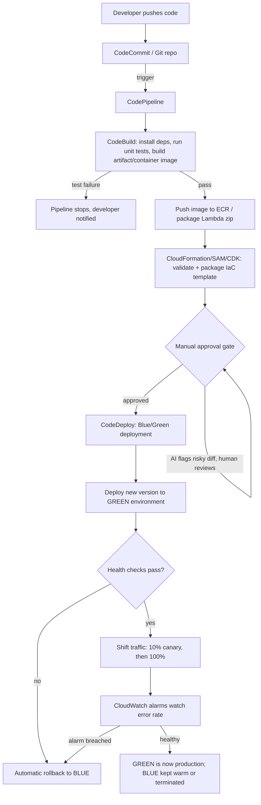

# Domain 3: Testing and Deployment (22%)

Once code exists (Domain 1) and is reasonably secure (Domain 2), Domain 3 is about shipping it
reliably: packaging artifacts correctly, proving they work before they go live, and getting them
into production through an automated, reversible pipeline.

## Task statements (verbatim from the exam guide)

**Task 3.1 — Prepare application artifacts for deployment**
- Dependency management (bundling, layers, lockfiles)
- Build container images for ECR (Dockerfiles, tagging, lifecycle policies)
- Externalize configuration (AppConfig, Parameter Store, Secrets Manager — don't bake config into
  the artifact)
- Configure API Gateway stages as part of the deployment artifact (stage-specific variables)

**Task 3.2 — Implement and automate application testing**
- Validate infrastructure templates (SAM, CDK, CloudFormation) before deploying them
- Use mock APIs and test events to exercise Lambda functions without live dependencies
- AI-assisted test generation and regression-test automation

**Task 3.3 — Deploy code via CI/CD**
- Package and deploy Lambda functions (zip vs. container image)
- Deploy to ECS/EKS/Fargate (new container-deployment emphasis in DVA-C03)
- Deploy infrastructure via IaC templates (CloudFormation/CDK/SAM)
- Use CodeDeploy for compute deployment, CodePipeline for orchestration
- Choose a deployment strategy: blue/green, canary, rolling — and configure rollback
- AI-assisted deployment approvals (human-in-the-loop gating informed by AI risk flags)

## Every task, mapped to a doc

| Task | What to read | Where |
|---|---|---|
| 3.1 — Dependency bundling, Lambda layers | [`services/compute/lambda.md`](../../../services/compute/lambda.md) |
| 3.1 — Container images, ECR build/tag/lifecycle | [`services/containers/ecr.md`](../../../services/containers/ecr.md) |
| 3.1 — Container-vs-VM-vs-serverless packaging decision | [`services/containers/containers-vs-vms-vs-serverless.md`](../../../services/containers/containers-vs-vms-vs-serverless.md) |
| 3.1 — Externalized config | [`services/security-identity-compliance/secrets-manager-vs-parameter-store.md`](../../../services/security-identity-compliance/secrets-manager-vs-parameter-store.md) (AppConfig itself is covered as part of Systems Manager — see [`services/management-governance/systems-manager.md`](../../../services/management-governance/systems-manager.md)) |
| 3.1 — API Gateway stage config as deployable artifact | [`services/networking-content-delivery/api-gateway.md`](../../../services/networking-content-delivery/api-gateway.md) |
| 3.2 — IaC template authoring/validation | [`services/developer-tools/sam.md`](../../../services/developer-tools/sam.md), [`services/management-governance/cloudformation.md`](../../../services/management-governance/cloudformation.md), [`services/management-governance/cdk.md`](../../../services/management-governance/cdk.md) |
| 3.2 — Build-time test execution | [`services/developer-tools/codebuild.md`](../../../services/developer-tools/codebuild.md) |
| 3.2 — Source control triggering the pipeline | [`services/developer-tools/codecommit.md`](../../../services/developer-tools/codecommit.md) |
| 3.2 — AI-assisted test generation | Cross-link — see below |
| 3.3 — Lambda packaging & versioning | [`services/compute/lambda.md`](../../../services/compute/lambda.md) |
| 3.3 — ECS/EKS/Fargate deployment (new DVA-C03 emphasis) | [`services/containers/ecs.md`](../../../services/containers/ecs.md), [`services/containers/eks.md`](../../../services/containers/eks.md), [`services/containers/fargate.md`](../../../services/containers/fargate.md), [`services/compute/fargate.md`](../../../services/compute/fargate.md) |
| 3.3 — IaC deployment | [`services/management-governance/cloudformation.md`](../../../services/management-governance/cloudformation.md), [`services/management-governance/cdk.md`](../../../services/management-governance/cdk.md), [`services/developer-tools/sam.md`](../../../services/developer-tools/sam.md) |
| 3.3 — Compute deployment strategies (blue/green, canary, rolling) | [`services/developer-tools/codedeploy.md`](../../../services/developer-tools/codedeploy.md) |
| 3.3 — Pipeline orchestration end-to-end | [`services/developer-tools/codepipeline.md`](../../../services/developer-tools/codepipeline.md) |
| 3.3 — Low-friction dev environments to test deployment scripts from | [`services/developer-tools/cloud9-and-cloudshell.md`](../../../services/developer-tools/cloud9-and-cloudshell.md) |
| 3.3 — AI-assisted deployment approvals | Cross-link — see below |

### AI-assisted development cross-link

Task 3.2's test generation and Task 3.3's deployment approvals are two of the four places the
AI-assisted development pattern shows up on this exam. Read the canonical explanation once in
Domain 1, then apply it here:

➡️ **[`../domain-1-development/ai-assisted-development.md`](../domain-1-development/ai-assisted-development.md#how-it-works--the-pattern-across-the-sdlc)**
— see the "Domain 3" section of that doc's diagram for how AI-generated tests and AI-flagged
deployment risk fit into a CodePipeline run.

## How it fits together: a full CI/CD pipeline with blue/green deployment

Step by step:
1. **A developer pushes code** to the source repo, which triggers the pipeline automatically —
   no manual kickoff needed (Task 3.3's CI/CD automation).
2. **CodeBuild compiles, runs unit/integration tests, and produces a deployable artifact** — either
   a container image or a Lambda deployment package. If tests fail here, the pipeline stops before
   anything touches a live environment — this is where Task 3.2's automated testing actually runs.
3. **The artifact is pushed to ECR** (containers) or packaged as a Lambda zip, and any IaC template
   (CloudFormation/SAM/CDK) describing the infrastructure change is validated — catching a broken
   template before it's ever applied.
4. **A manual approval gate** pauses the pipeline. This is where Task 3.3's "AI-assisted deployment
   approvals" lives — an AI tool can summarize the diff and flag risk, but a human still clicks
   approve. Skipping this gate for production changes is a common exam wrong-answer trap.
5. **CodeDeploy performs a blue/green deployment**: the new version goes live in a parallel
   ("green") environment while the current ("blue") environment keeps serving all traffic.
6. **Health checks run against green** before any real traffic reaches it — if they fail, the
   deployment is aborted and blue is untouched (zero customer impact).
7. **Traffic shifts gradually** (a canary-style ramp: e.g. 10% → monitor → 100%) rather than all at
   once — this limits the blast radius of a problem that health checks didn't catch.
8. **CloudWatch alarms watch the shifted traffic** (error rate, latency) throughout the shift — if
   an alarm breaches its threshold, CodeDeploy automatically rolls back to blue. This automatic,
   metric-driven rollback is exactly what Task 3.3 means by "configure rollback," and it's also the
   bridge into Domain 4 (the same CloudWatch alarms get used for troubleshooting).
9. **Once healthy, green becomes the new production** — blue is either terminated or kept idle
   briefly as an instant rollback target.

## Common exam scenarios

- *"A deployment must have near-zero downtime and an instant, full rollback option if anything goes
  wrong"* → blue/green (full environment swap), not rolling (rolling has no single "flip back"
  point — it's gradually replacing instances).
- *"Only a small percentage of users should see the new version first, to limit risk before a full
  rollout"* → canary deployment.
- *"A monitoring alarm should automatically trigger a rollback during a deployment, not just alert
  a human"* → configure CodeDeploy rollback to trigger on CloudWatch alarm state, not just on
  deployment failure.
- *"A Lambda function's test events need to simulate an S3 upload without actually uploading a
  file"* → use a mock/test event (Task 3.2), e.g. the console's built-in S3 Put test event template.
- *"Infrastructure changes must be validated for syntax/drift before they're ever applied"* → run
  `cfn-lint`/`sam validate`/`cdk diff` in the CodeBuild stage, before the deploy stage.
- *"Container images must be scanned and only tagged images older than N days should be purged"* →
  ECR lifecycle policies + image scanning, not manual cleanup.
- *"An AI tool suggests a deployment is safe, but the team still wants a person to confirm before
  production changes go live"* → manual approval action in CodePipeline, informed but not replaced
  by the AI flag.
- *"A new container-based microservice must scale automatically without managing EC2 instances"* →
  ECS/EKS on Fargate, not self-managed EC2-backed ECS/EKS.

## Labs

See [`labs.md`](labs.md) for hands-on Floci exercises covering this domain.
