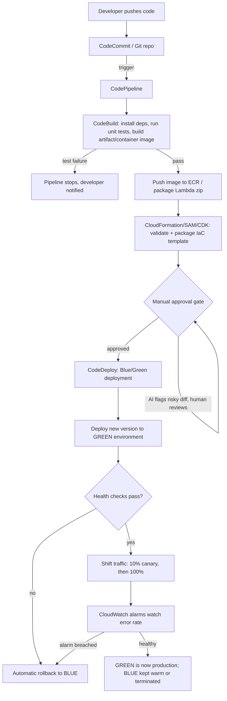
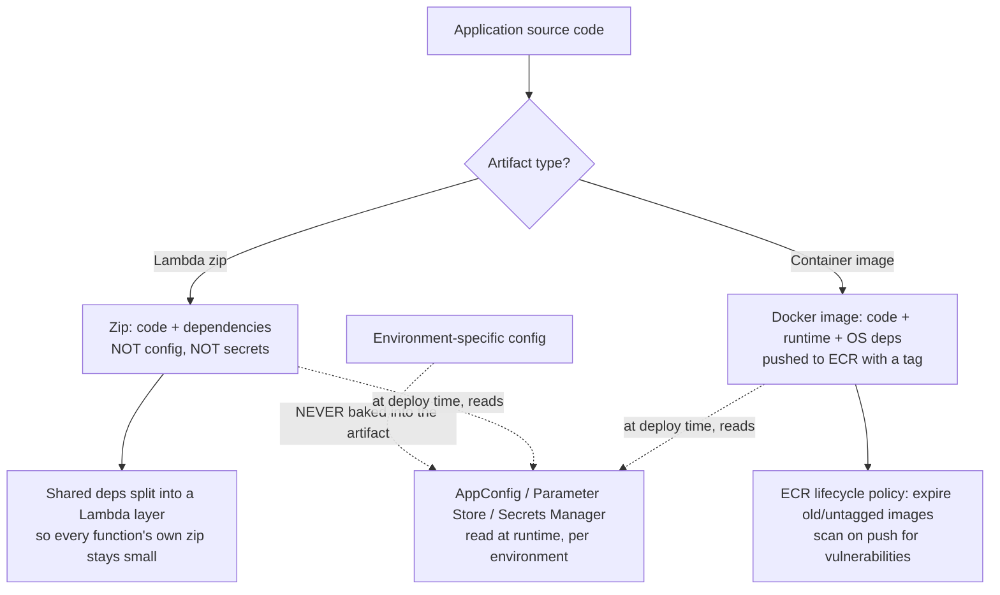
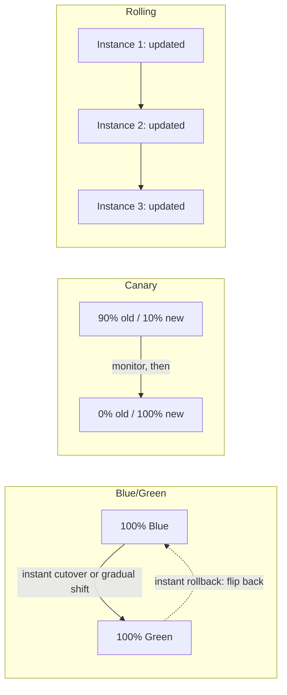
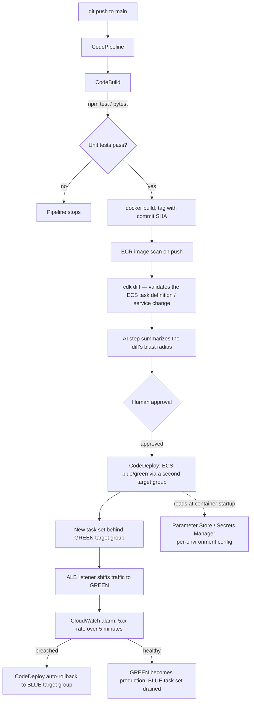
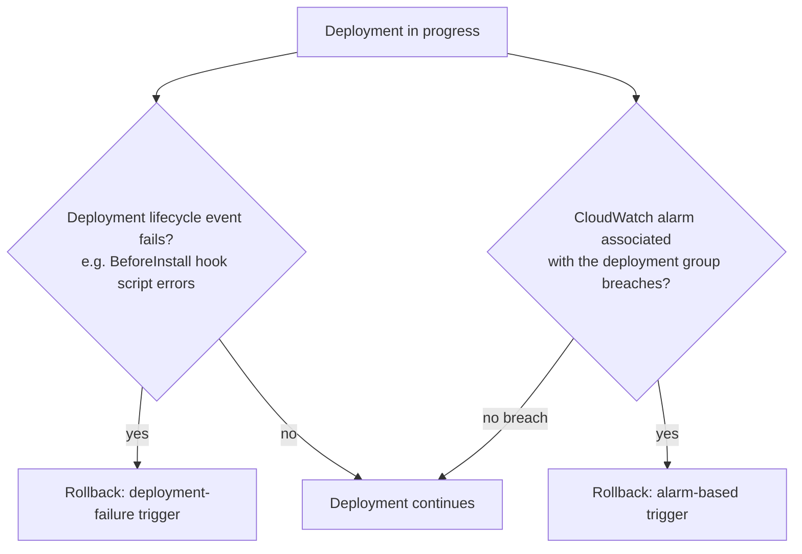

# Domain 3: Testing and Deployment (22%)


*Source: [AWS Well-Architected Framework — OPS04-BP01 Employ and test safe deployment strategies](https://docs.aws.amazon.com/wellarchitected/latest/framework/ops04-bp01.html). This is the official shape of the exact Lambda traffic-shifting flow this domain's "how it fits together" diagram below describes in detail.*

Once code exists (Domain 1) and is reasonably secure (Domain 2), Domain 3 is about shipping it
reliably: packaging artifacts correctly, proving they work before they go live, and getting them
into production through an automated, reversible pipeline. If Domain 1 is "does it work" and
Domain 2 is "is it safe," Domain 3 is "can you get it to production without betting the business
on it going right the first time" — every control in this domain exists specifically to make a bad
deployment cheap to detect and cheap to undo.

## Task statements (verbatim from the exam guide)

**Task 3.1 — Prepare application artifacts for deployment**
- Dependency management (bundling, layers, lockfiles)
- Build container images for ECR (Dockerfiles, tagging, lifecycle policies)
- Externalize configuration (AppConfig, Parameter Store, Secrets Manager — don't bake config into
  the artifact)
- Configure API Gateway stages as part of the deployment artifact (stage-specific variables)

**Task 3.2 — Implement and automate application testing**
- Validate infrastructure templates (SAM, CDK, CloudFormation) before deploying them
- Use mock APIs and test events to exercise Lambda functions without live dependencies
- AI-assisted test generation and regression-test automation

**Task 3.3 — Deploy code via CI/CD**
- Package and deploy Lambda functions (zip vs. container image)
- Deploy to ECS/EKS/Fargate (new container-deployment emphasis in DVA-C03)
- Deploy infrastructure via IaC templates (CloudFormation/CDK/SAM)
- Use CodeDeploy for compute deployment, CodePipeline for orchestration
- Choose a deployment strategy: blue/green, canary, rolling — and configure rollback
- AI-assisted deployment approvals (human-in-the-loop gating informed by AI risk flags)

## Every task, mapped to a doc

| Task | What to read | Where |
|---|---|---|
| 3.1 — Dependency bundling, Lambda layers | [`services/compute/lambda.md`](../../../services/compute/lambda.md) |
| 3.1 — Container images, ECR build/tag/lifecycle | [`services/containers/ecr.md`](../../../services/containers/ecr.md) |
| 3.1 — Container-vs-VM-vs-serverless packaging decision | [`services/containers/containers-vs-vms-vs-serverless.md`](../../../services/containers/containers-vs-vms-vs-serverless.md) |
| 3.1 — Externalized config | [`services/security-identity-compliance/secrets-manager-vs-parameter-store.md`](../../../services/security-identity-compliance/secrets-manager-vs-parameter-store.md) (AppConfig itself is covered as part of Systems Manager — see [`services/management-governance/systems-manager.md`](../../../services/management-governance/systems-manager.md)) |
| 3.1 — API Gateway stage config as deployable artifact | [`services/networking-content-delivery/api-gateway.md`](../../../services/networking-content-delivery/api-gateway.md) |
| 3.2 — IaC template authoring/validation | [`services/developer-tools/sam.md`](../../../services/developer-tools/sam.md), [`services/management-governance/cloudformation.md`](../../../services/management-governance/cloudformation.md), [`services/management-governance/cdk.md`](../../../services/management-governance/cdk.md) |
| 3.2 — Build-time test execution | [`services/developer-tools/codebuild.md`](../../../services/developer-tools/codebuild.md) |
| 3.2 — Source control triggering the pipeline | [`services/developer-tools/codecommit.md`](../../../services/developer-tools/codecommit.md) |
| 3.2 — AI-assisted test generation | Cross-link — see below |
| 3.3 — Lambda packaging & versioning | [`services/compute/lambda.md`](../../../services/compute/lambda.md) |
| 3.3 — ECS/EKS/Fargate deployment (new DVA-C03 emphasis) | [`services/containers/ecs.md`](../../../services/containers/ecs.md), [`services/containers/eks.md`](../../../services/containers/eks.md), [`services/containers/fargate.md`](../../../services/containers/fargate.md), [`services/compute/fargate.md`](../../../services/compute/fargate.md) |
| 3.3 — IaC deployment | [`services/management-governance/cloudformation.md`](../../../services/management-governance/cloudformation.md), [`services/management-governance/cdk.md`](../../../services/management-governance/cdk.md), [`services/developer-tools/sam.md`](../../../services/developer-tools/sam.md) |
| 3.3 — Compute deployment strategies (blue/green, canary, rolling) | [`services/developer-tools/codedeploy.md`](../../../services/developer-tools/codedeploy.md) |
| 3.3 — Pipeline orchestration end-to-end | [`services/developer-tools/codepipeline.md`](../../../services/developer-tools/codepipeline.md) |
| 3.3 — Low-friction dev environments to test deployment scripts from | [`services/developer-tools/cloud9-and-cloudshell.md`](../../../services/developer-tools/cloud9-and-cloudshell.md) |
| 3.3 — AI-assisted deployment approvals | Cross-link — see below |
| Supporting — the IAM identity the pipeline itself runs as | [`services/security-identity-compliance/iam.md`](../../../services/security-identity-compliance/iam.md), [`services/security-identity-compliance/sts-and-role-switching.md`](../../../services/security-identity-compliance/sts-and-role-switching.md) |
| Supporting — the metric data a rollback decision is based on | [`services/management-governance/cloudwatch.md`](../../../services/management-governance/cloudwatch.md) |

### AI-assisted development cross-link

Task 3.2's test generation and Task 3.3's deployment approvals are two of the four places the
AI-assisted development pattern shows up on this exam. Read the canonical explanation once in
Domain 1, then apply it here:

➡️ **[`../domain-1-development/ai-assisted-development.md`](../domain-1-development/ai-assisted-development.md#how-it-works--the-pattern-across-the-sdlc)**
— see the "Domain 3" section of that doc's diagram for how AI-generated tests and AI-flagged
deployment risk fit into a CodePipeline run.

## How it fits together: a full CI/CD pipeline with blue/green deployment



Step by step:
1. **A developer pushes code** to the source repo, which triggers the pipeline automatically —
   no manual kickoff needed (Task 3.3's CI/CD automation).
2. **CodeBuild compiles, runs unit/integration tests, and produces a deployable artifact** — either
   a container image or a Lambda deployment package. If tests fail here, the pipeline stops before
   anything touches a live environment — this is where Task 3.2's automated testing actually runs.
3. **The artifact is pushed to ECR** (containers) or packaged as a Lambda zip, and any IaC template
   (CloudFormation/SAM/CDK) describing the infrastructure change is validated — catching a broken
   template before it's ever applied.
4. **A manual approval gate** pauses the pipeline. This is where Task 3.3's "AI-assisted deployment
   approvals" lives — an AI tool can summarize the diff and flag risk, but a human still clicks
   approve. Skipping this gate for production changes is a common exam wrong-answer trap.
5. **CodeDeploy performs a blue/green deployment**: the new version goes live in a parallel
   ("green") environment while the current ("blue") environment keeps serving all traffic.
6. **Health checks run against green** before any real traffic reaches it — if they fail, the
   deployment is aborted and blue is untouched (zero customer impact).
7. **Traffic shifts gradually** (a canary-style ramp: e.g. 10% → monitor → 100%) rather than all at
   once — this limits the blast radius of a problem that health checks didn't catch.
8. **CloudWatch alarms watch the shifted traffic** (error rate, latency) throughout the shift — if
   an alarm breaches its threshold, CodeDeploy automatically rolls back to blue. This automatic,
   metric-driven rollback is exactly what Task 3.3 means by "configure rollback," and it's also the
   bridge into Domain 4 (the same CloudWatch alarms get used for troubleshooting).
9. **Once healthy, green becomes the new production** — blue is either terminated or kept idle
   briefly as an instant rollback target.

## Task 3.1 in one picture: what actually goes into a deployable artifact



The exam-relevant discipline here: **the same built artifact should be promotable unchanged from
dev to staging to prod** — if you have to rebuild the zip/image to change which database it points
at, you've baked environment-specific config into the artifact, which is exactly what Task 3.1 is
testing you to avoid. The artifact is immutable; only the externalized config it reads at startup
changes per environment.

## Deployment strategies compared



| Strategy | Rollback speed | Extra capacity needed | Best for |
|---|---|---|---|
| **Blue/Green** | Instant (flip traffic back to the untouched blue environment) | Full duplicate environment during the cutover | "Zero-downtime, must be able to undo instantly" requirements |
| **Canary** | Fast (stop shifting, route remaining traffic back) | A small amount of extra capacity for the canary slice | "Limit the blast radius to a small % of users first" requirements |
| **Rolling** | Slow (must roll each instance back one at a time, no single flip point) | None beyond normal capacity | Cost-sensitive deployments where some mixed-version window is acceptable |

A classic trap: a scenario needing "instant, full rollback" gets answered with rolling, because
rolling *sounds* safe and gradual — but rolling has no single point where you can flip back
immediately; you're undoing it instance by instance, which takes real time. Blue/green is the only
one of the three with a true instant full-rollback property.

## Full worked case study: CI/CD for a containerized checkout microservice

**Requirement.** A checkout microservice runs on ECS Fargate. The team wants every merge to `main`
to deploy automatically, but a production deployment must never go live without unit tests
passing, an infrastructure-template validation step, a human approval informed by an AI-generated
risk summary of the change, and an automatic rollback if error rate spikes within 5 minutes of a
new version receiving traffic. Config (DB connection string, feature flags) must differ between
staging and production without rebuilding the container image.

**Architecture.**



**Why each choice:**
- **ECR image tagged with the commit SHA, not `latest`.** This is Task 3.1's artifact-immutability
  discipline in practice — every deployment is traceable to an exact commit, and a rollback can
  reference an exact prior image tag instead of guessing which "latest" was actually good.
- **CodeBuild runs unit tests before the image is even pushed to ECR** — Task 3.2's "automate
  application testing," positioned as early as possible so a failing test never results in a
  built, scannable, deployable artifact at all.
- **`cdk diff` validates the infrastructure change before deployment** — catching, for example, an
  accidental task definition change that would remove a required environment variable, before it
  ever reaches a live environment. This is Task 3.2's infrastructure-template-validation bullet.
- **An AI step summarizes the diff for the human approver**, but the approval itself is still a
  manual CodePipeline approval action — the AI informs, a human decides, exactly the pattern from
  [`../domain-1-development/ai-assisted-development.md`](../domain-1-development/ai-assisted-development.md).
- **ECS blue/green via CodeDeploy, using a second target group behind the ALB.** This is the
  container-specific version of the blue/green pattern Task 3.3 now emphasizes — functionally
  identical in spirit to the Lambda alias-based blue/green shown in the main pipeline diagram
  above, just applied to ECS task sets instead of Lambda versions.
- **A CloudWatch alarm on 5xx rate over a 5-minute window drives automatic rollback** — satisfying
  the "must automatically roll back on error spike" requirement without anyone needing to be
  actively watching a dashboard during the deployment window.
- **Config is read from Parameter Store/Secrets Manager at container startup**, keyed by
  environment — the exact same container image runs in staging and production, with the
  environment-appropriate config injected at runtime rather than baked into two different images.

## Use Cases — Real Scenarios

Concrete developer/DevOps situations where Task 3.1/3.2/3.3 decisions actually get made, with app
type / requirement / implementation decision spelled out:

1. **App type:** Multi-environment SaaS API (dev/staging/prod on the same codebase).
   **Requirement:** the exact same tested build must be promotable across all three environments
   without a rebuild, and a config mistake in one environment must not be able to leak into
   another. **Decision:** build one immutable container image tagged with the commit SHA, and
   read all environment-specific values (DB host, feature flags) from Parameter Store/Secrets
   Manager keyed by environment at container startup — never bake config into the image.
2. **App type:** Payments microservice on ECS Fargate. **Requirement:** a bad deployment must be
   undoable within seconds, even if that means briefly running double capacity.
   **Decision:** blue/green deployment via CodeDeploy using a second ALB target group — the only
   one of the three strategies with a true instant full-rollback flip point, worth the temporary
   duplicate-capacity cost for a payments-critical path.
3. **App type:** High-traffic content API serving millions of daily reads. **Requirement:** limit
   the blast radius of a bad deploy to a small percentage of real users before committing to a
   full rollout, without provisioning a complete duplicate environment. **Decision:** canary
   deployment (e.g. `LambdaCanary10Percent5Minutes`), accepting a smaller resource overhead than
   blue/green in exchange for a built-in automatic "pause and evaluate" step.
4. **App type:** Internal cost-sensitive batch-processing service. **Requirement:** deploy safely
   but without justifying the expense of a duplicate environment for every release.
   **Decision:** rolling deployment — slower to roll back (instance by instance, no single flip
   point) but no extra capacity cost, an acceptable tradeoff for a non-customer-facing workload
   that can tolerate a brief mixed-version window.
5. **App type:** Regulated fintech deployment pipeline. **Requirement:** no infrastructure change
   can reach production without both an automated template-validation check and a documented human
   sign-off, even when an AI tool says the diff is low-risk. **Decision:** `cdk diff`/`sam validate`
   runs in the CodeBuild stage as a hard gate, and a CodePipeline manual approval action (informed
   by, but not replaced by, an AI risk summary) gates the deploy stage.
6. **App type:** Team migrating a monolith's first feature to serverless. **Requirement:** write
   automated tests for a new Lambda handler without needing a live API Gateway, DynamoDB table, or
   deployed stack just to exercise the handler's logic. **Decision:** hand-crafted/console-template
   test events plus `sam local invoke`, so the handler's parsing/response-shaping logic is verified
   entirely locally before anything is deployed.
7. **App type:** Container-based checkout service (see the full case study above).
   **Requirement:** an automatic rollback must trigger on a genuine production error spike, not
   just when a deployment script itself fails to run. **Decision:** associate a CloudWatch alarm
   (5xx rate over a 5-minute window) with the CodeDeploy deployment group specifically — the
   deployment-failure trigger alone wouldn't catch "deployed fine, now erroring in production."
8. **App type:** Platform team standardizing Lambda packaging across 40 functions.
   **Requirement:** stop every team from committing different versions of the same third-party
   SDK, bloating deployment packages and causing version drift. **Decision:** a shared Lambda
   layer for the common dependency, versioned centrally, so updating it once propagates to every
   function on their next deploy rather than 40 separate dependency bumps.
9. **App type:** Image-processing pipeline moving from Lambda zip packaging to containers.
   **Requirement:** old, untagged, or vulnerability-flagged container images must be purged
   automatically instead of accumulating in ECR indefinitely. **Decision:** an ECR lifecycle
   policy expiring untagged images after N days, combined with scan-on-push, rather than a
   manual cleanup script someone has to remember to run.

## Task 3.2 in practice: validating before you ever deploy

Three concrete validation techniques the exam expects you to recognize by behavior, not just name:

**Template validation** catches syntax/schema errors before any API call to create/update a stack:
```bash
sam validate --template template.yaml        # SAM-specific linting
aws cloudformation validate-template --template-body file://template.yaml  # generic CFN syntax check
cdk diff                                      # shows exactly what would change, before deploying
```
`cdk diff` is the one worth understanding conceptually even if you never type the others: it
compares your synthesized CloudFormation template against what's currently deployed and shows a
human-readable diff — the modern equivalent of "review the plan before you apply it," borrowed
from the same idea Terraform popularized, applied inside the AWS-native IaC toolchain.

**Mock APIs and test events** let you exercise a Lambda function's logic without any live
dependency:
```bash
# A hand-crafted test event simulating an API Gateway proxy request, with no real API Gateway involved
cat > test-event.json <<'EOF'
{"httpMethod": "POST", "path": "/orders", "body": "{\"item\":\"widget\"}", "headers": {}}
EOF
sam local invoke CreateOrderFunction --event test-event.json
```
The console's Lambda test feature ships built-in templates (S3 Put, SNS notification, DynamoDB
Stream, etc.) for exactly this reason — you don't need a real S3 bucket wired up to validate that
your handler parses an S3 event correctly.

**AI-assisted test generation** (the Domain 1 cross-link) proposes unit tests from existing code —
useful for quickly covering the obvious cases, but still requires a human to add the
business-specific edge cases the AI has no way to infer; see
[`../domain-1-development/ai-assisted-development.md`](../domain-1-development/ai-assisted-development.md#feature-by-feature-what-each-ai-capability-maps-to-on-the-exam)
for the full breakdown of this capability.

## SAM vs. CDK vs. raw CloudFormation, briefly

Task 3.2/3.3 assumes you can tell these apart without memorizing syntax for all three:

| | Raw CloudFormation | AWS SAM | AWS CDK |
|---|---|---|---|
| Authoring format | YAML/JSON template directly | YAML/JSON with serverless-specific shorthand (`AWS::Serverless::Function`) | Real programming language (TypeScript, Python, etc.) that synthesizes to CloudFormation |
| Best for | Full control, no abstraction | Serverless-first apps (Lambda, API Gateway, DynamoDB) wanting less boilerplate | Complex infra needing loops/conditionals/reusable constructs beyond what a template DSL comfortably expresses |
| Local testing | None built-in | `sam local invoke`, `sam local start-api` | Relies on the same `cdk synth`/`cdk diff`, no Lambda-specific local runner built in |
| Validation command | `validate-template` | `sam validate` | `cdk diff` / `cdk synth` |

A scenario describing "needs to loop over a list of regions and generate a repeated resource block
per region with conditional logic" is pointing at CDK (real code, real control flow) over SAM or
raw CloudFormation (template DSLs that make this awkward). A scenario about "fast local testing of
a serverless app's Lambda functions and API Gateway locally before any deploy" is SAM specifically,
because of `sam local`.

## Common exam scenarios


- *"A deployment must have near-zero downtime and an instant, full rollback option if anything goes
  wrong"* → blue/green (full environment swap), not rolling (rolling has no single "flip back"
  point — it's gradually replacing instances).
- *"Only a small percentage of users should see the new version first, to limit risk before a full
  rollout"* → canary deployment.
- *"A monitoring alarm should automatically trigger a rollback during a deployment, not just alert
  a human"* → configure CodeDeploy rollback to trigger on CloudWatch alarm state, not just on
  deployment failure.
- *"A Lambda function's test events need to simulate an S3 upload without actually uploading a
  file"* → use a mock/test event (Task 3.2), e.g. the console's built-in S3 Put test event template.
- *"Infrastructure changes must be validated for syntax/drift before they're ever applied"* → run
  `cfn-lint`/`sam validate`/`cdk diff` in the CodeBuild stage, before the deploy stage.
- *"Container images must be scanned and only tagged images older than N days should be purged"* →
  ECR lifecycle policies + image scanning, not manual cleanup.
- *"An AI tool suggests a deployment is safe, but the team still wants a person to confirm before
  production changes go live"* → manual approval action in CodePipeline, informed but not replaced
  by the AI flag.
- *"A new container-based microservice must scale automatically without managing EC2 instances"* →
  ECS/EKS on Fargate, not self-managed EC2-backed ECS/EKS.
- *"The same build artifact must be deployable unchanged to dev, staging, and production"* →
  externalize config via Parameter Store/Secrets Manager/AppConfig, read at runtime — never bake
  environment-specific values into the artifact itself.
- *"A rollback must happen within seconds, even at the cost of running double capacity briefly"* →
  blue/green, accepting the temporary cost of a duplicate environment for the fastest possible undo.
- *"A cost-sensitive team wants gradual deployment but can't justify running a duplicate full
  environment"* → rolling deployment — cheaper, slower to roll back, acceptable when a short mixed-
  version window during the rollout is tolerable.
- *"A CodeBuild stage needs to pull a private dependency and also run as part of a pipeline with
  least-privilege access"* → scope the CodeBuild service role narrowly (read access to just the
  needed artifact/source locations), the same least-privilege discipline from Domain 2 applied to
  a pipeline's own execution identity.
- *"A pipeline deploying a Lambda function needs to warm up the new version's concurrency before
  it receives real traffic during a canary shift"* → combine CodeDeploy's Lambda traffic-shifting
  configs (e.g. `LambdaCanary10Percent5Minutes`) with provisioned concurrency on the new version,
  so the canary slice isn't hit with cold starts during the very window you're trying to validate.
- *"A deployment needs a pre-traffic and post-traffic validation hook before/after the shift"* →
  CodeDeploy AppSpec `BeforeAllowTraffic`/`AfterAllowTraffic` lifecycle hooks, which can run a
  Lambda function to run smoke tests before any real traffic reaches the new version.
- *"ECS blue/green deployments need to be managed declaratively alongside the rest of the
  infrastructure"* → CodeDeploy-via-CloudFormation support for ECS blue/green, so the deployment
  strategy itself is version-controlled IaC, not a manually-clicked console action.

## Domain 3 study checklist

- [ ] Explain the difference between blue/green, canary, and rolling deployments, including which
      one has a true instant-rollback property.
- [ ] Explain why config must be externalized rather than baked into a build artifact.
- [ ] Name at least two things Task 3.2 expects you to validate *before* deployment (template
      syntax, mock test events) and why each matters.
- [ ] Describe where in a CI/CD pipeline an AI-assisted test-generation or deployment-approval step
      would realistically sit, and what a human still must do at that step.
- [ ] Explain ECR lifecycle policies and image scanning, and why "just delete old images manually"
      is the wrong exam answer.
- [ ] Pick the right CodeDeploy compute platform (EC2/on-prem, Lambda, ECS) for a given scenario.

## Rollback mechanics: how "automatic" rollback actually triggers

A frequently-misunderstood detail: CodeDeploy rollback doesn't happen just because "something went
wrong" in the abstract — it's wired to one of two concrete triggers, and the exam tests whether you
know which trigger a given scenario is describing.



- **Deployment-failure rollback** fires when a lifecycle hook itself errors (a script in the
  AppSpec's `BeforeInstall`/`AfterInstall`/etc. returns non-zero) — this catches "the deployment
  process itself broke," not "the new version is live but behaving badly."
- **Alarm-based rollback** fires when a CloudWatch alarm *you explicitly associate with the
  deployment group* enters `ALARM` state during/after the shift — this is the one that catches
  "the new version deployed successfully but is producing errors/high latency in production,"
  which is the scenario most exam questions about "automatic rollback" are actually describing.

Both must be explicitly configured — neither is on by default, and a scenario describing "the
rollback didn't happen even though the new version was clearly broken" is almost always testing
whether you know an alarm wasn't associated with the deployment group at all.

## Labs

See [`labs.md`](labs.md) for hands-on Floci exercises covering this domain.

