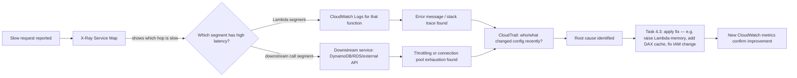

# Domain 4: Troubleshooting and Optimization (22%)

Everything shipped in Domains 1-3 eventually breaks, runs slow, or costs too much. Domain 4 is the
"it's live and something's wrong" layer: finding out what happened, making sure you can find out
*next* time without digging, and tuning what you built so it doesn't need rescuing as often.

## Task statements (verbatim from the exam guide)

**Task 4.1 — Assist in root cause analysis**
- Use CloudWatch Logs and Metrics to find what happened
- Use X-Ray tracing to find *where* in a distributed call chain it happened
- Use CloudTrail to find *who/what* made an API call that caused it
- AI-assisted error analysis (summarizing logs/traces into a likely cause)

**Task 4.2 — Instrument code for observability**
- Emit structured logs, custom metrics, and trace segments/subsegments from application code
- Ensure the right signals exist *before* an incident, not scrambled together during one

**Task 4.3 — Optimize applications on AWS**
- Lambda performance tuning (memory/CPU tradeoff, cold starts, concurrency)
- Cost/performance tradeoffs across compute and data store choices
- AI-assisted optimization recommendations

## Every task, mapped to a doc

| Task | What to read | Where |
|---|---|---|
| 4.1 — Logs and metrics | [`services/management-governance/cloudwatch.md`](../../../services/management-governance/cloudwatch.md) |
| 4.1 — Who/what made an API call | [`services/management-governance/cloudtrail.md`](../../../services/management-governance/cloudtrail.md) |
| 4.1 — AI-assisted error analysis | Cross-link — see below |
| 4.2 — Instrumenting code (custom metrics, structured logs, trace segments) | [`services/management-governance/cloudwatch.md`](../../../services/management-governance/cloudwatch.md) (metrics/logs side) — distributed tracing itself has no standalone services/ doc yet; see the new [`observability-instrumentation.md`](observability-instrumentation.md) in this folder for the X-Ray-specific piece |
| 4.2 — Automating remediation/runbooks once an issue is found | [`services/management-governance/systems-manager.md`](../../../services/management-governance/systems-manager.md) |
| 4.2 — Auditing config drift as a troubleshooting input | [`services/management-governance/aws-config.md`](../../../services/management-governance/aws-config.md) |
| 4.3 — Lambda performance tuning | [`services/compute/lambda.md`](../../../services/compute/lambda.md) |
| 4.3 — Cost visibility to inform tradeoffs | [`services/management-governance/cost-management-tools.md`](../../../services/management-governance/cost-management-tools.md) |
| 4.3 — Architecture-level cost/performance guidance | [`services/management-governance/well-architected-tool.md`](../../../services/management-governance/well-architected-tool.md), [`services/management-governance/trusted-advisor.md`](../../../services/management-governance/trusted-advisor.md) |
| 4.3 — Data store choice tradeoffs feeding optimization | [`services/database/database-selection-guide.md`](../../../services/database/database-selection-guide.md) |
| 4.3 — AI-assisted optimization recommendations | Cross-link — see below |

### AI-assisted development cross-link

Task 4.1's error analysis and Task 4.3's optimization recommendations are the third and fourth
places the AI-assisted development pattern shows up on this exam (after Domain 1's generation and
Domain 3's test-gen/approvals). Read the canonical explanation once:

➡️ **[`../domain-1-development/ai-assisted-development.md`](../domain-1-development/ai-assisted-development.md#how-it-works--the-pattern-across-the-sdlc)**
— see the "Domain 4" section of that doc's diagram for how an assistant reads CloudWatch/X-Ray
data and proposes a root cause or a tuning change, while a human still verifies before acting.

### New in this folder

X-Ray distributed tracing doesn't have a standalone `services/` doc yet, and it's central to Task
4.1/4.2, so it gets a short topic doc here:

➡️ **[`observability-instrumentation.md`](observability-instrumentation.md)** — X-Ray tracing
concepts (segments, subsegments, service maps) plus how to instrument code for Task 4.2.

## How it fits together: tracing a slow request to its root cause

Step by step:
1. **A slow request gets reported** (a user complaint, an alarm, a dashboard spike) — this is the
   trigger for root cause analysis (Task 4.1).
2. **X-Ray's service map shows the full call chain** — client → API Gateway → Lambda → DynamoDB/RDS
   → any external call — with latency annotated per hop. This answers *where* the time is going,
   which raw logs alone can't show you across a distributed system.
3. **You drill into the specific segment with high latency.** If it's the Lambda segment itself,
   go to CloudWatch Logs for that function to find an error or slow code path. If it's a downstream
   segment, the problem is in the dependency, not your function's code.
4. **CloudWatch Logs surfaces the specific error** — a stack trace, a timeout message, a thrown
   exception — assuming Task 4.2 was done right and the function logs meaningfully (structured,
   with enough context) instead of nothing.
5. **If the downstream call is slow/throttled** (DynamoDB `ProvisionedThroughputExceededException`,
   an RDS connection pool maxed out), that's the real bottleneck — fixing the Lambda code wouldn't
   have helped.
6. **CloudTrail answers "did something change recently?"** — a permissions change, a capacity
   setting change, a deployment — correlating the incident's start time against the API call
   history to catch a human- or pipeline-caused regression.
7. **Once the root cause is identified, Task 4.3's optimization step applies the actual fix** —
   increase Lambda memory (which also increases CPU proportionally), add a DAX cache in front of
   DynamoDB, revert the bad IAM/config change, or re-architect the slow call out of the critical
   path.
8. **New CloudWatch metrics after the fix confirm the improvement** — closing the loop back to
   Task 4.2's "instrument so you can tell."

## Common exam scenarios

- *"A Lambda function's errors aren't showing enough context to debug"* → the function isn't
  logging with structured, sufficiently detailed output — this is an instrumentation gap (Task
  4.2), fix before the next incident, not during it.
- *"Need to see which specific microservice in a chain of 5 calls is adding latency"* → X-Ray
  service map / trace segments, not just CloudWatch Logs (logs alone don't show cross-service
  timing without manual correlation).
- *"Need to know exactly which IAM principal deleted a resource at 2am"* → CloudTrail event
  history, not CloudWatch Logs (CloudTrail is the audit trail of *API calls*, CloudWatch is
  *application/runtime* telemetry).
- *"A Lambda function times out intermittently under load, and profiling shows it's CPU-bound, not
  idle-waiting"* → increase memory (which scales CPU proportionally in Lambda), not just the
  timeout value.
- *"Need a single chart to understand overall error rate and latency trend over the last 24 hours
  for a service made of 6 different Lambda functions"* → a CloudWatch dashboard with a custom
  metric math expression, not six separate default dashboards.
- *"Cost grew significantly after a traffic increase and the team needs to know if a cheaper
  architecture meets the same requirements"* → the cost/performance tradeoff is Task 4.3 — check
  Trusted Advisor/Cost Explorer and the Well-Architected Tool's cost pillar review, don't guess.
- *"An AI tool suggests a specific root cause for a production incident from the logs it was given"*
  → treat it as a hypothesis to verify against the actual CloudWatch/X-Ray data, not a confirmed
  diagnosis — see [`../domain-1-development/ai-assisted-development.md`](../domain-1-development/ai-assisted-development.md#when-not-to-use-it--limits).
- *"DynamoDB reads are being throttled under load"* → check if it's a hot partition key (access
  pattern issue, fix the key design) vs. simply under-provisioned capacity (fix: on-demand mode or
  raise provisioned capacity) — these have different fixes despite the same symptom.

## Labs

See [`labs.md`](labs.md) for hands-on Floci exercises covering this domain.
