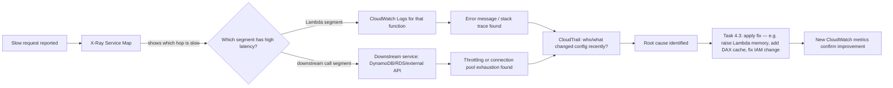
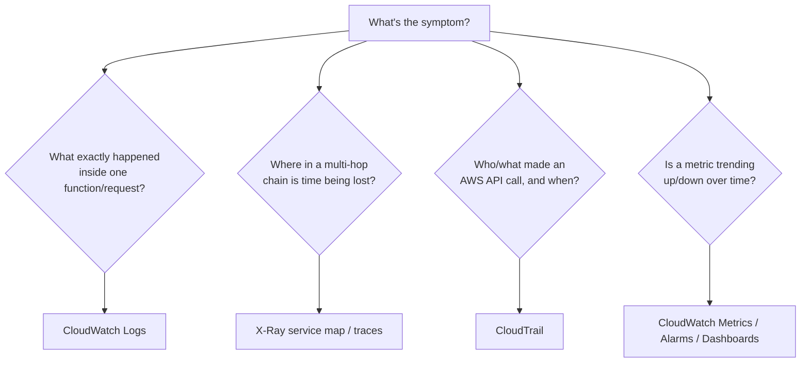
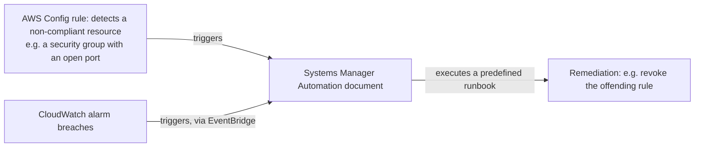
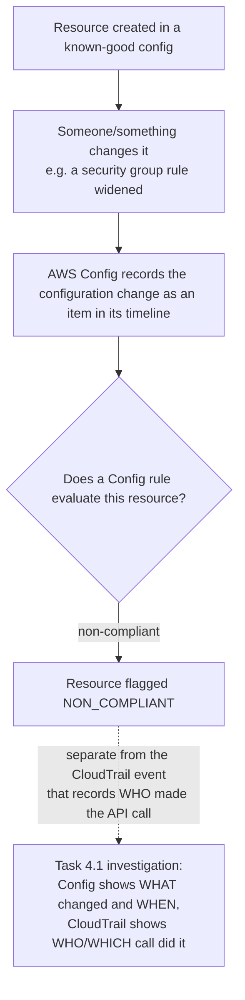

# Domain 4: Troubleshooting and Optimization (22%)


*Source: [AWS Documentation — Visualize Lambda function invocations using AWS X-Ray](https://docs.aws.amazon.com/lambda/latest/dg/services-xray.html). Even the simplest possible trace — one function, no downstream calls — produces two nodes: this is the minimum unit Task 4.1's "use X-Ray tracing" bullet is testing you on.*

Everything shipped in Domains 1-3 eventually breaks, runs slow, or costs too much. Domain 4 is the
"it's live and something's wrong" layer: finding out what happened, making sure you can find out
*next* time without digging, and tuning what you built so it doesn't need rescuing as often. If
Domains 1-3 are about building and shipping correctly, Domain 4 assumes you didn't catch
everything — because nobody does — and tests whether you know how to find out what you missed
quickly, and cheaply enough to do it routinely rather than only during a crisis.

## Task statements (verbatim from the exam guide)

**Task 4.1 — Assist in root cause analysis**
- Use CloudWatch Logs and Metrics to find what happened
- Use X-Ray tracing to find *where* in a distributed call chain it happened
- Use CloudTrail to find *who/what* made an API call that caused it
- AI-assisted error analysis (summarizing logs/traces into a likely cause)

**Task 4.2 — Instrument code for observability**
- Emit structured logs, custom metrics, and trace segments/subsegments from application code
- Ensure the right signals exist *before* an incident, not scrambled together during one

**Task 4.3 — Optimize applications on AWS**
- Lambda performance tuning (memory/CPU tradeoff, cold starts, concurrency)
- Cost/performance tradeoffs across compute and data store choices
- AI-assisted optimization recommendations

## Every task, mapped to a doc

| Task | What to read | Where |
|---|---|---|
| 4.1 — Logs and metrics | [`services/management-governance/cloudwatch.md`](../../../services/management-governance/cloudwatch.md) |
| 4.1 — Who/what made an API call | [`services/management-governance/cloudtrail.md`](../../../services/management-governance/cloudtrail.md) |
| 4.1 — AI-assisted error analysis | Cross-link — see below |
| 4.2 — Instrumenting code (custom metrics, structured logs, trace segments) | [`services/management-governance/cloudwatch.md`](../../../services/management-governance/cloudwatch.md) (metrics/logs side) — distributed tracing itself has no standalone services/ doc yet; see the new [`observability-instrumentation.md`](observability-instrumentation.md) in this folder for the X-Ray-specific piece |
| 4.2 — Automating remediation/runbooks once an issue is found | [`services/management-governance/systems-manager.md`](../../../services/management-governance/systems-manager.md) |
| 4.2 — Auditing config drift as a troubleshooting input | [`services/management-governance/aws-config.md`](../../../services/management-governance/aws-config.md) |
| 4.3 — Lambda performance tuning | [`services/compute/lambda.md`](../../../services/compute/lambda.md) |
| 4.3 — Cost visibility to inform tradeoffs | [`services/management-governance/cost-management-tools.md`](../../../services/management-governance/cost-management-tools.md) |
| 4.3 — Architecture-level cost/performance guidance | [`services/management-governance/well-architected-tool.md`](../../../services/management-governance/well-architected-tool.md), [`services/management-governance/trusted-advisor.md`](../../../services/management-governance/trusted-advisor.md) |
| 4.3 — Data store choice tradeoffs feeding optimization | [`services/database/database-selection-guide.md`](../../../services/database/database-selection-guide.md) |
| 4.3 — Caching as a performance/cost lever | [`services/database/elasticache.md`](../../../services/database/elasticache.md) |
| 4.3 — AI-assisted optimization recommendations | Cross-link — see below |
| Supporting — the data store whose consistency choices show up again here as a performance lever | [`services/database/dynamodb.md`](../../../services/database/dynamodb.md) |
| Supporting — the identity every CloudTrail event is ultimately attributing an action to | [`services/security-identity-compliance/iam.md`](../../../services/security-identity-compliance/iam.md) |

### AI-assisted development cross-link

Task 4.1's error analysis and Task 4.3's optimization recommendations are the third and fourth
places the AI-assisted development pattern shows up on this exam (after Domain 1's generation and
Domain 3's test-gen/approvals). Read the canonical explanation once:

➡️ **[`../domain-1-development/ai-assisted-development.md`](../domain-1-development/ai-assisted-development.md#how-it-works--the-pattern-across-the-sdlc)**
— see the "Domain 4" section of that doc's diagram for how an assistant reads CloudWatch/X-Ray
data and proposes a root cause or a tuning change, while a human still verifies before acting.

### New in this folder

X-Ray distributed tracing doesn't have a standalone `services/` doc yet, and it's central to Task
4.1/4.2, so it gets a short topic doc here:

➡️ **[`observability-instrumentation.md`](observability-instrumentation.md)** — X-Ray tracing
concepts (segments, subsegments, service maps) plus how to instrument code for Task 4.2.

## How it fits together: tracing a slow request to its root cause



Step by step:
1. **A slow request gets reported** (a user complaint, an alarm, a dashboard spike) — this is the
   trigger for root cause analysis (Task 4.1).
2. **X-Ray's service map shows the full call chain** — client → API Gateway → Lambda → DynamoDB/RDS
   → any external call — with latency annotated per hop. This answers *where* the time is going,
   which raw logs alone can't show you across a distributed system.
3. **You drill into the specific segment with high latency.** If it's the Lambda segment itself,
   go to CloudWatch Logs for that function to find an error or slow code path. If it's a downstream
   segment, the problem is in the dependency, not your function's code.
4. **CloudWatch Logs surfaces the specific error** — a stack trace, a timeout message, a thrown
   exception — assuming Task 4.2 was done right and the function logs meaningfully (structured,
   with enough context) instead of nothing.
5. **If the downstream call is slow/throttled** (DynamoDB `ProvisionedThroughputExceededException`,
   an RDS connection pool maxed out), that's the real bottleneck — fixing the Lambda code wouldn't
   have helped.
6. **CloudTrail answers "did something change recently?"** — a permissions change, a capacity
   setting change, a deployment — correlating the incident's start time against the API call
   history to catch a human- or pipeline-caused regression.
7. **Once the root cause is identified, Task 4.3's optimization step applies the actual fix** —
   increase Lambda memory (which also increases CPU proportionally), add a DAX cache in front of
   DynamoDB, revert the bad IAM/config change, or re-architect the slow call out of the critical
   path.
8. **New CloudWatch metrics after the fix confirm the improvement** — closing the loop back to
   Task 4.2's "instrument so you can tell."

## The symptom-to-tool lookup, as one diagram

The single most repeated Domain 4 exam pattern is "given this symptom, which tool answers it":



Memorize this mapping cold — a large fraction of Domain 4 questions are solvable by correctly
routing the symptom to one of these four boxes, even before you reason about the AWS-specific
details of the scenario.

## Task 4.2 in one picture: instrumenting BEFORE the incident

```mermaid
flowchart LR
    CODE[Application code] --> LOG[Structured JSON logs\nwith request/correlation ID]
    CODE --> METRIC[Custom CloudWatch metrics\ne.g. OrdersProcessed, PaymentFailures]
    CODE --> TRACE[X-Ray SDK: wraps outbound\nSDK/HTTP calls as subsegments]
    LOG --> READY[All three exist BEFORE\nanything goes wrong]
    METRIC --> READY
    TRACE --> READY
    READY -.only now can Task 4.1's tools\nactually answer a real incident.-> INCIDENT[Incident happens]
```

This is why Task 4.2 is its own task statement, separate from 4.1: root cause analysis tools are
useless against a function that logs nothing structured, emits no custom metrics, and never
enabled X-Ray. A scenario where "the team couldn't figure out what happened" is almost always
really testing whether you'd have instrumented *before* that incident, not just which tool to
reach for after one.

## Full worked case study: diagnosing and fixing a slow checkout endpoint

**Symptom.** A checkout API's p99 latency jumped from 200ms to 4 seconds after a routine deploy
two days ago, and a subset of requests now return 500 errors. The team doesn't know if it's the
Lambda function, DynamoDB, or something else, and cost has also crept up without anyone changing
traffic volume.

**Investigation, following the Task 4.1 toolchain in order.**

```mermaid
sequenceDiagram
    participant Eng as Engineer
    participant XRay as X-Ray Service Map
    participant CW as CloudWatch Logs/Metrics
    participant CT as CloudTrail

    Eng->>XRay: Open the service map for the last 2 days
    XRay-->>Eng: The DynamoDB subsegment, not the Lambda segment, shows the latency spike
    Eng->>CW: Check DynamoDB-related CloudWatch metrics for the table
    CW-->>Eng: ConsumedReadCapacityUnits is pegged at the provisioned limit; ThrottledRequests > 0
    Eng->>CT: Check CloudTrail for changes around the deploy time
    CT-->>Eng: A CloudFormation stack update 2 days ago changed the table from on-demand to\nprovisioned capacity with a LOW read capacity setting, as an unintended side effect of an\nunrelated template edit
    Eng->>Eng: Root cause confirmed: under-provisioned read capacity introduced by an unreviewed IaC change
```

**Fix and why (Task 4.3):**
- **Immediate fix**: switch the table back to on-demand capacity mode, removing the need to
  predict capacity at all for this bursty checkout workload — directly addressing the throttling.
- **Why not "just raise the Lambda's memory" first**: the trace already showed the bottleneck was
  the *downstream DynamoDB call*, not the Lambda function's own compute — raising Lambda memory
  would have cost more without fixing anything, a classic trap of optimizing the wrong layer
  because it's the easiest knob to reach for.
- **Secondary fix — add a cache**: since checkout reads the same product-catalog items repeatedly
  within a short window, adding a DAX cache in front of the DynamoDB table further reduces read
  load and latency for the hottest keys, independent of the capacity-mode fix.
- **Process fix (closing the loop into Domain 3)**: the capacity-mode change rode into production
  as an unreviewed side effect of an unrelated IaC change — add a `cdk diff`/`cfn-lint` check that
  specifically flags capacity-mode changes on production tables, so the *next* unintended change
  like this is caught in Task 3.2's validation step rather than discovered via a live incident.
- **Instrumentation fix (closing the loop into Task 4.2)**: add a CloudWatch alarm on
  `ThrottledRequests` for this table going forward, so this exact failure mode pages someone within
  minutes instead of being diagnosed after two days of degraded customer experience.

This case study's shape — "trace first to find *where*, metrics to find *what*, CloudTrail to find
*why it changed*, then fix the right layer, then close the loop so it can't silently recur" — is
the master pattern for nearly every Domain 4 scenario question, regardless of which specific
services the question names.

## Common exam scenarios

- *"A Lambda function's errors aren't showing enough context to debug"* → the function isn't
  logging with structured, sufficiently detailed output — this is an instrumentation gap (Task
  4.2), fix before the next incident, not during it.
- *"Need to see which specific microservice in a chain of 5 calls is adding latency"* → X-Ray
  service map / trace segments, not just CloudWatch Logs (logs alone don't show cross-service
  timing without manual correlation).
- *"Need to know exactly which IAM principal deleted a resource at 2am"* → CloudTrail event
  history, not CloudWatch Logs (CloudTrail is the audit trail of *API calls*, CloudWatch is
  *application/runtime* telemetry).
- *"A Lambda function times out intermittently under load, and profiling shows it's CPU-bound, not
  idle-waiting"* → increase memory (which scales CPU proportionally in Lambda), not just the
  timeout value.
- *"Need a single chart to understand overall error rate and latency trend over the last 24 hours
  for a service made of 6 different Lambda functions"* → a CloudWatch dashboard with a custom
  metric math expression, not six separate default dashboards.
- *"Cost grew significantly after a traffic increase and the team needs to know if a cheaper
  architecture meets the same requirements"* → the cost/performance tradeoff is Task 4.3 — check
  Trusted Advisor/Cost Explorer and the Well-Architected Tool's cost pillar review, don't guess.
- *"An AI tool suggests a specific root cause for a production incident from the logs it was given"*
  → treat it as a hypothesis to verify against the actual CloudWatch/X-Ray data, not a confirmed
  diagnosis — see [`../domain-1-development/ai-assisted-development.md`](../domain-1-development/ai-assisted-development.md#when-not-to-use-it--limits).
- *"DynamoDB reads are being throttled under load"* → check if it's a hot partition key (access
  pattern issue, fix the key design) vs. simply under-provisioned capacity (fix: on-demand mode or
  raise provisioned capacity) — these have different fixes despite the same symptom.
- *"Latency spiked right after a deployment and nobody changed the application code"* → check
  CloudTrail for infrastructure-level changes (capacity mode, IAM, config) that rode along with
  the deployment, per the case study above — the regression isn't always in the code diff.
- *"A function shows high Duration in CloudWatch but low actual CPU/memory utilization"* → the
  function is likely I/O-bound, waiting on a slow downstream call — trace it with X-Ray to find
  which downstream hop is actually slow, rather than tuning the function's own memory.
- *"Alarms exist but nobody noticed the incident for two days"* → the alarm wasn't wired to a
  notification action (SNS topic → on-call), or the alarm didn't exist for the specific failure
  mode at all — distinguishing "we had no visibility" from "we had visibility but no alerting."
- *"A cost review shows a Lambda function paying for far more memory than it uses"* → right-size
  memory down using CloudWatch's reported `Max Memory Used` per invocation, but re-verify Duration
  doesn't regress — memory also drives CPU, so going too low can increase Duration enough to raise
  total cost despite the lower per-GB-second rate.
- *"A read-heavy DynamoDB table serving the same few hot items repeatedly shows high read-capacity
  cost"* → DAX caching layer, reducing repeated reads of the same keys without changing application
  logic beyond swapping the client.
- *"Config drift is suspected as a contributing factor in an incident, separate from a deployment
  event"* → AWS Config shows configuration history/compliance drift over time, distinct from both
  CloudTrail (discrete API call events) and CloudWatch (application telemetry).
- *"The team wants an architecture-level, not just a resource-level, review of cost and performance
  tradeoffs before scaling up"* → the Well-Architected Tool's cost optimization and performance
  efficiency pillar reviews, not just reading individual CloudWatch metrics.

## Domain 4 study checklist

- [ ] Given a symptom description, route it to the correct tool (CloudWatch Logs, X-Ray,
      CloudTrail, or CloudWatch Metrics) without hesitation.
- [ ] Explain why instrumentation (Task 4.2) has to happen before an incident, not during one.
- [ ] Explain the Lambda memory/CPU/cost tradeoff and compute total cost as memory × duration,
      not just eyeball the memory number.
- [ ] Diagnose a DynamoDB throttling symptom as either a hot-key problem or a capacity problem, and
      know the different fix for each.
- [ ] Describe where AI-assisted error analysis and optimization recommendations fit, and what a
      human still verifies before acting on either.
- [ ] Walk through the case study's investigation order (trace → metrics → CloudTrail → fix →
      re-instrument) from memory.

## Lambda cost/performance math, concretely

Task 4.3's most commonly mis-answered question type is "should we raise or lower memory" — because
it's not a monotonic relationship with cost, even though compute capability (CPU, network
bandwidth) scales linearly with memory up to the maximum.

```
Cost per invocation ≈ (Memory in GB) × (Billed Duration in seconds) × (price per GB-second)
```

| Memory | Duration (CPU-bound workload) | Cost basis (relative) | Total relative cost |
|---|---|---|---|
| 128 MB | 4.0s (CPU-starved) | 0.125 GB × 4.0s | 0.50 |
| 512 MB | 1.1s | 0.5 GB × 1.1s | 0.55 |
| 1024 MB | 0.55s | 1.0 GB × 0.55s | 0.55 |
| 1769 MB (1 full vCPU) | 0.32s | 1.73 GB × 0.32s | 0.55 |
| 3008 MB | 0.30s (diminishing returns — already not CPU-bound) | 2.94 GB × 0.30s | 0.88 |

The exam-relevant lesson: for a genuinely CPU-bound function, raising memory from a low starting
point often **reduces** total cost because duration drops faster than the per-GB-second rate rises
— but only up to the point where the workload stops being CPU-bound (one full vCPU around
~1,769 MB in this illustrative table), after which more memory just adds cost without a
corresponding duration improvement. Never answer a "should we raise memory" question from the
memory number alone — always reason through (or ask for) the Duration change it would cause.

```bash
# The concrete CloudWatch metric that tells you whether raising memory would even help:
# "Max Memory Used" close to the configured memory limit → raising memory may reduce GC/throttling-driven delay
# "Max Memory Used" far below the limit → the function is NOT memory-constrained; look elsewhere (I/O wait, cold starts)
```

## CloudWatch Logs Insights, as a root-cause tool

Task 4.1 expects you to recognize what a Logs Insights query is *for*, not to write one from
scratch under exam pressure:

```sql
-- "How often is this function actually failing, and what are the top error messages?"
fields @timestamp, @message
| filter @message like /ERROR/
| stats count() as errorCount by bin(5m)
```

```sql
-- "Correlate every log line for ONE specific failing request across its full execution"
fields @timestamp, @message
| filter @requestId = "abc-123-def-456"
| sort @timestamp asc
```

The second query pattern — filtering by a correlation/request ID across potentially many log
groups — only works if Task 4.2's instrumentation discipline (propagate a correlation ID through
every log line) was actually followed. This is the concrete, queryable payoff of "instrument before
the incident," not an abstract principle.

## Automated remediation: Systems Manager Automation and Config rules

Task 4.2's "automating remediation/runbooks" bullet is about *not* manually SSHing in or
clicking through the console once an issue is diagnosed repeatedly:



A scenario describing "whenever this specific condition recurs, apply the same fix automatically,
without a human running a script by hand" is pointing at an SSM Automation runbook triggered either
by an AWS Config rule (configuration-compliance-driven) or a CloudWatch alarm via EventBridge
(metric-threshold-driven) — the trigger differs by scenario, the remediation mechanism is the same.

## Cost/performance tooling, compared

Task 4.3 names several AWS tools that overlap in purpose but differ in scope — the exam tests
picking the right one for a given question's framing:

| Tool | Scope | Best for |
|---|---|---|
| **CloudWatch Metrics/Dashboards** | Real-time, resource-level telemetry | "Is this specific metric trending badly right now" |
| **Cost Explorer** | Historical billing data, filterable/groupable | "Where did the money actually go last month, broken down by service/tag" |
| **Trusted Advisor** | Automated checks against AWS best practices (cost, performance, security, fault tolerance, service limits) | "Flag idle/underutilized resources and common misconfigurations automatically" |
| **AWS Well-Architected Tool** | Structured, pillar-based architecture review (you answer questions, it surfaces risks) | "A holistic review of whether this workload's *architecture*, not just one resource, follows best practices" |

A scenario describing "want an automated, ongoing check for idle EC2 instances and
over-provisioned EBS volumes" is Trusted Advisor. A scenario describing "want a structured review
of whether our whole payments system's architecture follows AWS best practices before a big
launch" is the Well-Architected Tool — a qualitatively different, broader exercise than checking
individual resource-level recommendations.

## AWS Config: drift as a Task 4.1 investigative input



Config and CloudTrail answer related but distinct questions, and exam questions sometimes test the
pairing directly: **CloudTrail** is the log of discrete API calls (an event-level record — "at
14:02:03, user X called `AuthorizeSecurityGroupIngress`"). **AWS Config** is a timeline of a
*resource's configuration state* over time plus ongoing compliance evaluation against rules you
define ("this security group's current state doesn't comply with the 'no open SSH to 0.0.0.0/0'
rule"). A question asking "how do we know this security group was ever compliant and when it
stopped being" wants Config's configuration timeline; a question asking "which specific API call
changed it" wants CloudTrail — often you use both together during one investigation, as the
diagram shows.

## Labs

See [`labs.md`](labs.md) for hands-on Floci exercises covering this domain.
