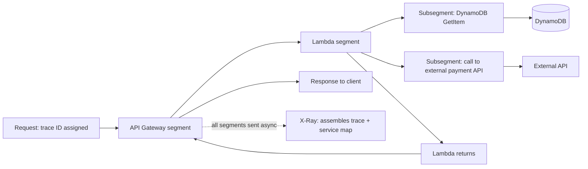
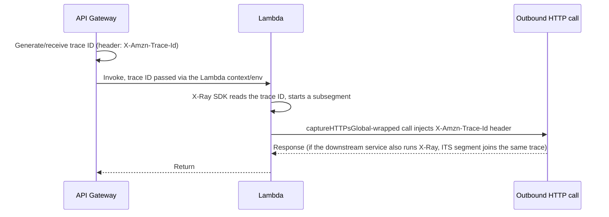
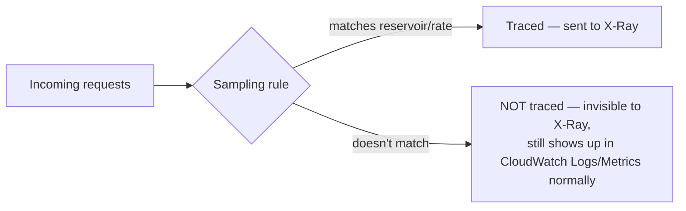
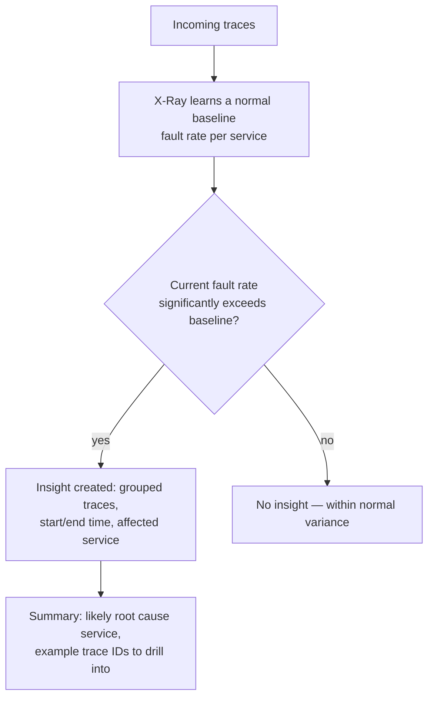
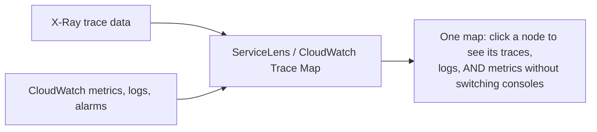

# Observability Instrumentation & AWS X-Ray (Task 4.1 / 4.2)


*Source: [AWS Documentation — Using the X-Ray trace map](https://docs.aws.amazon.com/xray/latest/devguide/xray-console-servicemap.html). Green nodes are healthy, red is server faults, yellow is client errors, purple is throttling — knowing this color code cold saves real time on scenario questions that describe a service map's colors instead of raw numbers.*

## Definition

Instrumentation is the practice of adding code to your application that reports what it's doing —
logs, metrics, and traces — so that when something goes wrong, the answer is "look at the
dashboard," not "add print statements and redeploy." **AWS X-Ray** is the AWS service specifically
for distributed tracing: following one request as it hops across multiple services and seeing how
long each hop took.

## Purpose

In a single-server application, debugging means reading one log file. In a serverless/microservice
application — API Gateway → Lambda → DynamoDB → another Lambda → an external API — a single slow
request touches five or six different services, each with its own logs. Without tracing, finding
"which hop was slow" means manually cross-referencing timestamps across five log groups. X-Ray
solves this by stitching one request's hops together into a single trace with per-segment timing.

## How It Works

Each piece of the call chain emits a **segment** (one service's contribution to the trace) or
**subsegment** (a smaller unit inside it, e.g. "the DynamoDB call inside this Lambda invocation").
X-Ray collects these and assembles a full **trace** for a single request ID, plus a **service map**
showing the whole architecture with aggregated latency/error rates per node.



Step by step: a trace ID is generated (or propagated from an upstream caller) at the first hop.
Every service that participates in handling the request — if instrumented — tags its segment with
that same trace ID and reports its own start/end time plus any subsegments for internal work (a
DB call, an outbound HTTP call). All of this is sent asynchronously to X-Ray, which assembles it
into one trace viewable as a timeline (a "waterfall") and rolls many traces up into a service map
showing average latency and error rate per node, system-wide.

## Trace propagation across service boundaries, precisely

The part of X-Ray that's easy to gloss over and genuinely worth understanding: how does the
*same* trace ID survive a hop from, say, API Gateway to Lambda to an external HTTP call?



- **Within AWS-to-AWS hops** (API Gateway → Lambda, Lambda → DynamoDB), the trace ID propagates
  automatically once active tracing is enabled — you don't manually thread it through.
- **Across an outbound HTTP call to a non-AWS service**, the X-Ray SDK's HTTP instrumentation
  (`captureHTTPsGlobal` in Node.js, `patch_all()` in Python) injects the `X-Amzn-Trace-Id` header
  automatically — if the receiving service also runs the X-Ray SDK and reads that header, its
  segment joins the same trace; if it doesn't, the trace simply ends at that hop (which is fine —
  X-Ray degrades gracefully to "as far as we can see").
- Exam angle: a question describing "a trace shows a gap — the Lambda segment ends but no segment
  for the downstream third-party API call ever appears" is testing whether you know the downstream
  service needs its own X-Ray instrumentation (or at minimum, to honor a propagated trace header)
  for its segment to show up at all — X-Ray can't retroactively trace a service that never reports.

## Instrumenting your own code (Task 4.2)

- **Structured logging**: log in a consistent, parseable format (JSON) with request IDs, not free
  text — this is what makes CloudWatch Logs Insights queries actually work during an incident.
- **Custom metrics**: emit business/application-specific metrics (e.g. "orders processed",
  "payment failures") via the CloudWatch embedded metric format or `PutMetricData`, not just relying
  on AWS's default per-service metrics — a default Lambda metric tells you invocation count and
  duration, not "how many orders failed validation."
- **Trace segments/subsegments**: use the X-Ray SDK to wrap outbound calls (`captureAWSClient`,
  `captureHTTPsGlobal` in the Node.js/Python SDKs) so DynamoDB calls, HTTP calls, and SQL queries
  each show up as their own subsegment instead of being invisible inside one opaque Lambda segment.
- **Correlation IDs**: propagate the X-Ray trace ID (or a custom request ID) through logs at every
  hop, so a CloudWatch Logs Insights query across multiple log groups can reconstruct one request's
  full story even without opening X-Ray.
- **Annotations vs. metadata**: X-Ray subsegments support both — **annotations** are indexed and
  filterable/searchable in X-Ray (e.g. tagging a subsegment with `customerId` so you can filter
  traces by it), **metadata** is stored but not indexed (useful for larger context you want
  attached to a trace but don't need to search by). Confusing the two is a common exam trap: if a
  scenario needs to *filter/search* traces by a specific field, that field must be an annotation,
  not metadata.
- The instrumentation has to be added *before* the incident — this is why it's its own task
  statement (4.2) separate from root cause analysis (4.1): you can't trace a request retroactively
  if nothing was recording.

```python
# Concrete Task 4.2 instrumentation example: a Lambda handler with all three signal types
import json, logging, boto3, time
from aws_xray_sdk.core import xray_recorder, patch_all
patch_all()  # auto-instruments boto3 clients as X-Ray subsegments

logger = logging.getLogger()
logger.setLevel(logging.INFO)
cloudwatch = boto3.client("cloudwatch")
ddb = boto3.client("dynamodb")

def handler(event, context):
    request_id = context.aws_request_id

    # Annotation: searchable in X-Ray traces by orderId
    segment = xray_recorder.current_segment()
    order_id = json.loads(event["body"])["orderId"]
    segment.put_annotation("orderId", order_id)

    start = time.time()
    try:
        ddb.get_item(TableName="Orders", Key={"orderId": {"S": order_id}})
        # Structured log, correlatable by requestId via Logs Insights
        logger.info(json.dumps({"requestId": request_id, "orderId": order_id, "status": "success"}))
        # Custom business metric — NOT one of Lambda's default metrics
        cloudwatch.put_metric_data(
            Namespace="CheckoutApp",
            MetricData=[{"MetricName": "OrdersLookedUp", "Value": 1, "Unit": "Count"}]
        )
        return {"statusCode": 200, "body": json.dumps({"orderId": order_id})}
    except Exception as e:
        logger.error(json.dumps({"requestId": request_id, "orderId": order_id, "error": str(e)}))
        raise
```

## Use Cases — When to Use It

- Any distributed/serverless application where a single request crosses more than one service —
  which is nearly every non-trivial application on AWS.
- Finding intermittent latency spikes that don't show up as outright errors (X-Ray's percentile
  latency view across a service map surfaces these faster than scanning logs).
- Confirming a fix actually worked — comparing the service map's latency before and after a change.
- Filtering traces by a specific business dimension (customer ID, order ID, feature flag) using
  annotations, when "show me every slow trace for this one customer" is a real support question.

## Use Cases — Real Scenarios

Concrete developer situations where Task 4.1/4.2 instrumentation decisions actually get made, with
app type / requirement / implementation decision spelled out:

1. **App type:** Multi-service checkout flow (API Gateway → Lambda → DynamoDB → external payment
   gateway). **Requirement:** find out which of four hops is adding the most latency during a
   reported slowdown, without manually cross-referencing four separate CloudWatch log groups by
   timestamp. **Decision:** enable active X-Ray tracing on every hop and read the resulting service
   map's per-node latency, rather than relying on raw logs to reconstruct cross-service timing.
2. **App type:** Customer-support tooling team. **Requirement:** a support agent needs to pull up
   every slow trace for one specific customer's account when they file a complaint, not just
   "traces from around that time." **Decision:** tag the relevant subsegment with a `customerId`
   annotation (not metadata) at write time, so traces become filterable by that field later.
3. **App type:** Order-processing Lambda function with no current logging discipline.
   **Requirement:** during the *next* incident, be able to reconstruct one failing request's full
   story across every log line it touched, not just whichever error message happened to get
   printed. **Decision:** add a correlation/request ID to every structured JSON log line now,
   before any incident happens — instrumentation has to exist in advance, it can't be retrofitted
   onto an incident already in progress.
4. **App type:** Internal analytics service reporting business-specific failures (e.g. "payment
   declined" vs. generic 500s). **Requirement:** know *how often* a specific business failure mode
   is occurring, distinct from generic invocation/error counts Lambda already reports by default.
   **Decision:** emit a custom CloudWatch metric (e.g. `PaymentFailures`) from application code via
   `PutMetricData` or the embedded metric format — default Lambda metrics don't know what a
   "payment failure" means to this specific business.
5. **App type:** Team debugging a trace with an unexplained gap between two services that should
   be connected. **Requirement:** figure out why a downstream third-party API call never shows up
   as a segment in the trace at all. **Decision:** confirm whether the downstream service runs its
   own X-Ray instrumentation (or at minimum honors the propagated `X-Amzn-Trace-Id` header) — X-Ray
   can't retroactively trace a hop that never reported data, regardless of how the calling side is
   configured.
6. **App type:** High-volume public API (millions of requests/day). **Requirement:** some requests
   that clearly errored according to CloudWatch Metrics have no matching X-Ray trace at all, and
   the on-call engineer needs to know if that's a bug. **Decision:** check the sampling rule first
   — not every request is traced by default at volume; raise the sampling rate (or set it to 100%)
   for the specific endpoint if full trace coverage is genuinely required there.
7. **App type:** Platform team rolling out tracing to a legacy service for the first time.
   **Requirement:** confirm active tracing is actually working before relying on it during the next
   incident. **Decision:** verify both that `TracingConfig: Active` is set AND that the execution
   role has `xray:PutTraceSegments`/`AWSXRayDaemonWriteAccess` — a function can look "configured"
   and still silently emit zero trace data if the IAM permission is missing.
8. **App type:** SRE team monitoring dozens of services. **Requirement:** get notified of an
   unusual cluster of failing requests without manually watching a service map all day.
   **Decision:** rely on X-Ray Insights' automatic anomaly detection against its learned baseline
   fault rate, rather than expecting a human to notice a gradual fault-rate increase by eye.
9. **App type:** On-call engineer mid-incident across logs, metrics, and traces for one service.
   **Requirement:** avoid pivoting between the X-Ray console and the CloudWatch console
   separately while under time pressure. **Decision:** use ServiceLens/the CloudWatch Trace Map,
   which surfaces a given node's logs, metrics, and traces together on one map.

## When NOT to Use It / Alternatives

- For a single-function, no-downstream-calls workload, X-Ray's distributed tracing is of limited
  value — plain CloudWatch Logs/Metrics may be enough; don't over-instrument trivial code paths.
- X-Ray doesn't replace CloudTrail — X-Ray shows *application request flow and timing*, CloudTrail
  shows *who called which AWS management/API action and when*. A security/audit question wants
  CloudTrail; a performance/latency question wants X-Ray.
- Don't attach everything as metadata "just in case" — unindexed metadata bloats trace size without
  making anything searchable; use annotations for anything you'll actually filter by.

## Sampling: why you don't see every single trace

X-Ray doesn't trace 100% of requests by default at high volume — it applies a **sampling rule**
(by default: the first request each second, plus 5% of additional requests) to control cost and
data volume. This is worth knowing explicitly because it explains a specific symptom:



Exam angle: "intermittent errors are visible in CloudWatch Metrics' error count, but X-Ray shows no
corresponding traces for some of them" → this isn't a bug, it's sampling — not every request is
traced, and a custom sampling rule (higher rate, or 100% for specific high-value paths) is the fix
if full trace coverage is actually required for a given endpoint.

## X-Ray Insights and anomaly detection

Beyond manually eyeballing a service map, **X-Ray Insights** automatically detects anomalies in
your application (a sudden fault-rate increase, a new error pattern) and groups related traces
into a single insight with a generated summary and timeline — effectively an AWS-native first pass
at the "AI-assisted error analysis" idea from Task 4.1, specific to trace data:



Exam angle: if a scenario mentions "X-Ray automatically flagged a cluster of failing requests and
summarized when it started," that's Insights specifically, not the base service map (the service
map requires you to notice the anomaly yourself; Insights notices it for you). This is a genuinely
distinct capability from the generic AI-assisted error analysis pattern in
[`../domain-1-development/ai-assisted-development.md`](../domain-1-development/ai-assisted-development.md)
even though they sound similar — Insights is a built-in X-Ray feature with no separate AI-tool
integration required, worth knowing by name specifically.

## ServiceLens: the CloudWatch+X-Ray combined view

**ServiceLens** (now surfaced as the CloudWatch console's "Trace Map" per current AWS naming) is
the integration point where X-Ray trace data and CloudWatch metrics/logs/alarms appear on one
map, rather than requiring you to pivot between the X-Ray console and the CloudWatch console
separately:



Exam angle: a question emphasizing "a single pane of glass combining logs, metrics, and traces for
one service" is describing ServiceLens/the CloudWatch Trace Map specifically, not X-Ray's service
map alone (which shows trace/latency data only, without pivoting directly into that node's logs).

## Lambda-specific X-Ray behavior worth knowing

- Lambda records **two segments per traced invocation**: one for the Lambda *service* itself
  (overhead: routing the invocation, cold start if applicable) and one for *your function's code*.
  A trace showing high latency in the "Lambda service" segment rather than your function's segment
  is pointing at cold-start/initialization overhead, not your handler's logic — a distinct
  diagnostic signal from Duration alone.
- Enabling active tracing is a single Lambda configuration flag (`TracingConfig: Active`), but the
  function's execution role still needs permission to write trace data
  (`xray:PutTraceSegments`, `xray:PutTelemetryRecords` — commonly granted via the
  `AWSXRayDaemonWriteAccess` managed policy). A function with tracing "enabled" in configuration
  but missing this IAM permission silently fails to report trace data — a frequent real
  troubleshooting scenario and a frequent exam distractor.
- For functions behind API Gateway, enabling tracing on *both* API Gateway and the Lambda function
  is required to see the full chain in one trace — enabling it on only one side leaves a gap in
  the service map at that hop, similar to the cross-service propagation gap described above.

## Common exam scenarios

- *"A service map shows a node colored red with a high fault rate"* → server-side faults (5xx) in
  that specific node — drill into its traces/logs, not a client-side problem.
- *"A node on the service map is purple"* → throttling (429s) at that node — check capacity/rate
  limits for that specific resource, not a code bug.
- *"A trace shows a gap between two services that should be connected"* → the downstream service
  either isn't instrumented with X-Ray or isn't propagating the trace header — see trace
  propagation above.
- *"Some requests that clearly errored in CloudWatch Metrics have no matching X-Ray trace at all"*
  → sampling — not every request is traced by default; adjust the sampling rule if full coverage
  is required.
- *"Active tracing is enabled on a Lambda function's configuration, but no trace data appears at
  all"* → the execution role is missing `xray:PutTraceSegments`/`AWSXRayDaemonWriteAccess`.
- *"Need to filter/search traces by a specific customer or order ID"* → use an X-Ray annotation for
  that field, not metadata (metadata isn't indexed/searchable).
- *"A team wants AWS to automatically flag a cluster of related failing traces instead of manually
  scanning the service map"* → X-Ray Insights.
- *"A team wants to see a service's logs, metrics, and traces together without switching
  consoles"* → ServiceLens / CloudWatch Trace Map.
- *"The Lambda service segment shows high latency but the function's own segment is fast"* →
  cold-start/initialization overhead, not application code — consider provisioned concurrency
  (a Domain 1 lever) rather than optimizing the handler further.
- *"A trace is missing the hop through API Gateway even though the Lambda function is fully
  traced"* → tracing wasn't enabled on the API Gateway stage itself, only on the Lambda function.
- *"A security-focused question asks who changed a resource, phrased in a way that sounds like it
  might be about tracing"* → it's CloudTrail, not X-Ray — tracing is about request flow/timing,
  never about identity/audit of management-plane API calls.
- *"A RAG-style AI application should log which documents were retrieved for a given response, for
  later debugging"* → treat this as a custom annotation/structured log on the relevant subsegment,
  the same instrumentation discipline applied to a newer kind of workload — see the overlap with
  [`../domain-2-security/ai-service-security-risks.md#sensitive-data-in-logs`](../domain-2-security/ai-service-security-risks.md#sensitive-data-in-logs)
  for what NOT to include in that log/annotation.

## Why It's Important

Real-world: without this, debugging a distributed system means guessing. Exam weight: Task 4.1
("assist in root cause analysis") and Task 4.2 ("instrument code for observability") are two of
Domain 4's three task statements — expect direct questions distinguishing when you need
CloudWatch Logs vs. Metrics vs. X-Ray vs. CloudTrail for a given symptom.

## Pricing Model (summary)

X-Ray charges per trace recorded and retrieved/scanned, with a free tier (first 100,000 traces
recorded per month, as of writing — verify current numbers against the official pricing page since
these change). CloudWatch custom metrics and Logs Insights queries are billed separately per the
CloudWatch doc's pricing summary. Sampling directly controls X-Ray cost — a higher sampling rate
means more cost for more trace coverage, a tradeoff worth naming explicitly on a cost-focused
Task 4.3 question that happens to involve tracing.

## Hands-on Lab (Floci)

See [`labs.md`](labs.md) Lab 1 for enabling X-Ray active tracing on a Lambda function and viewing
the resulting trace segments, and Lab 4 for a hands-on annotation-filtering exercise.

## Exam Tips

- Symptom → tool mapping is the most commonly tested pattern: "where in the chain is it slow" →
  X-Ray; "what exactly happened in this one function" → CloudWatch Logs; "who/what made this API
  call" → CloudTrail; "is this metric trending up" → CloudWatch Metrics/Alarms.
- "Active tracing" must be explicitly enabled per Lambda function (and the function's execution
  role needs `AWSXRayDaemonWriteAccess` or equivalent) — it's not on by default.
- Keywords pointing here: "distributed tracing," "service map," "latency across services,"
  "segments/subsegments," "correlate a request across multiple Lambda functions."
- If a question needs trace *filtering/searching* by a field, that's an annotation; if it just
  needs the data *attached and visible* without searching, that's metadata.
- If a scenario says some requests have no trace despite CloudWatch showing them clearly occurred,
  think sampling before assuming something is broken.

## Related Terms

- [`services/management-governance/cloudwatch.md`](../../../services/management-governance/cloudwatch.md)
- [`services/management-governance/cloudtrail.md`](../../../services/management-governance/cloudtrail.md)
- [`services/compute/lambda.md`](../../../services/compute/lambda.md)
- [`services/networking-content-delivery/api-gateway.md`](../../../services/networking-content-delivery/api-gateway.md) — the first hop that typically originates a trace ID in an HTTP-triggered workflow.
- [`services/database/dynamodb.md`](../../../services/database/dynamodb.md) — a very common subsegment target, and the service most often implicated in the "where's the real bottleneck" diagnostic from this domain's case study.
- [`../domain-1-development/ai-assisted-development.md`](../domain-1-development/ai-assisted-development.md) — AI-assisted root cause analysis reads exactly this data.
