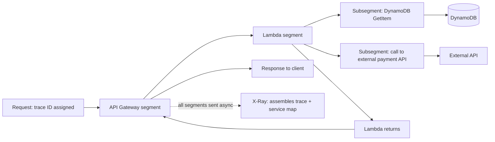

# Observability Instrumentation & AWS X-Ray (Task 4.1 / 4.2)

## Definition

Instrumentation is the practice of adding code to your application that reports what it's doing —
logs, metrics, and traces — so that when something goes wrong, the answer is "look at the
dashboard," not "add print statements and redeploy." **AWS X-Ray** is the AWS service specifically
for distributed tracing: following one request as it hops across multiple services and seeing how
long each hop took.

## Purpose

In a single-server application, debugging means reading one log file. In a serverless/microservice
application — API Gateway → Lambda → DynamoDB → another Lambda → an external API — a single slow
request touches five or six different services, each with its own logs. Without tracing, finding
"which hop was slow" means manually cross-referencing timestamps across five log groups. X-Ray
solves this by stitching one request's hops together into a single trace with per-segment timing.

## How It Works

Each piece of the call chain emits a **segment** (one service's contribution to the trace) or
**subsegment** (a smaller unit inside it, e.g. "the DynamoDB call inside this Lambda invocation").
X-Ray collects these and assembles a full **trace** for a single request ID, plus a **service map**
showing the whole architecture with aggregated latency/error rates per node.

Step by step: a trace ID is generated (or propagated from an upstream caller) at the first hop.
Every service that participates in handling the request — if instrumented — tags its segment with
that same trace ID and reports its own start/end time plus any subsegments for internal work (a
DB call, an outbound HTTP call). All of this is sent asynchronously to X-Ray, which assembles it
into one trace viewable as a timeline (a "waterfall") and rolls many traces up into a service map
showing average latency and error rate per node, system-wide.

## Instrumenting your own code (Task 4.2)

- **Structured logging**: log in a consistent, parseable format (JSON) with request IDs, not free
  text — this is what makes CloudWatch Logs Insights queries actually work during an incident.
- **Custom metrics**: emit business/application-specific metrics (e.g. "orders processed",
  "payment failures") via the CloudWatch embedded metric format or `PutMetricData`, not just relying
  on AWS's default per-service metrics — a default Lambda metric tells you invocation count and
  duration, not "how many orders failed validation."
- **Trace segments/subsegments**: use the X-Ray SDK to wrap outbound calls (`captureAWSClient`,
  `captureHTTPsGlobal` in the Node.js/Python SDKs) so DynamoDB calls, HTTP calls, and SQL queries
  each show up as their own subsegment instead of being invisible inside one opaque Lambda segment.
- **Correlation IDs**: propagate the X-Ray trace ID (or a custom request ID) through logs at every
  hop, so a CloudWatch Logs Insights query across multiple log groups can reconstruct one request's
  full story even without opening X-Ray.
- The instrumentation has to be added *before* the incident — this is why it's its own task
  statement (4.2) separate from root cause analysis (4.1): you can't trace a request retroactively
  if nothing was recording.

## Use Cases — When to Use It

- Any distributed/serverless application where a single request crosses more than one service —
  which is nearly every non-trivial application on AWS.
- Finding intermittent latency spikes that don't show up as outright errors (X-Ray's percentile
  latency view across a service map surfaces these faster than scanning logs).
- Confirming a fix actually worked — comparing the service map's latency before and after a change.

## When NOT to Use It / Alternatives

- For a single-function, no-downstream-calls workload, X-Ray's distributed tracing is of limited
  value — plain CloudWatch Logs/Metrics may be enough; don't over-instrument trivial code paths.
- X-Ray doesn't replace CloudTrail — X-Ray shows *application request flow and timing*, CloudTrail
  shows *who called which AWS management/API action and when*. A security/audit question wants
  CloudTrail; a performance/latency question wants X-Ray.

## Why It's Important

Real-world: without this, debugging a distributed system means guessing. Exam weight: Task 4.1
("assist in root cause analysis") and Task 4.2 ("instrument code for observability") are two of
Domain 4's three task statements — expect direct questions distinguishing when you need
CloudWatch Logs vs. Metrics vs. X-Ray vs. CloudTrail for a given symptom.

## Pricing Model (summary)

X-Ray charges per trace recorded and retrieved/scanned, with a free tier (first 100,000 traces
recorded per month, as of writing — verify current numbers against the official pricing page since
these change). CloudWatch custom metrics and Logs Insights queries are billed separately per the
CloudWatch doc's pricing summary.

## Hands-on Lab (Floci)

See [`labs.md`](labs.md) Lab 1 for enabling X-Ray active tracing on a Lambda function and viewing
the resulting trace segments.

## Exam Tips

- Symptom → tool mapping is the most commonly tested pattern: "where in the chain is it slow" →
  X-Ray; "what exactly happened in this one function" → CloudWatch Logs; "who/what made this API
  call" → CloudTrail; "is this metric trending up" → CloudWatch Metrics/Alarms.
- "Active tracing" must be explicitly enabled per Lambda function (and the function's execution
  role needs `AWSXRayDaemonWriteAccess` or equivalent) — it's not on by default.
- Keywords pointing here: "distributed tracing," "service map," "latency across services,"
  "segments/subsegments," "correlate a request across multiple Lambda functions."

## Related Terms

- [`services/management-governance/cloudwatch.md`](../../../services/management-governance/cloudwatch.md)
- [`services/management-governance/cloudtrail.md`](../../../services/management-governance/cloudtrail.md)
- [`services/compute/lambda.md`](../../../services/compute/lambda.md)
- [`../domain-1-development/ai-assisted-development.md`](../domain-1-development/ai-assisted-development.md) — AI-assisted root cause analysis reads exactly this data.
