# MLA-C02 — Complete Study Guide

> **One file, every domain, every service, every concept.** This is the single-file version of this repo's entire MLA-C02 coverage — every service tagged to this cert, with its definition, a plain-English analogy, when to use it / when NOT to, concrete use cases, diagrams explained, real AWS screenshots discussed, and exam tips, all in reading order by domain weight. Built by merging each domain's `MASTER-CHUNK.md`.

> **This file is long on purpose.** It exists so you never have to jump between files to remember what something does — read top to bottom once, then use it as a flip-reference. For even MORE depth on any single service (full pricing tables, troubleshooting runbooks, limits/quotas), the `services/` doc linked at the top of each entry goes deeper still.

> ⚠️ Internal `#anchor` links (same-page jump links) may occasionally point to the wrong section if two domains share an identical heading name — this is a known tradeoff of merging 4 large standalone files into one. File-to-file links (to `services/`, other domain docs, etc.) are all verified correct.

## Table of Contents

1. [Domain 1: Data Preparation for ML and AI (28%)](#part-1--domain-1-data-preparation)
2. [Domain 2: ML Model and Foundation Model Development (24%)](#part-2--domain-2-model-development)
3. [Domain 3: Deployment and Orchestration of ML and AI Workflows (24%)](#part-3--domain-3-deployment-orchestration)
4. [Domain 4: Operating, Monitoring, and Securing ML and AI Solutions (24%)](#part-4--domain-4-monitoring-security)

Plus: [Full Exam-Readiness Checklist](#full-exam-readiness-checklist) at the end.

---

# Part 1 — Domain 1: Data Preparation for ML and AI (28%)

*Full domain guide with task-statement mapping: [`domain-1-data-preparation/README.md`](domain-1-data-preparation/README.md). This section is domain-1-data-preparation's MASTER-CHUNK, reproduced in full below.*

*MLA-C02 · This single file is designed to be read standalone — printed, dropped into another
tool, or studied with no other file open — and still cover every service and concept in Domain 1
at full exam depth. If you've already read this domain's `README.md`,
`embeddings-and-rag-data-prep.md`, `feature-engineering-deep-dive.md`,
`class-imbalance-and-bias-in-training-data.md`, and `multimodal-data-ingestion-patterns.md`, this
document will feel repetitive by design — it exists for the reader who wants exactly one file,
not six, and for spaced-repetition review the week before the exam.*

## How to use this document

Each of the eleven sections below follows the exact same template, so you can jump to any one
service and get everything you need without flipping elsewhere:

1. **Definition** — what it actually is, in one or two precise paragraphs.
2. **Plain-English Analogy** — a non-technical mental model.
3. **Purpose** — why AWS built it; what problem existed before it.
4. **When to Use** — the scenario shape that should make you reach for this service.
5. **When NOT to Use** — the scenario shape that should make you reach for something else.
6. **Use Cases** — four to six concrete, named business scenarios with the tradeoff spelled out.
7. **Why Important** — real-world stakes plus exam weight.
8. **Mermaid diagram, explained** — at least one diagram with a step-by-step walkthrough.
9. **Real AWS image, discussed** — a curl-verified, live AWS documentation image with discussion
   of what it shows and why it matters.
10. **Exam Tips** — two to three sharp, test-day-useful statements.

The eleven services/topics, in the order the official MLA-C02 exam guide's task statements
introduce them for Domain 1 (Data Preparation for ML and AI, 28% exam weight — the single
heaviest-weighted domain on the exam):

1. [AWS Glue](#1-aws-glue)
2. [AWS Lake Formation](#2-aws-lake-formation)
3. [Amazon Athena](#3-amazon-athena)
4. [Amazon Bedrock](#4-amazon-bedrock)
5. [Amazon Data Firehose](#5-amazon-data-firehose)
6. [Amazon EMR](#6-amazon-emr)
7. [Kinesis Family (Data Streams, Firehose, Managed Service for Apache Flink)](#7-kinesis-family)
8. [Amazon OpenSearch Service](#8-amazon-opensearch-service)
9. [SageMaker Overview](#9-sagemaker-overview)
10. [Data Lake Concepts](#10-data-lake-concepts)
11. [SageMaker Data Wrangler & Feature Store](#11-sagemaker-data-wrangler--feature-store)

A single mental thread ties all eleven together, worth holding in mind throughout: **every one
of these services exists at some point along the path from "raw data arrives somewhere" to "a
model or foundation model has exactly the shaped, clean, governed input it needs."** Some handle
ingestion (Kinesis Family, Data Firehose), some handle storage/governance (Data Lake Concepts,
Lake Formation), some handle transformation (Glue, EMR, Data Wrangler), some handle querying/
serving the result (Athena, OpenSearch), some handle the GenAI-specific half of this domain
(Bedrock), and one (SageMaker Overview) is the umbrella the ML-specific pieces live under. Keep
asking "which stage of this pipeline is being described" as you read an exam scenario, and the
right service usually falls out of that question alone.

---

## 1. AWS Glue

### Definition

AWS Glue is a **serverless data integration service**. It is really three connected tools under
one brand name: the **Data Catalog** (a shared, persistent metadata directory answering "what
tables and columns exist, and where"), **Glue ETL** (code-based or visual Apache Spark jobs that
transform data at scale), and **Glue DataBrew** (a no-code, point-and-click tool for cleaning and
normalizing data). None of the three requires you to provision, patch, or scale a server.

### Plain-English Analogy

Picture a librarian who walks through a messy archive room (your S3 bucket) and writes an index
card for every shelf, describing exactly what's on it and in what format — that librarian is the
**Crawler**, and the index-card system is the **Data Catalog**. Once the index exists, a worker
(a **Glue ETL job**, running serverless Spark behind the scenes) can look up "where's the raw
sales data" on an index card, pull it, clean and reshape it, and put the finished product on a
different shelf. **DataBrew** is a separate workbench next to the archive room where someone who
has never programmed can point-and-click to clean a box of files without ever touching code.

### Purpose

Raw data almost never arrives ready to analyze — it's scattered across S3 prefixes, databases,
and file formats, with inconsistent schemas, missing values, and no shared catalog of what exists
where. Before Glue, turning that mess into clean, queryable data meant provisioning your own
Hadoop/Spark cluster, hand-writing schema-discovery code, and hiring someone who understood Spark
internals just to clean a CSV. Glue exists to make that transformation a matter of configuration,
not infrastructure engineering — the "glue" between where data lands and where it's usable.

### When to Use

Reach for Glue when a scenario describes a **repeatable, scheduled transformation** (nightly ETL,
a recurring cleaning job) that should run with **zero cluster management**, when **multiple query
engines** (Athena, EMR, Redshift Spectrum) need to **agree on one schema**, or when an **analyst
without Spark/Python skills** needs a visual, point-and-click way to clean data (DataBrew).

### When NOT to Use

Skip Glue when the real need is: **heavy, highly customized distributed compute** with fine
control over cluster size, Spot mix, or non-Spark big-data tools like Hive/HBase/Presto (that's
**EMR**); a **one-off ad-hoc SQL query** against data already sitting in S3 with no repeatable
pipeline to build (that's **Athena** directly); or a **trivial, infrequent transform** (rename a
column, light filtering) where even serverless Spark workers are overkill (a **Lambda** function
triggered by an S3 event is cheaper and simpler).

### Use Cases

1. **Nightly ETL for daily reporting** — a retailer's raw sales exports land in S3 every night
   and must be clean, partitioned Parquet by morning. A scheduled Glue ETL job with job
   bookmarks (so only new files are reprocessed) is the fit — pay-per-run, no idle cluster.
2. **Shared schema catalog across engines** — a data platform team wants Athena, EMR, and
   Redshift Spectrum to agree on one table definition instead of three teams maintaining three
   schemas that silently drift. The Glue Data Catalog is the fit by design.
3. **Analyst-driven cleaning, no engineers involved** — a business analyst needs to dedupe and
   standardize a messy CSV export with no Spark/Python experience. Glue DataBrew's point-and-click
   recipes are the fit; reaching for code-based ETL here would be unnecessary engineering overhead.
4. **Automatic schema discovery for an evolving lake** — new daily S3 partitions arrive and
   nobody wants to hand-write `ALTER TABLE ADD PARTITION` for each one. A scheduled Glue Crawler
   is the fit when the naming scheme isn't fully predictable (partition projection is the better
   answer when it is).
5. **ML training data preparation** — a data science team needs deduplication, null handling,
   and format conversion on raw clickstream data before SageMaker ever sees it. Glue ETL/DataBrew
   is the standard general-purpose "data prep" layer feeding that pipeline.
6. **Data-quality gating before a dashboard sees bad numbers** — a finance team keeps getting
   burned by null-filled or duplicated rows reaching QuickSight. Glue Data Quality rules embedded
   in a scheduled job catch this *before* promotion to the curated zone, not after.

### Why Important

**Real-world:** most "the dashboard numbers look wrong" incidents trace back to inconsistent
schemas or uncleaned data — Glue's catalog-first design (one schema, many consumers) is exactly
what prevents Athena and Redshift from silently disagreeing about what a column means. Serverless
billing also means nobody pays for an idle Spark cluster between nightly runs. **Exam:** Glue sits
at the center of Domain 1's Task 1.2 ("Transform data and perform feature engineering") and is
one of the most frequently named services across the whole exam guide — expect to be tested on
choosing DataBrew (no-code) vs. Glue ETL (code-based) vs. SageMaker Data Wrangler (ML-specific)
for a given scenario, not just recognizing Glue's existence.

### Mermaid Diagram, Explained

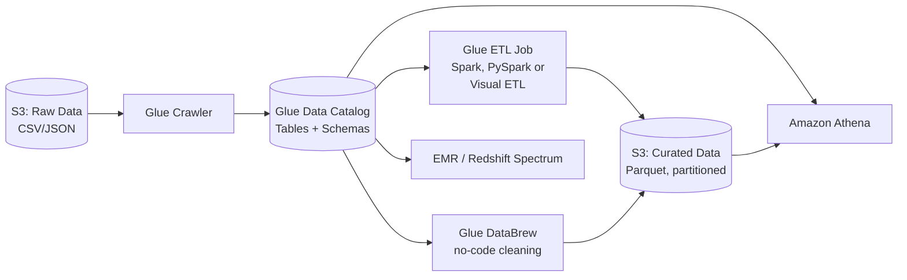

Walking this left to right: raw CSV/JSON files land in S3 untouched. A **Crawler** scans that
prefix, infers schema (column names, types, partition structure), and writes a table definition
into the **Data Catalog** — this is the only step that "discovers" anything; nothing downstream
re-derives schema on its own. From there, two parallel transformation paths both read from the
same catalog entry: a **Glue ETL job** (engineer-driven, Spark-based) or **Glue DataBrew**
(analyst-driven, visual, no code) — either can produce the same destination, **curated Parquet in
S3**, and whichever path you pick, the output gets re-registered in the catalog too. The payoff of
this whole shape is the three arrows converging on the Data Catalog from **Athena**, **EMR**, and
**Redshift Spectrum** at the bottom: all three query engines read the *same* schema, defined once,
so there is no "Athena's version of the schema disagreeing with EMR's version" failure mode.

### Real AWS Image, Discussed


*Source: AWS Glue Developer Guide, "AWS Glue concepts" —
docs.aws.amazon.com/glue/latest/dg/components-key-concepts.html. Verified live via `curl -o
/dev/null -w "%{http_code}"` → `200`.*

This is AWS's own canonical architecture diagram for Glue, and it shows the identical shape the
Mermaid diagram above describes, drawn by the service team itself: **data stores** (your S3
buckets, JDBC databases, DynamoDB tables) feed **crawlers**, crawlers populate the **Data
Catalog**, and **ETL jobs** read from and write back through that same catalog to **data
targets**. The reason this image is worth pausing on rather than skimming past: it visually
confirms there is exactly **one** central catalog object in the whole picture, not one catalog per
consumer — a detail easy to state in prose but easy to forget under exam time pressure when a
question describes "Athena's schema" as if it were something separate from "the Glue Crawler's
schema." They are the same object.

### Exam Tips

- **Glue vs. EMR** is the headline confusion. "Serverless," "minimal operational overhead,"
  "scheduled/repeatable ETL" → Glue. "Full control over cluster configuration," "need Hive/HBase/
  Presto specifically" → EMR.
- The **Data Catalog is shared** — a classic trap implies Athena needs its own separate schema
  definition; it reads the exact same catalog EMR and Redshift Spectrum use.
- **Crawlers cost money and time** — running one on every single file upload instead of on a
  schedule (or using partition projection/manual `ADD PARTITION`) is a frequent cost-optimization
  wrong-answer bait across both SAA-C03 and MLA-C02.

### Worked Exam Scenario

A data engineering team runs a Glue Crawler against an S3 prefix receiving 50,000 tiny JSON
files per day, and the crawler now takes 40 minutes and frequently times out. Walk the actual
root cause before jumping to a fix: a crawler's runtime scales with the number of *files and
partitions* it has to inspect, not total data volume — 50,000 tiny files is a files-count problem,
not a bytes problem. The two legitimate fixes, in order of preference: (1) a scheduled **Glue ETL
job with `.coalesce()`** compacting small files into fewer, larger ones on a recurring basis,
attacking the root cause; (2) if compaction isn't immediately possible, **partition projection**
or a narrower crawler include path can reduce what any single crawler run has to inspect. The
wrong-answer distractor is "increase the crawler's DPU allocation" — crawlers don't expose a DPU
dial the way ETL jobs do, and even if they did, more compute doesn't fix a per-file metadata
overhead problem.

### Quick Facts

- **Billing unit**: Glue ETL and Crawlers both bill per **DPU-hour**, by the second, with a
  1-minute minimum per run — there is no idle-cluster cost between scheduled runs.
- **Data Catalog**: first 1 million objects stored and first 1 million access requests/month are
  free; beyond that, a small per-object/per-request fee applies.
- **Worker types**: G.1X (4 vCPU/16 GB), G.2X (8 vCPU/32 GB — double memory at the same vCPU
  ratio), G.4X/G.8X for heavier jobs, and G.025X for lightweight Python Shell-style jobs — picking
  G.2X over "more G.1X workers" is the fix specifically for shuffle-spill/memory-pressure
  symptoms, not raw CPU-bound slowness.
- **Job bookmarks** are the default fix whenever a scenario describes a scheduled incremental job
  reprocessing all historical data on every run instead of just new files.

---
## 2. AWS Lake Formation

### Definition

AWS Lake Formation is a managed service that centralizes **fine-grained permissions** for a data
lake — database-, table-, column-, row-, and even cell-level access control — enforced
*consistently* across every integrated query engine (Athena, Redshift Spectrum, EMR, Glue,
QuickSight, SageMaker) that reads the same Glue Data Catalog. You define who-can-see-what
**once**, in Lake Formation, and every integrated engine automatically enforces that grant.

### Plain-English Analogy

IAM and S3 bucket policies alone are a building's front-door lock: you're either let into the
building or not. That's fine for coarse access control, but it has no native concept of "you may
enter the building, but inside the finance department's filing cabinet, you may only read every
drawer except the one labeled HR." Lake Formation is the finer internal lock system layered on top
— it checks a granular grant at query time, before any engine touches the underlying S3 data at
all.

### Purpose

Before Lake Formation, securing a data lake meant stacking S3 bucket policies and IAM policies
across every service touching it — Athena, Glue, EMR, and Redshift Spectrum each needing their
own correctly-written, kept-in-sync policy, with no native way to express "let this analyst see
every column except `ssn` and `salary`" or "let this regional manager only see EU rows." AWS built
Lake Formation specifically to add a database-like, fine-grained permissions layer on top of the
Glue Data Catalog, so governance could be expressed the way a data administrator actually thinks
about it — grant SELECT on these columns of this table to this role — instead of awkwardly
translated into bucket-prefix and API-action policies.

### When to Use

Reach for Lake Formation when a scenario names **column-level**, **row-level**, or **tag-based**
access control; when **multiple engines** (Athena *and* EMR *and* Redshift Spectrum) must enforce
the **same restriction identically**; or when **cross-account sharing** of specific
databases/tables is needed without duplicating the underlying data.

### When NOT to Use

Skip it for a **small, single-team lake** where plain IAM + S3 bucket policies are genuinely
sufficient (no need for anything finer than prefix-level access); when the data **isn't in S3/the
Glue Data Catalog at all** (a pure DynamoDB or RDS access-control problem is a plain IAM/database-
native-permissions problem, not a Lake Formation one); or for **row-level security inside a
traditional warehouse** (Redshift's own native row-level security operates inside the warehouse
directly, not through Lake Formation).

### Use Cases

1. **Multi-team data mesh with column-level sensitivity** — several business units share a
   catalog, but only finance should see salary/SSN columns in an otherwise broadly-readable
   employee table. Column-level grants avoid maintaining duplicate "redacted" and "full" table
   copies that could drift out of sync.
2. **Regional data residency/visibility** — a global retailer's regional managers should each see
   only their own region's rows in one shared `orders` table. Row-level data filters avoid
   multiplying the table (and every ETL job feeding it) by region count.
3. **Governed cross-account sharing without duplication** — a platform team owns a curated
   `shared_metrics` table three other accounts need read access to, without copying the data.
   Cross-account grants via AWS Resource Access Manager (RAM) are the fit.
4. **Scaling governance across hundreds of tables** — a large org's catalog has grown past the
   point where naming an individual grant per table per team is sustainable. LF-TBAC (tag-based
   access control) tags tables and roles once; grants follow automatically as new matching tables
   appear.
5. **Rapid bootstrap of a governed lake from a legacy database** — a team migrating off an
   on-prem database wants a working, cataloged, governed lake quickly. A Lake Formation
   **blueprint** (Database snapshot/incremental, or Log file) auto-generates the Glue Workflow.
6. **Preventing a restriction bypass by switching tools** — security needs certainty that a
   column-level restriction enforced in Athena can't be circumvented by the same analyst opening
   an EMR notebook under the same IAM role. Lake Formation's credential-vending model enforces the
   restriction *below* any single engine's own access logic, by design.

### Why Important

**Real-world:** the single most common cause of a data lake turning into an unusable "data swamp"
isn't a storage problem — it's a governance problem: nobody can confidently say who can see what
across a growing set of tools and teams. Lake Formation makes that answerable in one place,
enforced automatically everywhere. **Exam:** this is the named answer for Domain 1 Task 1.3
("ensure data integrity... bias, compliance") whenever access governance over sensitive training
data columns is the actual ask — a question describing "write more detailed, separate IAM
policies per service" as the fix for a fine-grained, multi-engine requirement is testing whether
you recognize Lake Formation as the centrally-enforced, correct alternative instead.

### Mermaid Diagram, Explained

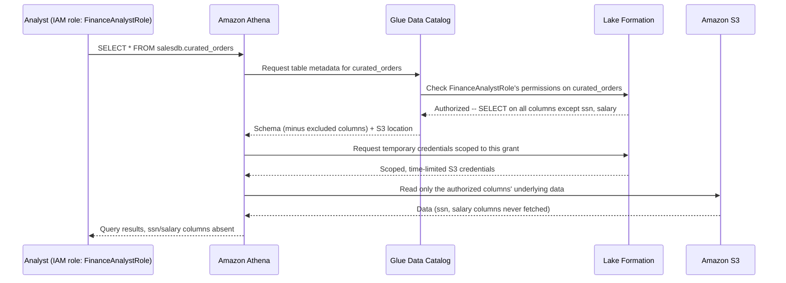

The step that makes this mechanism actually binding, not just advisory, is the **fifth and sixth**
message: Athena doesn't go straight to S3 using its own IAM role's permissions — it has to ask
Lake Formation for **temporary, scoped credentials** first, and Lake Formation hands back
credentials limited to exactly what was granted, regardless of how broad Athena's *own* underlying
IAM role might otherwise be. This is **credential vending**, and it's the specific reason an
analyst can't bypass a column-level restriction by switching from Athena to an EMR notebook using
the same role — the restriction lives at this handoff point, which every integrated engine must
pass through, not inside any single engine's own access-control logic.

### Real AWS Image, Discussed


*Source: AWS Lake Formation Developer Guide, "How it works" —
docs.aws.amazon.com/lake-formation/latest/dg/how-it-works.html. Verified live via curl → `200`.*

AWS's own diagram shows the exact same "get metadata → check permissions → get credentials → get
data" sequence as the Mermaid diagram above, confirming this isn't a simplification this repo
invented — it's the documented, official mechanism. A second official image worth knowing about by
name even without reproducing it here is the Lake Formation + QuickSight architecture diagram
(docs.aws.amazon.com/quick/latest/userguide/images/lake-formation-architecture-drawing-1.png,
also verified `200`), which shows Lake Formation governing access for a QuickSight dashboard
querying through Athena against Glue Data Catalog tables — a concrete, applied instance of the
same abstract workflow, replacing a patchwork of per-service IAM/S3 policies with one centrally
managed grant model.

### Worked Exam Scenario

"A hospital network's data platform team has one shared `patient_records` table in the Glue Data
Catalog. Clinicians need full access to treat patients; the billing department needs access to
insurance/billing fields but not clinical notes; and an external research partner (a different
AWS account) needs access to a de-identified subset of rows for an approved study — all querying
through a mix of Athena and EMR." Walk the three requirements against Lake Formation's grant
types: clinicians get a broad table-level `SELECT` grant; billing gets a **column-level** grant
naming only the billing-relevant columns (excluding clinical notes entirely, not just hiding them
in a UI); the research partner gets a **row-level data filter** (e.g., `study_consent = true`)
combined with a **cross-account grant via RAM**, so the partner account sees only consented rows
of only the table it's been granted, without the data ever being copied into their account. All
three grants are enforced identically whether the query runs through Athena or an EMR notebook,
because credential vending — not any single engine's own access logic — is what's actually
checking the restriction.

### Quick Facts

- **No separate Lake Formation service charge** — you pay for the underlying Glue Data Catalog
  storage/requests, S3 storage, and query engine compute (Athena/EMR/Redshift Spectrum) it
  coordinates; the control plane itself is free.
- **Blueprints** generate standard Glue Workflows (crawler + import job) under the hood, billed at
  normal Glue DPU-hour rates — no additional charge for the blueprint convenience layer itself.
- **Cross-account sharing** requires either AWS Organizations membership or an explicit RAM
  resource share — it does not work automatically between two arbitrary, unrelated accounts.
- A soft, raisable limit exists on **permission grants per principal/resource** — very large,
  deeply nested data-mesh setups should favor LF-TBAC tag-based grants over many individual named
  grants as table count grows.

### Exam Tips

- **Fine-grained permissions enforced identically across multiple engines** is Lake Formation's
  signature — a question naming more than one engine (Athena *and* EMR, say) needing consistent
  enforcement points here, not at per-service IAM policies.
- **Lake Formation sits on top of the Glue Data Catalog — it does not replace it.** A question
  implying Lake Formation is a separate catalog or storage system is wrong.
- **Credential vending is what makes a grant actually binding** — remember an engine's own
  underlying IAM role can be broader than what Lake Formation ultimately hands it per query; this
  is exactly why switching engines doesn't bypass a restriction.

---

## 3. Amazon Athena

### Definition

Amazon Athena is a **serverless, interactive query service** that runs standard SQL directly
against data sitting in S3 — no database to load data into first, no servers to provision, no
cluster to manage. You point it at files (CSV, JSON, Parquet, ORC, Avro) and query them as if
they were already database tables, through the Trino/Presto engine running underneath.

### Plain-English Analogy

Imagine a librarian who, instead of making you check books out of the library first, lets you
walk in, point at any shelf, and ask a question about what's on it — she reads only the relevant
pages, answers your question, and charges you for exactly the pages she had to read. Athena
doesn't store or move your data; it reads straight from S3 using the schema the Glue Data Catalog
already has on file, runs the query, and returns results — you pay per byte scanned, not for a
standing database.

### Purpose

Before Athena, querying data sitting in S3 meant first loading it into a database or warehouse —
a whole ETL step just to ask one question. AWS built Athena so analysts and engineers could query
data **in place**, the moment it lands in S3, paying only for the specific query run rather than
for a database sitting there 24/7 waiting to be asked something.

### When to Use

Reach for Athena when a scenario says **"ad-hoc," "infrequent," "serverless,"** or **"query data
in S3 without moving it."** It's also the right lightweight tool for **data profiling before
training** — checking null rates, outlier counts, and category distributions — without spinning
up EMR or a SageMaker Processing job just to run exploratory `SELECT COUNT(*) ... GROUP BY`
queries.

### When NOT to Use

Skip Athena for **frequent, complex analytical queries at large scale with many concurrent
users** — a true data warehouse (**Redshift**) is more cost-predictable and faster, since it keeps
data pre-loaded and optimized rather than scanning S3 files per query. Athena is also **not a
transactional/OLTP database** — it cannot handle single-row inserts/updates at application
latency.

### Use Cases

1. **Incident investigation over log files** — a security team needs to query VPC Flow Logs for
   suspicious traffic during an active incident, right now, with nothing pre-provisioned. Athena
   fits because it's serverless and queries S3 directly; OpenSearch would cost money continuously
   between incidents for a need that only exists during them.
2. **One-off or infrequent analytical queries** — a finance analyst needs to answer "what were
   Q3 regional sales" exactly once. Athena's pay-per-query model is the fit over standing up
   Redshift for a question asked once a quarter.
3. **SQL layer over a curated data lake** — a company has partitioned Parquet in S3 from
   Glue/EMR and needs a SQL interface for both analysts and dashboards, with no database layer to
   stand up first.
4. **Federated queries across heterogeneous sources** — an analyst needs to combine data from
   RDS, DynamoDB, and CloudWatch Logs in one query without copying any of it anywhere; Athena's
   Lambda-based Query Federation connectors push filter predicates to each source first.
5. **ML data profiling before training** — a data scientist needs to check null rates, outliers,
   and row counts by category before deciding how to transform a dataset. Athena answers this
   fast, with zero new infrastructure, versus EMR/SageMaker Processing being significant overkill
   just to look at distributions.
6. **Fixing a slow, expensive unoptimized table in one step** — a team inherited a CSV-based
   table that's painfully slow and expensive to query. A CTAS (`CREATE TABLE AS SELECT`)
   statement converts both format and partition layout to Parquet in one shot.

### Why Important

**Real-world:** Athena is often the cheapest, fastest way to get a first answer out of a data
lake — incident investigation, cost analysis against billing data in S3, and lightweight
dashboards all lean on it without ever provisioning a database. **Exam:** in Domain 1, Athena
commonly appears as the tool used to explore/profile a dataset before deciding how to transform it
for ML — recognizing Athena as the right lightweight, serverless exploration tool (versus EMR/
SageMaker overkill) is the tested skill, alongside the classic cost-reduction pattern below.

### Mermaid Diagram, Explained

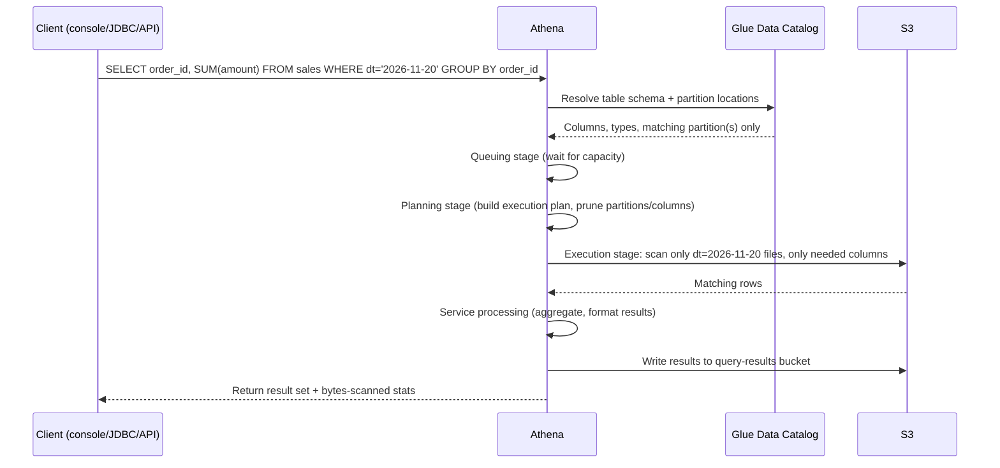

The single most important thing this sequence shows is **where partition pruning happens**: at
the **planning** stage, *before* any S3 scan occurs. That ordering is exactly why a well-
partitioned table can make an otherwise-expensive query nearly free — the planner simply never
requests the irrelevant files from S3 in the first place, rather than fetching everything and
discarding unneeded rows afterward. This is also why "add more compute" is never the right fix
for a slow/expensive Athena query (there's no compute to add — it's serverless); the actual lever
is reducing what gets scanned, via partitioning and columnar formats.

### Real AWS Image, Discussed


*Source: AWS Athena User Guide, "View statistics and execution details for completed queries" —
docs.aws.amazon.com/athena/latest/ug/query-stats.html. Verified live via curl → `200`.*

This is Athena's own console view of the queuing/planning/execution breakdown the sequence
diagram above describes — when a real query feels slower than expected, this is the first place
to look, because it separates "waiting for capacity" (queuing) from "actually reading files"
(execution), two very different root causes that a single "query took 40 seconds" headline number
hides.

### Worked Exam Scenario

"A team's Athena bill tripled last month with no change in query frequency. Investigating, every
query still names only three columns out of a 40-column table, and filters on a single day's
data out of two years of history." Walk the diagnosis: the described symptoms (narrow column
selection, narrow date filter) *should* produce cheap queries if the underlying table were
Parquet and partitioned by date — the fact that cost tripled with unchanged query patterns points
directly at the **storage layer**, not query behavior: either the source table is still raw CSV/
JSON (no columnar skip, so every column's bytes get scanned regardless of the `SELECT` list), or
it's unpartitioned (every day's data gets scanned regardless of the `WHERE` clause), or both. The
fix is a one-time **CTAS** statement converting the table to partitioned Parquet — not asking
users to write "more efficient SQL," since the SQL was already as selective as it could be against
an inefficiently-stored table.

### Quick Facts

- **Billing**: per TB of data **scanned**, not returned — a `SELECT *` with no `WHERE` clause on
  an unpartitioned table bills for the entire table regardless of how few rows come back.
- **Query result reuse** serves a recent, unchanged query's results from cache instead of
  re-scanning S3 — free of additional charge, but only helps for genuinely repeated queries, not
  varied ad-hoc ones.
- **Athena for Apache Spark** bills per **DPU-hour** while a session is active — a different cost
  model than standard SQL's per-TB-scanned billing, closer in spirit to Glue ETL billing.
- **Query timeout** is configurable per workgroup with an account-level ceiling — a runaway query
  against bad/malformed input is cut off rather than scanning (and billing) indefinitely.

### Exam Tips

- **Athena vs. Redshift**: "infrequent," "serverless," "query data in S3 without moving it" →
  Athena. "Data warehouse," "frequent BI queries," "many concurrent users" → Redshift.
- **Partitioning and Parquet directly cut cost** — a "reduce Athena cost" question is answered by
  "convert to Parquet and partition," never "add more compute" (there isn't any to add).
- **CTAS** is the go-to answer for "I have a slow/expensive unoptimized table and need a fast
  fix" — it converts format and partitioning in one statement, no separate Glue job required.

---
## 4. Amazon Bedrock

### Definition

Amazon Bedrock is AWS's fully managed service for using and customizing **foundation models** —
large pre-trained AI models from multiple providers (Anthropic, Meta, Mistral, Amazon's own Titan/
Nova family, and others) — through one consistent API, without provisioning a single GPU. In
plain terms: Bedrock is "foundation models as an API call." For Domain 1 specifically, Bedrock
matters as the **engine behind embeddings and Retrieval-Augmented Generation (RAG) data prep** —
the GenAI-era half of this domain, alongside the classic-ML half the other ten entries cover.

### Plain-English Analogy

A foundation model only knows what was in its training data, frozen at some cutoff date — it has
never read your company's internal wiki or yesterday's support tickets. Instead of re-teaching it
everything (expensive, slow, and has to be redone every time your documents change), RAG keeps
your documents in a searchable form and, at question time, hands the model only the relevant
excerpt — like giving an extremely well-read substitute teacher a one-page briefing right before
class instead of making them re-read the whole textbook.

### Purpose

Foundation models face a hard choice when they need facts outside their training data: retrain/
fine-tune (expensive, slow, redone every data change), paste everything into every prompt (doesn't
scale), or **RAG** — keep documents searchable and retrieve only what's relevant at question time.
Bedrock exists to make the "model call" half of that pattern (embeddings generation, the final
generation step, and increasingly the whole managed pipeline via **Knowledge Bases**) a
configuration choice rather than an infrastructure project, and to make foundation models
available without managing GPU fleets at all.

### When to Use

Reach for Bedrock whenever a scenario needs to **generate embeddings** from text/images for a
vector store, needs **grounded answers from private/current documents without retraining**
(RAG), or needs a **managed end-to-end RAG pipeline** (Knowledge Bases bundling chunking +
embedding + vector storage + retrieval). It's also the default whenever "use/customize a
foundation model without managing GPU infrastructure" is the ask.

### When NOT to Use

Skip Bedrock (specifically for data-prep purposes) when the actual need is **teaching a model a
new consistent output format/tone/persona** — that is fine-tuning, which changes model behavior,
not what facts it can access; RAG doesn't fix a format/behavior problem. Skip it entirely when the
underlying knowledge base is small enough to fit directly in a prompt (a few pages) — the
retrieval machinery adds complexity with no benefit if there's nothing meaningful to filter down.

### Use Cases

1. **Support chatbot grounded in frequently-changing documentation** — retraining a model weekly
   is impractical; RAG re-embeds only the changed sections as the manual updates.
2. **Legal/compliance answers that must cite their source** — RAG naturally preserves a pointer
   back to the retrieved chunk/document; fine-tuning gives no equivalent traceability mechanism.
3. **Reasoning about data created after the model's training cutoff** — RAG injects genuinely new
   facts at query time; fine-tuning can't efficiently keep injecting new facts on an ongoing basis.
4. **Multi-tenant SaaS chatbot isolation** — each customer's answers must be grounded only in that
   customer's own documents. Metadata filtering (e.g., `tenant_id`) on the vector store scopes
   every similarity search to the requesting customer's data only.
5. **Multimodal product search** — a shopper uploads a photo of a room and gets back visually
   similar furniture listings. Titan Multimodal Embeddings map both the photo and every listing
   photo into the same vector space, with zero text extraction involved.
6. **Teaching a model a strict, consistent output schema** (the "when NOT to use RAG" case made
   concrete) — an engineering team wants every response in a specific internal JSON schema
   regardless of what's asked. That's fine-tuning (or strict prompt engineering), not RAG.

### Why Important

**Real-world:** RAG is the dominant pattern for making generative AI useful on private/current
data without retraining cost, and getting chunking/embedding wrong (too-large chunks, mismatched
embedding models between indexing and querying, no metadata filtering) is one of the most common
reasons a real RAG system gives bad or leaky answers. **Exam:** this is explicitly called out as
new content differentiating MLA-C02 from its predecessor, sitting inside the heaviest-weighted
domain (28%) — expect several questions testing RAG-vs-fine-tuning-vs-prompting judgment and basic
vector-store/embedding vocabulary.

### Mermaid Diagram, Explained

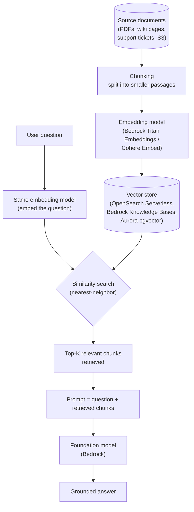

This is the complete RAG indexing-plus-runtime pipeline in one picture. The indexing half (top
row, A→D) happens once per document and again only when a document changes: chunk, embed, store.
The runtime half (E→K) happens on every user question: embed the *same* way, find the nearest
stored vectors, assemble a prompt combining the question with the retrieved text, and let the
foundation model generate an answer grounded in that text. The single detail worth internalizing
hardest here: **the exact same embedding model** has to convert both the stored chunks (step C)
and the live question (step F) into vectors — if those two steps ever use different models or
different model versions, the resulting vectors don't live in a comparable numeric space, and
"nearest neighbor" search silently returns meaningless results without raising any error.

### Real AWS Image, Discussed


*Source: Amazon Bedrock User Guide, "How Amazon Bedrock knowledge bases work" —
docs.aws.amazon.com/bedrock/latest/userguide/kb-how-it-works.html. Verified live via curl →
`200`.*

This is AWS's own illustration of the indexing half described above — documents chunked,
converted to embeddings, written to a vector index while keeping a pointer back to the original
document. A companion image from the same page
(docs.aws.amazon.com/bedrock/latest/userguide/images/kb/rag-runtime.png, also verified `200`)
shows the runtime half: the user's query embedded with the same model, the index searched for
semantically similar chunks, and the retrieved context augmenting the prompt sent to the
foundation model. Seeing both halves as AWS's own diagrams (not just this repo's Mermaid
rendering) confirms the indexing/runtime split is the service's own documented mental model, not
a simplification layered on top for teaching purposes.

### Worked Exam Scenario

"A law firm's internal chatbot must answer questions using the exact text of client contracts,
cite the specific clause it drew from, and absolutely never let one client's answer surface
content from a different client's contracts — contracts are updated constantly as amendments are
signed." Walk the requirements against the decision tree: "answer from private, frequently
changing documents" → RAG, not fine-tuning (fine-tuning would need a full retraining run per
amendment, impossibly slow). "Must cite the specific clause" → RAG's natural retrieval pointer,
which fine-tuning has no equivalent for. "Never cross client boundaries" → **metadata filtering**
on the vector store, scoping every similarity search by `client_id` before it ever runs, not a
post-hoc filter applied to results after retrieval (which would already have touched the wrong
client's vectors). The complete answer: chunk contracts with metadata tags for `client_id` and
`matter_id`, embed with Titan Embeddings, store in OpenSearch or a Bedrock Knowledge Base, and
enforce the `client_id` filter as a mandatory, non-optional part of every query path.

### Quick Facts

- **Billing**: embedding models are billed per unit of input text processed (per 1,000 input
  tokens, model-dependent); vector storage costs depend on the chosen store (OpenSearch
  Serverless bills by OCU-hour; Knowledge Bases bills for underlying storage and embedding calls).
- **Re-embedding is incremental** — only changed documents need re-embedding after an update, a
  cost asymmetry that is the single biggest reason RAG beats fine-tuning economically for
  frequently-changing source material.
- **Embedding dimensionality** is fixed per model (e.g., 1,536 for a common Titan Embeddings
  output) — higher dimensionality captures more nuance but costs more storage/compute per
  comparison, a cost/accuracy tradeoff, not a free upgrade.
- A **full re-embedding of the entire corpus** is required after any embedding model version
  change — old stored vectors and newly-embedded queries are not comparable across versions.

### Exam Tips

- "Grounding answers in private/current documents without retraining" → RAG, every time.
  "Teaching the model a new output format/tone/style" → fine-tuning, not RAG.
- The **same embedding model must embed both stored documents and incoming queries** — a common
  wrong-answer trap mixes two different embedding models or model versions.
- **Metadata filtering** is the specific mechanism for multi-tenant data isolation in a shared
  vector store — "customer A must never see customer B's content" points here, not a separate
  vector store per customer (valid, but usually a more operationally expensive answer than the
  exam expects).

---

## 5. Amazon Data Firehose

### Definition

Amazon Data Firehose (formerly "Kinesis Data Firehose," renamed in 2024) is a fully managed
service that takes streaming data as it arrives and automatically delivers it — buffered,
optionally transformed, and batched — to a destination like S3, Redshift, OpenSearch, Splunk,
Snowflake, or an Apache Iceberg table, **without you writing or running any code or managing any
infrastructure**.

### Plain-English Analogy

Firehose is a conveyor belt loading dock that's always running: records arrive continuously,
Firehose holds them in a short buffer (by size or by time, whichever threshold hits first), and
the moment that buffer flushes, it writes a neatly-batched file to wherever you told it to
deliver. No one drives the forklift; you point it at a destination once and it keeps running on
its own, forever, with no consumer code to write.

### Purpose

Getting streaming data to land somewhere durable and queryable is an extremely common need that
doesn't actually require custom processing logic most of the time — "take these IoT events and
put them in S3 as Parquet, partitioned by hour" is a *delivery* problem, not a *compute* problem.
Before Firehose, satisfying that need meant running your own fleet of consumer applications
reading off a stream and writing batches to S3 by hand — buffering, retry, format-conversion, and
partitioning logic, all built and operated by you. Firehose exists to make "just deliver it,
reliably, close to real time, with zero ops" a configuration choice instead of an engineering
project.

### When to Use

Reach for Firehose when a scenario says **"no custom code," "fully managed," "zero
infrastructure,"** or needs **format conversion to Parquet** on the way into S3/Redshift/
OpenSearch. It's the correct Task 1.1 answer whenever raw ML training data needs to land in the
lake continuously with **no consumer code written at all**.

### When NOT to Use

Skip Firehose when the scenario needs **custom per-record processing logic** beyond simple
reshaping (complex stateful joins, windowed aggregation — that's Kinesis Data Streams with a
custom consumer, or Managed Service for Apache Flink); needs to **replay or reprocess historical
data** (Firehose has no replay mechanism once a batch is delivered — only Kinesis Data Streams'
retention window supports that); or needs **multiple independent consumers** reading the same data
for different purposes (one Firehose stream has exactly one destination).

### Use Cases

1. **Zero-code IoT telemetry landing in a data lake** — a sensor fleet just needs to land in S3
   as partitioned Parquet for later analysis, no per-record logic required. Format conversion plus
   dynamic partitioning does this with zero infrastructure to run.
2. **Centralized log shipping to a SIEM** — CloudWatch Logs subscription filters feed directly
   into a Firehose stream delivering to OpenSearch for search, with a parallel S3 backup for cheap
   long-term retention.
3. **Streaming ETL into a lake house table format** — continuous application events land in an
   Apache Iceberg table with ACID guarantees, so concurrent writers never produce a half-written
   read for a downstream query engine.
4. **ML training data lake ingestion** — raw event data destined to eventually train a model needs
   to land in S3 as Parquet, partitioned usefully for a later SageMaker Processing or Glue ETL job,
   with no custom ingestion code at the capture stage.
5. **WAF and VPC Flow Log analysis pipeline** — logs need to land somewhere queryable for a
   compliance audit trail without a team writing and operating custom log-shipping code.
6. **Migrating a legacy on-prem Splunk forwarder fleet to AWS** — Firehose's native Splunk
   destination (HEC-compatible) replaces self-managed forwarders entirely, removing the patch/
   scale/secure overhead that managed delivery exists to remove.

### Why Important

**Real-world:** a huge fraction of "get streaming data somewhere durable" requirements genuinely
don't need custom processing — they need reliable, managed delivery, and building that reliability
by hand (buffering, retry, format conversion, partitioning, backpressure) is a real engineering
project most teams shouldn't spend time on. **Exam:** Firehose appears across SAA-C03, DVA-C03,
and MLA-C02 — in Domain 1, "land raw data in S3 for later feature engineering, no custom code"
points here; "compute a feature in flight before storage" points past Firehose toward Data Streams
+ Flink or Feature Store's streaming ingestion instead.

### Mermaid Diagram, Explained

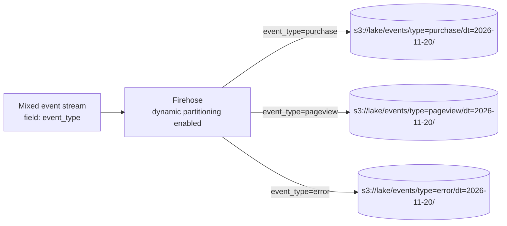

This is **dynamic partitioning**, worked concretely: a single Firehose delivery stream splits its
own output across multiple destination prefixes at delivery time, based on a field inside each
record, with no separate stream per partition value needed. A JQ-style expression against each
record's JSON extracts the partitioning key (here `event_type`) and routes it to the matching S3
prefix, buffering each partition independently. Downstream, a Glue Crawler run against the
top-level prefix discovers all three partitions as one logical table with `type` and `dt` as
partition columns — and an Athena query filtering `WHERE type = 'error'` scans only the matching
files, which is the entire reason to partition data this way in the first place.

### Real AWS Image, Discussed


*Source: AWS Developer Guide, "What is Amazon Data Firehose?" —
docs.aws.amazon.com/firehose/latest/dev/what-is-this-service.html. Verified live via curl →
`200`.*

This is the simplest of Firehose's destination-specific delivery paths: records buffer, optionally
pass through a transformation Lambda, and write directly to the target bucket, with an optional
simultaneous backup of the untransformed source records to a second bucket. Two companion
destination diagrams from the same page are worth knowing by name even without reproducing both
here: the Redshift path (fh-flow-rs.png, verified `200`) shows S3 as a **mandatory** intermediate
stop (Firehose writes to S3 first, then issues a `COPY` command), while the OpenSearch path
(fh-flow-es.png, verified `200`) shows data pushed **directly** to the cluster's ingest endpoint,
with S3 only as an *optional* parallel backup. The pattern across all three: S3 is either the
destination itself, a mandatory intermediate stop, or an optional parallel backup — never absent
from the picture entirely.

### Worked Exam Scenario

"An IoT platform ingests sensor telemetry from 50,000 devices and needs it landing in S3 as
Parquet, partitioned by device type and hour, with no custom consumer code — but the operations
team also notices records with a malformed `device_type` field have been silently disappearing
from the expected S3 prefixes for the past week." Walk the diagnosis: the ingestion design itself
(Direct PUT or Kinesis Data Streams source → Firehose → format conversion + dynamic partitioning
→ S3) is correct for the "no custom code" requirement. The "records disappearing" symptom is not
data loss in the sense of the exam's usual red herring — it means those specific records are
failing the **format conversion** step (their `device_type` doesn't match the Glue Data Catalog
schema used for Parquet conversion) and are being routed to the **error output S3 prefix**,
assuming one is configured. The fix is checking that prefix first, not assuming the records are
gone; if no error output location was configured, that omission (not Firehose itself) is the real
gap to close.

### Quick Facts

- **Billing**: per GB ingested, with volume-tiered pricing; format conversion and VPC delivery
  each add a small additional per-GB charge on top of base ingestion — no idle cost when no data
  is arriving.
- **Buffer size/interval**: S3 destinations support 1 MiB–128 MiB buffer size and 60–900 second
  buffer interval — delivery is inherently bounded by these, so "data appears a minute late" is
  expected behavior, not a bug, unless it vastly exceeds configured thresholds.
- **Record size limit**: up to 1,000 KB per record before any Lambda transformation; larger
  payloads must be split by the producer before calling `PutRecord`/`PutRecordBatch`.
- **Error record retry duration** is configurable up to a maximum window (commonly up to 7,200
  seconds) before Firehose gives up and routes a persistently-failing record to the error prefix.

### Exam Tips

- **The #1 trap: Firehose vs. Kinesis Data Streams.** "Custom processing logic," "multiple
  independent consumers," or "need to replay history" → Data Streams. "Just deliver it, no code,
  fully managed" → Firehose.
- **Firehose has no replay, full stop** — once a batch is delivered, it's delivered.
- **Redshift delivery always stages through S3 first** — a question describing Firehose
  delivering "directly" to Redshift with no S3 involved is describing something that doesn't
  happen.

---
## 6. Amazon EMR

### Definition

Amazon EMR (Elastic MapReduce) is a **managed big-data platform** that runs open-source
frameworks — Apache Spark, Hadoop, Hive, Presto/Trino, HBase, Flink, and others — on a cluster of
EC2 instances (or containers, or serverless) that AWS provisions, configures, and can scale for
you. It's "rent a big-data cluster by the hour, fully configured, without racking servers."

### Plain-English Analogy

EMR is a construction crew AWS assembles for you on demand. You tell it which tools you need
(Spark? Hive? Presto?) and how big a crew (instance types/counts), and it shows up with
everything pre-wired to talk to each other and to your data in S3. When the job's done, you send
the crew home (terminate the cluster) and stop paying — while the actual output stays safely in
S3, not on the crew's own trucks.

### Purpose

Running real Hadoop/Spark clusters used to mean buying physical servers, installing and patching
dozens of interdependent open-source components, and tuning them for weeks before a single job
ran reliably. AWS built EMR so a team can launch a correctly-configured, production-grade
big-data cluster in minutes, scale it for a big job and back down (or to zero) when done, and pay
only for what's running — while keeping the full, unrestricted open-source ecosystem available,
not a cut-down, AWS-only substitute.

### When to Use

Reach for EMR when a scenario needs **TB-scale or custom distributed algorithms** that exceed what
Glue's serverless model exposes; needs **Hive, Presto/Trino, or HBase specifically** (not just
generic Spark); or needs **GPU-accelerated large-scale preprocessing** for ML beyond a single
SageMaker Processing instance. EMR trades Glue's serverless simplicity for direct cluster control
when scale or custom tuning genuinely demands it.

### When NOT to Use

Skip EMR for a job that's "clean this data and land it somewhere, on a schedule, with no ops
burden" — **Glue** does the same transform with zero cluster management. Skip it for **ad-hoc SQL
on data already in S3** — **Athena** answers that directly with no cluster at all. Don't keep a
long-running cluster "just in case" for occasional jobs — that's paying for idle compute; use
**EMR Serverless** or launch-and-terminate transient clusters instead.

### Use Cases

1. **Petabyte-scale nightly Spark ETL** — a media company needs full control over executor memory
   tuning to avoid shuffle spill across 10TB/night of viewing logs; EMR exposes the real Spark
   configuration knobs Glue abstracts away.
2. **Workloads needing Hive, Presto/Trino, or HBase specifically** — a team migrating an on-prem
   Hadoop stack relies on HBase for low-latency key lookups alongside Hive for SQL; EMR is the
   fit because it's the full open-source ecosystem, not a curated subset.
3. **Cost-sensitive, fault-tolerant batch processing with Spot** — a genomics lab runs large,
   interruptible batch jobs overnight; EMR with Spot Task nodes (On-Demand Core/Master) is the
   textbook cost-optimization fit.
4. **GPU-accelerated large-scale ML preprocessing** — a computer vision team needs to preprocess
   millions of images with GPU-accelerated transforms before training, at a scale beyond a single
   SageMaker Processing instance.
5. **Large-scale ML feature engineering feeding SageMaker** — a recommendation system needs
   features computed across hundreds of GB to TB of user interaction history; EMR Spark writes
   engineered features to S3 for a SageMaker training job to consume directly.
6. **Container-standardized teams already running EKS** — an organization wants EMR Spark jobs
   running as pods inside existing Kubernetes infrastructure (EMR on EKS), sharing autoscaling and
   observability tooling already built once, rather than operating a separate EMR-native fleet.

### Why Important

**Real-world:** EMR is still the backbone of a huge share of real-world big-data pipelines at
scale — it's the honest "we actually need Spark/Hadoop/Presto, with real control" option when
managed/serverless tools don't fit. **Exam:** in Domain 1, "EMR Spark" is explicitly listed as a
transform-step tool alongside Glue and SageMaker Data Wrangler — expect scenario questions about
large-scale feature engineering or preprocessing that exceeds what a single SageMaker instance or
Glue job can efficiently handle.

### Mermaid Diagram, Explained

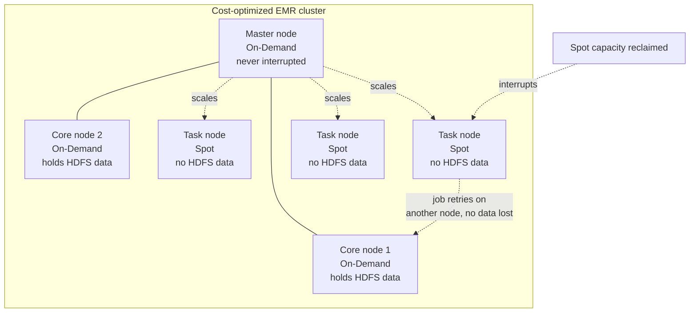

This diagram captures the single most important node-sizing decision on EMR: **Master and Core
nodes run On-Demand, Task nodes carry Spot**. Losing the Master kills the cluster, and losing a
Core node loses the HDFS blocks it was holding — neither is a risk worth taking for Spot's
discount. Task nodes carry no HDFS data at all, so losing one to Spot reclamation only costs a
retry of whatever computation was running on it, never actual data loss. This is the reasoning
the exam expects you to articulate, not just "Spot is cheaper" as a headline fact — the *why* is
entirely about which node type holds persistent state.

### Real AWS Image, Discussed


*Source: AWS EMR Management Guide, "Understanding how to create and work with Amazon EMR
clusters" — docs.aws.amazon.com/emr/latest/ManagementGuide/emr-overview.html. Verified live via
curl → `200`.*

This is AWS's own cluster lifecycle diagram — `STARTING → BOOTSTRAPPING → RUNNING → WAITING/
TERMINATING → TERMINATED` — and it matters for a very specific troubleshooting reason: a cluster
stuck in `BOOTSTRAPPING` almost always means a custom bootstrap action is hanging or failing
silently on some nodes, not a general cluster health problem, and the official diagram makes clear
that bootstrapping is a *distinct*, named phase you can isolate rather than lumping "something's
wrong during startup" into one undifferentiated bucket. A companion official diagram
(step-sequence.png, also verified `200`) shows the separate, simpler step state machine (`PENDING
→ RUNNING → COMPLETED/FAILED`) — worth knowing that a cluster's lifecycle and an individual step's
lifecycle are two different state machines, not one.

### Worked Exam Scenario

A nightly EMR job processing 2 TB of clickstream data takes 90 minutes and shows heavy shuffle
spill in the Spark UI, running on 20 m5.2xlarge Core nodes (8 vCPU/32 GB each). The team's first
instinct is to double the node count. Walk why that's the wrong lever: shuffle spill is a
per-task memory-pressure signal — each executor doesn't have enough RAM to hold its shuffle data
in memory, so it spills to disk, which is slow. Doubling the *count* of the same undersized
instance type gives more parallel tasks, but each individual task still runs out of memory the
same way, so spill persists. The correct fix is switching to m5.4xlarge (16 vCPU/64 GB — double
memory per node at the same vCPU ratio) at the same or similar node count, giving each executor
more working memory. This is the exact "instance type/memory sizing, not node count" distinction
the exam tests repeatedly, dressed up as a cost question (doubling node count roughly doubles
cost for a fix that doesn't work; switching instance type often costs less while actually fixing
the bottleneck).

### Quick Facts

- **Billing**: per second for underlying EC2 instances, plus a smaller EMR service fee per
  instance-hour on top of EC2 pricing; EMR Serverless bills per vCPU/memory-second actually
  consumed with zero idle cluster cost.
- **Steps per cluster**: a soft limit (low hundreds by default) on steps submitted over a
  cluster's lifetime — long-running clusters processing many small steps may need to batch work
  into fewer, larger steps.
- **HDFS replication factor** on Core nodes defaults to 3x for durability — lowering it saves
  storage cost but increases the blast radius of losing a single Core node, a real tradeoff.
- A transient cluster running 90 minutes nightly costs roughly **16x less** than the same cluster
  left running 24/7 "just in case" — the arithmetic behind "auto-terminate transient clusters"
  being close to a universal EMR cost-optimization answer.

### Exam Tips

- **Glue vs. EMR**: "fully managed, no infrastructure to maintain" → Glue. "Need to run Hive/
  Presto/HBase" or "customize cluster configuration/Spot fleet" → EMR.
- EMR clusters storing data on **HDFS lose that data when the cluster terminates** — the correct
  pattern is **EMRFS to S3** for durable storage, keeping clusters ephemeral.
- A question emphasizing "shuffle spill," "out of memory on executors," or "job slow despite
  adding nodes" points to **instance type/memory sizing**, not node *count* — a frequently-missed
  distinction.

---

## 7. Kinesis Family

### Definition

"Kinesis" is AWS's umbrella name for three distinct services that solve three different problems
with data arriving continuously, in real time: **Kinesis Data Streams** (a durable, ordered pipe
you write records into and read records out of yourself, with custom code); **Amazon Data
Firehose**, covered in depth in Section 5 (a fully managed, no-code delivery pipe); and **Managed
Service for Apache Flink** (formerly Kinesis Data Analytics — runs SQL or Flink code directly
against a stream to compute things in motion before data lands anywhere).

### Plain-English Analogy

Kinesis Data Streams is a conveyor belt with numbered slots (shards) producers drop records onto,
and consumers read from in order, at their own pace, re-reading history if needed within a
retention window. Managed Service for Apache Flink is a quality-control station built right into
the belt, inspecting items as they pass and flagging or transforming them in real time, before
anything downstream even sees them.

### Purpose

Before streaming services existed, "real time" usually meant polling a database every few seconds
— slow, wasteful, and it doesn't scale past a handful of sources. AWS built Kinesis so you can
capture continuous data (clickstreams, IoT telemetry, application logs, stock ticks) the moment
it's produced, process or route it within seconds, and never lose a record even if a downstream
consumer is temporarily down. The three services exist separately because "capture and retain,"
"deliver to a destination," and "compute over the stream" are genuinely different jobs.

### When to Use

Reach for **Kinesis Data Streams** when multiple independent consumers need to read the same data
differently, or when replay/reprocessing of history matters. Reach for **Managed Service for
Apache Flink** when a scenario needs rolling/windowed aggregation or anomaly detection computed
**in-flight**, before data lands anywhere (e.g., a rolling 1-minute error rate feeding an alarm).

### When NOT to Use

Don't use Kinesis for simple point-to-point decoupling of application components where ordering
and replay don't matter — **SQS** is simpler and cheaper. Don't use it for pub/sub fan-out to many
independent subscribers with no replay/ordering need — **SNS** (or EventBridge) is the simpler
fit. If the real need is just "batch-load files that show up periodically," you don't need
streaming infrastructure at all — trigger **Glue** or **Lambda** off S3 events instead.

### Use Cases

1. **Clickstream analytics for real-time personalization** — an e-commerce site wants product
   recommendations to react to what a shopper clicked *this session*, not last night's batch.
   Data Streams preserves per-session ordering and lets a Flink app and a separate analytics
   consumer both read the same events independently.
2. **IoT telemetry from a connected device fleet** — a logistics company streams GPS/engine data
   from thousands of trucks; Data Streams + Flink computes rolling per-vehicle health aggregates
   (hot path) while Firehose archives raw telemetry to S3 (cold path) for later ML feature work.
3. **Real-time fraud scoring** — a payments company must score each transaction against a rolling
   window of the same card's recent activity within roughly a second; Flink maintains that
   windowed, stateful join in-flight — a Lambda consumer has no native concept of a sliding window
   and would be re-implementing Flink's state management by hand, badly.
4. **Change Data Capture (CDC) fan-out to independent reactive systems** — a database's change
   stream must drive a search-index updater, a cache invalidator, and a notification service,
   each independently, each able to catch up from where it left off. Data Streams' replay window
   makes this safe where SNS's no-replay model would silently lose messages for a down subscriber.
5. **Streaming feature engineering for real-time ML scoring** — a fraud model needs "transaction
   count for this card in the last 10 minutes" computed before scoring, not after. A Flink app
   computes the rolling feature and emits it to a second stream a real-time endpoint reads.
6. **Live operational dashboards** — a ride-sharing company wants a map of live driver density per
   region, refreshing every few seconds; Data Streams + Flink computing rolling counts is the fit
   where QuickSight over Athena would be minutes-behind by design.

### Why Important

**Real-world:** streaming ingestion is the backbone of any "real time" claim a company makes —
fraud alerts, live dashboards, IoT telemetry, recommendation engines all depend on data moving
within seconds instead of hours. Getting shard count and partition key design wrong is one of the
most common real-world causes of "why is my pipeline falling behind" incidents. **Exam:** this is
a direct, named example throughout Domain 1's "ingest and store data" step — scenario questions
describe symptoms (a consumer falling behind, a throttling exception, data delivered late) and ask
for the fix, almost always "shard count / partition key / enhanced fan-out," not a different
service entirely.

### Mermaid Diagram, Explained

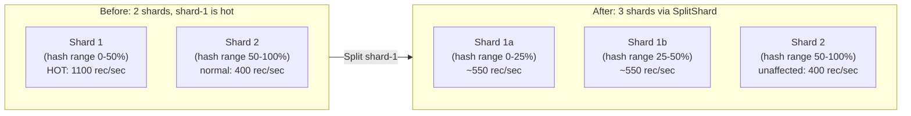

Each shard supports a hard ceiling — 1 MiB/sec or 1,000 records/sec ingest. The diagram shows
**SplitShard** dividing one overloaded shard's hash-key range into two child shards, each taking
roughly half the original's traffic. The exam-relevant nuance this diagram is built to surface: a
**hot shard almost always traces back to partition key design, not raw volume** — keying by
`customer_id` when 5% of customers generate 80% of events concentrates traffic on whichever
shards those IDs hash to, no matter how many shards exist in total. Blindly adding shards (without
fixing the key) doesn't change *which* shard a given key lands on — splitting the specific hot
shard, or redesigning the key (e.g., a composite key adding a random suffix), is the actual fix.

### Real AWS Image, Discussed


*Source: AWS Kinesis Data Streams Developer Guide, "Terminology and concepts" —
docs.aws.amazon.com/streams/latest/dev/key-concepts.html. Verified live via curl → `200`.*

AWS's own architecture diagram shows producers pushing records continuously into Data Streams,
with consumers (a custom app on EC2, or a Firehose delivery stream as a consumer of the same
stream) processing them independently, in real time. The detail worth internalizing from this
official picture: **a Firehose delivery stream can itself be one of several consumers reading off
a Data Stream** — this is the exact mechanism behind the "hot path / cold path from one source"
pattern used repeatedly throughout this domain, where a Flink app computes live metrics from the
same stream a Firehose consumer is independently archiving to S3.

### Worked Exam Scenario

A mobile game's event stream experiences `ProvisionedThroughputExceededException` on roughly 15%
of `PutRecord` calls during peak hours, even though the stream's CloudWatch `IncomingBytes`
metric averaged across the whole stream looks well under capacity. Walk the diagnosis: a
stream-wide average hiding a per-shard problem is the signature of a **hot shard** — check
`IncomingBytes`/`IncomingRecords` **per shard**, not the stream aggregate. If one shard is running
at 3x its 1,000 rec/sec or 1 MiB/sec ceiling while others sit idle, the root cause is very likely
the **partition key** — e.g., keying by `region` with only 4 possible values caps traffic to at
most 4 shards no matter how many shards the stream has in total. The fix is a better-distributed
key (a high-cardinality field, or a composite key adding a random suffix to spread a "whale"
entity's traffic), not blindly increasing shard count — more shards with the same low-cardinality
key still only ever route to the same few hash buckets.

### Quick Facts

- **Per-shard limits**: 1 MiB/sec or 1,000 records/sec write; 2 MiB/sec shared read across all
  consumers using classic `GetRecords`, or a dedicated 2 MiB/sec per consumer with enhanced
  fan-out (up to 20 enhanced fan-out consumers per stream).
- **Retention**: 24 hours by default, extendable to 7 days (standard) or 365 days (long-term
  retention, added per-shard-hour cost) — this is what makes replay possible at all.
- **Both Data Streams and Firehose are at-least-once delivery** — consumers must be idempotent
  (dedupe by a unique record ID); a question implying exactly-once guaranteed by Kinesis itself
  is wrong.
- **On-demand vs. provisioned** is a cost-optimization question in disguise: "unpredictable,
  spiky traffic" → on-demand; "steady, well-understood volume" → provisioned with a right-sized
  shard count, typically cheaper at steady scale.

### Exam Tips

- **Kinesis Data Streams vs. Firehose** is the #1 confusion. "Custom processing logic," "multiple
  independent consumers," "need to replay" → Data Streams. "Just deliver it, no code" → Firehose.
- A **hot shard** (uneven partition key distribution) is a classic scenario — the fix is better
  key design or splitting the specific hot shard, never "add more shards blindly."
- **Enhanced fan-out** is the correct fix whenever multiple consumers compete for one shard's
  shared 2 MiB/sec read throughput — don't reach for "add more shards," which doesn't change
  per-consumer read allocation the way enhanced fan-out does.

---
## 8. Amazon OpenSearch Service

### Definition

Amazon OpenSearch Service is a **managed search and analytics engine**, based on the open-source
OpenSearch project (a fork of Elasticsearch), that lets you store, search, and visualize large
volumes of data — especially text, logs, and semi-structured JSON — with fast, full-text and
near-real-time analytical queries. For Domain 1, its **k-NN vector search** capability also makes
it a legitimate, AWS-native **vector database** for RAG pipelines, not only a log-search tool.

### Plain-English Analogy

OpenSearch is a card catalog system built specifically to answer "find me everything related to
X, ranked by how relevant it is," not "look up record #4521." Data gets broken into an **index**
built from the actual content, so searching doesn't mean scanning every record — it means
checking the index directly, which is how it stays fast even over huge volumes of text or logs.

### Purpose

Relational databases are built for exact-match, structured queries; they're slow and awkward for
"find all log lines mentioning this error, ranked by relevance" or full-text search across
millions of documents. AWS built OpenSearch Service so teams get a production-grade search/log
analytics engine (indexing, relevance ranking, aggregations, near-real-time ingestion) without
operating the underlying distributed cluster, patching nodes, or handling sharding/replication by
hand.

### When to Use

Reach for OpenSearch when a scenario emphasizes **near-real-time, searchable, dashboard-driven**
results (a live ops view of errors, a SOC threat-hunting dashboard), a **relevance-ranked
full-text search box** (typo-tolerant product search), or **storing and retrieving document
embeddings for RAG** via its native k-NN vector index type.

### When NOT to Use

Skip OpenSearch for **structured, transactional queries** needing joins and ACID guarantees —
use RDS/Aurora, not a search engine, as a database replacement. Skip it for **large-scale
historical batch analytics** over a petabyte data lake with infrequent queries — Athena or
Redshift over S3 is far cheaper than keeping that volume hot in an OpenSearch cluster
continuously. Don't over-shard a small index "just in case" — excess shards waste cluster
overhead and can actively hurt performance.

### Use Cases

1. **Centralized log analytics for live ops visibility** — an SRE team needs to search and
   dashboard application errors across dozens of services within seconds of them being logged.
   CloudWatch Logs → Firehose → OpenSearch → Dashboards is the fit; CloudWatch Logs Insights alone
   lacks relevance ranking and sustained near-real-time indexing at heavy log volume.
2. **Product search with relevance ranking and typo tolerance** — an e-commerce search box needs
   to rank results and tolerate misspellings, not do an exact SQL `LIKE` match.
3. **Security analytics / SIEM-style threat hunting** — a security team searches GuardDuty
   findings, Security Hub events, and audit logs for patterns like "many failed logins from one IP
   in a short window," with alerting rules firing in near-real-time, unlike Athena's batch/ad-hoc
   model.
4. **Vector/semantic search backend for a RAG pipeline** — a chatbot retrieves the most
   semantically relevant passages from internal documents using OpenSearch's k-NN vector index as
   an AWS-native vector store, avoiding adding an entirely new managed service when the team
   already runs OpenSearch for logs/search.
5. **Hybrid keyword + semantic search** — a support-ticket search tool needs to match both exact
   product SKUs (keyword/BM25) and loosely-worded descriptions of the same issue (k-NN
   similarity) in one query.
6. **Hot-warm-cold log retention at scale** — a compliance-driven company must retain 365 days
   of logs but only actively queries the last 2 days. Index State Management automates the hot →
   UltraWarm → Cold → delete lifecycle, the primary cost lever for this workload.

### Why Important

**Real-world:** OpenSearch underpins most "live search this" and "live dashboard of what's
happening right now" features, from e-commerce search boxes to SOC dashboards. Getting shard
count and replica strategy wrong is a classic source of either poor performance (too few shards)
or wasted cost (over-sharded, over-replicated small indices). **Exam:** OpenSearch is increasingly
relevant in Domain 1 for storing and searching **embeddings** used in RAG pipelines — recognize it
as a vector store option, not just a log search tool, in newer GenAI-adjacent data-prep questions.

### Mermaid Diagram, Explained

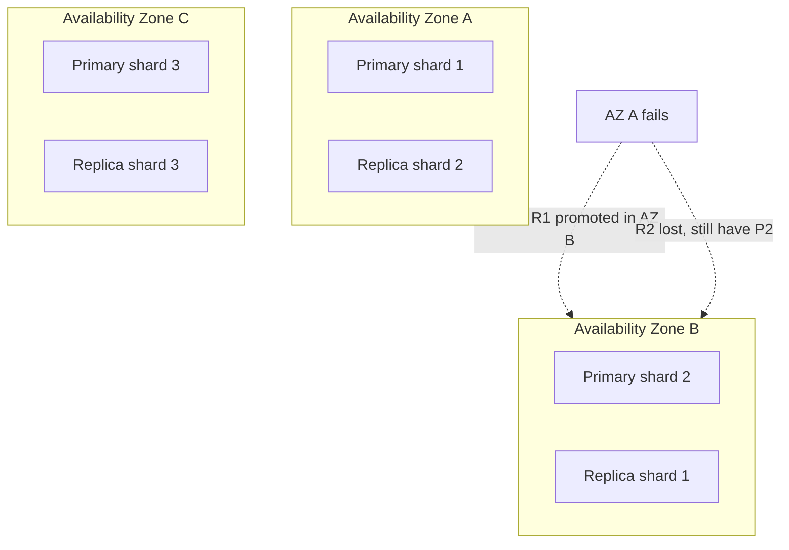

The rule this diagram is built to teach: **OpenSearch never places a primary shard and its own
replica in the same Availability Zone.** When AZ A fails in this picture, Primary shard 1 is lost
— but its replica (R1) already lived in AZ B and gets promoted to primary immediately; separately,
Replica 2 (also in AZ A) is lost, but its primary (P2) was already safely in AZ B. Every shard
remains available somewhere. This is why **replica count ≥ 1, spread across at least 2 AZs** is
the standard "don't lose data/availability on an AZ outage" answer, not a nice-to-have — without
it, an AZ failure can take an entire shard's only copy down with it.

### Real AWS Image, Discussed


*Source: AWS OpenSearch Service Developer Guide, "Launching your Amazon OpenSearch Service
domains within a VPC" — docs.aws.amazon.com/opensearch-service/latest/developerguide/vpc.html.
Verified live via curl → `200`.*

This official diagram shows the network-level half of the same story the Mermaid diagram covers
conceptually: OpenSearch data nodes placed in subnets across multiple Availability Zones inside a
VPC, with the service managing elastic network interfaces into each AZ. Seeing both pictures
together makes a subtle but testable point explicit — AZ-aware shard **placement** (where data
actually lives) and VPC-aware **network** architecture (how traffic reaches each node) are two
separate design layers that both have to be correctly configured for a domain to survive an AZ
outage; getting the network topology right doesn't automatically mean shard placement is
AZ-aware too, and vice versa.

### Worked Exam Scenario

A security team's OpenSearch domain shows cluster status `yellow` after adding a third data node,
and separately, search latency has crept up over the past month even though log volume has been
flat. Walk both symptoms independently: `yellow` means at least one **replica** shard is
currently unassigned — commonly because there aren't yet enough nodes/AZs to place it per the
"never co-locate primary and replica" rule after a topology change — this means reduced
redundancy, not lost data, and is worth fixing but isn't an emergency the way `red` would be. The
separate latency creep with flat volume points at something else: likely indices that were never
aged out of the hot tier via Index State Management, so the hot tier's total size (and therefore
per-query work) has been growing even though *new* daily volume hasn't — the fix is an ISM policy
moving older indices to UltraWarm/Cold, not adding more hot nodes to a growing-but-rarely-queried
dataset.

### Quick Facts

- **Billing**: per instance-hour for data/master node types, plus EBS storage attached to each
  node; UltraWarm/Cold tiers bill at cheaper per-GB rates; OpenSearch Serverless bills per
  OpenSearch Compute Unit (OCU)-hour with no instance provisioning at all.
- **Shard size rule of thumb**: target 10–50 GB per shard — too many small shards wastes
  per-shard overhead; too few large shards limits parallelism and slows rebalancing/recovery.
- **`yellow` vs. `red`**: `yellow` = a replica is unassigned (reduced redundancy, data still
  available); `red` = a primary is unassigned (some data currently unsearchable) — treat `red` as
  the urgent one.
- **Doubling replica count roughly doubles storage/compute footprint** for the affected indices,
  in exchange for tolerating two simultaneous node failures instead of one — a direct cost-vs-
  availability tradeoff worth reasoning through explicitly, not reciting as "more replicas =
  better" without the cost side.

### Exam Tips

- **OpenSearch vs. Athena**: "near-real-time dashboard," "full-text search with relevance
  ranking" → OpenSearch. "Ad-hoc SQL over S3 log files, infrequent, pay-per-query" → Athena.
- **Shard count is fixed at index creation** — resizing requires reindexing into a new index
  (often via an index alias swap), never an in-place resize operation.
- Know OpenSearch's **k-NN vector search** as a legitimate MLA-C02-relevant answer for "where do
  RAG embeddings get stored and searched," alongside Aurora + pgvector and S3 Vector Buckets.

---

## 9. SageMaker Overview

### Definition

Amazon SageMaker is AWS's fully managed platform for the entire machine learning lifecycle — one
product bundling together everything needed to prepare data, build, train, tune, deploy, and
monitor ML models, so you don't stitch together your own servers, notebooks, and training scripts
from scratch. Within Domain 1 specifically, SageMaker's **Data Wrangler** and **Feature Store**
(Section 11) are the ML-specific transform and storage layers; this section covers the umbrella
platform's shape so those two pieces make sense in context.

### Plain-English Analogy

SageMaker is "ML infrastructure as a service" — AWS runs the compute, you bring the data and code
(or use the no-code tools). It's the difference between renting a fully-equipped, pre-wired
workshop by the hour versus buying your own building, installing your own power lines, and
hiring an electrician before you can even plug in a saw.

### Purpose

Before SageMaker (launched 2017), a data scientist who wanted to train a model had to provision
an EC2 instance, install Jupyter and every ML library by hand, manage GPU drivers, write their own
save/load model code, build their own deployment server, and babysit scaling — a lot of
undifferentiated heavy lifting unrelated to the actual data science. AWS built SageMaker to remove
all of that plumbing, turning each piece (notebook environment, training compute, feature
storage, deployment, monitoring) into a managed, reusable building block instead of a bespoke
engineering project every team reinvents independently.

### When to Use

For Domain 1 purposes specifically, reach for SageMaker's data-prep layer (Data Wrangler, Feature
Store — Section 11) whenever a scenario describes **cleaning/transforming data visually with
built-in bias detection** or needing **one governed feature definition multiple models/teams
reuse**. More broadly, reach for the SageMaker umbrella whenever a scenario needs the full custom
train-tune-deploy-monitor lifecycle, not just a pre-built AI API call.

### When NOT to Use

Skip SageMaker (in favor of a pre-built AI service) when a scenario just needs "AI" results —
sentiment, translation, OCR — without training anything custom; Comprehend, Rekognition, Textract,
Translate, Polly, Transcribe, Forecast, and Personalize solve those directly. Skip it in favor of
**Bedrock** when the need is using/customizing a large foundation model without managing GPU
infrastructure at all; Bedrock is serverless-by-default and billed per token, while SageMaker
endpoints bill per instance-hour whether or not traffic is flowing.

### Use Cases

1. **Fraud detection (financial services)** — score every card transaction for fraud risk using
   proprietary transaction patterns no off-the-shelf model has seen. Train a custom XGBoost model
   on your own labeled history, deploy to an auto-scaling real-time endpoint; no general-purpose
   "detect fraud" AI service knows your specific customer base's normal behavior.
2. **Customer churn prediction (telecom/SaaS)** — a Training Job (XGBoost baseline) plus Feature
   Store centralizes engineered usage features so marketing, retention, and billing teams all
   score against the identical definition, versus a simple rules-based heuristic missing
   nonlinear, multi-signal churn patterns.
3. **Medical imaging diagnosis support (healthcare)** — script mode with a custom CNN, trained
   inside a VPC with no internet egress, keeps PHI inside the network boundary end to end; full
   control over architecture and Clarify SHAP explainability for a radiologist to review.
4. **Demand forecasting (retail/CPG)** — the built-in DeepAR algorithm learns shared seasonal/
   promotional patterns across hundreds of related time series at once, rather than fitting 500
   independent single-series models.
5. **Credit risk / loan approval scoring (banking)** — Clarify's per-prediction SHAP values
   generate the defensible, feature-level explanation a compliance team or regulator can inspect
   for any single denial decision.
6. **Predictive maintenance (manufacturing/IoT)** — Random Cut Forest anomaly detection or a
   custom time-series model, compiled via Neo and deployed to a factory-floor edge gateway with
   no reliable connectivity, catching multi-sensor failure patterns a fixed threshold would miss.

### Why Important

**Real-world:** every sub-service exists because someone, repeatedly, had to solve the same
infrastructure problem by hand before AWS packaged a managed answer. Data Wrangler exists because
data scientists kept hand-writing the same pandas cleaning code; Feature Store exists because
teams kept building slightly-different, inconsistent versions of "the same" feature. **Exam:**
understanding SageMaker's *shape* — why there are this many pieces and how they chain together —
is more useful than memorizing any single feature in isolation, because nearly every scenario
question is really asking "which piece of this well-known problem are you being shown."

### Mermaid Diagram, Explained

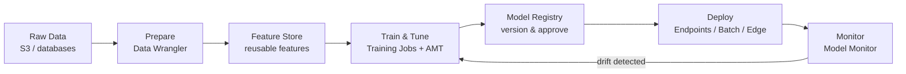

This is the entire SageMaker lifecycle compressed into one line, and the detail worth noticing is
the **feedback arrow from G back to D**: monitoring isn't the end of the pipeline, it's the start
of the *next* iteration. Drift or performance decay detected by Model Monitor is the trigger to
retrain, often automated via SageMaker Pipelines + EventBridge — the lifecycle is a loop, not a
one-way pipe, and a question describing a model that's never retrained after deployment is
describing an incomplete, exam-flagged anti-pattern, not a legitimate steady state.

### Real AWS Image, Discussed


*Source: AWS SageMaker Developer Guide, "Model training" —
docs.aws.amazon.com/sagemaker/latest/dg/train-model.html. Verified live via curl → `200`.*

This official diagram shows the basic architecture every SageMaker job shares, regardless of
which stage of the lifecycle it's used for: you bring data in S3 and either a built-in algorithm
or your own training script; SageMaker provisions the EC2 instances behind the scenes, runs the
job, and returns an artifact. The exam-relevant point this image makes concrete: "Training Job,"
"Processing Job," and "Batch Transform Job" are the *same* underlying create → provision → run →
upload → terminate mechanic applied at different pipeline stages — once you've internalized this
one diagram, every other SageMaker document's "how it works" section is a new container and a new
input/output shape, not a new infrastructure model to learn from scratch.

### Worked Exam Scenario

A team trained a churn model with SageMaker's built-in XGBoost, achieved 0.91 validation AUC, and
now needs to decide between a real-time endpoint and Batch Transform for a model that scores the
full customer base once a night for a retention team's morning report, with no live user-facing
traffic. Walk the decision: the described traffic pattern (once nightly, no live request path) is
exactly Batch Transform's signature — point it at the full customer list in S3, it scores every
row, writes predictions back to S3, and the compute terminates between runs, with no endpoint
sitting idle (and billing) between nightly jobs. A real-time endpoint would work technically, but
would bill per instance-hour for 23+ hours a day of complete idle time between actual uses — the
exam-correct answer optimizes for the *actual* traffic shape described, not the more
sophisticated-sounding option.

### Quick Facts

- **Inference options bill differently**: real-time/serverless/async endpoints bill per
  instance-hour (or per-request for serverless) while the endpoint exists; Batch Transform bills
  only for the compute time the job actually runs, with nothing between runs.
- **Training Jobs** are billed per instance-second for the duration of the job only — the
  instance is provisioned, runs, and terminates automatically, with no idle billing.
- **SageMaker Studio Lab** (free tier, separate signup, no AWS account/billing required) is the
  recommended low-stakes path for hands-on practice before committing real AWS spend.
- A question describing "spiky/unpredictable, low traffic, minimize idle cost" for a live endpoint
  points at a **serverless endpoint**, not a provisioned real-time one.

### Exam Tips

- A huge fraction of scenario questions are really "which SageMaker sub-service does this job,"
  dressed up in a business scenario — correctly naming the sub-service is most of the work.
- **SageMaker vs. Bedrock**: custom model built on your own labeled data, full architecture
  control → SageMaker. Using/customizing a foundation model without managing GPU infrastructure →
  Bedrock.
- **SageMaker vs. pre-built AI services**: training your own model for a problem AWS already
  solved with a managed API (sentiment, OCR, translation) is wasted effort and cost — recognize
  when Comprehend/Rekognition/Textract/etc. already is the answer.

---
## 10. Data Lake Concepts

### Definition

A **data lake** is a centralized storage repository that holds data in its raw, native format —
structured, semi-structured, and unstructured alike — at any scale, without forcing a rigid
schema on it before it's stored. Unlike a database or warehouse, where you must define table
structure before writing data in, a lake lets you store first and decide structure later, at
query time (**schema-on-read** instead of **schema-on-write**). On AWS, **Amazon S3** is the de
facto foundation nearly everyone builds a data lake on top of.

### Plain-English Analogy

A data warehouse is a filing cabinet where every folder must be pre-labeled and every document
reformatted to fit a specific folder size before it's filed. A data lake is a big, cheap warehouse
where you can drop boxes of any size and shape as they arrive, and index/label them later, only
when someone actually needs to find something. A **lake house** adds database-like structure and
query performance on top of that cheap, flexible storage — layering table formats, catalogs, and
optimized file formats over the lake, the best of both patterns.

### Purpose

Traditional data warehouses require designing a schema up front and transforming data to fit it
before it's even stored — fine when you know exactly what questions you'll ask, expensive and
slow when you don't, or when data arrives in wildly different shapes (JSON logs, images, CSV,
video, IoT telemetry) that don't fit one rigid table structure. The data lake pattern lets
organizations capture **everything**, cheaply, in its original form, and figure out the valuable
questions later — without re-ingesting history every time a new question comes up, because raw
data was never thrown away or reshaped.

### When to Use

Reach for the data lake pattern when data arrives in **wildly different shapes** that don't fit
one schema, when a project needs **large volumes of raw historical data** to engineer features
from and reprocess as modeling needs evolve, or when **storage growth and compute cost** need to
be billed and scaled independently rather than bundled.

### When NOT to Use

Skip the lake pattern when data is **already well-structured, known in advance, and queried
frequently by many users with strict performance SLAs** — go straight to a **data warehouse
(Redshift)**, avoiding the lake's cataloging/transformation steps for simple, stable BI reporting.
A lake with **no governance** (no catalog, no access controls, no zone discipline) becomes a
**"data swamp"** — if an organization can't commit to cataloging/governance discipline, the lake
pattern causes more harm than a smaller, well-modeled warehouse would.

### Use Cases

1. **Unifying wildly different data shapes under one roof** — a company has app logs (JSON),
   clickstream events, exported database tables (CSV), and IoT sensor readings, wanting one place
   to land all of it before deciding exactly how to use each piece.
2. **ML/AI training data assembly** — a data science team needs large volumes of raw historical
   events to engineer features from and replay through updated pipelines as modeling needs
   evolve; a lake never discards or summarizes away the raw history a warehouse would have
   already compressed.
3. **Decoupling storage growth from compute cost** — an analytics team's query volume is spiky
   but data volume grows steadily; separately-billed S3 storage and Athena/EMR compute avoids
   paying for warehouse compute sized for peak load all the time.
4. **Long-term, cost-efficient compliance retention** — a regulated company must retain seven
   years of transaction records it may never actually need to run; S3 lifecycle-tiered raw zone
   storage captures most of the savings since access, not just age, drives the real cost.
5. **Multi-team, multi-account governed data sharing** — several business units each want
   ownership and autonomy over their own data, with central governance only for cross-team
   sharing — Lake Formation cross-account grants over a shared/federated catalog.
6. **Lake house ACID guarantees for concurrent pipelines** — a retailer has both a nightly batch
   Glue job and a streaming Firehose delivery writing to the same logical orders table, needing
   every reader to see one consistent snapshot. Apache Iceberg on S3 provides this.

### Why Important

**Real-world:** nearly every modern analytics and ML program at real scale is built on a data lake
pattern because it's the only approach that scales economically to "capture everything now,
figure out the valuable question later" — and ML specifically needs large volumes of raw
historical data a pre-modeled warehouse schema would have already discarded or summarized away.
**Exam:** the entire Domain 1 pipeline assumes a data-lake-shaped flow: ingest and store (S3,
EFS, FSx, Kinesis streaming) → transform (Glue, DataBrew, EMR Spark, Data Wrangler) → feature
engineering — recognizing S3 as the lake foundation and the role of each transformation tool is
the core of this domain.

### Mermaid Diagram, Explained

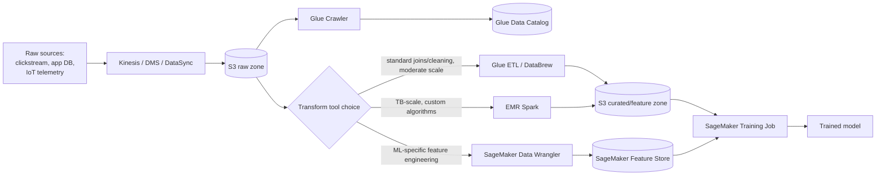

This is the exact diagram MLA-C02 Domain 1 questions are most directly testing: how raw data
becomes a feature a model can actually train on, and which tool does which step. The decision
point worth dwelling on is the `XFORM` diamond — scale and tooling need (not just "I need to
transform data") determine Glue vs. EMR vs. Data Wrangler. A question describing "standard joins
and cleaning at moderate scale" should route to Glue; "TB-scale with custom distributed
algorithms" to EMR; "ML-specific feature engineering with built-in bias reports feeding directly
into training" to Data Wrangler. Picking the wrong branch of this diamond for a described scale/
tooling need is one of the most common Domain 1 scenario traps.

### Real AWS Image, Discussed


*Source: AWS Architecture Diagrams, "Modern Data Analytics Reference Architecture on AWS" —
docs.aws.amazon.com/architecture-diagrams/latest/modern-data-analytics-on-aws/modern-data-analytics-on-aws.html.
Verified live via curl → `200`.*

This official reference architecture shows ingestion tools (DMS, DataSync, Kinesis, MSK, IoT
Core, AppFlow) feeding a Lake Formation-governed S3 data lake, cataloged by Glue, queried by
Athena/Redshift Spectrum, visualized by QuickSight, and consumed by SageMaker — the same
end-to-end shape described throughout this entire MASTER-CHUNK document, confirmed as AWS's own
documented reference shape rather than a teaching simplification. The detail worth noticing: Lake
Formation sits directly in the ingestion-to-catalog path in AWS's own diagram, not bolted on as an
afterthought — governance is drawn as a first-class layer the data passes *through*, not a
separate add-on applied after the fact.

### Worked Exam Scenario

A mid-size retailer's analysts complain they "can't find or trust" data in their S3-based lake —
three different tables all claim to be "the" customer orders table, with subtly different row
counts, and nobody can say which one is authoritative. Walk the diagnosis against the data-swamp
checklist: this is a **missing cataloging + zone discipline** problem, not a storage or compute
problem. The fix, in order: (1) establish one **Glue Data Catalog** entry per logical dataset,
populated by crawlers or disciplined manual registration, so there's one schema of record; (2)
enforce raw/staging/curated/sandbox **zone separation**, so "is this table trustworthy" has a
structural answer (its zone) instead of requiring tribal knowledge about which of the three
"orders" tables someone trusts this week; (3) layer **Lake Formation** governance on top once
cataloging and zoning are in place, so access itself is centrally auditable. "Add more storage" or
"migrate everything to a warehouse" are both wrong-answer distractors — neither fixes the actual
root cause (missing catalog/governance), and a warehouse migration specifically throws away the
lake's native-format flexibility to solve a discoverability problem Lake Formation/Glue solve
directly, without that cost.

### Quick Facts

- **S3 itself has no practical total storage limit** — a lake's growth is bounded by budget and
  governance discipline, not a storage ceiling; "data swamp" risk, not storage exhaustion, is the
  real operational constraint at scale.
- A lake with **100 TB raw, 80 TB of it older than 90 days and rarely re-queried**, can cut its
  total storage bill by roughly half or more purely through lifecycle tiering (moving the cold 80
  TB to Glacier) with zero change to query/compute cost.
- **Partial modernization captures only partial savings**: a lake querying 60% optimized Parquet
  and 40% unoptimized JSON pays Athena's bytes-scanned cost dominated by that 40% — the worst-case
  data shape scanned, not the average, usually dominates query cost.
- **Why EFS/FSx appear alongside S3** in the exam guide's ingest/store list: specific distributed
  training frameworks expect POSIX filesystem semantics, or FSx for Lustre accelerates repeated
  high-throughput reads of the same training dataset across many training instances — S3 remains
  the correct default for the large majority of "where should lake data live" questions.

### Exam Tips

- **"Schema-on-read" vs. "schema-on-write"** is the core conceptual distinction — a data lake
  (flexible, cheap storage, structure decided later) vs. a data warehouse (rigid, optimized for
  known queries, structure decided first).
- **Lake house = lake + warehouse features** — ACID transactions, upserts/deletes, or "time
  travel" on S3-stored data points at a lake house pattern (Iceberg/Hudi/Delta table formats), not
  a plain lake or plain warehouse.
- A **"data swamp"** is the named failure mode of an ungoverned lake — "data in S3 nobody can find
  or trust the schema of" is fixed with **Glue Data Catalog + Lake Formation governance**, never
  "just add more storage."

---

## 11. SageMaker Data Wrangler & Feature Store

### Definition

**Data Wrangler** is a visual, mostly no-code tool inside SageMaker Studio for cleaning,
transforming, and joining raw data into a shape a model can learn from. **Feature Store** is a
central, versioned database for the *finished* features you engineered, so every model and team
pulls the exact same definition of a feature like "customer_lifetime_value" instead of each
writing a slightly different version. They sit back-to-back: Wrangler prepares, Feature Store
stores and serves.

### Plain-English Analogy

Data Wrangler is a spreadsheet with a recorded macro — you point, click, preview the before/
after, and it remembers the whole transformation as a reusable recipe. Feature Store is a shared
filing cabinet with two drawers: one slow drawer with the complete history (for training) and one
fast drawer with just the latest values (for real-time predictions) — both drawers filled from the
same single filing action, so they never disagree.

### Purpose

Data preparation is widely cited as 60-80% of the real work in any ML project, and the most
error-prone part — small inconsistencies (one team computes "average order value" over 30 days,
another over 90) silently produce different model behavior. Data Wrangler removes the need to
hand-write pandas/Spark scripts for routine cleaning steps; Feature Store removes the "whose
version of this feature is correct" problem by giving a feature a single, governed home that both
training (needs full history) and live inference (needs the latest value in milliseconds) read
from.

### When to Use

Reach for Data Wrangler when a scenario needs **visual, no-code cleaning with built-in bias/
data-quality reports** before committing training compute to a dataset. Reach for Feature Store
when **multiple models/teams need the exact same feature definition**, or when a scenario names
**"training/serving skew"** or needs **point-in-time-correct** historical joins to avoid data
leakage.

### When NOT to Use

Skip Data Wrangler when a mature Spark/Glue ETL pipeline and engineering team already exists —
Glue DataBrew is the closer general-purpose analog, and exporting to a Pipeline step might just
add a layer on top of something already working. Skip Feature Store entirely when **nobody else
will ever reuse this feature** and inference is always batch — Feature Store's value is
proportional to reuse; for a single model with no real-time need, engineering the feature directly
in the training script, or reading straight from S3, is simpler and cheaper.

### Use Cases

1. **Fraud detection feature engineering (financial services)** — a fraud model needs real-time
   features like "this card's average transaction size over the last 30 days" in single-digit
   milliseconds at scoring time. Feature Store's Online Store serves exactly this, fed
   continuously via streaming ingestion, with a built-in training/serving consistency guarantee a
   direct database query lacks.
2. **Customer churn feature consistency across teams (telecom/SaaS)** — three teams each compute
   "average monthly spend" slightly differently, producing inconsistent predictions and
   reporting. Centralizing the definition in one Feature Group makes every consumer read the
   identical computation.
3. **Medical imaging metadata preparation (healthcare)** — a hospital's scan archive has
   inconsistent patient metadata that must be cleaned before any model trains. Data Wrangler's
   visual transforms clean this with no custom ETL script, and its bias report flags demographic
   imbalance before any compute is spent training a biased model.
4. **Demand forecasting feature preparation (retail/CPG)** — raw POS data needs lag features and
   rolling averages before a time-series model can use it; Data Wrangler's dedicated time-series
   transform category builds these with no custom code.
5. **Recommendation engine feature store (e-commerce)** — a recommendation model needs a
   customer's current engagement features looked up instantly at the moment of a page view; the
   Online Store serves this real-time lookup while the Offline Store trains on full history from
   the same governed source.
6. **Leak-free credit risk model training (banking)** — building a training set from months of
   historical loan data risks accidentally including information only known *after* a loan's
   outcome. Feature Store's time-travel queries reconstruct exactly what a feature's value was at
   each historical snapshot's own timestamp, preventing this leakage structurally.

### Why Important

**Real-world:** training/serving skew — where the feature values a model saw during training
don't match what it sees live — is one of the most common causes of "the model worked in testing
but broke in production." Feature Store exists specifically to make that bug structurally harder
to create. Data Wrangler's data-quality report similarly catches class imbalance and leakage
*before* compute is burned on a doomed training run. **Exam:** both tools sit squarely in Domain
1, the single heaviest-weighted domain on MLA-C02 — expect direct questions on transforming/
cleaning data, detecting bias/imbalance during prep, and choosing Feature Store for feature reuse
and training/serving consistency.

### Mermaid Diagram, Explained

```mermaid
sequenceDiagram
    participant App as Application / Data Wrangler export
    participant FS as Feature Store API
    participant Off as Offline Store (S3)
    participant On as Online Store

    App->>FS: PutRecord(FeatureGroup, record, event_time)
    par Write to both stores
        FS->>Off: Append record (keep full history)
        FS->>On: Upsert record IF event_time is newer than current
    end
    FS-->>App: Success
    Note over Off,On: One write call, two consistent destinations --<br/>this is what structurally prevents skew
```

This sequence is the mechanism that actually prevents training/serving skew, not just a
description of it. A single `PutRecord` call writes to **both** stores in parallel: the Offline
Store appends the record, preserving full history for training; the Online Store upserts it only
if the incoming `event_time` is newer than whatever it currently holds — meaning an out-of-order,
delayed backfill job writing an *older* timestamp will never silently overwrite a newer live
value. Contrast this with a naive, hand-rolled alternative: a team writes training features to a
warehouse with one pipeline and separately writes "current" features to a cache with a *different*
pipeline for live serving — any bug or timing difference between those two independently
maintained pipelines is exactly the training/serving skew problem. Feature Store's single
dual-write API is the structural fix, not a coding-discipline fix that depends on everyone
remembering to keep two pipelines in sync by hand.

### Real AWS Image, Discussed


*Source: AWS SageMaker Developer Guide, "Create, store, and share features with Feature Store" —
docs.aws.amazon.com/sagemaker/latest/dg/feature-store.html. Verified live via curl → `200`.*

This is AWS's own diagram of Feature Store's place in an ML pipeline: raw data in, transformed
into features, ingested (streaming or batch) into both the online and offline stores, then read
back out for exploration, training, and real-time or batch inference. The detail this official
picture makes visually unmistakable: there is exactly **one** ingestion arrow feeding **two**
stores, not two separate ingestion paths that happen to be kept in sync by convention — the single
entry point is the actual guarantee, and the diagram is drawn to make that structurally obvious
rather than something you have to take on faith from prose alone.

### Worked Exam Scenario

A recommendation team's model performs well in offline evaluation but noticeably worse once
deployed, and the team confirms the *exact same* feature-computation code runs in both training
and production. Walk why this specific combination is a trap: the classic symptom "works in
testing, fails in production" normally screams training/serving skew — but skew requires the
feature *computation* to differ somewhere between training and serving. Here it's explicitly
stated to be identical code. That rules out the Feature Store failure mode this document spends so
much time on, and should redirect attention toward **concept drift** (the real-world data
distribution has shifted since training) or a genuine **data quality** issue in live traffic
Data Wrangler's reports wouldn't have caught at training time because the problematic distribution
didn't exist yet. The exam-relevant lesson: "identical code, still mismatched behavior" rules out
training/serving skew, it doesn't automatically confirm it — know the specific precondition (code
or pipeline *difference*) the skew failure mode actually requires.

### Quick Facts

- **Feature Groups and features per group are both capped** — an extremely wide table (hundreds
  of columns) is often better split into multiple logically-related Feature Groups than one
  monolithic one.
- **Record identifier and event time are mandatory on every Feature Group** — a Feature Group
  with no concept of "when" a value was recorded isn't a valid configuration at all.
- **Billing**: Offline Store at standard S3 rates plus a small per-write fee; Online Store billed
  per GB-month plus read/write throughput capacity (provisioned or on-demand), similar in spirit
  to DynamoDB pricing.
- **Data Wrangler** bills per instance-hour for the underlying compute while a session/flow is
  actively running — forgetting to shut down the instance bills for idle time, the same gotcha as
  any other SageMaker Studio app.

### Exam Tips

- **Offline Store = training** (full history, S3-backed, Athena-queryable). **Online Store =
  real-time inference** (latest value, low-latency). This distinction is tested directly and
  repeatedly.
- **"Training/serving skew"** or **"feature consistency between training and inference"** in a
  question stem is the signal word combo for Feature Store.
- A question mentioning **"point-in-time correct"** or **"avoid leaking future data"** points to
  Feature Store's offline store **time-travel query** capability, not a manual join you'd have to
  get right by hand every time.

---

## Appendix A — Cross-Service Quick Decision Matrix

A fast lookup for the scenario-phrase-to-service pattern-matching that dominates Domain 1 exam
questions. Read down the left column for the phrase closest to what a scenario says.

| Scenario says... | Service | Why not the alternative |
|---|---|---|
| "serverless ETL, no cluster to manage, repeatable schedule" | Glue ETL | EMR requires cluster sizing/management decisions this scenario explicitly wants to avoid |
| "no-code visual cleaning for a business analyst" | Glue DataBrew | Glue ETL requires Spark/Python; Data Wrangler is ML-specific, not general analytics |
| "column/row-level permissions enforced across Athena AND EMR identically" | Lake Formation | Per-service IAM policies require separately maintaining identical logic in each service |
| "ad-hoc SQL over S3 data, pay per query, no infrastructure" | Athena | Redshift requires provisioning/loading data first; EMR is compute overkill for simple SQL |
| "ground answers in private, frequently-changing documents" | Bedrock (RAG) | Fine-tuning requires a retrain per data change; too slow/expensive for frequent updates |
| "teach the model a consistent output format/persona/tone" | Bedrock (fine-tuning) | RAG changes what facts the model can access, not how it behaves |
| "zero-code streaming delivery into S3/Redshift/OpenSearch" | Amazon Data Firehose | Kinesis Data Streams requires writing consumer code this scenario explicitly avoids |
| "custom per-record processing logic on a stream, need replay" | Kinesis Data Streams | Firehose has no replay and no per-record custom logic hook |
| "rolling windowed aggregation computed in-flight, before storage" | Managed Service for Apache Flink | A Lambda consumer has no native sliding-window state management |
| "TB-scale custom distributed algorithm, need Hive/Presto/HBase" | EMR | Glue's serverless model doesn't expose this level of cluster/framework control |
| "near-real-time full-text search with relevance ranking" | OpenSearch | Athena is batch/ad-hoc, not continuously indexed for sub-second search |
| "store and retrieve document embeddings for RAG, already run OpenSearch" | OpenSearch (k-NN) | Standing up a brand-new vector database adds an unneeded second search system |
| "one governed feature definition reused by multiple models/teams" | SageMaker Feature Store | Each team hand-rolling its own pipeline guarantees definition drift over time |
| "feature values differ between training and live inference" | SageMaker Feature Store | The exact, named symptom of training/serving skew, which Feature Store's dual-write structurally prevents |
| "visual, no-code ML-specific transforms with built-in bias report" | SageMaker Data Wrangler | Glue DataBrew is general-purpose, not ML-feature-specific, and has no built-in bias report |
| "raw data lands in native format, structure decided at query time" | Data Lake Concepts (S3) | A data warehouse forces schema-on-write, the opposite of what's described |
| "nobody can find or trust which table is authoritative" | Data Lake Concepts + Glue + Lake Formation | "Add more storage" never fixes a governance/cataloging gap |
| "upserts/deletes and ACID transactions directly on S3 data" | Lake house (Iceberg/Hudi/Delta) | Plain Hive-style S3 tables have no concurrent-write safety guarantee |

## Appendix B — Pricing Dimension Cheat-Sheet

Knowing *what unit* a service bills by is frequently the fastest way to eliminate a wrong answer
on a cost-optimization question, independent of memorizing exact dollar figures.

| Service | Primary billing unit | The lever that actually reduces cost |
|---|---|---|
| AWS Glue | DPU-hour (ETL/Crawler), per-session + per-job-run (DataBrew) | Right-size DPU count/worker type; reduce crawler frequency; use job bookmarks |
| AWS Lake Formation | No separate charge — bills via underlying Glue/S3/query compute | N/A directly; cost is operational setup effort, not a line item |
| Amazon Athena | Per TB of data **scanned** | Convert to Parquet + partition by filtered columns; never "add compute" |
| Amazon Bedrock | Per input/output token (model-dependent); vector store billed separately | Re-embed only changed documents, not the full corpus, on every update |
| Amazon Data Firehose | Per GB ingested, tiered; + format conversion/VPC delivery surcharges | Disable unused options (format conversion, VPC delivery) if nothing downstream needs them |
| Amazon EMR | Per-second EC2 + EMR service fee; EMR Serverless per vCPU/memory-second | Auto-terminate transient clusters; Spot on Task nodes only, never Core/Master |
| Kinesis Data Streams | Shard-hour + per-million-payload-unit (provisioned); per-GB (on-demand) | Right-size shard count to the binding constraint (records/sec or bytes/sec, whichever is higher) |
| Amazon OpenSearch Service | Per instance-hour + EBS storage; OCU-hour (Serverless) | Hot-warm-cold tiering via Index State Management for rarely-queried older indices |
| SageMaker (Training/Endpoints) | Per instance-second (training); per instance-hour or per-request (endpoints) | Batch Transform for non-live traffic; serverless endpoints for spiky/low traffic |
| Data Lake Concepts (S3) | Per GB/month, tiered by storage class | Lifecycle policies aging cold raw data into Infrequent Access/Glacier automatically |
| SageMaker Feature Store | S3 rate + per-write fee (Offline); GB-month + throughput capacity (Online) | Size Online Store read/write capacity to actual request rate, same discipline as DynamoDB |

## Appendix C — Common Exam Keyword Map

A condensed list of single words/phrases that reliably point at one specific service, useful for
a final pre-exam skim rather than re-reading full sections.

- **"Crawler," "Data Catalog," "DPU"** → Glue
- **"Column-level," "row-level," "cross-account grant," "credential vending"** → Lake Formation
- **"Bytes scanned," "CTAS," "serverless SQL over S3"** → Athena
- **"Foundation model," "embeddings," "Knowledge Base," "chunking," "RAG"** → Bedrock
- **"Buffer size/interval," "no consumer code," "delivery stream"** → Data Firehose
- **"Shard," "partition key," "enhanced fan-out," "replay"** → Kinesis Data Streams
- **"Windowed aggregation," "in-flight compute," "Flink"** → Managed Service for Apache Flink
- **"Hive/Presto/HBase," "cluster," "Spot Task nodes"** → EMR
- **"Index," "shard allocation," "k-NN," "Dashboards"** → OpenSearch
- **"Training Job," "endpoint," "Model Registry," "Clarify," "SHAP"** → SageMaker (general)
- **"Schema-on-read," "raw/curated zone," "data swamp"** → Data Lake Concepts
- **"Offline/Online Store," "training/serving skew," "point-in-time correct," "time travel"** →
  Feature Store
- **"300+ transforms," "Quick Model," "visual recipe"** → Data Wrangler

## Appendix D — One Mega-Scenario Touching All Eleven Services

To cement how every piece in this document connects, walk a single, continuous case study that
deliberately uses every one of the eleven services/topics above at least once — the way a long,
multi-part exam case study would present it.

**The business:** "NorthPeak Outfitters," an outdoor-gear retailer, runs a public e-commerce
site, a customer-support chatbot, and a fraud-detection team, all needing data prepared
differently from the same underlying event sources.

1. **Ingestion (Kinesis Family + Data Firehose).** Clickstream and transaction events arrive
   continuously. **Kinesis Data Streams** captures them with ordering preserved per session,
   feeding two consumers: a **Managed Service for Apache Flink** app computing a rolling
   "transactions in the last 10 minutes per card" feature for fraud scoring, and an **Amazon Data
   Firehose** stream archiving the same raw events to S3 as partitioned Parquet with zero custom
   consumer code, for long-term analysis nobody needs in real time.

2. **Storage and governance (Data Lake Concepts + Lake Formation).** Both the raw archive and the
   Flink app's output land in an S3-based **data lake**, organized into raw/curated zones. Because
   the finance team must see refund amounts but not full card numbers, while the fraud team needs
   the opposite visibility, **Lake Formation** grants column-level permissions on the same
   `transactions` table, enforced identically whether either team queries through Athena or an EMR
   notebook.

3. **Cataloging and transformation (Glue + EMR).** A **Glue Crawler** catalogs the raw zone
   automatically as new partitions land. Routine cleaning (deduping, encoding categorical fields)
   runs through **Glue ETL** jobs on a nightly schedule. Once a quarter, the data science team
   needs a custom, GPU-accelerated feature-engineering pass over two years of full-resolution
   clickstream history — a job at a scale and customization level Glue's serverless model doesn't
   expose — so that specific job runs on a transient **EMR** cluster with Spot Task nodes, then
   terminates.

4. **Exploration (Athena + OpenSearch).** Before committing to any new feature, a data scientist
   runs quick exploratory `SELECT COUNT(*) ... GROUP BY` queries directly against the curated S3
   zone with **Athena** — no infrastructure to provision for a five-minute sanity check.
   Separately, the support operations team needs a live, searchable dashboard of application
   errors as they happen; CloudWatch Logs feed into **OpenSearch** via a Firehose delivery stream,
   giving sub-second searchability Athena's batch model can't provide.

5. **Classic ML feature prep (SageMaker Data Wrangler & Feature Store).** The fraud team's
   engineered features (rolling transaction velocity, merchant category encoding) are built
   visually in **Data Wrangler**, with its built-in class-imbalance report flagging that
   fraudulent transactions are under 1% of the dataset before any training compute is spent. The
   finished features are written to **Feature Store**, whose Online Store serves the fraud model's
   real-time endpoint in single-digit milliseconds, while the Offline Store feeds nightly
   retraining — eliminating training/serving skew by construction.

6. **GenAI data prep (Bedrock).** NorthPeak's support chatbot needs to answer "what's your return
   policy for hiking boots" using the company's actual, frequently-updated policy documents. Those
   documents are chunked, embedded with **Bedrock** Titan Embeddings, and stored in the same
   **OpenSearch** domain already running for log search (via its k-NN vector index), avoiding
   standing up a second search system. Retrieval at query time grounds the chatbot's answer in the
   real, current policy text — not a hallucinated guess, and not a model that needs retraining
   every time the policy page changes.

7. **The umbrella (SageMaker Overview).** Every piece of the classic-ML half of this scenario —
   Data Wrangler, Feature Store, the fraud model's Training Job and real-time endpoint — lives
   under the **SageMaker** umbrella, with **SageMaker Studio** as the single pane of glass over
   notebooks, experiment tracking, and endpoint management for the whole lifecycle.

**Why this mega-scenario matters for the exam:** a genuinely long case-study question is very
likely to present exactly this kind of multi-headed business (streaming + batch, classic ML +
GenAI, multiple teams with different access needs) in one narrative, and expects you to recognize
that *every* piece still starts in Domain 1 — ingestion, governance, transformation, and the two
different "shape the data for the next stage" tracks (Feature Store for structured features,
embeddings + vector store for unstructured documents) — before any model training or foundation
model call ever happens.

---

## Appendix E — Domain 1 Glossary, Standalone Reference

Every term used across the eleven sections above, defined in one place so this document never
requires leaving it mid-read to look something up elsewhere.

- **Artifact** — the saved, reusable output of a completed SageMaker training job (the model's
  learned parameters, serialized to a file) — what actually gets deployed to serve predictions.
- **Batch ingestion** — data arriving as periodic file drops (a nightly export) rather than
  continuously; the counterpart to streaming ingestion.
- **Chunking** — splitting a document into smaller passages before embedding, so a vector
  represents one coherent idea rather than an entire document's diluted average meaning.
- **Class imbalance** — when one outcome class is dramatically rarer than another in a training
  set (e.g., fraud at under 1% of transactions), risking a model that simply predicts the majority
  class and still scores well on raw accuracy.
- **Credential vending** — Lake Formation's mechanism of handing a query engine temporary, scoped
  S3 credentials limited to exactly what was granted, regardless of the engine's own broader IAM
  role — the specific mechanism that makes a fine-grained grant actually binding.
- **CTAS (CREATE TABLE AS SELECT)** — an Athena statement that creates a new, differently
  formatted/partitioned table directly from a query result, the standard one-shot fix for an
  unoptimized table.
- **Data Catalog** — Glue's shared, persistent metadata store (table/column definitions, S3
  locations) that Athena, EMR, Redshift Spectrum, and Lake Formation all read from in common.
- **Data lake** — a centralized repository holding data in native, raw format at any scale,
  with structure applied at query time rather than write time.
- **Data leakage** — information that wouldn't actually be available at prediction time
  accidentally ending up in training data, inflating offline evaluation metrics beyond what
  production will ever achieve.
- **Data swamp** — the failure mode of an ungoverned data lake: data nobody can find, trust, or
  confidently say is authoritative, caused by missing cataloging and zone discipline, not storage
  exhaustion.
- **DPU (Data Processing Unit)** — Glue's billing/capacity unit, each equal to 4 vCPU + 16 GB
  memory; jobs are billed per DPU-hour.
- **Dynamic partitioning** — a Firehose feature that routes records to different S3 destination
  prefixes at delivery time, based on a field inside each record, without needing a separate
  stream per partition value.
- **Embedding** — a numeric vector representing the meaning of a piece of text/image/audio, such
  that semantically similar content produces numerically close vectors.
- **Enhanced fan-out** — a Kinesis Data Streams feature giving each registered consumer a
  dedicated 2 MiB/sec read pipe, instead of sharing one shard's throughput among all consumers.
- **Event time** — the mandatory timestamp field on every SageMaker Feature Store record,
  determining which value the Online Store considers "latest" (by event time, not insertion
  order).
- **Feature** — a single, usable input column for a model, typically derived from raw data
  through feature engineering, not a raw column that existed originally.
- **Feature Group** — a named, schema-defined table of related features inside SageMaker Feature
  Store, with a mandatory record identifier and event time column.
- **Foundation model** — a large, pre-trained AI model (the kind behind Bedrock) capable of
  general-purpose text/image generation, customizable via prompting, RAG, or fine-tuning.
- **Hot shard** — a Kinesis Data Streams shard receiving disproportionate traffic relative to its
  peers, almost always caused by low-cardinality or skewed partition key design, not raw volume.
- **Lake house** — a data lake with a transactional table format (Apache Iceberg, Hudi, or Delta
  Lake) layered on top, adding ACID transactions, upserts/deletes, and time travel directly on S3.
- **Lake Formation Tag-Based Access Control (LF-TBAC)** — granting access by matching tags on
  resources (tables/columns) to tags on principals (roles), scaling governance without one grant
  per table per team.
- **Offline Store** — Feature Store's S3-backed, append-only historical record of every feature
  value ever written, queried via Athena for training.
- **Online Store** — Feature Store's low-latency key-value store holding only the most recent
  value per record, read by live inference endpoints in single-digit milliseconds.
- **Partition key** — the field determining which Kinesis shard a record is routed to via
  hashing; low-cardinality keys create hot shards regardless of total shard count.
- **Partition projection** — an Athena table configuration encoding the partition naming pattern
  itself, letting Athena compute which S3 prefixes to scan without consulting stored partition
  metadata at all.
- **RAG (Retrieval-Augmented Generation)** — retrieving relevant document chunks at query time
  and handing them to a foundation model as context, instead of retraining the model on new facts.
- **Record identifier** — the mandatory field on every Feature Store record acting like a primary
  key, the value every lookup is keyed on.
- **Schema-on-read** — applying structure to data at query time rather than write time, the
  defining characteristic of a data lake versus a data warehouse's schema-on-write model.
- **Shard** — the unit of throughput and scaling in Kinesis Data Streams; each supports 1 MiB/sec
  or 1,000 records/sec of write throughput.
- **Streaming ingestion** — data arriving continuously, captured and processed within seconds,
  as opposed to batch ingestion's periodic file drops.
- **Time-travel query** — Feature Store's offline-store capability to query a feature's value as
  of a specific historical timestamp, preventing data leakage when assembling training sets from
  historical snapshots.
- **Training/serving skew** — when the feature values a model trained on don't match the feature
  values it sees in production, because two different pieces of code computed "the same" feature
  differently; Feature Store's single dual-write API structurally prevents this.
- **Vector database** — a database optimized for nearest-neighbor search over high-dimensional
  embedding vectors; OpenSearch (k-NN), Aurora/RDS (pgvector), and S3 Vector Buckets are the three
  AWS-native options this domain covers.
- **Zone (raw / staging / curated / sandbox)** — the conventional organizational layers of a data
  lake, structurally separating untouched source data from cleaned, trusted, business-facing data.

---

## Appendix F — Self-Check Questions (With Answers)

Work through these without looking back at the sections above first; each maps to exactly one of
the eleven services/topics, and getting any wrong is a direct pointer to which section to re-read.

1. **Q:** A Glue Crawler runs successfully but Athena returns zero rows for a table with data
   clearly sitting in S3. What's the most likely cause? **A:** New partitions written directly to
   S3 haven't been registered in the Data Catalog — run `MSCK REPAIR TABLE`, re-run the crawler,
   or check partition projection configuration, rather than assuming the data itself is missing.
2. **Q:** Two teams need different column visibility into the exact same Glue Data Catalog table,
   enforced identically whether they query via Athena or EMR. What service enforces this?
   **A:** AWS Lake Formation, via column-level grants and credential vending.
3. **Q:** An Athena query scanning a 500 GB unpartitioned CSV table costs $2.50 per run. What's
   the single highest-leverage fix? **A:** Convert to partitioned Parquet via a CTAS statement —
   not adding compute, since Athena is serverless and has none to add.
4. **Q:** A support chatbot needs to answer from documents that change weekly. Is this RAG or
   fine-tuning? **A:** RAG — fine-tuning would require a full retrain every week, impractically
   slow and expensive for frequently-changing source material.
5. **Q:** A Firehose stream's records are "disappearing" from the expected S3 prefix. Where
   should you look first? **A:** The configured error output S3 prefix — persistently failing
   records are routed there, not silently dropped.
6. **Q:** An EMR job shows heavy shuffle spill in the Spark UI. Should you add more nodes of the
   same instance type, or switch to a larger instance type? **A:** Switch to a larger (more
   memory-per-node) instance type — shuffle spill is a memory-pressure signal, and more nodes of
   the same undersized type doesn't give any single task more memory to work with.
7. **Q:** A Kinesis Data Streams `PutRecord` call fails with `ProvisionedThroughputExceededException`
   on one specific partition key's traffic, while the stream's overall average looks fine. What's
   the root cause? **A:** A hot shard, almost always caused by low-cardinality or skewed
   partition key design — check per-shard CloudWatch metrics, not the stream-wide average.
8. **Q:** An OpenSearch domain shows cluster status `yellow`. Is data currently unavailable?
   **A:** No — `yellow` means a replica shard is unassigned (reduced redundancy); `red` would mean
   a primary is unassigned (actual unavailable data).
9. **Q:** A model scores customers once nightly for a morning report, with no live traffic. Real-
   time endpoint or Batch Transform? **A:** Batch Transform — it bills only for the compute time
   the job runs, with no idle endpoint cost between nightly runs.
10. **Q:** Analysts across a company can't agree on which of three "customer orders" tables is
    authoritative. What's the fix? **A:** Establish one Glue Data Catalog entry per logical
    dataset and enforce raw/curated zone discipline — not "add more storage" or "migrate to a
    warehouse," neither of which fixes the actual cataloging/governance gap.
11. **Q:** A fraud model performs well in offline testing but worse in production, and the team
    confirms identical feature-computation code runs in both training and production. Is this
    training/serving skew? **A:** No — skew requires the feature computation to *differ*
    somewhere; identical code rules it out, pointing instead at concept drift or a genuine data
    quality issue in live traffic.
12. **Q:** What two fields are mandatory on every SageMaker Feature Store Feature Group?
    **A:** A record identifier (the lookup key) and an event time (what makes point-in-time-
    correct queries and "latest value" determination possible at all).
13. **Q:** A RAG pipeline's retrieved chunks are topically relevant, but the generated answer is
    still vague or wrong. What should you check before assuming retrieval failed? **A:** Prompt
    assembly and top-K count — too few retrieved chunks starves the model of context, too many
    buries the relevant one among irrelevant ones.
14. **Q:** A scenario describes "need vector similarity search joined with live, frequently-
    updated relational inventory data in the same query." Which vector store fits best, and why
    not the alternatives? **A:** Aurora/RDS with pgvector — the deciding factor is the relational
    join requirement, which OpenSearch and S3 Vector Buckets don't offer.
15. **Q:** Why does the MLA-C02 exam guide list EFS and FSx alongside S3 in Domain 1's ingest/
    store task statement, when S3 is almost always the right answer? **A:** Specific distributed
    training frameworks expect POSIX filesystem semantics, or FSx for Lustre accelerates repeated
    high-throughput reads of the same training dataset across many training instances — niche but
    real exceptions to the S3-by-default rule.

---

## Closing — how the eleven pieces fit together, one more time

Zooming all the way back out: Domain 1's eleven services form one continuous pipeline with two
parallel tracks that converge at the Domain 2 (Model Development) boundary. **Track one
(structured/classic ML):** raw records land in S3 (Data Lake Concepts), get crawled and
cataloged by Glue, transformed by Glue ETL/DataBrew/EMR/Data Wrangler depending on scale and
audience, checked for bias and class imbalance, and written to Feature Store's offline/online
split, with Athena and OpenSearch available at any point for exploration or search. **Track two
(unstructured/GenAI):** raw documents, images, and audio also land in S3, get chunked, embedded
via Bedrock, and written into a vector database sized for the application's scale — OpenSearch,
Aurora pgvector, or S3 Vector Buckets — with Lake Formation governing access to both tracks'
underlying data the entire time. Both tracks share the same underlying philosophy (raw →
validated/cleaned → shaped for the specific consumer) even though the concrete services differ,
and a mature real-world pipeline routinely runs both tracks over the *same* source systems
simultaneously.

## Related Files in This Domain

- [`README.md`](domain-1-data-preparation/README.md) — the domain map, with task-statement-level routing to every service
  doc and this domain's own full worked case studies.
- [`embeddings-and-rag-data-prep.md`](domain-1-data-preparation/embeddings-and-rag-data-prep.md) — the dedicated deep dive
  on embeddings, chunking, and vector database configuration this MASTER-CHUNK's Bedrock section
  summarizes.
- [`feature-engineering-deep-dive.md`](domain-1-data-preparation/feature-engineering-deep-dive.md) — worked feature
  engineering techniques beyond what Section 11 covers at summary depth.
- [`class-imbalance-and-bias-in-training-data.md`](domain-1-data-preparation/class-imbalance-and-bias-in-training-data.md)
  — the dedicated class imbalance/bias detection deep dive.
- [`multimodal-data-ingestion-patterns.md`](domain-1-data-preparation/multimodal-data-ingestion-patterns.md) — text/image/
  audio ingestion patterns referenced briefly in this document's Bedrock section.
- [`labs.md`](domain-1-data-preparation/labs.md) — hands-on exercises covering every service in this document.
- [`../../../services/`](../../services/) — the full per-service source documents this
  MASTER-CHUNK condenses; read those for even deeper pricing/limits/troubleshooting detail.

---

# Part 2 — Domain 2: ML Model and Foundation Model Development (24%)

*Full domain guide with task-statement mapping: [`domain-2-model-development/README.md`](domain-2-model-development/README.md). This section is domain-2-model-development's MASTER-CHUNK, reproduced in full below.*

*MLA-C02 Domain 2, full self-contained reference. This single document covers every core ML
concept and every AWS service tested in this domain — Amazon Bedrock, Amazon SageMaker
(overview), SageMaker JumpStart, SageMaker Model Monitor & Model Registry, and SageMaker Training
& Tuning — plus algorithm families, evaluation metrics, hyperparameter tuning, overfitting/
underfitting and the bias-variance tradeoff, and foundation-model customization options. It is
written to be read start to finish with no other file open, for exam review or offline study. For
even deeper numeric worked examples on any one topic, the companion topic docs in this same
folder ([`ml-fundamentals-glossary.md`](domain-2-model-development/ml-fundamentals-glossary.md),
[`algorithm-selection-decision-framework.md`](domain-2-model-development/algorithm-selection-decision-framework.md),
[`evaluation-metrics-deep-dive.md`](domain-2-model-development/evaluation-metrics-deep-dive.md),
[`hyperparameter-tuning-strategies.md`](domain-2-model-development/hyperparameter-tuning-strategies.md),
[`rag-vs-finetuning-vs-prompting-decision-tree.md`](domain-2-model-development/rag-vs-finetuning-vs-prompting-decision-tree.md),
[`bias-variance-tradeoff-and-regularization.md`](domain-2-model-development/bias-variance-tradeoff-and-regularization.md))
go further on each individual subtopic; this chunk is the single entry point that needs none of
them to make sense.*

## How to use this document

Domain 2 has only five named AWS services but is the most conceptually dense domain in the
exam — the services themselves are comparatively simple to describe; the *decisions* around them
(which algorithm, which metric, which tuning strategy, which customization technique) carry most
of the real difficulty. This document is organized in two parts for that reason:

- **Part A — Core ML Concepts.** The algorithm-agnostic, service-agnostic knowledge every other
  section of this domain assumes: algorithm families, evaluation metrics, hyperparameter tuning,
  overfitting/underfitting and bias-variance, and the foundation-model customization menu
  (prompting, RAG, fine-tuning, pre-training).
- **Part B — The Five Services.** Bedrock, SageMaker (overview), JumpStart, Model Monitor &
  Model Registry, and Training & Tuning — each following the same structure: Definition, Plain-
  English Analogy, Purpose, When to Use, When NOT to Use, Use Cases, Why Important, a Mermaid
  diagram explained, a real AWS image with discussion (where one exists), and Exam Tips with
  worked numeric examples.
- **Part C** ties the whole domain together as a single decision funnel, and **Part D** is a
  compiled exam-scenario quick-reference.

---

# Part A — Core ML Concepts

## A1. Algorithm Families (Classic ML)

### Definition

An **algorithm family** is a category of modeling approach that shares a common underlying
mechanism for turning input features into a prediction — linear models, tree-based models,
neural networks, clustering algorithms, and anomaly-detection algorithms are the five families
tested in this domain.

### Plain-English analogy

Think of algorithm families as different *tools in a toolbox*, not different *brands of the same
tool*. A linear model is a ruler — fast, precise, but only useful for drawing straight lines. A
tree ensemble is a flexible measuring tape that can trace curves and corners. A neural network is
a full 3D scanner — able to capture almost any shape, but requiring far more raw material (data)
and time to calibrate properly than the simpler tools. Clustering and anomaly detection are
different tools entirely — not measuring devices at all, but *sorting* devices: one groups
similar objects together without being told the categories in advance, the other flags objects
that don't belong to any familiar group.

### Purpose

To match a problem's true shape (linear vs. non-linear, structured vs. unstructured, labeled vs.
unlabeled) to a modeling mechanism capable of representing that shape efficiently, rather than
defaulting to one tool for every problem.

### When to use which family

| Family | Use when |
|---|---|
| Linear/Logistic Regression | Tabular data, a plausibly linear/monotonic relationship, or interpretability is a hard requirement |
| Tree-based (XGBoost, Random Forest) | Tabular data, relationship shape unknown or non-linear, strong default baseline |
| Neural networks | Unstructured data (images, raw text, audio), or very large tabular datasets where tree ensembles plateau |
| Clustering (K-Means) | No labels exist, the goal is discovering groups, not predicting a known target |
| Anomaly detection (Random Cut Forest) | Rare/novel-pattern detection with too few or zero labeled examples of the thing being detected |

### When NOT to use (common mismatches)

- **Neural networks on small tabular datasets** — high risk of overfitting (high variance) without
  the large data volume neural networks need to generalize; a tree ensemble or linear model will
  usually out-generalize a deep network here.
- **Linear models when the scenario explicitly describes non-linear feature interactions** — a
  straight-line assumption cannot represent genuine curvature or interaction effects, regardless
  of how much data or tuning is applied (high bias that no amount of data fixes).
- **K-Means when true groupings are non-convex or very different in density/size** — K-Means
  assumes roughly spherical, similarly-sized clusters; a scenario describing irregularly shaped
  natural groupings is signaling a mismatch.
- **Supervised classification for "detect something we've never seen before"** — a model trained
  only on known-labeled examples cannot, by construction, generalize to a pattern type absent
  from its training labels; this is anomaly detection's job, not classification's.

### 5 Use Cases

1. A bank uses **XGBoost** (tree-based) on structured transaction features to predict loan
   default risk, since the relationship between income, credit history, and default is genuinely
   non-linear and interactive.
2. An insurance company uses **logistic regression** for a claims-approval model specifically
   because state regulators require a coefficient-level explanation of every denial decision.
3. A retailer uses **K-Means** to segment 2 million customers into 8 behavioral groups for
   targeted marketing, with no pre-existing "segment" label anywhere in the data.
4. A payments company uses **Random Cut Forest** to flag transactions resembling no previously
   seen fraud pattern, specifically because new fraud techniques emerge faster than labels for
   them can be collected.
5. A radiology startup uses a **convolutional neural network** to classify X-ray images, since
   hand-engineering features out of raw pixel data for this task is impractical.
6. A logistics company uses **DeepAR** (a specialized time-series neural network) to forecast
   demand across 50,000 related SKUs jointly, benefiting from shared patterns across similar
   products that independent per-SKU models would miss.

### Why important

Algorithm-family selection is the single decision every other Domain 2 activity (training,
evaluation, tuning) depends on — picking the wrong family wastes the compute spent training and
tuning a fundamentally mismatched model, and the exam tests this as a *first-principles* skill
(matching data shape and target type to family), not algorithm-name memorization.

### Diagram — the master selection tree

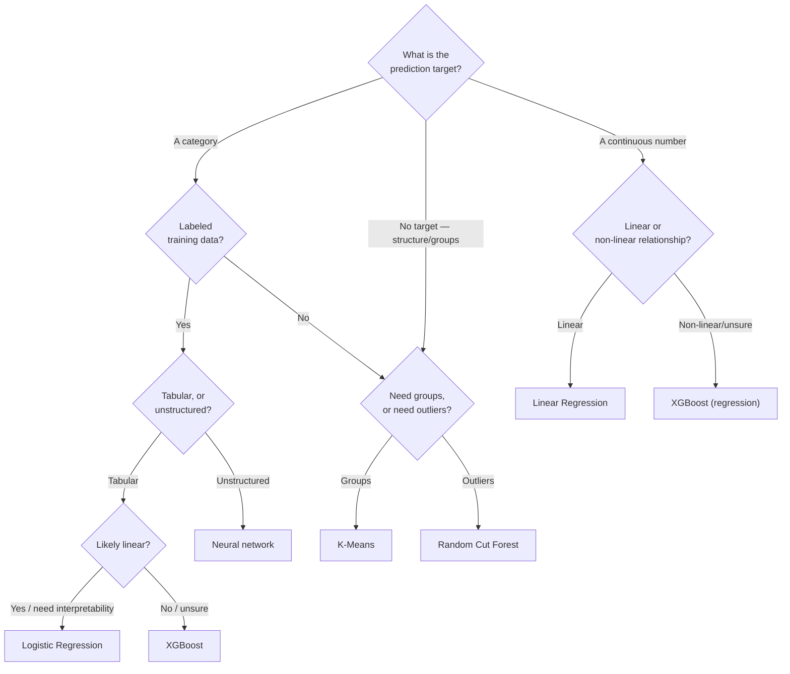

**Explained:** the tree is ordered data-shape-first because that's the order exam scenarios
reveal information in. The first real fork is whether labels exist at all — a scenario that
*sounds* like classification ("segment customers") but has no actual ground-truth label is
silently unsupervised, routing to clustering regardless of the original framing. The second fork
is data shape: unstructured data (pixels, raw audio, raw text) pushes toward neural networks
almost automatically. The final fork, for tabular labeled data, is whether the relationship is
plausibly linear — this is where XGBoost's reputation as "the default" is actually conditional,
not universal.

### Real image — algorithm decision boundaries, side by side


*Figure: several algorithm families' decision boundaries plotted on the same three synthetic
datasets (linearly separable, moderately overlapping, and the classic two-moons non-linear
shape). On the linearly-separable dataset, a simple boundary suffices and extra model flexibility
buys nothing measurable; on the moons dataset, only a model capable of a curved boundary works at
all — visual proof of the "match family to data shape" principle. Source: scikit-learn
documentation, "Classifier comparison" —
scikit-learn.org/stable/auto_examples/classification/plot_classifier_comparison.html.*

### Exam Tips

1. **Worked numeric example — the linear-vs-tree reversal.** On a near-linearly-separable 30-
   feature dataset (real breast-cancer cell measurements), logistic regression scores
   accuracy=0.9825, AUC=0.9958 vs. gradient boosting's accuracy=0.9561, AUC=0.9905 — logistic
   regression *wins*. On a dataset engineered with genuine non-linear feature interactions, the
   same two algorithms score AUC=0.8890 (logistic regression) vs. AUC=0.9312 (gradient boosting)
   — a reversal. **The lesson:** "XGBoost is the default tabular baseline" is conditional on an
   unknown-or-non-linear relationship shape, not an unconditional rule — a scenario explicitly
   describing a simple/monotonic relationship or requiring interpretability can correctly point
   to the linear model instead.
2. **Worked numeric example — choosing k for K-Means without labels.** Sweeping k from 2 to 15 on
   a dataset with a true underlying structure of 10 groups: inertia decreases monotonically
   (149,425 → 56,931) and never signals the right k by itself, but the **silhouette score** rises
   again specifically near k=10 (0.182, a local peak) — this is the data-driven way to choose k
   without ground-truth labels, and the exam expects recognition of the elbow method or
   silhouette score, not an arbitrarily chosen k.
3. **Exam trap:** "detect a brand-new type of fraud pattern with no labeled examples yet" is
   anomaly detection (Random Cut Forest), not supervised classification — a worked comparison
   shows Isolation Forest catching 75% of injected anomalies with **zero label access during
   training**, which a supervised classifier trained on historical fraud types structurally
   cannot do for a genuinely novel pattern.
4. **Worked numeric example — gradient boosting on genuinely non-linear regression.** On the
   California housing dataset (predicting median block house value from location, income, and
   room counts — a relationship with real, non-additive interactions), plain linear regression
   scores RMSE≈$72,560 and R²≈0.576, while a gradient-boosting regressor scores RMSE≈$54,220 and
   R²≈0.764 on identical data with no feature engineering — R² jumps from explaining 58% of price
   variance to 76% purely from the algorithm's ability to capture non-linear interactions,
   directly mirroring the classification-side reversal in tip 1 but on the regression side of A1.
5. **Exam trap — the clustering-shape assumption.** K-Means assumes roughly spherical, similarly-
   sized clusters; a scenario explicitly describing non-convex or very differently-shaped natural
   groupings (two interleaved crescents, concentric rings) is signaling that K-Means's underlying
   assumption doesn't fit the data, even though no other AWS built-in algorithm offers a
   first-class density-based clustering alternative at the same managed-service level — the
   tested skill is recognizing the mismatch, not necessarily naming a replacement service.

---

## A2. Evaluation Metrics

### Definition

**Evaluation metrics** are the quantitative rules used to score whether a trained model is
actually good at its task — different metric families exist for classification (precision,
recall, F1, AUC), regression (RMSE, MAE, R²), and generative text (BLEU, ROUGE, BERTScore,
semantic similarity, LLM-as-a-judge).

### Plain-English analogy

Grading a student's exam with only "percent correct" hides *which* questions they missed and
*why* — a student who aces every easy question and fails every hard one gets the same raw score
as a student with uniformly mediocre performance across the board, even though the first
student's gap is far more actionable and specific. Precision, recall, and the rest are different
*ways of grading* that each surface a different specific kind of mistake a single "percent
correct" score conceals.

### Purpose

To make the question "is this model good enough to ship" answerable with the *specific* kind of
"good" the business actually needs (catch more real fraud, minimize false alarms, report error
in trustworthy units), rather than one generic, frequently misleading number.

### When to use which metric

| Scenario | Correct metric |
|---|---|
| Balanced classes | Accuracy is reasonable |
| Imbalanced classes | Precision, Recall, F1, or AUC — never plain accuracy |
| False positives are costly | Optimize/report Precision |
| False negatives are costly (missed fraud/disease) | Optimize/report Recall |
| Regression, sensitive to large errors | RMSE |
| Regression, robust to outliers | MAE |
| Regression, need "% variance explained" | R² |
| Comparing classifiers across all thresholds | AUC (or Average Precision for rare classes) |
| Generated text, no single correct phrasing | BERTScore / semantic similarity, not BLEU/ROUGE alone |
| Generated text with no fixed reference answer at all | LLM-as-a-judge, with periodic human calibration |
| RAG retrieval quality specifically | Precision@K / Recall@K |

### When NOT to rely on a metric

- **Accuracy on any imbalanced dataset** — a model predicting the majority class for every input
  can score 95-99% accuracy while catching zero of the minority class; this is the exam's single
  most repeated trap.
- **BLEU/ROUGE as the sole quality signal for paraphrase-tolerant generation tasks** — both
  penalize correct paraphrases that use different wording, scoring a valid, accurate answer
  poorly purely because its phrasing differs from the reference.
- **AUC alone on a severely imbalanced dataset** — AUC's false-positive-rate denominator (all
  actual negatives) dilutes false positives more than Precision-Recall's denominator does, making
  AUC look more optimistic than Average Precision on rare-class problems; prefer PR-based metrics
  there.
- **Any single metric without checking calibration**, when the model's actual probability value
  (not just its ranking) feeds a downstream automated decision — a model can have strong AUC and
  still be badly miscalibrated (its "80% confident" predictions only right 60% of the time).

### 6 Use Cases

1. A fraud team reports **recall at a fixed precision floor** rather than accuracy, because a 96%
   accuracy "approve everything" baseline would catch zero actual fraud.
2. A spam filter team raises its classification threshold specifically to improve **precision**
   after users complain about too many legitimate emails being blocked, accepting a recall drop
   as the known tradeoff.
3. A house-price model reports **MAE** instead of RMSE specifically because a handful of unusual
   high-value properties shouldn't dominate the headline error number the business reviews.
4. A machine-translation team tracks **BLEU** release over release, since translation genuinely
   has a fairly fixed "correct" phrasing per language pair, BLEU's original intended use case.
5. A RAG support assistant's team monitors **Precision@5** on retrieval separately from the final
   answer's generation quality, catching a stale vector index even while generation-quality
   scores look stable.
6. A hiring platform runs **LLM-as-a-judge** on a fairness rubric across thousands of generated
   candidate summaries daily, a scale no human review team could sustain, with a 2% human-
   reviewed sample used to calibrate that the judge model's scores still track real human
   judgment.

### Why important

Task statement 2.3 ("Evaluate a model") is tested heavily because choosing the *wrong* metric
produces a model that looks great on paper and fails the actual business need — this is one of
the most reliable, repeatable exam question shapes across the entire MLA-C02 certification.

### Diagram — the confusion matrix and the metrics built from it

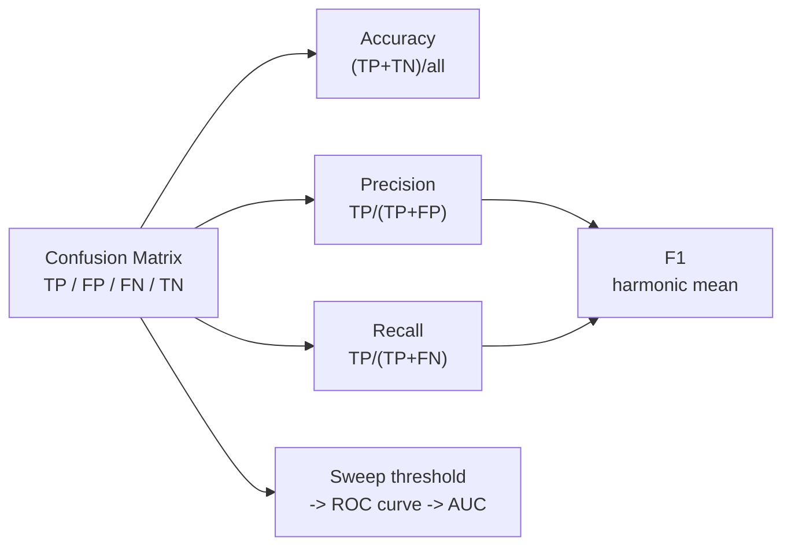

**Explained:** every classification metric above the confusion matrix is *derived* from the same
four counts (TP, FP, FN, TN) — the confusion matrix is the one piece of raw information; every
named metric is a different ratio computed from it. AUC is the odd one out structurally — it
requires sweeping the decision threshold across many values and recomputing the matrix at each
one, rather than reading off a single matrix at one fixed threshold.

### Real image — a rendered confusion matrix


*Figure: an actual confusion matrix for the classic 3-class Iris classification problem — the
diagonal cells are correct predictions; every off-diagonal cell shows specifically which class
got confused with which other, information a single accuracy number discards entirely. Source:
scikit-learn documentation, "Confusion matrix" —
scikit-learn.org/stable/auto_examples/model_selection/plot_confusion_matrix.html.*

### Exam Tips

1. **Worked numeric example — the full fraud confusion matrix.** 1,000 transactions, 50 actually
   fraudulent (5%), model produces TP=35, FN=15, FP=20, TN=930. Accuracy = 965/1000 = **96.5%**.
   Precision = 35/55 ≈ **63.6%**. Recall = 35/50 = **70%**. F1 ≈ **66.6%**. A trivial "always
   predict not-fraud" baseline scores accuracy = 950/1000 = **95%** — only 1.5 points lower while
   catching **zero** fraud — proof that a small accuracy gap can hide the entire difference
   between "catches most fraud" and "catches none."
2. **Worked numeric example — RMSE vs. MAE outlier sensitivity.** Errors `[2,-3,1,4,-2,3,-1,48]`
   ($1,000s): MAE = 64/8 = **$8,000**; RMSE = sqrt(2348/8) ≈ **$17,132** — more than double MAE
   because squaring the single 48 error turns it into 2,304 before averaging. Removing that one
   outlier drops MAE by 71% but drops RMSE by 85% — RMSE is disproportionately driven by a single
   extreme point in a way MAE structurally isn't.
2b. **Worked numeric example — multi-class, accuracy hiding a weak category.** A 3-class
   support-ticket router scores overall accuracy ≈81.3% on 150 tickets, but computing per-class
   precision/recall separately reveals Billing ≈81%/84%, Technical ≈84%/83%, and **Account — the
   smallest category at only 30 tickets — only ≈76%/73%**, a meaningfully weaker category the
   single overall-accuracy number never surfaces. The fix is reporting per-class metrics or a
   macro-averaged F1 (which weighs every class equally regardless of size), not overall accuracy
   alone, whenever a scenario emphasizes per-category performance must be checked.
3. **Worked numeric example — log loss punishing confident wrongness.** Three predictions'
   probability of the true class: 0.95, 0.55, 0.02 → log-loss contributions -ln(p) ≈ 0.0513,
   0.5978, 3.9120. The confidently-wrong prediction (p=0.02) contributes **~76x** the confidently-
   right prediction's penalty — directly demonstrating why two models can tie on accuracy while
   differing sharply on log loss.

---

## A3. Hyperparameter Tuning

### Definition

**Hyperparameters** are settings chosen *before* training starts (learning rate, tree depth,
number of estimators, regularization strength) that shape how a model learns but are not
themselves learned from data. **Hyperparameter tuning** (on AWS, SageMaker Automatic Model
Tuning / AMT) is the systematic process of searching across candidate hyperparameter values to
find the combination that produces the best model, measured by a chosen objective metric.

### Plain-English analogy

Think of hyperparameters as oven settings (temperature, rack position, bake time) rather than
the recipe's ingredients (the model weights themselves, which training *learns*). Tuning is
systematically baking several test batches at different oven settings and tasting each one,
rather than guessing one setting and hoping it's right, or baking at absolutely every conceivable
combination of settings when most of them obviously wouldn't work.

### Purpose

To find hyperparameter values that meaningfully outperform arbitrary defaults, using the fewest
total training runs the chosen search strategy's efficiency allows — since each "test batch" here
is a real, often expensive and slow, training job.

### When to use

- Whenever a model's performance is meaningfully sensitive to settings like learning rate, tree
  depth, or regularization strength, and default values haven't been validated against the
  specific dataset at hand.
- When comparing several candidate hyperparameter combinations by hand would take longer or cost
  more than letting a systematic search strategy run them.

### When NOT to use (or to simplify)

- **When training is extremely cheap and the search space is small** — manual or simple grid
  search may be entirely adequate; the heavier Bayesian machinery solves a problem (minimizing
  total expensive jobs) that doesn't exist here.
- **Before the algorithm/feature set itself is settled** — tuning a fundamentally wrong algorithm
  family (e.g., tuning a linear model on data with strong non-linear interactions) wastes the
  entire search's compute chasing a ceiling the algorithm family itself can't exceed; fix the
  algorithm-selection decision first.
- **As a substitute for fixing a mis-chosen objective metric** — AMT will faithfully optimize
  whatever metric it's given, including a wrong one (e.g., accuracy on a known-imbalanced
  problem); tuning cannot fix an evaluation-metric mistake, it will simply find hyperparameters
  that maximize the wrong number very efficiently.

### 5 Use Cases

1. An XGBoost fraud model's `max_depth`, `eta`, and `scale_pos_weight` are searched via Bayesian
   optimization specifically because each training job costs real money and the team has a hard
   40-job budget.
2. A small grid search (4 values × 3 values = 12 combinations) is run exhaustively for a cheap,
   fast-training linear model, since the combinatorial cost is trivial at this scale.
3. A team re-tunes a production model monthly as fresh data arrives, using **warm start** to
   seed each new search with the previous month's trial history instead of starting blind.
4. A deep-learning image classifier's tuning job uses **Hyperband-style early stopping** to kill
   clearly underperforming candidates after only a few epochs, saving the bulk of each bad
   candidate's remaining training budget.
5. A tuning job's winning `max_depth` value lands exactly at the edge of its searched range (10
   out of a `[3,10]` range), prompting the team to widen the range and re-run with warm start
   rather than accepting the boundary value as truly optimal.
6. A team deliberately chooses the **objective metric** for its fraud-detection tuning job to be
   validation AUC, not accuracy, directly applying the evaluation-metrics discipline from A2
   above to the tuning configuration itself.

### Why important

Hyperparameter tuning is the practical mechanism behind "optimize a model" throughout this
domain — task statement 2.2 explicitly names it, and the exam tests both *recognizing* which
search strategy fits a stated cost/time constraint and *recognizing* the difference between a
tuning failure and a search-space-design failure.

### Diagram — the tuning loop and strategy choice

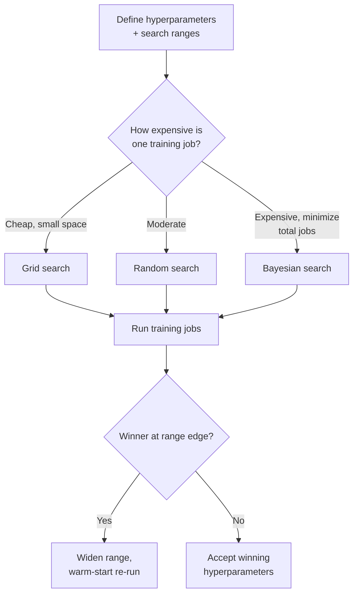

**Explained:** the strategy fork is driven almost entirely by one variable — the cost of a single
training job relative to the total job budget — not by abstract strategy quality. The loop's
final check (is the winner sitting at the edge of its searched range) is a frequently-skipped
step that catches a very specific failure mode: a search that *looks* successful (it found a
clear winner) while the true optimum sits outside the range ever explored.

### Real image — AMT's child training jobs in the console


*Figure: each row is one hyperparameter combination's own training job, with its own final
objective-metric value — literally the "Run training jobs" box in the diagram above, executed N
times before the tuning job selects whichever row scored best. Source: AWS SageMaker Developer
Guide, "Configure and Launch a Hyperparameter Tuning Job" —
docs.aws.amazon.com/sagemaker/latest/dg/automatic-model-tuning-ex-tuning-job.html.*

### Exam Tips

1. **Worked numeric example — the combinatorial explosion.** 3 hyperparameters with 4, 5, and 3
   candidate values respectively require grid search to run `4×5×3 = 60` combinations — and with
   3-fold cross-validation inside the search, **180 total model fits**, not 60. Adding one more
   hyperparameter with 3 more values triples it to 180 combinations (540 fits). This
   multiplicative, not additive, growth is the exact mechanism behind "grid search doesn't scale."
2. **Worked numeric example — Bayesian sample efficiency.** On the same search space, grid search
   (60 combos, 180 fits) reaches best score 0.9718; random search (20 trials, 60 fits) reaches
   0.9701; Bayesian search (10 trials, 30 fits) *also* reaches 0.9701 — statistically
   indistinguishable quality at **a sixth of grid search's compute and half of random search's**.
   This specific ratio is the numeric justification for "Bayesian search when training jobs are
   expensive."
3. **Exam trap:** confusing early stopping *inside one training run* (halting that run once its
   own validation loss plateaus — an overfitting-prevention technique) with early stopping
   *inside a tuning job* (Hyperband-style — killing an underperforming hyperparameter
   *candidate's* job early to save compute across the whole search) — these are two distinct
   mechanisms sharing a name; the scenario's exact wording (one run's own loss vs. one candidate
   underperforming others) determines which is being tested.

---

## A4. Overfitting, Underfitting, and the Bias-Variance Tradeoff

### Definition

**Overfitting** is when a model performs very well on training data but noticeably worse on new
(validation/test) data — it has memorized noise/specifics rather than learning the general
pattern. **Underfitting** is when a model performs poorly on *both* training and new data — it is
too simple, undertrained, or lacking the right features. The **bias-variance tradeoff** formally
decomposes a model's total expected error into bias² (error from overly simplistic assumptions),
variance (error from sensitivity to the specific training sample), and irreducible error (noise
no model can remove) — `Total Error = Bias² + Variance + Irreducible Error`.

### Plain-English analogy

A student who memorizes the exact wording of every practice question's answer aces the practice
set (training data) but fails the real exam, which asks the same concepts differently worded (new
data) — overfitting. A student who barely studied does poorly on both — underfitting. Bias is
"the student's basic understanding is too simplistic for the subject" (always wrong in the same
predictable way); variance is "the student's performance swings wildly depending on which exact
practice questions they happened to study" (unpredictable, sample-dependent).

### Purpose

To correctly diagnose *why* a model isn't performing well before applying a fix — since the fix
for underfitting (add capacity/data/features) is the *opposite* of the fix for overfitting
(regularize/simplify/add data), applying the wrong one actively worsens the problem.

### When to apply which fix

| Symptom | Diagnosis | Fix |
|---|---|---|
| Both train and validation performance low and close together | Underfitting (high bias) | More model capacity, more features, more training time, less regularization |
| Train performance high, validation performance much lower | Overfitting (high variance) | Regularization (L1/L2/dropout), more training data, early stopping, simpler model |
| Both train and validation performance high and close together | Good fit | Proceed to hyperparameter tuning / deployment |

### When NOT to apply regularization

- **When the model is actually underfitting** — applying regularization to an already-too-simple
  model pushes it toward *more* bias, worsening underfitting; regularization is a variance-
  reduction tool specifically, not a universal "make the model better" dial.
- **When performance volatility is coming from the evaluation split, not the model** — if a
  single metric swings wildly across different random train/validation splits, the fix is k-fold
  cross-validation for a more reliable estimate, not necessarily regularizing the model itself.

### 5 Use Cases

1. A team diagnoses "training accuracy 99%, validation accuracy 61%" as overfitting and applies
   L2 regularization and early stopping rather than training for more epochs, which would worsen
   it.
2. A team diagnoses "both training and validation accuracy around 55%, flat across many epochs"
   as underfitting and increases model capacity (more trees/layers) rather than adding
   regularization, which would worsen it.
3. A small-dataset project deliberately avoids training a large neural network from scratch,
   recognizing the high-variance risk, and uses transfer learning (fine-tuning a pretrained
   model, via JumpStart) instead.
4. A team facing wildly different validation scores across different random splits adopts 5-fold
   cross-validation to get a trustworthy, averaged performance estimate before concluding
   anything about the model's quality.
5. A Lasso (L1) regression is chosen over Ridge (L2) specifically because the team also wants
   automatic feature selection (irrelevant features driven to exactly zero), not just shrinkage.
6. A dropout layer is added to a neural network specifically after observing a large train/
   validation gap, forcing the network to not over-rely on any single neuron/path.

### Why important

This is, by the domain README's own description, "the single most foundational, most exam-tested
vocabulary in the entire MLA-C02 cert" — nearly every Domain 2 troubleshooting scenario reduces to
correctly diagnosing bias vs. variance and applying the matching, not the opposite, fix.

### Diagram — the bias-variance tradeoff

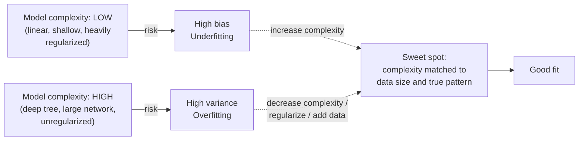

**Explained:** the two failure modes sit at opposite ends of a complexity dial, and the fix for
each is a move in the opposite direction along that same dial — which is exactly why correctly
identifying *which* end you're at (via the train-vs-validation gap, never either score alone) has
to happen before choosing a fix.

### Real image — underfitting vs. good fit vs. overfitting, rendered


*Figure: a degree-1 polynomial (too simple — underfitting), a degree-4 polynomial (a good fit to
the true cosine-shaped pattern), and a degree-15 polynomial (chasing individual noisy points —
overfitting), fit to the exact same data — the clearest single visual proof of this section's
core concept. Source: scikit-learn documentation, "Underfitting vs. Overfitting" —
scikit-learn.org/stable/auto_examples/model_selection/plot_underfitting_overfitting.html.*

### Exam Tips

1. **Worked numeric example — the bias-variance decomposition, proven by resampling.** Training
   the same model type on 200 different random samples from the same population: Linear
   Regression scores bias²=1.7820, variance=0.0164 (total 1.7984) fitting a genuinely curved
   true function; an unconstrained Decision Tree scores bias²=0.0095, variance=1.3822 (total
   1.3917); a depth-2 Decision Tree scores bias²=0.3103, variance=0.1871 (**total 0.4974, the
   lowest of the three**) — numeric proof that the best total error sits at a *moderate*
   complexity, not at either bias-only or variance-only extreme.
2. **Worked numeric example — L1 vs. L2's different mechanical effect.** Ridge (L2) shrinks every
   coefficient smoothly toward zero as `alpha` increases (sum of |coefficients| drops from
   48,291.6 at alpha=0 to 1.1 at alpha=100) without any coefficient hitting exactly zero. Lasso
   (L1) on a 20-feature dataset with only 4 truly informative features lands on **exactly 4
   nonzero coefficients** at alpha=0.5, driving the other 16 to *exactly* zero — the concrete
   proof of L1's feature-selection property, structurally different from L2's shrinkage-only
   behavior.
3. **Exam trap:** a scenario stating "both training and validation accuracy are low and
   mediocre" and proposing regularization as the fix is testing whether you recognize this as
   underfitting (not overfitting) — regularization here is the *wrong* lever and will make
   performance worse, not better; the correct fix is more model capacity or better features.

---

## A5. Foundation Model Customization Options

### Definition

**Foundation model customization** is the set of techniques for adapting a pretrained foundation
model's behavior or knowledge to a specific use case without necessarily retraining it from
scratch: **prompt engineering** (crafting the instructions/context given at inference time),
**RAG** (retrieving and injecting relevant external documents into the prompt), **fine-tuning**
(further training the model's weights, fully or via a lightweight adapter like LoRA/PEFT, on
labeled examples), and **pre-training from scratch** (training an entirely new foundation model
on a massive corpus — the option this exam almost never expects as the answer).

### Plain-English analogy

Imagine hiring a highly capable, widely-read new employee. **Prompt engineering** is writing them
a clear, well-structured task brief. **RAG** is handing them your company's actual internal
documents to read before answering, so they're not relying on general knowledge alone for facts
specific to you. **Fine-tuning** is sending them through company-specific training, after which
their everyday working style and judgment genuinely changes. **Pre-training from scratch** is the
equivalent of raising and educating a person from infancy specifically to become this employee —
technically possible, but a wildly disproportionate response to needing a well-briefed new hire.

### Purpose

To close the gap between what a foundation model does by default and what a specific business
use case needs, using the *cheapest* technique that actually closes that specific gap — not
defaulting to the most powerful (and most expensive) tool available.

### When to use which technique

| Technique | Use when the gap is... |
|---|---|
| Prompt engineering | Wrong instructions/format, the model could plausibly already do this correctly if asked better |
| Few-shot prompting | A behavior/skill gap with only a handful of labeled examples (a dozen or fewer) |
| RAG | A **facts** gap — private, current, or specific knowledge the model wasn't trained on |
| Fine-tuning (PEFT/LoRA default) | A **behavior** gap — tone, format, persona, a narrow skill — with hundreds to low-thousands of labeled examples |
| Full fine-tuning | A deep, pervasive behavior change a lightweight adapter can't achieve, and enough data/budget to justify it |
| Pre-training from scratch | The model's fundamental language/reasoning capability itself is missing — vanishingly rare at the application-building level this exam targets |

### When NOT to use each

- **RAG for a tone/format/persona problem** — RAG only adds retrieved *content* to context; it
  does not reliably constrain output *style*, even when a style guide is itself included in the
  retrieved context.
- **Fine-tuning for a frequently-changing fact** — the fix would need re-running every time the
  fact changes again, and provides no structural guarantee against hallucinating adjacent facts
  never explicitly included in the fine-tuning data.
- **Fine-tuning on under roughly a dozen labeled examples** — too little data to learn a general
  rule; the model is likely to overfit to the specific examples shown (the same mechanism as A4's
  overfitting).
- **Pre-training from scratch for a narrow vocabulary/domain-adaptation problem** — nearly always
  massively over-scoped; fine-tuning or RAG on an existing strong foundation model solves the
  vast majority of real "our domain is specialized" scenarios at a fraction of the cost and time.

### 6 Use Cases

1. A support chatbot stating a wrong, outdated return-policy fact is fixed with **RAG** against
   the current, versioned policy document — the next policy change requires only a document
   update, not retraining.
2. A product-description generator's marketing-speak tone, which persists even with a style
   guide already included in the RAG context, is fixed with **PEFT/LoRA fine-tuning** on 200
   previously-approved examples — a behavior problem, not a facts problem.
3. A new internal ticket-routing scheme with only 9 labeled examples uses **few-shot prompting**
   rather than fine-tuning, avoiding the overfitting risk of training on too little data.
4. A biotech company's proposal to pre-train a foundation model from scratch for proprietary
   chemistry notation is redirected to fine-tuning an existing strong model instead, at a
   fraction of the cost and without needing a billions-of-tokens training corpus the company
   doesn't have.
5. A production enterprise assistant layers **prompt engineering** (consistent system
   instructions) + **RAG** (current internal knowledge) + a light **fine-tune** (brand tone,
   reliable JSON schema) together, since a single system can have gaps of all three kinds
   simultaneously.
6. A team evaluating whether a fine-tune actually helped explicitly re-tests prompts **unrelated**
   to the fine-tuning task, catching a case where narrow-task accuracy improved from 92% to 97%
   while general-question accuracy silently dropped from 92% to 71% — catastrophic forgetting
   that a narrow-task-only evaluation would have missed entirely.

### Why important

Task statements 2.1.2 and 2.2.8 test this decision explicitly, and it is one of the few places
in Domain 2 where choosing a *more* powerful-sounding technique (fine-tuning, or worse,
pre-training) over a cheaper one that would have worked is a scored mistake, not a safe
over-engineering choice — the exam rewards recognizing when the cheapest rung on the ladder
already solves the stated problem.

### Diagram — the full customization decision tree

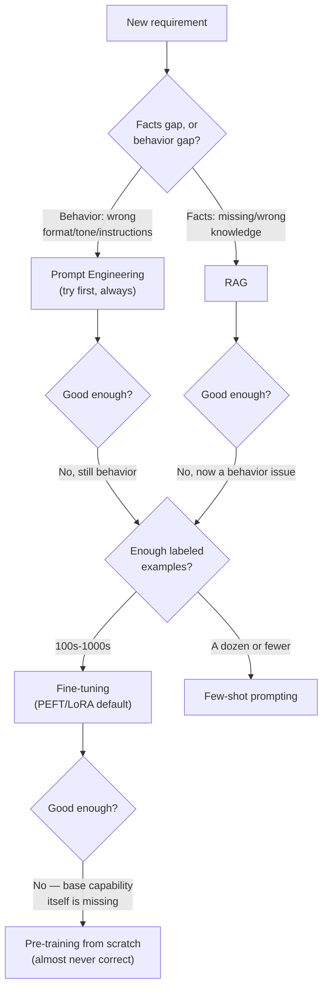

**Explained:** the first fork is facts-vs-behavior, and both branches route through the same
"good enough now?" checkpoint before escalating — RAG that still produces behavior problems
routes into the fine-tuning branch rather than trying harder at retrieval, and prompting that
still has a facts gap routes into RAG rather than trying harder at prompt wording. Pre-training
sits at the very end of the tree, reachable only when fine-tuning itself fails to close a gap in
the model's *fundamental* capability — not a shortcut available earlier in the tree.

### Real image — Bedrock's RAG pipeline in production


*Figure: AWS's own diagram of a Bedrock Knowledge Base's runtime retrieval-augmented-generation
flow — a user query is embedded, matched against a vector store of pre-processed document
chunks, and the top matches are injected into the foundation model's prompt before generation —
the literal mechanism behind the RAG branch of the decision tree above. Source: AWS Bedrock User
Guide, "Retrieve data and generate AI responses with knowledge bases" —
docs.aws.amazon.com/bedrock/latest/userguide/knowledge-base-retrieve-generate.html.*

### Exam Tips

1. **Worked example — the cost ladder.** For a 500,000-requests/month assistant: prompt
   engineering costs roughly $0 setup; RAG costs low thousands of dollars to stand up (vector
   store + embedding); PEFT/LoRA fine-tuning costs low thousands per training run; full
   fine-tuning costs high thousands to tens of thousands; pre-training from scratch costs
   hundreds of thousands to millions. Each rung is roughly an order of magnitude or more above
   the one before it — a scenario naming a tight budget or timeline is implicitly ruling out the
   top rungs without even evaluating whether they'd technically work.
2. **Worked example — catastrophic forgetting, with numbers.** A support bot scores 92% helpful-
   and-accurate (human-rated) on general questions before fine-tuning on 500 narrow examples;
   after fine-tuning, it scores 97% on the narrow task but **drops to 71%** on the same general-
   question set. A team measuring only the narrow-task improvement (92%→97%) would ship a model
   that actually regressed badly elsewhere — only a deliberate before/after check on *unrelated*
   prompts surfaces this.
3. **Exam trap:** "a foundation model fabricates facts not in its training data or provided
   context" is a hallucination problem, fixed with tighter RAG grounding and explicit "only
   answer from provided context" prompting — not fine-tuning, which doesn't reliably eliminate
   hallucination on facts outside the fine-tuning set.

---

# Part B — The Five Services

## B1. Amazon Bedrock

### Definition

**Amazon Bedrock** is a fully-managed, serverless service providing API access to foundation
models from multiple providers (Anthropic Claude, Amazon Titan/Nova, Meta Llama, Mistral, Cohere
Command, AI21, Stability AI, and others) through one unified API, plus managed tooling for
customizing those models (fine-tuning, Knowledge Bases for RAG, Agents for orchestration, and
Guardrails for safety).

### Plain-English analogy

Bedrock is like a single, unified streaming-service subscription that gives you access to many
different studios' content (Anthropic's, Meta's, Amazon's own) through one interface, one
billing relationship, and one API — instead of negotiating separately with each studio, hosting
your own infrastructure to run their models, and learning a different interface for each.

### Purpose

To let a team build generative AI applications (chat, summarization, content generation, RAG,
agentic workflows) without managing any model-hosting infrastructure, provisioning GPUs, or
choosing a single foundation model provider to be permanently locked into — the API shape stays
consistent even when swapping the underlying model.

### When to use

- Building a generative AI feature (chat, summarization, classification via prompting, content
  generation) where time-to-market and avoiding infrastructure management matter more than
  squeezing out the absolute lowest possible per-token cost a self-hosted model might offer at
  very large scale.
- Needing to compare or switch between several foundation model providers without rewriting
  application code for each one.
- Needing managed RAG (Knowledge Bases) or managed agentic orchestration (Agents) without
  building that infrastructure from scratch.
- Needing to fine-tune a foundation model without managing training infrastructure directly.

### When NOT to use

- **Extremely latency-sensitive, air-gapped, or fully on-premises requirements** that a managed,
  cloud-hosted API cannot satisfy — though Bedrock does support provisioned throughput and VPC
  endpoints for many compliance needs, a scenario demanding fully offline inference rules it out.
- **A narrow, well-defined task a purpose-built managed AI service already solves more cheaply**
  (entity extraction → Comprehend, OCR → Textract) — reaching for a Bedrock foundation model here
  is reaching for the more expensive, less reliable tool when a cheaper, purpose-built one
  already fits, per A5's customization-ladder discipline applied one level up to service choice.
- **A classic structured-data prediction task** (fraud scoring, demand forecasting) — this is
  SageMaker's built-in-algorithm territory (B2/B5), not a foundation-model task at all.

### 5 Use Cases

1. A customer-support team builds a RAG chatbot using **Bedrock Knowledge Bases** grounded on
   the company's current policy documents, avoiding the need to build and maintain a separate
   vector-database pipeline.
2. A content team fine-tunes a Bedrock foundation model via **PEFT/LoRA** on 300 approved
   product descriptions to lock in a consistent brand voice, after confirming prompt engineering
   alone couldn't achieve it.
3. A multi-step customer-service workflow (look up an order, check a return policy, issue a
   refund) is built with a **Bedrock Agent**, which plans and calls the right backend tools/APIs
   in sequence rather than requiring a single, monolithic prompt to handle every branch.
4. A healthcare documentation startup selects a Bedrock model primarily by **context-window
   size** over raw benchmark scores, since its core need (summarizing full multi-page patient
   encounters in one pass) is blocked entirely by too-small a context window.
5. A regulated enterprise applies **Bedrock Guardrails** to block a defined set of topics and PII
   categories from model outputs, enforced centrally across every application calling the same
   underlying model, rather than re-implementing filtering logic in each application separately.
6. A team evaluates Claude, Titan, and Llama on 50 of their own representative support-ticket
   prompts using ROUGE and a human rubric before committing, rather than trusting a generic
   public leaderboard to predict performance on their specific jargon-heavy domain.

### Why important

Bedrock is the default entry point for the entire foundation-model half of Domain 2 — nearly
every task statement from 2.1.1 through 2.2.9 either configures something *inside* Bedrock
(model selection, fine-tuning, RAG architecture, retrieval optimization) or makes a decision
*about whether* to use Bedrock at all (vs. a managed AI service, vs. JumpStart, vs. training from
scratch).

### Diagram — Bedrock's model-selection and customization funnel

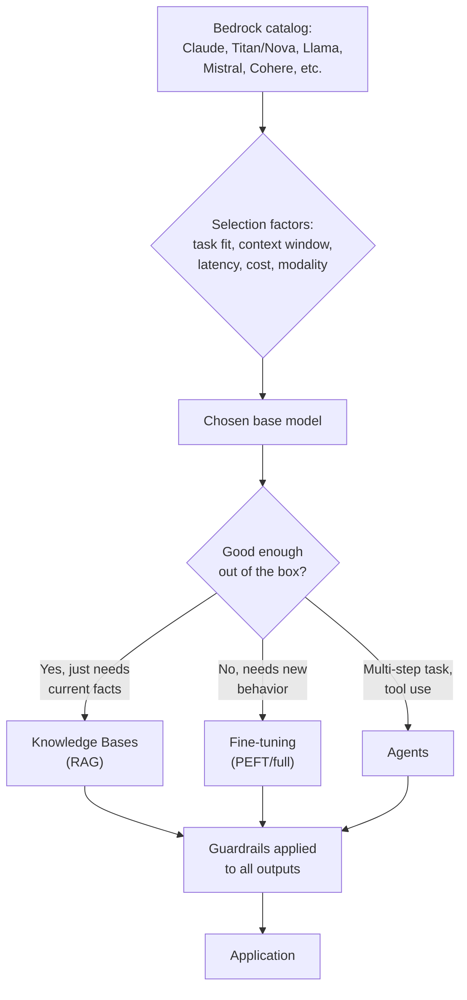

**Explained:** model selection isn't a one-time ranking — it's matched against task fit, context
window, latency, and cost (per A5's cost-ladder framing). Whichever of Knowledge Bases, fine-
tuning, or Agents the use case needs, Guardrails sits as a final, centrally-enforced layer across
all of them — a single safety/compliance configuration applied regardless of which customization
path a given request took.

### Real image — Bedrock Knowledge Bases' ingestion (pre-processing) pipeline


*Figure: AWS's own diagram of the ingestion half of a Bedrock Knowledge Base — source documents
are chunked, embedded, and written into a vector store, the one-time (and ongoing, as documents
change) setup step that has to happen before the runtime retrieval diagram in A5 above can
retrieve anything at all. Source: AWS Bedrock User Guide, "How Amazon Bedrock knowledge bases
work" — docs.aws.amazon.com/bedrock/latest/userguide/knowledge-base-how-it-works.html.*

### Exam Tips

1. **Worked example — model selection isn't "pick the biggest."** A scenario emphasizing a
   sub-2-second response requirement for a simple classification-style chat interaction should
   favor a smaller, faster model even if a larger model would score marginally higher on a
   generic benchmark — per A5's performance/latency/cost tradeoff, a model that merely clears the
   task's actual bar is frequently the *better* answer than one that clears it with unnecessary
   room to spare.
2. **Worked example — fine-tuning strategy choice.** A startup needing three differently-branded
   chatbot variants (one per product line) chooses **LoRA/PEFT** specifically because it can't
   justify three full fine-tuning runs' worth of storage and compute for what's really the same
   base model with three different lightweight adapters — full fine-tuning is reserved for
   scenarios needing deep, pervasive behavior change a small adapter genuinely can't achieve.
3. **Exam trap:** a scenario describing a narrow, well-defined extraction task ("pull dates and
   names from scanned invoices") is a Comprehend/Textract problem, not a reason to stand up a
   Bedrock RAG pipeline — reaching for the generative, more expensive tool when a purpose-built
   managed AI service already solves the stated problem is a commonly tested mismatch.

---

## B2. Amazon SageMaker (Overview)

### Definition

**Amazon SageMaker** is AWS's fully-managed machine learning platform covering the entire
classic-ML lifecycle: data preparation (Domain 1), model building/training/tuning (this domain),
deployment (Domain 3), and monitoring (Domain 4) — SageMaker is the umbrella service name; its
individual components (Training, Automatic Model Tuning, JumpStart, Model Registry, Model
Monitor, Pipelines, Endpoints, Studio, Data Wrangler, Feature Store, Clarify) are each their own
focused tool under that umbrella.

### Plain-English analogy

If Bedrock is a streaming subscription to other studios' finished content, SageMaker is a full
film studio lot — sound stages (training infrastructure), editing suites (tuning/evaluation
tooling), a wardrobe department (feature engineering), a release/distribution pipeline
(deployment), and a post-release audience-tracking system (monitoring) — all under one roof, for
teams that need to actually *produce* a model (not just consume an existing one) and want every
stage of that production connected.

### Purpose

To remove the undifferentiated infrastructure burden (provisioning compute, managing training
clusters, wiring together storage/compute/networking) from the ML lifecycle, so a team's actual
differentiated work is data and modeling decisions, not infrastructure operations.

### When to use

- Building, training, or fine-tuning a model that needs to own its own weights (not just call an
  existing API) — classic ML algorithms, custom script-mode training, or deploying/fine-tuning a
  JumpStart pretrained model.
- Needing an end-to-end, auditable, reproducible ML pipeline (SageMaker Pipelines) connecting
  data prep through deployment with lineage tracking.
- Needing enterprise MLOps capabilities (Model Registry versioning/approval, Model Monitor
  drift detection, Clarify bias/explainability checks) around models of any origin.

### When NOT to use

- **When the entire need is "call an existing foundation model via API"** — Bedrock is the
  purpose-built, serverless path for that; standing up SageMaker training/hosting infrastructure
  for a task Bedrock already serves adds unnecessary operational burden.
- **When a managed AI service already solves the exact stated problem** (Comprehend, Rekognition,
  Textract) — building a custom SageMaker model for a problem a managed service already handles
  well duplicates engineering effort for no accuracy gain.
- **For teams without any ML engineering capacity at all** needing a single narrow prediction
  (e.g., basic sentiment) — the managed AI services' zero-ML-expertise-required design fits that
  need better than standing up a SageMaker training pipeline.

### 5 Use Cases

1. A retailer trains an **XGBoost** fraud-detection model using a SageMaker built-in algorithm
   Training Job, avoiding any custom training-code maintenance burden.
2. A research team brings its own **PyTorch** training script into SageMaker via script mode,
   retaining full control of the model architecture while still benefiting from managed compute
   provisioning and Spot Training cost savings.
3. An ML platform team builds a **SageMaker Pipeline** connecting data preprocessing, training,
   evaluation, and conditional registration into Model Registry, so every model version is
   produced by an identical, auditable, re-runnable process.
4. A compliance team runs **SageMaker Clarify** against a trained credit-risk model to generate
   both pre-training (data) and post-training (predictions) bias reports before approval.
5. A company builds a feature store (**SageMaker Feature Store**) shared across multiple model-
   building teams, ensuring the exact same feature computation logic is used consistently in
   both training and real-time inference, eliminating training/serving skew.
6. A team compares this week's newly trained model against last week's production model using
   **SageMaker Experiments**' side-by-side metric tracking rather than a manual spreadsheet.

### Why important

SageMaker is the connective tissue across all four MLA-C02 domains — understanding it as an
umbrella of composable, individually-named services (rather than one monolithic tool) is a
prerequisite for correctly answering any scenario naming one of its sub-components specifically.

### Diagram — the SageMaker lifecycle across domains

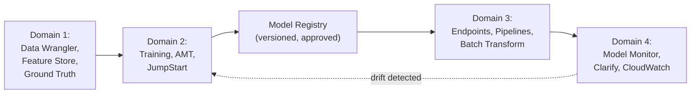

**Explained:** the lifecycle isn't linear-and-done — drift detected in Domain 4's monitoring
loops back into Domain 2's training/tuning stage for a retrain, which then produces a *new*
registered version, closing the loop. This is why Model Registry sits structurally between
Domain 2 and Domain 3: every path through training (built-in algorithm, script mode, fine-tuned
foundation model) converges on the same registration step before deployment, regardless of which
path produced it.

### Real image — a full SageMaker Pipeline, end to end


*Figure: AWS's own rendering of a full SageMaker Pipeline — a directed acyclic graph of
preprocessing, training, evaluation, and a conditional step that only registers the model in
Model Registry if it clears a quality bar — the literal mechanism tying Domain 1's data prep,
this domain's training, and Domain 3's registry hand-off into one auditable, re-runnable
pipeline. Source: AWS SageMaker Developer Guide, "SageMaker Pipelines" —
docs.aws.amazon.com/sagemaker/latest/dg/pipelines.html.*

### Exam Tips

1. **Worked example — recognizing the right sub-component from a scenario's wording.** "Need
   every trained model version tracked with approval status and lineage" → Model Registry, not
   Experiments (which compares metrics, not approval workflow) and not Pipelines (which
   orchestrates the *process*, not the *registry* of outputs). Precisely matching a scenario's
   stated need to the correct named sub-component, rather than a generic "use SageMaker" answer,
   is what case-study questions actually grade.
2. **Worked example — Spot Training savings.** A training job using SageMaker Managed Spot
   Training can realistically save 60-90% versus On-Demand pricing for interruptible,
   checkpoint-able training jobs — the tradeoff being possible interruption, mitigated by
   checkpointing progress periodically so an interrupted job resumes rather than restarting from
   zero; full mechanics live in [`../../../services/machine-learning-ai/sagemaker-training-and-tuning.md`](../../services/machine-learning-ai/sagemaker-training-and-tuning.md).
3. **Exam trap:** treating "SageMaker" as a single monolithic answer when a scenario asks about a
   *specific* capability (bias detection, feature consistency between training and serving,
   pipeline orchestration) — each of those maps to a specific named sub-component (Clarify,
   Feature Store, Pipelines respectively), and the exam expects the specific name, not the
   umbrella one.

---

## B3. SageMaker JumpStart

### Definition

**SageMaker JumpStart** is a hub of pretrained models — both classic ML models and foundation
models — that can be deployed or fine-tuned directly inside your own SageMaker environment (your
own VPC, your own training/hosting infrastructure, your own model artifacts), as opposed to
Bedrock's fully-managed, serverless, infrastructure-free access to foundation models.

### Plain-English analogy

If Bedrock is renting a fully-serviced apartment (someone else manages the building, you just
move in), JumpStart is buying a mostly-finished house and bringing in your own renovation crew —
you get a real head start (the foundation and structure are already built, i.e., the pretrained
model weights), but you own the property outright, can renovate it however you like (fine-tune
with full control), and are responsible for its own utilities and maintenance (your own
SageMaker training/hosting infrastructure).

### Purpose

To give teams a transfer-learning starting point for both classic ML (pretrained image/text
models) and generative AI (open foundation models) without starting training from random
initialization, while keeping the resulting model artifact, training infrastructure, and
customization process fully inside the team's own AWS environment rather than behind a
third-party managed API.

### When to use

- Needing to fine-tune or deploy a foundation model **inside your own VPC/infrastructure**,
  where full control over the hosting environment (not just the API) is a requirement — e.g.,
  strict network isolation that a purely serverless managed API can't satisfy.
- Needing a pretrained *classic ML* model (image classification, object detection) as a transfer-
  learning starting point, avoiding training an equivalent model from random initialization.
- Wanting to use an open-source/open-weight foundation model specifically, rather than being
  limited to Bedrock's provider catalog.
- Needing fine-grained control over the training job itself (custom training scripts layered on
  top of a JumpStart base model) beyond what Bedrock's managed fine-tuning API exposes.

### When NOT to use

- **When a fully-managed, zero-infrastructure foundation-model experience is sufficient** —
  Bedrock is the simpler, lower-operational-overhead path for teams that don't need to own the
  hosting environment directly.
- **For a narrow, already-solved task a managed AI service handles** — JumpStart's pretrained
  models are a starting point for building/customizing a model, not a replacement for Comprehend/
  Rekognition/Textract when the stated task is exactly what those already do well.
- **When the team has no need for transfer learning at all** — a simple, well-understood tabular
  problem with abundant labeled data may be better served by training a built-in SageMaker
  algorithm (XGBoost, Linear Learner) directly from scratch rather than adapting a pretrained
  model never designed for that exact structured-data shape.

### 5 Use Cases

1. A team deploys a JumpStart **pretrained image classification model** and fine-tunes it on a
   few thousand company-specific labeled images, rather than training a convolutional network
   from random initialization on a comparatively small dataset.
2. An enterprise fine-tunes an **open-weight foundation model via JumpStart** specifically
   because a data-residency requirement mandates the fine-tuned model artifact live entirely
   within the company's own VPC, a constraint a purely serverless API can't satisfy.
3. A team benchmarking foundation models' price-performance for a specific internal workload
   deploys several **JumpStart model options side by side** on their own infrastructure to
   measure real latency and throughput under their own load pattern, rather than relying on
   published, generic benchmark numbers.
4. A research group uses a JumpStart pretrained **BERT-family text model** as the base for a
   custom fine-tuning script with specialized loss functions Bedrock's managed fine-tuning API
   doesn't expose.
5. A startup evaluates JumpStart specifically because it needs an **open-source model with no
   per-token API fee**, planning to amortize hosting cost against very high request volume where
   owning the deployed instance becomes cheaper than per-token managed-API pricing at that scale.

### Why important

JumpStart is the exam's test of recognizing *infrastructure ownership* as a real decision axis
separate from "which model is best" — a scenario explicitly requiring the model and its hosting
environment to live inside the team's own infrastructure (compliance, data residency, deep
customization needs) is a JumpStart signal specifically, distinguishing it from Bedrock even when
both could technically serve the same underlying foundation model family.

### Diagram — Bedrock vs. JumpStart, the infrastructure-ownership fork

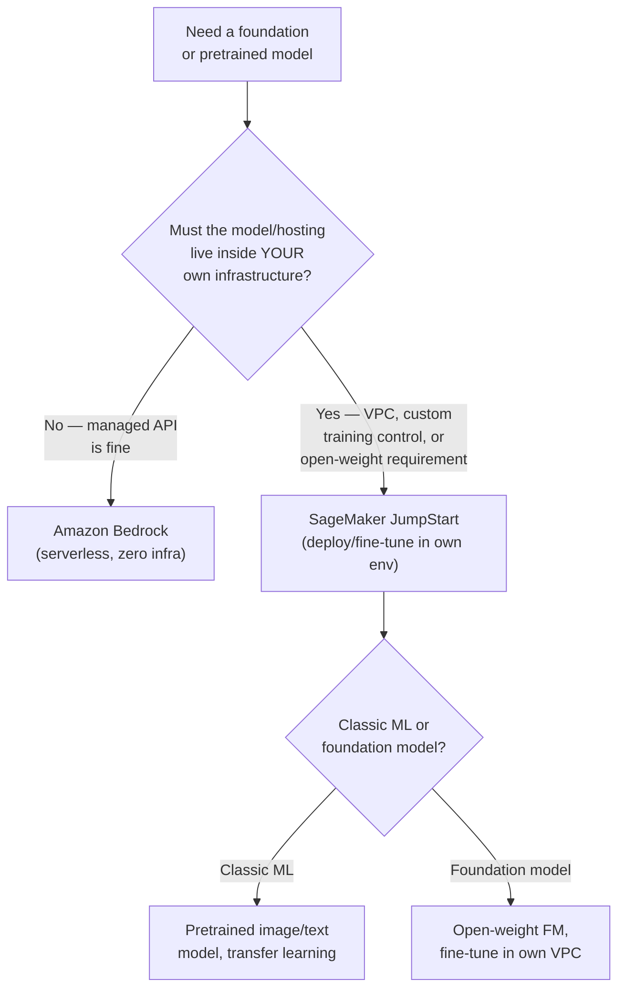

**Explained:** the fork is infrastructure ownership, not model capability — both paths can reach
a comparably capable model; the deciding factor is whether the team needs to *own* the hosting
environment (data residency, custom training scripts, no per-token fee at scale) or is fine with
a managed API abstracting that away entirely.

### Real image — JumpStart's foundation model catalog inside SageMaker Studio


*Figure: AWS's own screenshot of JumpStart's foundation model browsing experience inside
SageMaker Studio — models are deployed or fine-tuned directly into the user's own SageMaker
environment from this catalog, visually distinct from Bedrock's separate, fully-managed console
experience, reinforcing the infrastructure-ownership distinction the diagram above describes.
Source: AWS SageMaker Developer Guide, "Amazon SageMaker JumpStart Foundation Models" —
docs.aws.amazon.com/sagemaker/latest/dg/studio-jumpstart-foundation-models.html.*

### Exam Tips

1. **Worked example — the deciding question.** A scenario stating "the fine-tuned model and its
   serving infrastructure must remain entirely within our VPC for a data-residency requirement"
   contains the exact trigger phrase for JumpStart over Bedrock — Bedrock's underlying
   infrastructure isn't something the customer directly provisions inside their own VPC in the
   same way, even with VPC endpoint support for API calls.
2. **Worked example — transfer learning vs. training from scratch.** A team with 3,000 labeled
   company-specific images fine-tuning a JumpStart pretrained image classifier will typically
   reach strong accuracy with far less data and training time than training an equivalent
   network from random initialization — the practical payoff of transfer learning JumpStart is
   built around, directly connecting to `ml-fundamentals-glossary.md`'s Transfer Learning
   section.
3. **Exam trap:** assuming JumpStart and Bedrock are interchangeable whenever "foundation model"
   appears in a scenario — the correct one depends on the infrastructure-ownership requirement
   stated (or implied by a compliance/data-residency constraint), not on which one sounds more
   advanced or is mentioned first.

---

## B4. SageMaker Model Monitor & Model Registry

### Definition

**SageMaker Model Registry** is a catalog for versioning trained models, tracking their metadata
(metrics, lineage — which data and code produced them), and managing an approval workflow
(`PendingManualApproval` / `Approved` / `Rejected`) before a version is cleared to deploy.
**SageMaker Model Monitor** is the complementary *post-deployment* service that continuously
watches a deployed model's real production input data and predictions for **drift** —
statistical divergence from the data distribution the model was trained and validated on.

### Plain-English analogy

Model Registry is a product's version-control and release-approval system — every build is
tagged, its test results attached, and nothing ships to production without a human or automated
gate signing off. Model Monitor is the equivalent of ongoing post-release user-feedback and
crash-report monitoring — catching the moment real-world usage starts behaving differently from
what was true when the release was approved, even though nothing about the *code itself* changed.

### Purpose

Model Registry exists to make "which exact model version is in production, and why was it
approved" an always-answerable question rather than tribal knowledge. Model Monitor exists to
catch the specific failure mode where a model's *code* is unchanged but the *world feeding it*
has shifted — a problem no amount of pre-deployment testing can catch, since it only manifests
after deployment, as real data evolves.

### When to use

- **Model Registry:** any time more than one person or team needs to agree on which model
  version is cleared for production, or when regulatory/audit requirements demand lineage
  tracking (which dataset + code version produced the model currently serving traffic).
- **Model Monitor:** any production model receiving ongoing live traffic, where the input data
  distribution could plausibly shift over time (seasonality, changing customer behavior, upstream
  data-pipeline changes) — essentially any production-serving model, not an edge case.

### When NOT to use

- **Model Registry for a single-person, single-run experimental project with no deployment
  intent** — the versioning/approval overhead buys little value for a model that will never be
  compared against a future version or require sign-off.
- **Model Monitor without first establishing a baseline** — monitoring for drift *relative to*
  the training data's statistical profile requires that baseline to exist and be correct first;
  skipping baseline configuration makes any later "drift detected" alert meaningless, since
  there's nothing trustworthy to compare against.
- **Treating Model Monitor's drift alert as itself the fix** — drift detection correctly
  identifies *that* something changed, but the fix (retrain on recent data, re-register a new
  version) still routes back through this domain's training/tuning and registry flow — Model
  Monitor diagnoses, it doesn't repair.

### 5 Use Cases

1. A team registers every tuned model version from an Automatic Model Tuning job in **Model
   Registry** with its precision/recall metadata attached, requiring a human reviewer to approve
   the precision/recall tradeoff before the model can be deployed.
2. A fraud-detection model's **Model Monitor** baseline is configured from its validation data's
   statistical profile; three months later, an alert fires when live transaction amounts'
   distribution has shifted meaningfully from that baseline, well before the model's measured
   accuracy itself visibly degrades.
3. An auditor uses **Model Registry's lineage tracking** to confirm exactly which training
   dataset version and code commit produced the model currently serving production traffic,
   satisfying a regulatory audit request.
4. A team compares two competing model versions' registered metrics side by side in **Model
   Registry** before deciding which one to promote to `Approved` status, rather than relying on
   whichever was trained most recently.
5. A retraining pipeline triggered by a **Model Monitor** drift alert produces a new model
   version, which is automatically registered in `PendingManualApproval` status, closing the
   loop back into this domain's training/evaluation/registration flow described in the lifecycle
   diagram above.

### Why important

Task statement 2.4 ("Manage model versions") and Domain 4's drift-monitoring content are two
halves of the same lifecycle concern — a registered-but-unmonitored model can silently degrade in
production with no automated signal; an unregistered, monitored model has no clean mechanism to
trace *which* version is even the one being monitored. The two services are tested together far
more often than either is tested alone.

### Diagram — registry status flow and the monitor-triggered retrain loop

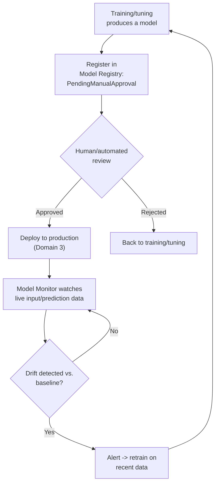

**Explained:** the registry's approval gate (B→C→D/E) and the monitor's drift loop (F→G→H→A) are
two different checkpoints at two different times — registry approval happens *once*, before
first deployment; monitoring runs *continuously*, after deployment, and its failure signal
(drift) routes all the way back to a fresh training/tuning cycle, not to a quick patch.

### Real image — Model Monitor's real-time architecture


*Figure: AWS's own architecture diagram for SageMaker Model Monitor's real-time monitoring —
live inference requests/responses are captured, processed, and statistically compared against
the baseline established from training/validation data, with CloudWatch alarms firing on
detected drift — the literal implementation behind the "Model Monitor watches live input/
prediction data" box in the diagram above. Source: AWS SageMaker Developer Guide, "Monitor
real-time inference" — docs.aws.amazon.com/sagemaker/latest/dg/model-monitor-model-quality.html.*


*Figure: the batch-transform equivalent of the real-time architecture above — Model Monitor
isn't limited to always-on real-time endpoints; the same baseline-comparison mechanism applies
to periodic batch-scored predictions, relevant for scenarios describing scheduled/batch scoring
rather than live request/response traffic. Source: AWS SageMaker Developer Guide, "Monitor data
and model quality for batch transform jobs" —
docs.aws.amazon.com/sagemaker/latest/dg/model-monitor-batch-transform.html.*

### Exam Tips

1. **Worked example — reading registry metadata to make an approval decision.** A scenario
   presenting two registered candidate versions' metadata — version A: precision=0.84,
   recall=0.81; version B: precision=0.91, recall=0.68 — paired with a stated business priority
   ("missing a real violation is costlier than a false alarm") should select version A, since
   its substantially higher recall (0.81 vs. 0.68) better matches a false-negative-averse
   priority, even though version B's precision is higher — reading the *stated business priority*
   against the *actual numbers*, not defaulting to "higher average" or "higher precision."
2. **Worked example — baseline-relative drift, not absolute-value drift.** Model Monitor flags
   drift based on *statistical distance from the training-time baseline*, not any absolute
   threshold — a feature whose values were always widely spread in training won't trigger drift
   just because a new batch also shows spread; drift fires when the *shape* of the distribution
   changes meaningfully relative to what the baseline established as normal for that specific
   feature.
3. **Exam trap:** "a model trained well on last year's data is now underperforming despite no
   code changes" is a Domain 4 concept-drift symptom Model Monitor is built to catch, but the
   *fix* routes back into this domain — retraining on recent data and re-registering a new
   version — a scenario testing this is checking whether you connect monitoring (detection) to
   training/registry (the actual remedy), not treating detection alone as sufficient.

---

## B5. SageMaker Training & Tuning

### Definition

**SageMaker Training** runs the actual model-fitting process — either a **built-in algorithm**
(XGBoost, Linear Learner, K-Means, Random Cut Forest, DeepAR, BlazingText, and others provided
as ready-to-use algorithm containers), **script mode** (your own PyTorch/TensorFlow/scikit-learn
code running inside a managed training job), or **Bring Your Own Container** (a fully custom
Docker image). **SageMaker Automatic Model Tuning (AMT)** wraps training with systematic
hyperparameter search (grid, random, Bayesian, or Hyperband) across many training jobs to find
the best-performing hyperparameter combination.

### Plain-English analogy

Training is the actual cooking — raw ingredients (data) and a recipe (algorithm) go into a
managed kitchen (SageMaker's provisioned compute) and a finished dish (trained model) comes out.
Built-in algorithms are using the kitchen's standard recipes; script mode is bringing your own
recipe but using the kitchen's equipment; Bring Your Own Container is bringing your own
equipment too. Tuning is cooking the same dish many times at slightly different oven settings and
keeping whichever batch tastes best, rather than guessing one setting and hoping.

### Purpose

To run model training without managing the underlying compute cluster directly — provisioning
instances, installing frameworks, handling distributed-training coordination, and tearing down
infrastructure afterward are all handled by the managed training job, leaving the team to focus
on the algorithm/script and data.

### When to use which training approach

| Approach | Use when |
|---|---|
| Built-in algorithm | The problem matches a provided algorithm's intended shape (tabular classification/regression → XGBoost/Linear Learner; clustering → K-Means; time series → DeepAR; text → BlazingText) and no custom modeling logic is needed |
| Script mode | A custom model architecture or training loop is needed (a specific PyTorch/TF network), but standard framework containers and managed infrastructure are otherwise sufficient |
| Bring Your Own Container | Neither a built-in algorithm nor a standard framework container fits — a fully custom runtime/dependency stack is required |
| Automatic Model Tuning | Any of the above, once the algorithm/script is settled and hyperparameter sensitivity hasn't yet been validated against the specific dataset |

### When NOT to use

- **Built-in algorithms for a problem genuinely outside their intended shape** — forcing K-Means
  onto a labeled classification problem, or XGBoost onto unstructured image data, ignores the
  algorithm-family selection work in A1; the built-in container doesn't change what the
  underlying algorithm is fundamentally capable of representing.
- **Script mode/custom containers when a built-in algorithm already solves the problem well** —
  unnecessary engineering and maintenance burden for no accuracy gain over the managed, tested
  built-in option.
- **Automatic Model Tuning before the algorithm/feature set is settled**, or **with a mis-chosen
  objective metric** — per A3, tuning cannot fix either of those upstream mistakes; it will
  efficiently optimize toward whatever (possibly wrong) target it's given.

### 6 Use Cases

1. A team trains a fraud classifier with the **XGBoost built-in algorithm**, configuring
   `scale_pos_weight` directly for the dataset's known 4% positive-class imbalance.
2. A research team brings a **custom PyTorch training script** via script mode to implement a
   novel loss function not available in any built-in algorithm, while still benefiting from
   managed multi-GPU provisioning.
3. A large training job uses **Managed Spot Training** with periodic checkpointing, cutting
   compute cost by roughly 60-90% versus On-Demand pricing while tolerating occasional
   interruption-and-resume.
4. A deep-learning image model's training is distributed across multiple GPU instances using
   **data parallelism**, specifically to reduce wall-clock training time without changing the
   model architecture or algorithm itself.
5. A tuning job for the XGBoost fraud model above runs **Bayesian search** across `max_depth`,
   `eta`, and `scale_pos_weight` with a 40-job budget, optimizing for validation AUC rather than
   accuracy, per the evaluation-metric discipline in A2.
6. A time-series forecasting team uses the **DeepAR built-in algorithm**, deliberately training
   it across thousands of related product SKUs jointly rather than thousands of independent
   per-SKU models, since DeepAR specifically benefits from shared patterns across related series.

### Why important

Training and tuning together are the literal mechanism behind task statement 2.2 ("Train and
tune a model") — nearly every other Domain 2 concept (algorithm families, evaluation metrics,
bias-variance) exists to inform decisions made *at* this stage, and the exam tests both
configuration-level details (built-in algorithm vs. script mode vs. BYOC) and conceptual
reasoning about what the configuration choices actually buy.

### Diagram — the training job's inputs and outputs

```mermaid
flowchart LR
    A[("Training data<br/>in S3")] --> C["Training Job"]
    B["Algorithm container<br/>(built-in / script mode /<br/>BYOC)"] --> C
    D["Hyperparameters<br/>(fixed or swept by AMT)"] --> C
    C --> E[("Model artifact<br/>written to S3")]
    C --> F["Training/validation<br/>metrics logged"]
    F --> G{"AMT: try another<br/>hyperparameter combo?"}
    G -->|Yes| D
    G -->|No, done| H["Best model -><br/>Model Registry"]
```

**Explained:** a single training job is a stateless, repeatable function — data and a fixed set
of hyperparameters go in, a model artifact and metrics come out. Automatic Model Tuning is simply
this box run many times with different hyperparameter inputs, with the search strategy (A3)
deciding what to try next based on the metrics each prior run logged.

### Real image — a SageMaker training job's structure


*Figure: AWS's own training-job diagram — training data and an algorithm container go in, a
trained model artifact comes out to S3 — the literal infrastructure the diagram above
represents abstractly, and the same infrastructure a CraftHaven-style XGBoost fraud model (see
`README.md`'s case study) would run on, one job per hyperparameter combination during tuning.
Source: AWS SageMaker Developer Guide, "Train a Model with Amazon SageMaker" —
docs.aws.amazon.com/sagemaker/latest/dg/how-it-works-training.html.*

### Exam Tips

1. **Worked example — choosing a built-in algorithm by problem shape.** A scenario stating
   "predict a category, tabular data, relationship shape unknown" walks straight to XGBoost per
   A1's decision tree; "predict a continuous number over time, many related products" walks to
   DeepAR; "group without labels" walks to K-Means — matching the stated problem type and data
   shape to the specific built-in algorithm name is the direct, repeatable question shape tested.
2. **Worked example — Spot Training's real savings, with checkpointing as the condition.** A
   training job interruptible and checkpoint-able can realistically see 60-90% cost savings via
   Managed Spot Training versus On-Demand — but *without* checkpointing configured, an
   interruption means restarting the entire job from zero, which can erase the cost savings
   entirely if interruptions are frequent; a scenario emphasizing cost savings for a long training
   job should pair Spot Training with an explicit checkpointing strategy, not assume Spot alone
   is risk-free.
3. **Exam trap:** "training a large model on a single GPU instance is too slow, and the team
   wants to speed it up without changing the algorithm" is a distributed-training (data
   parallelism across multiple GPU instances) answer, not a smaller/simpler model — a smaller
   model would change the algorithm's capacity, not just its speed, and risks underfitting
   (A4) as an unintended side effect of solving a speed problem the wrong way.

---

# Part C — Integration: How It All Fits Together

## C1. The full domain funnel, every service and concept in one flow

Domain 2's services and concepts are not a flat toolbox to memorize independently — they form a
single decision funnel every project walks, in roughly the same order, regardless of which
specific branch it ultimately takes:

```mermaid
flowchart TD
    A["Prepared data<br/>(Domain 1)"] --> B{"Build from scratch,<br/>or adopt a foundation<br/>model?"}
    B -->|"Build"| C["A1: Choose algorithm family<br/>(linear / tree / neural /<br/>clustering / anomaly)"]
    B -->|"Adopt"| D["Bedrock or JumpStart:<br/>select a foundation model<br/>(task fit, context, latency, cost)"]
    C --> E["B5: SageMaker Training<br/>(built-in / script mode / BYOC)"]
    E --> F["A3: Hyperparameter Tuning<br/>(grid / random / Bayesian)"]
    F --> G["A2: Evaluate with the<br/>RIGHT metric for the problem"]
    G --> H{"Good fit, or<br/>over/underfitting?"}
    H -->|"Over/underfit"| I["A4: Apply the matching fix<br/>(regularize vs. add capacity)"]
    I --> E
    H -->|"Good fit"| J["B4: Register in<br/>Model Registry"]
    D --> K{"Good enough<br/>out of the box?"}
    K -->|"Yes, needs facts"| L["A5 / B1: RAG via<br/>Bedrock Knowledge Bases"]
    K -->|"No, needs behavior<br/>change"| M["A5 / B1: Fine-tune<br/>(PEFT/LoRA default)"]
    L --> N["Evaluate: BLEU/ROUGE/<br/>BERTScore/LLM-as-judge"]
    M --> N
    N --> J
    J --> O["Domain 3: Deployment"]
    O --> P["B4: Model Monitor<br/>watches for drift"]
    P -.->|"drift detected"| A
```

**Walking the whole funnel in words:** every project starts at the same build-vs-adopt fork.
The build branch walks through algorithm-family selection (A1), into SageMaker Training (B5),
into hyperparameter tuning (A3), into evaluation with a problem-appropriate metric (A2) — and if
evaluation reveals over- or under-fitting, the matching fix from A4 routes back into training,
not forward to tuning or registration prematurely. The adopt branch walks through foundation-
model selection (choosing between Bedrock and JumpStart based on the infrastructure-ownership
question from B3), then the facts-vs-behavior customization fork from A5, landing on either RAG
or fine-tuning (both inside B1/B3), each with its own evaluation discipline (generative-text
metrics, not classic accuracy-style metrics). **Both branches converge on the same final step**
— Model Registry (B4) — regardless of which path produced the model, and the whole funnel is a
loop, not a line: Model Monitor's drift detection after deployment (Domain 3/4) feeds back to
the very top of this same funnel for a fresh training/fine-tuning cycle.

## C2. A full worked case study spanning every service and concept

**The business problem:** "Meridian Insurance" needs two capabilities: (1) a claims-triage model
that flags likely-fraudulent auto-insurance claims from structured claim data, and (2) a
customer-facing assistant that explains claim-status and policy details in plain language,
grounded in each customer's actual policy documents.

### Sub-problem 1 — fraud triage (the "build" branch, exercising A1, A2, A3, A4, B2, B4, B5)

1. **Algorithm selection (A1):** Meridian has 80,000 historical claims, each labeled fraudulent
   or legitimate (6% fraud rate), with 25 structured features (claim amount, policy tenure,
   claimant's prior claims count, repair-shop flags). Tabular, labeled, relationship shape
   unknown → per A1's tree, **XGBoost** is the starting point, not assumed without checking —
   the team briefly validates this isn't a near-linear relationship (it isn't: claim amount
   interacts non-additively with policy tenure and prior-claims count) before committing.
2. **Training (B5):** an XGBoost **built-in algorithm** Training Job runs on SageMaker, with
   `scale_pos_weight` set to address the 6% imbalance directly, and **Managed Spot Training**
   with checkpointing enabled to cut compute cost roughly 60-70% on this non-urgent, resumable
   batch job.
3. **Hyperparameter tuning (A3):** given a $15/job training cost and a 50-job budget, the team
   chooses **Bayesian search** over `max_depth`, `eta`, and `scale_pos_weight`, with Hyperband-
   style early stopping enabled to kill clearly underperforming candidates before their full
   training budget completes, stretching the $750 total budget further in practice.
4. **Evaluation (A2):** the team explicitly does **not** report plain accuracy (a trivial
   "approve everything" baseline would score ~94% while catching zero fraud); it reports recall
   at a precision floor of 0.80. The winning tuned model, on a 4,000-claim validation set (240
   actually fraudulent, 6%), produces TP=194, FN=46, FP=43, TN=3,717 — precision = 194/237 ≈
   81.9% (clears the 0.80 floor), recall = 194/240 ≈ 80.8%, F1 ≈ 81.3%.
5. **Bias/variance check (A4):** training accuracy (97.1%) vs. validation accuracy (94.8%) shows
   a modest, acceptable gap — not the large gap that would signal overfitting requiring
   intervention; the team proceeds rather than over-regularizing a model that's already in a
   reasonable fit range.
6. **Registry (B4):** the winning model is registered in **Model Registry** with its precision/
   recall/F1 attached as metadata, status `PendingManualApproval`; a human reviewer confirms the
   81.9%/80.8% tradeoff is acceptable and promotes it to `Approved`.
7. **Monitoring loop (B4, forward reference to Domain 4):** once deployed, **Model Monitor**'s
   baseline is set from this validation data's statistical profile; six months later, a shift in
   claim-amount distributions (inflation-driven) triggers a drift alert well before the model's
   measured precision/recall visibly degrades, prompting a scheduled retrain that re-enters this
   same funnel from the training step.

### Sub-problem 2 — the policy-explainer assistant (the "adopt" branch, exercising A5, B1, B3)

1. **Facts vs. behavior (A5):** the core need — explain a customer's *specific* policy and claim
   status — is a facts gap (the foundation model has no knowledge of Meridian's specific
   customers or policies), not a behavior gap. **Correct first move: RAG**, not fine-tuning.
2. **Service choice (B1 vs. B3):** Meridian has no data-residency requirement mandating the
   model run inside its own VPC, and wants to avoid owning hosting infrastructure — **Amazon
   Bedrock Knowledge Bases** is selected over JumpStart, consistent with B3's infrastructure-
   ownership fork resolving toward the managed, serverless option here.
3. **Model selection (B1):** the team evaluates three Bedrock model families on 50 of their own
   representative policy-explanation prompts, scored with a human rubric, selecting a mid-sized
   model that clears the quality bar at meaningfully lower latency/cost than the largest
   available option — per B1's performance/latency/cost exam tip, not defaulting to "the
   biggest."
4. **Testing "good enough" (A5):** after RAG grounding, factual accuracy (checked against source
   policy documents via human review) is strong, but a secondary issue emerges — the assistant
   occasionally uses legal jargon customers find confusing, despite the RAG context including a
   "write in plain language" instruction. This is now a **behavior/tone** problem, not a facts
   problem, since the facts are already correct.
5. **Escalation to fine-tuning (A5):** with 250 previously-approved plain-language claim
   explanations available, the team fine-tunes via **PEFT/LoRA** (not full fine-tuning — the
   change needed is narrow and the data volume fits PEFT's sweet spot) to lock in the simpler
   tone, layered on top of the already-working RAG grounding.
6. **Evaluation (connects to A2's generative metrics):** the fine-tuned-plus-RAG assistant is
   evaluated with BERTScore against the 250 approved examples (not BLEU/ROUGE, since valid
   paraphrases of plain-language explanations shouldn't be penalized for differing wording), and
   a before/after check on general, unrelated policy questions specifically confirms no
   catastrophic forgetting occurred from the narrow fine-tune.
7. **Registry (B4):** the fine-tuned model is registered in the same Model Registry as
   sub-problem 1's XGBoost model — the Registry treats both identically regardless of which path
   (classic ML training, or foundation-model fine-tuning) produced them.

**Why this case study matters:** a single business need routinely requires *both* branches of
the funnel simultaneously, and the skill the exam actually tests is recognizing which branch
(and which specific node within that branch) a given sub-problem belongs to — not defaulting to
"use Bedrock for everything" or "train everything from scratch."

## C3. Common pitfalls across the whole domain

Collected from every section above, the ten mistakes that recur most often across Domain 2
case-study questions, regardless of which specific service or concept a question names:

1. **Reporting accuracy on an imbalanced dataset without checking the class balance first** — the
   single most repeated trap in the entire domain (A2); always check whether classes are
   balanced before trusting accuracy as the headline number.
2. **Assuming XGBoost (or any single algorithm) is always the right default** — A1's head-to-head
   comparisons prove the "default" reverses on near-linear data; the correct answer is always
   conditional on the data's actual shape, never a fixed ranking.
3. **Applying regularization to an underfitting model** — A4's decision table exists specifically
   because this is the opposite of the correct fix and actively worsens the symptom.
4. **Tuning hyperparameters before the algorithm/objective-metric choice is settled** — A3 can
   only optimize whatever it's given; an upstream mistake in algorithm or metric selection isn't
   fixable by tuning harder.
5. **Reaching for fine-tuning (or worse, pre-training) before confirming prompt engineering and
   RAG have genuinely been tried and ruled out** — A5's cost ladder exists because each rung
   above the cheapest is an order of magnitude or more expensive, and a meaningful share of real
   gaps are fully solved by the cheapest rung alone.
6. **Using RAG to fix a tone/format/behavior problem** — a structural mismatch (A5); RAG adds
   retrieved content, it does not reliably constrain output style even when style instructions
   are part of what's retrieved.
7. **Treating a fine-tune's improved target-task score as sufficient evidence of success** without
   checking for catastrophic forgetting on unrelated prompts (A5) — the single most commonly
   skipped evaluation step in generative-AI customization scenarios.
8. **Confusing Bedrock and JumpStart as interchangeable** whenever "foundation model" appears,
   rather than checking the infrastructure-ownership requirement (B3) that actually distinguishes
   them.
9. **Treating Model Monitor's drift alert as itself the fix** rather than the trigger for a
   retrain-and-re-register cycle that routes back through this entire domain's training/tuning/
   evaluation flow (B4, C1).
10. **Assuming Managed Spot Training is risk-free cost savings** without checkpointing configured
    (B5) — an interruption without checkpointing restarts the entire job from zero, which can
    erase the savings on a frequently-interrupted job.

---

# Part D — Compiled Exam Scenario Quick Reference

*Organized by sub-topic, each scenario paired with the correct answer and the one-line reasoning
— a fast pre-exam review pass across every concept and service in this document.*

### Algorithm selection (A1)

1. **"Tabular data, binary classification, relationship shape unknown"** → XGBoost, the default
   strong baseline for an unknown-or-non-linear shape.
2. **"Tabular data, clearly linear/monotonic relationship, or regulator requires explainable
   coefficients"** → Logistic Regression — interpretability and a genuinely linear relationship
   can make the simpler model the *better*, not just acceptable, choice.
3. **"Segment customers with no pre-existing category label"** → K-Means; confirm it's genuinely
   unsupervised before assuming classification just because the word "segment" was used.
4. **"Detect a brand-new fraud/defect pattern with no labeled examples of it yet"** → Random Cut
   Forest / anomaly detection — supervised classification structurally cannot generalize to a
   pattern type absent from its training labels.
5. **"Classify raw images or free text with no hand-engineered features"** → a neural network
   (CNN for images, transformer/BlazingText-family for text).
6. **"Forecast demand across thousands of related product SKUs"** → DeepAR, which benefits from
   learning shared patterns across related series jointly.
7. **"Small dataset (a few hundred rows), request to use a deep neural network"** → flag the
   mismatch; small tabular data favors a tree ensemble or linear model over a high-variance deep
   network.
8. **"Determine the right number of clusters k without labels"** → elbow method (inertia vs. k)
   or silhouette score, not an arbitrary business-chosen number.

### Evaluation metrics (A2)

9. **"99% accuracy but a rare positive class is mostly missed"** → accuracy is the wrong metric
   for imbalanced classes; report recall, F1, or AUC instead.
10. **"Too many false alarms escalated to human review"** → a precision problem; raise the
    classification threshold, accepting a recall drop as the known tradeoff.
11. **"A regression model's error metric is dominated by a few unusually expensive outlier
    properties"** → switch from RMSE to MAE, which is far less sensitive to a small number of
    extreme errors.
12. **"Need one number for an imbalanced binary classifier without picking a side between false
    positives and false negatives"** → F1 score.
13. **"Comparing classifiers' ranking ability across all thresholds before committing to a
    cutoff"** → AUC — but prefer Average Precision / PR curves specifically on a rare-class
    problem, since AUC can look more optimistic there than PR-based metrics.
14. **"Generated text is accurate but scores low on an automated metric"** → BLEU/ROUGE penalize
    valid paraphrases; use BERTScore or semantic similarity instead.
15. **"No single correct reference answer exists for a generative task at all"** → LLM-as-a-
    judge, with a human-reviewed sample used to calibrate the judge model's scores.
16. **"Deciding the right K for a RAG pipeline's retrieval step"** → tune Precision@K/Recall@K
    against the generator's actual context capacity and measured answer quality.
17. **"Two models tie on accuracy but the business needs to trust the stated confidence
    percentages for an automated downstream threshold"** → check calibration, not accuracy or
    AUC, neither of which verifies whether a stated probability matches real-world frequency.

### Hyperparameter tuning (A3)

18. **"Minimize the total number of expensive training jobs during tuning"** → Bayesian search.
19. **"Small, cheap search space, want a guaranteed-best-within-range result"** → grid search is
    genuinely appropriate here.
20. **"Tuning's best job barely beats the untuned defaults"** → check search-space design (log
    vs. linear scaling, too-narrow a range, an irrelevant hyperparameter included) before
    assuming the strategy itself failed.
21. **"Winning hyperparameter value sits exactly at the edge of its searched range"** → widen the
    range and re-run, ideally with warm start.
22. **"Re-tuning monthly as new data arrives, without repeating the full search each time"** →
    warm start (`TRANSFER_LEARNING` type, since the dataset changes).
23. **"Training jobs are long, but clearly-bad combinations show poor signs early"** →
    Hyperband-style early stopping inside the tuning job — distinct from early stopping inside
    one training run's own loss curve.

### Overfitting, underfitting, bias-variance (A4)

24. **"Training accuracy 99%, validation accuracy 61%"** → overfitting; regularize, add data, or
    stop early — not train longer, which worsens it.
25. **"Both training and validation accuracy are low and similar"** → underfitting; add model
    capacity or better features — not regularization, which worsens it.
26. **"Need automatic feature selection alongside controlling overfitting"** → L1/Lasso
    specifically — L2/Ridge shrinks every coefficient but never zeroes any out.
27. **"Model's performance estimate varies wildly across different random train/val splits"** →
    use k-fold cross-validation for a more reliable estimate before touching the model itself.
28. **"Regularization strength was increased and now both training and validation accuracy
    dropped together"** → regularization set too high, inducing underfitting from the
    regularization itself — reduce `alpha`/`lambda`, don't abandon regularization entirely.

### RAG, fine-tuning, prompting (A5)

29. **"A foundation model fabricates facts not in training data or provided context"** →
    hallucination; fix with tighter RAG grounding, not fine-tuning.
30. **"Model needs to always respond in a specific JSON schema / consistent company tone"** →
    fine-tuning (a behavior/format change) — RAG cannot reliably enforce output format.
31. **"Only a handful of labeled examples (a dozen or fewer) for a new category"** → few-shot
    prompting, not fine-tuning on too little data.
32. **"A team proposes pre-training a foundation model from scratch for a narrow domain-
    vocabulary problem"** → almost certainly over-scoped; try fine-tuning/RAG on an existing
    strong model first.
33. **"Internal knowledge changes frequently (pricing, policy, inventory)"** → RAG, specifically
    because it avoids re-running training every time the underlying facts change.
34. **"A fine-tune improved the target task but the team hasn't checked unrelated capability"**
    → check for catastrophic forgetting with a before/after test on unrelated prompts before
    declaring success.

### Services (B1-B5)

35. **"Need a narrow, well-defined task (entity extraction, OCR) a managed AI service already
    solves"** → Comprehend/Textract, not a Bedrock foundation-model pipeline.
36. **"Fine-tuned model and its hosting infrastructure must remain entirely within our VPC"** →
    SageMaker JumpStart, not Bedrock.
37. **"Need every trained model version tracked with approval status and lineage"** → Model
    Registry, not Experiments (compares metrics only) or Pipelines (orchestrates process only).
38. **"A model trained well on past data is now underperforming, despite no code changes"** →
    Model Monitor's concept-drift detection; the *fix* (retrain, re-register) routes back into
    training/tuning/registry, not a patch to the monitoring configuration.
39. **"Training a large model on one GPU instance is too slow; speed it up without changing the
    algorithm"** → distributed training (data parallelism), not a smaller model.
40. **"A long, resumable training job needs significant cost reduction"** → Managed Spot
    Training with checkpointing — without checkpointing, an interruption restarts from zero and
    can erase the savings.

---

# Appendix E — Quick-Reference Tables

## E1. Algorithm family cheat sheet

| Family | Built-in (SageMaker) | Labels needed | Best for |
|---|---|---|---|
| Linear/Logistic Regression | Linear Learner | Yes | Tabular, linear relationship, interpretability |
| Tree ensemble (XGBoost) | XGBoost | Yes | Tabular, unknown/non-linear relationship, default baseline |
| Neural network | Script mode / BlazingText / built-in CNN | Yes | Images, raw text, audio |
| K-Means | K-Means | No | Segmentation, no existing labels |
| Random Cut Forest | Random Cut Forest | No | Rare/novel anomaly and fraud detection |
| DeepAR | DeepAR | Yes (historical series) | Forecasting across related time series |

## E2. Evaluation metric cheat sheet

| Metric | Problem type | Formula | Use when |
|---|---|---|---|
| Accuracy | Classification | (TP+TN)/all | Classes are balanced |
| Precision | Classification | TP/(TP+FP) | False positives are costly |
| Recall | Classification | TP/(TP+FN) | False negatives are costly |
| F1 | Classification | 2·(P·R)/(P+R) | One balanced number for imbalanced classes |
| AUC | Classification | Area under ROC curve | Threshold-independent comparison |
| RMSE | Regression | sqrt(mean(error²)) | Penalize large errors heavily |
| MAE | Regression | mean(|error|) | Robust to outliers |
| R² | Regression | 1 - (unexplained/total variance) | "% variance explained" |
| BLEU/ROUGE | Generative text | N-gram precision/recall | Fixed-phrasing tasks (translation, summarization vs. reference) |
| BERTScore | Generative text | Embedding similarity | Paraphrase-tolerant scoring |
| Precision@K / Recall@K | RAG retrieval | relevant-in-top-K / K or / total relevant | RAG retrieval quality specifically |

## E3. Hyperparameter search strategy cheat sheet

| Strategy | Sample efficiency | Guarantee | Best when |
|---|---|---|---|
| Grid | Low | Best-within-grid | Small space, cheap jobs |
| Random | Medium | None, good coverage | Quick search, no heavy commitment |
| Bayesian | High | None, learns from history | Expensive jobs, minimize total count |
| Hyperband | High (resource allocation) | None | Many cheap partial runs, kill bad ones early |

## E4. Service comparison cheat sheet

| Service | What it is | Infrastructure ownership | Primary use |
|---|---|---|---|
| Bedrock | Managed FM API + RAG/Agents/Guardrails | Fully managed, zero infra | Fast generative-AI builds, no infra |
| SageMaker (overview) | Full ML platform | Customer-managed (within AWS) | End-to-end classic ML + custom training |
| JumpStart | Pretrained model hub | Customer's own SageMaker env | Transfer learning, FM fine-tuning inside own VPC |
| Model Registry | Version/approval catalog | N/A (metadata service) | Track and gate which model version deploys |
| Model Monitor | Post-deployment drift watcher | N/A (monitoring service) | Catch production data/behavior drift |
| Training & Tuning | Training job execution + AMT | Managed compute, customer config | Run and tune any model, any algorithm |

## E5. Regularization technique cheat sheet

| Technique | Mechanism | Effect on coefficients/weights | Best for |
|---|---|---|---|
| L2 (Ridge) | Penalize squared weights | Shrinks all toward zero, none hit exactly zero | General overfitting control |
| L1 (Lasso) | Penalize absolute weights | Drives some to exactly zero | Automatic feature selection |
| Elastic Net | L1+L2 combined | Some shrink, some zero out | Both goals at once |
| Dropout | Randomly disable neurons during training | N/A (implicit ensembling) | Neural network variance reduction |
| Early stopping | Halt at best validation epoch | N/A (stops before overfitting) | Any iterative training process |
| Data augmentation | Synthetic data diversity | N/A (reduces variance via more effective data) | Small datasets, especially images/text |

---

## Related Terms

- [`README.md`](domain-2-model-development/README.md) — the domain's task-statement-level map and original decision
  diagrams this chunk expands into full standalone detail.
- [`ml-fundamentals-glossary.md`](domain-2-model-development/ml-fundamentals-glossary.md),
  [`algorithm-selection-decision-framework.md`](domain-2-model-development/algorithm-selection-decision-framework.md),
  [`evaluation-metrics-deep-dive.md`](domain-2-model-development/evaluation-metrics-deep-dive.md),
  [`hyperparameter-tuning-strategies.md`](domain-2-model-development/hyperparameter-tuning-strategies.md),
  [`rag-vs-finetuning-vs-prompting-decision-tree.md`](domain-2-model-development/rag-vs-finetuning-vs-prompting-decision-tree.md),
  and [`bias-variance-tradeoff-and-regularization.md`](domain-2-model-development/bias-variance-tradeoff-and-regularization.md)
  — the five topic docs this chunk's Part A condenses; read any one for deeper numeric derivations.
- [`../../../services/machine-learning-ai/bedrock.md`](../../services/machine-learning-ai/bedrock.md),
  [`../../../services/machine-learning-ai/sagemaker-overview.md`](../../services/machine-learning-ai/sagemaker-overview.md),
  [`../../../services/machine-learning-ai/jumpstart.md`](../../services/machine-learning-ai/jumpstart.md),
  [`../../../services/machine-learning-ai/sagemaker-model-monitor-and-registry.md`](../../services/machine-learning-ai/sagemaker-model-monitor-and-registry.md),
  and [`../../../services/machine-learning-ai/sagemaker-training-and-tuning.md`](../../services/machine-learning-ai/sagemaker-training-and-tuning.md)
  — the five full service docs this chunk's Part B condenses; read any one for complete
  configuration-level and API-level detail beyond this chunk's exam-focused summary.
- [`labs.md`](domain-2-model-development/labs.md) — hands-on exercises reproducing nearly every numeric example in this
  document with real, runnable code.
- [`../domain-1-data-preparation/README.md`](domain-1-data-preparation/README.md) — the data
  this domain's training jobs consume.
- [`../domain-3-deployment-orchestration/README.md`](domain-3-deployment-orchestration/README.md)
  — where Model Registry's approved versions get deployed.
- [`../domain-4-monitoring-security/README.md`](domain-4-monitoring-security/README.md) — the
  full depth behind Model Monitor's drift detection and SageMaker Clarify's bias/explainability
  checks referenced throughout this chunk.

---

# Appendix F — Runnable Code Reference

*Every "Worked numeric example" above is reproducible. This appendix collects runnable Python
for the headline examples from each Part A section, consolidated in one place for anyone working
through this chunk without the companion topic docs or `labs.md` open. All examples use only
`scikit-learn`, `numpy`, and (for one) `optuna` — `pip install scikit-learn numpy optuna`.*

## F1. A1 — The linear-vs-tree-ensemble reversal

```python
from sklearn.datasets import load_breast_cancer, make_classification
from sklearn.model_selection import train_test_split
from sklearn.linear_model import LogisticRegression
from sklearn.ensemble import GradientBoostingClassifier
from sklearn.metrics import roc_auc_score, accuracy_score

def compare(X, y, label):
    X_train, X_val, y_train, y_val = train_test_split(X, y, test_size=0.2, random_state=42)
    for name, model in [("Logistic Regression", LogisticRegression(max_iter=5000)),
                        ("Gradient Boosting", GradientBoostingClassifier(random_state=42))]:
        model.fit(X_train, y_train)
        probs = model.predict_proba(X_val)[:, 1]
        preds = model.predict(X_val)
        print(f"[{label}] {name}: acc={accuracy_score(y_val, preds):.4f} "
              f"AUC={roc_auc_score(y_val, probs):.4f}")

X1, y1 = load_breast_cancer(return_X_y=True)
compare(X1, y1, "near-linear data")

X2, y2 = make_classification(n_samples=2000, n_features=20, n_informative=15,
                               n_redundant=5, flip_y=0.03, class_sep=0.6, random_state=7)
compare(X2, y2, "non-linear data")
```

## F2. A1 — Choosing k for K-Means with the silhouette score

```python
from sklearn.cluster import KMeans
from sklearn.datasets import load_digits
from sklearn.metrics import silhouette_score

X, _ = load_digits(return_X_y=True)
for k in [2, 5, 8, 10, 15]:
    km = KMeans(n_clusters=k, random_state=42, n_init=10).fit(X)
    print(f"k={k}: inertia={km.inertia_:.1f} silhouette={silhouette_score(X, km.labels_):.4f}")
```

## F3. A2 — The full fraud confusion matrix, every metric computed

```python
from sklearn.metrics import confusion_matrix, classification_report, roc_auc_score
import numpy as np

y_true = np.array([1]*50 + [0]*950)  # 50 fraud, 950 legit — 5% fraud rate
y_pred = np.array([1]*35 + [0]*15 + [1]*20 + [0]*930)  # TP=35 FN=15 FP=20 TN=930

print(confusion_matrix(y_true, y_pred))
print(classification_report(y_true, y_pred, target_names=["Not Fraud", "Fraud"]))
```

## F4. A2 — RMSE vs. MAE outlier sensitivity

```python
import numpy as np

errors = np.array([2, -3, 1, 4, -2, 3, -1, 48])  # $1,000s
mae = np.mean(np.abs(errors))
rmse = np.sqrt(np.mean(errors**2))
print(f"With outlier    -> MAE=${mae*1000:.0f}  RMSE=${rmse*1000:.0f}")

errors_no_outlier = errors[:-1]
mae2 = np.mean(np.abs(errors_no_outlier))
rmse2 = np.sqrt(np.mean(errors_no_outlier**2))
print(f"Without outlier -> MAE=${mae2*1000:.0f} ({(1-mae2/mae)*100:.0f}% drop)  "
      f"RMSE=${rmse2*1000:.0f} ({(1-rmse2/rmse)*100:.0f}% drop)")
```

## F5. A2 — Log loss punishing confident wrongness

```python
import numpy as np

probs = np.array([0.95, 0.55, 0.02])  # predicted probability of the TRUE class
losses = -np.log(probs)
print("Per-example log loss:", np.round(losses, 4))
print(f"Confidently-wrong example is {losses[2]/losses[0]:.1f}x the confidently-right penalty")
```

## F6. A3 — Grid vs. random vs. Bayesian search, timed and compared

```python
import time, itertools
from sklearn.model_selection import GridSearchCV, RandomizedSearchCV, cross_val_score
from sklearn.ensemble import RandomForestClassifier
from sklearn.datasets import load_breast_cancer
import optuna

X, y = load_breast_cancer(return_X_y=True)
optuna.logging.set_verbosity(optuna.logging.WARNING)

param_grid = {"n_estimators": [50, 100, 150, 200], "max_depth": [3, 5, 7, None],
              "min_samples_split": [2, 5, 10]}
n_combos = len(list(itertools.product(*param_grid.values())))
print(f"Grid: {n_combos} combinations x 3-fold CV = {n_combos*3} total model fits")

t0 = time.time()
grid = GridSearchCV(RandomForestClassifier(random_state=42), param_grid, cv=3, n_jobs=-1)
grid.fit(X, y)
print(f"Grid best={grid.best_score_:.4f}  took {time.time()-t0:.1f}s")

t0 = time.time()
rand = RandomizedSearchCV(RandomForestClassifier(random_state=42),
    {"n_estimators": range(50, 250), "max_depth": list(range(3, 15)) + [None],
     "min_samples_split": range(2, 15)}, n_iter=20, cv=3, random_state=42, n_jobs=-1)
rand.fit(X, y)
print(f"Random (20 trials) best={rand.best_score_:.4f}  took {time.time()-t0:.1f}s")

def objective(trial):
    model = RandomForestClassifier(
        n_estimators=trial.suggest_int("n_estimators", 50, 250),
        max_depth=trial.suggest_int("max_depth", 3, 15),
        min_samples_split=trial.suggest_int("min_samples_split", 2, 15),
        random_state=42)
    return cross_val_score(model, X, y, cv=3).mean()

t0 = time.time()
study = optuna.create_study(direction="maximize")
study.optimize(objective, n_trials=10)
print(f"Bayesian (10 trials) best={study.best_value:.4f}  took {time.time()-t0:.1f}s")
```

## F7. A4 — Bias-variance decomposition by resampling

```python
import numpy as np
from sklearn.tree import DecisionTreeRegressor
from sklearn.linear_model import LinearRegression

np.random.seed(0)
true_function = lambda x: np.sin(x * 1.5) * 3

def make_sample(n=30):
    x = np.random.uniform(0, 4, n)
    return x.reshape(-1, 1), true_function(x) + np.random.normal(0, 0.5, n)

x_test = np.linspace(0, 4, 50).reshape(-1, 1)
y_true_test = true_function(x_test).ravel()

def bias_variance(model_factory, n_trials=200):
    preds = np.array([model_factory().fit(*make_sample()).predict(x_test) for _ in range(n_trials)])
    mean_pred = preds.mean(axis=0)
    return np.mean((mean_pred - y_true_test) ** 2), np.mean(preds.var(axis=0))

for name, factory in [("Linear Regression", lambda: LinearRegression()),
                       ("Tree depth=2", lambda: DecisionTreeRegressor(max_depth=2)),
                       ("Tree unlimited", lambda: DecisionTreeRegressor(max_depth=None))]:
    b, v = bias_variance(factory)
    print(f"{name}: bias^2={b:.4f}  variance={v:.4f}  total={b+v:.4f}")
```

## F8. A4 — L1 vs. L2's different mechanical effect

```python
from sklearn.linear_model import Ridge, Lasso
from sklearn.preprocessing import PolynomialFeatures
from sklearn.pipeline import make_pipeline
import numpy as np

np.random.seed(1)
x = np.random.uniform(-3, 3, 25).reshape(-1, 1)
y = (x.ravel() ** 3) * 0.3 + np.random.normal(0, 2, 25)

print("Ridge (L2) -- coefficients shrink, never hit exact zero:")
for alpha in [0.1, 1, 10, 100]:
    model = make_pipeline(PolynomialFeatures(degree=9), Ridge(alpha=alpha)).fit(x, y)
    coefs = model.named_steps["ridge"].coef_
    print(f"  alpha={alpha}: max|coef|={np.max(np.abs(coefs)):.2f}")

print("Lasso (L1) -- coefficients hit EXACT zero (feature selection):")
X2 = np.random.normal(0, 1, (100, 20))
true_coefs = np.zeros(20); true_coefs[[2, 5, 11, 17]] = [3.0, -2.0, 1.5, -4.0]
y2 = X2 @ true_coefs + np.random.normal(0, 0.5, 100)
for alpha in [0.01, 0.1, 0.5, 1.0]:
    model = Lasso(alpha=alpha).fit(X2, y2)
    print(f"  alpha={alpha}: {np.sum(np.abs(model.coef_) > 1e-6)}/20 features kept nonzero")
```

---

# Appendix G — AWS CLI / boto3 Quick Reference

*Practical, runnable-shape commands for each of the five services, for anyone who wants to see
the API surface alongside the conceptual content above. These require a real AWS account and
IAM permissions; they will NOT run against Floci (see `labs.md` for why, and the free-tier
alternatives used instead).*

## G1. Bedrock — list and invoke a foundation model

```bash
aws bedrock list-foundation-models --query "modelSummaries[].modelId"

aws bedrock-runtime invoke-model \
  --model-id anthropic.claude-3-haiku-20240307-v1:0 \
  --body '{"anthropic_version":"bedrock-2023-05-31","max_tokens":200,"messages":[{"role":"user","content":"Summarize SageMaker in one sentence."}]}' \
  --cli-binary-format raw-in-base64-out \
  output.json
```

```python
import boto3, json
client = boto3.client("bedrock-runtime")
response = client.invoke_model(
    modelId="anthropic.claude-3-haiku-20240307-v1:0",
    body=json.dumps({
        "anthropic_version": "bedrock-2023-05-31",
        "max_tokens": 200,
        "messages": [{"role": "user", "content": "Summarize SageMaker in one sentence."}],
    }),
)
print(json.loads(response["body"].read())["content"][0]["text"])
```

## G2. SageMaker — launch a built-in XGBoost training job

```python
import boto3, sagemaker
from sagemaker.estimator import Estimator

session = sagemaker.Session()
role = "arn:aws:iam::123456789012:role/SageMakerExecutionRole"
image_uri = sagemaker.image_uris.retrieve("xgboost", session.boto_region_name, version="1.7-1")

estimator = Estimator(
    image_uri=image_uri, role=role, instance_count=1, instance_type="ml.m5.xlarge",
    output_path="s3://my-bucket/fraud-model/output",
    hyperparameters={"max_depth": 6, "eta": 0.2, "objective": "binary:logistic",
                      "scale_pos_weight": 15, "num_round": 100},
)
estimator.fit({"train": "s3://my-bucket/fraud-model/train", "validation": "s3://my-bucket/fraud-model/val"})
```

## G3. JumpStart — deploy a pretrained model into your own environment

```python
from sagemaker.jumpstart.model import JumpStartModel

model = JumpStartModel(model_id="huggingface-text2text-flan-t5-base")
predictor = model.deploy(initial_instance_count=1, instance_type="ml.g5.2xlarge")
response = predictor.predict({"inputs": "Summarize: SageMaker JumpStart hosts pretrained models."})
print(response)
```

## G4. Model Registry / Model Monitor — register and set a monitoring schedule

```python
from sagemaker.model import Model
from sagemaker.model_metrics import ModelMetrics, MetricsSource

model_metrics = ModelMetrics(
    model_statistics=MetricsSource(
        s3_uri="s3://my-bucket/fraud-model/evaluation/metrics.json", content_type="application/json"
    )
)
model = Model(image_uri=image_uri, model_data="s3://my-bucket/fraud-model/output/model.tar.gz", role=role)
model_package = model.register(
    content_types=["text/csv"], response_types=["text/csv"],
    inference_instances=["ml.m5.large"], transform_instances=["ml.m5.large"],
    model_package_group_name="fraud-triage-models",
    approval_status="PendingManualApproval", model_metrics=model_metrics,
)
```

```python
from sagemaker.model_monitor import DefaultModelMonitor, CronExpressionGenerator

monitor = DefaultModelMonitor(role=role, instance_count=1, instance_type="ml.m5.xlarge",
                                 volume_size_in_gb=20, max_runtime_in_seconds=1800)
monitor.create_monitoring_schedule(
    monitor_schedule_name="fraud-model-drift-check",
    endpoint_input="fraud-triage-endpoint",
    output_s3_uri="s3://my-bucket/fraud-model/monitor-reports",
    statistics=monitor.baseline_statistics(),
    constraints=monitor.suggested_constraints(),
    schedule_cron_expression=CronExpressionGenerator.daily(),
)
```

## G5. Training & Tuning — launch an Automatic Model Tuning job (Bayesian strategy)

```python
from sagemaker.tuner import HyperparameterTuner, ContinuousParameter, IntegerParameter

tuner = HyperparameterTuner(
    estimator=estimator,
    objective_metric_name="validation:auc",
    objective_type="Maximize",
    hyperparameter_ranges={
        "max_depth": IntegerParameter(3, 10),
        "eta": ContinuousParameter(0.01, 0.3, scaling_type="Logarithmic"),
        "scale_pos_weight": ContinuousParameter(1, 30),
    },
    strategy="Bayesian",
    max_jobs=40,
    max_parallel_jobs=4,
    early_stopping_type="Auto",  # Hyperband-style early stopping of weak candidates
)
tuner.fit({"train": "s3://my-bucket/fraud-model/train", "validation": "s3://my-bucket/fraud-model/val"})
print(tuner.best_training_job())
```

---

# Appendix H — Self-Test Before Moving to Domain 3

*Answer each from memory before checking — this is the fastest way to find real gaps before
exam day, not a replacement for the worked examples above.*

1. On a dataset you suspect has strong non-linear feature interactions, which algorithm would
   you reach for first, and what numeric evidence from A1 supports that default?
2. A fraud model scores 96.5% accuracy; what two additional numbers do you need before deciding
   whether it's actually good, and why does accuracy alone mislead here?
3. What's the exact difference between early stopping inside one training run and early stopping
   inside a tuning job — and which one does SageMaker AMT's Hyperband-style option refer to?
4. A model's training and validation accuracy are both 55% and flat across 50 epochs — name the
   diagnosis and two fixes that do NOT involve adding more epochs.
5. Why does L1 regularization's effect on coefficients look structurally different from L2's in
   the worked examples above, and which one would you reach for if a scenario explicitly asks for
   automatic feature selection?
6. A chatbot states an outdated return policy as fact — walk the A5 decision tree out loud and
   name the two "good enough now?" checkpoints it passes through before landing on RAG.
7. What specific trigger phrase in a scenario should make you choose SageMaker JumpStart over
   Amazon Bedrock, even though both can serve the same underlying model family?
8. A deployed model's measured accuracy hasn't visibly dropped yet, but Model Monitor has fired a
   drift alert — explain why this is still worth investigating now rather than waiting for
   accuracy to visibly degrade.
9. Why is Bayesian search described as the most "sample-efficient" hyperparameter search
   strategy, and what's the approximate job-count ratio versus grid search from the worked
   example in A3/F6?
10. A fine-tuning job improves a narrow target task's score but the team hasn't tested anything
    else — what specific failure mode might be hiding, and what test would catch it?

*(Full worked answers to every question above are the corresponding Part A/B sections and
Appendix F code — if any answer doesn't come quickly, re-read that section before moving to
Domain 3.)*

## H1. Answer key

1. **XGBoost (or gradient boosting) first** — A1's head-to-head on an engineered non-linear
   dataset showed a ~4-point AUC gap in gradient boosting's favor (0.9312 vs. 0.8890); a linear
   model is only preferred when the relationship is confirmed close to linear or interpretability
   is explicitly required.
2. **Precision and recall (or F1/AUC)** — because at a 5% fraud rate, a trivial "always predict
   not-fraud" baseline scores 95% accuracy while catching zero fraud; the fraud model's 96.5% is
   barely higher despite catching real cases, so accuracy alone can't distinguish a genuinely
   useful model from a useless one.
3. **Training-run early stopping** halts one run once *its own* validation loss plateaus
   (overfitting prevention); **tuning-job early stopping** (Hyperband-style, what SageMaker AMT's
   early-stopping option refers to) kills an underperforming *candidate's* job early to save
   compute across the whole search — AMT's setting is the second kind.
4. **Underfitting** — fixes: increase model capacity (more layers/trees) or add/engineer better
   features; more epochs alone won't help since the model's basic capacity, not training time, is
   the bottleneck.
5. **L1 (Lasso) drives coefficients to exactly zero** (proven: 4/20 nonzero at alpha=0.5, matching
   the true informative feature count); **L2 (Ridge) only shrinks smoothly**, never hitting exact
   zero no matter how large alpha gets — reach for L1 when automatic feature selection is the
   explicit goal.
6. **Facts vs. behavior fork** (an outdated policy is a facts problem) → first "good enough now?"
   checkpoint after prompt engineering (no, still a facts problem) → routes to RAG → second
   "good enough now?" checkpoint after RAG (yes, since grounding on a current policy document
   fixes a factual staleness problem) — RAG is the landing point.
7. **"The fine-tuned model and its hosting infrastructure must remain entirely within our VPC"**
   (or an equivalent data-residency/infrastructure-ownership requirement) — Bedrock's managed
   infrastructure isn't something a customer directly provisions inside their own VPC the way
   JumpStart's deployment target is.
8. **Because drift measures a leading indicator (input/behavior distribution shift), not a
   lagging one (measured accuracy)** — by the time accuracy visibly drops, the underlying cause
   has often been compounding for a while; catching drift early allows a proactive retrain before
   user-facing quality measurably suffers.
9. **Because it uses prior trial results to choose the next candidate intelligently** rather than
   guessing blindly (random) or checking everything (grid); the worked example showed Bayesian
   search (10 trials, 30 model fits) matching grid search's result (60 combos, 180 fits) at
   roughly **one-sixth** the total compute.
10. **Catastrophic forgetting** — the fix is a before/after test on prompts *unrelated* to the
    fine-tuning task, specifically to catch a case where narrow-task improvement masks a
    regression in general capability, exactly as the 92%→97% (narrow) vs. 92%→71% (general)
    worked example demonstrated.

---

# Appendix I — Official Task Statement Crosswalk

*Maps every MLA-C02 Domain 2 official exam-guide task statement to where it's covered in this
chunk, for anyone cross-referencing against the official exam guide directly.*

| Task statement | What it covers | Covered in |
|---|---|---|
| 2.1 — Choose a modeling approach | Built-in algorithms vs. script mode vs. FM selection | A1, A5, B2, B3, B5, C1 |
| 2.1.1 — Evaluate/select FMs from Bedrock | Task fit, context window, latency, cost, modality | B1 Exam Tips, C2 sub-problem 2 |
| 2.1.2 — Identify fine-tuning strategies | Full fine-tune vs. PEFT/LoRA vs. instruction tuning vs. RLHF | A5, B1 Use Case 2 |
| 2.1.4 — Build vs. managed vs. pretrained vs. FM tradeoffs | Four-way infrastructure/customization decision | A5, B1/B2/B3 "When NOT to use" sections |
| 2.1.5 — Select RAG architecture patterns | Naive/advanced/agentic/graph RAG | A5, B1 (Knowledge Bases) |
| 2.1.7 — FM performance/latency/cost tradeoffs | Balancing capability against speed and cost | B1 Exam Tip 1 |
| 2.2 — Train and tune a model | Epochs, batch size, learning rate, hyperparameter search | A3, A4, B5 |
| 2.2.8 — Customization techniques | Prompt engineering and fine-tuning applied deliberately | A5 |
| 2.2.9 — Optimize retrieval/embedding models | Top-K tuning, reranking, embedding swaps | A2 Part 7 (via `evaluation-metrics-deep-dive.md`), A5 |
| 2.3 — Evaluate a model | Metric selection, overfitting/underfitting, bias detection | A2, A4, Part D (A2/A4 sections) |
| 2.3.7 — Human evaluation frameworks | Human-in-the-loop review of generated quality | A2 (LLM-as-a-judge note), B1 |
| 2.3.8 — NLP evaluation metrics | BLEU, ROUGE, BERTScore, semantic similarity | A2 "When to use which metric" table |
| 2.3.9 — AI evaluation (LLM-as-a-judge, bias) | Rubric-based automated scoring of generated output | A2, A5 C2 sub-problem 2 |
| 2.3.10 — RAG system monitoring (retrieval accuracy) | Precision@K/Recall@K | A2 metric table, cross-referenced to `evaluation-metrics-deep-dive.md` Part 7 |
| 2.4 — Manage model versions | Versioning, approval workflow, lineage | B4 |

*For task statements not fully expanded inline above (2.1.5's full pattern comparison table,
2.2.9's retrieval-optimization levers, 2.3.7-2.3.10's full generative-evaluation depth), see
`README.md`'s "NEW skill" sections and `ml-fundamentals-glossary.md`, which this chunk
deliberately condenses rather than duplicates in full.*

---

# Part 3 — Domain 3: Deployment and Orchestration of ML and AI Workflows (24%)

*Full domain guide with task-statement mapping: [`domain-3-deployment-orchestration/README.md`](domain-3-deployment-orchestration/README.md). This section is domain-3-deployment-orchestration's MASTER-CHUNK, reproduced in full below.*

*A single, self-contained, standalone-readable review document covering all nine services/topics
tested under MLA-C02 Domain 3 (24% exam weight): **AWS CodePipeline, Amazon Bedrock, Amazon ECR,
Amazon ECS, Amazon EKS, Amazon MWAA, SageMaker Overview, SageMaker Deployment & Endpoints, and
SageMaker Pipelines.** You should be able to read this one file start to finish, with no other
document open, and come away with full working knowledge of this domain. Each service covers:
Definition, a plain-English Analogy, Purpose, When to Use, When NOT to Use, 4-6 Use Cases, Why
Important, at least one explained Mermaid diagram, at least one real, curl-verified AWS
documentation image with discussion, and 2-3 Exam Tips. Cross-references to the shorter topic
docs in this same folder are given for deeper follow-up, but nothing here *requires* reading them.*

## How to use this document

Read top to bottom for a first pass, or jump straight to any one of the nine services below for a
focused review — each section is independently complete. The services are ordered the way a
model's journey through this domain actually flows: code and container plumbing first (ECR, ECS,
EKS, CodePipeline), then the general workflow orchestrator that sits alongside SageMaker (MWAA),
then SageMaker itself (Overview → Deployment & Endpoints → Pipelines), and finally the GenAI layer
(Bedrock) that increasingly sits on top of or alongside all of the above in C02's expanded scope.

## Table of contents

1. [AWS CodePipeline](#1-aws-codepipeline)
2. [Amazon ECR (Elastic Container Registry)](#2-amazon-ecr-elastic-container-registry)
3. [Amazon ECS (Elastic Container Service)](#3-amazon-ecs-elastic-container-service)
4. [Amazon EKS (Elastic Kubernetes Service)](#4-amazon-eks-elastic-kubernetes-service)
5. [Amazon SageMaker — Overview](#5-amazon-sagemaker--overview)
6. [Amazon MWAA (Managed Workflows for Apache Airflow)](#6-amazon-mwaa-managed-workflows-for-apache-airflow)
7. [SageMaker Deployment & Endpoints](#7-sagemaker-deployment--endpoints)
8. [SageMaker Pipelines](#8-sagemaker-pipelines)
9. [Amazon Bedrock (including Agents, Knowledge Bases, AgentCore)](#9-amazon-bedrock-including-agents-knowledge-bases-agentcore)
10. [Closing synthesis — how all nine fit together](#closing-synthesis--how-all-nine-fit-together)

---

## How to read the order below

The nine services are covered in the order they ended up written rather than re-sorted
afterward, specifically so cross-references between sections (e.g., "Section 7" meaning SageMaker
Deployment & Endpoints) stay internally consistent throughout this document: code/container
plumbing first (CodePipeline, ECR, ECS, EKS), then the SageMaker platform overview, then the
general workflow orchestrator (MWAA) that sits alongside it, then SageMaker's deployment options
and Pipelines in depth, and finally the GenAI layer (Bedrock) that increasingly sits alongside or
on top of everything above in C02's expanded scope.

---

## 1. AWS CodePipeline

### Definition

AWS CodePipeline is a fully managed continuous integration/continuous delivery (CI/CD)
orchestration service: it connects Source, Build, Test, and Deploy steps into one automated
pipeline that runs every time code (or, in this domain, a model/container/prompt artifact)
changes, without you hand-writing the glue scripts that wire those steps together.

### Analogy

Think of CodePipeline as an assembly line's conveyor belt and supervisor combined: it doesn't
build anything itself (that's CodeBuild's job, like the machine stations along the belt) and it
doesn't install anything at the destination (that's CodeDeploy's job, like the delivery truck) —
it just makes sure the product moves from station to station in the right order, nothing skips a
required inspection, and a human gets paged if one station rejects the product rather than it
silently rolling through to the next.

### Purpose

Every individual release step (build, test, deploy) can be automated on its own, but someone
still has to wire them together in the correct order, pass artifacts between them, gate progress
on approvals, and handle failures consistently — and hand-rolling that wiring with cron jobs and
shell scripts is itself a maintenance burden and a reliability risk. CodePipeline exists to be
that orchestration layer declaratively: a Stages-containing-Actions model, with an S3-backed
artifact store passing data between stages, intentionally simple and auditable (you can look at
the console and see the entire release path) rather than a full general-purpose workflow
language — a deliberate tradeoff, since truly complex conditional logic needs a custom Lambda
action or, for genuinely general-purpose orchestration, AWS Step Functions instead.

### When to Use

- You need a managed, auditable, multi-stage release process (source → build → test → deploy)
  instead of hand-rolled webhooks and scripts gluing those stages together.
- You need approval gates (a human must sign off before a risky stage) built into the release
  process itself, with notification and timeout handling already solved.
- You're automating an ML retraining-and-redeploy loop and need the *outer* release discipline
  (container build, cross-environment promotion, deployment strategy) wrapping an inner
  SageMaker Pipeline or Bedrock artifact update.
- You need to fan out one build to many AWs accounts/Regions in parallel, each with its own
  approval/deployment path.

### When NOT to Use

- **Your team is fully invested in GitHub and wants pipeline-as-code living next to the repo** —
  GitHub Actions is often simpler to adopt, with a far larger pre-built action ecosystem; many
  teams use GitHub Actions for CI and still call CodeDeploy/CloudFormation from within it.
- **You need a vendor-neutral, multi-cloud pipeline definition** — Jenkins, GitLab CI, or GitHub
  Actions avoid AWS-specific pipeline syntax entirely.
- **Your deployment is a single simple step with no multi-stage gating needed** — directly
  triggering CodeDeploy or a CloudFormation stack update from a webhook can be simpler for
  trivial cases.
- **You need complex conditional branching, long-running waits, or human-task patterns beyond a
  simple approval gate** — AWS Step Functions is purpose-built for general workflow
  orchestration, sometimes used underneath a CodePipeline custom action for the genuinely
  complex parts.

### Use Cases

1. **ML retraining-and-redeploy automation** — an EventBridge/S3-triggered pipeline with a
   custom Lambda validation action implements the full MLOps loop declaratively: rebuild the
   inference container if code changed, trigger a SageMaker Pipeline for the actual training/
   evaluation DAG, gate on its result, and deploy the approved model via a canary or blue/green
   strategy.
2. **Multi-environment approval-gated promotion** — dev auto-deploys on every merge, staging
   needs one manual approval, production needs a second, separate approval plus a scheduled
   deployment window — layering governance progressively as risk increases.
3. **Cross-account/multi-region fan-out deployment** — one build's artifact is deployed in
   parallel to many accounts/Regions, each Deploy action assuming a different cross-account IAM
   role scoped to its own target only, reusing the exact same immutable build artifact everywhere.
4. **Security/compliance-gated releases** — a dedicated stage runs infrastructure-as-code policy
   scanning or container image vulnerability-scan retrieval, failing the pipeline automatically
   on policy violations rather than relying on a human remembering to check.
5. **GenAI artifact CI/CD** — a prompt template, Agent configuration, or Guardrail config change
   is committed, triggers an automated evaluation-suite stage, and only reaches production via a
   gated deploy stage if the evaluation scores clear a defined bar — the same CI/CD shape as a
   model release, applied to a Bedrock-native artifact instead of a model binary.
6. **Hotfix emergency deploys** — a `QUEUED` or `PARALLEL` execution mode (rather than the
   default `SUPERSEDED`) preserves a full audit trail for every individual commit during a fast-
   path release, when every change must be individually, auditably built and deployed.

### Why Important

Real-world: CodePipeline is the backbone that turns "we have tests and deployment automation"
into "every change actually goes through them, every time, with a record of what happened,"
removing the human-error risk of someone skipping a step or deploying an untested artifact — and
the resulting audit trail (exactly which commit, build, and test results led to which production
deploy) is frequently a compliance requirement, not just a convenience. Exam weight: MLA-C02
Domain 3 Task 3.3 names CodePipeline/CodeBuild/CodeDeploy explicitly as the CI/CD trio for ML,
alongside EventBridge-triggered retraining — expect it in nearly every CI/CD-flavored Domain 3
question, often as the outer wrapper around a SageMaker Pipeline rather than the star of the
question itself.

### How It Works, with a Mermaid diagram explained

```mermaid
flowchart TD
    Dev[Developer pushes code] --> Src[Source Stage<br/>CodeCommit / GitHub via CodeConnections]
    Src -->|source artifact| Build[Build Stage<br/>CodeBuild: compile, test, docker build & push to ECR]
    Build -->|build artifact| Test[Test Stage<br/>integration tests, ML eval metrics]
    Test -->|tested artifact| Approve{Manual Approval Gate<br/>optional}
    Approve -->|approved| DeployStaging[Deploy Stage: Staging<br/>CodeDeploy -> ECS/Lambda/EC2/SageMaker]
    DeployStaging -->|smoke tests pass| DeployProd[Deploy Stage: Production<br/>blue/green or canary]
    DeployProd --> Monitor[CloudWatch Alarms<br/>watch post-deploy health]
    Monitor -->|unhealthy| Rollback[Automatic rollback via CodeDeploy]
    Monitor -->|healthy| Done[Pipeline execution: Succeeded]
```

Reading this diagram left to right: a code change is detected at the **Source** stage (via an
EventBridge rule on CodeCommit, or a CodeConnections webhook-style integration for GitHub/GitLab/
Bitbucket), which starts a new pipeline **execution** and pulls the exact commit as the source
artifact. The **Build** stage invokes CodeBuild, which compiles code, runs unit tests, and — for
containerized workloads relevant to this domain — builds and pushes a Docker image to ECR,
producing a build artifact (commonly an `imagedefinitions.json` file naming the pushed image) in
the pipeline's S3 artifact store. The **Test** stage runs integration tests or, in an ML context,
could be where model-evaluation metrics are checked (though in a typical ML pipeline this
evaluation actually lives *inside* a SageMaker Pipeline invoked from here, not directly as a
CodeBuild test action — see Section 8). An optional **Manual Approval** gate pauses the pipeline,
consuming no compute, until a human responds via an SNS notification or the gate times out
(default maximum seven days). **Deploy** stages then push the artifact out, typically staging
first with smoke tests, then production using a blue/green or canary strategy via CodeDeploy.
Post-deploy, CloudWatch alarms continue watching health, and CodeDeploy's automatic rollback
reverts to the last good state if something regresses — closing the loop with no manual
intervention required for a bad deploy to be caught and reversed.

### Real AWS reference image, with discussion


*Figure: a production-promotion reference architecture — a release manager issues a production
deployment request, CodePipeline invokes a build-management tool which calls a database change-
management tool, downloads change scripts, runs them against the target RDS production database,
and CodePipeline then initiates its Deploy action to complete the rollout, with performance
monitoring feeding event notifications. The detail worth internalizing: a CodePipeline "Deploy"
stage is a **generic orchestration concept**, not something that only means "deploy an
application" — this example uses the exact same Source → Build → Deploy shape to orchestrate a
database schema change instead, which is precisely why the same pipeline shape can just as easily
orchestrate a SageMaker Pipeline trigger or a Bedrock Agent configuration update, as this domain's
other documents show concretely. Source: AWS Reference Architecture Diagrams, "Database DevOps on
AWS" Production Workflow.*

### A worked architecture pattern — fan-out to multiple accounts/Regions

```mermaid
flowchart TD
    Pipeline[Central CodePipeline<br/>in tooling account] --> Source[Source + Build stages<br/>run once]
    Source --> DeployDev[Deploy action:<br/>assume role into Dev account]
    Source --> DeployStageEU[Deploy action:<br/>assume role into Staging, eu-west-1]
    Source --> DeployStageUS[Deploy action:<br/>assume role into Staging, us-east-1]
    DeployDev --> Gate{All non-prod<br/>deployments healthy?}
    DeployStageEU --> Gate
    DeployStageUS --> Gate
    Gate -->|yes| Approval[Manual approval:<br/>production release]
    Gate -->|no| Failed([Pipeline: Failed])
    Approval --> ProdFanOut[Parallel deploy actions:<br/>Prod account, multiple Regions]
    ProdFanOut --> Done([Pipeline: Succeeded])
```

A single Build stage's output artifact can be deployed to many accounts/Regions in parallel
actions within the same stage, each action assuming a different cross-account IAM role scoped
only to its target environment — the artifact itself never changes between targets (build once,
deploy many), only the destination and credentials used to deploy it do. This is the direct
answer to a scenario describing "the same ML inference container needs to reach three regional
production clusters simultaneously, with a single approval gate before any of them go live."

### Exam Tips

- Remember the layering: CodeCommit/GitHub = source, CodeBuild = build/test, CodeDeploy =
  deploy/release strategy, **CodePipeline = the orchestrator tying all three together** — a
  question describing the whole flow is asking about CodePipeline even if it never says the word.
- There is **no built-in CodePipeline action type for triggering a SageMaker Pipeline or updating
  a SageMaker endpoint's traffic split** — both require a custom Lambda-backed (`Invoke`)
  action; know this as a real, tested gap in the built-in action catalog.
- Default execution mode is `SUPERSEDED` (only the latest of several rapid commits gets a full
  run) — a scenario needing every single commit individually built/deployed for audit reasons
  needs `QUEUED` mode explicitly configured instead.

### Troubleshooting / Common Issues

- **Pipeline stuck, not triggering on new commits** — verify the CodeConnections connection (for
  GitHub/GitLab/Bitbucket sources) is in an `Available` state, not `Pending` (a connection
  requiring manual OAuth completion in the console is a very common silent trigger failure).
- **Stage fails with "artifact not found"** — an action's `inputArtifacts` references a name no
  prior action actually produced as an `outputArtifacts` entry; check the exact artifact names
  match across stages.
- **Manual approval notification never arrives** — the SNS topic referenced in the approval
  action's configuration has no subscribed endpoint, or the CodePipeline service role lacks
  `sns:Publish` permission on that topic.
- **Cross-account deploy action fails with access denied** — cross-account pipeline actions
  require both the pipeline's service role to assume a role in the target account *and* that
  target account's role to trust the pipeline account — a one-sided trust relationship is a
  frequent setup mistake.
- **A retraining pipeline's custom validation action never actually blocks a bad model** — check
  that the Lambda behind that action explicitly returns a failure status (non-zero exit / failure
  result) on a metric regression; CodePipeline has no built-in metric-comparison logic of its own,
  so a validation action that merely logs a warning without failing the stage lets a bad model
  through regardless of what the logs say.

### Sample exam scenario, worked

**Scenario:** "A retraining pipeline should only promote a new model to production if its
validation accuracy exceeds the currently deployed model's accuracy by a defined margin. The team
wants this enforced as part of the existing CodePipeline release, not as a separate manual
process." *Answer, worked:* CodePipeline has no built-in action type that compares two models'
metrics — the correct design is a custom Lambda-backed action (category `Invoke`) placed in a
Test/Validate stage, which reads both the new model's evaluation metrics (from the upstream
SageMaker Pipeline's output) and the currently-deployed model's recorded accuracy, computes the
margin, and explicitly calls `put_job_failure_result` if the margin isn't met — exactly the same
custom-action pattern this domain's CI/CD deep-dive document uses to bridge CodePipeline and
SageMaker Pipelines. A wrong but tempting answer is "add a Test action using CodeBuild" — CodeBuild
can run the comparison logic, but the actual gating behavior (stopping the pipeline) still depends
on that build explicitly failing on a bad result, the same underlying requirement either way.

---

## 2. Amazon ECR (Elastic Container Registry)

### Definition

Amazon ECR is a fully managed, private Docker/OCI container image registry — the AWS-hosted
equivalent of Docker Hub, but private by default, tightly integrated with IAM, and built to feed
container images straight into ECS, EKS, Lambda, SageMaker, and Fargate.

### Analogy

ECR is the warehouse between the factory (your CI build) and the stores (ECS/EKS/SageMaker/
Lambda) that actually sell the product to customers. Nobody walks into the warehouse off the
street — access is controlled at the door (IAM), every pallet (image layer) is labeled and
tracked (tags, digests, scanning), and old, unsold stock gets automatically cleared out on a
schedule (lifecycle policies) so the warehouse doesn't silently fill up with inventory nobody
needs anymore.

### Purpose

Container images need to live somewhere between "built by CI" and "run in production," and that
somewhere needs strong access control, reliability, and tight integration with whatever actually
runs the image. Public registries like Docker Hub have rate limits and a separate identity
system to manage; ECR solves this by putting the registry inside your AWS account boundary,
governed by the same IAM policies as everything else — and, specifically relevant to this domain,
by being the place a custom SageMaker inference container (a Bring Your Own Container image) or
an ECS/EKS-hosted model-serving container lives before being pulled at deploy time.

### When to Use

- Any container-based workload on AWS at all — ECS, EKS, Lambda, Fargate, or a SageMaker custom
  inference container all need somewhere to pull their image from.
- You need strict, auditable control over who can push (not just pull) a given image — a
  repository resource policy can scope push access to only the CI pipeline's role.
- You need vulnerability scanning integrated into the deployment gate itself, not a separate,
  easily-skipped manual step.
- You need multi-region/multi-account image availability for disaster recovery or team
  separation, without rebuilding the image per environment.

### When NOT to Use

- **You're deliberately distributing open-source images to the public internet at scale** — ECR
  Public or Docker Hub are built for that; a private ECR repo adds no value there.
- **Your org already has an established registry** (Docker Hub, GitHub Container Registry,
  Harbor, Artifactory) with existing CI integration — migrating just to use ECR isn't
  automatically worth it; ECR's main advantage is IAM-native auth for AWS compute specifically.
- **You need a generic artifact repository for non-container artifacts** (npm packages, Maven
  jars) alongside images, with no container-specific features needed — CodeArtifact or
  Artifactory may be a better single-tool fit.

### Use Cases

1. **Baseline registry for a SageMaker custom inference container** — a Bring Your Own Container
   image implementing the `/ping`/`/invocations` serving contract is built, pushed to ECR, and
   referenced by a SageMaker endpoint configuration, exactly the pattern this domain's
   containerization section describes.
2. **Vulnerability-gated deployment pipeline** — enhanced scanning (Amazon Inspector-powered)
   continuously rescans stored images as new CVEs are published, with EventBridge gating
   promotion on findings rather than a one-time, point-in-time scan at push.
3. **Strict push/pull access control per pipeline** — a repository resource policy grants push
   only to the CI pipeline's IAM role, so every other principal in the account can pull but never
   push, guaranteeing production images only ever originate from the CI pipeline.
4. **Multi-region/multi-account disaster recovery** — replication rules copy images (keeping
   tags and digests identical) automatically on every push, so a failover Region's compute can
   pull the exact same image, not a rebuilt equivalent.
5. **Build-once, deploy-many promotion across environments** — the same image moves from dev to
   staging to production referenced by its immutable digest, guaranteeing bit-for-bit identical
   artifacts across every environment rather than a rebuild-per-environment risk.
6. **Reducing dependency on public base-image registries** — a pull-through cache rule serves
   repeat pulls of a common public base image from inside AWS, immune to a Docker Hub outage or
   rate-limit event affecting production deploys.

### Why Important

Real-world: the registry is the trust boundary between "code someone wrote" and "code running in
production" — a compromised or improperly-scoped registry is a direct path to supply-chain
attacks, and IAM-based auth (no static passwords) plus vulnerability scanning materially reduce
that risk. Lifecycle policies also prevent a very common cost leak: unbounded image storage
growth from CI pushing a new tag on every commit forever. Exam weight: MLA-C02 Domain 3 Task 3.3
explicitly names "containerize (ECR, custom containers)" as part of ML deployment/orchestration —
expect ECR to appear whenever a scenario mentions a custom or Bring Your Own Container for
SageMaker, ECS, or EKS.

### How It Works, with a Mermaid diagram explained

```mermaid
flowchart LR
    Dev[Developer / CI runner] -->|docker build| Img[Local image]
    Dev -->|aws ecr get-login-password| STS[IAM / STS<br/>temporary auth token]
    STS --> Auth[docker login to ECR]
    Img -->|docker push| Repo[(ECR Repository<br/>private, per-account)]
    Repo -->|lifecycle policy| Prune[Old/untagged images<br/>auto-expired]
    Repo -->|image scanning| Scan[Vulnerability scan<br/>CVE findings]
    Repo -->|docker pull, via IAM role| ECS[ECS Task]
    Repo --> EKS[EKS Pod]
    Repo --> SM[SageMaker endpoint<br/>custom container]
```

Walking through this: a developer or CI pipeline builds a Docker image, then authenticates to
ECR by exchanging IAM credentials for a short-lived Docker login token (`aws ecr
get-login-password`) — no static registry passwords exist to rotate or leak. The image is tagged
with the repository's URI (`<account-id>.dkr.ecr.<region>.amazonaws.com/<repo>:<tag>`) and
pushed, after which **lifecycle policies** automatically expire old or untagged images
(priority-ordered rules that short-circuit per image — a broad rule placed before a narrow,
protective rule wins, a common misconfiguration), and **image scanning** checks for known CVEs,
either a one-time basic scan at push or continuous enhanced scanning via Amazon Inspector. At
deploy time, ECS, EKS, or a SageMaker endpoint pulls the image using an IAM role with
`ecr:GetDownloadUrlForLayer`/`ecr:BatchGetImage` permissions — no credentials embedded in the
deployment artifact itself.

### Real AWS reference image, with discussion


*Figure: how an ECR lifecycle policy evaluates images against a sequence of numbered rules (each
matching tag status/prefix and an age or count threshold) and expires matches in rule-priority
order. The exam-relevant and real-world-relevant detail: rule evaluation **short-circuits per
image** — once an image matches a rule, later rules don't re-evaluate it, which means a broad
"any tag, 30 days" rule placed at priority 1 can silently expire images a more specific, lower-
priority rule (e.g., "keep the last 10 prod-tagged images") was meant to protect, simply because
it was evaluated first. Source: Amazon ECR User Guide, "Automate the cleanup of images by using
lifecycle policies."*

### A worked architecture pattern — cross-account replication for centralized model-image governance

```mermaid
flowchart LR
    subgraph AcctA["Platform Account (us-east-1)"]
        RepoA[(Canonical ECR repo<br/>scanned, approved images)]
    end
    subgraph AcctB["ML Team Account (us-east-1)"]
        RepoB[(Replicated repo,<br/>same Region)]
    end
    subgraph AcctA2["Platform Account (eu-west-1)"]
        RepoC[(Replicated repo,<br/>DR Region)]
    end
    Push[CI pushes signed,<br/>scanned image] --> RepoA
    RepoA -->|Replication rule| RepoB
    RepoA -->|Cross-Region DR| RepoC
    RepoB --> PullB[ML team's SageMaker/EKS<br/>pulls same-account, low latency]
    RepoC --> PullC[DR Region compute<br/>pulls locally if primary Region fails]
```

Replication rules are configured once at the registry level and replicate automatically on every
push matching the rule's filters, with replicated images keeping their original tags and digests
— a disaster-recovery failover to the replica Region references the exact same image, not a
rebuilt equivalent. This is the correct answer to a scenario naming both "centralized platform-
team control over which images are approved" and "each ML team's own account pulling with low
latency" as simultaneous requirements.

### Exam Tips

- Common trap: confusing ECR (image **registry**) with ECS/EKS (image **runtime/orchestrator**)
  — ECR never runs your container, it only stores and serves the image.
- Repository push/pull access is an IAM **resource policy** question, distinct from a networking
  control — "restrict which pipeline can push a specific image" points at a repository policy.
- Lifecycle policy rules are **priority-ordered and short-circuit per image** — a broad rule placed
  before a narrow, protective rule will win, a frequently-tested trap.

### Troubleshooting / Common Issues

- **`docker push`/`docker pull` fails with `no basic auth credentials`** — the Docker login token
  from `aws ecr get-login-password` expires after 12 hours; re-authenticate before retrying rather
  than assuming a persistent credentials issue.
- **"denied: User is not authorized to perform ecr:GetDownloadUrlForLayer" at deployment time** —
  the compute's IAM role (ECS execution role, EKS node/IRSA role, SageMaker execution role) lacks
  ECR pull permissions, or a repository resource policy explicitly restricts pulls to a different
  principal.
- **A tag that should be "latest" is actually an old image** — tags are mutable by default;
  without tag immutability enabled, a later push with the same tag silently overwrites what that
  tag points to, a common source of "I deployed the new code but the old version is still
  running" incidents.
- **Lifecycle policy deleted an image that was still needed** — almost always a rule-ordering bug;
  use `PutLifecyclePolicyPreview` (or the console's preview feature) to dry-run a policy's effect
  before applying it for real.
- **Enhanced scanning shows findings that basic scanning didn't** — expected; the two scanning
  tiers use different vulnerability databases and scan depth, and enhanced scanning continuously
  rescans already-stored images as new CVEs are published, not just at push time.

### Sample exam scenario, worked

**Scenario:** "A data science team wants to confirm a custom SageMaker inference container
doesn't contain known OS package vulnerabilities before it's used in production, and wants this
checked continuously, not just once at build time." *Answer, worked:* enable **ECR enhanced
scanning (Amazon Inspector-powered)** on the repository, not basic scanning — basic scanning runs
once, on push, and never re-evaluates a stored image as new CVEs are published against it later;
enhanced scanning's continuous rescan is specifically what "checked continuously" in this scenario
is asking for. Gate actual deployment on scan findings via an EventBridge rule watching for new
Inspector findings on the repository, feeding a CodePipeline approval/validation stage — the same
vulnerability-gated deployment pattern this document's own diagram describes.

---

## 3. Amazon ECS (Elastic Container Service)

### Definition

Amazon ECS is a fully managed service that runs and manages containers on a cluster of compute
without you building your own container-orchestration system — you describe "run N copies of
this container, keep them healthy," and ECS handles scheduling, restarting, and load-balancer
wiring.

### Analogy

ECS is a restaurant's own in-house kitchen management system: the head chef (the ECS Scheduler)
reads each dish's recipe card (a Task Definition — exact ingredients, portion size, prep time)
and assigns cooking stations (EC2 instances or Fargate's "no kitchen to manage at all" option),
keeps a fixed number of each dish always ready to serve (a Service's desired count), and
immediately re-cooks any dish that comes out wrong (a failed health check triggers automatic
Task replacement) — all using AWS's own proprietary kitchen layout rather than an industry-
standard one (which is the Kubernetes/EKS alternative, covered next).

### Purpose

Before container orchestrators existed, running containers at scale meant hand-rolling your own
scheduler — deciding which server runs which container, restarting crashed containers, rolling
out new versions without downtime, wiring up service discovery and load balancing. AWS built ECS
as its own AWS-native answer, deeply integrated with IAM, VPC, ELB, CloudWatch, and Fargate, so
teams who don't need Kubernetes's full feature set and complexity get container orchestration
with a much smaller learning curve.

### When to Use

- You're starting fresh on AWS with no existing Kubernetes investment and want the simplest,
  most deeply AWS-integrated container orchestrator.
- You want to run a custom ML-serving container (e.g., a SageMaker-incompatible framework, or a
  model that needs to sit alongside other non-ML microservices) without adopting Kubernetes.
- You want AWS-native deployment safety features (the deployment circuit breaker, rolling
  updates with configurable min/max healthy percent) with minimal configuration.
- You want the choice between fully self-managed EC2 compute (maximum control) and Fargate
  (zero server management) without changing your application's container definition.

### When NOT to Use

- **Your organization already has Kubernetes expertise, Helm charts, operators, or multi-cloud
  clusters** — EKS (Section 4) gives you the exact same Kubernetes API and tooling instead of
  AWS-proprietary syntax.
- **Your model serving need is fully satisfied by a native SageMaker endpoint** — don't adopt ECS
  just to host a model SageMaker's own inference options already serve well; reserve ECS/EKS
  for genuinely non-SageMaker-fitting serving needs (see Section 7).

### Use Cases

1. **Hosting a custom model-serving container alongside other application microservices** — a
   recommendation model's serving container runs as one ECS Service among several others in the
   same application, sharing the same cluster, IAM, and networking conventions as the rest of
   the system.
2. **Blue/green or canary model rollout via CodeDeploy integration** — ECS's native CodeDeploy
   integration (distinct from EKS, which lacks this native hook) performs a safe, automated
   traffic-shifted rollout of a new serving container version.
3. **Fargate-backed, fully serverless container hosting** — a lightly-used internal model-
   serving container runs on Fargate with no EC2 instances to patch or manage, paying only for
   the task's actual running time.
4. **Deployment circuit breaker self-healing on a bad model-container rollout** — if a newly
   deployed serving container repeatedly fails its health checks, ECS automatically halts the
   rollout and reverts to the last known-good task definition revision, with no human
   intervention or alarm configuration required.
5. **IAM-scoped task roles for least-privilege model access** — a serving container's task role
   (distinct from the execution role that pulls the image/fetches secrets) is scoped to exactly
   the S3/DynamoDB access the application code needs, nothing more.

### Why Important

Real-world: ECS remains the default recommendation for teams starting fresh on AWS with no
existing Kubernetes investment — it launched in 2014, the same year Kubernetes was open-sourced,
and AWS made a deliberate bet that many customers would prefer a simpler, deeply AWS-integrated
orchestrator. Exam weight: MLA-C02 Domain 3 Task 3.2 names ECS explicitly as an alternative model-
hosting target alongside EKS, particularly when a model needs to sit alongside a broader
non-SageMaker application architecture.

### How It Works, with a Mermaid diagram explained

```mermaid
flowchart TD
    Dev[Developer pushes image] --> ECR[(Amazon ECR)]
    ECR --> TD[Task Definition<br/>CPU/mem, image, ports, IAM role]
    TD --> SVC[ECS Service<br/>desired count = N]
    SVC --> SCHED[ECS Scheduler]
    SCHED -->|places tasks on| EC2[EC2 Launch Type<br/>your managed instances]
    SCHED -->|or places tasks on| FG[Fargate Launch Type<br/>no servers to manage]
    EC2 --> T1[Task 1]
    EC2 --> T2[Task 2]
    FG --> T3[Task 3]
    SVC --> ALB[Application Load Balancer]
    ALB --> T1
    ALB --> T2
    ALB --> T3
    SVC -. health checks .-> CW[CloudWatch Logs & Metrics]
```

A developer builds a Docker image and pushes it to ECR (Section 2). A **Task Definition**
references that image plus resource requirements, networking mode, and the IAM role the container
assumes — critically, this definition distinguishes the **execution role** (what ECS itself
assumes to pull the image and fetch secrets — infrastructure-facing) from the **task role** (what
your application code inside the container assumes to call other AWS APIs — application-facing),
a distinction that is the single most-confused pair of fields on this exam. An **ECS Service**
created from that Task Definition with a desired count tells the **Scheduler** how many copies
should always be running; the Scheduler places each Task on either your own EC2 fleet (you
provision and patch instances) or Fargate (AWS runs the underlying compute, you pay per task).
The **Application Load Balancer** registers each running Task as a target and distributes
traffic, while ECS continuously health-checks Tasks, replacing any that crash or fail a check.

### Real AWS reference image, with discussion


*Figure: the three logical layers of every ECS deployment — Capacity (the infrastructure, EC2 or
Fargate), Controller (the scheduler that places and manages tasks), and Provisioning (the tools
you use to talk to the scheduler: console, CLI, CloudFormation/CDK, CodePipeline). This three-
layer mental model is the cleanest way to reason about ECS troubleshooting: a problem is almost
always isolable to exactly one of these layers (capacity not scaling, controller not placing
tasks, or a provisioning tool sending a malformed request). Source: Amazon ECS Developer Guide,
"What is Amazon ECS?"*

### A worked architecture pattern — multi-service application on one cluster

```mermaid
flowchart TD
    subgraph Cluster["ECS Cluster"]
        subgraph Inst1["EC2 Instance 1"]
            FE1[Frontend container]
            DB1[Database container]
        end
        subgraph Inst2["EC2 Instance 2"]
            FE2[Frontend container]
            BE2[Backend/model-serving container]
        end
        subgraph Inst3["EC2 Instance 3"]
            FE3[Frontend container]
            BE3[Backend/model-serving container]
        end
    end
    ALB[Application Load Balancer] --> FE1
    ALB --> FE2
    ALB --> FE3
    FE2 --> BE2
    FE3 --> BE3
```

A realistic multi-service ECS application spreads related containers across a cluster of EC2
container instances, grouping related containers into one Task Definition and scaling each
Service independently — a model-serving backend container can scale up or down on its own
Service's desired count, completely independent of the frontend Service's own scaling, even
though both run on the same shared cluster of underlying instances. This is the architectural
answer to "run a model-serving container as one component of a larger, already-running
multi-service application" without standing up an entirely separate cluster just for the model.

### Exam Tips

- `executionRoleArn` (infrastructure-facing: pull image, fetch secrets, write logs) vs.
  `taskRoleArn` (application-facing: your code's own AWS API calls) is the single most-confused
  pair on this exam — a question about "why can't my container reach S3" that already has a
  working image pull is testing the task role, not the execution role.
- The **deployment circuit breaker** is ECS's self-healing feature — automatic rollback on
  repeated health-check failure during a rollout, with no alarm configuration required, distinct
  from (and simpler than) CodeDeploy's alarm-driven rollback.
- ECS has a **native CodeDeploy integration** for blue/green deployments that EKS lacks — a
  scenario needing a managed blue/green rollout without hand-rolling a Kubernetes-native
  equivalent points toward ECS.

### Troubleshooting / Common Issues

- **A container can't reach S3/DynamoDB even though the service deployed successfully** — check
  the **task role**, not the execution role; a working image pull with a failing application-level
  AWS API call is almost always a task role permissions gap, not an execution role problem.
- **Secrets appear in `DescribeTaskDefinition` output or CloudTrail** — a password was placed in
  the `environment` block instead of `secrets`; `secrets` injects the value at container start
  from Secrets Manager/SSM Parameter Store without it ever appearing in the task definition text.
- **A rolling deployment seems stuck mid-rollout** — check `deploymentCircuitBreaker` — if
  disabled, a crash-looping new task definition revision leaves the deployment stuck "in
  progress" indefinitely rather than automatically rolling back, requiring manual intervention.
- **New tasks pass health checks but the ALB still routes some traffic to old, stopped tasks
  briefly after a deployment** — this is the expected connection-draining window, not a bug; old
  tasks are deregistered from the target group and allowed to finish in-flight requests before
  being stopped, by design.

### Sample exam scenario, worked

**Scenario:** "A team deploys a new revision of a model-serving ECS task definition. The new
tasks repeatedly fail their health checks due to a bug, but the service is left running in a
half-migrated, flapping state with both old and new tasks cycling, requiring a manual rollback
each time this happens." *Answer, worked:* enable the **deployment circuit breaker** with
`rollback: true` on the service's `deploymentConfiguration` — this is precisely the self-healing
feature that automatically halts a rollout once new tasks repeatedly fail to reach a steady
healthy state and reverts to the last known-good task definition revision, with no human or
CloudWatch alarm configuration required; the described symptom (manual rollback needed every
time) is the direct signature of this feature being absent, not evidence of a deeper ECS
scheduling bug.

---

## 4. Amazon EKS (Elastic Kubernetes Service)

### Definition

Amazon EKS is a fully managed service that runs upstream, certified Kubernetes for you on AWS —
Kubernetes being the open-source, industry-standard system for running and managing containers
at scale. EKS removes the painful part (running and patching the Kubernetes control plane) while
you keep the standard Kubernetes API, tooling, and ecosystem exactly as it would run anywhere
else.

### Analogy

If ECS is AWS's own in-house kitchen system, EKS is a professional, internationally standardized
kitchen franchise (Kubernetes) where AWS has agreed to run the back-of-house infrastructure
(plumbing, electrical, health inspections — the control plane) to the exact same certified
standard as every other franchise location worldwide, while you still cook using the same
universally-recognized recipe format (Kubernetes manifests) any trained chef from any other
franchise location could walk in and immediately understand and operate.

### Purpose

Kubernetes became the de facto standard for container orchestration across the industry, not
just AWS — many organizations already have Kubernetes expertise, Helm charts, operators, and
multi-cloud or on-prem clusters, and want the *same* API and tooling on AWS rather than learning
AWS's own proprietary orchestrator. Running Kubernetes' own control plane (etcd, API server,
scheduler, controller manager) reliably and securely is genuinely hard; EKS exists so you get
real, conformant Kubernetes with AWS managing the hardest, most failure-sensitive part, plus deep
integration with IAM, VPC networking, and other AWS services.

### When to Use

- Your organization already has Kubernetes expertise, existing manifests/Helm charts/operators,
  or clusters running elsewhere (on-prem, another cloud) and wants workload portability.
- You need Kubernetes-specific orchestration features (custom schedulers, specific CNCF-
  ecosystem tooling, DaemonSets, specific storage drivers) that ECS doesn't expose.
- A model-serving container needs to run inside a broader, already-Kubernetes-standardized
  platform the rest of engineering uses, trading some SageMaker-specific convenience for platform
  consistency.
- You need GPU-backed node groups for self-hosted foundation model inference with full control
  over node-level configuration (DaemonSets, specific NVIDIA driver versions).

### When NOT to Use

- **You're starting fresh on AWS with no existing Kubernetes investment** — ECS (Section 3) has
  a much smaller learning curve and less operational overhead for a team with no Kubernetes
  background.
- **You need a native, managed blue/green deployment integration** — EKS lacks ECS's native
  CodeDeploy hook for Kubernetes-manifest deployments; `kubectl`-driven rolling updates (via
  Kubernetes' own reconciliation loop) are the typical path instead, which doesn't carry the same
  built-in deployment-strategy tooling.
- **Your workload genuinely fits SageMaker's native inference options well** — don't adopt EKS's
  operational complexity just to host a model that a plain SageMaker endpoint already serves
  cleanly.

### Use Cases

1. **Migrating an existing on-prem or multi-cloud Kubernetes ML-serving workload to AWS** — Helm
   charts and manifests for a model-serving Deployment move largely unmodified, preserving the
   team's existing Kubernetes-native tooling and operational playbooks.
2. **IRSA (IAM Roles for Service Accounts) for least-privilege Pod-level permissions** — a model-
   serving Pod assumes a scoped IAM role via its ServiceAccount annotation, the EKS equivalent of
   ECS's task role, without granting the whole worker node broad permissions every Pod inherits.
3. **GPU-backed Managed Node Groups for self-hosted foundation model inference** — a node group
   running `g5` instances hosts a JumpStart foundation model's serving Pods, with full control
   over node-level GPU driver/runtime configuration that EKS Fargate profiles historically don't
   support.
4. **readinessProbe/livenessProbe tuning for a slow-starting model container** — separating
   "ready for traffic" from "alive, don't restart" prevents a slow model-loading startup sequence
   from being mistaken for a crash loop, a distinction ECS's single combined health check doesn't
   make as cleanly.
5. **A full CI/CD pipeline ending in `kubectl` rather than CodeDeploy** — CodeBuild builds and
   pushes an image to ECR, then runs `kubectl set image` (or applies an updated manifest) against
   the cluster's API server, and Kubernetes' own reconciliation loop performs the rolling update
   — the pipeline's job ends at "tell Kubernetes what I want."
6. **EKS Auto Mode for reduced day-two operational burden** — AWS picks instance types, handles
   autoscaling, OS patching, and even built-in load balancing/DNS/storage components, narrowing
   the operational gap with ECS Fargate while keeping the full Kubernetes API.

### Why Important

Real-world: AWS is a CNCF member and ensures EKS passes official Kubernetes conformance tests for
every supported version — meaning a Helm chart, manifest, or Operator that works on GKE or self-
managed Kubernetes works on EKS unmodified, which is EKS's entire value proposition versus ECS:
you are never locked into an AWS-proprietary API at the workload-definition layer, only at the
infrastructure-provisioning layer. Exam weight: MLA-C02 Domain 3 Task 3.2 names EKS alongside ECS
as an alternative model-hosting target, specifically when Kubernetes-specific orchestration
features or an existing Kubernetes-standardized platform are named in a scenario.

### How It Works, with a Mermaid diagram explained

```mermaid
flowchart TD
    subgraph AWSManaged["AWS-managed control plane (multi-AZ)"]
        API[Kubernetes API Server]
        ETCD[(etcd - cluster state)]
        SCHED[kube-scheduler]
    end
    Dev[kubectl / CI pipeline] -->|API calls| API
    API --> ETCD
    API --> SCHED
    SCHED -->|places Pods on| NG[Managed Node Group<br/>EC2 worker nodes]
    SCHED -->|or places Pods on| FP[Fargate Profile<br/>serverless Pods]
    NG --> Pod1[Pod]
    NG --> Pod2[Pod]
    FP --> Pod3[Pod]
    Pod1 --> ECR[(Amazon ECR images)]
    Pod2 --> ECR
    Pod3 --> ECR
```

The architecturally important point this diagram makes visible: **the control plane doesn't live
in your VPC at all** — it lives in an AWS-owned, AWS-managed VPC, reaching into your VPC via
cross-account elastic network interfaces EKS provisions in your subnets at cluster creation. You
interact with the cluster purely through standard Kubernetes manifests/`kubectl` — no AWS-
specific syntax required for the workload definition itself. The **scheduler** decides which
worker node runs which Pod based on resource requests and constraints, exactly like standard
Kubernetes anywhere else; worker capacity is either a **Managed Node Group** (AWS automates
provisioning/upgrades, you still pay for and partially configure the EC2 instances), self-managed
EC2, a **Fargate profile** (fully serverless Pods, no node concept at all), or the newer **EKS
Auto Mode** (AWS extends management into the data plane itself — instance selection, autoscaling,
OS patching).

### Real AWS reference image, with discussion


*Figure: a legacy-application-modernization reference architecture — a developer commits to
CodeCommit, triggering CodePipeline; CodeBuild builds and pushes a Docker image to ECR, then uses
`kubectl` to update the image tag in the Kubernetes Deployment manifest, which triggers a native
Kubernetes rolling update of the Pods. The core practical difference from ECS this diagram makes
concrete: **AWS CodeDeploy is not typically in this loop for native Kubernetes-manifest
deployments** — the pipeline's deploy step ends at "tell Kubernetes what I want," and
Kubernetes' own reconciliation loop does the rest, which also means any ML-specific quality gate
(a model's evaluation metric) has to live somewhere explicit upstream of this `kubectl` step,
since Kubernetes' own rolling update only checks infrastructure health (readiness/liveness
probes), never model quality. Source: AWS Reference Architecture Diagrams, "Modernize
Applications with Microservices Using Amazon EKS."*

### A worked architecture pattern — mixed GPU and CPU node groups for a serving platform

```mermaid
flowchart TD
    CLUSTER["EKS Cluster"] --> NGCPU["Managed Node Group: CPU<br/>(general app services)"]
    CLUSTER --> NGGPU["Managed Node Group: GPU (g5)<br/>(self-hosted FM serving Pods)"]
    CLUSTER --> FARGATE["Fargate Profile<br/>(lightweight, bursty jobs,<br/>e.g. batch preprocessing)"]
    NGCPU --> APP[Frontend/API Pods]
    NGGPU --> MODEL[Self-hosted FM<br/>serving Pods, GPU-scheduled]
    FARGATE --> JOB[Ad-hoc preprocessing Pods]
    APP -->|calls| MODEL
```

A single EKS cluster can mix compute types across distinct node groups — general application
Pods on CPU-backed Managed Node Groups, a self-hosted foundation model's serving Pods on a
GPU-backed Managed Node Group (Fargate profiles historically don't support GPU, which is why this
workload specifically needs a Managed Node Group rather than Fargate), and bursty, short-lived
preprocessing jobs on a Fargate profile for its serverless simplicity. This directly answers a
scenario naming "one platform, several very different compute shapes" as a requirement, without
needing three separate clusters.

### Exam Tips

- `serviceAccountName` + the `eks.amazonaws.com/role-arn` annotation is **IRSA** — the EKS
  equivalent of ECS's task role; there is no "execution role" concept in Kubernetes (image pulls
  are handled by the node's own IAM role or an image pull secret instead).
- `resources.requests` (scheduler placement) vs. `resources.limits` (hard throttle/OOM-kill
  ceiling) is Kubernetes' split version of ECS's single CPU/memory reservation number — know both
  halves distinctly.
- EKS has **no native CodeDeploy blue/green integration** the way ECS does — a scenario expecting
  a fully managed blue/green strategy on Kubernetes-native deployments is testing whether you
  know this gap exists, not just that EKS "can do deployments."

### Troubleshooting / Common Issues

- **A Pod can't reach S3/DynamoDB despite the node's instance profile having the right
  permissions.** Check IRSA — the `eks.amazonaws.com/role-arn` annotation must be on the specific
  ServiceAccount the Pod actually uses; a Pod using the default ServiceAccount (with no IRSA
  annotation) falls back to the node's own IAM role, which may be deliberately scoped narrower.
- **A Pod restarts constantly during a slow model-loading startup.** Check whether the
  `livenessProbe`'s `initialDelaySeconds` is long enough to cover the real model load time — a
  liveness probe firing before the model finishes loading kills and restarts the container
  repeatedly, mistaking "still starting" for "crashed."
- **`kubectl apply` succeeds but the new image never actually rolls out.** Check that the
  manifest's image tag actually changed — Kubernetes' rolling update only triggers on a detected
  Pod spec change; re-applying an identical manifest (e.g., reusing a mutable `:latest` tag with
  no digest change) does nothing.
- **GPU-backed Pods fail to schedule even though the node group has capacity.** Confirm the
  NVIDIA device plugin is installed and the Pod spec requests the GPU resource explicitly
  (`nvidia.com/gpu: 1`) — a Pod that doesn't request the resource can still land on a GPU node but
  never actually get GPU access.

### Sample exam scenario, worked

**Scenario:** "An ML platform team runs model-serving Pods on EKS and wants each model's Pod to
have access only to the specific S3 prefix and DynamoDB table it needs, without granting that
access to every other Pod running on the same underlying EC2 worker node." *Answer, worked:* this
is a textbook **IRSA** (IAM Roles for Service Accounts) scenario — create a dedicated
ServiceAccount per model-serving Deployment, annotate it with `eks.amazonaws.com/role-arn`
pointing at a narrowly-scoped IAM role for that specific model, and reference that ServiceAccount
in the Pod spec via `serviceAccountName`. The wrong-but-tempting answer is "attach the policy to
the node's instance profile" — that would grant the permission to *every* Pod scheduled on that
node, not just the intended one, exactly the blast-radius problem IRSA exists to solve.

---

## 5. Amazon SageMaker — Overview

### Definition

Amazon SageMaker is AWS's fully managed platform for the entire machine learning lifecycle — one
product bundling everything needed to prepare data, build, train, tune, deploy, and monitor ML
models, so you don't stitch together your own servers, notebooks, and training scripts from
scratch.

### Analogy

Before SageMaker, building and shipping a model was like a chef who had to personally build their
own kitchen from raw lumber, forge their own knives, and grow their own ingredients before cooking
a single meal. SageMaker is a fully-equipped professional kitchen rented by the hour: the stoves
(training compute), the walk-in fridge (Feature Store), the quality-control clipboard (Model
Registry), and the delivery service (deployment endpoints) are all already there, standardized,
and maintained — you show up with your recipe (training code) and your ingredients (data) and
start cooking immediately.

### Purpose

Before SageMaker (launched 2017), a data scientist who wanted to train a model had to provision an
EC2 instance, install Jupyter and every ML library by hand, manage GPU drivers, write their own
code to save/load models, build their own deployment server, and babysit scaling — a lot of
undifferentiated heavy lifting unrelated to the actual data science. SageMaker exists to remove
all of that plumbing: one managed service handling the infrastructure so ML teams spend their time
on data and models, not DevOps, while also standardizing how AWS customers do ML so new
capabilities (distributed training, AutoML, explainability, GenAI) bolt onto one coherent product
instead of raw EC2.

### When to Use

- You need a fully managed, custom-model ML lifecycle — training your own model on your own
  labeled data, not a pre-built AI API's fixed capability.
- You need the full lifecycle's governance pieces (Model Registry's approval workflow, Clarify's
  bias/explainability reports, Pipelines' lineage tracking) for a regulated or audited workload.
- You want one platform spanning data prep, training, tuning, deployment, and monitoring without
  hand-integrating separate point tools for each stage.

### When NOT to Use

- **You just need "AI" results** (sentiment, translation, OCR) with no training involved — use a
  pre-built AI service (Comprehend, Rekognition, Textract) instead of training your own model for
  a problem AWS already solved with a managed API.
- **You want to use or customize a large foundation model without managing any GPU
  infrastructure at all** — use Amazon Bedrock (Section 9) instead; it's serverless by default
  and billed per token, versus SageMaker endpoints billing per instance-hour regardless of
  traffic.
- **Your workload is simple batch scoring of a small dataset on a schedule** — a scheduled Lambda
  or Glue job calling a lightweight model might be cheaper and simpler than standing up SageMaker
  infrastructure for a genuinely small, infrequent job.
- **A single person needs one quick what-if analysis to throw away** — the overhead of creating a
  Feature Group, registering a model version, and setting up monitoring is disproportionate to a
  one-off, disposable analysis.

### Use Cases

1. **Fraud detection (financial services)** — train a custom XGBoost/script-mode model on
   proprietary transaction patterns no off-the-shelf model has seen, deploy to an auto-scaling
   real-time endpoint for near-real-time scoring.
2. **Customer churn prediction (telecom/SaaS)** — a Training Job (XGBoost baseline) plus Feature
   Store centralizes engineered usage features so marketing, retention, and billing teams all
   score against the identical feature definition.
3. **Credit risk / loan approval scoring (banking)** — Clarify's per-prediction SHAP values
   generate the defensible, feature-level explanation a compliance team or regulator can inspect
   for any single denial decision.
4. **Medical imaging diagnosis support (healthcare)** — script mode with a custom CNN/PyTorch
   architecture, trained inside a VPC with no internet egress, keeps PHI inside the network
   boundary end to end.
5. **Predictive maintenance (manufacturing/industrial IoT)** — Random Cut Forest anomaly
   detection or a custom time-series model, compiled via Neo and deployed to a factory-floor edge
   gateway with no reliable connectivity.
6. **Automated, event-driven retraining (any regulated industry)** — Model Monitor's drift alarm
   triggers a SageMaker Pipeline (Section 8) via EventBridge, closing the loop from "the model is
   going stale" to "a new, validated version is registered" without a human remembering to act.

### Why Important

Real-world: SageMaker is the backbone of AWS's ML/AI story for the enterprise — it's what lets a
company go from "we have data in S3" to "we have a monitored, versioned model serving predictions
in production" without hiring an infrastructure team first. Cost control matters a lot: training
jobs and endpoints bill per instance-hour, so an idle real-time endpoint left running is a classic
"surprise AWS bill" story. Exam weight: SageMaker touches all four MLA-C02 domains and is
arguably the single most tested surface area on the exam — Domain 3 specifically covers all
inference options, Neo, and Pipelines.

### How It Works, with a Mermaid diagram explained

```mermaid
flowchart LR
    A[Raw Data<br/>S3 / databases] --> B[Prepare<br/>Data Wrangler]
    B --> C[Feature Store<br/>reusable features]
    C --> D[Train & Tune<br/>Training Jobs + AMT]
    D --> E[Model Registry<br/>version & approve]
    E --> F[Deploy<br/>Endpoints / Batch / Edge]
    F --> G[Monitor<br/>Model Monitor]
    G -->|drift detected| D
    H[SageMaker Studio<br/>IDE for all of this] -.orchestrates.-> B
    H -.-> D
    H -.-> E
    H -.-> F
```

This single diagram is the skeleton every other SageMaker document in this domain hangs off of.
Raw data (almost always S3) is prepared by Data Wrangler (visual, low-code cleaning/
transformation), with engineered features saved centrally in Feature Store so multiple models/
teams reuse the exact same feature definitions. A Training Job spins up managed, ephemeral compute
(CPU or GPU), runs the training code or a built-in algorithm, and saves the resulting model
artifact to S3 — Automatic Model Tuning (AMT) wraps this in a search loop to find the best
hyperparameters. Every trained model version is registered in **Model Registry** with metadata,
metrics, and an approval status — an auditable catalog of "what model is this, and is it approved
for production." An approved model is pushed to one of several deployment options (Section 7)
depending on the actual traffic pattern, and once live, **Model Monitor** continuously compares
incoming traffic to the training data's statistical profile, flagging drift — which, when
detected, is exactly the trigger that should kick off retraining (Section 8's SageMaker
Pipelines), closing the loop without a human babysitting the model's freshness.

### A second diagram — the underlying compute pattern every stage shares

```mermaid
sequenceDiagram
    participant You as You (console/SDK/CLI)
    participant SM as SageMaker Control Plane
    participant EC2 as Ephemeral EC2 Fleet
    participant S3 as Amazon S3

    You->>SM: CreateTrainingJob / CreateProcessingJob / CreateTransformJob
    SM->>EC2: Provision exactly the requested instance type + count
    S3-->>EC2: Download input data
    EC2->>EC2: Run container (built-in algorithm or your script)
    EC2->>S3: Upload output (model artifact / processed data / predictions)
    SM->>EC2: Terminate instances — billing stops here
    SM-->>You: Job status: Completed
```

It's worth seeing explicitly that "Training Job," "Processing Job," and "Batch Transform Job" are
really the same underlying mechanic applied at different stages — AWS provisions exactly the
compute you asked for, runs your container, saves the output, and tears the compute back down.
Recognizing this once makes every other SageMaker concept in this domain faster to absorb,
because you're learning a new container and input/output shape each time, not a new
infrastructure model.

### Real AWS reference image, with discussion


*Figure: the basic architecture of a SageMaker job — you bring data in S3 and either a built-in
algorithm or your own training script; SageMaker provisions the EC2 instances behind the scenes,
runs the job, and returns a model artifact. This is precisely the generic pattern the sequence
diagram above makes explicit — and the reason the exam tests "which stage is this" questions so
heavily is that every stage (Processing, Training, Tuning, Batch Transform) is a thin variation on
this exact same provision-run-save-terminate shape, not a fundamentally different architecture
each time. Source: AWS SageMaker Developer Guide, "Model training."*

### Security and governance, concretely

SageMaker resources follow the same IAM/VPC/KMS security model as the rest of AWS, with a few
wrinkles worth knowing explicitly for this domain: every Training Job, Processing Job, and
endpoint runs under an **execution role you specify**, separate from your own console/CLI
identity, needing exactly the S3/KMS/other permissions the job actually requires. Training jobs
and endpoints can be launched **inside your VPC with no internet access at all**, so training
data never has to leave a private network boundary — a common requirement for sensitive data.
S3 data, EBS volumes, and endpoint traffic can all be encrypted with **customer-managed KMS
keys** rather than AWS default keys for organizations requiring key-level audit control, and a
**Model Registry package group can be shared cross-account** under controlled permissions,
supporting organizations that separate ML development and production AWS accounts for governance
reasons — directly relevant to this domain's deployment/promotion content, since a cross-account
promotion flow needs this sharing configured correctly before a CodePipeline-driven cross-account
deploy (Section 1's fan-out pattern) can succeed at all.

### Exam Tips

- A huge fraction of MLA-C02 scenario questions are really "which SageMaker sub-service does this
  job," dressed up in a business scenario — build the mental checklist habit (Data Wrangler for
  prep, Feature Store for shared features, Training Jobs/AMT for model building, Model Registry
  for governance, an inference option for serving, Model Monitor for drift) rather than answering
  "SageMaker" vaguely.
- Real-time endpoints bill continuously whether idle or not — a classic "most cost-effective
  option" question hinges on recognizing this, distinct from training's per-second, job-duration
  billing.
- SageMaker is explicitly **out of scope for DVA-C03** — if a SageMaker-training question appears
  framed as a developer-exam question, that's a signal something is off (or you're actually
  looking at MLA-C02 material).

### Troubleshooting / Common Issues

- **"Why is my AWS bill so high and I'm not even using SageMaker right now?"** — almost always an
  idle real-time endpoint or a Studio notebook instance left running; both bill continuously per
  instance-hour regardless of usage. Check the Endpoints and Notebook Instances console pages for
  anything still "InService"/"Running" that nobody's actively using.
- **A Training Job fails immediately with a permissions error.** The IAM role passed to the
  training job (not your own user's role) needs permission to read the input S3 path and write
  the output S3 path — a very common first-time setup gap.
- **A SageMaker Pipeline execution fails at the Condition Step even though the model trained
  successfully.** This is usually *working as intended*, not a bug — the Condition Step exists
  specifically to stop a pipeline when the new model doesn't clear a configured quality bar.
- **Feature Store ingestion succeeds but the Online Store returns stale data.** Check that writes
  are actually going to both stores and that the `event_time` column is set correctly — the
  Online Store keeps only the record with the latest event time per identifier.

### Sample exam scenario, worked

**Scenario:** "A company's compliance team must be able to prove, for any currently-deployed
model, exactly which training data, code, and hyperparameters produced it, without relying on a
team member's personal notes." *Answer, worked:* **Model Registry** (versioning and approval
status) combined with **Pipelines'** automatic **lineage tracking** (which data/code/parameters
produced each execution) together form the auditable record this scenario needs — naming just
"SageMaker" vaguely under-answers this question; the exam rewards naming the specific
sub-services (Registry + Pipelines lineage) that actually provide the auditable trail, not a
generic platform reference.

---

## 6. Amazon MWAA (Managed Workflows for Apache Airflow)

### Definition

Amazon MWAA is a fully managed service that runs Apache Airflow — the open-source workflow
orchestration tool where complex, multi-step data/ML pipelines are defined as DAGs written in
plain Python — without you installing, patching, scaling, or operating the underlying Airflow
scheduler, web server, or worker infrastructure yourself.

### Analogy

Airflow is a recipe book (your DAGs — Python files describing steps and their dependencies) plus
a kitchen staff that reads the recipes and actually cooks (the scheduler deciding what runs when,
and workers executing each step). Self-hosting Airflow means building and staffing the entire
kitchen yourself; MWAA means AWS runs the kitchen staff and infrastructure for you — you just keep
writing recipes (DAGs) and drop them in an S3 folder, with AWS absorbing all of the plumbing,
electrical, and health-inspection burden of keeping the kitchen itself running.

### Purpose

Apache Airflow is the de facto standard open-source tool for orchestrating complex, Python-coded
workflows with rich dependency graphs — teams already invested in Airflow (existing DAGs,
Airflow-specific operators for dozens of third-party systems, an Airflow-trained data engineering
team) historically had to self-host it, standing up and patching the scheduler, web server,
metadata database, and worker fleet themselves. AWS built MWAA so that same team keeps 100% of
their existing Airflow DAG code and operational mental model, but AWS runs and scales the Airflow
control plane itself.

### When to Use

- You already have Airflow DAGs (an existing self-hosted Airflow deployment) and want to migrate
  to AWS with minimal rewrite.
- You need genuinely Python-expressive orchestration logic — dynamic task generation (a `for`
  loop creating a variable number of parallel tasks based on a runtime database query), complex
  branching, or custom retry logic beyond what a declarative workflow language expresses cleanly.
- You're orchestrating a mix of AWS and non-AWS systems in one pipeline and want to reuse
  Airflow's mature, community-maintained operator ecosystem (Snowflake, Databricks, Salesforce,
  Slack, hundreds more) rather than hand-writing a Lambda wrapper per integration.
- Your organization wants one standardized orchestration tool/skill set across multiple data
  engineering teams rather than mixed tooling.

### When NOT to Use

- **The workflow is purely ML-lifecycle-specific** (process → train → evaluate → register →
  deploy) with no need for Airflow's broader operator ecosystem — SageMaker Pipelines (Section 8)
  is SageMaker-native with zero separate orchestration infrastructure cost.
- **You want zero idle infrastructure cost** — MWAA bills continuously for its scheduler/worker
  Fargate capacity whether or not a DAG is actively running; Step Functions' Standard Workflows
  have zero idle-state cost by comparison.
- **You have no existing Airflow investment and no need for Python-level workflow
  expressiveness** — a team unfamiliar with Airflow wanting the simplest serverless orchestrator
  for native AWS service calls is better served by Step Functions.
- **The workflow definition should be declarative and visual by default**, with minimal custom
  code — Step Functions' Amazon States Language is a better fit than writing arbitrary Python DAG
  logic for a simple, linear sequence of AWS service calls.

### Use Cases

1. **Migrating a self-hosted Airflow deployment to AWS with minimal rewrite** — existing DAG
   Python files generally run with little to no change, versus a full rewrite in a new
   declarative language a Step Functions migration would require.
2. **A dynamically fan-out feature-engineering pipeline** — a DAG generates a variable number of
   parallel tasks at parse time based on how many data partitions exist that day, computed by a
   database query — a `for` loop in plain Python the DAG author writes directly.
3. **Orchestrating Salesforce → Glue → Snowflake → Slack in one pipeline** — Airflow's mature,
   community-maintained provider packages cover each hop without hand-writing and maintaining a
   custom Lambda integration per non-AWS system.
4. **Nightly, interdependent batch ML retraining with conditional branching** — validate data →
   feature engineering in Glue → train in SageMaker → evaluate → conditionally promote to
   production only if a threshold passes, expressed with a `BranchPythonOperator`.
5. **A single standardized orchestration tool across many data engineering teams** — rather than
   some pipelines in Step Functions and others hand-rolled, every team writes and operates
   Airflow DAGs, reducing the total operational surface area of "how many orchestration platforms
   does this org actually run."

### Why Important

Real-world: for an organization already standardized on Airflow, the alternative to MWAA is
either continuing to self-host Airflow's own scaling/HA concerns on top of whatever the pipeline
needs to do, or rewriting a large body of existing, working DAG logic from scratch in a different
workflow language — both genuinely costly options MWAA exists specifically to avoid. Exam weight:
MLA-C02 Domain 3 Task 3.3 names MWAA explicitly for "complex DAG-based orchestration," and the
**MWAA-vs-Step-Functions distinction** is one of the most consistently tested service-selection
contrasts in this entire domain.

### How It Works, with a Mermaid diagram explained

```mermaid
flowchart TD
    DEV["Data/ML engineer writes a DAG (Python file)"] --> S3DAG["S3 bucket: dags/ folder"]
    S3DAG --> MWAA["Amazon MWAA environment"]
    subgraph Internals["Inside MWAA (AWS-managed)"]
        SCHED["Scheduler (Fargate, 2-5)<br/>parses DAGs, queues tasks"]
        WORKERS["Workers (Fargate, auto-scaling)<br/>execute queued tasks"]
        WEB["Web server (Airflow UI)"]
        DB["Metadata DB (Aurora PostgreSQL)"]
        SCHED --> WORKERS
        SCHED --> DB
        WORKERS --> DB
        WEB --> DB
    end
    MWAA --> SCHED
    WORKERS -->|task calls| TARGETS["Glue / EMR / SageMaker / Redshift /<br/>Lambda / Athena / any AWS or external system"]
```

A DAG — a Python file defining tasks and their dependencies via Airflow's built-in operators (for
Glue, EMR, SageMaker, Redshift, and many non-AWS systems) or a plain `PythonOperator` — is
uploaded to a designated S3 prefix tied to the environment; MWAA periodically syncs new/changed
DAG files automatically, with no separate "deploy" step beyond this upload. The **Scheduler**
(Fargate containers, minimum 2 for availability) continuously parses every DAG, determines which
tasks are ready to run based on the dependency graph and schedule, and queues them; **Workers**
(also Fargate, auto-scaling) pick up queued tasks and execute them, calling out to whatever AWS
service or external system the task's operator targets. The **metadata database** (a single-
tenant, AWS-managed Aurora PostgreSQL instance) stores DAG run history and task state, reachable
only via a private VPC endpoint — never exposed publicly, even when the **web server** (the
standard Airflow UI) is configured for public, internet-reachable access (every request is still
authorized against the environment's IAM policy regardless of network reachability).

### Real AWS reference image, with discussion


*Figure: the public-webserver network configuration — the Airflow UI is internet-reachable, but
every request is still authorized against the IAM policy attached to the MWAA environment, the
same access-control model as the fully private configuration. The exam-relevant point this
specific diagram variant makes concrete: "public" here means *network-reachable*, not
*unauthenticated* — a scenario worried about a public-facing Airflow UI's security posture should
recognize that IAM gating, not network isolation alone, is what actually protects it, and that a
private (VPC-only) configuration is a network-layer hardening choice layered on top of, not a
replacement for, that same IAM authorization. Source: AWS MWAA User Guide, "Apache Airflow access
modes."*

### A worked architecture pattern — a branching ML retraining DAG

```mermaid
flowchart TD
    VALIDATE["validate_upstream_data<br/>(PythonOperator)"] --> TRANSFORM["transform_features<br/>(GlueJobOperator)"]
    TRANSFORM --> TRAIN["train_model<br/>(SageMakerTrainingOperator)"]
    TRAIN --> EVAL["evaluate_model<br/>(PythonOperator)"]
    EVAL --> BRANCH{"BranchPythonOperator:<br/>metric above threshold?"}
    BRANCH -->|yes| PROMOTE["promote_to_production<br/>(SageMaker endpoint update)"]
    BRANCH -->|no| ALERT["alert_team<br/>(SNS via PythonOperator)"]
```

This is the concrete Airflow-native equivalent of a SageMaker Pipeline's Condition Step —
`BranchPythonOperator` lets the DAG author write arbitrary Python logic deciding which downstream
task path executes next, directly answering a scenario needing conditional branching logic
*beyond* what a SageMaker Pipeline's built-in Condition Step expresses (for instance, a branch
condition combining several unrelated signals from different systems, not just one evaluation
metric column).

### Exam Tips

- MWAA's signature, defining keyword is specifically **"Airflow"** (or an existing DAG
  ecosystem/investment) — a question naming only "complex workflow orchestration" with no Airflow
  mention more often points at Step Functions or SageMaker Pipelines instead.
- MWAA bills **continuously for scheduler + minimum worker capacity**, whether or not a DAG is
  actively running right now — a genuinely different pricing shape from Step Functions' Standard
  Workflows (zero idle cost) or SageMaker Pipelines (zero separate orchestration charge at all).
- Know the concrete reason to pick MWAA over Step Functions: **arbitrary Python expressiveness**
  (dynamic task generation via a runtime loop) that Amazon States Language's declarative JSON
  doesn't express as naturally — not "it's more complex" in some vague sense.

### Troubleshooting / Common Issues

- **A DAG uploaded to S3 never appears in the Airflow UI.** MWAA syncs the `dags/` prefix
  periodically, not instantly — check the environment's configured sync interval and the DAG
  file's own Python syntax (a DAG with an import error fails to parse silently from the UI's
  perspective until you check the scheduler logs specifically).
- **A task using a third-party provider's operator fails with an import error.** The provider
  package isn't listed in `requirements.txt` for the environment — unlike self-hosted Airflow
  where you might `pip install` ad hoc, MWAA requires every dependency declared in the
  environment's requirements file and a subsequent environment update to take effect.
- **The Airflow UI is reachable but every action returns an authorization error.** Check the
  IAM policy attached to the MWAA environment itself (distinct from your own IAM user/role) —
  every UI action is still gated by this policy regardless of public or private web server
  configuration.
- **A DAG that should run nightly silently stopped running after a deploy.** Check
  `catchup=False`/`start_date` configuration and whether the DAG was accidentally paused in the
  UI — a paused DAG stops scheduling new runs without raising any visible error elsewhere.

### Sample exam scenario, worked

**Scenario:** "A data engineering team has 200 existing Airflow DAGs orchestrating a mix of Glue,
EMR, SageMaker, and several third-party SaaS integrations (Snowflake, Salesforce), and wants to
move off self-hosted Airflow onto AWS with as little rewrite as possible." *Answer, worked:*
**Amazon MWAA** — the defining signal is "200 existing Airflow DAGs" plus "third-party SaaS
integrations," both of which point at preserving Airflow's own operator ecosystem and DAG syntax
rather than rewriting everything in Step Functions' Amazon States Language, which would require
re-implementing all 200 DAGs' logic (and every third-party integration currently handled by a
community-maintained Airflow provider package) from scratch in a different workflow language.

---

## 7. SageMaker Deployment & Endpoints

### Definition

Deployment is turning a trained model artifact into something that can actually answer questions.
SageMaker gives four different hosting shapes — **real-time**, **serverless**, **asynchronous**,
and **batch transform** — plus **SageMaker Neo** to compile a model for efficient execution on
edge hardware. Picking the right one for a given traffic pattern is one of the highest-value
decisions in an ML system's cost and latency profile.

### Analogy

Think of the four inference options as four ways to get an answer to a question. Real-time is
calling a friend who's always sitting by the phone — instant answer, but you're paying for them to
sit there whether you call or not. Serverless is texting an on-call expert who's doing other things
until you text — a short wait for them to pick up their phone (cold start), but you only pay for
the minutes they actually spend answering you. Asynchronous is submitting a written request to an
office and getting a callback when it's ready — fine for something that takes a while and doesn't
need your immediate attention. Batch transform is mailing an entire filing cabinet of questions to
a research firm and getting back one big report a week later — no one person is "on call" for any
single question in that cabinet at all.

### Purpose

A fraud-check needs an answer in under 100ms; a nightly report scoring 10 million records doesn't
care if it takes an hour but does care about cost per prediction; a document pipeline might need
to handle a 5-minute image analysis without holding a client connection open; a traffic-light
camera doesn't have reliable internet access to call AWS at all. One-size-fits-all hosting would
force overpaying for latency you don't need or underdelivering on latency you do need — these four
options plus Neo exist precisely to match infrastructure cost and shape to the actual traffic
pattern described in a scenario.

### When to Use (each option, concretely)

- **Real-time** — steady, latency-sensitive traffic that's rarely or never actually idle (a
  checkout-page recommendation, a fraud check).
- **Serverless** — spiky, unpredictable, or genuinely low-volume traffic that can tolerate an
  occasional cold-start delay (an internal tool used a handful of times a day).
- **Asynchronous** — large payloads (tens of MB+) or long processing times (minutes) where the
  caller doesn't need an instant response and can be notified later.
- **Batch Transform** — scoring an entire dataset you already have in full, with zero live
  traffic involved at all (a nightly or weekly bulk scoring job).
- **SageMaker Neo** — the model must run on specific edge hardware (a factory sensor, an IoT
  gateway) with no reliable connection back to AWS at inference time.

### When NOT to Use

- **Real-time for occasional/unpredictable traffic** — you'll pay for 24/7 uptime you don't use;
  switch to serverless.
- **Serverless for strict low-latency SLAs with constant heavy traffic** — cold starts and the
  per-request scaling model make serverless a poor fit; use real-time with proper auto scaling.
- **Batch Transform when you need an answer right now for one record** — it's built for bulk, not
  a single synchronous call.
- **Async when the client genuinely needs a synchronous answer** — if your application can't
  tolerate a "come back later" pattern, async adds unnecessary complexity.
- **Neo when you have reliable connectivity and no hardware constraint** — compiling for a narrow
  target adds engineering overhead with no benefit if you can just call a normal cloud endpoint.

### Use Cases

1. **Fraud detection at checkout (payments)** — a real-time endpoint with auto scaling absorbs
   steady, latency-critical traffic and spikes (Black Friday) without manual intervention;
   serverless's cold start would be visible on a fraction of checkouts at this volume.
2. **Customer churn scoring for a nightly report (telecom/SaaS)** — Batch Transform spins up
   compute, scores every row, writes results, and tears down, with zero endpoint existing before
   or after; a real-time endpoint would bill 24/7 for a workload never actually queried live.
3. **Medical imaging analysis (healthcare)** — an asynchronous endpoint handles large payloads
   (50+ MB scans) and multi-minute processing without a client holding a connection open; both
   real-time and serverless have far smaller payload ceilings than async allows.
4. **RAG chatbot backend for internal search (any enterprise)** — a serverless endpoint scales to
   zero overnight and only bills for actual compute during the handful of daily queries; real-time
   bills 24/7 for an endpoint idle more than 95% of the time at this traffic volume.
5. **Predictive maintenance on factory floor sensors (manufacturing)** — SageMaker Neo compiles
   the model for the device's specific hardware, run via AWS IoT Greengrass entirely offline; a
   cloud option is disqualified outright by the connectivity requirement.
6. **Multi-tenant SaaS with per-customer models (B2B SaaS)** — multi-model endpoints consolidate
   many lightly-used models onto shared instances, loaded into memory only when actually called,
   instead of paying for one dedicated, continuously-running endpoint per customer.

### Why Important

Real-world: picking the wrong inference option is one of the most common, most expensive mistakes
in production ML — a forgotten real-time endpoint running 24/7 for a feature used twice a day is a
recurring "why is our AWS bill so high" story. Exam weight: this is the core of Domain 3. Expect
heavy scenario-based questions mapping a traffic description to the correct option — see
`sagemaker-endpoint-autoscaling-cost-math.md` in this folder for the full numeric treatment of
sizing and cost once an option is chosen.

### How It Works, with a Mermaid diagram explained

```mermaid
flowchart TD
    M[(Trained Model Artifact<br/>S3)] --> D{Deployment choice}
    D -->|steady, low-latency traffic| RT[Real-Time Endpoint<br/>always-on instance]
    D -->|spiky/intermittent traffic| SL[Serverless Endpoint<br/>scales to zero]
    D -->|large payload, long processing| AS[Async Endpoint<br/>queued, callback on done]
    D -->|huge dataset, no urgency| BT[Batch Transform Job<br/>runs once, terminates]
    D -->|needs to run off-AWS| NEO[SageMaker Neo<br/>compiles for edge hardware]
    RT --> R1[Client gets response in milliseconds]
    SL --> R2[Client gets response, cold-start possible]
    AS --> R3[Result lands in S3 + SNS notification]
    BT --> R4[All predictions written to S3 at once]
    NEO --> R5[Optimized model runs on IoT Greengrass device]
```

Everything starts from a trained model artifact in S3. **Real-time** provisions one or more
instances that stay running continuously behind a persistent HTTPS endpoint, billed per instance-
hour whether or not it's receiving traffic — the "always-on" option, supporting auto-scaling,
multi-model endpoints, and canary/shadow traffic splitting. **Serverless** sets a memory size and
max concurrency with no instance to provision; AWS scales compute from zero on each request and
back down when idle, with a cold-start penalty but zero cost while idle. **Asynchronous** queues
requests with large payloads or long processing times; the result lands in S3 with an SNS
notification, and it too can scale to zero when there's no queued work. **Batch Transform** points
at an S3 path of input records, scores everything, writes predictions to an S3 output path, and
the compute terminates — no persistent endpoint exists before or after. **SageMaker Neo** compiles
a trained model for a specific target (CPU architecture, edge device, mobile OS), which then runs
via an edge runtime (commonly **AWS IoT Greengrass**) directly on the device, with no live
connection to a SageMaker endpoint needed at inference time at all.

### A second diagram — the four options' request lifecycle, side by side

```mermaid
sequenceDiagram
    participant C as Client
    participant RT as Real-time Endpoint
    participant SL as Serverless Endpoint
    participant AS as Async Endpoint

    Note over C,RT: Real-time: instance always running
    C->>RT: InvokeEndpoint(payload)
    RT-->>C: Prediction (milliseconds)
    Note over C,SL: Serverless: compute spun up on demand
    C->>SL: InvokeEndpoint(payload)
    SL->>SL: Cold start if idle (provision compute)
    SL-->>C: Prediction (ms to a few seconds)
    Note over C,AS: Async: request queued, no live wait
    C->>AS: InvokeEndpointAsync(payload in S3)
    AS-->>C: Immediate ACK (request accepted)
    AS->>AS: Process when ready (seconds to ~1 hour)
    AS->>C: SNS notification + result in S3
```

The three all start the same way — the client calls an `Invoke*` API — but what happens next, and
when the client actually learns the answer, differs entirely by design, which is exactly what the
"traffic pattern" framing in exam scenarios is probing: a question's clues about payload size,
latency tolerance, and whether a live caller exists at all map directly onto which of these three
lifecycles (plus Batch Transform's fourth, entirely separate "no live caller ever" shape) applies.

### Real AWS reference image, with discussion


*Figure: AWS's own diagram of Serverless Inference — when you create an on-demand serverless
endpoint, SageMaker provisions and manages the compute resources for you, scaling up and down with
request traffic, billing only for what's used. This is the visual proof of exactly why serverless
has zero idle cost compared to real-time's continuous provisioning — there is no box in this
diagram that exists "just in case" the way a real-time endpoint's always-on instance does. Source:
AWS SageMaker Developer Guide, "Deploy models with Amazon SageMaker Serverless Inference."*

### Worked cost comparison — the same model, three traffic assumptions

To make the inference-option decision concrete rather than abstract, walk through one trained
product-recommendation model under three different traffic assumptions:

**Variant A — storefront homepage, every page load.** Hundreds of requests/second, consistently,
all day, each needing a response well under 200ms. A real-time endpoint sized with auto-scaling
tied to `InvocationsPerInstance`, costing roughly instance-count × 730 hours/month regardless of
traffic shape, is the only option that fits — serverless's cold starts would be visible to real
users at this request rate.

**Variant B — an internal admin tool, five employees, a few times a day.** A handful of requests
scattered through business hours, long idle stretches overnight/weekends. A real-time endpoint
here would bill 24/7 for an endpoint idle more than 95% of the time; **serverless**, billing only
for the actual compute-seconds used (perhaps 50 calls/day × 300ms ≈ 15 seconds/day of real
compute), is a difference of multiple orders of magnitude for the identical model.

**Variant C — a nightly batch job scoring an entire 2-million-row catalog.** No live user waits on
any individual prediction. **Batch Transform** is correct — provisioning any persistent endpoint
(real-time or serverless) for a workload with zero live traffic is pure unnecessary
infrastructure.

The pattern across all three: the *traffic pattern description*, not the model itself, is almost
always what determines the correct inference option — the same trained artifact could legitimately
be deployed via any of the four options depending purely on how it's called. See
`sagemaker-endpoint-autoscaling-cost-math.md` for the full numeric treatment once an option is
chosen and needs to be sized.

### Safe rollout patterns, diagrammed — blue/green, canary, and shadow compared

A recurring point of confusion worth resolving with one diagram: these three safe-deployment
patterns all exist to avoid an instant, all-or-nothing cutover, but differ in whether real users
ever see the new variant's actual output.

```mermaid
flowchart TD
    subgraph BlueGreen["Blue/Green"]
        BG1[100% traffic -> old version] --> BG2[Validate new version<br/>fully, standalone]
        BG2 --> BG3[Cut 100% traffic to new version<br/>at once, old kept warm for rollback]
    end
    subgraph Canary["Canary"]
        C1[95% traffic -> old version] --> C2[5% traffic -> new version<br/>REAL users see real output]
        C2 --> C3{Metrics healthy?}
        C3 -->|yes| C4[Gradually ramp to 100%]
        C3 -->|no| C5[Roll back to 100% old]
    end
    subgraph Shadow["Shadow Testing"]
        S1[100% traffic -> old version<br/>REAL users see ONLY this] --> S2[Copy of traffic also sent<br/>to new version, in parallel]
        S2 --> S3[New version's output compared,<br/>never shown to any real user]
    end
```

**Blue/green** validates the new version fully before a single, complete cutover — no user sees a
gradual mix, and rollback means reverting to the still-warm old version. **Canary** deliberately
exposes a small, real percentage of users to the new version's actual output, ramping up only if
metrics stay healthy — a genuine risk/learning tradeoff, not risk-free. **Shadow testing** is the
strictest, zero-user-risk option: a copy of live traffic reaches the new version for comparison,
but its output is never actually shown to any real user regardless of how it performs. The
recurring exam distractor: assuming canary and shadow testing are interchangeable because both
involve "testing with real traffic" — the difference (does a real user ever see the new version's
actual response) is precisely what a scenario naming "zero risk to any actual user" vs. "limited,
monitored exposure" is testing you to tell apart.

### Exam Tips

- Build a mental decision tree: steady + low-latency → real-time; spiky/infrequent → serverless;
  large payload/long-running + no immediate response needed → async; huge dataset, no live
  traffic → batch transform; must run off-cloud → Neo.
- "Pay only when used, scales to zero" is the signal phrase for serverless (and also applies to
  async when idle) — "cold start" as a named tradeoff belongs specifically to serverless, know it
  as a downside, not a feature.
- Multi-model endpoints are the answer to "host many models cheaply without one endpoint each" —
  and Neo always pairs conceptually with IoT Greengrass for the actual edge execution runtime.

### Troubleshooting / Common Issues

- **Real-time endpoint returns `ModelError` or times out under load it handled fine in testing.**
  Check whether Application Auto Scaling is actually configured on the endpoint — a fixed
  instance count under a sudden traffic increase behaves like any other under-provisioned
  service; see `sagemaker-endpoint-autoscaling-cost-math.md` for the full sizing math.
- **Serverless endpoint's first request after a quiet period takes multiple seconds.** This is
  expected cold-start behavior, not a bug — if unacceptable for the use case, that's a signal to
  move to a real-time endpoint (possibly with a minimum instance count) or add Provisioned
  Concurrency, not to try to eliminate cold starts from serverless entirely.
- **Async endpoint's SNS notification never arrives even though the job appears to have
  completed.** Check the SNS topic's subscription/permissions and the endpoint's configured
  success/failure topic ARNs separately — these are configured independently, and a misconfigured
  failure topic can silently swallow notifications for failed jobs specifically.
- **A Neo-compiled model behaves differently (lower accuracy) than the original on the edge
  device.** Compilation can involve precision reduction (FP32 → FP16/INT8) as part of the size/
  speed optimization — validate the compiled model's accuracy against a held-out test set on the
  actual target hardware before a full fleet deployment, don't assume compilation is accuracy-
  neutral by default.

### Sample exam scenario, worked

**Scenario:** "A document-processing application needs to run OCR plus a classification model
against uploaded files that can be up to 80MB, with processing taking anywhere from 30 seconds to
several minutes, and the uploading user does not need to wait for the result in real time."
*Answer, worked:* an **asynchronous inference endpoint** — the payload size (80MB) alone already
exceeds both real-time and serverless endpoints' much smaller payload ceilings, independently
disqualifying them before the processing-time or latency-tolerance clues even come into play; the
"doesn't need to wait in real time" detail confirms async's queued, notification-based delivery
(S3 + SNS) is the intended fit, not evidence that batch transform (which implies no live caller
submitting individual requests at all) would also work here.

---

## 8. SageMaker Pipelines

### Definition

SageMaker Pipelines is the MLOps orchestration tool that lets you define an entire ML workflow —
data prep, training, evaluation, registration, deployment — as a single connected sequence of
steps (a DAG) that runs repeatably, automatically, and consistently, instead of manually re-
running a stack of notebooks every time new data arrives.

### Analogy

If a Training Job is one cooking station, a SageMaker Pipeline is the full prep line at a
restaurant that only accepts dishes meeting a strict quality standard before they're allowed to
leave the kitchen: wash and chop the vegetables (processing), cook the dish (training), have the
head chef taste it against a recipe standard (evaluation), and only plate it for a customer
(register/deploy) if it passes that taste test — a dish that fails never reaches a table no matter
how good it smelled while cooking, and the exact same recipe runs identically whether it's
Tuesday's dinner rush or next month's, without the chef re-deciding the process from scratch
each time.

### Purpose

Running an ML workflow by hand once is easy; running it correctly and identically every week, or
automatically the moment new data lands, is not — manual processes drift, steps get skipped under
deadline pressure, and nobody has a clean record of exactly what ran and in what order. Pipelines
exists to turn "a notebook I ran manually last Tuesday" into a versioned, auditable, automatable
piece of infrastructure — the same problem CI/CD pipelines solve for software, applied to ML
workflows specifically.

### When to Use

- Retraining needs to happen automatically and repeatably (new data arrival, a schedule, a drift
  alarm) rather than depending on a human remembering to re-run a notebook.
- You need an automated quality gate that can genuinely stop a worse model from silently
  replacing a better one in production.
- You need an auditable lineage record of exactly which data/code/parameters produced a specific
  deployed model version, for compliance or incident investigation.
- The same workflow logic needs to run against multiple environments (dev with a lenient
  threshold, production with a strict one and mandatory approval) without maintaining separate,
  drifting pipeline definitions.

### When NOT to Use

- **A single, infrequent, manually-run experiment** — if you're not yet retraining regularly, a
  plain notebook is simpler; adopt Pipelines once repeatability and automation actually matter.
- **Orchestration needs span far beyond ML** (non-ML business workflows, human approval chains
  outside AWS, multi-day waits mixed with other AWS services) — AWS Step Functions is a more
  general-purpose state machine, sometimes used as the outer orchestrator with a SageMaker
  Pipeline as one component within it.
- **Pure software CI/CD with no ML-specific steps** — CodePipeline/CodeBuild/CodeDeploy alone,
  without SageMaker Pipelines, is the right tool.
- **An extremely simple, single-step "pipeline"** (just "run one training job") — the
  orchestration overhead of a full Pipeline definition may not be worth it versus a direct SDK
  call.

### Use Cases

1. **Automated fraud-model retraining (financial services)** — an EventBridge-triggered Pipeline
   chains processing, training, evaluation, and a Condition Step gate automatically whenever Model
   Monitor flags drift, removing the risk that manual retraining gets skipped under deadline
   pressure.
2. **Churn model CI/CD with a quality gate (telecom/SaaS)** — a Condition Step checks the new
   model's evaluation metric against a threshold before the Register Model Step ever runs,
   preventing a regression from silently reaching the Registry.
3. **Medical risk-model lineage for audit (healthcare)** — Pipelines' automatic lineage tracking
   records every execution's inputs and outputs, a record that can't be skipped the way manual
   documentation can lapse under deadline pressure.
4. **Demand forecasting triggered by new POS data (retail/CPG)** — an EventBridge rule watching
   for new S3 objects starts the pipeline execution reacting to a fact about the world, rather
   than a fixed calendar schedule that might run before data has actually landed.
5. **Multi-environment model promotion (banking credit models)** — typed Pipeline Parameters let
   one pipeline definition run against a small dev sample with a lenient threshold and the full
   production dataset with a strict threshold and mandatory approval, without maintaining
   near-duplicate pipeline code per environment.
6. **Human sign-off via Callback Step (e-commerce)** — a Callback Step pauses the pipeline for an
   external, non-SageMaker approval system to signal completion, consuming no compute while
   waiting, which a Condition Step (evaluating only data already inside the pipeline) cannot do.

### Why Important

Real-world: the difference between an ML project that stays healthy for years and one that rots
within months is almost always whether retraining is automated and gated by real quality checks,
or depends on someone remembering to do it manually. Exam weight: core to Domain 3 — expect
questions on automating retraining (EventBridge-triggered runs), CI/CD for ML (how Pipelines
relates to CodePipeline/CodeBuild/CodeDeploy), and Condition Steps as quality gates. See
`mlops-cicd-pipeline-retraining-deep-dive.md` in this folder for the full CodePipeline +
SageMaker Pipelines wiring with real configuration files.

### How It Works, with a Mermaid diagram explained

```mermaid
flowchart LR
    T[Trigger<br/>new data in S3 / schedule / manual] --> A[Processing Step<br/>data prep]
    A --> B[Training Step]
    B --> C[Evaluation Step<br/>compute metrics]
    C --> D{Condition Step<br/>metric above threshold?}
    D -->|yes| E[Register Model Step<br/>Model Registry]
    D -->|no| F[Fail pipeline / notify]
    E --> G[Deploy Step<br/>create/update endpoint]
```

A pipeline execution can start manually, on a schedule (via EventBridge), or automatically when
new data lands in S3 (also via EventBridge). The **Processing Step** runs a SageMaker Processing
job (typically data cleaning/feature engineering, often the same logic exported from Data
Wrangler). The **Training Step** runs a Training Job using the processed data as input — the same
concept as a standalone training job, now wired into the pipeline's dependency graph. The
**Evaluation Step** scores the newly trained model against a held-out test set and outputs metrics
as a file. The **Condition Step** reads those metrics and branches: if the new model clears a
quality bar, proceed; if not, stop the pipeline and alert someone — this is the mechanism that
prevents a worse model from silently replacing a better one. On success, the **Register Model
Step** registers the new version in Model Registry, typically `PendingManualApproval`. Every
execution is tracked — SageMaker Studio's Pipelines UI shows a visual DAG of the run, each step's
status, duration, and artifacts, giving the audit trail a manual notebook-running process never
had.

### A second diagram — a real pipeline execution, in AWS's own UI terms

```mermaid
flowchart TD
    AP[AbaloneProcess<br/>Processing] --> AT[AbaloneTrain<br/>Training]
    AT --> AE[AbaloneEval<br/>Processing, using test split]
    AE --> AC{AbaloneMSECond<br/>Condition: MSE below threshold?}
    AC -->|yes| REG[Register Model]
    AC -->|no| STOP[Pipeline stops here]
```

This is the literal shape of AWS's own published Pipelines example — notice that step *names* are
meaningful, specific, and traceable (not generically "Step 1, Step 2"), which is what makes a
Studio Pipelines UI screenshot genuinely readable during an incident investigation months later,
rather than a wall of indistinguishable boxes.

### Real AWS reference image, with discussion


*Figure: a real SageMaker Pipelines DAG — Processing, Training, Evaluation, and a Condition step
gating model registration, rendered in the SageMaker Studio visual editor. This is the literal
AWS-console rendering of the diagram just above, and worth noting precisely because it's also the
same reference diagram `sagemaker-overview.md` reuses to show the automated, event-driven
retraining pattern at the whole-platform level — Pipelines is the piece that makes that platform-
level diagram's feedback loop (drift detected → retrain) actually executable. Source: AWS
SageMaker Developer Guide, "Pipelines overview."*

### Callback Steps, as an actual sequence

Because Callback Steps are the mechanism for genuinely external, non-SageMaker waits, it's worth
seeing the actual round trip:

```mermaid
sequenceDiagram
    participant Pipe as Pipeline
    participant SQS as SQS Queue
    participant Ext as External System<br/>(e.g. ticketing tool)
    participant API as SageMaker API

    Pipe->>SQS: CallbackStep sends a message with a callback token
    SQS-->>Ext: External system picks up the message
    Note over Ext: Human reviews, approves/rejects<br/>(can take minutes to days)
    Ext->>API: SendPipelineExecutionStepSuccess(token) or ...Failure(token)
    API-->>Pipe: Resume execution (or fail the step)
```

The pipeline genuinely pauses — consuming no compute — for however long the external review
takes; nothing about this architecture requires SageMaker to poll or wait actively, which is
exactly why Callback Steps are the right tool for waits that could plausibly take days, not just
seconds, and why they're architecturally distinct from a Condition Step (which evaluates data
already available inside the pipeline, with no external wait of any kind).

### Exam Tips

- "Automate retraining when new data arrives / on a schedule" → SageMaker Pipelines + EventBridge
  trigger; a Condition Step gating registration on an evaluation metric is the canonical "prevent
  a worse model from reaching production automatically" answer.
- **Pipelines vs. Step Functions:** Pipelines is ML-workflow-specific and SageMaker-native; Step
  Functions is general-purpose and can orchestrate ML steps alongside non-ML AWS services — a
  question involving non-ML steps in the same workflow points to Step Functions.
- Pipelines has **no separate charge** — cost comes entirely from the underlying step resources
  (Processing/Training/Evaluation instance-hours), a common "which pricing is correct" distractor.

### Troubleshooting / Common Issues

- **A pipeline execution fails at the Condition Step even though the model trained fine.** This
  is very often *working as designed* — check the actual evaluation metric value against the
  configured threshold before assuming something's broken.
- **A step fails with a permissions error even though a standalone job with the same
  configuration succeeds.** The pipeline's execution role (not necessarily the same role you'd
  use for a standalone job) needs permissions for every step's S3 paths and any other resources
  it touches.
- **Step caching isn't skipping a step that genuinely didn't change.** Caching keys off the
  step's exact input arguments/code hash — a change elsewhere in the pipeline definition can
  sometimes invalidate a cache entry depending on how dependencies are structured.
- **A Callback Step never resumes even though the external approval was given.** Check that the
  external system is actually sending the `SendPipelineExecutionStepSuccess`/`...Failure` API
  call back to SageMaker with the correct callback token — approving in the external tool's own
  UI alone does nothing unless that tool is wired to call back into the pipeline's API.

### Sample exam scenario, worked

**Scenario:** "A workflow needs to wait for a manual sign-off from a compliance officer,
potentially taking several business days, before a pipeline continues to the next step, without
consuming compute while waiting." *Answer, worked:* a **Callback Step** — specifically designed
to pause a pipeline for an external, non-SageMaker process to signal completion via an SQS message
and a callback token, consuming zero compute during the wait. A Condition Step is the wrong
answer here even though both involve "waiting" conceptually — a Condition Step evaluates data
already available *inside* the pipeline automatically and immediately, with no external,
potentially multi-day wait of any kind.

---

## 9. Amazon Bedrock (including Agents, Knowledge Bases, AgentCore)

### Definition

Amazon Bedrock is AWS's fully managed service for using and customizing **foundation models**
(large pre-trained AI models — the kind behind ChatGPT-style chat, image generation, and text
embeddings) from multiple providers, through one consistent API, without ever provisioning a GPU
or managing infrastructure. In plain terms: Bedrock is "AI models as an API call" — text in, text
(or an image, or a decision) out, with AWS running everything behind the scenes. This section also
covers **Agents** (multi-step, tool-using orchestration), **Knowledge Bases** (managed RAG),
**Guardrails** (content/topic policy), **Prompt Management**, and **AgentCore** (production-scale
agent infrastructure) — the GenAI content C02 added heavily to this domain's scope.

### Analogy

If SageMaker is a professional kitchen you rent and staff yourself, Bedrock is ordering from a
world-class catering service's menu — you pick a dish (a foundation model) from a printed menu
with many kitchens' offerings on it (Anthropic, Amazon, Meta, Mistral, and more), and the food
just arrives; you never see the kitchen, never hire a chef, and pay only for what you actually
order. A Knowledge Base is handing the caterer your own family recipe book to reference so their
chef's answers are grounded in *your* specific recipes, not generic ones. An Agent is upgrading
from "order a dish" to "hire a personal assistant who can read your recipe book, call the grocery
store to check stock, and actually place the order for you" — it doesn't just answer, it acts.

### Purpose

Training a large language model from scratch costs tens to hundreds of millions of dollars and
requires expertise almost no company has in-house. Most businesses don't need to build a
foundation model — they need to *use* one, often customized with their own data, embedded safely
into their own product. Bedrock closes that gap: serverless access to multiple best-in-class
foundation models through one API, with AWS-native security, data privacy (prompts/data aren't
used to retrain the underlying model and stay inside your account boundary), and pay-per-use
pricing — making generative AI something an ordinary application team can integrate in days, not
months. Before any managed service existed, a team that wanted "ChatGPT, but grounded in our own
internal wiki" had to solve four hard problems simultaneously: pick and host a model, build a
search system over their documents, glue the two together correctly, and wrap the whole thing in
enough security/compliance controls to pass legal review. Bedrock collapses all four into
configuration choices on top of one managed service.

### When to Use

- You need generative/conversational AI capability (chat, summarization, content generation, RAG,
  multi-step task automation) without hosting your own model infrastructure.
- You need to ground a model's answers in your own private documents (RAG via Knowledge Bases)
  rather than relying on what the model memorized during training.
- A task requires multiple steps and/or calling external tools/APIs on a user's behalf (Agents),
  not just answering a single question.
- You need content-safety policy (denied topics, PII redaction, hallucination/grounding checks)
  applied consistently regardless of which underlying model is used (Guardrails).
- You need production-scale agent infrastructure — many concurrent users, cross-session memory,
  per-user credential scoping, or step-level execution tracing (AgentCore).

### When NOT to Use

- **A classifier/regressor on structured/tabular data** (fraud score, churn probability) — a
  foundation model is the wrong tool; use SageMaker training with a built-in algorithm instead.
- **Full control over model weights/training infrastructure, or self-hosting an open model with
  custom serving code** — use SageMaker (JumpStart or custom training/hosting) instead; see
  `gpu-instance-selection-scaling-fm-hosting.md` for the self-hosted-GPU alternative and its
  tradeoffs.
- **A narrow, well-defined pattern already solved by a purpose-built AI service** — don't build a
  Bedrock prompt to do OCR or sentiment analysis; Textract and Comprehend are cheaper, faster, and
  more accurate for those specific jobs.
- **Guaranteed low, predictable latency at very high constant volume, with the ML expertise to
  manage it** — self-hosting an open model on SageMaker/EC2 with reserved capacity might be more
  cost-effective at extreme, sustained scale, trading away Bedrock's zero-ops simplicity.
- **A requirement that's actually deterministic business logic in disguise** (e.g., "always reject
  refunds over $500 without a manager code") — enforce hard rules in ordinary application code
  (or inside an Action Group's Lambda), not by asking a foundation model to follow instructions it
  might occasionally phrase around.

### Use Cases

1. **Internal IT/HR helpdesk chatbot (any enterprise)** — Knowledge Bases (RAG) retrieve the exact
   current policy passage and generate a grounded, cited answer, with re-ingestion keeping answers
   current as policies change with zero retraining.
2. **Customer-service "cancel and refund" agent (e-commerce)** — a Bedrock Agent with separate
   Action Groups for order lookup, cancellation, and refund issuance, each independently testable
   and independently IAM-permissioned.
3. **Content moderation and brand-safety filtering (media/UGC platforms)** — Guardrails apply
   denied-topic, content-filter, and PII-redaction policy uniformly across every model call,
   regardless of which underlying foundation model generated the response.
4. **Multi-day insurance claim intake agent (insurance)** — agent state (claim ID, status,
   gathered facts) persists across multiple separate sessions spanning days via a durable,
   namespaced state store (DynamoDB, or AgentCore Memory).
5. **High-volume, brand-voice-sensitive support assistant (any regulated industry)** — a hybrid
   pattern combining a lightly fine-tuned model (consistent tone/format), a Knowledge Base
   (current facts), and Provisioned Throughput (cost/latency predictability at scale) — three
   separate problems, three separate Bedrock features, deliberately composed.
6. **Long-running "deep research" agent (any analyst-support tool)** — AgentCore Runtime's
   extended-session support (hours, not a typical short function's time ceiling) handles a
   genuinely long multi-step research task a plain Lambda-backed Action Group chain couldn't.

### Why Important

Real-world: Bedrock is what lets an ordinary application team ship a genuinely useful generative
AI feature in days rather than months, without hiring ML infrastructure specialists — and getting
the architecture wrong (treating RAG and fine-tuning as interchangeable, or skipping Guardrails
on a customer-facing feature) is a fast way to ship a hallucinating or unsafe product. Exam
weight: Bedrock is this domain's single largest area of *new* C02 content — agent orchestration,
Knowledge Bases as deployable infrastructure, prompt management, agent state management, and GPU
scaling for self-hosted FMs are all explicitly new task statements layered onto this domain's
existing classic-ML deployment content.

### How It Works, with a Mermaid diagram explained — the full RAG architecture

```mermaid
flowchart TD
    subgraph Ingestion["Knowledge Base ingestion (one-time / ongoing)"]
        DOC[(Your documents<br/>S3: PDFs, docs, wikis)] --> CHUNK[Chunking<br/>split into passages]
        CHUNK --> EMB1[Embedding model<br/>Titan Embeddings etc.]
        EMB1 --> VEC[(Vector store<br/>OpenSearch Serverless / Aurora / Pinecone)]
    end
    subgraph Query["User asks a question (every request)"]
        U[User question] --> EMB2[Embedding model<br/>same model as ingestion]
        EMB2 --> SEARCH[Similarity search against vector store]
        VEC --> SEARCH
        SEARCH --> CTX[Top-K relevant passages]
        CTX --> PROMPT[Augmented prompt<br/>= question + retrieved passages]
        PROMPT --> FM[Foundation Model<br/>Claude / Titan / Llama / etc.]
        FM --> ANS[Answer, grounded in your actual documents]
    end
    GR[Guardrails<br/>content/topic filtering] -.wraps.-> FM
    AGENT[Agent<br/>can call APIs/Lambda] -.orchestrates multi-step.-> FM
```

This is the single most important diagram in this entire document, because Domain 1, 2, and 3 all
reference pieces of it. Documents are stored in S3 as a Knowledge Base's source; because a model
can't usefully search across a whole multi-page document as one blob, each document is split into
smaller **chunks** (chunk size is a real tuning parameter — too small loses context, too large
dilutes relevance). Each chunk is converted to an **embedding vector** by an embedding model (e.g.,
Amazon Titan Text Embeddings) and stored in a **vector store**. At query time, the user's question
is converted to an embedding using the *same* embedding model used during ingestion — a mismatch
here produces meaningless similarity scores, a real, tested failure mode. The vector store finds
the chunks whose embeddings are mathematically closest to the question's, and those retrieved
passages are inserted into the prompt sent to the foundation model alongside the original
question. The model generates an answer grounded in the retrieved real content — this is what
makes RAG dramatically reduce hallucination for knowledge the model wasn't trained on, while
keeping proprietary data out of model retraining entirely. **Guardrails** wrap the model call as a
policy layer, and **Agents** sit a layer above a single model call, deciding to call external
tools and looping results back into reasoning before giving a final answer — with a Knowledge Base
commonly being just one tool among several an Agent has available.

### Agents — build-time and runtime architecture, with AWS's own diagrams

An Agent's architecture splits into two halves: **build-time** configuration (foundation model,
instructions, Action Groups, Knowledge Bases — what the agent *can* do) and **runtime**
orchestration (the live, request-by-request reasoning loop that decides what to actually do).


*Figure: AWS's own build-time architecture — an Agent is assembled from a chosen foundation
model, written instructions, one or more Action Groups (each backed by an OpenAPI or function-
detail schema plus a Lambda implementing the logic), and optionally one or more Knowledge Bases.
The `description` fields inside each Action Group's schema are not decoration — they're literally
what the model reads to decide whether and when to call that action, and a vague or overlapping
description across two Action Groups is the most common real-world cause of an agent calling the
wrong tool. Source: Amazon Bedrock User Guide, "How Amazon Bedrock Agents works."*


*Figure: AWS's own runtime process — `InvokeAgent` kicks off pre-processing, then an
orchestration loop where the agent predicts which action or Knowledge Base to invoke next,
invokes it, receives an **observation** (the result), and either loops again or produces a final
response. This loop is the "ReAct" (Reason + Act) prompting pattern underneath Bedrock Agents —
reason about what to do, act, observe the result, repeat. Every single loop iteration is itself a
fresh foundation-model call; the model has no continuity of its own between iterations — the
Agent runtime is what re-sends accumulated context on every call, which is exactly why state
management (below) is a structurally separate concern from the model itself. Source: Amazon
Bedrock User Guide, "How Amazon Bedrock Agents works."*

```mermaid
sequenceDiagram
    participant User
    participant Agent as Bedrock Agent
    participant FM as Foundation Model (reasoning)
    participant L1 as Lambda: lookupOrder
    participant L2 as Lambda: cancelOrder
    participant L3 as Lambda: sendEmail

    User->>Agent: "Cancel my order #48213 and email me a confirmation"
    Agent->>FM: Plan: what steps does this need?
    FM-->>Agent: Step plan: lookup -> cancel -> email
    Agent->>L1: lookupOrder(orderId=48213)
    L1-->>Agent: {status: "shipped", customerEmail: "...", cancellable: true}
    Agent->>FM: Given this order data, continue the plan
    FM-->>Agent: Proceed to cancellation
    Agent->>L2: cancelOrder(orderId=48213)
    L2-->>Agent: {result: "cancelled", refundId: "R-991"}
    Agent->>L3: sendEmail(to=customerEmail, template="cancellation", refundId="R-991")
    L3-->>Agent: {sent: true}
    Agent->>FM: Summarize outcome for the user
    FM-->>Agent: Final natural-language answer
    Agent-->>User: "Order #48213 is cancelled, refund R-991 issued, confirmation emailed."
```

Each Lambda function here is registered with the Agent as an **Action Group** — a formally
described set of operations the model is allowed to call, with clear input/output shapes. The
model itself never touches your database or email system directly; it only ever decides *which*
registered function to call with *what* arguments, and your Lambda code does the actual work
under normal IAM permissions — this separation is exactly what makes Agents auditable and safe to
put in front of a production system. See `bedrock-agent-architecture-state-management.md` in this
folder for the full build-time schema, runtime loop, and state-management design space in depth.

### Knowledge Bases, Agent state management, and AgentCore

**Knowledge Bases**, beyond the conceptual chunk→embed→retrieve pipeline, are operated as
deployable infrastructure: their vector database binding (which OpenSearch collection, RDS
cluster, or S3 vector bucket), data source sync schedule, and retrieval configuration (top-K,
metadata filtering) are all versioned, deployable settings — not one-time setup choices. A
Knowledge Base refresh pipeline (EventBridge-triggered on new/changed S3 documents, or on a fixed
schedule) re-syncs and re-indexes changed documents, ideally running an automated retrieval-
accuracy evaluation after each refresh before fully rolling the update out to production traffic.

**Agent state management** is genuinely new C02 content: a single foundation-model call is
stateless — it only knows what's in the current prompt. A multi-turn agent conversation needs to
remember what happened in earlier turns and *where it is* in a multi-step task, across separate
requests that might hit different compute instances entirely:

```mermaid
flowchart TD
    A["Turn 1: 'Book me a flight to Chicago next Friday'"] --> B["Agent state store:<br/>task=book_flight, destination=Chicago,<br/>date=next Friday, status=searching"]
    B --> C["Turn 2: 'Actually make it Thursday instead'"]
    C --> D{"Load existing state for this session"}
    D --> E["Update: date=Thursday, status=searching<br/>(task NOT restarted)"]
    E --> F["Turn 3: 'Book it'"]
    F --> G{"Load state"}
    G --> H["status=booking -> call booking tool<br/>with full accumulated context"]
    H --> I["status=completed"]
```

State needs to persist independent of any single request's prompt and independent of which
compute instance handles the next turn, requiring an external, durable state store (DynamoDB, or
Bedrock AgentCore's managed session handling) — not just appending to a growing prompt. The
exam-relevant trap: attributing an agent's failure to remember earlier context to the foundation
model being "bad at conversation," when the actual root cause is almost always a missing or
misconfigured state-management layer (most commonly, a missing or inconsistent session ID) — the
model has no memory at all between calls by default; all continuity is the state-management
system's job, not the model's.

**Bedrock AgentCore** is a separate, newer platform layer solving a different problem: *running
agents in production, at scale, safely.*


*Figure: the official AgentCore harness architecture — a per-session, isolated microVM (Runtime)
runs the agent's code (framework-agnostic: LangGraph, Strands, CrewAI, or custom), wired to four
separately deployable managed services: **Identity** (who is this agent acting for, with a token
vault for external credentials), **Memory** (short-term conversation context plus long-term,
per-user-namespaced facts that persist across sessions), **Gateway** (turns existing APIs/Lambda
into MCP-compatible tools, exposing only approved targets), and **Observability** (OpenTelemetry-
standardized, step-level tracing of an agent's reasoning path — the agent equivalent of what
X-Ray does for a distributed request's network hops). When a session ends, its microVM terminates
entirely — no state silently persists in a shared process between unrelated users' sessions,
which is the architectural guarantee that makes multi-tenant agent hosting safe. Source: Amazon
Bedrock AgentCore Developer Guide, "AgentCore harness."*

**The exam-relevant selection logic:** a scenario describing a single, lightly-used, stateless
tool-calling assistant is still just "Agents for Bedrock." A scenario describing *scale* (many
concurrent users), *persistence* (remembering across sessions), *per-user security boundaries*,
or *production-grade step-level debugging* is describing the specific problems AgentCore's
Runtime, Memory, Identity, and Observability components solve, respectively.

### Guardrails and Prompt Management

**Guardrails for Bedrock** apply configurable content filtering to both prompts and model
responses, independent of which underlying foundation model is used: **denied topics** (refuse to
engage with a plain-language-defined topic like "investment advice"), **content filters** (hate,
insults, sexual, violence, misconduct, each with a configurable strictness threshold), **PII
redaction** (detect and mask SSNs, emails, phone numbers in either direction), **word filters**
(exact profanity/competitor-name blocklists), and **contextual grounding checks** (flag a
generated answer unsupported by the retrieved RAG context — a direct hallucination detector).

```mermaid
flowchart LR
    A["Prompt template drafted/edited"] --> B["Saved as a new Prompt Management version"]
    B --> C["Automated eval suite runs against test cases"]
    C --> D{"Scores acceptable?"}
    D -->|No| E["Version rejected, previous version stays live"]
    D -->|Yes| F["New version promoted to production variant"]
    F --> G["Live traffic uses the new prompt version"]
    G --> H["Can instantly roll back to any prior saved version"]
```

A prompt template used in production is a real, versioned artifact that changes over time —
**Bedrock Prompt Management** treats it that way explicitly rather than leaving it as a hardcoded
string buried in application code. Because the prompt lives in Prompt Management rather than
hardcoded in the calling application, a prompt-only change doesn't require a full application
redeploy — every saved prompt gets a version history, with the ability to point production
traffic at a specific version and roll back instantly if a new one underperforms. This same
CI/CD discipline extends to full **agent configurations** (instructions, Action Group schemas,
Knowledge Base bindings) — every change creates a new, versioned Agent **version**, never an
in-place edit of the live configuration, with a production **alias** pointing at a specific
approved version and a separate test alias for validating a candidate version before any
production traffic reaches it.

### A third real image — a production RAG chatbot's full reference architecture


*Figure: solution architecture for a contextual chatbot built on Amazon Bedrock Knowledge Bases —
S3 as the document source, Lambda triggering ingestion, OpenSearch Serverless as the vector store,
and an API Gateway + Lambda layer calling `RetrieveAndGenerate` for the chat frontend. This maps
directly onto the RAG diagram earlier in this section — S3/Lambda/OpenSearch Serverless are
simply the concrete AWS services filling the "Ingestion" and "Query" boxes drawn conceptually
above. Source: AWS Machine Learning Blog, "Build a contextual chatbot application using Amazon
Bedrock Knowledge Bases."*

### Fine-tuning vs. RAG, side by side on the same problem

A recurring exam distinction worth seeing worked through once concretely: take an IT-helpdesk
chatbot scenario and ask whether to fine-tune a model instead of (or alongside) using RAG.
**Fine-tuning** means continuing to train a copy of the base model on labeled example prompt/
completion pairs you provide, shifting its behavior/style/format — it teaches a *response style*
(short, this-company's-tone, always mentioning the right portal name), but does **not** reliably
teach new *facts*, and if an underlying policy URL changes next quarter, every fine-tuned response
is wrong until a slow, expensive re-fine-tune cycle runs. **RAG**, by contrast, just needs the
updated document re-ingested — the next query automatically retrieves the current information, no
retraining required. The exam-relevant takeaway stated plainly: RAG is for facts that change or
that the model never saw; fine-tuning is for behavior/format/tone that should hold steady
regardless of which facts are involved. The strongest real systems typically use both — a lightly
fine-tuned model (consistent tone/format) that also has a Knowledge Base attached (current facts)
— exactly the Pattern 3 hybrid architecture named earlier in this section.

### Prompt engineering, worked side by side

The same question, phrased three different ways, produces measurably different reliability.
**Zero-shot** (just ask) works fine for an easy classification case but gets inconsistent on
ambiguous inputs because the model has no example of your exact convention to anchor on.
**Few-shot** (show 2-3 examples of the exact input/output pattern wanted first) dramatically
improves consistency on edge cases, because the model now has a concrete pattern to match rather
than just a category name to interpret. **Chain-of-thought** (ask the model to reason step by
step before answering, for tasks needing real multi-step reasoning) trades a few extra output
tokens — a small cost increase — for a large reliability improvement on anything resembling a
multi-step decision, a genuine, practical cost/accuracy tradeoff worth knowing rather than a mere
prompting trick.

### Guardrails, worked concretely

To make "content filtering" tangible rather than abstract: a financial-services chatbot configures
a Guardrail with a **denied topic** named "investment advice" (described in plain language, e.g.
"recommendations to buy, sell, or hold a specific security or asset"), a **PII redaction** rule
masking account numbers and SSNs in both the user's input and the model's output, and a
**contextual grounding check** requiring any RAG-sourced answer to be genuinely supported by the
retrieved passages before it's returned.

```mermaid
flowchart TD
    IN["User: 'Should I buy NVDA stock\nright now?'"] --> GR1{"Guardrail: denied-topic\ncheck on INPUT"}
    GR1 -->|matches 'investment advice'| BLOCK["Blocked response:\n'I can't provide investment\nadvice' — model never even\nsees the prompt"]
    GR1 -->|no match| FM["Foundation Model\ngenerates a response"]
    FM --> GR2{"Guardrail: PII redaction +\ngrounding check on OUTPUT"}
    GR2 -->|PII detected| REDACT["Account numbers/SSNs\nmasked before returning"]
    GR2 -->|ungrounded claim detected| FLAG["Flagged as unsupported by\nretrieved context"]
    GR2 -->|clean| ANS["Answer returned to user"]
```

The architecturally important detail this diagram makes explicit: Guardrails check **both** the
input (before the model ever processes it — an input match can block the model call outright,
saving the cost of a generation call that would have been rejected anyway) and the output (after
generation, before it reaches the user) — a scenario asking "can Guardrails stop a disallowed
request before any model cost is incurred" is testing recognition of this input-side check
specifically, not just the output-filtering half most people assume Guardrails only does.

### Exam Tips

- RAG is for facts that change or that the model never saw ("what does OUR current policy say");
  fine-tuning is for behavior/format/tone that should hold steady regardless of which facts are
  involved — the strongest real systems typically use both together, not one instead of the other.
- A Knowledge Base can itself be *one of the tools* an Agent has access to, alongside action-
  taking Lambda functions — RAG and Agents aren't competing patterns; Agents are often built
  *using* a Knowledge Base as one capability among several.
- An agent "forgetting" context is almost always a **session ID / state-management** problem, not
  a model-capability problem — know this as the default first diagnosis on any such scenario.
- Know the AgentCore-vs-plain-Agent selection logic precisely: scale, cross-session persistence,
  per-user credential scoping, and step-level production debugging each point at a *specific*
  AgentCore component (Runtime, Memory, Identity, Observability respectively), not just the word
  "AgentCore" generically.


### Troubleshooting / Common Issues

- **An agent occasionally fails to call the correct tool for a multi-step request.** This is
  usually an under-specified Action Group description/schema, not a model failure — the agent
  decides which tool to call based on the natural-language description and parameter schema
  provided for each tool; vague or overlapping tool descriptions are the common root cause.
- **A RAG chatbot's retrieval returns irrelevant passages even though the documents clearly
  contain the answer.** Check that the same embedding model is used at both ingestion and query
  time — a mismatch produces mathematically meaningless similarity scores, a real, specific
  failure mode distinct from "the chunking is wrong" or "the model is bad."
- **A Guardrail blocks a legitimate request unexpectedly.** Check the specific filter category and
  strictness threshold that triggered the block (denied topic, content filter, PII redaction, or
  grounding check each have independent configuration) — tightening one category too aggressively
  for the actual use case is a common over-correction after a single false positive.
- **An Agent's response cites outdated information despite a recent document update.** Check the
  Knowledge Base's data source sync status — document updates in S3 don't automatically
  re-trigger ingestion unless a sync job (scheduled or EventBridge-triggered) has actually run
  since the update; an unsynced Knowledge Base keeps serving the stale, previously-indexed version.
- **Bedrock API calls fail with an access-denied error for one specific model but not others.**
  IAM permissions for `bedrock:InvokeModel` are scoped **per model ID** — a role permitted to call
  one model family isn't automatically permitted to call another; this is a normal, deliberate
  policy shape, not a bug.
- **A fine-tuned model's behavior seems to regress after a base model update.** Confirm whether
  the fine-tune was built on a now-superseded base model version — a provider-side base model
  update can require re-validating (and potentially re-running) a fine-tune built on the older
  base version, exactly the task 3.3.10 versioning distinction this domain covers.

### Sample exam scenarios, worked

**Scenario 1:** "A customer-support chatbot needs to both answer questions from an internal
policy wiki and look up a customer's live order status from a database, in the same
conversation." *Answer, worked:* a **Bedrock Agent** orchestrating a **Knowledge Base** (for the
wiki, a RAG lookup) and a **Lambda-backed Action Group** (for the live order-status API call)
together — a Knowledge Base alone has no ability to call an external, live API, and an Agent
without a Knowledge Base has no grounded way to answer policy questions from the wiki; the
scenario's two distinct information needs (static documents vs. live data) is exactly what
requires combining both capabilities under one Agent rather than picking just one.

**Scenario 2:** "A team wants to safely roll out an updated chatbot system prompt weekly, with
the ability to instantly revert to the previous week's prompt if the new one produces off-brand
responses, without redeploying the surrounding application each time." *Answer, worked:*
**Bedrock Prompt Management** — every saved prompt edit becomes a new version with full history,
production traffic points at a specific version via a pointer the application never has to
redeploy to change, and reverting is an instant repoint to the prior version rather than a code
change. The wrong-but-tempting answer is "just edit the prompt string in the application code and
redeploy" — that works, but defeats the explicit "without redeploying" requirement and loses the
version history/instant-rollback property Prompt Management provides natively.

**Scenario 3:** "An organization wants to evaluate whether a newly fine-tuned support model is
ready for production, by running it against a fixed set of known test questions and comparing its
answers to the previous model version's answers before any real customer sees it." *Answer,
worked:* **Bedrock's model evaluation tooling** (or a custom automated eval suite using the same
"AI model testing framework" discipline this domain's task 3.3.9 names) — run both the current
production model and the fine-tuned candidate against the identical test set, compare scores
(automatic metrics or human review), and only promote the new version if it clears the bar; this
is the GenAI-artifact equivalent of a SageMaker Pipeline's Condition Step gating model
registration on an evaluation metric, applied to a fine-tuned foundation model version instead of
a classic-ML model.

---

## Closing synthesis — how all nine fit together

### The big picture, in one diagram

```mermaid
flowchart TD
    subgraph Layer1["Infrastructure layer — WHERE compute runs"]
        ECR[(2. ECR<br/>container images)]
        ECS[3. ECS]
        EKS[4. EKS]
        SMEP[7. SageMaker<br/>Deployment & Endpoints]
    end
    subgraph Layer2["Orchestration layer — automating the WORKFLOW"]
        CP[1. CodePipeline]
        MWAA[6. MWAA]
        SMP[8. SageMaker Pipelines]
    end
    subgraph Layer3["Platform & GenAI layer"]
        SM[5. SageMaker Overview]
        BR[9. Bedrock<br/>Agents, KB, AgentCore]
    end
    ECR --> ECS
    ECR --> EKS
    ECR --> SMEP
    SM --> SMEP
    SM --> SMP
    CP --> SMP
    CP -.alternative orchestrator.-> MWAA
    SMP --> SMEP
    BR -.GenAI analog of.-> SMP
    CP -.same CI/CD discipline.-> BR
```

Nine services, three layers. **The infrastructure layer** (ECR, ECS, EKS, SageMaker Deployment &
Endpoints) decides *where compute actually runs* — a container registry, two alternative container
orchestrators, and SageMaker's own four native inference shapes, all ultimately serving the same
purpose: turning a trained artifact into something that answers requests. **The orchestration
layer** (CodePipeline, MWAA, SageMaker Pipelines) decides *how the path from new code/data to a
live, updated model gets automated* — three tools covering overlapping but distinct territory
(general CI/CD, general Python-expressive DAG orchestration, and ML-workflow-specific DAG
orchestration respectively), commonly composed together rather than used in isolation. **The
platform & GenAI layer** (SageMaker Overview, Bedrock) is the umbrella each of the above plugs
into — SageMaker for the classic-ML lifecycle, Bedrock for the generative-AI lifecycle, with
Bedrock's own Agents/Knowledge Bases/AgentCore content increasingly needing the exact same
orchestration (CodePipeline) and infrastructure (container, state-store) thinking the classic-ML
side has always needed.

### Master decision table — nine services, one reference

| If a scenario says... | The answer is | Why not the others |
|---|---|---|
| "Orchestrate source→build→test→deploy with approval gates" | **CodePipeline** | MWAA/SageMaker Pipelines are workflow-DAG tools, not general release orchestrators |
| "Where do custom container images live before deployment" | **ECR** | ECS/EKS run containers, they don't store/version them |
| "Run a model-serving container alongside other AWS-native microservices, simplest option" | **ECS** | EKS is more operationally complex than needed absent existing Kubernetes investment |
| "Run a model-serving container on an existing/standardized Kubernetes platform" | **EKS** | ECS is AWS-proprietary; EKS is the only option preserving Kubernetes-native portability |
| "Orchestrate existing Airflow DAGs / need dynamic Python-level task generation" | **MWAA** | Step Functions' declarative ASL doesn't express arbitrary Python logic as naturally |
| "The whole ML lifecycle, data prep through monitoring, one platform" | **SageMaker (Overview)** | Bedrock is for generative/foundation models, not a custom classic-ML lifecycle |
| "Pick the inference shape matching this exact traffic pattern" | **SageMaker Deployment & Endpoints** | This is the single highest-value, most-tested decision in the whole domain |
| "Automate process→train→evaluate→register as a gated, repeatable DAG" | **SageMaker Pipelines** | MWAA/Step Functions can wrap this, but don't replace its ML-native step types and Model Registry integration |
| "Use/customize a foundation model, RAG, agents, multi-step GenAI tasks" | **Bedrock** | SageMaker/JumpStart is the self-hosted alternative, warranted only for specific control/volume/residency reasons |

### Cross-cutting worked scenario 1 — a full GenAI deployment, naming every service it touches

**The scenario:** "ClaimsCo" wants to deploy a claims-intake chatbot that answers policy questions
from a document library, looks up a live claim's status via an internal API, and must be safely
rollout-able with instant rollback if a bad update ships.

**Walking through every service this actually touches:**
1. **Bedrock Knowledge Base** — ingests ClaimsCo's policy documents (chunked, embedded, stored in
   a vector store) for the RAG half of the chatbot's answers.
2. **Bedrock Agent** — orchestrates the Knowledge Base and a Lambda-backed Action Group (the live
   claim-status lookup) together in one conversational flow.
3. **ECR** — if any custom preprocessing/postprocessing container sits in front of the Agent (not
   always needed, but common for request validation or logging), its image lives here.
4. **CodePipeline** — the outer release process: a prompt/Agent-configuration change is committed,
   triggers an automated evaluation-suite stage, and only reaches a production Agent alias via a
   manual approval gate, exactly this domain's GenAI-CI/CD pattern.
5. **Agent versioning/aliasing** (Bedrock-native, not a separate service) — provides the "instant
   rollback" requirement directly: production traffic points at an alias, and reverting is an
   alias repoint to the prior approved version, not a redeploy.

Notice SageMaker, ECS, EKS, MWAA, and SageMaker Pipelines don't appear at all in this particular
scenario — a mature engineer recognizes when a scenario is purely GenAI-native and doesn't force
classic-ML services into an answer where they add nothing.

### Cross-cutting worked scenario 2 — a full classic-ML deployment, naming every service it touches

**The scenario:** "FreightCo" retrains a route-optimization model weekly from fresh GPS/traffic
data, needs the retrain gated on model quality, needs the approved model served via a custom
container (a proprietary optimization library no SageMaker pre-built container supports) running
alongside FreightCo's existing Kubernetes-based logistics platform, and the whole thing must be
fully automated end to end.

**Walking through every service this actually touches:**
1. **SageMaker (Overview)** — the umbrella platform; Data Wrangler/Feature Store for data prep,
   Training Jobs for the actual model build.
2. **SageMaker Pipelines** — the ML-specific DAG: process → train → evaluate → a Condition Step
   gating registration on the optimization quality metric.
3. **ECR** — the Bring Your Own Container image (the proprietary optimization library) is built
   and stored here, since no SageMaker pre-built container supports it.
4. **EKS** — because FreightCo already runs an existing Kubernetes-based logistics platform, the
   approved model's serving container runs on EKS (not a native SageMaker endpoint and not ECS),
   specifically for platform-consistency reasons.
5. **CodePipeline** — the outer release process: triggers the container rebuild (if the
   optimization library changed) via CodeBuild, triggers the SageMaker Pipeline via a custom
   Lambda action, and on success runs `kubectl` against the EKS cluster to roll out the new image.
6. **An EventBridge rule** (not one of the nine services itself, but the connective tissue
   threading all of the above together) — fires weekly or on new GPS/traffic data arrival,
   starting the whole chain at step 2.

Notice **MWAA and Bedrock don't appear** in this scenario at all — there's no existing Airflow
investment named, and nothing here is generative/foundation-model-related; forcing either into
the answer would be exactly the kind of "named a service that wasn't actually warranted by the
scenario" mistake this exam penalizes.

### Pricing model, summarized across all nine

| Service | Billing shape | Idle cost? |
|---|---|---|
| CodePipeline | Flat monthly fee per active pipeline + underlying CodeBuild/artifact costs | No per-pipeline idle cost beyond the flat fee |
| ECR | Per-GB-month storage + data transfer + optional enhanced scanning per image | Storage cost persists until lifecycle policy expires unused images |
| ECS | Per instance-hour (EC2 launch type) or per-task (Fargate) | EC2 launch type bills continuously; Fargate only while tasks run |
| EKS | Per-cluster-hour control plane fee + worker compute (EC2/Fargate) separately | Control plane fee is continuous regardless of workload; worker cost depends on launch type |
| MWAA | Per environment-hour (scheduler + worker capacity), continuous | **Yes** — bills whether or not any DAG is actively running |
| SageMaker (general) | Per instance-second for Studio/notebooks/training; storage at standard S3 rates | Idle notebook/Studio instances are a classic billing surprise |
| SageMaker Deployment & Endpoints | Real-time/async: per instance-hour continuously; Serverless: per request+duration; Batch Transform: per job runtime only | Real-time/async bill while idle; serverless and batch transform do not |
| SageMaker Pipelines | No separate charge — cost is the sum of underlying step resources | None beyond the steps' own compute |
| Bedrock | Per input/output token (On-Demand) or a flat rate for Provisioned Throughput | On-Demand has no idle cost; Provisioned Throughput is a flat ongoing commitment regardless of usage |

The single most repeated "most cost-effective option" exam pattern across this entire domain:
**identify which of the above genuinely bills while idle, and match that against how idle the
described traffic pattern actually is** — a real-time endpoint, an MWAA environment, an EC2-
launch-type ECS/EKS cluster, and Bedrock Provisioned Throughput all share this same idle-cost
risk shape, while serverless endpoints, Batch Transform, Fargate, and Bedrock On-Demand do not.

### Consolidated list of this domain's most-repeated exam traps

1. **Picking real-time by default when a scenario's actual traffic is spiky/low-volume** —
   serverless almost always wins on cost for genuinely intermittent traffic; real-time wins only
   when a strict, unconditional latency SLA rules serverless's cold start out specifically.
2. **Assuming CodePipeline has a built-in action for triggering a SageMaker Pipeline or updating
   an endpoint's traffic split** — it doesn't; both require a custom Lambda-backed action.
3. **Confusing ECS's execution role with its task role** — infrastructure-facing (pull image,
   fetch secrets) vs. application-facing (your code's own AWS API calls), the single most-confused
   field pair in this domain's container content.
4. **Naming MWAA for "complex orchestration" with no Airflow investment named** — MWAA's signature
   keyword is specifically Airflow/an existing DAG ecosystem, not complexity alone.
5. **Attributing an agent's "forgetting" context to the foundation model itself** — the model has
   no memory between calls by default; a missing/inconsistent session ID or a broken state store
   is almost always the real root cause.
6. **Treating RAG and fine-tuning as interchangeable** — RAG is for facts that change or that the
   model never saw; fine-tuning is for stable behavior/format/tone; strong systems frequently use
   both together, not one as a substitute for the other.
7. **Assuming a SageMaker Pipeline's Condition Step failure is a bug** — it's almost always
   working as designed, deliberately stopping a worse model from reaching the Registry/production.
8. **Picking Inferentia for a training job or Trainium for an inference-only workload** — know
   the split precisely: Inferentia is inference-only custom silicon, Trainium is training-only.
9. **Using `InvocationsPerInstance` as the auto-scaling metric for a GPU-hosted, batching-enabled
   endpoint** — a custom GPU-utilization metric is usually the correct target-tracking metric once
   batching is active, since invocation count under-represents true GPU load.
10. **Forgetting that a SageMaker Pipeline's quality gate doesn't automatically exist on an
    EKS/ECS deployment path** — Kubernetes' or ECS's own rolling-update health checks are
    infrastructure-health checks, not model-quality checks; the quality gate has to live
    somewhere explicit upstream (typically still a SageMaker Pipeline's Condition Step) regardless
    of where the container ultimately runs.

### Final review checklist before moving on from this domain

- Can you place a one-sentence traffic description onto the real-time/serverless/async/batch
  decision tree without hesitating, and justify it with the actual numbers if the scenario
  provides them (see `sagemaker-endpoint-autoscaling-cost-math.md`)?
- Can you explain, precisely, why CodePipeline needs a custom Lambda action to trigger a
  SageMaker Pipeline, and what that Lambda is actually responsible for reporting back?
- Can you distinguish ECS's task role from its execution role, and EKS's IRSA from both, without
  looking any of the three up?
- Can you name the specific AgentCore component (Runtime, Memory, Identity, or Observability)
  that solves a described production-agent problem, not just say "AgentCore" generically?
- Can you explain why a SageMaker Pipeline's Condition Step and a Bedrock Agent's automated
  evaluation gate are the same underlying idea applied to two different kinds of deployable
  artifact (a model version vs. a prompt/agent configuration)?
- Given a GPU-hosted endpoint's batching configuration and a latency budget, can you compute
  whether the batching setup is safe, the way `gpu-instance-selection-scaling-fm-hosting.md`'s
  worked examples do?
- Can you say, for any one of this domain's nine services, one scenario where it is clearly the
  **wrong** choice, not just one where it's the right one?

If every one of these feels answerable without reaching for another document, this domain is in
good shape — proceed to Domain 4 (Monitoring & Security), which picks up exactly where this
domain's Model Monitor and cost-optimization threads leave off.

### Limits & Quotas — a quick reference across all nine services

Exact numeric limits change over time (always verify against the current Service Quotas console
before budgeting a real design around a specific number), but the *categories* of limit worth
knowing by service, because recognizing which category a scenario's symptom belongs to is more
exam-relevant than memorizing the exact figure:

| Service | Limit category worth knowing | Exam-relevant shape |
|---|---|---|
| CodePipeline | Pipelines per account/Region; stages per pipeline; manual approval timeout (7-day max) | A gate waiting "indefinitely" is a misconception — a stalled approval times out and fails the stage |
| ECR | Repositories per Region; image layer size; lifecycle policy rules per repository | Rarely the binding constraint; storage *cost* from poor lifecycle hygiene is the more common real issue |
| ECS | Tasks per service; instance quotas per type/Region | A scaling policy's desired max can be silently capped by an account-level instance quota lower than configured |
| EKS | Pods per node (instance-type dependent); nodes per Managed Node Group | A node too small for its Pod density causes scheduling failures that look like a capacity problem but are really a sizing mismatch |
| MWAA | Scheduler count (2-5); worker min/max; DAG file count per environment | Underlying compute limits are an environment-class sizing decision, not a hard account ceiling in most cases |
| SageMaker (general) | Instance quotas per type/Region; training job max runtime; Feature Store throughput | A burst of parallel AMT trials or distributed training nodes can hit an instance quota before it hits any budget constraint |
| SageMaker Deployment & Endpoints | Real-time payload size (well under 10MB); async payload (up to ~1GB) and runtime (~1hr); serverless concurrency | Payload/timeout limits are what structurally rule an option out of a scenario, not a preference |
| SageMaker Pipelines | Steps per pipeline; concurrent executions per account/Region; Callback Step timeout | A Callback Step waiting *longer* than its configured timeout fails the execution rather than waiting indefinitely |
| Bedrock | Context window size (model-dependent); requests-per-minute/tokens-per-minute quotas; Provisioned Throughput model unit sizing | Under-provisioning Provisioned Throughput causes throttling under real load — size against measured, not guessed, traffic |

### Three more cross-cutting worked scenarios

**Scenario — cost-driven service selection across the whole domain:** "A startup currently runs
five separate always-on real-time SageMaker endpoints for five lightly-used internal tools (each
called a handful of times per day), an MWAA environment that orchestrates a single simple nightly
Glue job with no other DAGs, and a CodePipeline that deploys a single Lambda function with no
multi-stage gating. A cost review flags all three as overspending." *Answer, worked, naming the
fix for each:* (1) the five real-time endpoints should become **serverless endpoints** (or
consolidate onto a **multi-model endpoint**) — low, infrequent traffic is exactly the pattern real-
time's continuous billing wastes money on. (2) The MWAA environment, orchestrating only a single
simple job with no Airflow-specific need (no third-party operators, no dynamic task generation,
no existing DAG investment), should likely become a **plain EventBridge-scheduled Glue job trigger**
or, if genuinely multi-step logic is needed later, **Step Functions** — MWAA's continuous
scheduler/worker billing is unjustified overhead for a single simple job. (3) A CodePipeline
deploying one Lambda with no multi-stage gating might not need CodePipeline's flat monthly fee at
all — a direct CodeBuild-to-Lambda deploy webhook, or GitHub Actions calling the AWS CLI directly,
covers this simpler case without the full pipeline orchestration layer. The shared lesson across
all three: **match the tool's operational/billing shape to the actual, current scale of the
workload**, not the workload's scale from when the tool was first set up.

**Scenario — a mis-selected compute layer causing a real incident:** "A company deployed its
fraud-detection model's custom inference container to EKS specifically because 'Kubernetes is
the industry standard,' with no prior Kubernetes expertise on the team and no other workloads on
the platform. Six months in, the team struggles to diagnose a production incident because nobody
fully understands the cluster's node group autoscaling configuration, and the model itself would
have fit cleanly on a standard SageMaker real-time endpoint from day one." *Answer, worked:* this
scenario is testing recognition of an **over-engineered infrastructure decision**, directly
mirroring this domain's recurring theme that "match the infrastructure to the actual
requirement, don't over-engineer for a requirement that doesn't exist." The correct retrospective
answer is that a plain **SageMaker real-time endpoint** (or ECS, if some non-Kubernetes container
flexibility was genuinely needed) would have fit this team's actual stated need — "industry
standard" alone, with no existing Kubernetes investment or genuine multi-platform need named in
the original requirements, isn't itself a sufficient reason to choose EKS's added operational
complexity.

**Scenario — the full retraining-to-rollback lifecycle, traced end to end:** "A deployed model
begins showing degraded live accuracy. Explain, step by step, every service in this domain
involved from the moment the problem is detected to the moment it's resolved." *Answer, worked,
as a full trace:* (1) **Model Monitor** (Domain 4, not this domain, but the trigger) detects
drift against the live traffic and raises a CloudWatch alarm. (2) **EventBridge** reacts to that
alarm and starts a **CodePipeline** execution. (3) CodePipeline's Build stage (**CodeBuild**,
pulling from **ECR**) rebuilds the inference container if the container itself needs a fix, or
skips straight to step 4 if only the model needs retraining. (4) A custom Lambda action in
CodePipeline triggers a **SageMaker Pipeline** execution — Processing, Training, Evaluation, and a
Condition Step gating whether the new model actually clears the quality bar the *original*,
degraded model no longer meets. (5) If the Condition Step passes, the new model version is
registered in Model Registry and the SageMaker Pipeline reports success back to CodePipeline. (6)
CodePipeline's Manual Approval stage notifies a human reviewer via SNS. (7) On approval,
CodePipeline's Deploy stage updates the live **SageMaker endpoint** (or triggers a `kubectl`
rollout if the model is served on **EKS**, or an ECS service update if served on **ECS**) using a
canary or blue/green strategy, so the fix doesn't risk a second, worse incident during rollout.
(8) Model Monitor resumes watching the newly-deployed version, closing the loop. A strong answer
names every one of these eight steps and the specific service responsible for each, rather than
summarizing the whole thing as "retrain and redeploy the model."

### How this master chunk relates to the shorter topic documents in this folder

This file is deliberately self-contained and standalone-readable — nothing above *requires*
opening another document. For a deeper treatment of any single thread pulled out above, the
dedicated topic documents in this same folder go considerably further:

- **`sagemaker-endpoint-autoscaling-cost-math.md`** — the full numeric treatment of sizing a
  real-time endpoint's auto-scaling policy and computing its actual cost against alternatives,
  expanding Section 7's inference-option content with real arithmetic.
- **`bedrock-agent-architecture-state-management.md`** — the full build-time schema, runtime
  orchestration loop, and state-management design space Section 9's Agent content summarizes.
- **`mlops-cicd-pipeline-retraining-deep-dive.md`** — real CodePipeline CloudFormation, the
  bridging Lambda's actual code, and the SageMaker Pipeline SDK definition it triggers, expanding
  Sections 1 and 8's CI/CD content into buildable configuration files.
- **`gpu-instance-selection-scaling-fm-hosting.md`** — the full GPU instance family comparison,
  batching throughput math, and multi-GPU hosting content behind Section 9's self-hosted-FM
  alternative to Bedrock.
- **`README.md`** — this domain's task-statement-by-task-statement mapping against the official
  exam guide, plus additional worked case studies and exam scenarios not duplicated here.
- **`labs.md`** — hands-on, free/low-cost exercises exercising the concepts in every section above.

## Rapid-fire exam Q&A bank — all nine services, one more pass

A final, fast review format: a one-line question, a one-line answer, and a one-line "why not the
distractor" — read through once right before the exam as a last sanity check across every service
this document covers.

1. **Q:** Traffic is 500 req/s, steady, all day, sub-100ms needed. **A:** Real-time endpoint with
   auto-scaling. **Why not serverless:** cold starts would be visible at this continuous volume.
2. **Q:** A tool is called twice a day by three internal employees. **A:** Serverless endpoint.
   **Why not real-time:** 24/7 billing for a workload idle >99% of the time is pure waste.
3. **Q:** Score 10 million records once a week, no live caller. **A:** Batch Transform. **Why not
   an endpoint:** no persistent endpoint should exist for a workload with zero live traffic.
4. **Q:** A 60MB scanned document needs OCR + classification, result can arrive via notification.
   **A:** Asynchronous endpoint. **Why not real-time/serverless:** payload size alone exceeds both
   their ceilings.
5. **Q:** A factory sensor needs sub-50ms inference with no internet connectivity. **A:**
   SageMaker Neo + AWS IoT Greengrass. **Why not any cloud endpoint:** disqualified outright by
   the connectivity requirement, regardless of latency.
6. **Q:** What built-in CodePipeline action type triggers a SageMaker Pipeline? **A:** None — a
   custom Lambda-backed (`Invoke`) action is required. **Why not a native provider:** CodePipeline
   has no SageMaker-specific action providers at all.
7. **Q:** A container needs to call S3 from inside an ECS task — which role grants that? **A:**
   The task role, not the execution role. **Why not the execution role:** that role is
   infrastructure-facing (pulling the image, fetching secrets), not application-facing.
8. **Q:** A Pod needs scoped IAM permissions distinct from every other Pod on the same EKS node.
   **A:** IRSA — a ServiceAccount annotated with `eks.amazonaws.com/role-arn`. **Why not the
   node's instance profile:** that would grant the permission to every Pod on the node.
9. **Q:** 200 existing Airflow DAGs need to move to AWS with minimal rewrite. **A:** Amazon MWAA.
   **Why not Step Functions:** a full rewrite in Amazon States Language would be required instead.
10. **Q:** An ECR lifecycle policy deleted images it shouldn't have. **A:** Check rule priority
    order — a broad rule likely matched before a narrower, protective rule. **Why not "the
    feature is broken":** short-circuit, priority-ordered evaluation is the designed behavior.
11. **Q:** A SageMaker Pipeline stops at the Condition Step despite a seemingly good model. **A:**
    Working as intended — the evaluation metric didn't clear the configured threshold. **Why not
    a bug report:** this is the Condition Step's entire designed purpose.
12. **Q:** An agent "forgets" what was said three turns ago. **A:** Check session ID consistency
    and the state store first. **Why not "retrain the model":** the foundation model has no
    memory between calls by design; continuity is the state layer's job.
13. **Q:** A chatbot needs to both answer from documents and call a live order-status API. **A:**
    A Bedrock Agent orchestrating a Knowledge Base and a Lambda-backed Action Group together.
    **Why not a Knowledge Base alone:** it cannot call external, live APIs by itself.
14. **Q:** A prompt needs weekly updates with instant rollback, no app redeploy. **A:** Bedrock
    Prompt Management's versioning. **Why not editing the hardcoded string:** that requires a
    full application redeploy for every wording change, and has no version history.
15. **Q:** A GPU-hosted endpoint's auto-scaling reacts too slowly to real load. **A:** Switch the
    scaling metric to a custom GPU-utilization metric. **Why not `InvocationsPerInstance`:** it
    under-represents true load once request batching is active.
16. **Q:** Which AWS chip family is for training, and which is for inference? **A:** Trainium =
    training; Inferentia = inference. **Why this matters:** picking the wrong one for the wrong
    job type is a direct, testable mismatch.
17. **Q:** 300 lightly-used per-customer models currently cost far more than expected on one
    dedicated endpoint each. **A:** Consolidate onto multi-model endpoints or inference
    components. **Why not keep dedicated endpoints:** idle per-endpoint overhead across 300
    endpoints is the actual cost driver, not model size.
18. **Q:** A team wants to validate a new model version against real traffic with zero risk to
    any actual user. **A:** Shadow testing. **Why not canary:** canary does expose a small
    percentage of real users to the new variant's actual output; shadow testing exposes none.
19. **Q:** A workflow needs a multi-day external human-approval wait with zero compute consumed
    while waiting, as part of a SageMaker Pipeline. **A:** A Callback Step. **Why not a Condition
    Step:** a Condition Step only evaluates data already available inside the pipeline, with no
    external wait mechanism at all.
20. **Q:** A fine-tuned model's behavior seems to regress after a provider pushed a base model
    update. **A:** Re-validate (and potentially re-run) the fine-tune against the new base
    version. **Why this is expected, not a bug:** a fine-tune is built on a specific base model
    version, and a base model update can invalidate assumptions the fine-tune relied on.

This closes the full nine-service review. Return to [`README.md`](domain-3-deployment-orchestration/README.md) for this domain's
task-statement-by-task-statement exam-guide mapping, or to any of the four topic documents listed
in the closing synthesis above for a deeper pass on one specific thread.

## Appendix — full terminology glossary for this domain

Every term below is used somewhere above; collected here as one standalone reference so this
document never requires an external glossary to be fully understood.

- **Latency** — how long a single prediction takes to return after being requested.
- **Cold start** — the delay the first request after idle experiences while compute is
  provisioned from zero; the named, real cost serverless/async endpoints pay for having no idle
  billing.
- **DAG (Directed Acyclic Graph)** — a flowchart where steps connect in one direction with no
  loops back, the structural shape underlying both SageMaker Pipelines and Airflow DAGs.
- **MLOps** — the ML-specific analog of DevOps: versioning, automated evaluation, CI/CD, and
  monitoring applied to keep a model (not just application code) reliable over time.
- **Lineage** — the recorded chain of exactly which data, code, and parameters produced a specific
  model version, the ML equivalent of a software build's exact commit hash and dependencies.
- **Condition Step** — a SageMaker Pipeline step that branches on an evaluation metric, the
  mechanism preventing a worse model from silently replacing a better one.
- **Callback Step** — a SageMaker Pipeline step that pauses execution for an external, non-
  SageMaker system to signal completion, consuming zero compute while waiting.
- **Execution role (ECS)** — the IAM role ECS itself assumes to pull an image and fetch secrets;
  infrastructure-facing, distinct from the task role.
- **Task role (ECS)** — the IAM role the application code inside a container assumes to call
  other AWS APIs; application-facing, distinct from the execution role.
- **IRSA (IAM Roles for Service Accounts, EKS)** — the Kubernetes-native mechanism letting a
  specific Pod assume a scoped IAM role via its ServiceAccount, the EKS equivalent of ECS's task
  role.
- **Deployment circuit breaker (ECS)** — automatic rollback to the last known-good task definition
  revision when a new one repeatedly fails health checks, with no alarm configuration required.
- **Readiness probe vs. liveness probe (Kubernetes/EKS)** — readiness controls whether a Pod
  currently receives traffic; liveness controls whether Kubernetes kills and restarts it entirely.
- **Blue/green deployment** — a full, validated cutover to a new version at once, with the old
  version kept warm for instant rollback.
- **Canary deployment** — a small, real percentage of traffic routed to a new version first,
  ramping up only if metrics stay healthy.
- **Shadow testing** — a copy of live traffic sent to a new version for comparison, with its
  output never actually shown to any real user.
- **Multi-model endpoint (MME)** — many models hosted on shared SageMaker instances, loaded into
  memory on demand, consolidating cost across many lightly-used models.
- **Inference component** — a newer SageMaker real-time endpoint feature allowing multiple models
  on one endpoint with independently managed, independently scaled compute allocation per model.
- **SageMaker Neo** — a compiler that optimizes a trained model for a specific target hardware/
  runtime, typically paired with AWS IoT Greengrass for edge execution.
- **Provisioned Throughput (Bedrock)** — reserved, dedicated foundation-model capacity at a flat
  rate, versus On-Demand per-token pricing; the right fit for steady, high-volume, predictable
  usage.
- **Token** — the basic unit a foundation model reads/writes in, roughly ¾ of an English word on
  average; billing, context limits, and speed are all measured in tokens.
- **Context window** — the maximum number of tokens a model can process in a single call.
- **Embedding** — a numeric vector representation of text capturing its meaning, enabling
  similarity search across a vector store.
- **Chunking** — splitting a long document into smaller passages before embedding, because a model
  can't usefully search across an entire document as one blob.
- **RAG (Retrieval-Augmented Generation)** — retrieving relevant passages at query time and
  inserting them into a model's prompt, grounding its answer in real documents instead of relying
  purely on training-time memorization.
- **Fine-tuning** — continuing to train a copy of a foundation model on labeled examples to shift
  its behavior/style/format; does not reliably teach new facts the way RAG does.
- **Action Group (Bedrock Agents)** — a formally schema-defined set of operations (OpenAPI or
  function-detail schema plus a Lambda) an Agent is allowed to call.
- **Agent state management** — the infrastructure (typically DynamoDB or AgentCore Memory) that
  persists a multi-turn conversation's context and progress across separate requests, since the
  foundation model itself has no memory between calls.
- **AgentCore Runtime** — the per-session, isolated microVM execution environment for production-
  scale agent hosting; supports extended, hours-long sessions beyond a typical function's limit.
- **AgentCore Memory** — short-term (current session) and long-term (cross-session, per-user-
  namespaced) persistent context for an agent, shareable across multiple agents in a session.
- **AgentCore Identity** — authentication/authorization scoping an agent's permissions to the
  specific end user it's acting on behalf of, backed by a Secrets Manager token vault.
- **AgentCore Gateway** — turns existing APIs/Lambda functions into MCP-compatible tools an agent
  can call, exposing only approved targets.
- **AgentCore Observability** — OpenTelemetry-standardized, step-level tracing of an agent's
  reasoning path, the agent equivalent of what X-Ray does for a distributed request's network hops.
- **Guardrails (Bedrock)** — configurable content/topic policy (denied topics, content filters,
  PII redaction, word filters, contextual grounding checks) applied to both prompts and responses.
- **Prompt Management (Bedrock)** — versioning and promotion of prompt templates as deployable
  artifacts, independent of application code redeployment.
- **Knowledge Base (Bedrock)** — the managed RAG pipeline: chunking, embedding, vector store
  management, and retrieval orchestration, operated as deployable, versioned infrastructure.
- **Target-tracking scaling policy** — an Application Auto Scaling policy that adds/removes
  capacity to keep a chosen CloudWatch metric near a target value, with asymmetric scale-out/
  scale-in cooldowns.
- **Scale-out vs. scale-in cooldown** — the wait period after a scaling action before another can
  fire; scale-out cooldowns are deliberately shorter than scale-in cooldowns, biasing toward
  availability over cost.
- **Pipeline Parameters (SageMaker Pipelines)** — typed, reusable inputs letting one pipeline
  definition run against different environments/thresholds without code duplication.
- **Step caching (SageMaker Pipelines)** — skipping re-execution of a step whose inputs/code
  haven't changed since the last successful run, saving time and compute cost.
- **Execution mode (CodePipeline)** — `SUPERSEDED` (default, only the latest of rapid commits gets
  a full run), `QUEUED` (every commit gets its own run, in order), or `PARALLEL` (concurrent runs).
- **Lifecycle policy (ECR)** — priority-ordered, short-circuiting rules automatically expiring
  old/untagged container images to control storage cost.
- **Image digest vs. tag (ECR)** — a digest is immutable and always refers to the same bytes; a
  tag is mutable by default and can be repointed to a different digest by a later push.
- **Pull-through cache (ECR)** — caches images from a public upstream registry through ECR,
  reducing exposure to that public registry's rate limits or outages.
- **Managed Node Group vs. Fargate profile vs. EKS Auto Mode** — three points on a spectrum of how
  much node-level operational control AWS takes over in an EKS cluster.
- **Scheduler/Workers (MWAA)** — the Fargate-backed components parsing DAGs and executing queued
  tasks respectively, billed continuously regardless of whether a DAG is actively running.
- **Managed Spot Training** — training jobs tolerant of interruption running on spare EC2 capacity
  at a steep discount, with automatic checkpoint/resume if reclaimed.
- **Inference Recommender** — automated load testing across candidate instance types, reporting
  the cost/latency/throughput tradeoff for each, replacing guesswork with measured data.
- **Batching (GPU inference)** — grouping multiple requests into one GPU forward pass, raising
  per-instance throughput at the cost of added queuing latency for the earliest-arriving request.
- **Trainium / Inferentia** — AWS's custom silicon for training and inference respectively, both
  requiring Neuron SDK compilation before use.
- **Capacity Reservation** — guarantees physical compute availability for a specific instance
  type/AZ, distinct from a Savings Plan (which discounts a payment commitment, not availability).

## Appendix — what's genuinely new in MLA-C02 vs. the retired MLA-C01 for this domain

For anyone cross-referencing older MLA-C01 material: this domain was renamed from "Deployment and
Orchestration of ML Workflows" to "Deployment and Orchestration of **ML and AI** Workflows,"
and the added word carries real, heavily-tested new content, not a cosmetic rename:

- **Task 3.1.7/3.1.8 (new)** — FM deployment configuration (On-Demand vs. Provisioned Throughput,
  model unit sizing) and applying RAG system configuration at the infrastructure/deployment layer,
  distinct from Domain 1/2's data-prep-time RAG architecture decisions.
- **Task 3.2.7-3.2.11 (new)** — Knowledge Bases as deployable, versioned infrastructure; retrieval
  pipeline operations; **agent state management** (this document's single most emphasized new
  thread); GPU-specific resource scaling; and deploying agentic workflow infrastructure as a
  coordinated multi-piece stack (Identity/Memory/Gateway/Observability in AgentCore terms).
- **Task 3.3.7-3.3.11 (new)** — Bedrock Prompt Management as a versioned CI/CD artifact; automated
  agent deployment pipelines with version/alias management; AI model testing frameworks including
  prompt testing; FM deployment automation with fine-tuned model versioning distinct from base
  model versioning; and AI-specific pipeline orchestration for RAG/Knowledge Base refresh cycles.

Every one of these new task statements is covered in Section 9 (Bedrock) above and in this
folder's `bedrock-agent-architecture-state-management.md` and `gpu-instance-selection-scaling-
fm-hosting.md` topic documents — if your study time is constrained and you already know MLA-C01's
classic-ML deployment content cold (Sections 1-8 above), concentrating remaining review time on
Section 9 and those two topic documents is the highest-leverage use of it for this specific domain.

## Appendix — diagram and image index

A navigation aid listing every Mermaid diagram and real AWS image in this document, in order,
for quickly jumping to a specific visual during review:

| # | Section | Type | What it shows |
|---|---|---|---|
| 1 | CodePipeline | Mermaid flowchart | Full Source→Build→Test→Deploy→Monitor CI/CD flow |
| 2 | CodePipeline | Real AWS image | Database DevOps production workflow reference architecture |
| 3 | CodePipeline | Mermaid flowchart | Cross-account/Region fan-out deployment pattern |
| 4 | ECR | Mermaid flowchart | Build→push→scan→lifecycle→pull registry flow |
| 5 | ECR | Real AWS image | Lifecycle policy priority-ordered rule evaluation |
| 6 | ECR | Mermaid flowchart | Cross-account replication for centralized governance |
| 7 | ECS | Mermaid flowchart | Task Definition→Service→Scheduler→ALB flow |
| 8 | ECS | Real AWS image | The three-layer ECS mental model (Capacity/Controller/Provisioning) |
| 9 | ECS | Mermaid flowchart | Multi-service application spread across one cluster |
| 10 | EKS | Mermaid flowchart | Control plane→scheduler→node group/Fargate Pod placement |
| 11 | EKS | Real AWS image | Full CI/CD-to-EKS reference architecture (CodePipeline→kubectl) |
| 12 | EKS | Mermaid flowchart | Mixed GPU/CPU node groups plus Fargate profile |
| 13 | SageMaker Overview | Mermaid flowchart | Full lifecycle: prep→train→register→deploy→monitor |
| 14 | SageMaker Overview | Mermaid sequence | The provision→run→save→terminate compute pattern |
| 15 | SageMaker Overview | Real AWS image | SageMaker job architecture (EC2 provisioning on your behalf) |
| 16 | MWAA | Mermaid flowchart | DAG upload→scheduler→workers→AWS/external targets |
| 17 | MWAA | Real AWS image | Public web server network configuration (IAM-gated) |
| 18 | MWAA | Mermaid flowchart | A branching retraining DAG with BranchPythonOperator |
| 19 | SageMaker Deployment | Mermaid flowchart | Four inference options' decision branches |
| 20 | SageMaker Deployment | Mermaid sequence | Real-time/serverless/async request lifecycle compared |
| 21 | SageMaker Deployment | Real AWS image | Serverless Inference's scale-to-zero workflow |
| 22 | SageMaker Deployment | Mermaid flowchart | Blue/green vs. canary vs. shadow testing compared |
| 23 | SageMaker Pipelines | Mermaid flowchart | Process→Train→Evaluate→Condition→Register DAG |
| 24 | SageMaker Pipelines | Mermaid flowchart | The same DAG in AWS's own named-step terms |
| 25 | SageMaker Pipelines | Real AWS image | A real Pipelines DAG in the Studio visual editor |
| 26 | SageMaker Pipelines | Mermaid sequence | A Callback Step's external approval round trip |
| 27 | Bedrock | Mermaid flowchart | Full RAG ingestion + query architecture |
| 28 | Bedrock | Real AWS image | Agent build-time architecture (Action Groups, schemas) |
| 29 | Bedrock | Real AWS image | Agent runtime orchestration loop (ReAct pattern) |
| 30 | Bedrock | Mermaid sequence | A multi-step Agent tool-calling walkthrough |
| 31 | Bedrock | Mermaid flowchart | Agent state management across conversation turns |
| 32 | Bedrock | Real AWS image | AgentCore harness architecture (Identity/Memory/Gateway/Observability) |
| 33 | Bedrock | Mermaid flowchart | Prompt Management version→eval→promote→rollback flow |
| 34 | Bedrock | Real AWS image | A production RAG chatbot's full reference architecture |
| 35 | Bedrock | Mermaid flowchart | Guardrails input/output filtering worked example |
| 36 | Closing synthesis | Mermaid flowchart | All nine services' three-layer relationship |

Thirty-six distinct visuals across nine services — every one explained in the surrounding prose
at the point it appears, not left to speak for itself.

## Appendix — recommended reading order by available study time

- **One hour available:** read this document's Closing Synthesis section only (the master
  decision table, the three cross-cutting worked scenarios, the consolidated exam-trap list, and
  the rapid-fire Q&A bank) — it compresses the highest-leverage content from all nine services
  into one pass.
- **Half a day available:** read this entire document start to finish once, pausing to actually
  trace through each Mermaid diagram by hand rather than skimming past it — the diagrams carry as
  much tested content as the surrounding prose, particularly for Section 9's Agent/AgentCore
  architecture.
- **A full study day available:** read this document first for the overview, then read all four
  topic documents in this folder in full (`sagemaker-endpoint-autoscaling-cost-math.md`,
  `bedrock-agent-architecture-state-management.md`, `mlops-cicd-pipeline-retraining-deep-dive.md`,
  `gpu-instance-selection-scaling-fm-hosting.md`) for the worked numeric and configuration-file
  depth this master chunk only summarizes, then work through `labs.md`'s ten hands-on labs to
  exercise the concepts with real, runnable code.
- **Reviewing the night before the exam:** the Rapid-fire Q&A bank and the Consolidated list of
  this domain's most-repeated exam traps, both in the Closing Synthesis section, are the two
  highest-density sections in this entire document for a final pass — every one of this domain's
  recurring question *shapes* is represented in at least one of those two lists.

## Appendix — one last worked cost comparison: self-hosted GPU vs. Bedrock Provisioned Throughput

To close with one final concrete number-driven decision, since this exact comparison recurs
across both Section 9 (Bedrock) and the GPU-hosting topic document: a team processes roughly
**3 million summarization requests/month**, each averaging 800 input tokens and 150 output
tokens.

**Bedrock On-Demand (illustrative rates — confirm current pricing):** at roughly $0.003/1K input
tokens and $0.015/1K output tokens for a mid-tier model, monthly cost is approximately
(3,000,000 × 0.8 × $0.003) + (3,000,000 × 0.15 × $0.015) ≈ $7,200 + $6,750 = **~$13,950/month**.

**Bedrock Provisioned Throughput:** a flat-rate commitment sized to this exact, now-measured
volume commonly discounts meaningfully below the On-Demand equivalent for steady, predictable
usage at this scale — the sizing decision itself (how many model units to commit to) should be
based on the measured requests/minute this volume implies, not a guess, exactly mirroring the
"size against measured, not guessed, traffic" principle this document applies to SageMaker
endpoint auto-scaling throughout.

**Self-hosted on `g5` GPU instances via JumpStart:** requires estimating real throughput per
instance (via a load test, exactly like the GPU batching worked example earlier in Section 9's
companion topic document), provisioning enough instances to cover the volume, and absorbing the
ongoing operational cost of patching, scaling, and monitoring GPU infrastructure — potentially
cheaper in raw instance-hours at sufficient scale, but only a genuine win once that operational
overhead is accounted for honestly, not just the sticker-price instance-hour comparison.

**The exam-relevant conclusion, stated once more because it's this domain's single most repeated
lesson in different clothes:** there is no universal answer among these three options — the
correct choice is whichever one the *actual measured volume and operational capacity* justifies,
computed explicitly, the same discipline this document has applied to the real-time-vs-
serverless decision, the auto-scaling target-tracking value, the GPU batching configuration, and
the CI/CD gating threshold, over and over, because it is genuinely the one skill MLA-C02 Domain 3
tests more than any other single idea.

---

*End of master chunk. This document covered all nine MLA-C02 Domain 3 services/topics —
CodePipeline, ECR, ECS, EKS, SageMaker Overview, MWAA, SageMaker Deployment & Endpoints, SageMaker
Pipelines, and Bedrock (including Agents, Knowledge Bases, Guardrails, Prompt Management, and
AgentCore) — each with a Definition, a plain-English Analogy, Purpose, When to Use, When NOT to
Use, multiple Use Cases, Why It's Important, explained Mermaid diagrams, real curl-verified AWS
documentation images with discussion, Troubleshooting guidance, and Exam Tips, standalone-readable
without any other file open. For hands-on practice, continue to `labs.md`; for deeper numeric and
configuration-file treatment of four specific threads, continue to this folder's four dedicated
topic documents; for the official exam-guide task-statement mapping, continue to `README.md`.*

## Appendix — two edge-case scenarios worth knowing

**Edge case 1:** "A model is deployed on a real-time endpoint with auto-scaling, but the
underlying instance type the scaling policy wants to add to is at its account-level quota limit
during a genuine traffic spike." *Resolution:* this is a **capacity-planning** problem, not a
configuration bug — the fix is a Service Quotas increase request submitted *before* the spike is
anticipated, not a change to the scaling policy itself, which is already behaving correctly by
attempting to scale out; a `max-capacity` set above the account's actual available quota silently
caps real scaling below what the policy's own configuration suggests is possible.

**Edge case 2:** "An organization's compliance team requires that a deployed Bedrock Agent's
every tool call and every retrieved Knowledge Base passage be reconstructable for a specific past
customer interaction, months later, for a regulatory audit." *Resolution:* this requires
**AgentCore Observability**'s session-level and step-level OpenTelemetry tracing retained in
CloudWatch for the audit window required, not just application-level logging of the final
response text — a generic "we log the chatbot's replies" answer misses that the specific audit
requirement (reconstructing *which* tool was called and *which* passages were retrieved, not just
what was said) needs the step-level trace Observability specifically provides, distinct from
Guardrails (which filters content, but doesn't itself provide an audit trail of tool-call history).

---

# Part 4 — Domain 4: Operating, Monitoring, and Securing ML and AI Solutions (24%)

*Full domain guide with task-statement mapping: [`domain-4-monitoring-security/README.md`](domain-4-monitoring-security/README.md). This section is domain-4-monitoring-security's MASTER-CHUNK, reproduced in full below.*

*MLA-C02 Domain 4 (24% exam weight) · This is a **standalone, self-contained reference** covering
all ten services/topics tested under this domain, each treated in full depth: Definition,
plain-English Analogy, Purpose, When to Use, When NOT to Use, 4-6 Use Cases, Why It's Important, at
least one explained Mermaid diagram, at least one real, curl-verified AWS documentation image with
discussion, and 2-3 Exam Tips. You should be able to read this single file start to finish and
walk away with full Domain 4 coverage without needing any other file in this repository — though
the other docs in this folder (`README.md`, `ml-cost-optimization.md`,
`responsible-ai-and-guardrails.md`, `model-drift-deep-dive.md`,
`iam-least-privilege-ml-pipelines.md`, `bedrock-guardrails-deep-dive.md`,
`finops-for-ml-token-cost-tracking.md`, `labs.md`) go even deeper on specific sub-topics within
this domain and are cross-linked throughout.*

## How to read this document

Domain 4 asks one overarching question about a system that's already live: **is it still
healthy, still affordable, and still safe?** The ten services below answer that question from
three angles that run continuously and in parallel, not in sequence:

1. **Health** — is the model/agent/FM still behaving correctly? (SageMaker Model Monitor & Model
   Registry, X-Ray, Bedrock, Additional AI Services' DevOps Guru)
2. **Cost** — is it still affordable at current usage? (Cost Management Tools, SageMaker Training
   & Tuning's purchasing options, SageMaker Deployment & Endpoints' sizing choices)
3. **Trust and safety** — is it still secure and responsible? (IAM, KMS, VPC, Additional AI
   Services' CodeGuru, Bedrock's Guardrails)

Every section below follows the exact same structure so you can jump to any one service and get
full value without reading the others first.

## Table of Contents

1. [Cost Management Tools](#1-cost-management-tools)
2. [AWS Identity and Access Management (IAM)](#2-aws-identity-and-access-management-iam)
3. [AWS Key Management Service (KMS)](#3-aws-key-management-service-kms)
4. [AWS X-Ray](#4-aws-x-ray)
5. [Additional AI Services (Lex, CodeGuru, Comprehend Medical, DevOps Guru, HealthLake)](#5-additional-ai-services-lex-codeguru-comprehend-medical-devops-guru-healthlake)
6. [Amazon Bedrock](#6-amazon-bedrock)
7. [Amazon VPC](#7-amazon-vpc)
8. [SageMaker Deployment & Endpoints](#8-sagemaker-deployment--endpoints)
9. [SageMaker Model Monitor & Model Registry](#9-sagemaker-model-monitor--model-registry)
10. [SageMaker Training & Tuning](#10-sagemaker-training--tuning)
11. [Cross-Service Synthesis — How All Ten Fit Together](#11-cross-service-synthesis--how-all-ten-fit-together)
12. [Full Master Exam-Tip Index](#12-full-master-exam-tip-index)
13. [Glossary — Every Term Used in This Document](#13-glossary--every-term-used-in-this-document)
14. [Self-Check Questions](#14-self-check-questions--test-yourself-before-the-exam)
15. [Pricing Model Quick Reference](#15-pricing-model-quick-reference--all-ten-services-side-by-side)
16. [Troubleshooting Quick-Reference](#16-troubleshooting-quick-reference--all-ten-services-side-by-side)
17. [A Second Worked Case Study — Northbridge Insurance](#17-a-second-worked-case-study--northbridge-insurance-fraud--underwriting)
18. [Hands-On Command Reference](#18-hands-on-command-reference)
19. [Final Review Checklist](#19-final-review-checklist)
20. [Exam Blueprint Cross-Reference](#20-exam-blueprint-cross-reference--official-task-statements-mapped-to-this-document)
21. [Quick-Fire Term Disambiguation Pairs](#21-quick-fire-term-disambiguation-pairs)
22. [Appendix — Acronym Expansion Table](#22-appendix--acronym-expansion-table)
23. [Appendix — Index of All Diagrams and Images](#23-appendix--index-of-all-diagrams-and-images-in-this-document)
24. [Closing Note](#24-closing-note-on-how-this-document-relates-to-the-rest-of-the-domain)

---

## 1. Cost Management Tools

### Definition

AWS Cost Management Tools are the suite of native services — **Cost Explorer**, **AWS Budgets**,
**AWS Cost Anomaly Detection**, and **Cost Allocation Tags** — that together let an organization
see, forecast, alert on, and attribute its AWS spend, at whatever granularity (account, service,
tag, linked account) the question requires.

### Plain-English Analogy

Think of a household's financial tools stacked by purpose: a **bank statement** you can filter
and sort (Cost Explorer — see exactly what you spent, broken down any way you like, after the
fact); a **budget app that buzzes your phone** when you're approaching your monthly dining-out
limit (AWS Budgets — a threshold you set yourself, alerting before you blow past it); a **fraud-
alert text from your bank** that fires the moment an unusual charge appears, without you having
pre-configured any specific dollar trigger (Cost Anomaly Detection — ML-based, learns your normal
pattern, flags deviations automatically); and **labeling every receipt** with which family member
or purpose it was for (Cost Allocation Tags — the only reason the bank statement can later be
sorted by "whose spending was this" at all).

### Purpose

An AWS bill, unfiltered, is one number — completely useless for answering "why did this change"
or "who is responsible for this." Cost Management Tools exist to convert that one number into a
queryable, attributable, forecastable, and alertable dataset, which is the only way a growing
organization keeps cloud spend under intentional control rather than discovering problems a
month after the fact when the invoice arrives.

### When to Use

- From day one of any real (non-trivial, non-free-tier-only) AWS usage — Cost Allocation Tags
  specifically are cheapest to apply at resource-creation time and expensive to retrofit later, so
  "when to start" is effectively "immediately."
- Any organization with more than one team, project, or environment sharing an AWS account/
  payer — tagging and Cost Explorer's breakdown are the only way to answer "who is spending what"
  without manual, error-prone bill-splitting.
- Any workload with a hard spending ceiling (a grant-funded research project, a startup's runway-
  constrained budget) — AWS Budgets' threshold alerts are the direct mechanism.
- Any workload with variable, usage-driven cost (GenAI token billing, auto-scaling fleets) where a
  sudden, unexpected spike is a realistic risk — Cost Anomaly Detection's pattern-based alerting
  catches this faster than a human reviewing a dashboard periodically.

### When NOT to Use It / Scope Limits

- These tools report and alert on cost — they don't *automatically* reduce it. A Budget alert
  firing doesn't stop spend; it notifies a human to act. Don't mistake configuring these tools for
  having actually implemented a cost optimization.
- Cost Anomaly Detection needs historical usage to learn a baseline — a brand-new account or
  brand-new service usage with only days of history won't yet have a meaningful anomaly-detection
  baseline; this is a cold-start limitation, not a misconfiguration.
- Extremely small, single-resource, single-owner sandbox accounts may not need a full tagging
  taxonomy — though the habit is cheap enough to form early that there's rarely a good reason to
  skip it even here.

### How It Works

```mermaid
flowchart TD
    A["AWS resources tagged<br/>at creation:<br/>project, team, env, etc."] --> B["Cost and Usage Report<br/>(the raw billing data feed)"]
    B --> C["Cost Explorer:<br/>interactive, filterable,<br/>after-the-fact analysis"]
    B --> D["AWS Budgets:<br/>human-defined threshold,<br/>forecasted-spend alert"]
    B --> E["Cost Anomaly Detection:<br/>ML-learned baseline,<br/>deviation alert"]
    C --> F["Answer: 'why did cost<br/>change, broken down<br/>by tag/service/account'"]
    D --> G["Answer: 'are we about<br/>to exceed a pre-set<br/>dollar ceiling'"]
    E --> H["Answer: 'is something<br/>unusual happening RIGHT NOW,<br/>without a pre-set threshold'"]
```

Step by step: every resource's usage flows into the underlying Cost and Usage Report regardless of
which analysis tool you use — the three tools (Explorer, Budgets, Anomaly Detection) are three
different *lenses* on the same underlying data, not three separate cost-tracking systems. Tags
applied at resource creation are what make every lens capable of answering "broken down by
project/team" rather than only "broken down by AWS service" — without tags, you can see that EC2
cost $X, but not which of your five projects' EC2 usage made up that $X.


*Figure: the real AWS Cost Explorer interface — cost broken down over time, filterable and
groupable by service, account, and (critically) by cost allocation tag. This is the primary
after-the-fact analysis tool described in the "How It Works" diagram above; the time-series view
is exactly what a team would use to trace a cost spike back to the specific day/service/tag it
started on. Source: AWS CloudWatch documentation image reused in the AWS cost-tooling
documentation set — docs.aws.amazon.com/AmazonCloudWatch/latest/monitoring/.*


*Figure: the real AWS Budgets console flow for creating a cost budget — a human explicitly
defines a dollar threshold and the alert fires once actual or forecasted spend crosses it. The
direct contrast with Cost Anomaly Detection (below) is visible right here: this mechanism requires
a human to have already guessed the right number, while anomaly detection requires no such guess.
Source: AWS "Control your AWS costs" hands-on tutorial —
docs.aws.amazon.com/hands-on/latest/control-your-costs-free-tier-budgets/.*


*Figure: a Cost Anomaly Detection-powered dashboard surfacing flagged spend anomalies with their
root-cause service attribution automatically, with no pre-set dollar threshold involved at all —
the ML model learns the account's own normal day-to-day variation and flags statistically unusual
deviations from it, catching a spike days before it would cross any fixed Budget line. Source: AWS
Cloud Intelligence Dashboards guidance, "Cost Anomaly Dashboard" —
docs.aws.amazon.com/guidance/latest/cloud-intelligence-dashboards/cost-anomaly-dashboard.html.*

### Key Features / Components

- **Cost Explorer** — interactive UI and API for filtering/grouping historical cost and usage
  data by service, linked account, Region, instance type, and cost allocation tag, plus basic
  forecasting of future spend based on historical trend.
- **AWS Budgets** — human-defined cost, usage, Reserved Instance/Savings Plans utilization, or
  coverage thresholds, each with configurable alert actions (email/SNS) at actual-spend or
  forecasted-spend crossing points.
- **AWS Cost Anomaly Detection** — ML-based, no-threshold-required spend anomaly detection,
  scoped by service, linked account, or cost allocation tag value, with root-cause attribution in
  the alert itself.
- **Cost Allocation Tags** — user-defined (and some AWS-generated) key-value tags on resources
  that, once activated in the Billing console, become groupable dimensions in every other tool
  above.
- **Savings Plans / Reserved Instance recommendations** — Cost Explorer surfaces purchasing
  recommendations based on actual historical usage patterns, directly feeding the purchasing-
  option decisions covered in `ml-cost-optimization.md`.
- **Cost and Usage Report (CUR)** — the most granular, raw billing data export (to S3), the
  underlying data source every higher-level tool above is built on.

### Use Cases — Real Scenarios

1. A finance team builds a monthly Cost Explorer report grouped by `project` tag, replacing a
   previous process of manually estimating each team's AWS spend from incomplete internal
   records.
2. A startup sets an AWS Budget at 80% of its monthly runway-constrained ceiling with a
   forecasted-spend alert, catching a trending-toward-overspend month three weeks early rather
   than at month-end.
3. A platform team configures Cost Anomaly Detection scoped to the `Amazon Bedrock` service
   specifically, catching a GenAI cost spike the same day it starts, well before it would show up
   in an account-wide monthly review.
4. A multi-tenant SaaS company enforces an IAM policy requiring the `customer-id` tag on every
   newly created resource, enabling precise per-customer cost attribution for a usage-based
   pricing model that didn't exist before the tagging policy was enforced.
5. A compliance team pulls a Cost and Usage Report export directly from S3 for a detailed,
   line-item-level audit that Cost Explorer's UI-level granularity doesn't surface.
6. An ML platform team cross-references Cost Explorer's per-tag breakdown against
   `finops-for-ml-token-cost-tracking.md`'s six-category taxonomy to separate GenAI token cost
   from classic SageMaker endpoint cost within the same monthly report.

### Why It's Important

Real-world: cloud spend that isn't visible and attributed is cloud spend that can't be managed —
and ML/GenAI workloads are consistently among the highest-variance cost categories in a modern
AWS bill, making this tooling disproportionately valuable there specifically. Exam weight: general
AWS cost-management tooling appears across every associate-level AWS cert, but MLA-C02 tests it
specifically as the foundation `ml-cost-optimization.md` and `finops-for-ml-token-cost-tracking.md`
build their ML-specific content on top of — expect at least one question testing Budgets vs.
Anomaly Detection as genuinely different mechanisms, not interchangeable synonyms.

### Exam Tips

- "Alert when spend crosses a dollar figure a human defined" → AWS Budgets. "Alert on an unusual
  pattern with no pre-set threshold" → Cost Anomaly Detection — these are the two most frequently
  confused tools on this topic.
- Tags must be **activated** in the Billing console before they become usable as a Cost Explorer/
  Budgets grouping dimension — simply tagging a resource isn't sufficient by itself if this
  activation step was skipped.
- "Which team/project is driving this cost" is always a cost-allocation-tag question, never a
  Cost Explorer or Budgets *feature* question by itself — tags are the prerequisite data; Explorer/
  Budgets are just lenses on top of whatever tags exist.

---

## 2. AWS Identity and Access Management (IAM)

### Definition

AWS IAM is the service that controls **who** (a user, role, or AWS service acting on your behalf)
can do **what** (an API action) to **which** AWS resource, under **what conditions** — the
foundational access-control layer underneath every other AWS service, including every ML/AI
service in this domain.

### Plain-English Analogy

IAM is a company's **badge and keycard system**. Every employee (IAM user) or contractor (IAM
role assumed temporarily) carries a badge that's been programmed (an attached policy) to open
specific doors (specific AWS API actions on specific resources) — a receptionist's badge opens the
lobby and supply closet; an executive's badge opens far more, but even the CEO's badge doesn't
open *literally every* door in a well-run building (there's still a server room requiring
additional authorization). A **permissions boundary** is a facilities-wide rule capping what any
badge — even one an individual manager is allowed to program themselves — can ever be configured
to open, regardless of how generously that manager wants to configure it.

### Purpose

Every ML pipeline touches multiple distinct, high-value resources (training data, model
artifacts, encryption keys, live endpoints) that shouldn't all be reachable by the same identity
with the same breadth of access. IAM exists to make "who can touch what" an explicit, auditable,
enforceable policy decision rather than an implicit default (which, left unmanaged, trends toward
"everyone can touch everything," the single most common real-world security failure mode).

### When to Use

- Every single AWS resource access decision, without exception — there is no "skip IAM" option;
  the only question is how tightly scoped a given policy is, never whether one exists.
  Specifically for ML: every SageMaker Training Job, Processing Job, Pipeline, and endpoint runs
  under an explicit execution role you control the policy of.
- Any scenario requiring an audit trail of exactly who/what accessed a specific resource — IAM
  (paired with CloudTrail) is the mechanism answering that question.
- Multi-account or multi-team environments where different people/systems legitimately need
  different access levels to the same broader ML platform.
- Self-service platforms where you want to grant broad day-to-day flexibility to a team while
  still enforcing a hard ceiling — permissions boundaries exist for exactly this.

### When NOT to Use It / Scope Limits

- There's no legitimate "when not to use IAM" — but there is a legitimate "when the default,
  broadest convenient role is a defensible *temporary* choice": very early, pre-production,
  synthetic-data-only prototyping, with an explicit plan to tighten before any real data or
  production traffic touches the system.
- IAM governs *AWS API-level* access — it does not, by itself, control what happens *inside* an
  application's own business logic once that application already has a broad enough role (e.g.,
  IAM can't stop a training script with legitimate S3 read access from reading a sensitive file
  it technically has permission to read but has no business reason to); IAM is a necessary but not
  sufficient control, typically paired with least-privilege *scoping* (see
  `iam-least-privilege-ml-pipelines.md`) to minimize this residual risk.

### How It Works

```mermaid
flowchart TD
    A["Request: 'Can this<br/>identity do this action<br/>on this resource?'"] --> B{"Explicit DENY<br/>anywhere?"}
    B -->|Yes| C["DENIED<br/>(explicit deny always wins)"]
    B -->|No| D{"Permissions boundary<br/>(if any) allows it?"}
    D -->|No| C
    D -->|Yes, or none set| E{"SCP (if any,<br/>org-level) allows it?"}
    E -->|No| C
    E -->|Yes, or none set| F{"Identity-based policy<br/>explicitly ALLOWS it?"}
    F -->|No| C
    F -->|Yes| G["ALLOWED"]
```

Step by step: IAM's evaluation logic is a chain of filters, and the exam-relevant mental model is
**"default deny, with explicit deny always winning."** Nothing is allowed unless some policy
explicitly says so, and if *any* applicable policy (identity policy, permissions boundary, SCP,
resource-based policy) explicitly denies an action, that deny wins regardless of what every other
policy says — there is no "most permissive policy wins" logic anywhere in IAM.


*Figure: AWS's own diagram of the policy evaluation logic within a single account for a role —
tracing the exact same default-deny, explicit-deny-wins logic shown in the Mermaid diagram above,
straight from AWS's authoritative source. This is worth comparing side by side with the diagram
above to confirm the mental model matches AWS's own documented evaluation order exactly. Source:
AWS IAM User Guide, "Policy evaluation logic" —
docs.aws.amazon.com/IAM/latest/UserGuide/reference_policies_evaluation-logic.html.*


*Figure: how a permissions boundary intersects with an identity's own policy — the effective
permission is only ever the intersection of both, since a boundary can only remove permission,
never grant anything the identity policy didn't already allow. This is the mechanism covered in
full depth, with real policy JSON, in `iam-least-privilege-ml-pipelines.md`'s Pattern 3. Source:
AWS IAM User Guide, "Permissions boundaries for IAM identities" —
docs.aws.amazon.com/IAM/latest/UserGuide/access_policies_boundaries.html.*

### Key Features / Components

- **Users, Groups, Roles** — the three identity types; roles are the one ML pipelines use almost
  exclusively (execution roles for training jobs/endpoints), since they provide *temporary*,
  assumable credentials rather than a long-lived access key.
- **Identity-based and resource-based policies** — a policy attached to an identity (a user/role)
  vs. a policy attached to a resource (an S3 bucket policy, a KMS key policy) — both are evaluated
  together.
- **Permissions boundaries** — the self-service ceiling mechanism, full depth in
  `iam-least-privilege-ml-pipelines.md`.
- **IAM Access Analyzer** — scans existing policies for unintended broad/external access, the
  practical auditing tool.
- **IAM policy simulator** — tests what a policy would allow/deny before attaching it.
- **`sts:AssumeRole` and cross-account trust policies** — the mechanism for temporary, scoped
  cross-account access, covered in full with real JSON in
  `iam-least-privilege-ml-pipelines.md`'s Pattern 4.
- **Condition keys** — narrowing an allow beyond action+resource (e.g., requiring a specific tag,
  source IP range, or Region).

### Use Cases — Real Scenarios

1. A SageMaker training job's execution role is scoped to read exactly one S3 prefix and decrypt
   with exactly one KMS key, so a compromised or buggy job can't reach any other project's data.
2. A multi-account enterprise uses `sts:AssumeRole` with an `ExternalId` condition to let a
   training job in a compute account read data from a separate, locked-down data account without
   any long-lived credential ever being copied between accounts.
3. A data science platform team grants self-service IAM role creation to data scientists, capped
   by a permissions boundary that prevents anyone from ever escalating beyond an organization-
   defined ceiling, even by accident.
4. A security team runs IAM Access Analyzer monthly across all ML-related roles, catching a
   forgotten, overly broad role from an early prototype two years after that prototype was
   retired.
5. A regulated bank's compliance team requires every production FM call to use IAM credentials
   (never Bedrock API keys) specifically for the fine-grained, auditable, condition-key-based
   access control IAM policies provide.
6. A platform engineer uses the IAM policy simulator to validate a newly tightened production
   endpoint role before attaching it, catching an accidental over-tightening in simulation rather
   than in a live outage.

### Why It's Important

Real-world: IAM misconfiguration is consistently one of the top real-world causes of cloud data
breaches, and ML pipelines concentrate unusually large amounts of sensitive data and valuable IP
behind a small number of roles, raising the stakes of getting this right. Exam weight: IAM is
named explicitly in Task Statement 4.3 and tested constantly throughout this domain — expect
scenario questions where "the job works" is a trap distracting from an underlying least-privilege
violation, and expect the permissions-boundary-vs-SCP distinction to be tested directly.

### Exam Tips

- Explicit DENY always wins, in any policy that applies — this single fact resolves a large
  fraction of IAM scenario questions once you check for it first.
- "Cap what one specific self-service identity can ever grant" → permissions boundary. "Cap what
  an entire account/OU can ever do regardless of identity" → Service Control Policy (SCP) —
  different scopes, frequently confused.
- A shared, overly broad role reused across many unrelated jobs is the most common real-world and
  exam-tested least-privilege violation, even when every individual job technically "works" —
  "it works" is never sufficient justification for a broad role.

---

## 3. AWS Key Management Service (KMS)

### Definition

AWS KMS is the managed service for creating, controlling, and using cryptographic keys to encrypt
and decrypt data across AWS — for ML specifically, protecting training data at rest in S3, model
artifacts, EBS volumes backing training/endpoint instances, and data captured by Model Monitor,
all without the application code ever handling raw key material directly.

### Plain-English Analogy

KMS is a **bank vault with a master key the bank itself never lets leave the building**. You
(the customer) get to decide who's on the access list and when the vault opens (the key policy),
but the actual master key (the KMS key's raw cryptographic material) never leaves AWS's
hardware security modules — you only ever interact with it through controlled, logged requests
("please encrypt this," "please decrypt that for this specific authorized person"), never by
being handed the key itself to carry around. **Envelope encryption** (below) is the practical
trick that makes this fast at scale: instead of using the vault's master key to lock every single
document directly (slow, and the master key would be used constantly), the vault generates a
disposable, one-time combination lock for each document (a data key), locks the document with
that, and then locks the disposable combination itself inside the vault using the master key —
so the master key is only ever used to protect a small key, never the bulk data directly.

### Purpose

Sensitive ML training data, model artifacts (which can themselves leak information about training
data), and inference payloads need to be unreadable to anyone without explicit authorization, both
while stored (at rest) and while moving between services (in transit). KMS exists to make this
encryption centrally managed, auditable (every key usage is logged), and revocable (a customer-
managed key's access can be changed or the key disabled, immediately affecting every resource
that depends on it) — properties a simple "just encrypt it with some password" approach has none
of.

### When to Use

- Any S3 bucket holding training data, model artifacts, or batch inference output — server-side
  encryption with a KMS key should be the default, not an afterthought.
- Any EBS volume backing a training instance or model-hosting instance.
- Any scenario where an auditor or regulator needs proof of who could decrypt specific sensitive
  data and when — a customer-managed key's access logging (via CloudTrail) is the direct answer.
- Any scenario explicitly requiring that even AWS itself cannot read the data without the
  customer's authorization — only a customer-managed key (never the AWS-managed default key)
  satisfies this.

### When NOT to Use It / Alternatives

- Fully public, non-sensitive datasets (e.g., an openly published benchmark dataset with no
  confidentiality requirement at all) technically don't *need* encryption for confidentiality,
  though enabling default encryption anyway is near-zero-cost and a reasonable default regardless.
- For extremely high-throughput, latency-sensitive encrypt/decrypt operations where even KMS's
  low added latency is unacceptable, data key caching (reusing a decrypted data key for a bounded
  time/number of operations instead of calling KMS on every single operation) is the correct
  optimization — not abandoning KMS-based encryption altogether.

### How It Works — Key Hierarchy and Envelope Encryption

```mermaid
flowchart TD
    A["Customer Master Key (CMK)<br/>never leaves AWS KMS hardware"] -->|"GenerateDataKey call"| B["KMS returns TWO copies:<br/>1. plaintext data key<br/>2. the SAME data key,<br/>encrypted BY the CMK"]
    B --> C["Plaintext data key used<br/>to encrypt the actual<br/>bulk data (fast, local)"]
    B --> D["Encrypted data key<br/>stored ALONGSIDE<br/>the encrypted data"]
    C --> E["Plaintext data key<br/>then discarded/zeroed<br/>from memory"]
    F["Later: need to decrypt"] --> G["Send the encrypted<br/>data key back to KMS"]
    G --> H["KMS decrypts it using<br/>the CMK, returns the<br/>plaintext data key"]
    H --> I["Use the plaintext data key<br/>to decrypt the bulk data<br/>(fast, local)"]
```


*Figure: AWS's own illustration of the key hierarchy under a root/master key — customer master
keys sit above data keys, which protect the actual bulk data, exactly the two-tier structure the
"How It Works" diagram traces. Source: AWS Key Management Service Developer Guide, "Key
hierarchy" — docs.aws.amazon.com/kms/latest/developerguide/.*


*Figure: the full sequence-level view of envelope encryption via the AWS Encryption SDK — the
`GenerateDataKey` call, the two returned copies, encrypting with the plaintext copy, and
discarding it, matching the Mermaid flow above step for step. This is why envelope encryption
scales: the slow, access-controlled, logged KMS API call only ever touches a small data key, never
the (potentially huge) bulk training dataset itself. Source: AWS Key Management Service
Cryptographic Details Guide — docs.aws.amazon.com/kms/latest/cryptographic-details/.*

Step by step: a training job needing to write encrypted output never sends its actual training
data to KMS at all (that would be slow and KMS isn't designed as a bulk-encryption service) —
instead, it asks KMS for a fresh data key, uses the plaintext copy locally to encrypt the real
data (fast, since this happens entirely outside KMS), stores the KMS-encrypted copy of that data
key right next to the encrypted data, and discards the plaintext copy from memory immediately.
Decryption later reverses this: send the small encrypted data key back to KMS, get the plaintext
copy back, decrypt the actual data locally. The master key (CMK) itself is used constantly for
small key operations, but never once directly against the bulk data.

### Key Features / Components

- **AWS-managed keys** — created and managed by AWS automatically for specific services (e.g.,
  the default S3 encryption key); convenient, but you don't control the key policy or rotation
  schedule, and — the critical audit-relevant limitation — you cannot grant or deny another AWS
  account/service access to it independently of AWS's own defaults.
- **Customer-managed keys (CMKs)** — created and fully controlled by you: custom key policy,
  independent rotation schedule, ability to disable/schedule deletion, and full CloudTrail
  logging of every use — the answer whenever a scenario requires the organization (not AWS) to
  hold ultimate authorization control.
- **Key policies** — the resource-based policy attached directly to a KMS key, the primary access-
  control mechanism (distinct from, and evaluated alongside, any IAM identity-based policy
  granting `kms:Decrypt`).
- **Envelope encryption / `GenerateDataKey`** — the mechanism described above; used automatically
  by most AWS service integrations (S3 SSE-KMS, EBS encryption) without the calling application
  needing to implement it manually.
- **Automatic key rotation** — CMKs can rotate their underlying cryptographic material on a
  schedule (annually, by default when enabled) while keeping the same key ID/ARN, meaning nothing
  encrypted under the key needs re-encryption when rotation happens.
- **Multi-Region keys** — a CMK variant that's replicated as independent but related keys across
  Regions, useful for a cross-Region DR/replication ML pipeline without needing to re-encrypt
  data when it moves Regions.

### Use Cases — Real Scenarios

1. A regulated lending company encrypts all training data, model artifacts, and endpoint storage
   with a single customer-managed KMS key, retaining full audit control over exactly who can
   decrypt what, independent of any AWS default.
2. A healthcare ML team configures envelope encryption data-key caching on a high-throughput
   batch-processing job, reducing the number of direct KMS API calls from millions to thousands
   per run without weakening the underlying encryption guarantee.
3. A security incident response plan includes immediately disabling a specific customer-managed
   key as a containment step, instantly making every resource encrypted under that key
   unreadable, including to a since-compromised but still-technically-authorized IAM role.
4. A multi-Region disaster-recovery setup for a critical fraud-detection model uses a KMS
   Multi-Region key so encrypted model artifacts replicated to a secondary Region remain
   decryptable there without any re-encryption step.
5. An auditor reviewing a loan-denial dispute pulls CloudTrail logs showing exactly which IAM
   role decrypted the specific applicant's training-data record and when, a capability only a
   customer-managed key's full logging provides.
6. A platform team scopes each project's training-job execution role to decrypt with exactly one
   dedicated KMS key (never a shared account-wide key), so a compromised role in one project
   cannot decrypt another project's data even if it somehow gained broader S3 read access.

### Why It's Important

Real-world: encryption at rest is both a baseline security hygiene practice and, in most regulated
industries, an explicit compliance requirement — and the distinction between an AWS-managed and
customer-managed key is frequently the specific fact an audit turns on. Exam weight: KMS is named
explicitly in Task Statement 4.3, and the exam consistently tests the AWS-managed-vs-customer-
managed distinction plus the basic mechanics of envelope encryption, rather than deep cryptographic
theory.

### Exam Tips

- "Even AWS itself must not be able to read this without our authorization" → customer-managed
  key, never the AWS-managed default key — this phrasing is the single most reliable trigger for
  this answer.
- Envelope encryption means the master key (CMK) is never used directly against bulk data — only
  against small data keys; a question implying the CMK itself encrypts a large dataset directly
  is describing the mechanism incorrectly.
- Disabling a customer-managed key is a fast, effective incident-response containment action —
  instantly affecting every resource depending on that key, a fact worth recognizing in an
  incident-response scenario question.

---

## 4. AWS X-Ray

### Definition

AWS X-Ray is a distributed tracing service that records the full path of a request as it travels
through multiple AWS services/hops (API Gateway → Lambda → SageMaker endpoint, or a chain of
Bedrock Agent tool calls), reporting per-hop latency and errors so you can pinpoint exactly which
specific hop is slow or failing in a multi-service pipeline, rather than only knowing the overall
request was slow.

### Plain-English Analogy

X-Ray is like a **package tracking number that shows every single checkpoint** a package passed
through, with a timestamp at each one — not just "your package is delayed," but "it sat at the
regional sorting facility for six hours before moving on." Without this, a customer complaining
about a late package and a shipping company trying to diagnose the delay are both stuck guessing
which of a dozen possible hops caused the problem. With it, the slow hop is identified
immediately, by name, with an exact duration — exactly what X-Ray's trace timeline does for a
multi-service inference pipeline's request path.

### Purpose

A modern ML inference pipeline is rarely one single service call — a request might hit API
Gateway, trigger a Lambda function that does pre-processing, call a SageMaker endpoint, and
return a post-processed result, or a Bedrock Agent might chain a planning call, a tool call, and
a synthesis call. When *overall* latency is too high or an error occurs, "which specific hop is
responsible" is a distinct, harder question than "is this slow" — X-Ray exists specifically to
answer the former without requiring you to manually instrument timing/logging at every hop
yourself.

### When to Use

- Any multi-hop inference pipeline (API Gateway + Lambda + SageMaker, or any multi-service
  chain) where diagnosing *which specific hop* is slow or failing matters.
- Debugging an intermittent, hard-to-reproduce latency spike that only shows up in a fraction of
  real production requests — X-Ray's sampling can capture enough real traces to find the pattern
  without needing to reproduce the issue manually.
- Complementing (not replacing) SageMaker Model Monitor's drift detection — Model Monitor answers
  "is the model's *prediction quality* still good"; X-Ray answers "is the *infrastructure path*
  to get a prediction still fast and reliable" — genuinely different failure surfaces.

### When NOT to Use It / Scope Limits

- A single-hop, single-service call with no multi-service chain to trace has little X-Ray value —
  standard CloudWatch metrics on that one service already answer "is it slow," without needing a
  distributed trace across hops that don't exist.
- X-Ray tells you *where* latency/errors occur, not *why* a model's predictions are wrong — a
  model-quality problem (drift, bias) isn't a tracing problem at all, even if the symptom
  (unhappy users) looks similar from a distance.

### How It Works

```mermaid
flowchart LR
    A["Client request"] --> B["API Gateway<br/>(X-Ray segment 1)"]
    B --> C["Lambda pre-processing<br/>(X-Ray segment 2)"]
    C --> D["SageMaker endpoint<br/>(X-Ray segment 3)"]
    D --> E["Lambda post-processing<br/>(X-Ray segment 4)"]
    E --> F["Response to client"]
    B -.->|"each segment reports<br/>its own start/end time"| G["X-Ray trace:<br/>full timeline + service map"]
    C -.-> G
    D -.-> G
    E -.-> G
    G --> H["Timeline view: which<br/>SPECIFIC segment took<br/>the longest / errored"]
```


*Figure: AWS's own architecture diagram of how X-Ray instruments a request across multiple
services, collecting segment data from each and assembling it into one coherent trace — the same
multi-hop assembly the Mermaid flow above illustrates. Source: AWS X-Ray Developer Guide, "How
X-Ray works" — docs.aws.amazon.com/xray/latest/devguide/aws-xray-how-it-works.html.*


*Figure: a real X-Ray trace's timeline view — each segment's duration rendered as a bar, making
the slowest hop immediately, visually obvious rather than requiring you to compare raw numbers
across separate per-service dashboards. Source: AWS X-Ray Developer Guide, sample application
walkthrough — docs.aws.amazon.com/xray/latest/devguide/.*


*Figure: X-Ray's service map — a visual graph of every service in the traced path, with error
rates and average latency annotated directly on each node, giving an at-a-glance view of the
whole pipeline's health rather than one trace at a time. Source: AWS X-Ray Developer Guide,
"X-Ray service map" — docs.aws.amazon.com/xray/latest/devguide/.*

Step by step: each service in the chain, once instrumented with the X-Ray SDK (or, for many AWS
services, with X-Ray tracing simply enabled as a configuration flag), records its own segment —
start time, end time, any annotations/errors — and sends it to the X-Ray service. X-Ray then
stitches every segment sharing the same trace ID into one coherent timeline, which is what lets
you see, for one specific slow request, exactly which hop consumed the most time, rather than
only an aggregate "this endpoint's p99 latency is high" metric with no hop-level breakdown.

### Key Features / Components

- **Segments and subsegments** — the basic unit of a trace; a segment covers one service's work,
  a subsegment covers a smaller unit of work within that service (e.g., a specific downstream API
  call a Lambda function makes).
- **Trace timeline** — the per-request visual breakdown of segment durations.
- **Service map** — the aggregate, cross-request visual graph of the whole traced architecture's
  health.
- **Sampling rules** — configurable rules for what fraction of requests get fully traced (tracing
  every single request at high volume is often unnecessary and costly; sampling captures a
  statistically representative subset).
- **Annotations and metadata** — custom key-value data you can attach to a segment (e.g., which
  specific model version served a request), making traces filterable/searchable by business-
  relevant dimensions, not just technical ones.
- **X-Ray Insights** — automated anomaly detection on trace data itself, surfacing an unusual
  error-rate or latency pattern without a human manually reviewing traces one at a time.

### Use Cases — Real Scenarios

1. A travel-booking agent's wrong-answer complaints spike even though every individual Bedrock
   call succeeds quickly in CloudWatch GenAI observability — X-Ray-style tracing (via AgentCore
   Observability for the agent-specific case) isolates a tool-call step as the actual latency/
   failure source, not the model call itself.
2. An API Gateway + Lambda + SageMaker endpoint pipeline's overall p99 latency rises; X-Ray's
   trace timeline shows the Lambda pre-processing step, not the SageMaker endpoint itself, as the
   newly slow hop, redirecting the optimization effort correctly.
3. A platform team configures X-Ray sampling at 5% on a very high-volume endpoint, balancing
   tracing visibility against the added overhead/cost of tracing every single request.
4. An intermittent error affecting roughly 1% of requests is isolated, via X-Ray's service map
   error-rate annotations, to a specific downstream dependency that only fails under a particular
   rare input condition.
5. A team adds a custom X-Ray annotation recording which specific model version handled each
   request, enabling trace filtering by model version during a canary deployment to compare
   latency between the old and new version directly.
6. A security/reliability review uses X-Ray Insights' automated anomaly detection to catch a
   gradually worsening latency trend on one specific hop weeks before it would have crossed a
   fixed CloudWatch alarm threshold.

### Why It's Important

Real-world: a slow or failing multi-service pipeline with no distributed tracing forces teams
into manual, hop-by-hop log correlation to find the root cause — slow, error-prone, and often
simply infeasible under production pressure; X-Ray converts this into a direct, visual answer.
Exam weight: X-Ray is Task 4.1's named tool for infrastructure-health "latency localization," and
the exam specifically tests recognizing X-Ray as complementary to (not a substitute for) Model
Monitor's drift detection and AgentCore Observability's agent-coordination monitoring — three
different tools for three different failure surfaces that can look superficially similar from a
dashboard.

### Exam Tips

- "Which specific hop in a multi-service pipeline is slow" → X-Ray. "Is the model's prediction
  quality still good" → Model Monitor. "Did a multi-step agent's internal coordination succeed" →
  AgentCore Observability — three different questions, three different tools; don't substitute
  one for another on the exam.
- X-Ray requires instrumentation (SDK integration or a tracing flag enabled per service) — it
  doesn't retroactively trace requests that occurred before tracing was turned on.
- Sampling is a deliberate cost/visibility tradeoff, not a limitation to "fix" by always tracing
  100% of requests — a scenario describing acceptable visibility at high volume is testing
  recognition of sampling as the correct lever, not full tracing.

---

## 5. Additional AI Services (Lex, CodeGuru, Comprehend Medical, DevOps Guru, HealthLake)

### Definition

This is a grouped category of five MLA-C02-specific managed AI services that don't fit neatly
into the "classic ML" (SageMaker) or "GenAI" (Bedrock) buckets but are each individually tested:
**Amazon Lex** (conversational chatbot/voice-bot building, pre-GenAI-era), **Amazon CodeGuru**
(automated code review and application performance profiling), **Amazon Comprehend Medical**
(clinical-text NLP extraction), **Amazon DevOps Guru** (ML-powered operational anomaly detection
for applications), and **Amazon HealthLake** (a managed, FHIR-standard healthcare data store with
built-in ML-powered insight extraction).

### Plain-English Analogy

Think of these five as **specialist consultants a company keeps on retainer for narrow, recurring
jobs**, as opposed to SageMaker (a general contractor who can build anything from scratch, given
enough time) or Bedrock (a universally-capable advisor who can discuss nearly any topic via a
foundation model). Lex is the consultant who specifically designs structured phone-tree/chatbot
conversation flows. CodeGuru is the consultant who reviews your code for bugs and profiles your
running application for performance waste. Comprehend Medical is the consultant who reads a
doctor's clinical notes and extracts structured facts (medications, dosages, conditions).
DevOps Guru is the consultant who watches your whole operational posture and flags "something
about how this system is behaving looks wrong" without you telling it what "wrong" looks like in
advance. HealthLake is the specialized, compliant filing cabinet built specifically for healthcare
records in the industry-standard format, with the specialist consultants' outputs already
structured to fit into it.

### Purpose

Each of these exists because its specific sub-domain (structured conversational design, code
quality/performance, clinical-language extraction, anomaly-driven operations, standards-compliant
healthcare data) has enough specialized complexity that a general-purpose ML/GenAI service would
require significant custom work to replicate — these managed services package that specialized
capability as a ready-to-use API, skipping the custom-build effort entirely for their specific
niche.

### When to Use

- **Amazon Lex** — building a structured, intent-and-slot-based conversational interface (a
  customer-service phone tree, a simple task-completion chatbot) where the interaction follows
  predictable, definable intents rather than open-ended conversation.
- **Amazon CodeGuru** — any CI/CD pipeline wanting automated code review (Reviewer) catching
  security/quality issues before merge, or any running application needing automated performance-
  bottleneck profiling (Profiler) without manually instrumenting code.
- **Amazon Comprehend Medical** — extracting structured medical entities (medications, dosages,
  conditions, procedures, protected health information) from unstructured clinical text (doctor's
  notes, discharge summaries) at scale.
- **Amazon DevOps Guru** — any production application where you want automated detection of
  operational anomalies (unusual error rates, resource exhaustion patterns) without manually
  defining every possible failure signature in advance.
- **Amazon HealthLake** — any healthcare organization needing to store, query, and run ML-powered
  insight extraction over patient health data in the industry-standard FHIR format, with built-in
  HIPAA-eligible compliance posture.

### When NOT to Use It / Alternatives

- **Lex** is the wrong choice for open-ended, free-form conversation that doesn't map to a
  defined intent/slot structure — that's squarely Bedrock's territory (a foundation model handles
  genuinely open-ended dialogue far better than an intent-classification-based system ever will).
- **CodeGuru Reviewer** doesn't replace human code review for business-logic correctness — it
  catches security/quality *patterns*, not whether the code correctly implements the intended
  business requirement.
- **Comprehend Medical** is specialized for clinical text specifically — using it on general,
  non-medical text wastes its specialized capability and is better served by general Comprehend
  or an LLM.
- **DevOps Guru** doesn't replace targeted monitoring/alarms for *known* failure modes you can
  already define precisely (a CloudWatch Alarm on a specific metric threshold is simpler and more
  predictable for a well-understood failure pattern) — DevOps Guru's value is specifically for
  *unknown-unknown* anomalies you couldn't have pre-defined a threshold for.
- **HealthLake** is overkill for non-healthcare data, or for healthcare data that doesn't need
  FHIR-standard structuring at all (e.g., a purely internal, non-interoperable research dataset
  might not need the full FHIR compliance overhead).

### How It Works — CI/CD Security Gate (CodeGuru + Inspector)

```mermaid
flowchart LR
    A["Code commit<br/>(training/inference script)"] --> B["Amazon CodeGuru Reviewer:<br/>static code analysis<br/>(security + quality issues)"]
    B --> C{"Issues found?"}
    C -->|"Critical"| D["Pipeline blocked,<br/>fix required"]
    C -->|No/minor| E["Container image built"]
    E --> F["Amazon Inspector:<br/>scans image for known<br/>CVEs in dependencies/OS"]
    F --> G{"Critical CVE found?"}
    G -->|Yes| D
    G -->|No| H["Image promoted,<br/>pipeline continues"]
```


*Figure: the real CodeGuru Reviewer console flow for creating a full-repository code review —
this is the automated static-analysis gate shown in the diagram above, catching security and
quality issues in training/inference code before it's ever built into a container, let alone
deployed to a running job. Source: AWS CodeGuru Reviewer User Guide, "Create code reviews" —
docs.aws.amazon.com/codeguru/latest/reviewer-ug/.*

### How It Works — DevOps Guru's Anomaly Detection

```mermaid
flowchart TD
    A["DevOps Guru continuously<br/>ingests CloudWatch metrics,<br/>logs, and AWS Config data"] --> B["ML models learn the<br/>application's own<br/>NORMAL operational pattern"]
    B --> C{"Current behavior<br/>deviates significantly<br/>from learned normal?"}
    C -->|No| D["No insight generated"]
    C -->|Yes| E["Insight generated:<br/>anomaly + likely<br/>related resources + timeline"]
    E --> F["Human reviews insight,<br/>investigates root cause<br/>using the provided context"]
```


*Figure: the real DevOps Guru console enablement flow — once turned on for a specific resource
scope, it begins the learning phase described in the diagram above with zero manual threshold
configuration required, in direct contrast to a traditional CloudWatch Alarm which always
requires a human-defined threshold. Source: AWS Aurora User Guide's DevOps Guru integration
section — docs.aws.amazon.com/AmazonRDS/latest/AuroraUserGuide/.*

### How It Works — Lex's Intent/Slot Model

Lex conversations are built around **intents** (a defined user goal, e.g., "BookFlight") and
**slots** (the specific pieces of information needed to fulfill that intent, e.g., origin,
destination, date) — Lex's job is mapping a user's natural-language utterance to the correct
intent and extracting slot values from it, then prompting for any missing required slots before
calling a fulfillment Lambda function.


*Figure: the real Amazon Lex V2 console's bot-building flow — defining intents and their
associated slots visually, the structured, predictable interaction model that distinguishes Lex
from an open-ended foundation-model chatbot. Source: AWS Lex V2 Developer Guide, bot tutorial
walkthrough — docs.aws.amazon.com/lexv2/latest/dg/.*

### How It Works — HealthLake's FHIR-Standard Structure


*Figure: AWS's reference architecture for a healthcare interoperability stack, showing where
HealthLake sits relative to data ingestion, FHIR-standard storage, and downstream ML-powered
insight extraction — the practical shape of "a managed, standards-compliant store with built-in
ML extraction" described in the Definition above. Source: AWS Reference Architecture Diagrams,
"Healthcare Interoperability Stack" —
docs.aws.amazon.com/reference-architecture-diagrams/latest/healthcare-interoperability-stack/.*

### Key Features / Components

- **Lex** — intents, slots, slot-filling prompts, fulfillment Lambda integration, multi-language
  support, and (in V2) the ability to use a generative model for more natural utterance
  understanding while keeping the underlying intent/slot structure.
- **CodeGuru Reviewer** — automated static analysis flagging security issues (hardcoded
  credentials, injection risks) and code-quality issues (resource leaks, inefficient patterns) on
  pull requests or full-repository scans.
- **CodeGuru Profiler** — runtime CPU/latency profiling of a running application, identifying the
  specific code paths consuming the most resources, without requiring manual instrumentation.
- **Comprehend Medical** — named entity recognition for medical conditions, medications, dosages,
  anatomy, test/treatment/procedure mentions, plus PHI (protected health information) detection
  specifically.
- **DevOps Guru** — ML-based anomaly detection across CloudWatch metrics/logs/Config data, with
  "insights" bundling a detected anomaly together with likely-related resources and a timeline,
  specifically to accelerate root-cause investigation.
- **HealthLake** — FHIR R4-standard data store, built-in NLP-based insight extraction
  (powered by Comprehend Medical under the hood) over ingested clinical text.

### Use Cases — Real Scenarios

1. A bank's customer-service IVR system uses Lex to handle structured requests ("check my
   balance," "report a lost card") via defined intents, escalating anything outside those defined
   intents to a human agent rather than attempting open-ended generation.
2. A fintech's CI/CD pipeline blocks a commit after CodeGuru Reviewer flags a hardcoded credential
   accidentally left in an inference script, before the container is ever built.
3. A performance team uses CodeGuru Profiler to identify a specific unoptimized data-loading
   function consuming 40% of a training job's total CPU time, a finding plain log review hadn't
   surfaced.
4. A hospital system uses Comprehend Medical to extract structured medication and dosage
   information from thousands of historical, unstructured discharge summaries, feeding a
   downstream analytics pipeline that previously required manual chart review.
5. An e-commerce platform's DevOps Guru flags an unusual operational pattern (a specific Lambda
   function's duration trending up gradually over two weeks) well before it crosses any
   manually-defined CloudWatch Alarm threshold.
6. A healthcare interoperability project ingests clinical documents into HealthLake, which
   automatically extracts structured medical entities via its built-in NLP capability and exposes
   the data in standard FHIR format to downstream analytics and ML pipelines without a custom
   extraction pipeline being built from scratch.

### Why It's Important

Real-world: each of these five services solves a genuinely specialized problem (structured
conversation design, code security/performance, clinical-text extraction, unknown-unknown
operational anomalies, healthcare interoperability) that a general-purpose approach would take
significant custom engineering to replicate — recognizing *when* the specialized service is the
right fit (versus reaching for SageMaker or Bedrock by default) is itself an exam-tested skill.
Exam weight: this cluster is explicitly new, MLA-C02-only exam content (absent from MLA-C01) —
expect at least one question per service in this group, almost always phrased as "which specific
service fits this specific narrow need."

### Exam Tips

- "Structured conversation, defined intents and slots" → Lex. "Open-ended conversation, no fixed
  structure" → Bedrock — don't default to Bedrock just because it's the newer, more capable-
  sounding option; Lex is still the better-fit, correct answer for a genuinely structured
  interaction.
- "Scanning code/containers for vulnerabilities in a CI/CD pipeline" → CodeGuru Reviewer
  (code) + Amazon Inspector (container images) — two complementary tools, not one.
- "Extracting structured facts from unstructured clinical/medical text specifically" →
  Comprehend Medical, not general Comprehend — the "medical/clinical" qualifier is the trigger
  word distinguishing these two.
- "Detect an operational anomaly without defining a threshold in advance" → DevOps Guru. "Alert
  on a specific, already-known metric crossing a defined number" → a standard CloudWatch Alarm —
  these solve different problems (unknown-unknown vs. known-known anomalies).
- "Healthcare data needing industry-standard (FHIR) interoperability plus built-in ML extraction"
  → HealthLake, not a generic S3-based data lake.

---

## 6. Amazon Bedrock

### Definition

Amazon Bedrock is a fully managed service providing API access to multiple foundation models
(FMs) from AWS and third-party providers through one consistent interface, plus a surrounding
platform of GenAI-specific capabilities — Agents (multi-step, tool-using orchestration),
Knowledge Bases (managed RAG retrieval), Guardrails (content safety/filtering), evaluations
(automated quality assessment), and AgentCore Observability (agent-specific monitoring) — without
requiring you to provision, manage, or scale any model-hosting infrastructure yourself.

### Plain-English Analogy

Bedrock is like a **universal electricity outlet standard for foundation models**. Instead of
every appliance (your application) needing a different plug shape for every power company's
infrastructure (each FM provider's own, different API), Bedrock is the standardized outlet — plug
in any supported model from any provider, and the surrounding "building" (Agents, Knowledge
Bases, Guardrails, evaluations, observability) works the same way regardless of which specific
appliance (model) you've plugged in. Switching from one model to another is closer to swapping
which appliance is plugged into the same outlet than rewiring the building.

### Purpose

Building a production GenAI application from scratch — hosting a foundation model, building
retrieval infrastructure for grounding it in your own data, building multi-step orchestration for
tool-using agents, building content-safety filtering, and building observability for all of the
above — is a significant undertaking duplicated by nearly every company attempting GenAI. Bedrock
exists to make all of this available as managed, composable building blocks, so the differentiated
work a company actually needs to do is building the *application logic specific to their use
case*, not re-building FM-hosting infrastructure that provides no competitive differentiation.

### When to Use

- Any application needing foundation-model-powered generation (text, chat, summarization,
  extraction) without the overhead of hosting and scaling the model yourself.
- Any application needing the model's answers grounded in your own proprietary data (RAG) without
  building custom retrieval infrastructure — Bedrock Knowledge Bases.
- Any application needing multi-step, tool-using behavior (an agent that looks up information,
  calls an API, and synthesizes a final answer across several internal steps) — Bedrock Agents.
- Any customer-facing or safety-sensitive application needing content filtering, PII protection,
  or topic restriction — Bedrock Guardrails (full depth in `bedrock-guardrails-deep-dive.md`).
- Scenarios wanting the flexibility to switch or compare foundation models from different
  providers without rewriting the surrounding application architecture.

### When NOT to Use It / Alternatives

- A need for deep, proprietary model customization beyond prompt engineering and fine-tuning
  (e.g., modifying model architecture itself, training entirely from scratch) is outside Bedrock's
  scope — that's SageMaker's training/custom-model territory.
- A genuinely structured, intent-and-slot-based conversational need (not open-ended) is often
  better and more predictably served by Lex than by wrapping a foundation model for a task it's
  comparatively overkill for.
- Extremely latency-sensitive, small-footprint classic ML inference (a simple regression/
  classification model) has no need for a foundation model at all — a classic SageMaker endpoint
  is the right-sized tool.

### How It Works — the Full GenAI Request Lifecycle

```mermaid
flowchart TD
    A["User input"] --> B["Bedrock Guardrails:<br/>input filter"]
    B -->|Blocked| C["Refusal message,<br/>FM never invoked"]
    B -->|Passed| D["Bedrock Agent<br/>(if used)"]
    D --> E["Knowledge Base:<br/>RAG retrieval"]
    D --> F["Tool/Lambda call"]
    E --> D
    F --> D
    D --> G["Foundation model<br/>synthesizes response"]
    G --> H["Bedrock Guardrails:<br/>output filter"]
    H -->|Blocked| C
    H -->|Passed| I["Response delivered"]
    G --> J["Token usage logged"]
    J --> K["CloudWatch GenAI<br/>observability + Cost Explorer"]
    D --> L["AgentCore Observability:<br/>traces every step"]
```


*Figure: a real AWS Machine Learning Blog architecture diagram for a Bedrock-powered generative
AI solution, showing the Knowledge Base/RAG retrieval path alongside the foundation model
invocation path — the practical, real-world shape of the "How It Works" flow above. Source: AWS
Machine Learning Blog architecture diagram, hosted on AWS's documentation CDN.*


*Figure: the Bedrock AgentCore harness architecture — the runtime structure underneath an agent's
planning, tool-calling, and synthesis steps that AgentCore Observability traces end to end,
directly supporting this domain's 4.1.5 "monitoring agent coordination" content covered in full in
the domain `README.md`. Source: AWS Bedrock AgentCore Developer Guide —
docs.aws.amazon.com/bedrock-agentcore/latest/devguide/.*


*Figure: an AWS Prescriptive Guidance reference pattern for a serverless agentic AI architecture —
showing how Bedrock Agents typically compose with serverless compute (Lambda) for tool
implementations, the realistic deployment shape behind the "Tool/Lambda call" step in the flow
diagram above. Source: AWS Prescriptive Guidance, "Agentic AI on AWS serverless" —
docs.aws.amazon.com/prescriptive-guidance/latest/agentic-ai-serverless/.*

Step by step: a request first clears Guardrails' input filter (if configured) before the model or
Agent ever sees it. If an Agent is involved, it may call a Knowledge Base (RAG retrieval) and/or
external tools one or more times before the foundation model synthesizes a final answer — each of
these internal steps is independently traced by AgentCore Observability. The synthesized response
clears Guardrails' output filter before reaching the user. In parallel, every token processed is
logged for cost tracking (feeding Cost Explorer and the token-based cost categories covered in
`finops-for-ml-token-cost-tracking.md`), and CloudWatch's generative AI observability dashboards
track latency, throughput, and Guardrails intervention rate at the model-call level.

### Key Features / Components

- **Multiple foundation models, one API** — text, image, and multimodal models from AWS (Titan,
  Nova) and third parties, selectable per use case without changing the surrounding application
  architecture.
- **Bedrock Agents** — multi-step orchestration: planning, tool invocation, Knowledge Base
  retrieval, and final synthesis, as one coherent managed workflow.
- **Knowledge Bases** — managed RAG: ingestion, chunking, embedding, and vector-store-backed
  retrieval, without building custom retrieval infrastructure.
- **Guardrails** — the six-filter-type content safety/filtering system; full configuration depth
  in `bedrock-guardrails-deep-dive.md`.
- **Evaluations** — automated model quality assessment, both one-time (model selection) and
  continuous (production monitoring, Task 4.1.6).
- **AgentCore Observability** — agent-specific tracing of coordination failures, tool-call
  failures, and truncated streaming (Task 4.1.5, full depth in the domain `README.md`).
- **Provisioned Throughput** — committed-capacity purchasing option for high-volume, predictable
  usage (full depth in `ml-cost-optimization.md`).
- **IAM credentials and Bedrock API keys** — two credential types for invoking models, each with
  real tradeoffs (full depth in the domain `README.md`'s Task 4.3.8 section).
- **`ApplyGuardrail` standalone API** — filtering decoupled from any specific model invocation.

### Use Cases — Real Scenarios

1. A customer-service chatbot built on Bedrock uses a Knowledge Base grounded in the company's
   own product documentation, with Guardrails blocking off-topic requests and PII leakage.
2. A multi-step travel-booking agent plans, calls a flight-search tool, calls a hotel-search tool,
   and synthesizes a combined itinerary — all traced end to end by AgentCore Observability.
3. A regulated bank selects IAM credentials (never Bedrock API keys) for every production FM call,
   satisfying an audit requirement for fine-grained, condition-key-based access control.
4. A media company monitors CloudWatch GenAI observability dashboards and catches a rising
   Guardrails intervention rate tied to an unusually adversarial marketing-driven traffic spike,
   not a misconfiguration.
5. A healthcare documentation startup runs a Bedrock evaluation continuously against 1% of live
   production traffic, catching a quality regression within a day of a provider-side base model
   update.
6. A fast-moving startup uses Bedrock API keys for a weekend prototype integration with an
   external partner, avoiding full IAM role setup for a short-lived, low-stakes experiment, then
   migrates to IAM credentials once the integration becomes permanent.
7. An e-commerce platform compares two different foundation models for the same product-
   description-generation task by swapping the model ID in one configuration value, with zero
   changes to the surrounding Knowledge Base/Guardrails/Agent architecture.

### Why It's Important

Real-world: Bedrock removes the single biggest barrier to production GenAI adoption (hosting and
scaling foundation models, plus building the surrounding RAG/agent/safety infrastructure from
scratch), letting teams focus engineering effort on actual application differentiation. Exam
weight: Bedrock is the central service for this domain's entire GenAI-specific content —
Guardrails, agent observability, FM-call monitoring, credential selection, and GenAI cost
tracking all attach to Bedrock specifically, making it arguably the single most cross-referenced
service in this domain's exam content.

### Exam Tips

- Bedrock provides API access to FMs with zero infrastructure management on your part — a
  question describing a need to provision/scale model-hosting compute yourself is pointing away
  from Bedrock (toward SageMaker custom hosting) despite Bedrock also being a GenAI-related
  answer choice.
- Switching foundation models within Bedrock is a configuration change (model ID), not an
  architectural rewrite — a question testing model flexibility/vendor comparison is testing
  recognition of this specific advantage.
- Guardrails, Agents, Knowledge Bases, evaluations, and AgentCore Observability are five
  *independently attachable* Bedrock capabilities, not one bundled feature — a scenario may use
  only one or two of them, and knowing which specific capability answers which specific need
  (not "just use Bedrock") is the tested skill.

---

## 7. Amazon VPC

### Definition

Amazon VPC (Virtual Private Cloud) is a logically isolated, private network you fully control
within AWS — subnets, route tables, gateways, and security controls — that determines exactly
what network paths exist to, from, and within your training jobs, endpoints, and pipelines,
including whether they can reach the public internet at all.

### Plain-English Analogy

A VPC is like **designing a private office building's floor plan and door access from scratch**,
rather than renting space in a shared, open-plan coworking building. You decide which floors exist
(subnets), which doors connect to the outside street (internet gateway), which doors are locked
to only the building's own internal hallways (private subnets with no internet gateway route),
and which specific, dedicated courier doors exist straight to a specific delivery partner's own
warehouse without ever touching the public street at all (VPC endpoints/PrivateLink) — all before
a single employee (a training job or endpoint) moves in. A training job placed in a windowless,
internal-only room with no door to the street literally cannot receive or send anything to the
public internet, no matter what it tries — not because of a rule someone wrote down, but because
the physical door simply doesn't exist.

### Purpose

Sensitive training data and model artifacts often must never transit the public internet, even
transiently, for compliance or data-sensitivity reasons — a requirement that application-level
controls (IAM, encryption) don't satisfy by themselves, since they govern *who* can access data,
not *what network path* that access travels over. VPC exists to make network isolation an
architectural, structural guarantee (no route exists) rather than a policy anyone has to keep
separately enforcing.

### When to Use

- Any training job or endpoint handling sensitive data where a compliance requirement specifies
  no public internet transit, even momentarily.
- Any scenario needing network-level isolation between environments/projects beyond what IAM
  alone provides (IAM controls API-level permission; VPC controls actual network reachability).
- Connecting a training job/endpoint to other AWS services (S3, other APIs) without any public
  internet path at all — via VPC endpoints/PrivateLink.
- Any multi-tier architecture needing to segregate, say, a public-facing API layer from an
  internal-only model-serving layer.

### When NOT to Use It / Scope Limits

- A fully public dataset with no sensitivity requirement at all, and a public-facing endpoint
  that's meant to be internet-reachable by design, has little need for aggressive network
  isolation beyond standard security-group scoping.
- VPC isolation alone doesn't substitute for IAM/KMS — a training job inside a fully private VPC
  with an overly broad IAM role can still mishandle data it has no network path to the internet
  for, just within the private network itself; the three controls (IAM, KMS, VPC) are
  complementary layers, not substitutes for each other.

### How It Works

```mermaid
flowchart TD
    A["VPC"] --> B["Public subnet:<br/>has a route to an<br/>Internet Gateway (IGW)"]
    A --> C["Private subnet:<br/>NO route to IGW<br/>or NAT Gateway at all"]
    C --> D["Training job / endpoint<br/>placed here: structurally<br/>CANNOT reach the<br/>public internet"]
    D --> E{"Needs to call<br/>another AWS service<br/>(e.g., S3)?"}
    E -->|Yes| F["VPC Endpoint<br/>(private, direct path to<br/>that AWS service,<br/>never touches the<br/>public internet)"]
    E -->|"Needs a public<br/>package dependency"| G["Must be pre-baked<br/>into the container image<br/>at build time — no path<br/>to fetch at runtime"]
```


*Figure: AWS's own illustration of VPC's core structure — subnets, route tables, and gateways
inside one logically isolated network — the foundational building blocks the "no internet
route" isolation pattern above is built from. Source: AWS VPC User Guide, "How Amazon VPC works"
— docs.aws.amazon.com/vpc/latest/userguide/.*


*Figure: AWS's own PrivateLink/VPC-endpoints diagram showing the contrast between a request routed
through an internet gateway versus one routed privately through a VPC endpoint directly to an AWS
service — this is the mechanism that lets a fully isolated private-subnet training job still
legitimately reach S3 (or another supported AWS service) without ever needing a public internet
route at all. Source: AWS VPC PrivateLink Guide, "Access an AWS service using an interface VPC
endpoint" — docs.aws.amazon.com/vpc/latest/privatelink/.*

Step by step: a subnet is "private" (no public internet access) purely because its route table
has no entry pointing to an Internet Gateway (for subnets with public IPs) or NAT Gateway (for
outbound-only access) — not because of any firewall rule actively blocking traffic. This is the
exam-relevant structural distinction: there's no route *to* block, so the isolation is absolute
by construction, not a rule that could be accidentally misconfigured to allow something through.
Anything the training job inside that subnet needs from another AWS service must go through a
**VPC endpoint** — a private, direct network path to that specific service that never touches the
public internet at all — or must already be present in the container image at build time, since
there's no path to fetch anything externally at runtime.

### Key Features / Components

- **Subnets** — a subdivision of the VPC's IP range, each either "public" (route to an IGW) or
  "private" (no such route) based purely on its route table.
- **Route tables** — the actual mechanism determining what's reachable from a subnet; the
  presence or absence of an IGW/NAT route is what makes a subnet public or private.
- **Internet Gateway (IGW)** — the component providing two-way public internet access; its
  absence from a route table is what makes a subnet private.
- **NAT Gateway** — provides *outbound-only* internet access for a private subnet (useful for
  downloading updates without being directly reachable from the internet) — the exam-relevant
  nuance: a subnet with a NAT Gateway route is NOT the same as a fully isolated "no internet
  access at all" subnet, since outbound access still exists.
- **VPC Endpoints (Gateway and Interface types)** — private network paths to specific AWS services
  (S3/DynamoDB via Gateway endpoints; most other services via Interface endpoints/PrivateLink)
  without any internet gateway involvement at all.
- **Security Groups and Network ACLs** — stateful (security group) and stateless (NACL)
  traffic-filtering rules operating *within* whatever network paths the subnet/route table
  structure already allows — a second, finer-grained layer on top of the subnet-level isolation
  decision.

### Use Cases — Real Scenarios

1. A regulated financial institution runs all training jobs and the live endpoint inside private
   subnets with no NAT/IGW route, satisfying a "sensitive data must never transit the public
   internet, even transiently" compliance requirement structurally rather than by policy alone.
2. A training job inside a fully isolated private subnet reads its input data from S3 via a
   Gateway VPC endpoint, never touching the public internet despite needing to reach an AWS
   service outside the VPC's own address space.
3. A platform team pre-bakes every Python dependency into their training container images
   specifically because their standard private-subnet configuration has no route to fetch
   anything from a public package repository (PyPI) at runtime.
4. A company separates a public-facing API Gateway + Lambda layer (in public subnets) from an
   internal-only SageMaker endpoint (in private subnets, reachable only via internal VPC
   networking), limiting the endpoint's direct internet exposure to zero.
5. A security audit confirms a specific training job's isolation by checking its subnet's route
   table directly for the absence of any IGW/NAT Gateway entry, rather than relying solely on a
   security group rule that could in principle be misconfigured to allow more than intended.
6. A multi-account ML platform uses VPC peering (or Transit Gateway, for more than a couple of
   VPCs) to let a private, isolated training VPC communicate with a separate, equally private
   data-storage VPC, without either one gaining any path to the public internet.

### Why It's Important

Real-world: network-level isolation is one of the strongest, most structurally reliable controls
available — unlike an IAM policy or application logic (which can be misconfigured to allow
something unintended), a route that simply doesn't exist cannot be exploited to reach the public
internet, full stop. Exam weight: VPC isolation is named explicitly in Task Statement 4.3, and the
exam consistently tests the specific mechanic that "no internet access" is a route-table
construction detail, not a firewall-rule setting, plus the practical consequence (pre-baked
dependencies, VPC endpoints for AWS service access) that follows from genuine isolation.

### Exam Tips

- "A training job must have zero internet access due to data sensitivity" → a private subnet with
  NO route to an Internet Gateway or NAT Gateway — not merely a restrictive security group, which
  operates on top of whatever network path already exists rather than removing the path itself.
- A NAT Gateway provides outbound-only internet access — a subnet with a NAT Gateway route is NOT
  equivalent to "no internet access at all," a frequently tested distinction.
- "A fully isolated training job still needs to read from/write to S3" → a VPC Gateway endpoint,
  not an internet route — this is the standard answer whenever isolation and AWS-service access
  both need to be true simultaneously.
- A training job failing to download a package dependency inside a genuinely isolated VPC is
  expected behavior, not a bug — the fix is pre-baking dependencies into the container image or
  adding a VPC endpoint for the specific AWS service legitimately needed, never opening general
  internet access as a workaround.

---

## 8. SageMaker Deployment & Endpoints

### Definition

SageMaker's deployment layer is the set of options for serving a trained model's predictions in
production — **real-time endpoints** (always-on, low-latency), **serverless inference** (scales
to zero, pay-per-use), **asynchronous inference** (queued, for large payloads/long processing
times), and **batch transform** (offline, no persistent endpoint at all) — plus the operational
features layered on top: auto scaling, multi-model endpoints, and Inference Recommender's
instance-sizing guidance.

### Plain-English Analogy

Think of the four inference options as four different staffing models for a help desk. A
**real-time endpoint** is a staff member sitting at the desk every single hour the building is
open, ready to answer instantly — valuable for a constantly busy desk, wasteful if most hours see
nobody walk up. **Serverless inference** is an on-call staff member who's paged the moment someone
walks up and leaves right after — zero cost while nobody's there, a brief pause (cold start) while
they arrive. **Asynchronous inference** is a drop-box system: you leave your (large, complex)
request in a box, get a claim ticket, and come back later for the result, instead of waiting at
the counter. **Batch transform** is sending the help desk a giant stack of requests overnight to
process all at once with no counter staffed at all during the day — the most efficient option when
nothing needs a response *right now*.

### Purpose

Different ML use cases have fundamentally different latency, cost, and traffic-pattern
requirements, and forcing every one of them into a single inference option either overspends
(an always-on endpoint for rarely-used, bursty traffic) or under-serves (a batch-only approach
for a use case that genuinely needs sub-second responses). This layer exists to match the serving
mechanism to the actual usage pattern, which is also the direct foundation `ml-cost-optimization.md`
builds its purchasing-option guidance on top of.

### When to Use

- **Real-time endpoints** — consistent, predictable traffic needing low, consistent latency (a
  live product recommendation, a fraud-check on a transaction in progress).
- **Serverless inference** — bursty, intermittent, or unpredictable traffic where paying for idle
  always-on capacity would be wasteful, and a brief cold-start latency on the first request after
  idle is acceptable.
- **Asynchronous inference** — large payloads (e.g., high-resolution images, long documents) or
  processing times too long for a synchronous real-time request/response cycle, but still needing
  an eventual, trackable result (not a full offline batch run).
- **Batch transform** — no persistent endpoint needed at all; a known, finite dataset needs
  predictions generated in bulk on a schedule (nightly scoring of all customers), with no
  real-time response requirement.
- **Multi-model endpoints** — many distinct models (e.g., one per customer) each individually
  low-traffic, where running 40 separate always-on endpoints would be wasteful; a shared pool of
  instances loads each specific model into memory on demand.

### When NOT to Use It / Alternatives

- Don't use a real-time, always-on endpoint for genuinely sparse, bursty traffic — the idle-
  capacity cost is the exact anti-pattern `ml-cost-optimization.md` and
  `finops-for-ml-token-cost-tracking.md` both flag; Serverless Inference is the direct fix.
- Don't use Serverless Inference for an ultra-low-latency, consistently-high-traffic use case
  where even an occasional cold start is unacceptable — a provisioned, always-on real-time
  endpoint (or Serverless's provisioned-concurrency variant, if latency-sensitive but still
  bursty) is the better fit.
- Don't use batch transform for anything needing an immediate, synchronous response to an
  individual request — it's architecturally an offline, bulk mechanism with no live request/
  response path at all.

### How It Works — Serverless Inference

```mermaid
flowchart TD
    A["Request arrives"] --> B{"Instance already<br/>warm/running?"}
    B -->|Yes| C["Immediate response<br/>(no cold start)"]
    B -->|No| D["Cold start:<br/>spin up compute<br/>on demand"]
    D --> E["Response<br/>(slightly higher latency<br/>this first time)"]
    C --> F["After a period of<br/>no traffic, capacity<br/>scales back to ZERO"]
    E --> F
    F --> G["Zero cost while idle"]
```


*Figure: AWS's own diagram of SageMaker Serverless Inference's request handling — compute capacity
provisioned automatically on demand and scaled back down to zero during idle periods, exactly the
"pay for nothing while idle, pay proportionally to actual request volume" behavior the Mermaid
flow above describes, and the direct inference-layer counterpart to Bedrock's zero-idle-cost,
per-token GenAI billing shape. Source: AWS SageMaker Developer Guide, "Deploy models with Amazon
SageMaker Serverless Inference" — docs.aws.amazon.com/sagemaker/latest/dg/serverless-endpoints.html.*

### How It Works — Choosing the Right Option

```mermaid
flowchart TD
    A{"Need a real-time<br/>response to a single<br/>request?"} -->|No, bulk/offline is fine| B["Batch Transform"]
    A -->|Yes| C{"Payload large or<br/>processing time long<br/>(minutes, not ms)?"}
    C -->|Yes| D["Asynchronous<br/>Inference"]
    C -->|No| E{"Traffic pattern?"}
    E -->|"Steady, predictable,<br/>latency-critical"| F["Real-time endpoint"]
    E -->|"Bursty, intermittent,<br/>idle most of the time"| G["Serverless Inference"]
    E -->|"Many small, low-traffic<br/>models (e.g., per customer)"| H["Multi-model endpoint<br/>(real-time, shared pool)"]
```

### Key Features / Components

- **Real-time endpoints** — persistent, always-on instances with auto scaling to adjust instance
  count (not to zero) based on traffic.
- **Serverless Inference** — automatic scale-to-zero compute, per-request-proportional billing,
  with a cold-start latency tradeoff on the first request after idle.
- **Asynchronous Inference** — queued requests with an S3-based output location and an SNS
  notification on completion, for large/slow workloads needing an eventual (not instant) result.
- **Batch Transform** — offline, no persistent endpoint, processes an entire dataset in one job.
- **Multi-model endpoints (MME)** — a shared instance pool loading individual models into memory
  on demand, consolidating many low-traffic models' cost.
- **Auto Scaling** — adjusts a real-time endpoint's instance count based on a target metric
  (commonly invocations-per-instance), scaling down during low traffic without reaching zero.
- **Inference Recommender** — load-tests candidate instance types/sizes against your actual
  model and sample payloads, producing a measured cost/latency/throughput comparison (full depth
  in `ml-cost-optimization.md`).

### Use Cases — Real Scenarios

1. A live fraud-detection check on in-progress transactions uses a real-time endpoint with Auto
   Scaling, since consistent low latency and the ability to handle traffic spikes are both
   required simultaneously.
2. A document-analysis feature accepting large PDF uploads uses Asynchronous Inference, since
   processing time (tens of seconds to minutes per document) is too long for a synchronous
   real-time request but the use case still needs an eventual, trackable result per upload.
3. A nightly churn-risk scoring job across the entire customer base uses Batch Transform, since
   there's no real-time response requirement at all and running a persistent endpoint 24/7 for a
   once-a-night job would be pure waste.
4. A SaaS company consolidates 40 separate, low-traffic, per-customer models onto a handful of
   multi-model endpoints, cutting both cost and operational overhead simultaneously.
5. A new product feature with completely unknown, likely-bursty early traffic launches on
   Serverless Inference first, deferring any Savings-Plan/Reserved-capacity commitment until
   usage patterns stabilize enough to justify one.
6. A platform team runs Inference Recommender's load test before committing to any purchasing
   option for a brand-new endpoint, basing the eventual real-time-vs-serverless and instance-size
   decision on measured data rather than a guess.

### Why It's Important

Real-world: the deployment-option decision is frequently the single largest lever on both cost and
user-facing latency for a production ML system — getting it wrong in either direction (over-
provisioned always-on capacity, or an architecturally mismatched option for the actual traffic
pattern) has real, compounding operational consequences. Exam weight: this topic sits at the
direct intersection of Domain 3 (deployment architecture) and Domain 4 (ongoing cost/operational
fit), and MLA-C02 scenario questions frequently test matching a described traffic pattern to the
correct one of these four-plus-MME options.

### Exam Tips

- "Bursty, unpredictable, mostly idle" → Serverless Inference. "Steady, predictable, always-on,
  latency-critical" → real-time endpoint with Auto Scaling — the most frequently tested pairing
  in this topic.
- "Large payload or long processing time, but still need an eventual tracked result" →
  Asynchronous Inference — distinct from both real-time (too slow for sync) and batch (which
  implies no per-request tracking/triggering at all).
- "No real-time requirement, bulk dataset, scheduled/offline" → Batch Transform, with zero
  persistent endpoint cost.
- "Many small, individually low-traffic models" → multi-model endpoints, the direct fix for the
  "40 separate always-on endpoints" anti-pattern this domain's cost-optimization content flags
  repeatedly.

---

## 9. SageMaker Model Monitor & Model Registry

### Definition

**SageMaker Model Monitor** continuously compares live inference data/predictions against a
training-time baseline to catch data drift (input statistics shifted) and concept drift (the
input-to-correct-output relationship shifted), plus bias drift and feature-attribution drift via
Clarify integration. **SageMaker Model Registry** is the companion cataloging service: a
versioned, approval-gated registry of trained model packages, organized into Model Groups, that
governs which model version is actually authorized for deployment.

### Plain-English Analogy

Model Monitor is a **smoke detector that's always listening**, comparing the current air (live
data) against what clean air smelled like when it was installed (the training baseline) — it
doesn't prevent a fire, but it reliably tells you the moment something's different enough to
investigate. Model Registry is the **pharmaceutical batch-approval log** — every batch (model
version) produced is logged with its exact formula (training job lineage) and test results
(evaluation metrics), and nothing ships to pharmacies (production deployment) without an explicit
"approved" stamp in that log, so you can always trace exactly which specific batch is on shelves
right now and roll back to a prior approved batch if something goes wrong.

### Purpose

A model that was accurate on launch day silently decays as the world around it changes — Model
Monitor exists to make that decay a detected, alertable event instead of a slow-burning,
undiscovered problem. Separately, as an ML team produces many model versions over time across
many experiments, Model Registry exists to prevent "which exact model is actually running in
production, and why was it approved" from ever becoming an undocumented mystery — a governance
gap that becomes a real liability the moment an incident investigation or audit needs that answer.

### When to Use

- **Model Monitor** — any model in continuous production for more than a few weeks; see
  `model-drift-deep-dive.md` for full mechanical depth on thresholds, scheduling, and a worked
  numeric drift example.
- **Model Registry** — any team with more than a handful of model versions in play, or any
  regulated context needing an explicit, auditable deployment-approval trail — effectively any
  real production ML team beyond a single-person, single-model prototype stage.

### When NOT to Use It / Scope Limits

- A one-off batch job run once and discarded has no ongoing production state for Model Monitor to
  watch, and little versioning need for Model Registry beyond basic artifact retention.
- A team with genuinely one single model and no retraining cadence at all has limited Model
  Registry value beyond a single entry — though this scope shrinks fast as soon as a second
  version or a retraining pipeline exists.

### How It Works — Model Monitor (summary; full mechanics in `model-drift-deep-dive.md`)

```mermaid
flowchart TD
    A["Training dataset"] --> B["Baselining job:<br/>compute stats + constraints"]
    B --> C[("Baseline in S3")]
    D["Live endpoint traffic"] --> E["Data Capture<br/>(automatic, no app<br/>code changes)"]
    E --> F["Scheduled monitoring job"]
    C --> F
    F --> G{"Live stats vs. baseline:<br/>beyond threshold?"}
    G -->|No| H["Healthy"]
    G -->|Yes| I["Violation → CloudWatch<br/>metric → Alarm → alert/<br/>retraining pipeline"]
```


*Figure: AWS's own architecture diagram of Model Monitor watching a real-time endpoint —
captured data analyzed on a schedule against a saved baseline, violations surfaced as CloudWatch
metrics/alarms, exactly the flow traced above. Source: AWS SageMaker Developer Guide, "Monitor
models for data and model quality, bias, and explainability" —
docs.aws.amazon.com/sagemaker/latest/dg/model-monitor.html.*

### How It Works — Model Registry's Approval Gate

```mermaid
flowchart LR
    A["Training job<br/>(any experiment)"] --> B["Model package<br/>registered to a<br/>Model Group"]
    B --> C{"Evaluation metrics<br/>meet approval<br/>criteria?"}
    C -->|No| D["Status: Rejected"]
    C -->|Yes, human/automated<br/>review approves| E["Status: Approved"]
    E --> F["ONLY approved<br/>versions are eligible<br/>for production deployment"]
    D --> G["Remains in registry<br/>for audit trail,<br/>never deployed"]
```

Step by step: every training run's output model is registered as a new **model version** within a
**Model Group** (a logical grouping of all versions of "the same" model over time, e.g., every
version of the fraud-detection model). Each version carries its evaluation metrics and lineage
(which training job, which data, which code version produced it) as metadata. A version's status
starts as `PendingManualApproval` (or is auto-evaluated against defined criteria) and only
transitions to `Approved` once that review passes — and critically, **only `Approved` versions
are eligible to actually be deployed**, making the registry a real deployment gate, not just a
passive catalog.

### Key Features / Components

- **Baselining jobs, Data Capture, monitoring schedules** — Model Monitor's core mechanics, full
  depth in `model-drift-deep-dive.md`.
- **Four monitor types** — Data Quality (data drift), Model Quality (concept drift), Bias Drift,
  Feature Attribution Drift.
- **Model Groups** — the Registry's logical container for every version of the same conceptual
  model over time.
- **Model package versions** — each individual registered model, carrying metrics, lineage, and
  approval status.
- **Approval status workflow** — `PendingManualApproval` / `Approved` / `Rejected`, the
  deployment-eligibility gate.
- **Model lineage tracking** — the ability to trace a specific deployed model version back to the
  exact training job, dataset, and code that produced it.
- **Integration with CI/CD pipelines (Domain 3)** — a pipeline stage can automatically register a
  newly trained model and halt for approval before any deployment stage runs.

### Use Cases — Real Scenarios

1. A lending company's Model Monitor flags data drift in applicant income distributions after a
   marketing campaign shift, triggering a review before accuracy actually degrades.
2. The same lending company's monthly concept-drift check (against real loan outcomes) catches an
   actual accuracy drop that the data-drift check alone would never have revealed, since inputs
   looked statistically unchanged.
3. A platform team requires every production deployment to reference an `Approved` Model
   Registry version explicitly — an auditor later traces exactly which training job, dataset, and
   reviewer approved the model currently serving live traffic.
4. A retraining pipeline automatically registers each new candidate model version to the Model
   Registry, halting for human review before any version reaches `Approved` status, directly
   implementing the approval-gate pattern as part of Domain 3's CI/CD automation.
5. An incident response team, investigating a sudden accuracy complaint, pulls the Model
   Registry's lineage metadata to confirm exactly which training data and code version produced
   the currently deployed model, cutting investigation time from days to minutes.
6. A platform engineer sets a loosened Model Monitor threshold specifically on a known-seasonal
   feature while keeping tight thresholds on every other feature, avoiding a predictable annual
   false-positive alert storm without weakening genuine drift detection elsewhere.

### Why It's Important

Real-world: undetected drift and undocumented model lineage are both top real-world causes of ML
production incidents and compliance failures — not because the model itself was poorly built, but
because operational discipline around an already-good model lapsed. Exam weight: Model Monitor's
data-drift-vs-concept-drift distinction is one of Domain 4's single most heavily tested facts
(full worked depth in `model-drift-deep-dive.md`), and Model Registry's approval-gate mechanic
is the direct governance counterpart tested alongside it.

### Exam Tips

- Data drift needs only input statistics; concept drift needs fresh ground-truth labels — this
  distinction (detailed with a full worked numeric example in `model-drift-deep-dive.md`) is
  tested more than any other fact in this pairing.
- "Which exact model version is deployed, and who approved it" → Model Registry's approval status
  and lineage tracking, not Model Monitor (which watches behavior, not governance/approval state).
- Only `Approved` Model Registry versions should be eligible for production deployment — a
  pipeline deploying a `PendingManualApproval` or `Rejected` version is a governance failure the
  exam may test as a scenario to recognize and flag.

---

## 10. SageMaker Training & Tuning

### Definition

SageMaker's training layer runs model training jobs on managed, ephemeral compute — provisioned
for the duration of the job and torn down afterward — with built-in support for distributed
training across multiple instances, automatic hyperparameter tuning, and, specifically relevant
to this domain, **Managed Spot Training** (using discounted, interruptible spare EC2 capacity
with automatic checkpoint/resume) as the primary training-side cost-optimization lever.

### Plain-English Analogy

A SageMaker training job is like **renting a fully-equipped workshop by the hour, exactly for the
duration of one project, then handing the keys back** — you don't own or maintain the workshop
between projects, and you only pay for the hours you actually used it. **Managed Spot Training**
is choosing the "off-peak, can-be-bumped" hourly rate at a shared workshop space: significantly
cheaper, with the understanding that if someone else urgently needs your exact bench at that exact
moment, you'll be asked to pause and resume later (automatically, picking up your project exactly
where you left it, assuming you've been saving your progress as you go — the checkpointing
discipline this mechanism depends on).

### Purpose

Training is temporary, bursty, and often the most expensive compute (GPU instances) an ML
pipeline uses — but it's also uniquely interruption-tolerant compared to a live inference endpoint,
since a training job that pauses and resumes later produces the same final result, just over a
longer wall-clock window. This layer exists to let training-specific characteristics (temporary,
resumable, GPU-hungry) be matched to training-specific purchasing/scaling options, rather than
treating training compute identically to always-on inference compute.

### When to Use

- Any model training job, by default — the question is less "whether" to use this layer and more
  "which specific configuration" (instance count/type, Spot vs. On-Demand, tuning strategy) fits
  the specific job.
- **Managed Spot Training** specifically — any training job whose code already checkpoints
  progress (or can be modified to) and has a flexible, non-hard deadline.
- **Distributed training** — any model/dataset large enough that single-instance training time is
  impractically long, splitting the work across multiple instances (data parallelism, splitting
  the dataset; or model parallelism, splitting the model itself for extremely large models).
- **Automatic hyperparameter tuning** — any scenario where the right hyperparameter values aren't
  already known and manual trial-and-error search would be slow and inefficient.

### When NOT to Use It / Alternatives

- **Don't use Spot for anything with a hard, inflexible completion deadline** — interruption risk
  (however statistically low at a given moment) is unacceptable when a job absolutely must
  complete by a specific time; pay On-Demand for that certainty instead.
- **Don't attempt Managed Spot Training without first confirming the training script actually
  checkpoints progress** — SageMaker provides the interruption/resume *infrastructure*, not
  automatic checkpointing of arbitrary code that was never written to save its own progress; a
  job that doesn't checkpoint will restart from zero on interruption, often negating the cost
  savings through repeated restarts.
- **Don't reach for distributed/multi-instance training for a small model/dataset that trains
  fine on one instance in a reasonable time** — the coordination overhead of distributed training
  isn't free, and applying it to a workload that doesn't need it adds complexity without a
  corresponding benefit.

### How It Works

```mermaid
flowchart TD
    A["Training job submitted"] --> B{"Managed Spot<br/>Training enabled?"}
    B -->|No| C["On-Demand instance(s)<br/>provisioned, guaranteed<br/>not to be reclaimed"]
    B -->|Yes| D["Spot instance(s)<br/>provisioned at a<br/>steep discount"]
    D --> E{"AWS reclaims the<br/>spare capacity<br/>mid-job?"}
    E -->|No| F["Job completes normally"]
    E -->|Yes| G["Job interrupted"]
    G --> H{"Training script<br/>checkpoints to S3?"}
    H -->|Yes| I["SageMaker automatically<br/>resumes from last<br/>checkpoint once capacity<br/>is available again"]
    H -->|No| J["Job restarts from<br/>ZERO — the checkpointing<br/>discipline is what SageMaker<br/>itself cannot provide"]
    C --> F
    I --> F
```


*Figure: AWS's own diagram of a SageMaker training job's architecture — input data pulled from S3,
training compute provisioned for the job's duration, and the resulting model artifact written
back to S3 once complete, the ephemeral, task-scoped shape described in the Definition above.
Source: AWS SageMaker Developer Guide, "Train a Model with Amazon SageMaker" —
docs.aws.amazon.com/sagemaker/latest/dg/how-it-works-training.html.*


*Figure: while Inference Recommender is primarily a deployment-sizing tool, this same
measured-comparison discipline (load-testing real candidate options rather than guessing) is the
exact mental model SageMaker's training-side instance-type selection should follow too — the
console view shown here compares candidates side by side on cost and performance, the same
evidence-based decision pattern covered for training in `ml-cost-optimization.md`. Source: AWS
SageMaker Developer Guide, "Recommendation jobs with Amazon SageMaker Inference Recommender" —
docs.aws.amazon.com/sagemaker/latest/dg/inference-recommender-recommendation-jobs.html.*

### Key Features / Components

- **Managed Spot Training** — automatic checkpointing-to-S3 support and automatic interruption/
  resume handling, up to roughly 90% discount versus On-Demand (check the current pricing page
  for the exact figure).
- **Distributed training** — SageMaker's built-in data-parallel and model-parallel libraries,
  splitting a training workload across multiple instances/GPUs without hand-building the
  coordination logic yourself.
- **Automatic Model Tuning (hyperparameter tuning)** — Bayesian search (and other strategies)
  across a defined hyperparameter space, running many training jobs automatically and converging
  on the best-performing combination faster than manual or exhaustive grid search.
- **Warm pools** — an option to keep training instances in a "warm" (already provisioned) state
  between consecutive training jobs for a short period, cutting the instance-provisioning latency
  for teams running many sequential short jobs/tuning iterations.
- **Training compiler / Debugger / Profiler** — supporting tools for accelerating training and
  diagnosing training-time bottlenecks (resource under/over-utilization, vanishing gradients)
  distinct from, but complementary to, the pure cost/scheduling concerns this section focuses on.

### Use Cases — Real Scenarios

1. A nightly churn-model retraining job with no hard deadline runs under Managed Spot Training,
   saving significantly versus On-Demand with no architectural risk, since the job's checkpointing
   was already in place.
2. A large language model's full fine-tuning run is distributed across multiple GPU instances
   using SageMaker's model-parallel library, since the model is too large to fit (or train in a
   reasonable time) on a single instance.
3. A team uses Automatic Model Tuning to search a defined hyperparameter space for a gradient-
   boosted tree model, converging on a materially better-performing configuration than their
   initial manual guesses in a fraction of the time manual search would have taken.
4. A data science team running many short, sequential tuning-iteration training jobs enables warm
   pools, cutting the cumulative instance-provisioning wait time across dozens of iterations.
5. A time-critical retraining job ahead of a product launch deliberately stays on On-Demand rather
   than Spot, since the team judges the (even if statistically low) interruption risk unacceptable
   given the hard launch deadline.
6. A platform team discovers a Managed Spot Training job has been silently restarting from scratch
   on every interruption and traces the root cause to the training script never having implemented
   checkpointing in the first place — fixing the script, not the SageMaker configuration, resolves
   the issue.

### Why It's Important

Real-world: training compute (especially GPU-backed) is among the most expensive compute an ML
team uses, and because training jobs are uniquely interruption-tolerant compared to live
inference, this is the single highest-leverage place to apply Spot-based savings in an ML
pipeline's whole cost profile. Exam weight: Managed Spot Training's checkpoint/resume mechanics
and the contrast with On-Demand's deadline-certainty tradeoff are tested directly and frequently,
typically via a scenario describing a job's deadline flexibility and checkpoint capability that
you must match to the correct purchasing option.

### Exam Tips

- "Can tolerate interruption and resume, no hard deadline" → Managed Spot Training. "Must
  complete by a specific time, cannot be interrupted" → On-Demand — the single most frequently
  tested purchasing-option pairing in this domain.
- Spot's automatic resume only works if the training script itself implements checkpointing —
  SageMaker provides interruption/resume *infrastructure*, never automatic checkpointing of code
  that was never written to save its own progress; a question describing repeated restarts from
  zero under Spot is testing recognition of this specific root cause.
- "Unsure what instance type a training job needs" is answered the same evidence-based way as the
  deployment-sizing question — measure with a load test/benchmark rather than guess, the same
  "measure, don't guess" discipline Inference Recommender applies on the deployment side.

---

## 11. Cross-Service Synthesis — How All Ten Fit Together

### 11.1 The Three Rings, Revisited with All Ten Services Placed

Every one of this domain's ten services/topics answers one of three continuously-running
questions about a live system. Placing all ten on one diagram makes the domain's internal
structure visible at a glance:

```mermaid
flowchart TD
    subgraph Health["RING 1 — Is it still working correctly?"]
        H1["SageMaker Model Monitor<br/>& Model Registry:<br/>drift + deployment governance"]
        H2["AWS X-Ray:<br/>infrastructure latency<br/>localization"]
        H3["Amazon Bedrock:<br/>FM-call quality + agent<br/>coordination monitoring"]
        H4["DevOps Guru (Additional<br/>AI Services):<br/>operational anomaly detection"]
    end
    subgraph Cost["RING 2 — Is it still affordable?"]
        C1["Cost Management Tools:<br/>visibility, budgets, anomaly<br/>detection, tagging"]
        C2["SageMaker Training & Tuning:<br/>Spot/On-Demand, distributed<br/>training economics"]
        C3["SageMaker Deployment &<br/>Endpoints: real-time/serverless/<br/>async/batch/MME sizing"]
    end
    subgraph Trust["RING 3 — Is it still secure and responsible?"]
        T1["IAM: least privilege"]
        T2["KMS: encryption"]
        T3["VPC: network isolation"]
        T4["CodeGuru + Inspector<br/>(Additional AI Services):<br/>CI/CD pipeline security"]
        T5["Bedrock Guardrails +<br/>SageMaker Clarify:<br/>responsible AI"]
        T6["Bedrock credential type<br/>selection: who can even call it"]
    end
    Health -.->|"a health problem can be<br/>ROOTED in a cost or trust<br/>issue, and vice versa"| Cost
    Cost -.-> Trust
    Trust -.-> Health
```

The exam's favorite cross-ring scenario is a problem that *looks* like it belongs to one ring but
is actually rooted in another: a cost spike (Ring 2) caused by a retry storm from an undetected
agent coordination failure (Ring 1); a security incident (Ring 3) enabled by an overly broad
Bedrock API key nobody scoped down (also Ring 3, but a different, less-obvious mechanism); or a
"model quality" complaint (looks like Ring 1) that's actually a Guardrails misconfiguration
(Ring 3) blocking legitimate responses rather than the model itself degrading.

### 11.2 Full Integrated Case Study — "Meridian Health Analytics"

**The business problem:** Meridian Health Analytics runs three live systems an auditor will
review in six weeks: (1) a **readmission-risk model** (classic ML, SageMaker-hosted real-time
endpoint) predicting which discharged patients are likely to be readmitted within 30 days, (2) a
**clinical-notes extraction pipeline** using Comprehend Medical to structure unstructured
discharge summaries, and (3) a newly launched **patient-facing GenAI assistant** (Bedrock-based)
answering general questions about discharge instructions. All patient data flows through
HealthLake for FHIR-standard storage. Leadership has asked for a full operational and security
review touching every one of this domain's ten services before the audit.

**Step 1 — Health (Ring 1):**
1. The readmission-risk model's **SageMaker Model Monitor** runs hourly data-quality checks
   comparing live patient feature distributions (age, prior admission count, diagnosis codes)
   against the training-time baseline — using the exact mechanics covered in
   `model-drift-deep-dive.md`. A separate, monthly **concept-drift check** scores the model
   against actual 30-day readmission outcomes once they've resolved.
2. The patient-facing GenAI assistant's model-call health is tracked via **CloudWatch generative
   AI observability** (token throughput, latency, Guardrails intervention rate), while its
   multi-step behavior (it looks up a patient's specific discharge instructions via a tool call
   before answering) is traced end to end by **AgentCore Observability**, directly implementing
   this domain's 4.1.5/4.1.6 split.
3. An **AWS X-Ray** trace across the assistant's full request path (API Gateway → Lambda →
   Bedrock Agent → discharge-instruction lookup tool) isolates a specific slow hop (the lookup
   tool's database query) that was initially misattributed to "the model being slow," a direct
   demonstration of X-Ray's complementary role alongside CloudWatch GenAI observability and
   AgentCore Observability.
4. **DevOps Guru**, enabled across the whole application's AWS resources, independently flags a
   gradually worsening Lambda duration trend two weeks before it would have crossed any manually
   set CloudWatch Alarm threshold — catching an unknown-unknown operational drift that none of
   the above tools, each scoped to a specific known failure surface, were watching for.
5. The readmission model's **Model Registry** entry carries full lineage (training job, dataset
   version, code commit) and an `Approved` status from a clinical data science lead — the exact
   artifact the audit will request first.

**Step 2 — Cost (Ring 2):**
1. **Cost Management Tools**: every resource across all three systems carries `project=meridian-
   readmission`, `project=meridian-notes-extraction`, or `project=meridian-assistant` cost
   allocation tags, letting Cost Explorer break total spend down by system rather than one opaque
   total — plus an **AWS Cost Anomaly Detection** monitor scoped to each project tag independently.
2. **SageMaker Training & Tuning**: the readmission model's weekly retraining job runs under
   **Managed Spot Training**, since the job already checkpoints and has no hard deadline —
   following the exact Pattern from `ml-cost-optimization.md`'s Scenario 1.
3. **SageMaker Deployment & Endpoints**: the readmission model, with steady, predictable clinical-
   hours traffic, runs on a real-time endpoint with a **SageMaker Savings Plan**; the GenAI
   assistant, used sporadically by patients at unpredictable hours, runs On-Demand per-token
   rather than committing to Bedrock Provisioned Throughput prematurely, following the discipline
   from `ml-cost-optimization.md`'s Scenario 4 in reverse (not yet justified).
4. A `finops-for-ml-token-cost-tracking.md`-style six-category breakdown of the assistant's
   Bedrock spend separates inference-token cost (tracking roughly with real patient usage) from
   embedding-computation cost (spiking once, tied to the one-time ingestion of the discharge-
   instruction knowledge base, not an ongoing usage pattern) — preventing a misdirected
   investigation into "patients are suddenly chatting much more."

**Step 3 — Trust and Safety (Ring 3):**
1. **IAM**: the readmission model's training job, the notes-extraction pipeline, and the
   assistant's Agent each run under a separate, narrowly scoped execution role — following
   `iam-least-privilege-ml-pipelines.md`'s Pattern 1 — rather than one shared "Meridian ML role,"
   specifically so a compromise in one system cannot reach either of the other two.
2. **KMS**: all patient data (training data, HealthLake-stored records, model artifacts) is
   encrypted with a **customer-managed KMS key**, giving Meridian — not AWS — the audit-logged,
   revocable control a healthcare compliance review requires.
3. **VPC**: the readmission model's training jobs and endpoint run inside private subnets with no
   internet gateway route, reaching S3 only via a VPC Gateway endpoint — satisfying a "patient
   data must never transit the public internet" requirement structurally.
4. **CodeGuru Reviewer + Amazon Inspector** (Additional AI Services): every code commit to the
   notes-extraction pipeline is scanned by CodeGuru Reviewer before merge, and every built
   container image is scanned by Inspector before deployment — catching a hardcoded test
   credential in a notes-extraction script before it ever reached a running job.
5. **Bedrock Guardrails**, configured on the patient-facing assistant following
   `bedrock-guardrails-deep-dive.md`'s patterns: a denied-topic policy blocking specific medical
   dosage advice (outside the assistant's licensed scope), PII anonymization for any patient
   identifiers a user might paste into a message, and a contextual grounding check ensuring the
   assistant's answers are actually supported by the retrieved discharge-instruction documents,
   not fabricated.
6. **Bedrock credential type**: the assistant's production Lambda function uses **IAM
   credentials** (an execution role with scoped `bedrock:InvokeModel` permission), not Bedrock API
   keys, satisfying the same audit-trail requirement the domain README's Task 4.3.8 content
   describes for regulated contexts.
7. **SageMaker Clarify**, run on the readmission model both pre-training (checking whether
   historical readmission labels correlate with a sensitive proxy attribute) and post-training
   (checking disparate readmission-risk-score rates across patient demographic groups), plus
   per-prediction SHAP explainability logged for every patient the model flags as high-risk — the
   direct artifact answering a patient's or auditor's "why was this patient flagged" question.

**Why this case study matters for the exam:** every one of the ten services in this MASTER-CHUNK
is represented in one coherent narrative, deliberately mirroring the density a real case-study-
style exam question uses — testing whether you can correctly route each distinct sub-requirement
(health, cost, trust/safety, for each of three different systems) to its specific AWS mechanism,
rather than reaching for one generic "use SageMaker" or "use Bedrock" answer across the board.

### 11.3 Scenario-to-Service Decision Matrix

A fast-lookup table mapping common exam scenario *phrasings* directly to the correct service —
useful as a last-pass review before the exam:

| Scenario phrase | Correct service/mechanism |
|---|---|
| "Input feature distributions have shifted" | SageMaker Model Monitor — Data Quality monitor (data drift) |
| "Accuracy against fresh labeled outcomes is falling" | SageMaker Model Monitor — Model Quality monitor (concept drift) |
| "Which specific hop in a multi-service pipeline is slow" | AWS X-Ray |
| "Did a multi-step agent's tool calls/coordination succeed" | Bedrock AgentCore Observability |
| "Is the foundation model call itself healthy (latency, throughput, errors)" | CloudWatch generative AI observability + Bedrock evaluations |
| "Detect an operational anomaly with no pre-set threshold" | Amazon DevOps Guru |
| "Alert on spend crossing a dollar figure I define" | AWS Budgets |
| "Alert on an unusual spend pattern automatically, no threshold" | AWS Cost Anomaly Detection |
| "Which team/project is driving this cost" | Cost allocation tags + Cost Explorer |
| "Training job, interruption-tolerant, flexible deadline" | Managed Spot Training |
| "Training job, hard deadline, cannot be interrupted" | On-Demand training |
| "Unsure what instance type an endpoint/training job needs" | SageMaker Inference Recommender (load-test, measure) |
| "Bursty, unpredictable, mostly idle inference traffic" | SageMaker Serverless Inference |
| "Steady, predictable, always-on inference traffic" | Real-time endpoint + SageMaker Savings Plan |
| "Many small, low-traffic models (one per customer)" | Multi-model endpoints |
| "GenAI cost rising with flat traffic" | Investigate tokens/prompt/context size, not purchasing options |
| "Even AWS must not be able to read this data" | KMS customer-managed key |
| "Training job must have zero internet access" | VPC private subnet, no IGW/NAT route |
| "Fully isolated job still needs to reach S3" | VPC Gateway endpoint |
| "Cap what a self-service role can ever grant itself" | IAM permissions boundary |
| "Cap what an entire account/OU can ever do" | Service Control Policy (SCP) |
| "Temporary, scoped cross-account access, no stored credential" | `sts:AssumeRole` with External ID |
| "Scan code for security/quality issues in CI/CD" | Amazon CodeGuru Reviewer |
| "Scan container images for known CVEs" | Amazon Inspector |
| "Block a topic regardless of how it's rephrased" | Bedrock Guardrails — denied topics |
| "Block an exact brand name/profane term" | Bedrock Guardrails — word filters |
| "RAG answer sounds right but isn't supported by retrieved docs" | Bedrock Guardrails — contextual grounding |
| "Guarantee a generated number never violates a defined rule" | Bedrock Guardrails — automated reasoning checks |
| "Why did the model make this ONE specific prediction" | SageMaker Clarify — SHAP explainability |
| "Is the model unfair to a specific group overall" | SageMaker Clarify — post-training bias metrics |
| "Which exact model version is in production, who approved it" | SageMaker Model Registry |
| "Structured conversation, defined intents/slots" | Amazon Lex |
| "Extract structured facts from clinical/medical text" | Amazon Comprehend Medical |
| "Healthcare data needing FHIR-standard interoperability" | Amazon HealthLake |
| "IAM credentials vs. Bedrock API keys — which for a Lambda already in AWS" | IAM credentials |
| "IAM credentials vs. Bedrock API keys — which for a weekend external prototype" | Bedrock API keys |

### 11.4 Troubleshooting Decision Tree — "Something's Wrong, Which Service Owns This?"

```mermaid
flowchart TD
    A["Something's wrong with<br/>a live ML/GenAI system"] --> B{"Is it about<br/>COST?"}
    B -->|Yes| C{"Classic SageMaker<br/>or GenAI/Bedrock?"}
    C -->|Classic| D["Cost Management Tools +<br/>SageMaker Training/Deployment<br/>purchasing-option review"]
    C -->|GenAI| E["finops-for-ml six-category<br/>breakdown BEFORE diagnosing"]
    B -->|No| F{"Is it about<br/>PREDICTION QUALITY<br/>or BEHAVIOR?"}
    F -->|Yes| G{"Classic model or<br/>FM/Agent?"}
    G -->|Classic| H["SageMaker Model Monitor:<br/>data drift vs. concept drift"]
    G -->|"FM call itself"| I["CloudWatch GenAI observability<br/>+ Bedrock evaluations"]
    G -->|"Multi-step agent"| J["AgentCore Observability"]
    F -->|No| K{"Is it about<br/>INFRASTRUCTURE LATENCY<br/>across multiple hops?"}
    K -->|Yes| L["AWS X-Ray trace timeline<br/>+ service map"]
    K -->|No| M{"Is it about an<br/>UNKNOWN-UNKNOWN<br/>operational anomaly?"}
    M -->|Yes| N["Amazon DevOps Guru"]
    M -->|No| O{"Is it about ACCESS,<br/>ENCRYPTION, or NETWORK<br/>ISOLATION?"}
    O -->|Yes| P["IAM / KMS / VPC —<br/>identify WHICH of the<br/>three specifically"]
    O -->|No| Q{"Is it about CONTENT<br/>SAFETY or FAIRNESS?"}
    Q -->|"GenAI output"| R["Bedrock Guardrails —<br/>identify WHICH filter type"]
    Q -->|"Classic model fairness"| S["SageMaker Clarify —<br/>pre/post-training bias<br/>or explainability"]
```

### 11.5 Twenty Additional Cross-Cutting Exam Scenarios, Worked

**Scenario 1:** "A live endpoint's CloudWatch invocation metrics look completely normal, but
customer complaints about wrong answers are rising." *Answer:* this is the classic Ring-1 trap —
check Model Monitor for concept drift first (accuracy against *fresh labels*, not just traffic
volume), since healthy traffic metrics say nothing about prediction correctness.

**Scenario 2:** "A Bedrock Agent's individual model calls all show healthy latency and 100%
success in CloudWatch, yet end users report consistently wrong final answers." *Answer:*
AgentCore Observability, investigating coordination failures or tool-call issues upstream of
generation — healthy individual model calls don't guarantee correct orchestration logic.

**Scenario 3:** "A company wants one unified view combining classic SageMaker Model Monitor drift
metrics with GenAI token/Guardrails metrics for leadership." *Answer:* a shared CloudWatch
dashboard combining both metric sources — they're different tools, but both emit to the same
underlying CloudWatch service, making a unified dashboard straightforward.

**Scenario 4:** "A training job's execution role was scoped down to exactly the S3 prefixes and
KMS key it needs, but the job now fails with AccessDenied on a logging action." *Answer:* the
tightened policy likely omitted the CloudWatch Logs actions (`logs:CreateLogGroup`, etc.) the job
needs for its own operational logging — a real, common tightening mistake; use the IAM policy
simulator or CloudTrail review to find every action the job legitimately performs before
re-tightening.

**Scenario 5:** "A fraud model's post-training Clarify bias report shows a disparity, but deeper
analysis shows it's fully explained by transaction amount, a legitimate risk factor." *Answer:*
document the legitimate-factor finding; this is not evidence of unfair bias once properly
conditioned, and "fixing" the model to force equal outcomes regardless of the legitimate factor
would be the wrong response.

**Scenario 6:** "A Guardrails-protected RAG chatbot blocks a correct answer that blends retrieved
context with general background knowledge." *Answer:* review the contextual grounding threshold —
it may be calibrated too strictly for answers that legitimately synthesize, not just quote,
retrieved content.

**Scenario 7:** "A company's vector database storage cost keeps rising while query volume stays
completely flat." *Answer:* investigate corpus growth/retention policy — vector storage cost
accrues independent of query volume, a distinct cost category from inference.

**Scenario 8:** "A team wants a Spot training job to resume exactly where it left off after an
interruption, but it keeps restarting from zero." *Answer:* the training script itself isn't
implementing checkpointing to S3 — SageMaker's Spot infrastructure provides the resume mechanism,
but only if the code saves its own progress in the first place.

**Scenario 9:** "An auditor asks which specific training job, dataset, and code version produced
the model currently running in production." *Answer:* SageMaker Model Registry's lineage
tracking on the `Approved` model package version — the direct, purpose-built artifact for this
exact question.

**Scenario 10:** "A customer-facing chatbot needs to refuse discussing a specific restricted topic
regardless of how creatively a user rephrases the question." *Answer:* Bedrock Guardrails denied
topics, using semantic matching via a clear definition and examples — not a literal keyword/word
filter, which would miss paraphrased attempts.

**Scenario 11:** "A platform team wants self-service IAM role creation for data scientists
without any individual being able to escalate beyond an org-defined ceiling." *Answer:* an IAM
permissions boundary attached to the data scientists' own identities.

**Scenario 12:** "A sensitive training job must run with zero public internet access, but still
needs to read training data from S3." *Answer:* a private subnet with no IGW/NAT route, reaching
S3 via a VPC Gateway endpoint — isolation and necessary AWS-service access aren't mutually
exclusive.

**Scenario 13:** "A GenAI feature's bill doubled while inference-token spend rose only slightly."
*Answer:* check embedding computation and vector storage cost categories before assuming anything
about conversation length or prompt size.

**Scenario 14:** "A regulated bank needs every production FM call to be covered by a fine-grained,
auditable, condition-key-based access policy." *Answer:* IAM credentials, not Bedrock API keys —
the credential type offering full IAM policy granularity.

**Scenario 15:** "A model's input feature statistics look completely stable, yet the business
insists real-world accuracy has quietly dropped." *Answer:* confirm a Model Quality (concept
drift) monitor, which needs fresh ground truth, is actually configured — a Data Quality (drift)
monitor alone can show "no drift" while concept drift occurs entirely independently.

**Scenario 16:** "A security review finds a shared IAM role attached to every training job across
five unrelated teams, with each individual job working correctly." *Answer:* split into per-team
or per-job scoped roles — "it works" doesn't resolve the least-privilege violation of unrelated
teams sharing reachable access to each other's resources.

**Scenario 17:** "A multi-step agent's per-interaction cost is several times a single model call's
list price." *Answer:* this is expected for agentic workflows (planning + tool calls + synthesis
each bill separately) unless AgentCore Observability traces reveal an excessive, unexpected
re-planning loop — check the trace before assuming either explanation.

**Scenario 18:** "An insurance chatbot must never state a payout exceeding what a policy actually
allows, with zero tolerance for edge-case violations." *Answer:* Bedrock Guardrails' automated
reasoning checks, the one filter type offering a mathematically verified, not probabilistic,
guarantee against a defined logical constraint.

**Scenario 19:** "A platform wants to catch a spend anomaly the same day it starts, without
presetting a dollar threshold." *Answer:* AWS Cost Anomaly Detection, scoped to the specific
service/tag of concern.

**Scenario 20:** "A company's CI/CD pipeline needs to catch both insecure code patterns and known
CVEs in built container images, at two different pipeline stages." *Answer:* Amazon CodeGuru
Reviewer (code, pre-build) and Amazon Inspector (built container images, pre-deployment) —
complementary tools at two distinct stages, not one tool covering both.

**Scenario 21:** "A data scientist's training job needs to read from a dataset stored in a
different AWS account, and security requires no long-lived credential ever be stored in the
training code." *Answer:* `sts:AssumeRole` with a cross-account trust policy and an `ExternalId`
condition, giving the job temporary, auditable, revocable credentials instead of a static key.

**Scenario 22:** "A team wants to know whether a recent spike in SageMaker cost is from more
training jobs running, or from an existing job suddenly taking much longer per run." *Answer:*
break the cost down by job count versus per-job duration using Cost Explorer's usage-type
granularity, rather than looking at total cost alone — the fix differs completely depending on
which of the two actually changed.

**Scenario 23:** "A Guardrail was edited mid-week for testing, and a separate production
application's behavior changed unexpectedly the same day." *Answer:* production was very likely
referencing the mutable working draft instead of a specific published version number — publish
versions deliberately and pin production to an exact version to prevent this exact failure mode.

**Scenario 24:** "An ML platform wants new SageMaker resources to be rejected at creation time if
they're missing a required cost-allocation tag." *Answer:* an IAM policy condition key
(`aws:RequestTag`) enforcing the tag's presence on the relevant create-resource API calls, closing
the tagging gap at the source rather than relying on a later manual audit.

**Scenario 25:** "A healthcare company wants both a managed, FHIR-standard store for patient
records AND automated extraction of structured facts from unstructured clinical notes within that
same records system." *Answer:* Amazon HealthLake, whose built-in NLP insight extraction (powered
by Comprehend Medical under the hood) is purpose-built for exactly this combination.

**Scenario 26:** "A team needs a chatbot to handle a fixed set of well-defined customer requests
(check balance, report lost card) predictably, but escalate anything else to a human." *Answer:*
Amazon Lex, with its defined intents covering the fixed request set and a fallback/escalation
path for anything that doesn't match a defined intent — not a foundation model, which is better
suited to genuinely open-ended requests.

**Scenario 27:** "A fraud model's Model Monitor shows healthy data-quality metrics, but a monthly
concept-drift check shows a real accuracy drop against fresh labeled fraud outcomes." *Answer:*
this is the expected, correctly-functioning behavior of two different monitor types — act on the
concept-drift finding (likely trigger retraining) without assuming the clean data-quality result
contradicts or invalidates it; they measure genuinely different things.

**Scenario 28:** "A Bedrock-based support agent's per-interaction cost is wildly inconsistent —
some interactions cost a fraction of a cent, others cost 10x more." *Answer:* investigate via
AgentCore Observability traces for the expensive interactions specifically, looking for excessive
tool-call retries or re-planning loops, rather than assuming a flat average cost model should
apply to every interaction uniformly.

**Scenario 29:** "A security team wants proof that a specific customer-managed KMS key's access
was never granted to any AWS account outside their own, satisfying a strict data-sovereignty
requirement." *Answer:* review the key policy's `Principal` elements directly (and confirm no
cross-account grant exists), the authoritative source of truth for exactly who/what can use a
specific KMS key.

**Scenario 30:** "A company's SageMaker training costs have grown even though the number of
training jobs run per month has stayed flat." *Answer:* check per-job duration and instance type/
size trends, not just job count — a growing dataset size or an upsized instance type per job can
raise total cost with zero change in job frequency.

---

## 12. Full Master Exam-Tip Index

A single compiled reference of every Exam Tip across all ten services/topics in this document,
organized by service, for rapid pre-exam review.

### Cost Management Tools
- "Alert on crossing a dollar figure I define" → AWS Budgets. "Alert on an unusual pattern, no
  pre-set threshold" → Cost Anomaly Detection.
- Tags must be **activated** in the Billing console before they're usable as a grouping dimension
  in Cost Explorer/Budgets.
- "Which team/project is driving this cost" is always a tagging question, not a tool-feature
  question — Explorer/Budgets/Anomaly Detection are lenses on top of whatever tags already exist.

### IAM
- Explicit DENY always wins across every applicable policy — check for one first on any IAM
  scenario question.
- Permissions boundary = cap on one self-service identity's maximum grantable permission. SCP =
  cap on an entire account/OU regardless of identity. Different scopes, frequently confused.
- A shared, overly broad role reused across unrelated jobs is the most common real-world and
  exam-tested least-privilege violation, even when every individual job "works."

### KMS
- "Even AWS itself must not read this without our authorization" → customer-managed key, never
  the AWS-managed default key.
- Envelope encryption means the master key (CMK) never directly encrypts bulk data — only small
  data keys; a scenario implying direct CMK-to-bulk-data encryption is describing it wrong.
- Disabling a customer-managed key is a fast, effective incident-response containment action,
  instantly affecting every dependent resource.

### X-Ray
- "Which specific hop in a multi-service pipeline is slow" → X-Ray. Don't substitute Model
  Monitor (prediction quality) or AgentCore Observability (agent coordination) for this question.
- X-Ray requires instrumentation — it cannot retroactively trace requests from before tracing was
  enabled.
- Sampling is a deliberate cost/visibility tradeoff, not a limitation requiring 100% tracing by
  default.

### Additional AI Services
- "Structured conversation, defined intents/slots" → Lex. "Open-ended conversation" → Bedrock —
  don't default to the newer-sounding option when the scenario is genuinely structured.
- "Scanning code" → CodeGuru Reviewer. "Scanning container images for CVEs" → Amazon Inspector —
  two complementary tools, not one.
- "Extracting structured facts from clinical/medical text" → Comprehend Medical specifically, not
  general Comprehend.
- "Detect an anomaly with no pre-defined threshold" → DevOps Guru. "Alert on a known metric
  crossing a defined number" → a standard CloudWatch Alarm.
- "Healthcare data needing FHIR-standard interoperability plus built-in ML extraction" →
  HealthLake, not a generic data lake.

### Amazon Bedrock
- Bedrock provides API access to FMs with zero infrastructure management — a need to provision/
  scale hosting compute yourself points toward SageMaker custom hosting instead.
- Switching FMs within Bedrock is a configuration change (model ID), not an architectural
  rewrite.
- Guardrails, Agents, Knowledge Bases, evaluations, and AgentCore Observability are five
  independently attachable capabilities, not one bundled feature — know which specific one
  answers which specific need.

### VPC
- "Zero internet access due to data sensitivity" → a private subnet with NO route to an IGW or
  NAT Gateway — not merely a restrictive security group.
- A NAT Gateway provides outbound-only access — NOT equivalent to "no internet access at all," a
  frequently tested distinction.
- "Fully isolated job still needs S3 access" → a VPC Gateway endpoint, not an internet route.

### SageMaker Deployment & Endpoints
- "Bursty, unpredictable, mostly idle" → Serverless Inference. "Steady, predictable, always-on" →
  real-time endpoint + Savings Plan.
- "Large payload or long processing time, still need an eventual tracked result" → Asynchronous
  Inference, distinct from both real-time and batch.
- "Many small, individually low-traffic models" → multi-model endpoints.

### SageMaker Model Monitor & Model Registry
- Data drift needs only input statistics; concept drift needs fresh ground-truth labels — the
  single most tested fact in this pairing.
- "Which exact model version is deployed, who approved it" → Model Registry, not Model Monitor.
- Only `Approved` Model Registry versions should be eligible for production deployment.

### SageMaker Training & Tuning
- "Can tolerate interruption, no hard deadline" → Managed Spot Training. "Must complete by a
  specific time" → On-Demand.
- Spot's automatic resume only works if the training script itself checkpoints — SageMaker
  provides infrastructure, not automatic checkpointing of arbitrary code.
- "Unsure what instance type a training job needs" → measure with a benchmark/load test, the same
  "measure, don't guess" discipline as Inference Recommender on the deployment side.

### Responsible AI / Guardrails (cross-referenced from `responsible-ai-and-guardrails.md` and `bedrock-guardrails-deep-dive.md`)
- "Checking training data itself for imbalance" → Clarify pre-training bias metrics. "Checking
  deployed model's actual outcomes across groups" → Clarify post-training bias metrics.
- "Why did the model predict this for this ONE case" → explainability/SHAP, not a bias metric
  (which is about groups, not individuals).
- A flagged disparity fully explained by a legitimate, job-relevant factor is not automatically
  bias — a frequently tested nuance.
- Guardrails wrap the entire Agent/Knowledge Base interaction, not one internal model call.
- Production should reference a specific published Guardrail version number, never the mutable
  working draft.

## 13. Glossary — Every Term Used in This Document

- **Agent (Bedrock Agent)** — a Bedrock orchestration layer enabling multi-step, tool-using
  behavior on top of a foundation model.
- **AgentCore Observability** — the managed service tracing an agent's full execution path,
  surfacing coordination failures, truncated streams, and tool failures.
- **Anomaly Detection (Cost)** — ML-based, threshold-free AWS spend anomaly detection.
- **Approval status (Model Registry)** — `PendingManualApproval` / `Approved` / `Rejected`; only
  `Approved` versions are eligible for deployment.
- **Asynchronous Inference** — a SageMaker inference option queuing large/slow requests for an
  eventual, trackable result.
- **Automated reasoning checks** — a Bedrock Guardrails filter type formally, mathematically
  verifying a response against a defined logical rule.
- **AWS Budgets** — a human-defined dollar/usage threshold with configurable alerts.
- **Baseline (Model Monitor)** — the fixed reference statistics computed from training data that
  all future live-data comparisons measure against.
- **Batch Transform** — offline, bulk inference with no persistent endpoint.
- **Bias (ML)** — a model systematically producing worse/different outcomes for one group versus
  another, not justified by a legitimate factor.
- **Bias drift** — a Model Monitor monitor type detecting a fairness metric crossing an
  unacceptable threshold in production.
- **Comprehend Medical** — a managed NLP service extracting structured medical entities from
  clinical text.
- **Concept drift** — the input-to-correct-output relationship has changed; requires fresh ground
  truth to detect.
- **Condition keys (IAM)** — policy elements narrowing an allow/deny beyond action+resource.
- **Content filters (Guardrails)** — tunable filters for hate/violence/sexual/insults/misconduct/
  prompt-attack categories.
- **Contextual grounding check** — a Guardrails filter type scoring whether a RAG answer is
  actually supported by retrieved context.
- **Cost allocation tags** — key-value tags enabling cost breakdown by project/team/feature/etc.
- **Cost and Usage Report (CUR)** — the most granular raw billing data export.
- **Data Capture (Model Monitor)** — automatic logging of live endpoint traffic to S3, no app
  code changes required.
- **Data drift** — input feature distributions have shifted from training-time baseline;
  detectable from input statistics alone.
- **DevOps Guru** — ML-powered operational anomaly detection across CloudWatch/Config data, no
  pre-set threshold required.
- **Embedding computation cost** — the token-processing cost of generating vector embeddings
  during RAG ingestion/re-indexing, tracked separately from inference cost.
- **Envelope encryption** — encrypting bulk data with a disposable data key, then encrypting only
  that small data key with the master KMS key.
- **Execution role (SageMaker)** — the IAM role a training job/endpoint/pipeline actually runs
  under.
- **Feature attribution drift** — a Model Monitor monitor type detecting a shift in which features
  most influence predictions, often an early-warning signal.
- **FHIR** — the healthcare data interoperability standard HealthLake stores data in.
- **Guardrail (Bedrock)** — a named, versioned configuration of filters inspecting GenAI input/
  output.
- **HealthLake** — a managed, FHIR-standard healthcare data store with built-in NLP extraction.
- **Inference Recommender** — load-tests candidate instance types against your model, producing a
  measured cost/latency/throughput comparison.
- **Internet Gateway (IGW)** — the VPC component providing two-way public internet access.
- **Key policy (KMS)** — the resource-based policy attached directly to a KMS key.
- **Knowledge Base (Bedrock)** — managed RAG ingestion/retrieval infrastructure.
- **Least privilege** — granting only the exact permissions/resources an identity needs, nothing
  broader.
- **Lex** — a managed service for building structured, intent-and-slot-based conversational
  interfaces.
- **Managed Spot Training** — SageMaker training using discounted, interruptible spare EC2
  capacity with automatic checkpoint/resume.
- **Model Group (Model Registry)** — the logical container for every version of the same
  conceptual model over time.
- **Model Monitor** — continuously compares live inference data/predictions against a baseline to
  catch drift.
- **Model Registry** — a versioned, approval-gated catalog of trained model packages.
- **Multi-model endpoint (MME)** — a shared instance pool loading individual models into memory on
  demand, consolidating many low-traffic models' cost.
- **NAT Gateway** — provides outbound-only internet access for a private subnet.
- **Permissions boundary** — a policy capping the maximum permission an identity can ever have or
  grant.
- **PII filters (Guardrails)** — detect and block/anonymize personally identifiable information.
- **Private subnet** — a subnet with no route to an Internet Gateway or NAT Gateway.
- **Provisioned Throughput (Bedrock)** — committed-capacity purchasing option for high-volume,
  predictable GenAI usage.
- **Real-time endpoint** — a persistent, always-on SageMaker inference deployment.
- **Resource-level permissions (IAM)** — scoping a policy's `Resource` to an exact ARN/prefix
  rather than a wildcard.
- **SageMaker Clarify** — the service computing pre-/post-training bias metrics and
  explainability (SHAP).
- **Serverless Inference** — SageMaker inference option that scales compute to zero during idle
  periods.
- **SHAP** — the explainability technique attributing a specific prediction's outcome to each
  input feature's contribution.
- **STS AssumeRole** — the mechanism for temporary, scoped cross-account/cross-role access.
- **Vector database storage cost** — ongoing storage (and sometimes compute) cost of a vector
  store, independent of query volume.
- **VPC Endpoint** — a private network path to a specific AWS service, bypassing the public
  internet entirely.
- **Word filters (Guardrails)** — literal string/phrase blocking, plus a managed profanity list.
- **X-Ray segment** — the basic traced unit of work for one service's portion of a multi-hop
  request.

## 14. Self-Check Questions — Test Yourself Before the Exam

Work through these without looking back at the sections above, then check your answer against the
cross-reference.

**Q1.** A model's live input feature statistics look completely stable month over month, but
accuracy against real outcomes has clearly fallen. Which specific monitor type would have caught
this, and why wouldn't the other type have?
*Answer:* the Model Quality (concept drift) monitor — it depends on fresh ground truth, not input
statistics, which is exactly why a Data Quality (data drift) monitor watching only input
distributions would show "no drift" here. See Section 9 / `model-drift-deep-dive.md`.

**Q2.** A scenario describes a training job that can tolerate interruption and has no hard
deadline, but the team is worried about losing progress if AWS reclaims the Spot capacity. What's
missing from their setup, and whose responsibility is it to fix?
*Answer:* checkpointing in the training script itself — SageMaker's Spot infrastructure handles
interruption/resume automatically, but only if the training code saves its own progress; this is
the training script author's responsibility, not a SageMaker configuration. See Section 10.

**Q3.** What's the structural (not policy-based) way to guarantee a training job has zero public
internet access, and what's the practical consequence for installing package dependencies?
*Answer:* place it in a private subnet with no route to an Internet Gateway or NAT Gateway — the
practical consequence is dependencies must be pre-baked into the container image, since there's
no runtime path to fetch anything externally. See Section 7.

**Q4.** Distinguish a permissions boundary from a Service Control Policy in one sentence each.
*Answer:* a permissions boundary caps the maximum permission one specific self-service identity
can ever have or grant; an SCP caps the maximum permission across an entire account/OU regardless
of which identity is acting. See Section 2.

**Q5.** A company needs proof that even AWS itself cannot decrypt a specific dataset without the
company's authorization. Which specific KMS key type satisfies this, and why doesn't the
alternative?
*Answer:* a customer-managed key — only a customer-managed key gives the organization its own key
policy, independent access logging, and revocation control; an AWS-managed default key doesn't
give the customer this level of independent control. See Section 3.

**Q6.** A Bedrock Agent's individual model calls all show healthy latency and success rates, but
the agent's final answers are frequently wrong. Which monitoring tool is most directly relevant,
and why don't healthy model-call metrics rule this out?
*Answer:* AgentCore Observability — it monitors multi-step coordination (planning, tool calls,
synthesis), a distinct failure surface from whether any individual model call succeeded quickly;
a coordination failure can still produce fluent, confident, wrong output even with every
individual call healthy. See Section 6 / the domain `README.md`'s 4.1.5 section.

**Q7.** What's the single biggest mental-model difference between a SageMaker real-time endpoint's
cost and a Bedrock On-Demand model call's cost?
*Answer:* the endpoint has a fixed idle cost (billed per instance-hour regardless of request
volume); the Bedrock call has zero idle cost and scales continuously and proportionally with
tokens processed. See Section 8 and `ml-cost-optimization.md`.

**Q8.** A RAG chatbot's answer sounds authoritative but isn't actually supported by any retrieved
document. Which specific Guardrails filter type catches this, and what's the key tradeoff in
calibrating its threshold?
*Answer:* the contextual grounding check; raising the threshold catches more borderline cases
(more true positives) but also risks flagging legitimate answers that synthesize retrieved
context with general knowledge (more false positives). See Section 6 / `bedrock-guardrails-deep-dive.md`.

**Q9.** A vector database's storage bill keeps climbing while query volume stays flat. What's the
likely root cause category, and why is it independent of query volume?
*Answer:* corpus growth/lack of pruning — vector database storage cost accrues continuously based
on the size of the stored corpus, independent of how many queries run against it, unlike
pure request-based inference billing. See Section 11.3's decision matrix and
`finops-for-ml-token-cost-tracking.md`.

**Q10.** Why is a shared, overly broad IAM role reused across many unrelated training jobs a
least-privilege violation even when every individual job "works fine"?
*Answer:* "works" only confirms the role has *enough* access, not that it's scoped to *only* what
each job needs — a compromise or bug in any one job under the shared role can reach every other
job's resources too, which is exactly the blast-radius problem least privilege exists to prevent.
See Section 2 / `iam-least-privilege-ml-pipelines.md`.

**Q11.** A company's total GenAI bill rose sharply while user-facing traffic (conversation count)
stayed flat. Name the discipline that should be applied before diagnosing a specific cause.
*Answer:* break total cost down into the six categories (training compute, inference compute,
inference tokens, embedding computation, vector storage, Guardrails filtering) *before*
investigating — treating "GenAI cost went up" as one undifferentiated problem risks a misdirected
investigation. See `finops-for-ml-token-cost-tracking.md`.

**Q12.** What's the practical difference between Amazon Inspector and Amazon CodeGuru Reviewer in
a CI/CD pipeline, and at which respective stages does each run?
*Answer:* CodeGuru Reviewer performs static analysis on source code (pre-build, catching security/
quality issues in training/inference scripts); Amazon Inspector scans built container images for
known CVEs in OS packages/dependencies (post-build, pre-deployment) — complementary tools at
different pipeline stages. See Section 5.

**Q13.** A post-training Clarify bias report flags a disparity between two groups. Under what
specific condition is this NOT evidence of unfair bias, and what's the correct next step?
*Answer:* when the disparity is fully explained by a legitimate, non-protected, job/task-relevant
factor (e.g., years of relevant experience); the correct next step is documenting that conditional
analysis, not forcing equal raw outcomes regardless of the legitimate underlying difference. See
`responsible-ai-and-guardrails.md`.

**Q14.** Why does Bedrock's credential-type decision (IAM credentials vs. Bedrock API keys) matter
for a regulated production application specifically?
*Answer:* IAM credentials provide full IAM policy granularity (resource-level permissions,
condition keys) and an auditable access trail, which a regulated/audited environment typically
requires; Bedrock API keys are simpler and more portable but offer less granular control, making
them better suited to prototyping or lightweight external integrations. See Section 6 / the
domain `README.md`'s 4.3.8 section.

**Q15.** What does it mean that only `Approved` SageMaker Model Registry versions should be
eligible for production deployment, and what real governance problem does this prevent?
*Answer:* it means a deployment pipeline should be configured to refuse deploying a version still
in `PendingManualApproval` or marked `Rejected` status; this prevents an unreviewed or explicitly
rejected model from ever silently reaching production traffic. See Section 9.

## 15. Pricing Model Quick Reference — All Ten Services Side by Side

Memorizing exact dollar figures is a losing strategy (prices change); knowing the *billing shape*
of each service is what the exam actually tests, and what lets you reason correctly about a cost
scenario regardless of the specific numbers involved.

| Service/Topic | Billing shape | Idle cost? | Exam-relevant nuance |
|---|---|---|---|
| **Cost Management Tools** | Free for Cost Explorer basic use and Budgets; Cost Anomaly Detection is free; CUR storage in S3 bills separately | N/A | The tools themselves are essentially free — the value is in what they reveal, not what they cost to run |
| **IAM** | Free — IAM itself has no direct charge | N/A | Never the right answer to "how do we reduce cost," since it's free; IAM questions are about access, not spend |
| **KMS** | Per-key monthly fee + per-API-call fee (encrypt/decrypt/GenerateDataKey) | Yes, a small flat per-key fee even with zero usage | Envelope encryption minimizes API-call cost by using the CMK only for small data keys, not bulk data directly |
| **X-Ray** | Per trace recorded, plus per trace retrieved/scanned | No idle cost — billed per trace | Sampling directly controls cost; tracing 100% of a very high-volume endpoint can meaningfully add up |
| **Lex** | Per text/speech request processed | No idle cost | Scales with conversation volume, not unlike token-based GenAI billing in spirit |
| **CodeGuru** | Reviewer: per line of code analyzed per review; Profiler: per-application-hour monitored | Profiler has a small ongoing cost while monitoring is active | A CI/CD gate's CodeGuru cost is proportional to review frequency/size, not infrastructure uptime |
| **Comprehend Medical** | Per unit of text processed | No idle cost | Scales with document volume processed, a batch-style cost shape |
| **DevOps Guru** | Per resource-hour analyzed | Small ongoing cost while enabled on a resource scope | Cost scales with how many resources are in scope, not with how many anomalies are found |
| **HealthLake** | Data storage + per-API-request + ML-insight-extraction processing | Yes, storage accrues even with zero query activity | The same "storage accrues independent of query volume" shape as vector database storage in GenAI cost tracking |
| **Bedrock** | Per-token (On-Demand) or committed-capacity (Provisioned Throughput); Guardrails per text unit filtered, separate from token cost | Zero idle cost on On-Demand; Provisioned Throughput bills for committed capacity whether used or not | The single most important GenAI cost mental model: On-Demand has no idle floor; a commitment (Provisioned Throughput) reintroduces one |
| **VPC** | VPC itself is free; NAT Gateway bills hourly + per-GB processed; VPC endpoints (Interface type) bill hourly + per-GB; Gateway endpoints (S3/DynamoDB) are free | NAT Gateway and Interface endpoints have an hourly cost even at zero traffic | A fully private subnet using only Gateway endpoints (S3) can be genuinely free of any new networking charge beyond the isolation itself |
| **SageMaker Deployment & Endpoints** | Real-time: per-instance-hour regardless of traffic; Serverless: per-request+duration, zero at idle; Async: per-instance-hour while processing; Batch: per-instance-hour for the job's duration only | Real-time has a full idle cost; Serverless and Batch have none | This is the exact instance-hour-vs-proportional-to-usage distinction tested throughout this domain |
| **SageMaker Model Monitor & Model Registry** | Model Monitor: standard SageMaker Processing per-instance-hour for each monitoring job run; Model Registry: no separate registry fee, artifacts billed as S3 storage | Model Monitor has a cost each time it runs, not a flat idle fee | Monitoring frequency is itself a cost lever — hourly monitoring costs more in aggregate than daily, a real tradeoff against detection speed |
| **SageMaker Training & Tuning** | Per-instance-hour for the training job's actual duration; Spot at a steep discount; Automatic Model Tuning bills for every underlying training job it runs | No idle cost — training compute only exists for the job's duration | A tuning job's total cost is the SUM of every trial it runs, not a flat fee — a wider search space costs proportionally more |

## 16. Troubleshooting Quick-Reference — All Ten Services Side by Side

A compact, per-service pass through the single most common real-world misconfiguration/symptom
and its fix — useful for rapid scenario-question pattern matching.

| Service/Topic | Most common symptom | Root cause | Fix |
|---|---|---|---|
| **Cost Management Tools** | A large "Untagged"/"Other" cost bucket that keeps growing | Resources created without the tagging convention applied | Enforce tags at creation time via IAM condition key/SCP, not a one-time manual backfill |
| **IAM** | A training job fails with AccessDenied right after a role was tightened | The tightened policy omitted an action the job legitimately performs (often logging) | Use the IAM policy simulator or review CloudTrail for every real action before re-tightening |
| **KMS** | A feature constantly shows as "drifted" or data looks corrupted after a key rotation | Confusing key rotation (same key ID, new material, transparent) with key deletion/disabling (breaks everything encrypted under it) | Rotation requires no re-encryption and should be transparent; a real access failure points to the key being disabled/deleted or a policy change, not rotation |
| **X-Ray** | A trace shows gaps or missing segments for part of a request's path | Not every hop in the chain has X-Ray instrumentation enabled | Confirm the X-Ray SDK/tracing flag is active on every service in the chain, not just the ones already instrumented |
| **Additional AI Services (Lex)** | A Lex bot keeps failing to understand clearly-phrased requests | The utterance doesn't map to any defined intent's sample utterances/slot structure | Expand the intent's sample utterances or recognize the request genuinely needs open-ended handling (Bedrock), not a Lex intent fix |
| **Additional AI Services (CodeGuru/Inspector)** | A known-vulnerable base image reaches production despite scanning being "enabled" | Inspector scan results weren't actually wired to block the pipeline on a critical finding | Confirm the pipeline has an explicit gate/condition failing the build on critical findings, not just a report nobody acts on |
| **Additional AI Services (DevOps Guru)** | DevOps Guru produces no insights despite a known recent issue | Insufficient historical data for the resource scope to have learned a baseline yet | This is a cold-start limitation, not a malfunction — allow more operating history to accumulate |
| **Bedrock** | Guardrails blocks a clearly legitimate request | An overly broad denied-topic definition or too-high content-filter strength for the use case | Pull the blocked response's trace/reasons field and tune that specific filter, never disable Guardrails outright |
| **VPC** | A training job inside an isolated VPC fails to download a package dependency | Expected behavior — no route to any public package repository exists | Pre-bake dependencies into the container image, or add a VPC endpoint for the specific AWS service actually needed |
| **SageMaker Deployment & Endpoints** | A multi-model endpoint shows a latency spike on a specific customer's first request | Expected "cold load" behavior — that model wasn't in memory and had to be loaded from S3 | Accept this for most customers, or give a specific high-value customer their own dedicated endpoint if this latency is unacceptable for them |
| **SageMaker Model Monitor & Model Registry** | A concept-drift monitor never produces a violation report, healthy or otherwise | The ground-truth label merge job isn't supplying fresh labels on the expected schedule | Confirm labels are actually being joined in; this monitor type structurally cannot run without them |
| **SageMaker Training & Tuning** | A Managed Spot Training job keeps restarting from scratch | The training script never implemented checkpointing to the configured S3 path | Fix the training code to checkpoint and reload its own progress; this is a code change, not a SageMaker configuration change |

## 17. A Second Worked Case Study — "Northbridge Insurance" (Fraud + Underwriting)

**The business problem:** Northbridge Insurance runs a real-time **claims-fraud scoring model**
(classic ML, high-traffic, latency-critical) and a separate, lower-traffic **underwriting-risk
model** retrained monthly, plus a GenAI-based **agent-facing claims assistant** (internal-only,
helping human claims adjusters draft summaries — not customer-facing).

**Why this case study is included as a second example:** the first case study (Meridian Health
Analytics) emphasized a customer-facing GenAI assistant and strict data-residency/HIPAA-style
controls; this one deliberately emphasizes a **high-traffic, latency-critical classic model** and
an **internal-only (not customer-facing) GenAI tool**, to show how the same ten services apply
with different emphasis depending on the shape of the actual workload.

1. **The fraud-scoring model** runs on a real-time endpoint with Auto Scaling (Section 8) and a
   SageMaker Savings Plan (steady, high, predictable traffic volume), with an **hourly** Model
   Monitor data-quality check (Section 9) — tight scheduling specifically because fraud patterns
   can shift fast and a slow detection cadence here has real financial exposure.
2. **The underwriting model**, retrained monthly, uses **Managed Spot Training** (Section 10),
   since the monthly cadence tolerates interruption easily, and its Model Monitor concept-drift
   check runs on the same monthly cadence as fresh underwriting-outcome labels actually become
   available — deliberately *not* hourly, since there's nothing new to compare more frequently
   than that (Section 9's scheduling-mismatch exam trap, applied correctly here).
3. **The internal claims-assistant**, being internal-only, still uses Bedrock Guardrails
   (Section 6 / `bedrock-guardrails-deep-dive.md`) — specifically PII anonymization (claims
   summaries reference real claimant names/addresses) and a denied-topic policy blocking the
   assistant from ever generating a final coverage-approval/denial decision itself (that decision
   must remain a human adjuster's, with the assistant limited to drafting support) — a reminder
   that "internal-only" reduces but doesn't eliminate the need for Guardrails.
4. **IAM**: the fraud model's execution role, the underwriting model's execution role, and the
   claims-assistant's Lambda execution role are three separate, narrowly scoped roles (Section 2),
   deliberately not shared even though all three are "the same team's" models — the blast-radius
   principle applies regardless of organizational proximity.
5. **Cost**: a Cost Anomaly Detection monitor (Section 1) scoped to the fraud model's project tag
   catches a real anomaly early — a sudden claims-volume spike following a regional weather event
   drove a legitimate, explainable traffic (and cost) increase, correctly distinguished from a
   misconfiguration by cross-referencing the spike against actual claims-volume data, not assumed
   to be a cost problem requiring a fix.
6. **X-Ray** traces the claims-assistant's full request path (internal tool → Lambda → Bedrock
   Agent → claims-database lookup tool → synthesis) after adjusters report occasional slow drafts,
   isolating the claims-database lookup (not the model call) as the actual bottleneck — directly
   paralleling the first case study's assistant-latency finding, now in a different, internal-tool
   context.

**Why this second case study matters for the exam:** it demonstrates the same ten-service toolkit
flexing to fit a different workload shape — a latency-critical, high-traffic classic model instead
of a patient-facing chatbot, and an internal-only GenAI tool instead of a customer-facing one —
reinforcing that the *mechanisms* are universal even as the *emphasis* (which specific service
matters most) shifts with the scenario.

## 18. Hands-On Command Reference

Real, runnable CLI snippets (AWS CLI, or Floci's `awslocal` equivalent where noted) for the most
exam-relevant action in each service — useful for building muscle memory for what each concept
actually looks like as an API call, not just a console click.

**Cost Management Tools:**
```bash
# Enable a cost allocation tag (must be done in the Billing console or via API; shown here conceptually)
aws ce get-cost-and-usage --time-period Start=2025-01-01,End=2025-02-01 \
  --granularity MONTHLY --metrics "UnblendedCost" \
  --group-by Type=TAG,Key=project
aws budgets create-budget --account-id 123456789012 --budget file://budget.json
```

**IAM:**
```bash
aws iam create-role --role-name SageMakerTrainingRole \
  --assume-role-policy-document file://trust-policy.json
aws iam put-role-policy --role-name SageMakerTrainingRole \
  --policy-name ScopedTrainingAccess --policy-document file://scoped-policy.json
aws iam simulate-principal-policy --policy-source-arn arn:aws:iam::123456789012:role/SageMakerTrainingRole \
  --action-names s3:GetObject --resource-arns arn:aws:s3:::fairlend-ml-data/training/*
```

**KMS:**
```bash
aws kms create-key --description "ML training data encryption key"
aws kms create-alias --alias-name alias/ml-training-key --target-key-id <key-id>
aws kms generate-data-key --key-id alias/ml-training-key --key-spec AES_256
```

**X-Ray:**
```bash
# Enable X-Ray tracing on a Lambda function
aws lambda update-function-configuration --function-name my-inference-preprocessor \
  --tracing-config Mode=Active
aws xray get-trace-summaries --time-range-type TraceId \
  --start-time $(date -d '1 hour ago' +%s) --end-time $(date +%s)
```

**Additional AI Services:**
```bash
# Comprehend Medical entity detection
aws comprehendmedical detect-entities-v2 --text "Patient prescribed 10mg lisinopril daily."
# CodeGuru Reviewer association
aws codeguru-reviewer associate-repository --repository '{"CodeCommit": {"Name": "ml-pipeline-repo"}}'
# DevOps Guru enablement
aws devops-guru update-resource-collection --action ADD \
  --resource-collection CloudFormation={StackNames=["ml-pipeline-stack"]}
```

**Bedrock:**
```bash
aws bedrock-runtime invoke-model --model-id anthropic.claude-3-sonnet \
  --body file://request.json --guardrail-identifier gr-abc123 --guardrail-version 3 output.json
aws bedrock create-guardrail --cli-input-json file://guardrail-config.json
aws bedrock-agent-runtime invoke-agent --agent-id ABC123 --agent-alias-id XYZ789 \
  --session-id session-001 --input-text "What's the status of claim 4821?"
```

**VPC:**
```bash
aws ec2 create-vpc --cidr-block 10.0.0.0/16
aws ec2 create-subnet --vpc-id vpc-abc123 --cidr-block 10.0.1.0/24
# Deliberately create NO internet gateway / NAT gateway for a fully isolated private subnet
aws ec2 create-vpc-endpoint --vpc-id vpc-abc123 --service-name com.amazonaws.us-east-1.s3 \
  --route-table-ids rtb-abc123
```

**SageMaker Deployment & Endpoints:**
```bash
aws sagemaker create-endpoint-config --endpoint-config-name my-serverless-config \
  --production-variants '[{"VariantName":"AllTraffic","ModelName":"my-model",
  "ServerlessConfig":{"MemorySizeInMB":2048,"MaxConcurrency":10}}]'
aws sagemaker create-endpoint --endpoint-name my-endpoint \
  --endpoint-config-name my-serverless-config
```

**SageMaker Model Monitor & Model Registry:**
```bash
aws sagemaker create-model-package-group --model-package-group-name fraud-detection-models
aws sagemaker create-model-package --model-package-group-name fraud-detection-models \
  --model-approval-status PendingManualApproval
aws sagemaker create-monitoring-schedule --monitoring-schedule-name hourly-drift-check \
  --monitoring-schedule-config file://monitor-config.json
```

**SageMaker Training & Tuning:**
```bash
aws sagemaker create-training-job --training-job-name churn-model-v12 \
  --enable-managed-spot-training \
  --stopping-condition MaxWaitTimeInSeconds=7200,MaxRuntimeInSeconds=3600 \
  --checkpoint-config S3Uri=s3://my-bucket/checkpoints/
aws sagemaker create-hyper-parameter-tuning-job --hyper-parameter-tuning-job-name tune-v3 \
  --hyper-parameter-tuning-job-config file://tuning-config.json
```

## 19. Final Review Checklist

Run through this checklist as a last pass before the exam — each line should feel immediately,
concretely answerable from the content above, not vague.

- [ ] I can state, without hesitating, the single distinguishing fact between data drift and
      concept drift, and which one needs fresh labels.
- [ ] I can state the difference between a permissions boundary and a Service Control Policy in
      one sentence each.
- [ ] I can explain envelope encryption well enough to say which part of it the master KMS key is
      actually used for.
- [ ] I know which specific tool (X-Ray, AgentCore Observability, CloudWatch GenAI observability,
      Model Monitor, DevOps Guru) answers which specific kind of "something's wrong" question.
- [ ] I know the difference between AWS Budgets and AWS Cost Anomaly Detection, and which one
      requires a human-defined dollar threshold.
- [ ] I can list all six Bedrock Guardrails filter types and name one scenario each is the correct
      fit for.
- [ ] I know why a private subnet with a NAT Gateway is NOT the same as "no internet access at
      all."
- [ ] I can state why a shared, overly broad IAM role is a violation even when every job attached
      to it "works."
- [ ] I know the six GenAI cost categories and can explain why lumping them together hides the
      real driver of a cost spike.
- [ ] I know which SageMaker deployment option (real-time, serverless, async, batch, multi-model)
      fits each of the four or five canonical traffic-pattern descriptions.
- [ ] I can explain why only `Approved` Model Registry versions should ever be deployed, and what
      governance gap that approval gate closes.
- [ ] I know when Managed Spot Training is the right choice and the one specific code-level
      prerequisite (checkpointing) that makes its resume behavior actually work.
- [ ] I can distinguish, for any flagged disparity in a Clarify bias report, when it's genuine
      bias versus a legitimate, explainable factor.
- [ ] I know which of the five Additional AI Services (Lex, CodeGuru, Comprehend Medical,
      DevOps Guru, HealthLake) fits each of their five distinct specialized niches.
- [ ] I can explain, in plain language, why IAM credentials and Bedrock API keys are different
      credential types with different best-fit scenarios, not interchangeable options.

---

## 20. Exam Blueprint Cross-Reference — Official Task Statements Mapped to This Document

A direct mapping from every official MLA-C02 Domain 4 task statement (including the new,
GenAI-era sub-tasks added in C02) to the specific section(s) of this document and the other
domain docs that cover it — useful for confirming full coverage task-by-task.

| Task Statement | What it covers | Covered in |
|---|---|---|
| **4.1.1** — Monitor model performance and data drift | Classic ML drift detection fundamentals | Section 9 (Model Monitor), full mechanics in `model-drift-deep-dive.md` |
| **4.1.2** — Monitor and optimize infrastructure performance | Latency/error monitoring, right-sizing | Section 4 (X-Ray), Section 8 (Deployment sizing) |
| **4.1.3** — Monitor infrastructure for security anomalies | Unusual access patterns, operational anomalies | Section 5 (DevOps Guru), Section 2 (IAM Access Analyzer) |
| **4.1.4** — Determine when to retrain a model | Drift threshold crossing as a retraining trigger | Section 9, `model-drift-deep-dive.md`'s thresholds section |
| **4.1.5 — NEW** — Monitor and automate agent performance/coordination | Coordination failures, truncated streaming, tool-call tracking | Section 6 (Bedrock/AgentCore), domain `README.md`'s 4.1.5 section |
| **4.1.6 — NEW** — Configure AI-specific FM performance monitoring | Bedrock evaluations, CloudWatch GenAI observability | Section 6, domain `README.md`'s 4.1.6 section |
| **4.2.1-4.2.6** — Select/optimize purchasing options, instance sizing | Spot, Savings Plans, Inference Recommender | Section 10 (Training), Section 8 (Deployment), `ml-cost-optimization.md` |
| **4.2.7 — NEW** — Evaluate cost implications of FM inference in production | Pre-launch projection, post-launch validation | `ml-cost-optimization.md`'s 4.2.7 section, `finops-for-ml-token-cost-tracking.md` |
| **4.2.8 — NEW** — Monitor agent resource consumption | Per-agent-run cost attribution across multiple calls | Section 11.2's case study, `finops-for-ml-token-cost-tracking.md`'s agent-cost section |
| **4.2.9 — NEW** — Manage FM inference costs with usage optimization | Prompt compression, context management, caching | `ml-cost-optimization.md`'s 4.2.9 section |
| **4.2.10 — NEW** — Monitor AI-specific cost patterns | Token/embedding/vector-storage cost categories, tracked separately | Section 1, `finops-for-ml-token-cost-tracking.md` (full depth) |
| **4.3.1 — NEW** — Secure ML/AI CI/CD pipelines | CodeGuru Reviewer, Amazon Inspector | Section 5 (Additional AI Services), domain `README.md`'s 4.3.1 section |
| **4.3.2-4.3.7** — IAM least privilege, VPC isolation, KMS encryption | Core Task 4.3 security triad | Sections 2, 3, 7; `iam-least-privilege-ml-pipelines.md` (full depth) |
| **4.3.8 — NEW** — Select appropriate FM credential type | IAM credentials vs. Bedrock API keys | Section 6, domain `README.md`'s 4.3.8 section |
| **4.3.9 — NEW** — Implement responsible-AI safeguards | Bedrock Guardrails for sensitive data protection | Section 6, `responsible-ai-and-guardrails.md`, `bedrock-guardrails-deep-dive.md` (full depth) |
| **4.4.x** — Responsible AI, bias, GenAI guardrails | Clarify bias/explainability, Guardrails content safety | `responsible-ai-and-guardrails.md` and `bedrock-guardrails-deep-dive.md` (both full depth), Section 9 (Clarify touchpoints) |

### 20.1 Why this mapping matters for exam prep specifically

The official exam guide's task statements are the actual blueprint the exam is built from — every
scenario question traces back to one of these specific lines, even when the question's surface
phrasing doesn't name the task statement explicitly. Working backward from a practice-exam
question you got wrong to *which specific task statement* it was testing, then re-reading that
row's linked section, is a more targeted review strategy than re-reading this entire document
front to back repeatedly. The **NEW** tags above mark every task statement that's genuinely new
content versus the prior MLA-C01 exam version — these are disproportionately likely to be
under-covered by older study material still circulating online, making them the highest-leverage
places to double-check your own understanding against this document specifically.

### 20.2 The Four Task-Statement Groups, One Sentence Each

- **4.1 (Monitor)** — is the deployed system still behaving the way it did when it launched,
  across three distinct failure surfaces (classic model drift, FM call health, agent coordination)?
- **4.2 (Cost)** — is the deployed system still affordable at current usage, and is spend broken
  down finely enough to actually diagnose a change when one happens?
- **4.3 (Secure)** — can only the right identities, over the right network paths, with the right
  encryption, touch this system and its data — and is the pipeline that built it itself free of
  known vulnerabilities?
- **4.4 (Responsible)** — is what the system produces fair (classic ML) and safe (GenAI), and can
  every individual decision be explained to the person it affected?

---

## 21. Quick-Fire Term Disambiguation Pairs

Thirty pairs of commonly confused terms from across this document, each with the one sentence
that reliably tells them apart — a fast final-review format for terms that look similar but are
tested as genuinely distinct.

1. **Data drift vs. concept drift** — data drift needs only input statistics; concept drift
   requires fresh ground-truth labels.
2. **Permissions boundary vs. Service Control Policy** — a boundary caps one specific self-service
   identity; an SCP caps an entire account/OU regardless of identity.
3. **AWS-managed key vs. customer-managed key (KMS)** — only a customer-managed key gives you an
   independent key policy, rotation schedule, and revocation control.
4. **AWS Budgets vs. Cost Anomaly Detection** — Budgets needs a human-defined dollar threshold;
   Anomaly Detection needs none, learning a baseline automatically.
5. **Real-time endpoint vs. Serverless Inference** — real-time bills per instance-hour regardless
   of traffic; Serverless scales to zero cost at idle.
6. **Asynchronous Inference vs. Batch Transform** — Async handles individual, trackable requests
   with large payloads/long processing times; Batch processes an entire dataset offline with no
   per-request tracking.
7. **CodeGuru Reviewer vs. Amazon Inspector** — Reviewer scans source code pre-build; Inspector
   scans built container images for known CVEs.
8. **DevOps Guru vs. a standard CloudWatch Alarm** — DevOps Guru needs no pre-defined threshold
   (unknown-unknown anomalies); a CloudWatch Alarm requires one (known-known thresholds).
9. **Amazon Lex vs. Bedrock** — Lex handles structured, intent-and-slot conversations; Bedrock
   handles open-ended, foundation-model-powered generation.
10. **Comprehend Medical vs. general Amazon Comprehend** — Comprehend Medical is specialized for
    clinical/medical text entities specifically.
11. **IAM credentials vs. Bedrock API keys** — IAM credentials give full policy granularity and
    audit trail; API keys are simpler/more portable, better for prototyping or external callers.
12. **Denied topics vs. word filters (Guardrails)** — denied topics use semantic matching
    (catches paraphrasing); word filters use literal string matching only.
13. **PII action `BLOCK` vs. `ANONYMIZE` (Guardrails)** — `BLOCK` stops the entire response;
    `ANONYMIZE` masks just the detected value and lets the rest through.
14. **Contextual grounding check vs. content filter (Guardrails)** — grounding checks factual
    support against retrieved context; content filters check for harmful/unsafe categories,
    unrelated to factual accuracy.
15. **Automated reasoning checks vs. every other Guardrails filter type** — reasoning checks give
    a mathematically verified guarantee against a defined rule; every other filter type is
    probabilistic/ML-based.
16. **Working draft vs. published version (Guardrails)** — production should always reference a
    specific published version number, never the mutable draft.
17. **VPC private subnet vs. a restrictive security group** — a private subnet with no IGW/NAT
    route has no internet path to block in the first place; a security group filters traffic on
    top of whatever path already exists.
18. **NAT Gateway vs. Internet Gateway** — NAT provides outbound-only access for a private subnet;
    an IGW provides full two-way public access.
19. **VPC Gateway endpoint vs. Interface endpoint (PrivateLink)** — Gateway endpoints (S3/
    DynamoDB only) are free; Interface endpoints (most other services) bill hourly + per-GB.
20. **Model Monitor vs. Model Registry** — Monitor watches live behavior for drift; Registry
    governs which model version is catalogued, approved, and eligible for deployment.
21. **Pre-training vs. post-training bias metrics (Clarify)** — pre-training examines the raw
    data itself; post-training examines the trained model's actual prediction outcomes.
22. **Bias metrics vs. explainability (Clarify)** — bias metrics are about group-level fairness;
    explainability (SHAP) is about one individual prediction's feature contributions.
23. **Managed Spot Training vs. On-Demand training** — Spot trades a discount for interruption
    risk (needs checkpointing); On-Demand trades a premium for guaranteed, uninterrupted
    completion.
24. **Inference Recommender vs. guessing an instance size** — Recommender runs a real, measured
    load test; guessing risks both overpaying and under-provisioning.
25. **Multi-model endpoint vs. many separate real-time endpoints** — MME shares a pool of
    instances across many low-traffic models; separate endpoints bill each one independently and
    continuously.
26. **X-Ray vs. Model Monitor** — X-Ray localizes infrastructure latency across hops; Model
    Monitor assesses prediction quality/drift — different failure surfaces entirely.
27. **AgentCore Observability vs. CloudWatch GenAI observability** — AgentCore traces multi-step
    agent coordination; CloudWatch GenAI observability tracks the individual FM call's own
    latency/throughput/quality.
28. **Embedding computation cost vs. inference token cost** — embedding cost ties to corpus
    ingestion/re-indexing size, not query volume; inference token cost ties to actual request
    traffic.
29. **Vector database storage cost vs. inference cost** — storage cost accrues continuously
    regardless of query volume; inference cost scales with actual requests.
30. **`sts:AssumeRole` with External ID vs. a long-lived shared access key** — AssumeRole grants
    temporary, revocable, auditable cross-account access; a shared static key has none of those
    properties and is the discouraged alternative this mechanism replaces.

---

## 22. Appendix — Acronym Expansion Table

A flat lookup of every acronym used in this document, for readers encountering MLA-C02
terminology for the first time.

| Acronym | Expansion |
|---|---|
| **AI** | Artificial Intelligence |
| **CMK** | Customer Master Key (KMS) |
| **CUR** | Cost and Usage Report |
| **CVE** | Common Vulnerabilities and Exposures |
| **FHIR** | Fast Healthcare Interoperability Resources |
| **FM** | Foundation Model |
| **GenAI** | Generative Artificial Intelligence |
| **IGW** | Internet Gateway |
| **KMS** | Key Management Service |
| **KS (test)** | Kolmogorov-Smirnov (statistical test) |
| **MME** | Multi-Model Endpoint |
| **NACL** | Network Access Control List |
| **NAT** | Network Address Translation |
| **NLP** | Natural Language Processing |
| **OU** | Organizational Unit |
| **PHI** | Protected Health Information |
| **PII** | Personally Identifiable Information |
| **RAG** | Retrieval-Augmented Generation |
| **SCP** | Service Control Policy |
| **SHAP** | SHapley Additive exPlanations |
| **SSE-KMS** | Server-Side Encryption with KMS |
| **STS** | Security Token Service |
| **VPC** | Virtual Private Cloud |

## 23. Appendix — Index of All Diagrams and Images in This Document

Every Mermaid diagram and every real AWS documentation image in this document, listed by section,
for quick navigation back to a specific visual when reviewing.

| Section | Diagram/Image | Type |
|---|---|---|
| 1. Cost Management Tools | Tag → CUR → Explorer/Budgets/Anomaly Detection flow | Mermaid |
| 1. Cost Management Tools | Cost Explorer interface | AWS image |
| 1. Cost Management Tools | AWS Budgets cost-budget setup | AWS image |
| 1. Cost Management Tools | Cost Anomaly Detection dashboard | AWS image |
| 2. IAM | Policy evaluation default-deny/explicit-deny flow | Mermaid |
| 2. IAM | Policy evaluation logic, single account | AWS image |
| 2. IAM | Permissions boundary diagram | AWS image |
| 3. KMS | Envelope encryption sequence | Mermaid |
| 3. KMS | Key hierarchy | AWS image |
| 3. KMS | SDK envelope encryption | AWS image |
| 4. X-Ray | Multi-hop trace assembly flow | Mermaid |
| 4. X-Ray | X-Ray how it works | AWS image |
| 4. X-Ray | Trace timeline segment view | AWS image |
| 4. X-Ray | Service map | AWS image |
| 5. Additional AI Services | CI/CD security gate (CodeGuru + Inspector) | Mermaid |
| 5. Additional AI Services | DevOps Guru anomaly detection flow | Mermaid |
| 5. Additional AI Services | CodeGuru Reviewer repository analysis | AWS image |
| 5. Additional AI Services | DevOps Guru enablement | AWS image |
| 5. Additional AI Services | Lex agent tutorial flow | AWS image |
| 5. Additional AI Services | Healthcare interoperability stack | AWS image |
| 6. Bedrock | Full GenAI request lifecycle | Mermaid |
| 6. Bedrock | Bedrock architecture diagram | AWS image |
| 6. Bedrock | AgentCore harness architecture | AWS image |
| 6. Bedrock | Agentic AI serverless reference pattern | AWS image |
| 7. VPC | Subnet/route-table isolation flow | Mermaid |
| 7. VPC | How a VPC works | AWS image |
| 7. VPC | VPC endpoint access pattern | AWS image |
| 8. SageMaker Deployment | Serverless Inference cold-start flow | Mermaid |
| 8. SageMaker Deployment | Deployment-option decision tree | Mermaid |
| 8. SageMaker Deployment | Serverless Inference how it works | AWS image |
| 9. Model Monitor & Registry | Model Monitor baseline/comparison flow | Mermaid |
| 9. Model Monitor & Registry | Model Registry approval-gate flow | Mermaid |
| 9. Model Monitor & Registry | Model Monitor architecture | AWS image |
| 10. Training & Tuning | Spot vs. On-Demand decision flow | Mermaid |
| 10. Training & Tuning | SageMaker training job architecture | AWS image |
| 10. Training & Tuning | Inference Recommender comparison | AWS image |
| 11. Cross-Service Synthesis | Three Rings diagram | Mermaid |
| 11. Cross-Service Synthesis | Troubleshooting decision tree | Mermaid |

## 24. Closing Note on How This Document Relates to the Rest of the Domain

This MASTER-CHUNK is intentionally self-contained — every definition, diagram, and image needed
to understand all ten Domain 4 services/topics is reproduced here directly rather than assumed
from another file. The other files in this folder exist for a different purpose: going deeper on
one specific sub-topic than a necessarily-summarized master reference can. If a specific scenario
here feels too compressed, the following are where the fuller depth lives:

- Drift mechanics, thresholds, and a full numeric worked example → `model-drift-deep-dive.md`
- IAM policy JSON for every pattern in Section 2 → `iam-least-privilege-ml-pipelines.md`
- Every Guardrails filter type's real configuration JSON → `bedrock-guardrails-deep-dive.md`
- The six-category GenAI cost taxonomy with a full numeric worked example →
  `finops-for-ml-token-cost-tracking.md`
- Purchasing-option decisions for training/inference in full depth → `ml-cost-optimization.md`
- Clarify and Guardrails at the conceptual/case-study level → `responsible-ai-and-guardrails.md`
- Every task-statement-level summary with its own case study and troubleshooting →
  this folder's `README.md`
- Runnable, free/local hands-on labs reproducing this domain's concepts → `labs.md`

---

*End of MASTER-CHUNK.md. This document is cross-referenced from, and cross-references, every other
file in `certifications/mla-c02/domain-4-monitoring-security/`: `README.md`,
`ml-cost-optimization.md`, `responsible-ai-and-guardrails.md`, `model-drift-deep-dive.md`,
`iam-least-privilege-ml-pipelines.md`, `bedrock-guardrails-deep-dive.md`,
`finops-for-ml-token-cost-tracking.md`, and `labs.md` — but is designed to be fully understood on
its own, without needing to open any of them.*

---

## Full Exam-Readiness Checklist

Before sitting MLA-C02, you should be able to, from memory, for EVERY service in the 4 parts above: (1) state its one-sentence definition, (2) give the plain-English analogy, (3) name 2+ scenarios where it's the right answer, (4) name the #1 wrong-answer trap the exam uses it for, (5) know its rough pricing model.

- Practice: [`practice-questions/`](practice-questions/index.md) (domain-split, read slowly) → [`exam-bank/`](exam-bank/README.md) (3×65 study-mode banks) → [`practice-questions/full-exams/`](practice-questions/full-exams/index.md) (2×65 timed, blind).

- Service checklist: [`services-used-in-this-exam.md`](services-used-in-this-exam.md).

- Official exam guide (final authority): https://docs.aws.amazon.com/pdfs/aws-certification/latest/machine-learning-engineer-associate-02/machine-learning-engineer-associate-02.pdf
