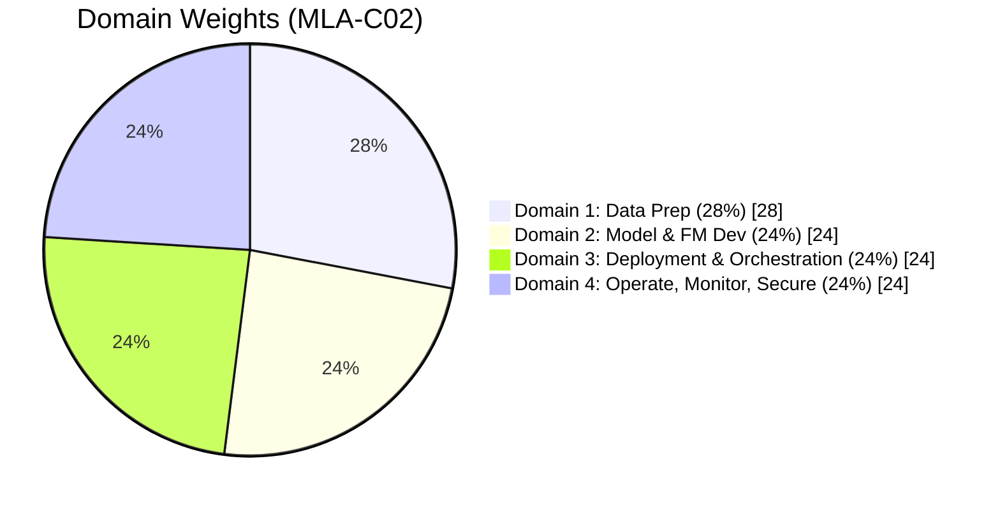
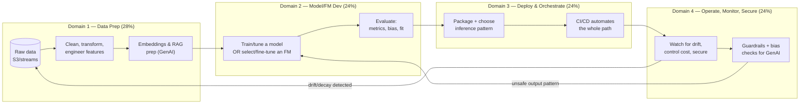

# MLA-C02 — AWS Certified Machine Learning Engineer – Associate

*Official AWS certification badge artwork for this exam. Source: AWS Certification —
aws.amazon.com/certification/.*

> **Exam transition:** MLA-C01 retired (English) Sept 28, 2026. **MLA-C02** entered beta
> Sept 29, 2026 and goes **GA Jan 14, 2027** — adding generative AI (Bedrock, RAG, fine-tuning
> foundation models, agents, AI cost monitoring) throughout all 4 domains. This repo targets
> MLA-C02. Where the official C02 guide isn't fully public yet, content is based on the
> confirmed C01→C02 domain mapping plus publicly announced additions; flagged inline where still
> provisional.

## Plain-English: what is this certification actually testing?

Think of MLA-C02 as answering one question over and over, in different disguises: **"given this
business problem and these constraints, which AWS ML/AI service — and which specific
configuration of it — is the right tool, and why?"** It is not a math exam (you will not be
asked to compute a gradient by hand), and it is not a coding exam (you will not be asked to
debug a Python traceback). It is a *decision-making* exam: you're handed a scenario (a company,
a dataset, a latency requirement, a compliance constraint) and asked to pick the AWS service,
inference pattern, or operational control that fits. Every document in this repo is organized
around making that decision-making skill concrete — plain-English grounding for every term,
then the AWS service mapping, then worked scenarios that mirror the exam's own question style.

## Exam Overview

| | |
|---|---|
| Who it's for | ML engineers who build, operationalize, deploy, and maintain ML/AI solutions and pipelines on AWS |
| Question types | Multiple choice & multiple response **only** (C01 also had ordering/matching/case studies — C02 simplified to MC/MR) |
| Number of questions | 65 (50 scored + 15 unscored, unlabeled — answer every question as if it counts) |
| Duration | 130 minutes |
| Passing score | 720 / 1000 (AWS standard scale; this is a scaled score, not "72%" — AWS does not publish the raw-to-scaled conversion) |
| Cost | $150 USD (standard AWS associate pricing) |
| Prerequisites | None formally required, but 1+ years of hands-on ML/AWS experience is AWS's stated recommendation |
| Official guide (C01, superseded) | https://d1.awsstatic.com/training-and-certification/docs-machine-learning-engineer-associate/AWS-Certified-Machine-Learning-Engineer-Associate_Exam-Guide.pdf |
| Official exam page | https://aws.amazon.com/certification/certified-machine-learning-engineer-associate/ |

## What's new vs MLA-C01

| Domain | C01 | C02 |
|---|---|---|
| 1 | Data Preparation for ML (28%) | Data Preparation for ML **and AI** (28%) — adds embeddings, RAG data prep |
| 2 | ML Model Development (26%) | ML Model **and Foundation Model** Development (24%) — adds FM selection, fine-tuning |
| 3 | Deployment and Orchestration of ML Workflows (22%) | Deployment and Orchestration of ML **and AI** Workflows (24%) — adds Knowledge Bases, agents |
| 4 | ML Solution Monitoring, Maintenance, and Security (24%) | **Operating**, Monitoring and Securing ML and AI Solutions (24%) — adds Guardrails, GenAI cost monitoring |

The net effect of these changes is a single theme: **C02 assumes you also have to build, deploy,
and operate generative AI systems, not just classic supervised-learning models.** Every domain
grew a GenAI-shaped task statement; none of the classic-ML task statements were removed. If you
studied C01 content already, nothing you learned is wasted — you're adding a layer, not
replacing one.

Domain 1 is deliberately the heaviest — the exam's design philosophy is that most real-world ML
failures trace back to a data problem, not an algorithm problem, so it tests that belief
directly by weighting data preparation above every other domain.

## Domains & Weights (C02)

| # | Domain | Weight | Folder |
|---|---|---|---|
| 1 | Data Preparation for ML and AI | **28%** | [`domain-1-data-preparation/`](domain-1-data-preparation) |
| 2 | ML Model and Foundation Model Development | **24%** | [`domain-2-model-development/`](domain-2-model-development) |
| 3 | Deployment and Orchestration of ML and AI Workflows | **24%** | [`domain-3-deployment-orchestration/`](domain-3-deployment-orchestration) |
| 4 | Operating, Monitoring, and Securing ML and AI Solutions | **24%** | [`domain-4-monitoring-security/`](domain-4-monitoring-security) |

## How the four domains fit together — the full lifecycle

The four domains are not four independent topic areas to memorize in isolation — they are four
stages of one continuous lifecycle, and a large fraction of real exam difficulty comes from
scenario questions that quietly span two domains at once (e.g., "data drift was detected in
production" is a Domain 4 monitoring fact whose *fix* is a Domain 1/2/3 retraining action).

Reading this diagram top to bottom is literally the order the four domain folders in this repo
are meant to be read in, and the feedback arrows at the bottom are exactly the kind of
cross-domain scenario the exam likes to test — "a model's accuracy has been falling for weeks"
sounds like a Domain 4 monitoring fact, but the *correct answer* usually routes back into Domain
2 (retrain) or Domain 1 (the underlying data changed) rather than staying inside Domain 4 alone.

## Domain 1: Data Preparation for ML and AI (28%)

Ingest and store data (S3, EFS, FSx, Kinesis streaming) → transform (Glue, Glue DataBrew, EMR
Spark, SageMaker Data Wrangler) → feature engineering (SageMaker Feature Store) → data quality,
bias detection, class imbalance handling (splitting, shuffling, augmentation) → embeddings and
RAG data preparation (new for GenAI workflows).

**Plain-English one-liner:** everything that has to happen to raw, messy data before any model
or foundation model is allowed to touch it.

## Domain 2: ML Model and Foundation Model Development (24%)

Select algorithm/approach (SageMaker built-in algorithms, script mode w/ TensorFlow/PyTorch, vs.
selecting/fine-tuning a foundation model via Bedrock/SageMaker JumpStart) → train and tune
(epochs, batch size, early stopping, distributed training, hyperparameter tuning — random
search/Bayesian) → evaluate (metrics selection, bias detection, overfitting diagnosis) → manage
model versions (SageMaker Model Registry).

**Plain-English one-liner:** turning prepared data into a working model — whether that means
training one from a blank slate or adopting and lightly adjusting one someone else already built.

## Domain 3: Deployment and Orchestration of ML and AI Workflows (24%)

Choose deployment infra (real-time / serverless / asynchronous / batch transform endpoints,
CPU vs GPU, SageMaker Neo for edge) → containerize (ECR, custom containers) → IaC (CloudFormation,
CDK) → auto scaling endpoints → CI/CD for ML (CodePipeline/CodeBuild/CodeDeploy, SageMaker
Pipelines, EventBridge-triggered retraining) → GenAI orchestration (Bedrock Knowledge Bases,
agents).

**Plain-English one-liner:** getting a finished model to actually answer real requests in
production, reliably, and automating the whole path so it doesn't require a human to babysit
every release.

## Domain 4: Operating, Monitoring, and Securing ML and AI Solutions (24%)

Monitor model/data/infra health (SageMaker Model Monitor for drift, X-Ray for latency, Inference
Recommender for right-sizing) → cost optimization (Spot/On-Demand/Reserved, SageMaker Savings
Plans, Cost Explorer/Budgets) → security (IAM least privilege, VPC isolation, KMS encryption,
Bedrock Guardrails for content filtering).

**Plain-English one-liner:** keeping a live model healthy, affordable, and safe long after launch
day — because a model that was great on day one silently rots if nobody watches it.

## Study order

1. [`00-fundamentals/`](../../00-fundamentals) and ideally SAA-C03 (networking/security/storage
   vocabulary this cert assumes) and DVA-C03 Domain 3 (CI/CD — ML pipelines reuse it)
2. Domain 1 (you can't model what you haven't prepared)
3. Domain 2 (the actual ML/FM work)
4. Domain 3 (getting the model into production)
5. Domain 4 (keeping it healthy, cheap, and secure once it's live)

This order mirrors the lifecycle diagram above deliberately — studying domains out of this order
(e.g., jumping to Domain 4's cost-optimization content before understanding what a SageMaker
Training Job or endpoint even is from Domain 2/3) makes every "why does this cost lever exist"
explanation land as memorized trivia instead of an obvious consequence of the system you already
understand.

### A realistic weekly study plan (6 weeks, adjustable)

| Week | Focus | What "done" looks like |
|---|---|---|
| 1 | `00-fundamentals/` + SAA-C03 review | Comfortable with S3, IAM, VPC, EC2 vocabulary without looking anything up |
| 2 | Domain 1 — classic data prep | Can explain Glue vs. Data Wrangler vs. Feature Store from memory |
| 3 | Domain 1 — embeddings/RAG + Domain 2 start | Can explain chunking/embeddings and epoch/overfitting without notes |
| 4 | Domain 2 — training, tuning, FM selection | Can diagnose overfitting vs. underfitting from two numbers alone |
| 5 | Domain 3 — deployment, CI/CD, GenAI orchestration | Can match a traffic pattern to the correct inference option instantly |
| 6 | Domain 4 — monitoring, cost, security, responsible AI + full practice exam | Score consistently above 80% on `practice-questions/` before sitting the real exam |

## Common exam-day pitfalls (cross-domain)

These aren't tied to one domain — they're failure patterns that show up regardless of which
domain a question is nominally testing:

1. **Picking "SageMaker" as an answer when the question wants a specific sub-service.** The
   exam consistently rewards precision — "Feature Store," not "SageMaker," "Model Registry," not
   "SageMaker," etc.
2. **Defaulting to RAG for every GenAI customization question.** If the scenario describes
   teaching a new *format/tone/behavior* rather than new *facts*, the answer is fine-tuning, not
   RAG — see Domain 1's `embeddings-and-rag-data-prep.md` and Domain 2's README.
3. **Confusing data drift with concept drift.** Both are Domain 4 territory but have different
   detection mechanisms and different urgency; see Domain 4's README.
4. **Treating "accuracy" as always the right metric.** On an imbalanced-class scenario, accuracy
   is very often the deliberately-planted wrong answer; see Domain 2's `ml-fundamentals-glossary.md`.
5. **Forgetting that real-time endpoints bill continuously, whether idle or not.** This exact
   fact is the hinge of a large number of "most cost-effective option" questions across Domains
   3 and 4.
6. **Assuming Floci (this repo's local AWS emulator) can run everything.** It emulates
   control-plane APIs only — it does not run real SageMaker training/inference or Bedrock
   inference. Every domain's `labs.md` spells out the real, free/cheap alternative for the parts
   Floci can't cover.

## Status

🚧 Actively expanded — domain folders now contain full-depth topic docs (README, dedicated
topic docs, and hands-on labs) for all four domains, kept current as the official C02 exam guide
finalizes ahead of Jan 2027 GA. See each domain's `README.md` for its own task-statement mapping
table and linked service docs under `services/machine-learning-ai/` and `services/analytics/`.

## Related repo-wide resources

- [`services/machine-learning-ai/`](../../services/machine-learning-ai) — the full depth on every
  SageMaker sub-service, Bedrock, Amazon Q, and JumpStart referenced throughout all four domains.
- [`services/analytics/`](../../services/analytics) — Glue, Kinesis, Athena, EMR, OpenSearch, and
  data-lake concepts that Domain 1 leans on heavily for ingestion and transformation.
- [`practice-questions/`](practice-questions) — domain-by-domain practice questions with
  explanations, the single best signal for whether you're actually exam-ready yet.
- [`glossary/README.md`](../../glossary/README.md) — the repo-wide cross-cutting term index.
