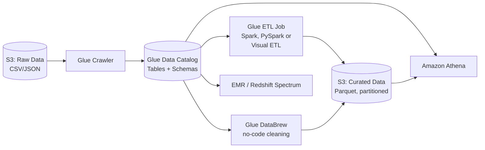
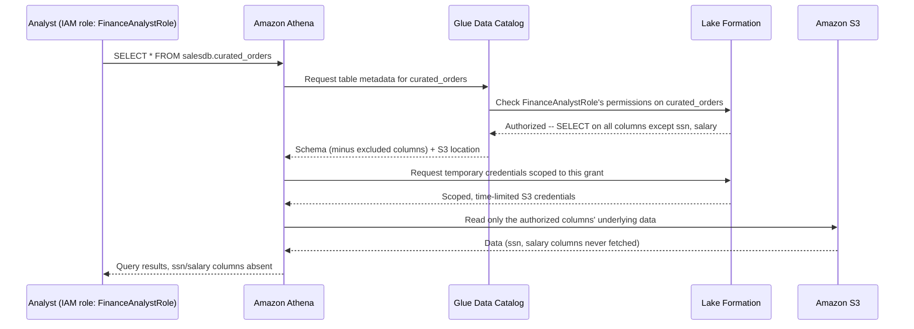
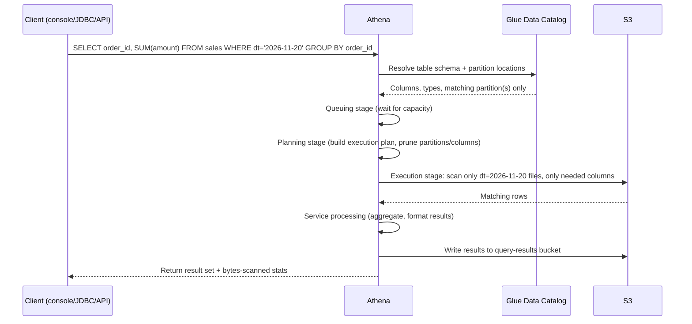
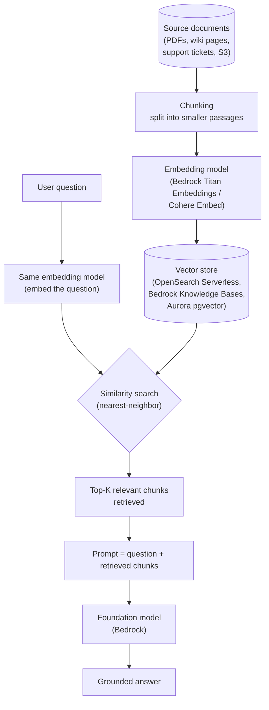
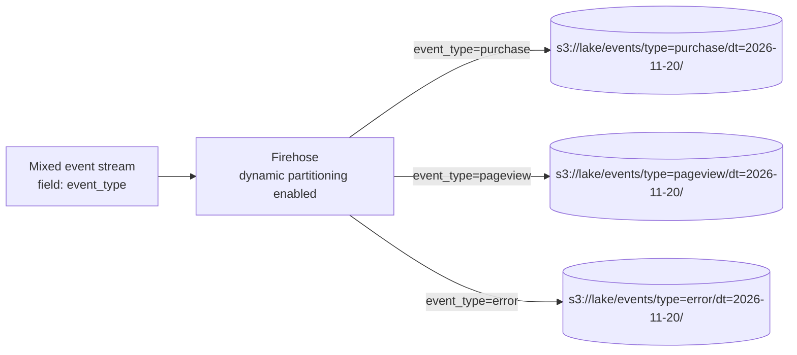
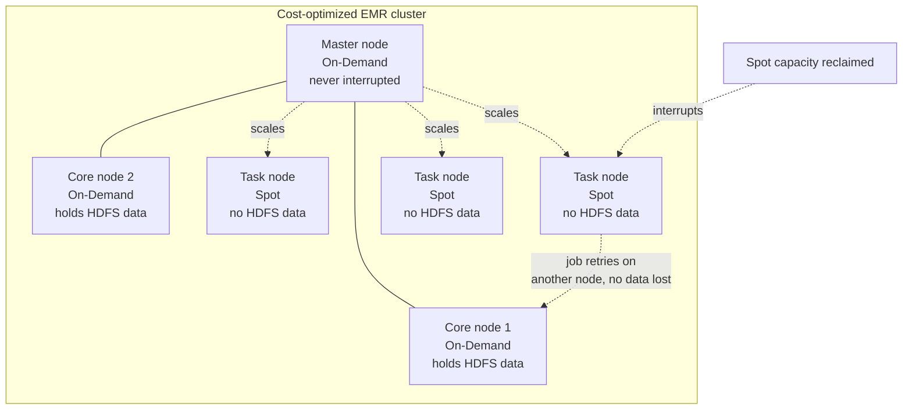
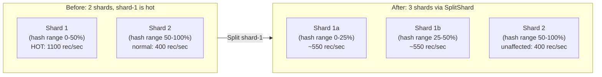
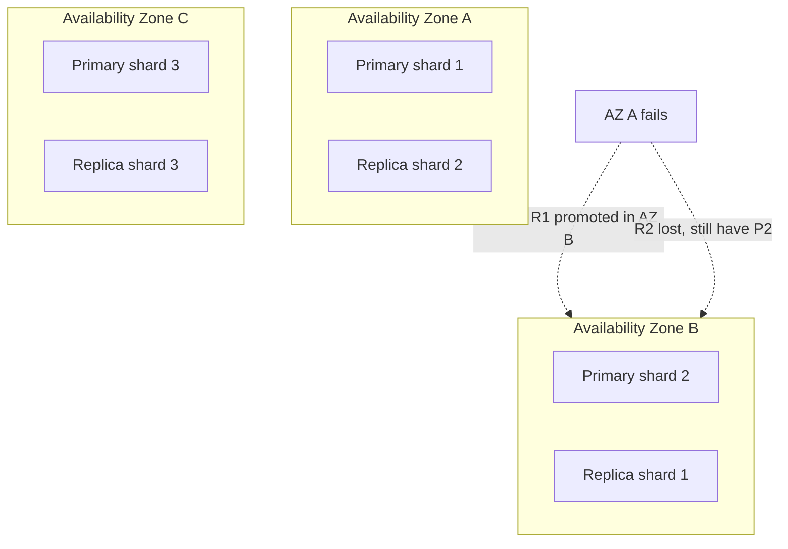
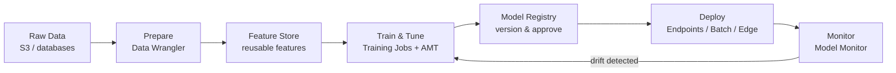
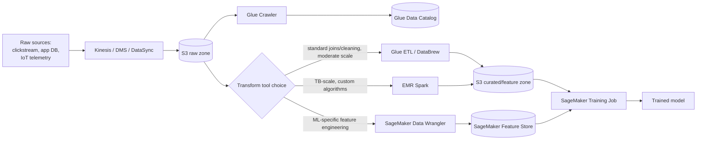

# MASTER CHUNK — Domain 1: Data Preparation for ML and AI (28%) — All 11 Services, Full Depth

*MLA-C02 · This single file is designed to be read standalone — printed, dropped into another
tool, or studied with no other file open — and still cover every service and concept in Domain 1
at full exam depth. If you've already read this domain's `README.md`,
`embeddings-and-rag-data-prep.md`, `feature-engineering-deep-dive.md`,
`class-imbalance-and-bias-in-training-data.md`, and `multimodal-data-ingestion-patterns.md`, this
document will feel repetitive by design — it exists for the reader who wants exactly one file,
not six, and for spaced-repetition review the week before the exam.*

## How to use this document

Each of the eleven sections below follows the exact same template, so you can jump to any one
service and get everything you need without flipping elsewhere:

1. **Definition** — what it actually is, in one or two precise paragraphs.
2. **Plain-English Analogy** — a non-technical mental model.
3. **Purpose** — why AWS built it; what problem existed before it.
4. **When to Use** — the scenario shape that should make you reach for this service.
5. **When NOT to Use** — the scenario shape that should make you reach for something else.
6. **Use Cases** — four to six concrete, named business scenarios with the tradeoff spelled out.
7. **Why Important** — real-world stakes plus exam weight.
8. **Mermaid diagram, explained** — at least one diagram with a step-by-step walkthrough.
9. **Real AWS image, discussed** — a curl-verified, live AWS documentation image with discussion
   of what it shows and why it matters.
10. **Exam Tips** — two to three sharp, test-day-useful statements.

The eleven services/topics, in the order the official MLA-C02 exam guide's task statements
introduce them for Domain 1 (Data Preparation for ML and AI, 28% exam weight — the single
heaviest-weighted domain on the exam):

1. [AWS Glue](#1-aws-glue)
2. [AWS Lake Formation](#2-aws-lake-formation)
3. [Amazon Athena](#3-amazon-athena)
4. [Amazon Bedrock](#4-amazon-bedrock)
5. [Amazon Data Firehose](#5-amazon-data-firehose)
6. [Amazon EMR](#6-amazon-emr)
7. [Kinesis Family (Data Streams, Firehose, Managed Service for Apache Flink)](#7-kinesis-family)
8. [Amazon OpenSearch Service](#8-amazon-opensearch-service)
9. [SageMaker Overview](#9-sagemaker-overview)
10. [Data Lake Concepts](#10-data-lake-concepts)
11. [SageMaker Data Wrangler & Feature Store](#11-sagemaker-data-wrangler--feature-store)

A single mental thread ties all eleven together, worth holding in mind throughout: **every one
of these services exists at some point along the path from "raw data arrives somewhere" to "a
model or foundation model has exactly the shaped, clean, governed input it needs."** Some handle
ingestion (Kinesis Family, Data Firehose), some handle storage/governance (Data Lake Concepts,
Lake Formation), some handle transformation (Glue, EMR, Data Wrangler), some handle querying/
serving the result (Athena, OpenSearch), some handle the GenAI-specific half of this domain
(Bedrock), and one (SageMaker Overview) is the umbrella the ML-specific pieces live under. Keep
asking "which stage of this pipeline is being described" as you read an exam scenario, and the
right service usually falls out of that question alone.

---

## 1. AWS Glue

### Definition

AWS Glue is a **serverless data integration service**. It is really three connected tools under
one brand name: the **Data Catalog** (a shared, persistent metadata directory answering "what
tables and columns exist, and where"), **Glue ETL** (code-based or visual Apache Spark jobs that
transform data at scale), and **Glue DataBrew** (a no-code, point-and-click tool for cleaning and
normalizing data). None of the three requires you to provision, patch, or scale a server.

### Plain-English Analogy

Picture a librarian who walks through a messy archive room (your S3 bucket) and writes an index
card for every shelf, describing exactly what's on it and in what format — that librarian is the
**Crawler**, and the index-card system is the **Data Catalog**. Once the index exists, a worker
(a **Glue ETL job**, running serverless Spark behind the scenes) can look up "where's the raw
sales data" on an index card, pull it, clean and reshape it, and put the finished product on a
different shelf. **DataBrew** is a separate workbench next to the archive room where someone who
has never programmed can point-and-click to clean a box of files without ever touching code.

### Purpose

Raw data almost never arrives ready to analyze — it's scattered across S3 prefixes, databases,
and file formats, with inconsistent schemas, missing values, and no shared catalog of what exists
where. Before Glue, turning that mess into clean, queryable data meant provisioning your own
Hadoop/Spark cluster, hand-writing schema-discovery code, and hiring someone who understood Spark
internals just to clean a CSV. Glue exists to make that transformation a matter of configuration,
not infrastructure engineering — the "glue" between where data lands and where it's usable.

### When to Use

Reach for Glue when a scenario describes a **repeatable, scheduled transformation** (nightly ETL,
a recurring cleaning job) that should run with **zero cluster management**, when **multiple query
engines** (Athena, EMR, Redshift Spectrum) need to **agree on one schema**, or when an **analyst
without Spark/Python skills** needs a visual, point-and-click way to clean data (DataBrew).

### When NOT to Use

Skip Glue when the real need is: **heavy, highly customized distributed compute** with fine
control over cluster size, Spot mix, or non-Spark big-data tools like Hive/HBase/Presto (that's
**EMR**); a **one-off ad-hoc SQL query** against data already sitting in S3 with no repeatable
pipeline to build (that's **Athena** directly); or a **trivial, infrequent transform** (rename a
column, light filtering) where even serverless Spark workers are overkill (a **Lambda** function
triggered by an S3 event is cheaper and simpler).

### Use Cases

1. **Nightly ETL for daily reporting** — a retailer's raw sales exports land in S3 every night
   and must be clean, partitioned Parquet by morning. A scheduled Glue ETL job with job
   bookmarks (so only new files are reprocessed) is the fit — pay-per-run, no idle cluster.
2. **Shared schema catalog across engines** — a data platform team wants Athena, EMR, and
   Redshift Spectrum to agree on one table definition instead of three teams maintaining three
   schemas that silently drift. The Glue Data Catalog is the fit by design.
3. **Analyst-driven cleaning, no engineers involved** — a business analyst needs to dedupe and
   standardize a messy CSV export with no Spark/Python experience. Glue DataBrew's point-and-click
   recipes are the fit; reaching for code-based ETL here would be unnecessary engineering overhead.
4. **Automatic schema discovery for an evolving lake** — new daily S3 partitions arrive and
   nobody wants to hand-write `ALTER TABLE ADD PARTITION` for each one. A scheduled Glue Crawler
   is the fit when the naming scheme isn't fully predictable (partition projection is the better
   answer when it is).
5. **ML training data preparation** — a data science team needs deduplication, null handling,
   and format conversion on raw clickstream data before SageMaker ever sees it. Glue ETL/DataBrew
   is the standard general-purpose "data prep" layer feeding that pipeline.
6. **Data-quality gating before a dashboard sees bad numbers** — a finance team keeps getting
   burned by null-filled or duplicated rows reaching QuickSight. Glue Data Quality rules embedded
   in a scheduled job catch this *before* promotion to the curated zone, not after.

### Why Important

**Real-world:** most "the dashboard numbers look wrong" incidents trace back to inconsistent
schemas or uncleaned data — Glue's catalog-first design (one schema, many consumers) is exactly
what prevents Athena and Redshift from silently disagreeing about what a column means. Serverless
billing also means nobody pays for an idle Spark cluster between nightly runs. **Exam:** Glue sits
at the center of Domain 1's Task 1.2 ("Transform data and perform feature engineering") and is
one of the most frequently named services across the whole exam guide — expect to be tested on
choosing DataBrew (no-code) vs. Glue ETL (code-based) vs. SageMaker Data Wrangler (ML-specific)
for a given scenario, not just recognizing Glue's existence.

### Mermaid Diagram, Explained



Walking this left to right: raw CSV/JSON files land in S3 untouched. A **Crawler** scans that
prefix, infers schema (column names, types, partition structure), and writes a table definition
into the **Data Catalog** — this is the only step that "discovers" anything; nothing downstream
re-derives schema on its own. From there, two parallel transformation paths both read from the
same catalog entry: a **Glue ETL job** (engineer-driven, Spark-based) or **Glue DataBrew**
(analyst-driven, visual, no code) — either can produce the same destination, **curated Parquet in
S3**, and whichever path you pick, the output gets re-registered in the catalog too. The payoff of
this whole shape is the three arrows converging on the Data Catalog from **Athena**, **EMR**, and
**Redshift Spectrum** at the bottom: all three query engines read the *same* schema, defined once,
so there is no "Athena's version of the schema disagreeing with EMR's version" failure mode.

### Real AWS Image, Discussed


*Source: AWS Glue Developer Guide, "AWS Glue concepts" —
docs.aws.amazon.com/glue/latest/dg/components-key-concepts.html. Verified live via `curl -o
/dev/null -w "%{http_code}"` → `200`.*

This is AWS's own canonical architecture diagram for Glue, and it shows the identical shape the
Mermaid diagram above describes, drawn by the service team itself: **data stores** (your S3
buckets, JDBC databases, DynamoDB tables) feed **crawlers**, crawlers populate the **Data
Catalog**, and **ETL jobs** read from and write back through that same catalog to **data
targets**. The reason this image is worth pausing on rather than skimming past: it visually
confirms there is exactly **one** central catalog object in the whole picture, not one catalog per
consumer — a detail easy to state in prose but easy to forget under exam time pressure when a
question describes "Athena's schema" as if it were something separate from "the Glue Crawler's
schema." They are the same object.

### Exam Tips

- **Glue vs. EMR** is the headline confusion. "Serverless," "minimal operational overhead,"
  "scheduled/repeatable ETL" → Glue. "Full control over cluster configuration," "need Hive/HBase/
  Presto specifically" → EMR.
- The **Data Catalog is shared** — a classic trap implies Athena needs its own separate schema
  definition; it reads the exact same catalog EMR and Redshift Spectrum use.
- **Crawlers cost money and time** — running one on every single file upload instead of on a
  schedule (or using partition projection/manual `ADD PARTITION`) is a frequent cost-optimization
  wrong-answer bait across both SAA-C03 and MLA-C02.

### Worked Exam Scenario

A data engineering team runs a Glue Crawler against an S3 prefix receiving 50,000 tiny JSON
files per day, and the crawler now takes 40 minutes and frequently times out. Walk the actual
root cause before jumping to a fix: a crawler's runtime scales with the number of *files and
partitions* it has to inspect, not total data volume — 50,000 tiny files is a files-count problem,
not a bytes problem. The two legitimate fixes, in order of preference: (1) a scheduled **Glue ETL
job with `.coalesce()`** compacting small files into fewer, larger ones on a recurring basis,
attacking the root cause; (2) if compaction isn't immediately possible, **partition projection**
or a narrower crawler include path can reduce what any single crawler run has to inspect. The
wrong-answer distractor is "increase the crawler's DPU allocation" — crawlers don't expose a DPU
dial the way ETL jobs do, and even if they did, more compute doesn't fix a per-file metadata
overhead problem.

### Quick Facts

- **Billing unit**: Glue ETL and Crawlers both bill per **DPU-hour**, by the second, with a
  1-minute minimum per run — there is no idle-cluster cost between scheduled runs.
- **Data Catalog**: first 1 million objects stored and first 1 million access requests/month are
  free; beyond that, a small per-object/per-request fee applies.
- **Worker types**: G.1X (4 vCPU/16 GB), G.2X (8 vCPU/32 GB — double memory at the same vCPU
  ratio), G.4X/G.8X for heavier jobs, and G.025X for lightweight Python Shell-style jobs — picking
  G.2X over "more G.1X workers" is the fix specifically for shuffle-spill/memory-pressure
  symptoms, not raw CPU-bound slowness.
- **Job bookmarks** are the default fix whenever a scenario describes a scheduled incremental job
  reprocessing all historical data on every run instead of just new files.

---
## 2. AWS Lake Formation

### Definition

AWS Lake Formation is a managed service that centralizes **fine-grained permissions** for a data
lake — database-, table-, column-, row-, and even cell-level access control — enforced
*consistently* across every integrated query engine (Athena, Redshift Spectrum, EMR, Glue,
QuickSight, SageMaker) that reads the same Glue Data Catalog. You define who-can-see-what
**once**, in Lake Formation, and every integrated engine automatically enforces that grant.

### Plain-English Analogy

IAM and S3 bucket policies alone are a building's front-door lock: you're either let into the
building or not. That's fine for coarse access control, but it has no native concept of "you may
enter the building, but inside the finance department's filing cabinet, you may only read every
drawer except the one labeled HR." Lake Formation is the finer internal lock system layered on top
— it checks a granular grant at query time, before any engine touches the underlying S3 data at
all.

### Purpose

Before Lake Formation, securing a data lake meant stacking S3 bucket policies and IAM policies
across every service touching it — Athena, Glue, EMR, and Redshift Spectrum each needing their
own correctly-written, kept-in-sync policy, with no native way to express "let this analyst see
every column except `ssn` and `salary`" or "let this regional manager only see EU rows." AWS built
Lake Formation specifically to add a database-like, fine-grained permissions layer on top of the
Glue Data Catalog, so governance could be expressed the way a data administrator actually thinks
about it — grant SELECT on these columns of this table to this role — instead of awkwardly
translated into bucket-prefix and API-action policies.

### When to Use

Reach for Lake Formation when a scenario names **column-level**, **row-level**, or **tag-based**
access control; when **multiple engines** (Athena *and* EMR *and* Redshift Spectrum) must enforce
the **same restriction identically**; or when **cross-account sharing** of specific
databases/tables is needed without duplicating the underlying data.

### When NOT to Use

Skip it for a **small, single-team lake** where plain IAM + S3 bucket policies are genuinely
sufficient (no need for anything finer than prefix-level access); when the data **isn't in S3/the
Glue Data Catalog at all** (a pure DynamoDB or RDS access-control problem is a plain IAM/database-
native-permissions problem, not a Lake Formation one); or for **row-level security inside a
traditional warehouse** (Redshift's own native row-level security operates inside the warehouse
directly, not through Lake Formation).

### Use Cases

1. **Multi-team data mesh with column-level sensitivity** — several business units share a
   catalog, but only finance should see salary/SSN columns in an otherwise broadly-readable
   employee table. Column-level grants avoid maintaining duplicate "redacted" and "full" table
   copies that could drift out of sync.
2. **Regional data residency/visibility** — a global retailer's regional managers should each see
   only their own region's rows in one shared `orders` table. Row-level data filters avoid
   multiplying the table (and every ETL job feeding it) by region count.
3. **Governed cross-account sharing without duplication** — a platform team owns a curated
   `shared_metrics` table three other accounts need read access to, without copying the data.
   Cross-account grants via AWS Resource Access Manager (RAM) are the fit.
4. **Scaling governance across hundreds of tables** — a large org's catalog has grown past the
   point where naming an individual grant per table per team is sustainable. LF-TBAC (tag-based
   access control) tags tables and roles once; grants follow automatically as new matching tables
   appear.
5. **Rapid bootstrap of a governed lake from a legacy database** — a team migrating off an
   on-prem database wants a working, cataloged, governed lake quickly. A Lake Formation
   **blueprint** (Database snapshot/incremental, or Log file) auto-generates the Glue Workflow.
6. **Preventing a restriction bypass by switching tools** — security needs certainty that a
   column-level restriction enforced in Athena can't be circumvented by the same analyst opening
   an EMR notebook under the same IAM role. Lake Formation's credential-vending model enforces the
   restriction *below* any single engine's own access logic, by design.

### Why Important

**Real-world:** the single most common cause of a data lake turning into an unusable "data swamp"
isn't a storage problem — it's a governance problem: nobody can confidently say who can see what
across a growing set of tools and teams. Lake Formation makes that answerable in one place,
enforced automatically everywhere. **Exam:** this is the named answer for Domain 1 Task 1.3
("ensure data integrity... bias, compliance") whenever access governance over sensitive training
data columns is the actual ask — a question describing "write more detailed, separate IAM
policies per service" as the fix for a fine-grained, multi-engine requirement is testing whether
you recognize Lake Formation as the centrally-enforced, correct alternative instead.

### Mermaid Diagram, Explained



The step that makes this mechanism actually binding, not just advisory, is the **fifth and sixth**
message: Athena doesn't go straight to S3 using its own IAM role's permissions — it has to ask
Lake Formation for **temporary, scoped credentials** first, and Lake Formation hands back
credentials limited to exactly what was granted, regardless of how broad Athena's *own* underlying
IAM role might otherwise be. This is **credential vending**, and it's the specific reason an
analyst can't bypass a column-level restriction by switching from Athena to an EMR notebook using
the same role — the restriction lives at this handoff point, which every integrated engine must
pass through, not inside any single engine's own access-control logic.

### Real AWS Image, Discussed


*Source: AWS Lake Formation Developer Guide, "How it works" —
docs.aws.amazon.com/lake-formation/latest/dg/how-it-works.html. Verified live via curl → `200`.*

AWS's own diagram shows the exact same "get metadata → check permissions → get credentials → get
data" sequence as the Mermaid diagram above, confirming this isn't a simplification this repo
invented — it's the documented, official mechanism. A second official image worth knowing about by
name even without reproducing it here is the Lake Formation + QuickSight architecture diagram
(docs.aws.amazon.com/quick/latest/userguide/images/lake-formation-architecture-drawing-1.png,
also verified `200`), which shows Lake Formation governing access for a QuickSight dashboard
querying through Athena against Glue Data Catalog tables — a concrete, applied instance of the
same abstract workflow, replacing a patchwork of per-service IAM/S3 policies with one centrally
managed grant model.

### Worked Exam Scenario

"A hospital network's data platform team has one shared `patient_records` table in the Glue Data
Catalog. Clinicians need full access to treat patients; the billing department needs access to
insurance/billing fields but not clinical notes; and an external research partner (a different
AWS account) needs access to a de-identified subset of rows for an approved study — all querying
through a mix of Athena and EMR." Walk the three requirements against Lake Formation's grant
types: clinicians get a broad table-level `SELECT` grant; billing gets a **column-level** grant
naming only the billing-relevant columns (excluding clinical notes entirely, not just hiding them
in a UI); the research partner gets a **row-level data filter** (e.g., `study_consent = true`)
combined with a **cross-account grant via RAM**, so the partner account sees only consented rows
of only the table it's been granted, without the data ever being copied into their account. All
three grants are enforced identically whether the query runs through Athena or an EMR notebook,
because credential vending — not any single engine's own access logic — is what's actually
checking the restriction.

### Quick Facts

- **No separate Lake Formation service charge** — you pay for the underlying Glue Data Catalog
  storage/requests, S3 storage, and query engine compute (Athena/EMR/Redshift Spectrum) it
  coordinates; the control plane itself is free.
- **Blueprints** generate standard Glue Workflows (crawler + import job) under the hood, billed at
  normal Glue DPU-hour rates — no additional charge for the blueprint convenience layer itself.
- **Cross-account sharing** requires either AWS Organizations membership or an explicit RAM
  resource share — it does not work automatically between two arbitrary, unrelated accounts.
- A soft, raisable limit exists on **permission grants per principal/resource** — very large,
  deeply nested data-mesh setups should favor LF-TBAC tag-based grants over many individual named
  grants as table count grows.

### Exam Tips

- **Fine-grained permissions enforced identically across multiple engines** is Lake Formation's
  signature — a question naming more than one engine (Athena *and* EMR, say) needing consistent
  enforcement points here, not at per-service IAM policies.
- **Lake Formation sits on top of the Glue Data Catalog — it does not replace it.** A question
  implying Lake Formation is a separate catalog or storage system is wrong.
- **Credential vending is what makes a grant actually binding** — remember an engine's own
  underlying IAM role can be broader than what Lake Formation ultimately hands it per query; this
  is exactly why switching engines doesn't bypass a restriction.

---

## 3. Amazon Athena

### Definition

Amazon Athena is a **serverless, interactive query service** that runs standard SQL directly
against data sitting in S3 — no database to load data into first, no servers to provision, no
cluster to manage. You point it at files (CSV, JSON, Parquet, ORC, Avro) and query them as if
they were already database tables, through the Trino/Presto engine running underneath.

### Plain-English Analogy

Imagine a librarian who, instead of making you check books out of the library first, lets you
walk in, point at any shelf, and ask a question about what's on it — she reads only the relevant
pages, answers your question, and charges you for exactly the pages she had to read. Athena
doesn't store or move your data; it reads straight from S3 using the schema the Glue Data Catalog
already has on file, runs the query, and returns results — you pay per byte scanned, not for a
standing database.

### Purpose

Before Athena, querying data sitting in S3 meant first loading it into a database or warehouse —
a whole ETL step just to ask one question. AWS built Athena so analysts and engineers could query
data **in place**, the moment it lands in S3, paying only for the specific query run rather than
for a database sitting there 24/7 waiting to be asked something.

### When to Use

Reach for Athena when a scenario says **"ad-hoc," "infrequent," "serverless,"** or **"query data
in S3 without moving it."** It's also the right lightweight tool for **data profiling before
training** — checking null rates, outlier counts, and category distributions — without spinning
up EMR or a SageMaker Processing job just to run exploratory `SELECT COUNT(*) ... GROUP BY`
queries.

### When NOT to Use

Skip Athena for **frequent, complex analytical queries at large scale with many concurrent
users** — a true data warehouse (**Redshift**) is more cost-predictable and faster, since it keeps
data pre-loaded and optimized rather than scanning S3 files per query. Athena is also **not a
transactional/OLTP database** — it cannot handle single-row inserts/updates at application
latency.

### Use Cases

1. **Incident investigation over log files** — a security team needs to query VPC Flow Logs for
   suspicious traffic during an active incident, right now, with nothing pre-provisioned. Athena
   fits because it's serverless and queries S3 directly; OpenSearch would cost money continuously
   between incidents for a need that only exists during them.
2. **One-off or infrequent analytical queries** — a finance analyst needs to answer "what were
   Q3 regional sales" exactly once. Athena's pay-per-query model is the fit over standing up
   Redshift for a question asked once a quarter.
3. **SQL layer over a curated data lake** — a company has partitioned Parquet in S3 from
   Glue/EMR and needs a SQL interface for both analysts and dashboards, with no database layer to
   stand up first.
4. **Federated queries across heterogeneous sources** — an analyst needs to combine data from
   RDS, DynamoDB, and CloudWatch Logs in one query without copying any of it anywhere; Athena's
   Lambda-based Query Federation connectors push filter predicates to each source first.
5. **ML data profiling before training** — a data scientist needs to check null rates, outliers,
   and row counts by category before deciding how to transform a dataset. Athena answers this
   fast, with zero new infrastructure, versus EMR/SageMaker Processing being significant overkill
   just to look at distributions.
6. **Fixing a slow, expensive unoptimized table in one step** — a team inherited a CSV-based
   table that's painfully slow and expensive to query. A CTAS (`CREATE TABLE AS SELECT`)
   statement converts both format and partition layout to Parquet in one shot.

### Why Important

**Real-world:** Athena is often the cheapest, fastest way to get a first answer out of a data
lake — incident investigation, cost analysis against billing data in S3, and lightweight
dashboards all lean on it without ever provisioning a database. **Exam:** in Domain 1, Athena
commonly appears as the tool used to explore/profile a dataset before deciding how to transform it
for ML — recognizing Athena as the right lightweight, serverless exploration tool (versus EMR/
SageMaker overkill) is the tested skill, alongside the classic cost-reduction pattern below.

### Mermaid Diagram, Explained



The single most important thing this sequence shows is **where partition pruning happens**: at
the **planning** stage, *before* any S3 scan occurs. That ordering is exactly why a well-
partitioned table can make an otherwise-expensive query nearly free — the planner simply never
requests the irrelevant files from S3 in the first place, rather than fetching everything and
discarding unneeded rows afterward. This is also why "add more compute" is never the right fix
for a slow/expensive Athena query (there's no compute to add — it's serverless); the actual lever
is reducing what gets scanned, via partitioning and columnar formats.

### Real AWS Image, Discussed


*Source: AWS Athena User Guide, "View statistics and execution details for completed queries" —
docs.aws.amazon.com/athena/latest/ug/query-stats.html. Verified live via curl → `200`.*

This is Athena's own console view of the queuing/planning/execution breakdown the sequence
diagram above describes — when a real query feels slower than expected, this is the first place
to look, because it separates "waiting for capacity" (queuing) from "actually reading files"
(execution), two very different root causes that a single "query took 40 seconds" headline number
hides.

### Worked Exam Scenario

"A team's Athena bill tripled last month with no change in query frequency. Investigating, every
query still names only three columns out of a 40-column table, and filters on a single day's
data out of two years of history." Walk the diagnosis: the described symptoms (narrow column
selection, narrow date filter) *should* produce cheap queries if the underlying table were
Parquet and partitioned by date — the fact that cost tripled with unchanged query patterns points
directly at the **storage layer**, not query behavior: either the source table is still raw CSV/
JSON (no columnar skip, so every column's bytes get scanned regardless of the `SELECT` list), or
it's unpartitioned (every day's data gets scanned regardless of the `WHERE` clause), or both. The
fix is a one-time **CTAS** statement converting the table to partitioned Parquet — not asking
users to write "more efficient SQL," since the SQL was already as selective as it could be against
an inefficiently-stored table.

### Quick Facts

- **Billing**: per TB of data **scanned**, not returned — a `SELECT *` with no `WHERE` clause on
  an unpartitioned table bills for the entire table regardless of how few rows come back.
- **Query result reuse** serves a recent, unchanged query's results from cache instead of
  re-scanning S3 — free of additional charge, but only helps for genuinely repeated queries, not
  varied ad-hoc ones.
- **Athena for Apache Spark** bills per **DPU-hour** while a session is active — a different cost
  model than standard SQL's per-TB-scanned billing, closer in spirit to Glue ETL billing.
- **Query timeout** is configurable per workgroup with an account-level ceiling — a runaway query
  against bad/malformed input is cut off rather than scanning (and billing) indefinitely.

### Exam Tips

- **Athena vs. Redshift**: "infrequent," "serverless," "query data in S3 without moving it" →
  Athena. "Data warehouse," "frequent BI queries," "many concurrent users" → Redshift.
- **Partitioning and Parquet directly cut cost** — a "reduce Athena cost" question is answered by
  "convert to Parquet and partition," never "add more compute" (there isn't any to add).
- **CTAS** is the go-to answer for "I have a slow/expensive unoptimized table and need a fast
  fix" — it converts format and partitioning in one statement, no separate Glue job required.

---
## 4. Amazon Bedrock

### Definition

Amazon Bedrock is AWS's fully managed service for using and customizing **foundation models** —
large pre-trained AI models from multiple providers (Anthropic, Meta, Mistral, Amazon's own Titan/
Nova family, and others) — through one consistent API, without provisioning a single GPU. In
plain terms: Bedrock is "foundation models as an API call." For Domain 1 specifically, Bedrock
matters as the **engine behind embeddings and Retrieval-Augmented Generation (RAG) data prep** —
the GenAI-era half of this domain, alongside the classic-ML half the other ten entries cover.

### Plain-English Analogy

A foundation model only knows what was in its training data, frozen at some cutoff date — it has
never read your company's internal wiki or yesterday's support tickets. Instead of re-teaching it
everything (expensive, slow, and has to be redone every time your documents change), RAG keeps
your documents in a searchable form and, at question time, hands the model only the relevant
excerpt — like giving an extremely well-read substitute teacher a one-page briefing right before
class instead of making them re-read the whole textbook.

### Purpose

Foundation models face a hard choice when they need facts outside their training data: retrain/
fine-tune (expensive, slow, redone every data change), paste everything into every prompt (doesn't
scale), or **RAG** — keep documents searchable and retrieve only what's relevant at question time.
Bedrock exists to make the "model call" half of that pattern (embeddings generation, the final
generation step, and increasingly the whole managed pipeline via **Knowledge Bases**) a
configuration choice rather than an infrastructure project, and to make foundation models
available without managing GPU fleets at all.

### When to Use

Reach for Bedrock whenever a scenario needs to **generate embeddings** from text/images for a
vector store, needs **grounded answers from private/current documents without retraining**
(RAG), or needs a **managed end-to-end RAG pipeline** (Knowledge Bases bundling chunking +
embedding + vector storage + retrieval). It's also the default whenever "use/customize a
foundation model without managing GPU infrastructure" is the ask.

### When NOT to Use

Skip Bedrock (specifically for data-prep purposes) when the actual need is **teaching a model a
new consistent output format/tone/persona** — that is fine-tuning, which changes model behavior,
not what facts it can access; RAG doesn't fix a format/behavior problem. Skip it entirely when the
underlying knowledge base is small enough to fit directly in a prompt (a few pages) — the
retrieval machinery adds complexity with no benefit if there's nothing meaningful to filter down.

### Use Cases

1. **Support chatbot grounded in frequently-changing documentation** — retraining a model weekly
   is impractical; RAG re-embeds only the changed sections as the manual updates.
2. **Legal/compliance answers that must cite their source** — RAG naturally preserves a pointer
   back to the retrieved chunk/document; fine-tuning gives no equivalent traceability mechanism.
3. **Reasoning about data created after the model's training cutoff** — RAG injects genuinely new
   facts at query time; fine-tuning can't efficiently keep injecting new facts on an ongoing basis.
4. **Multi-tenant SaaS chatbot isolation** — each customer's answers must be grounded only in that
   customer's own documents. Metadata filtering (e.g., `tenant_id`) on the vector store scopes
   every similarity search to the requesting customer's data only.
5. **Multimodal product search** — a shopper uploads a photo of a room and gets back visually
   similar furniture listings. Titan Multimodal Embeddings map both the photo and every listing
   photo into the same vector space, with zero text extraction involved.
6. **Teaching a model a strict, consistent output schema** (the "when NOT to use RAG" case made
   concrete) — an engineering team wants every response in a specific internal JSON schema
   regardless of what's asked. That's fine-tuning (or strict prompt engineering), not RAG.

### Why Important

**Real-world:** RAG is the dominant pattern for making generative AI useful on private/current
data without retraining cost, and getting chunking/embedding wrong (too-large chunks, mismatched
embedding models between indexing and querying, no metadata filtering) is one of the most common
reasons a real RAG system gives bad or leaky answers. **Exam:** this is explicitly called out as
new content differentiating MLA-C02 from its predecessor, sitting inside the heaviest-weighted
domain (28%) — expect several questions testing RAG-vs-fine-tuning-vs-prompting judgment and basic
vector-store/embedding vocabulary.

### Mermaid Diagram, Explained



This is the complete RAG indexing-plus-runtime pipeline in one picture. The indexing half (top
row, A→D) happens once per document and again only when a document changes: chunk, embed, store.
The runtime half (E→K) happens on every user question: embed the *same* way, find the nearest
stored vectors, assemble a prompt combining the question with the retrieved text, and let the
foundation model generate an answer grounded in that text. The single detail worth internalizing
hardest here: **the exact same embedding model** has to convert both the stored chunks (step C)
and the live question (step F) into vectors — if those two steps ever use different models or
different model versions, the resulting vectors don't live in a comparable numeric space, and
"nearest neighbor" search silently returns meaningless results without raising any error.

### Real AWS Image, Discussed


*Source: Amazon Bedrock User Guide, "How Amazon Bedrock knowledge bases work" —
docs.aws.amazon.com/bedrock/latest/userguide/kb-how-it-works.html. Verified live via curl →
`200`.*

This is AWS's own illustration of the indexing half described above — documents chunked,
converted to embeddings, written to a vector index while keeping a pointer back to the original
document. A companion image from the same page
(docs.aws.amazon.com/bedrock/latest/userguide/images/kb/rag-runtime.png, also verified `200`)
shows the runtime half: the user's query embedded with the same model, the index searched for
semantically similar chunks, and the retrieved context augmenting the prompt sent to the
foundation model. Seeing both halves as AWS's own diagrams (not just this repo's Mermaid
rendering) confirms the indexing/runtime split is the service's own documented mental model, not
a simplification layered on top for teaching purposes.

### Worked Exam Scenario

"A law firm's internal chatbot must answer questions using the exact text of client contracts,
cite the specific clause it drew from, and absolutely never let one client's answer surface
content from a different client's contracts — contracts are updated constantly as amendments are
signed." Walk the requirements against the decision tree: "answer from private, frequently
changing documents" → RAG, not fine-tuning (fine-tuning would need a full retraining run per
amendment, impossibly slow). "Must cite the specific clause" → RAG's natural retrieval pointer,
which fine-tuning has no equivalent for. "Never cross client boundaries" → **metadata filtering**
on the vector store, scoping every similarity search by `client_id` before it ever runs, not a
post-hoc filter applied to results after retrieval (which would already have touched the wrong
client's vectors). The complete answer: chunk contracts with metadata tags for `client_id` and
`matter_id`, embed with Titan Embeddings, store in OpenSearch or a Bedrock Knowledge Base, and
enforce the `client_id` filter as a mandatory, non-optional part of every query path.

### Quick Facts

- **Billing**: embedding models are billed per unit of input text processed (per 1,000 input
  tokens, model-dependent); vector storage costs depend on the chosen store (OpenSearch
  Serverless bills by OCU-hour; Knowledge Bases bills for underlying storage and embedding calls).
- **Re-embedding is incremental** — only changed documents need re-embedding after an update, a
  cost asymmetry that is the single biggest reason RAG beats fine-tuning economically for
  frequently-changing source material.
- **Embedding dimensionality** is fixed per model (e.g., 1,536 for a common Titan Embeddings
  output) — higher dimensionality captures more nuance but costs more storage/compute per
  comparison, a cost/accuracy tradeoff, not a free upgrade.
- A **full re-embedding of the entire corpus** is required after any embedding model version
  change — old stored vectors and newly-embedded queries are not comparable across versions.

### Exam Tips

- "Grounding answers in private/current documents without retraining" → RAG, every time.
  "Teaching the model a new output format/tone/style" → fine-tuning, not RAG.
- The **same embedding model must embed both stored documents and incoming queries** — a common
  wrong-answer trap mixes two different embedding models or model versions.
- **Metadata filtering** is the specific mechanism for multi-tenant data isolation in a shared
  vector store — "customer A must never see customer B's content" points here, not a separate
  vector store per customer (valid, but usually a more operationally expensive answer than the
  exam expects).

---

## 5. Amazon Data Firehose

### Definition

Amazon Data Firehose (formerly "Kinesis Data Firehose," renamed in 2024) is a fully managed
service that takes streaming data as it arrives and automatically delivers it — buffered,
optionally transformed, and batched — to a destination like S3, Redshift, OpenSearch, Splunk,
Snowflake, or an Apache Iceberg table, **without you writing or running any code or managing any
infrastructure**.

### Plain-English Analogy

Firehose is a conveyor belt loading dock that's always running: records arrive continuously,
Firehose holds them in a short buffer (by size or by time, whichever threshold hits first), and
the moment that buffer flushes, it writes a neatly-batched file to wherever you told it to
deliver. No one drives the forklift; you point it at a destination once and it keeps running on
its own, forever, with no consumer code to write.

### Purpose

Getting streaming data to land somewhere durable and queryable is an extremely common need that
doesn't actually require custom processing logic most of the time — "take these IoT events and
put them in S3 as Parquet, partitioned by hour" is a *delivery* problem, not a *compute* problem.
Before Firehose, satisfying that need meant running your own fleet of consumer applications
reading off a stream and writing batches to S3 by hand — buffering, retry, format-conversion, and
partitioning logic, all built and operated by you. Firehose exists to make "just deliver it,
reliably, close to real time, with zero ops" a configuration choice instead of an engineering
project.

### When to Use

Reach for Firehose when a scenario says **"no custom code," "fully managed," "zero
infrastructure,"** or needs **format conversion to Parquet** on the way into S3/Redshift/
OpenSearch. It's the correct Task 1.1 answer whenever raw ML training data needs to land in the
lake continuously with **no consumer code written at all**.

### When NOT to Use

Skip Firehose when the scenario needs **custom per-record processing logic** beyond simple
reshaping (complex stateful joins, windowed aggregation — that's Kinesis Data Streams with a
custom consumer, or Managed Service for Apache Flink); needs to **replay or reprocess historical
data** (Firehose has no replay mechanism once a batch is delivered — only Kinesis Data Streams'
retention window supports that); or needs **multiple independent consumers** reading the same data
for different purposes (one Firehose stream has exactly one destination).

### Use Cases

1. **Zero-code IoT telemetry landing in a data lake** — a sensor fleet just needs to land in S3
   as partitioned Parquet for later analysis, no per-record logic required. Format conversion plus
   dynamic partitioning does this with zero infrastructure to run.
2. **Centralized log shipping to a SIEM** — CloudWatch Logs subscription filters feed directly
   into a Firehose stream delivering to OpenSearch for search, with a parallel S3 backup for cheap
   long-term retention.
3. **Streaming ETL into a lake house table format** — continuous application events land in an
   Apache Iceberg table with ACID guarantees, so concurrent writers never produce a half-written
   read for a downstream query engine.
4. **ML training data lake ingestion** — raw event data destined to eventually train a model needs
   to land in S3 as Parquet, partitioned usefully for a later SageMaker Processing or Glue ETL job,
   with no custom ingestion code at the capture stage.
5. **WAF and VPC Flow Log analysis pipeline** — logs need to land somewhere queryable for a
   compliance audit trail without a team writing and operating custom log-shipping code.
6. **Migrating a legacy on-prem Splunk forwarder fleet to AWS** — Firehose's native Splunk
   destination (HEC-compatible) replaces self-managed forwarders entirely, removing the patch/
   scale/secure overhead that managed delivery exists to remove.

### Why Important

**Real-world:** a huge fraction of "get streaming data somewhere durable" requirements genuinely
don't need custom processing — they need reliable, managed delivery, and building that reliability
by hand (buffering, retry, format conversion, partitioning, backpressure) is a real engineering
project most teams shouldn't spend time on. **Exam:** Firehose appears across SAA-C03, DVA-C03,
and MLA-C02 — in Domain 1, "land raw data in S3 for later feature engineering, no custom code"
points here; "compute a feature in flight before storage" points past Firehose toward Data Streams
+ Flink or Feature Store's streaming ingestion instead.

### Mermaid Diagram, Explained



This is **dynamic partitioning**, worked concretely: a single Firehose delivery stream splits its
own output across multiple destination prefixes at delivery time, based on a field inside each
record, with no separate stream per partition value needed. A JQ-style expression against each
record's JSON extracts the partitioning key (here `event_type`) and routes it to the matching S3
prefix, buffering each partition independently. Downstream, a Glue Crawler run against the
top-level prefix discovers all three partitions as one logical table with `type` and `dt` as
partition columns — and an Athena query filtering `WHERE type = 'error'` scans only the matching
files, which is the entire reason to partition data this way in the first place.

### Real AWS Image, Discussed


*Source: AWS Developer Guide, "What is Amazon Data Firehose?" —
docs.aws.amazon.com/firehose/latest/dev/what-is-this-service.html. Verified live via curl →
`200`.*

This is the simplest of Firehose's destination-specific delivery paths: records buffer, optionally
pass through a transformation Lambda, and write directly to the target bucket, with an optional
simultaneous backup of the untransformed source records to a second bucket. Two companion
destination diagrams from the same page are worth knowing by name even without reproducing both
here: the Redshift path (fh-flow-rs.png, verified `200`) shows S3 as a **mandatory** intermediate
stop (Firehose writes to S3 first, then issues a `COPY` command), while the OpenSearch path
(fh-flow-es.png, verified `200`) shows data pushed **directly** to the cluster's ingest endpoint,
with S3 only as an *optional* parallel backup. The pattern across all three: S3 is either the
destination itself, a mandatory intermediate stop, or an optional parallel backup — never absent
from the picture entirely.

### Worked Exam Scenario

"An IoT platform ingests sensor telemetry from 50,000 devices and needs it landing in S3 as
Parquet, partitioned by device type and hour, with no custom consumer code — but the operations
team also notices records with a malformed `device_type` field have been silently disappearing
from the expected S3 prefixes for the past week." Walk the diagnosis: the ingestion design itself
(Direct PUT or Kinesis Data Streams source → Firehose → format conversion + dynamic partitioning
→ S3) is correct for the "no custom code" requirement. The "records disappearing" symptom is not
data loss in the sense of the exam's usual red herring — it means those specific records are
failing the **format conversion** step (their `device_type` doesn't match the Glue Data Catalog
schema used for Parquet conversion) and are being routed to the **error output S3 prefix**,
assuming one is configured. The fix is checking that prefix first, not assuming the records are
gone; if no error output location was configured, that omission (not Firehose itself) is the real
gap to close.

### Quick Facts

- **Billing**: per GB ingested, with volume-tiered pricing; format conversion and VPC delivery
  each add a small additional per-GB charge on top of base ingestion — no idle cost when no data
  is arriving.
- **Buffer size/interval**: S3 destinations support 1 MiB–128 MiB buffer size and 60–900 second
  buffer interval — delivery is inherently bounded by these, so "data appears a minute late" is
  expected behavior, not a bug, unless it vastly exceeds configured thresholds.
- **Record size limit**: up to 1,000 KB per record before any Lambda transformation; larger
  payloads must be split by the producer before calling `PutRecord`/`PutRecordBatch`.
- **Error record retry duration** is configurable up to a maximum window (commonly up to 7,200
  seconds) before Firehose gives up and routes a persistently-failing record to the error prefix.

### Exam Tips

- **The #1 trap: Firehose vs. Kinesis Data Streams.** "Custom processing logic," "multiple
  independent consumers," or "need to replay history" → Data Streams. "Just deliver it, no code,
  fully managed" → Firehose.
- **Firehose has no replay, full stop** — once a batch is delivered, it's delivered.
- **Redshift delivery always stages through S3 first** — a question describing Firehose
  delivering "directly" to Redshift with no S3 involved is describing something that doesn't
  happen.

---
## 6. Amazon EMR

### Definition

Amazon EMR (Elastic MapReduce) is a **managed big-data platform** that runs open-source
frameworks — Apache Spark, Hadoop, Hive, Presto/Trino, HBase, Flink, and others — on a cluster of
EC2 instances (or containers, or serverless) that AWS provisions, configures, and can scale for
you. It's "rent a big-data cluster by the hour, fully configured, without racking servers."

### Plain-English Analogy

EMR is a construction crew AWS assembles for you on demand. You tell it which tools you need
(Spark? Hive? Presto?) and how big a crew (instance types/counts), and it shows up with
everything pre-wired to talk to each other and to your data in S3. When the job's done, you send
the crew home (terminate the cluster) and stop paying — while the actual output stays safely in
S3, not on the crew's own trucks.

### Purpose

Running real Hadoop/Spark clusters used to mean buying physical servers, installing and patching
dozens of interdependent open-source components, and tuning them for weeks before a single job
ran reliably. AWS built EMR so a team can launch a correctly-configured, production-grade
big-data cluster in minutes, scale it for a big job and back down (or to zero) when done, and pay
only for what's running — while keeping the full, unrestricted open-source ecosystem available,
not a cut-down, AWS-only substitute.

### When to Use

Reach for EMR when a scenario needs **TB-scale or custom distributed algorithms** that exceed what
Glue's serverless model exposes; needs **Hive, Presto/Trino, or HBase specifically** (not just
generic Spark); or needs **GPU-accelerated large-scale preprocessing** for ML beyond a single
SageMaker Processing instance. EMR trades Glue's serverless simplicity for direct cluster control
when scale or custom tuning genuinely demands it.

### When NOT to Use

Skip EMR for a job that's "clean this data and land it somewhere, on a schedule, with no ops
burden" — **Glue** does the same transform with zero cluster management. Skip it for **ad-hoc SQL
on data already in S3** — **Athena** answers that directly with no cluster at all. Don't keep a
long-running cluster "just in case" for occasional jobs — that's paying for idle compute; use
**EMR Serverless** or launch-and-terminate transient clusters instead.

### Use Cases

1. **Petabyte-scale nightly Spark ETL** — a media company needs full control over executor memory
   tuning to avoid shuffle spill across 10TB/night of viewing logs; EMR exposes the real Spark
   configuration knobs Glue abstracts away.
2. **Workloads needing Hive, Presto/Trino, or HBase specifically** — a team migrating an on-prem
   Hadoop stack relies on HBase for low-latency key lookups alongside Hive for SQL; EMR is the
   fit because it's the full open-source ecosystem, not a curated subset.
3. **Cost-sensitive, fault-tolerant batch processing with Spot** — a genomics lab runs large,
   interruptible batch jobs overnight; EMR with Spot Task nodes (On-Demand Core/Master) is the
   textbook cost-optimization fit.
4. **GPU-accelerated large-scale ML preprocessing** — a computer vision team needs to preprocess
   millions of images with GPU-accelerated transforms before training, at a scale beyond a single
   SageMaker Processing instance.
5. **Large-scale ML feature engineering feeding SageMaker** — a recommendation system needs
   features computed across hundreds of GB to TB of user interaction history; EMR Spark writes
   engineered features to S3 for a SageMaker training job to consume directly.
6. **Container-standardized teams already running EKS** — an organization wants EMR Spark jobs
   running as pods inside existing Kubernetes infrastructure (EMR on EKS), sharing autoscaling and
   observability tooling already built once, rather than operating a separate EMR-native fleet.

### Why Important

**Real-world:** EMR is still the backbone of a huge share of real-world big-data pipelines at
scale — it's the honest "we actually need Spark/Hadoop/Presto, with real control" option when
managed/serverless tools don't fit. **Exam:** in Domain 1, "EMR Spark" is explicitly listed as a
transform-step tool alongside Glue and SageMaker Data Wrangler — expect scenario questions about
large-scale feature engineering or preprocessing that exceeds what a single SageMaker instance or
Glue job can efficiently handle.

### Mermaid Diagram, Explained



This diagram captures the single most important node-sizing decision on EMR: **Master and Core
nodes run On-Demand, Task nodes carry Spot**. Losing the Master kills the cluster, and losing a
Core node loses the HDFS blocks it was holding — neither is a risk worth taking for Spot's
discount. Task nodes carry no HDFS data at all, so losing one to Spot reclamation only costs a
retry of whatever computation was running on it, never actual data loss. This is the reasoning
the exam expects you to articulate, not just "Spot is cheaper" as a headline fact — the *why* is
entirely about which node type holds persistent state.

### Real AWS Image, Discussed


*Source: AWS EMR Management Guide, "Understanding how to create and work with Amazon EMR
clusters" — docs.aws.amazon.com/emr/latest/ManagementGuide/emr-overview.html. Verified live via
curl → `200`.*

This is AWS's own cluster lifecycle diagram — `STARTING → BOOTSTRAPPING → RUNNING → WAITING/
TERMINATING → TERMINATED` — and it matters for a very specific troubleshooting reason: a cluster
stuck in `BOOTSTRAPPING` almost always means a custom bootstrap action is hanging or failing
silently on some nodes, not a general cluster health problem, and the official diagram makes clear
that bootstrapping is a *distinct*, named phase you can isolate rather than lumping "something's
wrong during startup" into one undifferentiated bucket. A companion official diagram
(step-sequence.png, also verified `200`) shows the separate, simpler step state machine (`PENDING
→ RUNNING → COMPLETED/FAILED`) — worth knowing that a cluster's lifecycle and an individual step's
lifecycle are two different state machines, not one.

### Worked Exam Scenario

A nightly EMR job processing 2 TB of clickstream data takes 90 minutes and shows heavy shuffle
spill in the Spark UI, running on 20 m5.2xlarge Core nodes (8 vCPU/32 GB each). The team's first
instinct is to double the node count. Walk why that's the wrong lever: shuffle spill is a
per-task memory-pressure signal — each executor doesn't have enough RAM to hold its shuffle data
in memory, so it spills to disk, which is slow. Doubling the *count* of the same undersized
instance type gives more parallel tasks, but each individual task still runs out of memory the
same way, so spill persists. The correct fix is switching to m5.4xlarge (16 vCPU/64 GB — double
memory per node at the same vCPU ratio) at the same or similar node count, giving each executor
more working memory. This is the exact "instance type/memory sizing, not node count" distinction
the exam tests repeatedly, dressed up as a cost question (doubling node count roughly doubles
cost for a fix that doesn't work; switching instance type often costs less while actually fixing
the bottleneck).

### Quick Facts

- **Billing**: per second for underlying EC2 instances, plus a smaller EMR service fee per
  instance-hour on top of EC2 pricing; EMR Serverless bills per vCPU/memory-second actually
  consumed with zero idle cluster cost.
- **Steps per cluster**: a soft limit (low hundreds by default) on steps submitted over a
  cluster's lifetime — long-running clusters processing many small steps may need to batch work
  into fewer, larger steps.
- **HDFS replication factor** on Core nodes defaults to 3x for durability — lowering it saves
  storage cost but increases the blast radius of losing a single Core node, a real tradeoff.
- A transient cluster running 90 minutes nightly costs roughly **16x less** than the same cluster
  left running 24/7 "just in case" — the arithmetic behind "auto-terminate transient clusters"
  being close to a universal EMR cost-optimization answer.

### Exam Tips

- **Glue vs. EMR**: "fully managed, no infrastructure to maintain" → Glue. "Need to run Hive/
  Presto/HBase" or "customize cluster configuration/Spot fleet" → EMR.
- EMR clusters storing data on **HDFS lose that data when the cluster terminates** — the correct
  pattern is **EMRFS to S3** for durable storage, keeping clusters ephemeral.
- A question emphasizing "shuffle spill," "out of memory on executors," or "job slow despite
  adding nodes" points to **instance type/memory sizing**, not node *count* — a frequently-missed
  distinction.

---

## 7. Kinesis Family

### Definition

"Kinesis" is AWS's umbrella name for three distinct services that solve three different problems
with data arriving continuously, in real time: **Kinesis Data Streams** (a durable, ordered pipe
you write records into and read records out of yourself, with custom code); **Amazon Data
Firehose**, covered in depth in Section 5 (a fully managed, no-code delivery pipe); and **Managed
Service for Apache Flink** (formerly Kinesis Data Analytics — runs SQL or Flink code directly
against a stream to compute things in motion before data lands anywhere).

### Plain-English Analogy

Kinesis Data Streams is a conveyor belt with numbered slots (shards) producers drop records onto,
and consumers read from in order, at their own pace, re-reading history if needed within a
retention window. Managed Service for Apache Flink is a quality-control station built right into
the belt, inspecting items as they pass and flagging or transforming them in real time, before
anything downstream even sees them.

### Purpose

Before streaming services existed, "real time" usually meant polling a database every few seconds
— slow, wasteful, and it doesn't scale past a handful of sources. AWS built Kinesis so you can
capture continuous data (clickstreams, IoT telemetry, application logs, stock ticks) the moment
it's produced, process or route it within seconds, and never lose a record even if a downstream
consumer is temporarily down. The three services exist separately because "capture and retain,"
"deliver to a destination," and "compute over the stream" are genuinely different jobs.

### When to Use

Reach for **Kinesis Data Streams** when multiple independent consumers need to read the same data
differently, or when replay/reprocessing of history matters. Reach for **Managed Service for
Apache Flink** when a scenario needs rolling/windowed aggregation or anomaly detection computed
**in-flight**, before data lands anywhere (e.g., a rolling 1-minute error rate feeding an alarm).

### When NOT to Use

Don't use Kinesis for simple point-to-point decoupling of application components where ordering
and replay don't matter — **SQS** is simpler and cheaper. Don't use it for pub/sub fan-out to many
independent subscribers with no replay/ordering need — **SNS** (or EventBridge) is the simpler
fit. If the real need is just "batch-load files that show up periodically," you don't need
streaming infrastructure at all — trigger **Glue** or **Lambda** off S3 events instead.

### Use Cases

1. **Clickstream analytics for real-time personalization** — an e-commerce site wants product
   recommendations to react to what a shopper clicked *this session*, not last night's batch.
   Data Streams preserves per-session ordering and lets a Flink app and a separate analytics
   consumer both read the same events independently.
2. **IoT telemetry from a connected device fleet** — a logistics company streams GPS/engine data
   from thousands of trucks; Data Streams + Flink computes rolling per-vehicle health aggregates
   (hot path) while Firehose archives raw telemetry to S3 (cold path) for later ML feature work.
3. **Real-time fraud scoring** — a payments company must score each transaction against a rolling
   window of the same card's recent activity within roughly a second; Flink maintains that
   windowed, stateful join in-flight — a Lambda consumer has no native concept of a sliding window
   and would be re-implementing Flink's state management by hand, badly.
4. **Change Data Capture (CDC) fan-out to independent reactive systems** — a database's change
   stream must drive a search-index updater, a cache invalidator, and a notification service,
   each independently, each able to catch up from where it left off. Data Streams' replay window
   makes this safe where SNS's no-replay model would silently lose messages for a down subscriber.
5. **Streaming feature engineering for real-time ML scoring** — a fraud model needs "transaction
   count for this card in the last 10 minutes" computed before scoring, not after. A Flink app
   computes the rolling feature and emits it to a second stream a real-time endpoint reads.
6. **Live operational dashboards** — a ride-sharing company wants a map of live driver density per
   region, refreshing every few seconds; Data Streams + Flink computing rolling counts is the fit
   where QuickSight over Athena would be minutes-behind by design.

### Why Important

**Real-world:** streaming ingestion is the backbone of any "real time" claim a company makes —
fraud alerts, live dashboards, IoT telemetry, recommendation engines all depend on data moving
within seconds instead of hours. Getting shard count and partition key design wrong is one of the
most common real-world causes of "why is my pipeline falling behind" incidents. **Exam:** this is
a direct, named example throughout Domain 1's "ingest and store data" step — scenario questions
describe symptoms (a consumer falling behind, a throttling exception, data delivered late) and ask
for the fix, almost always "shard count / partition key / enhanced fan-out," not a different
service entirely.

### Mermaid Diagram, Explained



Each shard supports a hard ceiling — 1 MiB/sec or 1,000 records/sec ingest. The diagram shows
**SplitShard** dividing one overloaded shard's hash-key range into two child shards, each taking
roughly half the original's traffic. The exam-relevant nuance this diagram is built to surface: a
**hot shard almost always traces back to partition key design, not raw volume** — keying by
`customer_id` when 5% of customers generate 80% of events concentrates traffic on whichever
shards those IDs hash to, no matter how many shards exist in total. Blindly adding shards (without
fixing the key) doesn't change *which* shard a given key lands on — splitting the specific hot
shard, or redesigning the key (e.g., a composite key adding a random suffix), is the actual fix.

### Real AWS Image, Discussed


*Source: AWS Kinesis Data Streams Developer Guide, "Terminology and concepts" —
docs.aws.amazon.com/streams/latest/dev/key-concepts.html. Verified live via curl → `200`.*

AWS's own architecture diagram shows producers pushing records continuously into Data Streams,
with consumers (a custom app on EC2, or a Firehose delivery stream as a consumer of the same
stream) processing them independently, in real time. The detail worth internalizing from this
official picture: **a Firehose delivery stream can itself be one of several consumers reading off
a Data Stream** — this is the exact mechanism behind the "hot path / cold path from one source"
pattern used repeatedly throughout this domain, where a Flink app computes live metrics from the
same stream a Firehose consumer is independently archiving to S3.

### Worked Exam Scenario

A mobile game's event stream experiences `ProvisionedThroughputExceededException` on roughly 15%
of `PutRecord` calls during peak hours, even though the stream's CloudWatch `IncomingBytes`
metric averaged across the whole stream looks well under capacity. Walk the diagnosis: a
stream-wide average hiding a per-shard problem is the signature of a **hot shard** — check
`IncomingBytes`/`IncomingRecords` **per shard**, not the stream aggregate. If one shard is running
at 3x its 1,000 rec/sec or 1 MiB/sec ceiling while others sit idle, the root cause is very likely
the **partition key** — e.g., keying by `region` with only 4 possible values caps traffic to at
most 4 shards no matter how many shards the stream has in total. The fix is a better-distributed
key (a high-cardinality field, or a composite key adding a random suffix to spread a "whale"
entity's traffic), not blindly increasing shard count — more shards with the same low-cardinality
key still only ever route to the same few hash buckets.

### Quick Facts

- **Per-shard limits**: 1 MiB/sec or 1,000 records/sec write; 2 MiB/sec shared read across all
  consumers using classic `GetRecords`, or a dedicated 2 MiB/sec per consumer with enhanced
  fan-out (up to 20 enhanced fan-out consumers per stream).
- **Retention**: 24 hours by default, extendable to 7 days (standard) or 365 days (long-term
  retention, added per-shard-hour cost) — this is what makes replay possible at all.
- **Both Data Streams and Firehose are at-least-once delivery** — consumers must be idempotent
  (dedupe by a unique record ID); a question implying exactly-once guaranteed by Kinesis itself
  is wrong.
- **On-demand vs. provisioned** is a cost-optimization question in disguise: "unpredictable,
  spiky traffic" → on-demand; "steady, well-understood volume" → provisioned with a right-sized
  shard count, typically cheaper at steady scale.

### Exam Tips

- **Kinesis Data Streams vs. Firehose** is the #1 confusion. "Custom processing logic," "multiple
  independent consumers," "need to replay" → Data Streams. "Just deliver it, no code" → Firehose.
- A **hot shard** (uneven partition key distribution) is a classic scenario — the fix is better
  key design or splitting the specific hot shard, never "add more shards blindly."
- **Enhanced fan-out** is the correct fix whenever multiple consumers compete for one shard's
  shared 2 MiB/sec read throughput — don't reach for "add more shards," which doesn't change
  per-consumer read allocation the way enhanced fan-out does.

---
## 8. Amazon OpenSearch Service

### Definition

Amazon OpenSearch Service is a **managed search and analytics engine**, based on the open-source
OpenSearch project (a fork of Elasticsearch), that lets you store, search, and visualize large
volumes of data — especially text, logs, and semi-structured JSON — with fast, full-text and
near-real-time analytical queries. For Domain 1, its **k-NN vector search** capability also makes
it a legitimate, AWS-native **vector database** for RAG pipelines, not only a log-search tool.

### Plain-English Analogy

OpenSearch is a card catalog system built specifically to answer "find me everything related to
X, ranked by how relevant it is," not "look up record #4521." Data gets broken into an **index**
built from the actual content, so searching doesn't mean scanning every record — it means
checking the index directly, which is how it stays fast even over huge volumes of text or logs.

### Purpose

Relational databases are built for exact-match, structured queries; they're slow and awkward for
"find all log lines mentioning this error, ranked by relevance" or full-text search across
millions of documents. AWS built OpenSearch Service so teams get a production-grade search/log
analytics engine (indexing, relevance ranking, aggregations, near-real-time ingestion) without
operating the underlying distributed cluster, patching nodes, or handling sharding/replication by
hand.

### When to Use

Reach for OpenSearch when a scenario emphasizes **near-real-time, searchable, dashboard-driven**
results (a live ops view of errors, a SOC threat-hunting dashboard), a **relevance-ranked
full-text search box** (typo-tolerant product search), or **storing and retrieving document
embeddings for RAG** via its native k-NN vector index type.

### When NOT to Use

Skip OpenSearch for **structured, transactional queries** needing joins and ACID guarantees —
use RDS/Aurora, not a search engine, as a database replacement. Skip it for **large-scale
historical batch analytics** over a petabyte data lake with infrequent queries — Athena or
Redshift over S3 is far cheaper than keeping that volume hot in an OpenSearch cluster
continuously. Don't over-shard a small index "just in case" — excess shards waste cluster
overhead and can actively hurt performance.

### Use Cases

1. **Centralized log analytics for live ops visibility** — an SRE team needs to search and
   dashboard application errors across dozens of services within seconds of them being logged.
   CloudWatch Logs → Firehose → OpenSearch → Dashboards is the fit; CloudWatch Logs Insights alone
   lacks relevance ranking and sustained near-real-time indexing at heavy log volume.
2. **Product search with relevance ranking and typo tolerance** — an e-commerce search box needs
   to rank results and tolerate misspellings, not do an exact SQL `LIKE` match.
3. **Security analytics / SIEM-style threat hunting** — a security team searches GuardDuty
   findings, Security Hub events, and audit logs for patterns like "many failed logins from one IP
   in a short window," with alerting rules firing in near-real-time, unlike Athena's batch/ad-hoc
   model.
4. **Vector/semantic search backend for a RAG pipeline** — a chatbot retrieves the most
   semantically relevant passages from internal documents using OpenSearch's k-NN vector index as
   an AWS-native vector store, avoiding adding an entirely new managed service when the team
   already runs OpenSearch for logs/search.
5. **Hybrid keyword + semantic search** — a support-ticket search tool needs to match both exact
   product SKUs (keyword/BM25) and loosely-worded descriptions of the same issue (k-NN
   similarity) in one query.
6. **Hot-warm-cold log retention at scale** — a compliance-driven company must retain 365 days
   of logs but only actively queries the last 2 days. Index State Management automates the hot →
   UltraWarm → Cold → delete lifecycle, the primary cost lever for this workload.

### Why Important

**Real-world:** OpenSearch underpins most "live search this" and "live dashboard of what's
happening right now" features, from e-commerce search boxes to SOC dashboards. Getting shard
count and replica strategy wrong is a classic source of either poor performance (too few shards)
or wasted cost (over-sharded, over-replicated small indices). **Exam:** OpenSearch is increasingly
relevant in Domain 1 for storing and searching **embeddings** used in RAG pipelines — recognize it
as a vector store option, not just a log search tool, in newer GenAI-adjacent data-prep questions.

### Mermaid Diagram, Explained



The rule this diagram is built to teach: **OpenSearch never places a primary shard and its own
replica in the same Availability Zone.** When AZ A fails in this picture, Primary shard 1 is lost
— but its replica (R1) already lived in AZ B and gets promoted to primary immediately; separately,
Replica 2 (also in AZ A) is lost, but its primary (P2) was already safely in AZ B. Every shard
remains available somewhere. This is why **replica count ≥ 1, spread across at least 2 AZs** is
the standard "don't lose data/availability on an AZ outage" answer, not a nice-to-have — without
it, an AZ failure can take an entire shard's only copy down with it.

### Real AWS Image, Discussed


*Source: AWS OpenSearch Service Developer Guide, "Launching your Amazon OpenSearch Service
domains within a VPC" — docs.aws.amazon.com/opensearch-service/latest/developerguide/vpc.html.
Verified live via curl → `200`.*

This official diagram shows the network-level half of the same story the Mermaid diagram covers
conceptually: OpenSearch data nodes placed in subnets across multiple Availability Zones inside a
VPC, with the service managing elastic network interfaces into each AZ. Seeing both pictures
together makes a subtle but testable point explicit — AZ-aware shard **placement** (where data
actually lives) and VPC-aware **network** architecture (how traffic reaches each node) are two
separate design layers that both have to be correctly configured for a domain to survive an AZ
outage; getting the network topology right doesn't automatically mean shard placement is
AZ-aware too, and vice versa.

### Worked Exam Scenario

A security team's OpenSearch domain shows cluster status `yellow` after adding a third data node,
and separately, search latency has crept up over the past month even though log volume has been
flat. Walk both symptoms independently: `yellow` means at least one **replica** shard is
currently unassigned — commonly because there aren't yet enough nodes/AZs to place it per the
"never co-locate primary and replica" rule after a topology change — this means reduced
redundancy, not lost data, and is worth fixing but isn't an emergency the way `red` would be. The
separate latency creep with flat volume points at something else: likely indices that were never
aged out of the hot tier via Index State Management, so the hot tier's total size (and therefore
per-query work) has been growing even though *new* daily volume hasn't — the fix is an ISM policy
moving older indices to UltraWarm/Cold, not adding more hot nodes to a growing-but-rarely-queried
dataset.

### Quick Facts

- **Billing**: per instance-hour for data/master node types, plus EBS storage attached to each
  node; UltraWarm/Cold tiers bill at cheaper per-GB rates; OpenSearch Serverless bills per
  OpenSearch Compute Unit (OCU)-hour with no instance provisioning at all.
- **Shard size rule of thumb**: target 10–50 GB per shard — too many small shards wastes
  per-shard overhead; too few large shards limits parallelism and slows rebalancing/recovery.
- **`yellow` vs. `red`**: `yellow` = a replica is unassigned (reduced redundancy, data still
  available); `red` = a primary is unassigned (some data currently unsearchable) — treat `red` as
  the urgent one.
- **Doubling replica count roughly doubles storage/compute footprint** for the affected indices,
  in exchange for tolerating two simultaneous node failures instead of one — a direct cost-vs-
  availability tradeoff worth reasoning through explicitly, not reciting as "more replicas =
  better" without the cost side.

### Exam Tips

- **OpenSearch vs. Athena**: "near-real-time dashboard," "full-text search with relevance
  ranking" → OpenSearch. "Ad-hoc SQL over S3 log files, infrequent, pay-per-query" → Athena.
- **Shard count is fixed at index creation** — resizing requires reindexing into a new index
  (often via an index alias swap), never an in-place resize operation.
- Know OpenSearch's **k-NN vector search** as a legitimate MLA-C02-relevant answer for "where do
  RAG embeddings get stored and searched," alongside Aurora + pgvector and S3 Vector Buckets.

---

## 9. SageMaker Overview

### Definition

Amazon SageMaker is AWS's fully managed platform for the entire machine learning lifecycle — one
product bundling together everything needed to prepare data, build, train, tune, deploy, and
monitor ML models, so you don't stitch together your own servers, notebooks, and training scripts
from scratch. Within Domain 1 specifically, SageMaker's **Data Wrangler** and **Feature Store**
(Section 11) are the ML-specific transform and storage layers; this section covers the umbrella
platform's shape so those two pieces make sense in context.

### Plain-English Analogy

SageMaker is "ML infrastructure as a service" — AWS runs the compute, you bring the data and code
(or use the no-code tools). It's the difference between renting a fully-equipped, pre-wired
workshop by the hour versus buying your own building, installing your own power lines, and
hiring an electrician before you can even plug in a saw.

### Purpose

Before SageMaker (launched 2017), a data scientist who wanted to train a model had to provision
an EC2 instance, install Jupyter and every ML library by hand, manage GPU drivers, write their own
save/load model code, build their own deployment server, and babysit scaling — a lot of
undifferentiated heavy lifting unrelated to the actual data science. AWS built SageMaker to remove
all of that plumbing, turning each piece (notebook environment, training compute, feature
storage, deployment, monitoring) into a managed, reusable building block instead of a bespoke
engineering project every team reinvents independently.

### When to Use

For Domain 1 purposes specifically, reach for SageMaker's data-prep layer (Data Wrangler, Feature
Store — Section 11) whenever a scenario describes **cleaning/transforming data visually with
built-in bias detection** or needing **one governed feature definition multiple models/teams
reuse**. More broadly, reach for the SageMaker umbrella whenever a scenario needs the full custom
train-tune-deploy-monitor lifecycle, not just a pre-built AI API call.

### When NOT to Use

Skip SageMaker (in favor of a pre-built AI service) when a scenario just needs "AI" results —
sentiment, translation, OCR — without training anything custom; Comprehend, Rekognition, Textract,
Translate, Polly, Transcribe, Forecast, and Personalize solve those directly. Skip it in favor of
**Bedrock** when the need is using/customizing a large foundation model without managing GPU
infrastructure at all; Bedrock is serverless-by-default and billed per token, while SageMaker
endpoints bill per instance-hour whether or not traffic is flowing.

### Use Cases

1. **Fraud detection (financial services)** — score every card transaction for fraud risk using
   proprietary transaction patterns no off-the-shelf model has seen. Train a custom XGBoost model
   on your own labeled history, deploy to an auto-scaling real-time endpoint; no general-purpose
   "detect fraud" AI service knows your specific customer base's normal behavior.
2. **Customer churn prediction (telecom/SaaS)** — a Training Job (XGBoost baseline) plus Feature
   Store centralizes engineered usage features so marketing, retention, and billing teams all
   score against the identical definition, versus a simple rules-based heuristic missing
   nonlinear, multi-signal churn patterns.
3. **Medical imaging diagnosis support (healthcare)** — script mode with a custom CNN, trained
   inside a VPC with no internet egress, keeps PHI inside the network boundary end to end; full
   control over architecture and Clarify SHAP explainability for a radiologist to review.
4. **Demand forecasting (retail/CPG)** — the built-in DeepAR algorithm learns shared seasonal/
   promotional patterns across hundreds of related time series at once, rather than fitting 500
   independent single-series models.
5. **Credit risk / loan approval scoring (banking)** — Clarify's per-prediction SHAP values
   generate the defensible, feature-level explanation a compliance team or regulator can inspect
   for any single denial decision.
6. **Predictive maintenance (manufacturing/IoT)** — Random Cut Forest anomaly detection or a
   custom time-series model, compiled via Neo and deployed to a factory-floor edge gateway with
   no reliable connectivity, catching multi-sensor failure patterns a fixed threshold would miss.

### Why Important

**Real-world:** every sub-service exists because someone, repeatedly, had to solve the same
infrastructure problem by hand before AWS packaged a managed answer. Data Wrangler exists because
data scientists kept hand-writing the same pandas cleaning code; Feature Store exists because
teams kept building slightly-different, inconsistent versions of "the same" feature. **Exam:**
understanding SageMaker's *shape* — why there are this many pieces and how they chain together —
is more useful than memorizing any single feature in isolation, because nearly every scenario
question is really asking "which piece of this well-known problem are you being shown."

### Mermaid Diagram, Explained



This is the entire SageMaker lifecycle compressed into one line, and the detail worth noticing is
the **feedback arrow from G back to D**: monitoring isn't the end of the pipeline, it's the start
of the *next* iteration. Drift or performance decay detected by Model Monitor is the trigger to
retrain, often automated via SageMaker Pipelines + EventBridge — the lifecycle is a loop, not a
one-way pipe, and a question describing a model that's never retrained after deployment is
describing an incomplete, exam-flagged anti-pattern, not a legitimate steady state.

### Real AWS Image, Discussed


*Source: AWS SageMaker Developer Guide, "Model training" —
docs.aws.amazon.com/sagemaker/latest/dg/train-model.html. Verified live via curl → `200`.*

This official diagram shows the basic architecture every SageMaker job shares, regardless of
which stage of the lifecycle it's used for: you bring data in S3 and either a built-in algorithm
or your own training script; SageMaker provisions the EC2 instances behind the scenes, runs the
job, and returns an artifact. The exam-relevant point this image makes concrete: "Training Job,"
"Processing Job," and "Batch Transform Job" are the *same* underlying create → provision → run →
upload → terminate mechanic applied at different pipeline stages — once you've internalized this
one diagram, every other SageMaker document's "how it works" section is a new container and a new
input/output shape, not a new infrastructure model to learn from scratch.

### Worked Exam Scenario

A team trained a churn model with SageMaker's built-in XGBoost, achieved 0.91 validation AUC, and
now needs to decide between a real-time endpoint and Batch Transform for a model that scores the
full customer base once a night for a retention team's morning report, with no live user-facing
traffic. Walk the decision: the described traffic pattern (once nightly, no live request path) is
exactly Batch Transform's signature — point it at the full customer list in S3, it scores every
row, writes predictions back to S3, and the compute terminates between runs, with no endpoint
sitting idle (and billing) between nightly jobs. A real-time endpoint would work technically, but
would bill per instance-hour for 23+ hours a day of complete idle time between actual uses — the
exam-correct answer optimizes for the *actual* traffic shape described, not the more
sophisticated-sounding option.

### Quick Facts

- **Inference options bill differently**: real-time/serverless/async endpoints bill per
  instance-hour (or per-request for serverless) while the endpoint exists; Batch Transform bills
  only for the compute time the job actually runs, with nothing between runs.
- **Training Jobs** are billed per instance-second for the duration of the job only — the
  instance is provisioned, runs, and terminates automatically, with no idle billing.
- **SageMaker Studio Lab** (free tier, separate signup, no AWS account/billing required) is the
  recommended low-stakes path for hands-on practice before committing real AWS spend.
- A question describing "spiky/unpredictable, low traffic, minimize idle cost" for a live endpoint
  points at a **serverless endpoint**, not a provisioned real-time one.

### Exam Tips

- A huge fraction of scenario questions are really "which SageMaker sub-service does this job,"
  dressed up in a business scenario — correctly naming the sub-service is most of the work.
- **SageMaker vs. Bedrock**: custom model built on your own labeled data, full architecture
  control → SageMaker. Using/customizing a foundation model without managing GPU infrastructure →
  Bedrock.
- **SageMaker vs. pre-built AI services**: training your own model for a problem AWS already
  solved with a managed API (sentiment, OCR, translation) is wasted effort and cost — recognize
  when Comprehend/Rekognition/Textract/etc. already is the answer.

---
## 10. Data Lake Concepts

### Definition

A **data lake** is a centralized storage repository that holds data in its raw, native format —
structured, semi-structured, and unstructured alike — at any scale, without forcing a rigid
schema on it before it's stored. Unlike a database or warehouse, where you must define table
structure before writing data in, a lake lets you store first and decide structure later, at
query time (**schema-on-read** instead of **schema-on-write**). On AWS, **Amazon S3** is the de
facto foundation nearly everyone builds a data lake on top of.

### Plain-English Analogy

A data warehouse is a filing cabinet where every folder must be pre-labeled and every document
reformatted to fit a specific folder size before it's filed. A data lake is a big, cheap warehouse
where you can drop boxes of any size and shape as they arrive, and index/label them later, only
when someone actually needs to find something. A **lake house** adds database-like structure and
query performance on top of that cheap, flexible storage — layering table formats, catalogs, and
optimized file formats over the lake, the best of both patterns.

### Purpose

Traditional data warehouses require designing a schema up front and transforming data to fit it
before it's even stored — fine when you know exactly what questions you'll ask, expensive and
slow when you don't, or when data arrives in wildly different shapes (JSON logs, images, CSV,
video, IoT telemetry) that don't fit one rigid table structure. The data lake pattern lets
organizations capture **everything**, cheaply, in its original form, and figure out the valuable
questions later — without re-ingesting history every time a new question comes up, because raw
data was never thrown away or reshaped.

### When to Use

Reach for the data lake pattern when data arrives in **wildly different shapes** that don't fit
one schema, when a project needs **large volumes of raw historical data** to engineer features
from and reprocess as modeling needs evolve, or when **storage growth and compute cost** need to
be billed and scaled independently rather than bundled.

### When NOT to Use

Skip the lake pattern when data is **already well-structured, known in advance, and queried
frequently by many users with strict performance SLAs** — go straight to a **data warehouse
(Redshift)**, avoiding the lake's cataloging/transformation steps for simple, stable BI reporting.
A lake with **no governance** (no catalog, no access controls, no zone discipline) becomes a
**"data swamp"** — if an organization can't commit to cataloging/governance discipline, the lake
pattern causes more harm than a smaller, well-modeled warehouse would.

### Use Cases

1. **Unifying wildly different data shapes under one roof** — a company has app logs (JSON),
   clickstream events, exported database tables (CSV), and IoT sensor readings, wanting one place
   to land all of it before deciding exactly how to use each piece.
2. **ML/AI training data assembly** — a data science team needs large volumes of raw historical
   events to engineer features from and replay through updated pipelines as modeling needs
   evolve; a lake never discards or summarizes away the raw history a warehouse would have
   already compressed.
3. **Decoupling storage growth from compute cost** — an analytics team's query volume is spiky
   but data volume grows steadily; separately-billed S3 storage and Athena/EMR compute avoids
   paying for warehouse compute sized for peak load all the time.
4. **Long-term, cost-efficient compliance retention** — a regulated company must retain seven
   years of transaction records it may never actually need to run; S3 lifecycle-tiered raw zone
   storage captures most of the savings since access, not just age, drives the real cost.
5. **Multi-team, multi-account governed data sharing** — several business units each want
   ownership and autonomy over their own data, with central governance only for cross-team
   sharing — Lake Formation cross-account grants over a shared/federated catalog.
6. **Lake house ACID guarantees for concurrent pipelines** — a retailer has both a nightly batch
   Glue job and a streaming Firehose delivery writing to the same logical orders table, needing
   every reader to see one consistent snapshot. Apache Iceberg on S3 provides this.

### Why Important

**Real-world:** nearly every modern analytics and ML program at real scale is built on a data lake
pattern because it's the only approach that scales economically to "capture everything now,
figure out the valuable question later" — and ML specifically needs large volumes of raw
historical data a pre-modeled warehouse schema would have already discarded or summarized away.
**Exam:** the entire Domain 1 pipeline assumes a data-lake-shaped flow: ingest and store (S3,
EFS, FSx, Kinesis streaming) → transform (Glue, DataBrew, EMR Spark, Data Wrangler) → feature
engineering — recognizing S3 as the lake foundation and the role of each transformation tool is
the core of this domain.

### Mermaid Diagram, Explained



This is the exact diagram MLA-C02 Domain 1 questions are most directly testing: how raw data
becomes a feature a model can actually train on, and which tool does which step. The decision
point worth dwelling on is the `XFORM` diamond — scale and tooling need (not just "I need to
transform data") determine Glue vs. EMR vs. Data Wrangler. A question describing "standard joins
and cleaning at moderate scale" should route to Glue; "TB-scale with custom distributed
algorithms" to EMR; "ML-specific feature engineering with built-in bias reports feeding directly
into training" to Data Wrangler. Picking the wrong branch of this diamond for a described scale/
tooling need is one of the most common Domain 1 scenario traps.

### Real AWS Image, Discussed


*Source: AWS Architecture Diagrams, "Modern Data Analytics Reference Architecture on AWS" —
docs.aws.amazon.com/architecture-diagrams/latest/modern-data-analytics-on-aws/modern-data-analytics-on-aws.html.
Verified live via curl → `200`.*

This official reference architecture shows ingestion tools (DMS, DataSync, Kinesis, MSK, IoT
Core, AppFlow) feeding a Lake Formation-governed S3 data lake, cataloged by Glue, queried by
Athena/Redshift Spectrum, visualized by QuickSight, and consumed by SageMaker — the same
end-to-end shape described throughout this entire MASTER-CHUNK document, confirmed as AWS's own
documented reference shape rather than a teaching simplification. The detail worth noticing: Lake
Formation sits directly in the ingestion-to-catalog path in AWS's own diagram, not bolted on as an
afterthought — governance is drawn as a first-class layer the data passes *through*, not a
separate add-on applied after the fact.

### Worked Exam Scenario

A mid-size retailer's analysts complain they "can't find or trust" data in their S3-based lake —
three different tables all claim to be "the" customer orders table, with subtly different row
counts, and nobody can say which one is authoritative. Walk the diagnosis against the data-swamp
checklist: this is a **missing cataloging + zone discipline** problem, not a storage or compute
problem. The fix, in order: (1) establish one **Glue Data Catalog** entry per logical dataset,
populated by crawlers or disciplined manual registration, so there's one schema of record; (2)
enforce raw/staging/curated/sandbox **zone separation**, so "is this table trustworthy" has a
structural answer (its zone) instead of requiring tribal knowledge about which of the three
"orders" tables someone trusts this week; (3) layer **Lake Formation** governance on top once
cataloging and zoning are in place, so access itself is centrally auditable. "Add more storage" or
"migrate everything to a warehouse" are both wrong-answer distractors — neither fixes the actual
root cause (missing catalog/governance), and a warehouse migration specifically throws away the
lake's native-format flexibility to solve a discoverability problem Lake Formation/Glue solve
directly, without that cost.

### Quick Facts

- **S3 itself has no practical total storage limit** — a lake's growth is bounded by budget and
  governance discipline, not a storage ceiling; "data swamp" risk, not storage exhaustion, is the
  real operational constraint at scale.
- A lake with **100 TB raw, 80 TB of it older than 90 days and rarely re-queried**, can cut its
  total storage bill by roughly half or more purely through lifecycle tiering (moving the cold 80
  TB to Glacier) with zero change to query/compute cost.
- **Partial modernization captures only partial savings**: a lake querying 60% optimized Parquet
  and 40% unoptimized JSON pays Athena's bytes-scanned cost dominated by that 40% — the worst-case
  data shape scanned, not the average, usually dominates query cost.
- **Why EFS/FSx appear alongside S3** in the exam guide's ingest/store list: specific distributed
  training frameworks expect POSIX filesystem semantics, or FSx for Lustre accelerates repeated
  high-throughput reads of the same training dataset across many training instances — S3 remains
  the correct default for the large majority of "where should lake data live" questions.

### Exam Tips

- **"Schema-on-read" vs. "schema-on-write"** is the core conceptual distinction — a data lake
  (flexible, cheap storage, structure decided later) vs. a data warehouse (rigid, optimized for
  known queries, structure decided first).
- **Lake house = lake + warehouse features** — ACID transactions, upserts/deletes, or "time
  travel" on S3-stored data points at a lake house pattern (Iceberg/Hudi/Delta table formats), not
  a plain lake or plain warehouse.
- A **"data swamp"** is the named failure mode of an ungoverned lake — "data in S3 nobody can find
  or trust the schema of" is fixed with **Glue Data Catalog + Lake Formation governance**, never
  "just add more storage."

---

## 11. SageMaker Data Wrangler & Feature Store

### Definition

**Data Wrangler** is a visual, mostly no-code tool inside SageMaker Studio for cleaning,
transforming, and joining raw data into a shape a model can learn from. **Feature Store** is a
central, versioned database for the *finished* features you engineered, so every model and team
pulls the exact same definition of a feature like "customer_lifetime_value" instead of each
writing a slightly different version. They sit back-to-back: Wrangler prepares, Feature Store
stores and serves.

### Plain-English Analogy

Data Wrangler is a spreadsheet with a recorded macro — you point, click, preview the before/
after, and it remembers the whole transformation as a reusable recipe. Feature Store is a shared
filing cabinet with two drawers: one slow drawer with the complete history (for training) and one
fast drawer with just the latest values (for real-time predictions) — both drawers filled from the
same single filing action, so they never disagree.

### Purpose

Data preparation is widely cited as 60-80% of the real work in any ML project, and the most
error-prone part — small inconsistencies (one team computes "average order value" over 30 days,
another over 90) silently produce different model behavior. Data Wrangler removes the need to
hand-write pandas/Spark scripts for routine cleaning steps; Feature Store removes the "whose
version of this feature is correct" problem by giving a feature a single, governed home that both
training (needs full history) and live inference (needs the latest value in milliseconds) read
from.

### When to Use

Reach for Data Wrangler when a scenario needs **visual, no-code cleaning with built-in bias/
data-quality reports** before committing training compute to a dataset. Reach for Feature Store
when **multiple models/teams need the exact same feature definition**, or when a scenario names
**"training/serving skew"** or needs **point-in-time-correct** historical joins to avoid data
leakage.

### When NOT to Use

Skip Data Wrangler when a mature Spark/Glue ETL pipeline and engineering team already exists —
Glue DataBrew is the closer general-purpose analog, and exporting to a Pipeline step might just
add a layer on top of something already working. Skip Feature Store entirely when **nobody else
will ever reuse this feature** and inference is always batch — Feature Store's value is
proportional to reuse; for a single model with no real-time need, engineering the feature directly
in the training script, or reading straight from S3, is simpler and cheaper.

### Use Cases

1. **Fraud detection feature engineering (financial services)** — a fraud model needs real-time
   features like "this card's average transaction size over the last 30 days" in single-digit
   milliseconds at scoring time. Feature Store's Online Store serves exactly this, fed
   continuously via streaming ingestion, with a built-in training/serving consistency guarantee a
   direct database query lacks.
2. **Customer churn feature consistency across teams (telecom/SaaS)** — three teams each compute
   "average monthly spend" slightly differently, producing inconsistent predictions and
   reporting. Centralizing the definition in one Feature Group makes every consumer read the
   identical computation.
3. **Medical imaging metadata preparation (healthcare)** — a hospital's scan archive has
   inconsistent patient metadata that must be cleaned before any model trains. Data Wrangler's
   visual transforms clean this with no custom ETL script, and its bias report flags demographic
   imbalance before any compute is spent training a biased model.
4. **Demand forecasting feature preparation (retail/CPG)** — raw POS data needs lag features and
   rolling averages before a time-series model can use it; Data Wrangler's dedicated time-series
   transform category builds these with no custom code.
5. **Recommendation engine feature store (e-commerce)** — a recommendation model needs a
   customer's current engagement features looked up instantly at the moment of a page view; the
   Online Store serves this real-time lookup while the Offline Store trains on full history from
   the same governed source.
6. **Leak-free credit risk model training (banking)** — building a training set from months of
   historical loan data risks accidentally including information only known *after* a loan's
   outcome. Feature Store's time-travel queries reconstruct exactly what a feature's value was at
   each historical snapshot's own timestamp, preventing this leakage structurally.

### Why Important

**Real-world:** training/serving skew — where the feature values a model saw during training
don't match what it sees live — is one of the most common causes of "the model worked in testing
but broke in production." Feature Store exists specifically to make that bug structurally harder
to create. Data Wrangler's data-quality report similarly catches class imbalance and leakage
*before* compute is burned on a doomed training run. **Exam:** both tools sit squarely in Domain
1, the single heaviest-weighted domain on MLA-C02 — expect direct questions on transforming/
cleaning data, detecting bias/imbalance during prep, and choosing Feature Store for feature reuse
and training/serving consistency.

### Mermaid Diagram, Explained

```mermaid
sequenceDiagram
    participant App as Application / Data Wrangler export
    participant FS as Feature Store API
    participant Off as Offline Store (S3)
    participant On as Online Store

    App->>FS: PutRecord(FeatureGroup, record, event_time)
    par Write to both stores
        FS->>Off: Append record (keep full history)
        FS->>On: Upsert record IF event_time is newer than current
    end
    FS-->>App: Success
    Note over Off,On: One write call, two consistent destinations --<br/>this is what structurally prevents skew
```

This sequence is the mechanism that actually prevents training/serving skew, not just a
description of it. A single `PutRecord` call writes to **both** stores in parallel: the Offline
Store appends the record, preserving full history for training; the Online Store upserts it only
if the incoming `event_time` is newer than whatever it currently holds — meaning an out-of-order,
delayed backfill job writing an *older* timestamp will never silently overwrite a newer live
value. Contrast this with a naive, hand-rolled alternative: a team writes training features to a
warehouse with one pipeline and separately writes "current" features to a cache with a *different*
pipeline for live serving — any bug or timing difference between those two independently
maintained pipelines is exactly the training/serving skew problem. Feature Store's single
dual-write API is the structural fix, not a coding-discipline fix that depends on everyone
remembering to keep two pipelines in sync by hand.

### Real AWS Image, Discussed


*Source: AWS SageMaker Developer Guide, "Create, store, and share features with Feature Store" —
docs.aws.amazon.com/sagemaker/latest/dg/feature-store.html. Verified live via curl → `200`.*

This is AWS's own diagram of Feature Store's place in an ML pipeline: raw data in, transformed
into features, ingested (streaming or batch) into both the online and offline stores, then read
back out for exploration, training, and real-time or batch inference. The detail this official
picture makes visually unmistakable: there is exactly **one** ingestion arrow feeding **two**
stores, not two separate ingestion paths that happen to be kept in sync by convention — the single
entry point is the actual guarantee, and the diagram is drawn to make that structurally obvious
rather than something you have to take on faith from prose alone.

### Worked Exam Scenario

A recommendation team's model performs well in offline evaluation but noticeably worse once
deployed, and the team confirms the *exact same* feature-computation code runs in both training
and production. Walk why this specific combination is a trap: the classic symptom "works in
testing, fails in production" normally screams training/serving skew — but skew requires the
feature *computation* to differ somewhere between training and serving. Here it's explicitly
stated to be identical code. That rules out the Feature Store failure mode this document spends so
much time on, and should redirect attention toward **concept drift** (the real-world data
distribution has shifted since training) or a genuine **data quality** issue in live traffic
Data Wrangler's reports wouldn't have caught at training time because the problematic distribution
didn't exist yet. The exam-relevant lesson: "identical code, still mismatched behavior" rules out
training/serving skew, it doesn't automatically confirm it — know the specific precondition (code
or pipeline *difference*) the skew failure mode actually requires.

### Quick Facts

- **Feature Groups and features per group are both capped** — an extremely wide table (hundreds
  of columns) is often better split into multiple logically-related Feature Groups than one
  monolithic one.
- **Record identifier and event time are mandatory on every Feature Group** — a Feature Group
  with no concept of "when" a value was recorded isn't a valid configuration at all.
- **Billing**: Offline Store at standard S3 rates plus a small per-write fee; Online Store billed
  per GB-month plus read/write throughput capacity (provisioned or on-demand), similar in spirit
  to DynamoDB pricing.
- **Data Wrangler** bills per instance-hour for the underlying compute while a session/flow is
  actively running — forgetting to shut down the instance bills for idle time, the same gotcha as
  any other SageMaker Studio app.

### Exam Tips

- **Offline Store = training** (full history, S3-backed, Athena-queryable). **Online Store =
  real-time inference** (latest value, low-latency). This distinction is tested directly and
  repeatedly.
- **"Training/serving skew"** or **"feature consistency between training and inference"** in a
  question stem is the signal word combo for Feature Store.
- A question mentioning **"point-in-time correct"** or **"avoid leaking future data"** points to
  Feature Store's offline store **time-travel query** capability, not a manual join you'd have to
  get right by hand every time.

---

## Appendix A — Cross-Service Quick Decision Matrix

A fast lookup for the scenario-phrase-to-service pattern-matching that dominates Domain 1 exam
questions. Read down the left column for the phrase closest to what a scenario says.

| Scenario says... | Service | Why not the alternative |
|---|---|---|
| "serverless ETL, no cluster to manage, repeatable schedule" | Glue ETL | EMR requires cluster sizing/management decisions this scenario explicitly wants to avoid |
| "no-code visual cleaning for a business analyst" | Glue DataBrew | Glue ETL requires Spark/Python; Data Wrangler is ML-specific, not general analytics |
| "column/row-level permissions enforced across Athena AND EMR identically" | Lake Formation | Per-service IAM policies require separately maintaining identical logic in each service |
| "ad-hoc SQL over S3 data, pay per query, no infrastructure" | Athena | Redshift requires provisioning/loading data first; EMR is compute overkill for simple SQL |
| "ground answers in private, frequently-changing documents" | Bedrock (RAG) | Fine-tuning requires a retrain per data change; too slow/expensive for frequent updates |
| "teach the model a consistent output format/persona/tone" | Bedrock (fine-tuning) | RAG changes what facts the model can access, not how it behaves |
| "zero-code streaming delivery into S3/Redshift/OpenSearch" | Amazon Data Firehose | Kinesis Data Streams requires writing consumer code this scenario explicitly avoids |
| "custom per-record processing logic on a stream, need replay" | Kinesis Data Streams | Firehose has no replay and no per-record custom logic hook |
| "rolling windowed aggregation computed in-flight, before storage" | Managed Service for Apache Flink | A Lambda consumer has no native sliding-window state management |
| "TB-scale custom distributed algorithm, need Hive/Presto/HBase" | EMR | Glue's serverless model doesn't expose this level of cluster/framework control |
| "near-real-time full-text search with relevance ranking" | OpenSearch | Athena is batch/ad-hoc, not continuously indexed for sub-second search |
| "store and retrieve document embeddings for RAG, already run OpenSearch" | OpenSearch (k-NN) | Standing up a brand-new vector database adds an unneeded second search system |
| "one governed feature definition reused by multiple models/teams" | SageMaker Feature Store | Each team hand-rolling its own pipeline guarantees definition drift over time |
| "feature values differ between training and live inference" | SageMaker Feature Store | The exact, named symptom of training/serving skew, which Feature Store's dual-write structurally prevents |
| "visual, no-code ML-specific transforms with built-in bias report" | SageMaker Data Wrangler | Glue DataBrew is general-purpose, not ML-feature-specific, and has no built-in bias report |
| "raw data lands in native format, structure decided at query time" | Data Lake Concepts (S3) | A data warehouse forces schema-on-write, the opposite of what's described |
| "nobody can find or trust which table is authoritative" | Data Lake Concepts + Glue + Lake Formation | "Add more storage" never fixes a governance/cataloging gap |
| "upserts/deletes and ACID transactions directly on S3 data" | Lake house (Iceberg/Hudi/Delta) | Plain Hive-style S3 tables have no concurrent-write safety guarantee |

## Appendix B — Pricing Dimension Cheat-Sheet

Knowing *what unit* a service bills by is frequently the fastest way to eliminate a wrong answer
on a cost-optimization question, independent of memorizing exact dollar figures.

| Service | Primary billing unit | The lever that actually reduces cost |
|---|---|---|
| AWS Glue | DPU-hour (ETL/Crawler), per-session + per-job-run (DataBrew) | Right-size DPU count/worker type; reduce crawler frequency; use job bookmarks |
| AWS Lake Formation | No separate charge — bills via underlying Glue/S3/query compute | N/A directly; cost is operational setup effort, not a line item |
| Amazon Athena | Per TB of data **scanned** | Convert to Parquet + partition by filtered columns; never "add compute" |
| Amazon Bedrock | Per input/output token (model-dependent); vector store billed separately | Re-embed only changed documents, not the full corpus, on every update |
| Amazon Data Firehose | Per GB ingested, tiered; + format conversion/VPC delivery surcharges | Disable unused options (format conversion, VPC delivery) if nothing downstream needs them |
| Amazon EMR | Per-second EC2 + EMR service fee; EMR Serverless per vCPU/memory-second | Auto-terminate transient clusters; Spot on Task nodes only, never Core/Master |
| Kinesis Data Streams | Shard-hour + per-million-payload-unit (provisioned); per-GB (on-demand) | Right-size shard count to the binding constraint (records/sec or bytes/sec, whichever is higher) |
| Amazon OpenSearch Service | Per instance-hour + EBS storage; OCU-hour (Serverless) | Hot-warm-cold tiering via Index State Management for rarely-queried older indices |
| SageMaker (Training/Endpoints) | Per instance-second (training); per instance-hour or per-request (endpoints) | Batch Transform for non-live traffic; serverless endpoints for spiky/low traffic |
| Data Lake Concepts (S3) | Per GB/month, tiered by storage class | Lifecycle policies aging cold raw data into Infrequent Access/Glacier automatically |
| SageMaker Feature Store | S3 rate + per-write fee (Offline); GB-month + throughput capacity (Online) | Size Online Store read/write capacity to actual request rate, same discipline as DynamoDB |

## Appendix C — Common Exam Keyword Map

A condensed list of single words/phrases that reliably point at one specific service, useful for
a final pre-exam skim rather than re-reading full sections.

- **"Crawler," "Data Catalog," "DPU"** → Glue
- **"Column-level," "row-level," "cross-account grant," "credential vending"** → Lake Formation
- **"Bytes scanned," "CTAS," "serverless SQL over S3"** → Athena
- **"Foundation model," "embeddings," "Knowledge Base," "chunking," "RAG"** → Bedrock
- **"Buffer size/interval," "no consumer code," "delivery stream"** → Data Firehose
- **"Shard," "partition key," "enhanced fan-out," "replay"** → Kinesis Data Streams
- **"Windowed aggregation," "in-flight compute," "Flink"** → Managed Service for Apache Flink
- **"Hive/Presto/HBase," "cluster," "Spot Task nodes"** → EMR
- **"Index," "shard allocation," "k-NN," "Dashboards"** → OpenSearch
- **"Training Job," "endpoint," "Model Registry," "Clarify," "SHAP"** → SageMaker (general)
- **"Schema-on-read," "raw/curated zone," "data swamp"** → Data Lake Concepts
- **"Offline/Online Store," "training/serving skew," "point-in-time correct," "time travel"** →
  Feature Store
- **"300+ transforms," "Quick Model," "visual recipe"** → Data Wrangler

## Appendix D — One Mega-Scenario Touching All Eleven Services

To cement how every piece in this document connects, walk a single, continuous case study that
deliberately uses every one of the eleven services/topics above at least once — the way a long,
multi-part exam case study would present it.

**The business:** "NorthPeak Outfitters," an outdoor-gear retailer, runs a public e-commerce
site, a customer-support chatbot, and a fraud-detection team, all needing data prepared
differently from the same underlying event sources.

1. **Ingestion (Kinesis Family + Data Firehose).** Clickstream and transaction events arrive
   continuously. **Kinesis Data Streams** captures them with ordering preserved per session,
   feeding two consumers: a **Managed Service for Apache Flink** app computing a rolling
   "transactions in the last 10 minutes per card" feature for fraud scoring, and an **Amazon Data
   Firehose** stream archiving the same raw events to S3 as partitioned Parquet with zero custom
   consumer code, for long-term analysis nobody needs in real time.

2. **Storage and governance (Data Lake Concepts + Lake Formation).** Both the raw archive and the
   Flink app's output land in an S3-based **data lake**, organized into raw/curated zones. Because
   the finance team must see refund amounts but not full card numbers, while the fraud team needs
   the opposite visibility, **Lake Formation** grants column-level permissions on the same
   `transactions` table, enforced identically whether either team queries through Athena or an EMR
   notebook.

3. **Cataloging and transformation (Glue + EMR).** A **Glue Crawler** catalogs the raw zone
   automatically as new partitions land. Routine cleaning (deduping, encoding categorical fields)
   runs through **Glue ETL** jobs on a nightly schedule. Once a quarter, the data science team
   needs a custom, GPU-accelerated feature-engineering pass over two years of full-resolution
   clickstream history — a job at a scale and customization level Glue's serverless model doesn't
   expose — so that specific job runs on a transient **EMR** cluster with Spot Task nodes, then
   terminates.

4. **Exploration (Athena + OpenSearch).** Before committing to any new feature, a data scientist
   runs quick exploratory `SELECT COUNT(*) ... GROUP BY` queries directly against the curated S3
   zone with **Athena** — no infrastructure to provision for a five-minute sanity check.
   Separately, the support operations team needs a live, searchable dashboard of application
   errors as they happen; CloudWatch Logs feed into **OpenSearch** via a Firehose delivery stream,
   giving sub-second searchability Athena's batch model can't provide.

5. **Classic ML feature prep (SageMaker Data Wrangler & Feature Store).** The fraud team's
   engineered features (rolling transaction velocity, merchant category encoding) are built
   visually in **Data Wrangler**, with its built-in class-imbalance report flagging that
   fraudulent transactions are under 1% of the dataset before any training compute is spent. The
   finished features are written to **Feature Store**, whose Online Store serves the fraud model's
   real-time endpoint in single-digit milliseconds, while the Offline Store feeds nightly
   retraining — eliminating training/serving skew by construction.

6. **GenAI data prep (Bedrock).** NorthPeak's support chatbot needs to answer "what's your return
   policy for hiking boots" using the company's actual, frequently-updated policy documents. Those
   documents are chunked, embedded with **Bedrock** Titan Embeddings, and stored in the same
   **OpenSearch** domain already running for log search (via its k-NN vector index), avoiding
   standing up a second search system. Retrieval at query time grounds the chatbot's answer in the
   real, current policy text — not a hallucinated guess, and not a model that needs retraining
   every time the policy page changes.

7. **The umbrella (SageMaker Overview).** Every piece of the classic-ML half of this scenario —
   Data Wrangler, Feature Store, the fraud model's Training Job and real-time endpoint — lives
   under the **SageMaker** umbrella, with **SageMaker Studio** as the single pane of glass over
   notebooks, experiment tracking, and endpoint management for the whole lifecycle.

**Why this mega-scenario matters for the exam:** a genuinely long case-study question is very
likely to present exactly this kind of multi-headed business (streaming + batch, classic ML +
GenAI, multiple teams with different access needs) in one narrative, and expects you to recognize
that *every* piece still starts in Domain 1 — ingestion, governance, transformation, and the two
different "shape the data for the next stage" tracks (Feature Store for structured features,
embeddings + vector store for unstructured documents) — before any model training or foundation
model call ever happens.

---

## Appendix E — Domain 1 Glossary, Standalone Reference

Every term used across the eleven sections above, defined in one place so this document never
requires leaving it mid-read to look something up elsewhere.

- **Artifact** — the saved, reusable output of a completed SageMaker training job (the model's
  learned parameters, serialized to a file) — what actually gets deployed to serve predictions.
- **Batch ingestion** — data arriving as periodic file drops (a nightly export) rather than
  continuously; the counterpart to streaming ingestion.
- **Chunking** — splitting a document into smaller passages before embedding, so a vector
  represents one coherent idea rather than an entire document's diluted average meaning.
- **Class imbalance** — when one outcome class is dramatically rarer than another in a training
  set (e.g., fraud at under 1% of transactions), risking a model that simply predicts the majority
  class and still scores well on raw accuracy.
- **Credential vending** — Lake Formation's mechanism of handing a query engine temporary, scoped
  S3 credentials limited to exactly what was granted, regardless of the engine's own broader IAM
  role — the specific mechanism that makes a fine-grained grant actually binding.
- **CTAS (CREATE TABLE AS SELECT)** — an Athena statement that creates a new, differently
  formatted/partitioned table directly from a query result, the standard one-shot fix for an
  unoptimized table.
- **Data Catalog** — Glue's shared, persistent metadata store (table/column definitions, S3
  locations) that Athena, EMR, Redshift Spectrum, and Lake Formation all read from in common.
- **Data lake** — a centralized repository holding data in native, raw format at any scale,
  with structure applied at query time rather than write time.
- **Data leakage** — information that wouldn't actually be available at prediction time
  accidentally ending up in training data, inflating offline evaluation metrics beyond what
  production will ever achieve.
- **Data swamp** — the failure mode of an ungoverned data lake: data nobody can find, trust, or
  confidently say is authoritative, caused by missing cataloging and zone discipline, not storage
  exhaustion.
- **DPU (Data Processing Unit)** — Glue's billing/capacity unit, each equal to 4 vCPU + 16 GB
  memory; jobs are billed per DPU-hour.
- **Dynamic partitioning** — a Firehose feature that routes records to different S3 destination
  prefixes at delivery time, based on a field inside each record, without needing a separate
  stream per partition value.
- **Embedding** — a numeric vector representing the meaning of a piece of text/image/audio, such
  that semantically similar content produces numerically close vectors.
- **Enhanced fan-out** — a Kinesis Data Streams feature giving each registered consumer a
  dedicated 2 MiB/sec read pipe, instead of sharing one shard's throughput among all consumers.
- **Event time** — the mandatory timestamp field on every SageMaker Feature Store record,
  determining which value the Online Store considers "latest" (by event time, not insertion
  order).
- **Feature** — a single, usable input column for a model, typically derived from raw data
  through feature engineering, not a raw column that existed originally.
- **Feature Group** — a named, schema-defined table of related features inside SageMaker Feature
  Store, with a mandatory record identifier and event time column.
- **Foundation model** — a large, pre-trained AI model (the kind behind Bedrock) capable of
  general-purpose text/image generation, customizable via prompting, RAG, or fine-tuning.
- **Hot shard** — a Kinesis Data Streams shard receiving disproportionate traffic relative to its
  peers, almost always caused by low-cardinality or skewed partition key design, not raw volume.
- **Lake house** — a data lake with a transactional table format (Apache Iceberg, Hudi, or Delta
  Lake) layered on top, adding ACID transactions, upserts/deletes, and time travel directly on S3.
- **Lake Formation Tag-Based Access Control (LF-TBAC)** — granting access by matching tags on
  resources (tables/columns) to tags on principals (roles), scaling governance without one grant
  per table per team.
- **Offline Store** — Feature Store's S3-backed, append-only historical record of every feature
  value ever written, queried via Athena for training.
- **Online Store** — Feature Store's low-latency key-value store holding only the most recent
  value per record, read by live inference endpoints in single-digit milliseconds.
- **Partition key** — the field determining which Kinesis shard a record is routed to via
  hashing; low-cardinality keys create hot shards regardless of total shard count.
- **Partition projection** — an Athena table configuration encoding the partition naming pattern
  itself, letting Athena compute which S3 prefixes to scan without consulting stored partition
  metadata at all.
- **RAG (Retrieval-Augmented Generation)** — retrieving relevant document chunks at query time
  and handing them to a foundation model as context, instead of retraining the model on new facts.
- **Record identifier** — the mandatory field on every Feature Store record acting like a primary
  key, the value every lookup is keyed on.
- **Schema-on-read** — applying structure to data at query time rather than write time, the
  defining characteristic of a data lake versus a data warehouse's schema-on-write model.
- **Shard** — the unit of throughput and scaling in Kinesis Data Streams; each supports 1 MiB/sec
  or 1,000 records/sec of write throughput.
- **Streaming ingestion** — data arriving continuously, captured and processed within seconds,
  as opposed to batch ingestion's periodic file drops.
- **Time-travel query** — Feature Store's offline-store capability to query a feature's value as
  of a specific historical timestamp, preventing data leakage when assembling training sets from
  historical snapshots.
- **Training/serving skew** — when the feature values a model trained on don't match the feature
  values it sees in production, because two different pieces of code computed "the same" feature
  differently; Feature Store's single dual-write API structurally prevents this.
- **Vector database** — a database optimized for nearest-neighbor search over high-dimensional
  embedding vectors; OpenSearch (k-NN), Aurora/RDS (pgvector), and S3 Vector Buckets are the three
  AWS-native options this domain covers.
- **Zone (raw / staging / curated / sandbox)** — the conventional organizational layers of a data
  lake, structurally separating untouched source data from cleaned, trusted, business-facing data.

---

## Appendix F — Self-Check Questions (With Answers)

Work through these without looking back at the sections above first; each maps to exactly one of
the eleven services/topics, and getting any wrong is a direct pointer to which section to re-read.

1. **Q:** A Glue Crawler runs successfully but Athena returns zero rows for a table with data
   clearly sitting in S3. What's the most likely cause? **A:** New partitions written directly to
   S3 haven't been registered in the Data Catalog — run `MSCK REPAIR TABLE`, re-run the crawler,
   or check partition projection configuration, rather than assuming the data itself is missing.
2. **Q:** Two teams need different column visibility into the exact same Glue Data Catalog table,
   enforced identically whether they query via Athena or EMR. What service enforces this?
   **A:** AWS Lake Formation, via column-level grants and credential vending.
3. **Q:** An Athena query scanning a 500 GB unpartitioned CSV table costs $2.50 per run. What's
   the single highest-leverage fix? **A:** Convert to partitioned Parquet via a CTAS statement —
   not adding compute, since Athena is serverless and has none to add.
4. **Q:** A support chatbot needs to answer from documents that change weekly. Is this RAG or
   fine-tuning? **A:** RAG — fine-tuning would require a full retrain every week, impractically
   slow and expensive for frequently-changing source material.
5. **Q:** A Firehose stream's records are "disappearing" from the expected S3 prefix. Where
   should you look first? **A:** The configured error output S3 prefix — persistently failing
   records are routed there, not silently dropped.
6. **Q:** An EMR job shows heavy shuffle spill in the Spark UI. Should you add more nodes of the
   same instance type, or switch to a larger instance type? **A:** Switch to a larger (more
   memory-per-node) instance type — shuffle spill is a memory-pressure signal, and more nodes of
   the same undersized type doesn't give any single task more memory to work with.
7. **Q:** A Kinesis Data Streams `PutRecord` call fails with `ProvisionedThroughputExceededException`
   on one specific partition key's traffic, while the stream's overall average looks fine. What's
   the root cause? **A:** A hot shard, almost always caused by low-cardinality or skewed
   partition key design — check per-shard CloudWatch metrics, not the stream-wide average.
8. **Q:** An OpenSearch domain shows cluster status `yellow`. Is data currently unavailable?
   **A:** No — `yellow` means a replica shard is unassigned (reduced redundancy); `red` would mean
   a primary is unassigned (actual unavailable data).
9. **Q:** A model scores customers once nightly for a morning report, with no live traffic. Real-
   time endpoint or Batch Transform? **A:** Batch Transform — it bills only for the compute time
   the job runs, with no idle endpoint cost between nightly runs.
10. **Q:** Analysts across a company can't agree on which of three "customer orders" tables is
    authoritative. What's the fix? **A:** Establish one Glue Data Catalog entry per logical
    dataset and enforce raw/curated zone discipline — not "add more storage" or "migrate to a
    warehouse," neither of which fixes the actual cataloging/governance gap.
11. **Q:** A fraud model performs well in offline testing but worse in production, and the team
    confirms identical feature-computation code runs in both training and production. Is this
    training/serving skew? **A:** No — skew requires the feature computation to *differ*
    somewhere; identical code rules it out, pointing instead at concept drift or a genuine data
    quality issue in live traffic.
12. **Q:** What two fields are mandatory on every SageMaker Feature Store Feature Group?
    **A:** A record identifier (the lookup key) and an event time (what makes point-in-time-
    correct queries and "latest value" determination possible at all).
13. **Q:** A RAG pipeline's retrieved chunks are topically relevant, but the generated answer is
    still vague or wrong. What should you check before assuming retrieval failed? **A:** Prompt
    assembly and top-K count — too few retrieved chunks starves the model of context, too many
    buries the relevant one among irrelevant ones.
14. **Q:** A scenario describes "need vector similarity search joined with live, frequently-
    updated relational inventory data in the same query." Which vector store fits best, and why
    not the alternatives? **A:** Aurora/RDS with pgvector — the deciding factor is the relational
    join requirement, which OpenSearch and S3 Vector Buckets don't offer.
15. **Q:** Why does the MLA-C02 exam guide list EFS and FSx alongside S3 in Domain 1's ingest/
    store task statement, when S3 is almost always the right answer? **A:** Specific distributed
    training frameworks expect POSIX filesystem semantics, or FSx for Lustre accelerates repeated
    high-throughput reads of the same training dataset across many training instances — niche but
    real exceptions to the S3-by-default rule.

---

## Closing — how the eleven pieces fit together, one more time

Zooming all the way back out: Domain 1's eleven services form one continuous pipeline with two
parallel tracks that converge at the Domain 2 (Model Development) boundary. **Track one
(structured/classic ML):** raw records land in S3 (Data Lake Concepts), get crawled and
cataloged by Glue, transformed by Glue ETL/DataBrew/EMR/Data Wrangler depending on scale and
audience, checked for bias and class imbalance, and written to Feature Store's offline/online
split, with Athena and OpenSearch available at any point for exploration or search. **Track two
(unstructured/GenAI):** raw documents, images, and audio also land in S3, get chunked, embedded
via Bedrock, and written into a vector database sized for the application's scale — OpenSearch,
Aurora pgvector, or S3 Vector Buckets — with Lake Formation governing access to both tracks'
underlying data the entire time. Both tracks share the same underlying philosophy (raw →
validated/cleaned → shaped for the specific consumer) even though the concrete services differ,
and a mature real-world pipeline routinely runs both tracks over the *same* source systems
simultaneously.

## Related Files in This Domain

- [`README.md`](README.md) — the domain map, with task-statement-level routing to every service
  doc and this domain's own full worked case studies.
- [`embeddings-and-rag-data-prep.md`](embeddings-and-rag-data-prep.md) — the dedicated deep dive
  on embeddings, chunking, and vector database configuration this MASTER-CHUNK's Bedrock section
  summarizes.
- [`feature-engineering-deep-dive.md`](feature-engineering-deep-dive.md) — worked feature
  engineering techniques beyond what Section 11 covers at summary depth.
- [`class-imbalance-and-bias-in-training-data.md`](class-imbalance-and-bias-in-training-data.md)
  — the dedicated class imbalance/bias detection deep dive.
- [`multimodal-data-ingestion-patterns.md`](multimodal-data-ingestion-patterns.md) — text/image/
  audio ingestion patterns referenced briefly in this document's Bedrock section.
- [`labs.md`](labs.md) — hands-on exercises covering every service in this document.
- [`../../../services/`](../../../services/) — the full per-service source documents this
  MASTER-CHUNK condenses; read those for even deeper pricing/limits/troubleshooting detail.

