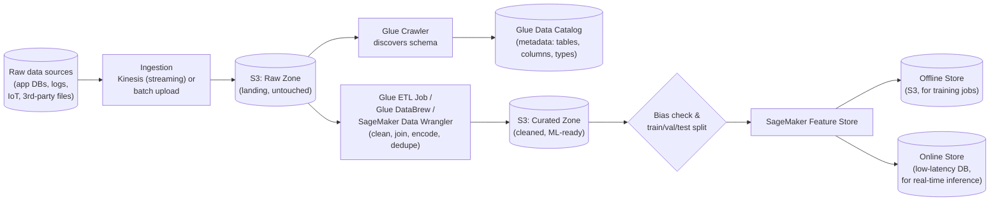
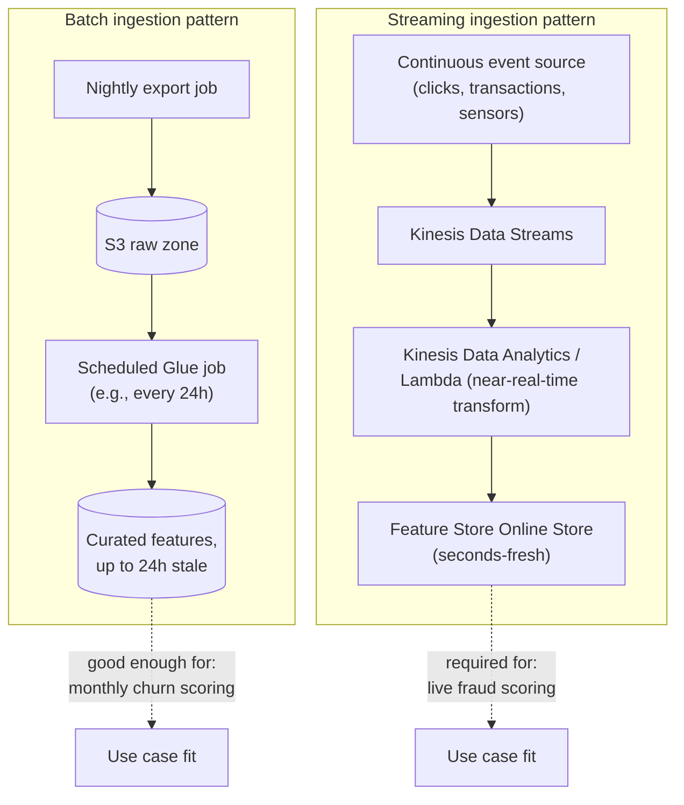
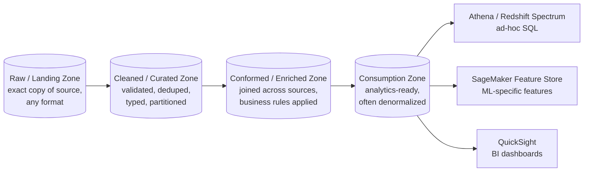

# Domain 1: Data Preparation for ML and AI (28%)

*MLA-C02 · heaviest-weighted domain · the exam's core belief: a model is only as good as the
data pipeline that fed it. This domain is "everything that happens before you call `fit()` or
`InvokeModel`."*

## Plain-English summary

Before any machine learning or generative AI model can be trained, fine-tuned, or queried, raw
data has to be collected, stored, cleaned, transformed, and shaped into whatever format the next
step needs. For classic ML that means tables of numbers ready for an algorithm. For generative
AI (new in C02) that also means documents turned into **embeddings** — numeric representations a
foundation model can search over — for **RAG** (Retrieval-Augmented Generation). This domain
tests whether you know *which AWS service to reach for at each stage* and *why*.

Why does this domain carry the single largest weight (28%) of any domain in the exam? Because
AWS's own field experience backs up an old data-science saying: most ML projects that
underperform in production didn't fail because of a bad algorithm choice — they failed because
of a data problem nobody caught early (a skewed sample, a leaking feature, a silent
training/serving mismatch). Testing this domain heavily is AWS's way of making sure certified ML
engineers internalize that discipline before they ever touch a training job.

## Task-statement-level content (from the official exam guide)

The C02 exam guide groups Domain 1 into these task statements. Each maps to a linked doc below.

| Task statement | What it covers | Where it's covered |
|---|---|---|
| **1.1 — Ingest and store data** | Batch vs. streaming ingestion; choosing a storage layer (S3, EFS, FSx) for ML workloads; streaming data with Kinesis for near-real-time features | [`services/analytics/kinesis-family.md`](../../../services/analytics/kinesis-family.md) |
| **1.2 — Transform data and perform feature engineering** | Cleaning, deduplication, normalization/standardization, encoding categoricals, handling missing values; building and serving reusable features | [`services/analytics/glue.md`](../../../services/analytics/glue.md), [`services/machine-learning-ai/sagemaker-data-wrangler-and-feature-store.md`](../../../services/machine-learning-ai/sagemaker-data-wrangler-and-feature-store.md) |
| **1.3 — Ensure data integrity and prepare for modeling (bias, compliance)** | Detecting class imbalance, labeling quality, bias in training data, train/validation/test splitting, shuffling, data augmentation | [`services/analytics/data-lake-concepts.md`](../../../services/analytics/data-lake-concepts.md) (governance/cataloging side) |
| **1.4 — NEW: Prepare data for generative AI / RAG** | What an embedding is, chunking documents, vector stores, why foundation models need retrieval instead of retraining | [`embeddings-and-rag-data-prep.md`](embeddings-and-rag-data-prep.md) *(new doc, written for this domain)* |

## Linked service docs — the deep dives

Don't duplicate content here; read the linked doc for depth. This README is the map.

- **[`services/analytics/kinesis-family.md`](../../../services/analytics/kinesis-family.md)** —
  Kinesis Data Streams / Firehose / Data Analytics. Use when data must be ingested continuously
  (clickstream, IoT sensor, transaction feed) and you need low-latency features (e.g., a fraud
  model scoring a transaction within seconds of it happening).
- **[`services/analytics/glue.md`](../../../services/analytics/glue.md)** — serverless ETL
  (Extract, Transform, Load — moving data from a source, reshaping it, and writing it somewhere
  new). Glue DataBrew (visual, no-code cleaning) and Glue Jobs (Spark-based, code-driven) are both
  in scope. The Glue Data Catalog is also how most other AWS analytics/ML services discover what
  data exists and its schema.
- **[`services/analytics/data-lake-concepts.md`](../../../services/analytics/data-lake-concepts.md)**
  — the storage philosophy underneath all of this: raw data lands in S3 in its native format,
  gets organized into zones (raw → curated → consumption), and is cataloged so ML pipelines know
  where to find it and what's in it.
- **[`services/analytics/athena.md`](../../../services/analytics/athena.md)** — serverless SQL
  directly over S3 data (via the Glue Data Catalog's schema), useful for a data scientist's quick
  exploratory query against curated data before committing to a full training job.
- **[`services/analytics/emr.md`](../../../services/analytics/emr.md)** — managed Spark/Hadoop
  for transformation jobs too large or too custom for Glue's serverless model; relevant when a
  scenario specifically needs distributed processing control Glue doesn't expose.
- **[`services/machine-learning-ai/sagemaker-data-wrangler-and-feature-store.md`](../../../services/machine-learning-ai/sagemaker-data-wrangler-and-feature-store.md)**
  — the ML-specific layer: Data Wrangler is a visual tool for exploring and transforming data
  specifically for ML (built-in bias reports, quick visualizations); Feature Store is where you
  save a transformed "feature" (e.g., `customer_lifetime_value`) once and reuse it consistently
  across training and real-time inference, instead of recomputing it differently in two places
  and getting subtly different answers (this mismatch is called **training/serving skew**).

## New topic doc for this domain

- **[`embeddings-and-rag-data-prep.md`](embeddings-and-rag-data-prep.md)** — embeddings, vector
  stores, chunking strategies, and why generative AI needs a different kind of "data prep" than
  classic ML. This concept doesn't belong to one AWS service (it spans S3, Bedrock, OpenSearch,
  and SageMaker), so it gets its own doc rather than being buried inside `bedrock.md`.

## How It Works — raw data to feature store, step by step

Step by step:
1. **Raw data sources** — application databases, log files, IoT sensors, or purchased
   third-party datasets. At this stage nothing has been cleaned or validated.
2. **Ingestion** — if data arrives continuously (clicks, sensor readings, transactions), it comes
   in through **Kinesis Data Streams/Firehose**; if it arrives as periodic file drops (a daily
   export), it's a **batch upload** straight to S3. Choosing streaming vs. batch here is itself a
   tested decision — streaming costs more operational complexity but gives you near-real-time
   features.
3. **S3 Raw Zone** — the data lands exactly as it arrived, untouched. This "keep the original"
   step matters: if a downstream transformation turns out to be wrong, you can always re-derive
   from the raw copy instead of having destroyed information.
4. **Glue Crawler** scans the raw zone and infers the schema (column names, data types,
   partitions), writing that metadata into the **Glue Data Catalog** — without this, nobody
   (human or service) knows what's actually in the S3 bucket.
5. **Transformation** happens via **Glue ETL jobs** (code/Spark, for complex or large-scale
   transforms), **Glue DataBrew** (visual, no-code, good for quick exploratory cleaning), or
   **SageMaker Data Wrangler** (visual, ML-specific — includes built-in bias and data-quality
   reports). This step cleans missing values, removes duplicates, joins tables, encodes
   categorical columns into numbers, and normalizes numeric ranges.
6. **S3 Curated Zone** — the output of transformation: cleaned, ML-ready data, but still just
   files in S3, not yet "features" tied to a specific entity.
7. **Bias check & splitting** — before modeling, check whether any class or demographic group is
   badly under/over-represented (class imbalance), and split the data into training, validation,
   and test sets (with shuffling, so the split isn't accidentally ordered by time or category in
   a way that skews results).
8. **SageMaker Feature Store** — named, versioned features (e.g., `customer_avg_order_value`) are
   written here *once*, split into an **Offline Store** (S3-backed, cheap, used for bulk training
   jobs and batch scoring) and an **Online Store** (low-latency key-value store, used so a live
   inference request can fetch the same feature value in milliseconds). Using one Feature Store
   for both guarantees the number a model trained on matches the number it sees in production —
   this is the fix for training/serving skew.

*Figure: AWS's own diagram of exactly the "raw data → transform → ingest into Feature Store →
serve for exploration, training, and real-time/batch inference" shape described above. Source:
AWS SageMaker Developer Guide, "Create, store, and share features with Feature Store" —
docs.aws.amazon.com/sagemaker/latest/dg/feature-store.html.*

### A second diagram — batch vs. streaming ingestion, side by side

The choice between batch and streaming ingestion at step 2 above is itself tested often enough to
deserve its own picture, because the "right" answer depends entirely on how fresh the resulting
features need to be:

The exam-relevant takeaway: picking streaming ingestion when batch would have been perfectly
adequate is itself a wrong answer on cost/complexity-optimization questions — streaming isn't
"the better option," it's "the option that costs more operational complexity in exchange for
freshness you only need if the use case genuinely requires near-real-time decisions."

### A third diagram — the data lake zone pattern in detail

Because "raw zone" and "curated zone" get used loosely above, it's worth seeing the fuller,
standard three (or four)-zone pattern this repo's data-lake content uses, since exam scenarios
sometimes name a specific zone by role rather than by this document's simplified two-zone version:

A scenario that says "a data engineering team wants one shared, governed copy of cleaned data
that both BI dashboards and ML training jobs draw from" is describing exactly this shape — the
Consumption Zone feeding both QuickSight and Feature Store from the same conformed data, rather
than each team building its own separate, inconsistent cleaning pipeline.

## Full worked case study — a retail company building real-time personalization

To see every piece of this domain working together on one concrete business problem, walk
through a single scenario end to end, the way an exam case-study question would frame it.

**The business problem:** "MegaMart," an online retailer, wants to show each shopper
personalized product recommendations on their homepage, updated in near-real-time as they browse
(not just from last week's purchase history), and also wants a customer-support chatbot that can
answer "what's your return policy for electronics" using MegaMart's actual, frequently-updated
policy documents, not a generic answer.

**Why this is a Domain 1 problem before it's anything else:** both halves of this ask — the
recommendation model and the chatbot — are completely blocked until the data feeding them is
ingested, cleaned, and shaped correctly. Jumping straight to "train a model" or "call Bedrock"
without this groundwork produces a system that's either stale, wrong, or ungrounded.

**Part A — the recommendation feature pipeline:**
1. **Ingestion:** clickstream events (page views, add-to-cart, purchases) arrive continuously as
   users browse — this is a **streaming**, not batch, ingestion problem, so it goes through
   **Kinesis Data Streams**, with **Kinesis Data Analytics** computing rolling features (e.g.,
   "items viewed in the last 10 minutes") in near-real time.
2. **Storage:** the raw clickstream also lands in an **S3 Raw Zone** so the full history is
   preserved for later retraining, even though live scoring only needs the last few minutes.
3. **Transformation:** a nightly **Glue ETL job** joins the clickstream history with the product
   catalog and past purchase history, producing engineered features like
   `category_affinity_score` and `avg_session_length` into the **S3 Curated Zone**.
4. **Bias/quality check:** before training, the team checks for class imbalance in "purchased
   vs. not purchased" labels (purchases are naturally rare relative to views) — this is flagged
   for Domain 2's training step to handle (class weighting), not something Domain 1 silently
   fixes on its own.
5. **Feature Store:** `category_affinity_score` and similar engineered features are written to
   **SageMaker Feature Store** — the **Offline Store** feeds the nightly retraining job; the
   **Online Store** is read in single-digit milliseconds the moment a shopper loads the homepage,
   so the recommendation reflects what they clicked five minutes ago, not last week.

**Part B — the chatbot's RAG data pipeline (see `embeddings-and-rag-data-prep.md` for full
depth):**
1. MegaMart's return-policy documents (which change whenever policy changes) are stored in S3 and
   **chunked** into passages of a few hundred tokens each.
2. Each chunk is converted into an **embedding** using Bedrock Titan Embeddings and stored in a
   vector store (Amazon OpenSearch Serverless, or Bedrock Knowledge Bases managing this
   end-to-end).
3. When a customer asks "what's your return policy for electronics," that question is embedded
   with the *same* embedding model, the closest-matching chunks are retrieved, and both the
   question and the retrieved policy text are sent to the foundation model — producing an answer
   grounded in MegaMart's actual, current policy, not a hallucinated guess.

**Why this worked example matters for the exam:** a real exam case study is very likely to
present exactly this kind of two-headed scenario (a classic-ML half and a GenAI half in the same
company), and expects you to recognize that *both halves start in Domain 1* with different
pipelines (Feature Store for structured features; embeddings + vector store for unstructured
documents) even though they converge on "serve a prediction/response to the same homepage."

## A second worked example — a healthcare provider's batch pipeline, and why it looks different

Not every Domain 1 pipeline looks like MegaMart's streaming/RAG hybrid above. Contrast it with a
regional hospital network building a **readmission-risk model** — a deliberately different shape
to show how the same domain's toolset adapts to different constraints.

**The business problem:** predict, at discharge, which patients are at high risk of readmission
within 30 days, so care coordinators can prioritize follow-up calls. Patient records are
historical (updated nightly from the hospital's electronic health record system, not streaming),
and the data is subject to HIPAA — it must never leave a private network boundary, even
transiently, during processing.

1. **Ingestion is batch, not streaming** — a nightly export job drops that day's discharge
   records into an **S3 Raw Zone**, inside a bucket with no public access and default
   server-side encryption. There's no clickstream-style urgency here; freshness of "last night's
   data" is entirely sufficient for a model that informs tomorrow's follow-up calls.
2. **Transformation happens inside a VPC with no internet egress** — the Glue ETL job (or
   SageMaker Processing job) that cleans and joins the discharge records runs with VPC-only
   networking, no NAT gateway, so sensitive health data is never exposed to the public internet
   even in transit between AWS services — a direct Domain 4 security requirement that shapes a
   Domain 1 pipeline's configuration.
3. **Feature engineering here is almost entirely about missingness, not freshness** — clinical
   records routinely have missing lab values; the pipeline's dominant task statement 1.2 work is
   imputation strategy (e.g., median-fill a missing lab value, or add a separate "was this value
   missing" indicator feature) rather than low-latency streaming features.
4. **Bias checking here is a compliance-mandated step, not optional** — before training, the team
   runs SageMaker Clarify's pre-training bias metrics specifically checking whether readmission
   labels correlate suspiciously with a protected attribute like age band or insurance type in a
   way not explained by genuine clinical risk factors — because a biased readmission-risk model
   making real care-prioritization decisions is a direct patient-harm and regulatory risk, not an
   abstract fairness nicety.
5. **Feature Store's Online Store is far less critical here** — because predictions run as a
   nightly batch job against yesterday's discharges, not live per-request, the Offline Store
   alone (feeding both training and the nightly batch scoring job) covers the entire use case;
   standing up an Online Store would be unused infrastructure cost for this particular workload.

**Why contrasting these two worked examples matters:** the exam does not reward memorizing "use
Kinesis" or "use Feature Store's Online Store" as universal defaults — it rewards recognizing
*which* constraints (freshness requirement, network sensitivity, batch vs. real-time consumption)
are present in a given scenario and picking the configuration that actually fits those
constraints, even when it means deliberately NOT reaching for the more sophisticated-sounding
option.

## Troubleshooting / Common Issues

- **A Glue Crawler runs successfully but Athena queries against the resulting table return no
  rows.** Usually a partition-registration issue — new partitions written directly to S3 don't
  automatically appear in the Data Catalog; run `MSCK REPAIR TABLE` (or re-run the crawler, or use
  Glue's partition indexes) rather than assuming the data itself is missing.
- **Data Wrangler's bias report flags severe class imbalance, but the team is confident the
  underlying population genuinely is that skewed (e.g., fraud really is rare).** This is a signal
  to carry the imbalance information forward into Domain 2's training step (class weighting,
  resampling, or choosing a metric like recall/F1 over accuracy) rather than something to "fix"
  in the data itself — genuine rarity isn't a data quality bug.
- **A Feature Store Online Store lookup returns an older value than expected.** Check that the
  `event_time` on the ingested record is actually newer than what's currently stored — the Online
  Store keeps only the latest record per identifier by event time, so a backfill job writing
  historical timestamps won't overwrite what's currently being served.
- **A RAG pipeline's retrieved chunks are technically relevant but the generated answer still
  seems to ignore them.** Check prompt assembly, not retrieval — a common root cause is the
  retrieved chunks being truncated or buried too far into an overly long prompt, not a retrieval
  failure; see `embeddings-and-rag-data-prep.md` for chunk-size/prompt-assembly guidance.
- **Kinesis-based streaming ingestion is falling behind (growing `IteratorAge` in CloudWatch).**
  Usually under-provisioned shard count relative to incoming throughput — add shards (or switch
  to on-demand capacity mode) rather than assuming the consumer application has a bug.
- **A Glue ETL job's cost is far higher than expected for what seems like a small dataset.**
  Check the configured number of DPUs (Data Processing Units) and job timeout — a job
  over-provisioned on workers for a small dataset burns compute unnecessarily; right-size before
  assuming Glue itself is expensive for this workload.

## Common exam scenarios

1. **"A streaming source of clickstream data must feed near-real-time fraud features"** → Kinesis
   Data Streams (or Firehose if near-real-time batching to S3/Redshift is acceptable), not a
   nightly Glue batch job.
2. **"A model performs well in training but poorly in production, and the team suspects the
   feature values differ between training and inference"** → classic training/serving skew; the
   fix is SageMaker Feature Store (one source of truth for both offline training and online
   inference).
3. **"Data scientists need a no-code way to visually explore and clean tabular data before
   modeling, with built-in bias detection"** → SageMaker Data Wrangler, not raw Glue Jobs.
4. **"A dataset has 95% of samples in one class and 5% in another, and the model only predicts
   the majority class"** → class imbalance; fix with resampling (oversample minority / undersample
   majority), class weighting, or SMOTE-style augmentation, covered as part of task statement 1.3.
5. **"Need to catalog data scattered across S3 so Athena/Redshift Spectrum/SageMaker can query it
   with a consistent schema"** → Glue Crawler + Glue Data Catalog, not manual schema definitions
   in each service.
6. **"Want to answer questions using an LLM grounded in a company's internal documents without
   retraining the model"** → RAG: chunk the documents, embed them, store vectors (e.g., in
   OpenSearch or Bedrock Knowledge Bases), retrieve relevant chunks at query time. See
   `embeddings-and-rag-data-prep.md`.
7. **"PII (personally identifiable information) must be removed before data reaches a training
   job"** → Glue/DataBrew transforms or Macie for discovery, applied to the raw→curated step, not
   after the model is already trained.
8. **"A table's schema changes over time (new columns added) and downstream jobs keep breaking"**
   → re-run Glue Crawlers on schedule, use schema evolution support in the Data Catalog, rather
   than hardcoding schemas in every consumer.
9. **"A data science team wants to sanity-check whether a handful of candidate features predict
   the target at all, before writing a training job"** → Data Wrangler's **Quick Model** feature —
   a fast, disposable model trained directly inside the data-prep tool, specifically to avoid
   spending real training compute on a feature set that might not even be predictive.
10. **"Training data for a loan-approval model contains a proxy for a protected attribute (e.g.,
    zip code correlating with race) and the team wants to check before training even starts"** →
    SageMaker Clarify's **pre-training** bias metrics (class imbalance, difference in label
    proportions), run against the *data*, not the trained model — see also
    `../domain-4-monitoring-security/responsible-ai-and-guardrails.md` for the post-training half.
11. **"A company's support tickets, product manuals, and wiki pages all need to be searchable by
    meaning, not just keyword, for an internal chatbot"** → this is the chunk → embed → vector
    store pipeline, and specifically a case for **Bedrock Knowledge Bases** if the team wants the
    whole pipeline managed rather than hand-building it.
12. **"Two different chunk sizes are being considered for a RAG pipeline over long legal
    contracts, and answers are coming back missing context"** → chunks are too small (losing
    surrounding context, e.g., a clause referencing "the aforementioned party" with no antecedent
    in the chunk) — increase chunk size and/or chunk overlap, covered in
    `embeddings-and-rag-data-prep.md`.
13. **"A nightly ETL job needs distributed Spark processing at a scale Glue's serverless jobs
    can't handle cost-effectively, with full cluster-level tuning control"** → Amazon EMR, not
    Glue — EMR trades Glue's serverless simplicity for direct cluster control when a job's scale
    or custom Spark tuning needs genuinely demands it.
14. **"An ML team wants ad-hoc SQL exploration directly against curated S3 data without standing
    up a database"** → Amazon Athena, querying through the Glue Data Catalog's schema — no ETL or
    database provisioning needed for exploratory analysis.
15. **"A company ingests both structured transaction records and unstructured scanned PDF
    receipts, and both need to feed the same fraud-detection effort"** → two parallel Domain 1
    pipelines converging on one use case: the structured data goes through the classic
    Glue/Data Wrangler/Feature Store path, while the PDFs may first need Amazon Textract (a
    pre-built AI service, see `services/machine-learning-ai/ai-services-overview.md`) to extract
    text before either classic feature engineering or embedding/RAG treatment applies.

## Related Terms

See the companion [`glossary/README.md`](../../../glossary/README.md) for one-line definitions of
every cross-cutting term, and [`00-fundamentals/`](../../../00-fundamentals) for AWS basics this
domain assumes (S3 storage classes, IAM basics, VPC).

- [`labs.md`](labs.md) — hands-on exercises for this domain (Floci + real free-tier alternatives).
- [`../domain-2-model-development/README.md`](../domain-2-model-development/README.md) — what
  happens to this domain's cleaned data and engineered features next.
- [`../domain-4-monitoring-security/README.md`](../domain-4-monitoring-security/README.md) — data
  drift detected here is often traced back to an upstream change in this domain's pipelines.
- [`services/machine-learning-ai/sagemaker-overview.md`](../../../services/machine-learning-ai/sagemaker-overview.md)
  — the umbrella SageMaker document, useful context before any individual sub-service doc above.
- [`services/analytics/opensearch.md`](../../../services/analytics/opensearch.md) — one of the
  vector store backends used by the embeddings/RAG pipeline in `embeddings-and-rag-data-prep.md`.
