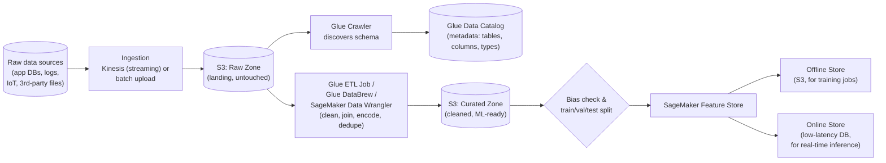

# Domain 1: Data Preparation for ML and AI (28%)

*MLA-C02 · heaviest-weighted domain · the exam's core belief: a model is only as good as the
data pipeline that fed it. This domain is "everything that happens before you call `fit()` or
`InvokeModel`."*

## Plain-English summary

Before any machine learning or generative AI model can be trained, fine-tuned, or queried, raw
data has to be collected, stored, cleaned, transformed, and shaped into whatever format the next
step needs. For classic ML that means tables of numbers ready for an algorithm. For generative
AI (new in C02) that also means documents turned into **embeddings** — numeric representations a
foundation model can search over — for **RAG** (Retrieval-Augmented Generation). This domain
tests whether you know *which AWS service to reach for at each stage* and *why*.

## Task-statement-level content (from the official exam guide)

The C02 exam guide groups Domain 1 into these task statements. Each maps to a linked doc below.

| Task statement | What it covers | Where it's covered |
|---|---|---|
| **1.1 — Ingest and store data** | Batch vs. streaming ingestion; choosing a storage layer (S3, EFS, FSx) for ML workloads; streaming data with Kinesis for near-real-time features | [`services/analytics/kinesis-family.md`](../../../services/analytics/kinesis-family.md) |
| **1.2 — Transform data and perform feature engineering** | Cleaning, deduplication, normalization/standardization, encoding categoricals, handling missing values; building and serving reusable features | [`services/analytics/glue.md`](../../../services/analytics/glue.md), [`services/machine-learning-ai/sagemaker-data-wrangler-and-feature-store.md`](../../../services/machine-learning-ai/sagemaker-data-wrangler-and-feature-store.md) |
| **1.3 — Ensure data integrity and prepare for modeling (bias, compliance)** | Detecting class imbalance, labeling quality, bias in training data, train/validation/test splitting, shuffling, data augmentation | [`services/analytics/data-lake-concepts.md`](../../../services/analytics/data-lake-concepts.md) (governance/cataloging side) |
| **1.4 — NEW: Prepare data for generative AI / RAG** | What an embedding is, chunking documents, vector stores, why foundation models need retrieval instead of retraining | [`embeddings-and-rag-data-prep.md`](embeddings-and-rag-data-prep.md) *(new doc, written for this domain)* |

## Linked service docs — the deep dives

Don't duplicate content here; read the linked doc for depth. This README is the map.

- **[`services/analytics/kinesis-family.md`](../../../services/analytics/kinesis-family.md)** —
  Kinesis Data Streams / Firehose / Data Analytics. Use when data must be ingested continuously
  (clickstream, IoT sensor, transaction feed) and you need low-latency features (e.g., a fraud
  model scoring a transaction within seconds of it happening).
- **[`services/analytics/glue.md`](../../../services/analytics/glue.md)** — serverless ETL
  (Extract, Transform, Load — moving data from a source, reshaping it, and writing it somewhere
  new). Glue DataBrew (visual, no-code cleaning) and Glue Jobs (Spark-based, code-driven) are both
  in scope. The Glue Data Catalog is also how most other AWS analytics/ML services discover what
  data exists and its schema.
- **[`services/analytics/data-lake-concepts.md`](../../../services/analytics/data-lake-concepts.md)**
  — the storage philosophy underneath all of this: raw data lands in S3 in its native format,
  gets organized into zones (raw → curated → consumption), and is cataloged so ML pipelines know
  where to find it and what's in it.
- **[`services/machine-learning-ai/sagemaker-data-wrangler-and-feature-store.md`](../../../services/machine-learning-ai/sagemaker-data-wrangler-and-feature-store.md)**
  — the ML-specific layer: Data Wrangler is a visual tool for exploring and transforming data
  specifically for ML (built-in bias reports, quick visualizations); Feature Store is where you
  save a transformed "feature" (e.g., `customer_lifetime_value`) once and reuse it consistently
  across training and real-time inference, instead of recomputing it differently in two places
  and getting subtly different answers (this mismatch is called **training/serving skew**).

## New topic doc for this domain

- **[`embeddings-and-rag-data-prep.md`](embeddings-and-rag-data-prep.md)** — embeddings, vector
  stores, chunking strategies, and why generative AI needs a different kind of "data prep" than
  classic ML. This concept doesn't belong to one AWS service (it spans S3, Bedrock, OpenSearch,
  and SageMaker), so it gets its own doc rather than being buried inside `bedrock.md`.

## How It Works — raw data to feature store, step by step

Step by step:
1. **Raw data sources** — application databases, log files, IoT sensors, or purchased
   third-party datasets. At this stage nothing has been cleaned or validated.
2. **Ingestion** — if data arrives continuously (clicks, sensor readings, transactions), it comes
   in through **Kinesis Data Streams/Firehose**; if it arrives as periodic file drops (a daily
   export), it's a **batch upload** straight to S3. Choosing streaming vs. batch here is itself a
   tested decision — streaming costs more operational complexity but gives you near-real-time
   features.
3. **S3 Raw Zone** — the data lands exactly as it arrived, untouched. This "keep the original"
   step matters: if a downstream transformation turns out to be wrong, you can always re-derive
   from the raw copy instead of having destroyed information.
4. **Glue Crawler** scans the raw zone and infers the schema (column names, data types,
   partitions), writing that metadata into the **Glue Data Catalog** — without this, nobody
   (human or service) knows what's actually in the S3 bucket.
5. **Transformation** happens via **Glue ETL jobs** (code/Spark, for complex or large-scale
   transforms), **Glue DataBrew** (visual, no-code, good for quick exploratory cleaning), or
   **SageMaker Data Wrangler** (visual, ML-specific — includes built-in bias and data-quality
   reports). This step cleans missing values, removes duplicates, joins tables, encodes
   categorical columns into numbers, and normalizes numeric ranges.
6. **S3 Curated Zone** — the output of transformation: cleaned, ML-ready data, but still just
   files in S3, not yet "features" tied to a specific entity.
7. **Bias check & splitting** — before modeling, check whether any class or demographic group is
   badly under/over-represented (class imbalance), and split the data into training, validation,
   and test sets (with shuffling, so the split isn't accidentally ordered by time or category in
   a way that skews results).
8. **SageMaker Feature Store** — named, versioned features (e.g., `customer_avg_order_value`) are
   written here *once*, split into an **Offline Store** (S3-backed, cheap, used for bulk training
   jobs and batch scoring) and an **Online Store** (low-latency key-value store, used so a live
   inference request can fetch the same feature value in milliseconds). Using one Feature Store
   for both guarantees the number a model trained on matches the number it sees in production —
   this is the fix for training/serving skew.

## Common exam scenarios

1. **"A streaming source of clickstream data must feed near-real-time fraud features"** → Kinesis
   Data Streams (or Firehose if near-real-time batching to S3/Redshift is acceptable), not a
   nightly Glue batch job.
2. **"A model performs well in training but poorly in production, and the team suspects the
   feature values differ between training and inference"** → classic training/serving skew; the
   fix is SageMaker Feature Store (one source of truth for both offline training and online
   inference).
3. **"Data scientists need a no-code way to visually explore and clean tabular data before
   modeling, with built-in bias detection"** → SageMaker Data Wrangler, not raw Glue Jobs.
4. **"A dataset has 95% of samples in one class and 5% in another, and the model only predicts
   the majority class"** → class imbalance; fix with resampling (oversample minority / undersample
   majority), class weighting, or SMOTE-style augmentation, covered as part of task statement 1.3.
5. **"Need to catalog data scattered across S3 so Athena/Redshift Spectrum/SageMaker can query it
   with a consistent schema"** → Glue Crawler + Glue Data Catalog, not manual schema definitions
   in each service.
6. **"Want to answer questions using an LLM grounded in a company's internal documents without
   retraining the model"** → RAG: chunk the documents, embed them, store vectors (e.g., in
   OpenSearch or Bedrock Knowledge Bases), retrieve relevant chunks at query time. See
   `embeddings-and-rag-data-prep.md`.
7. **"PII (personally identifiable information) must be removed before data reaches a training
   job"** → Glue/DataBrew transforms or Macie for discovery, applied to the raw→curated step, not
   after the model is already trained.
8. **"A table's schema changes over time (new columns added) and downstream jobs keep breaking"**
   → re-run Glue Crawlers on schedule, use schema evolution support in the Data Catalog, rather
   than hardcoding schemas in every consumer.

## Related Terms

See the companion [`glossary/README.md`](../../../glossary/README.md) for one-line definitions of
every cross-cutting term, and [`00-fundamentals/`](../../../00-fundamentals) for AWS basics this
domain assumes (S3 storage classes, IAM basics, VPC).
