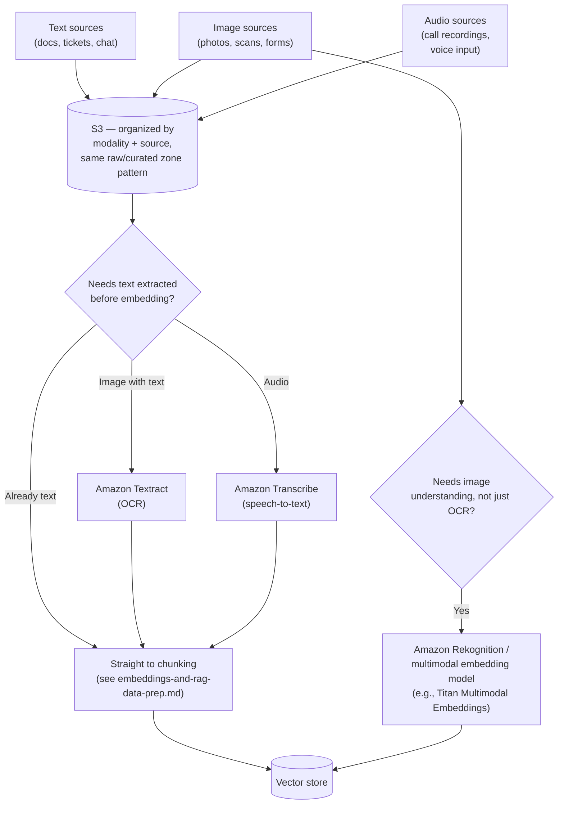
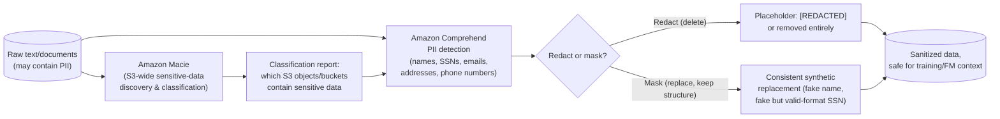
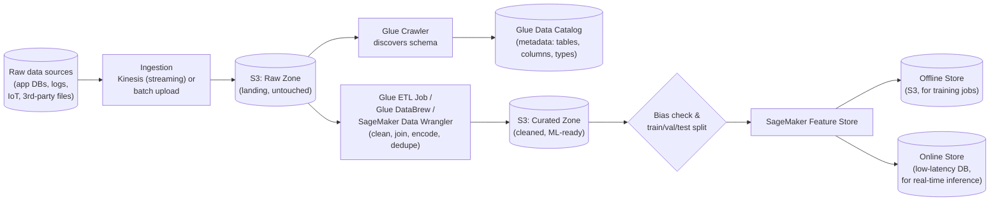
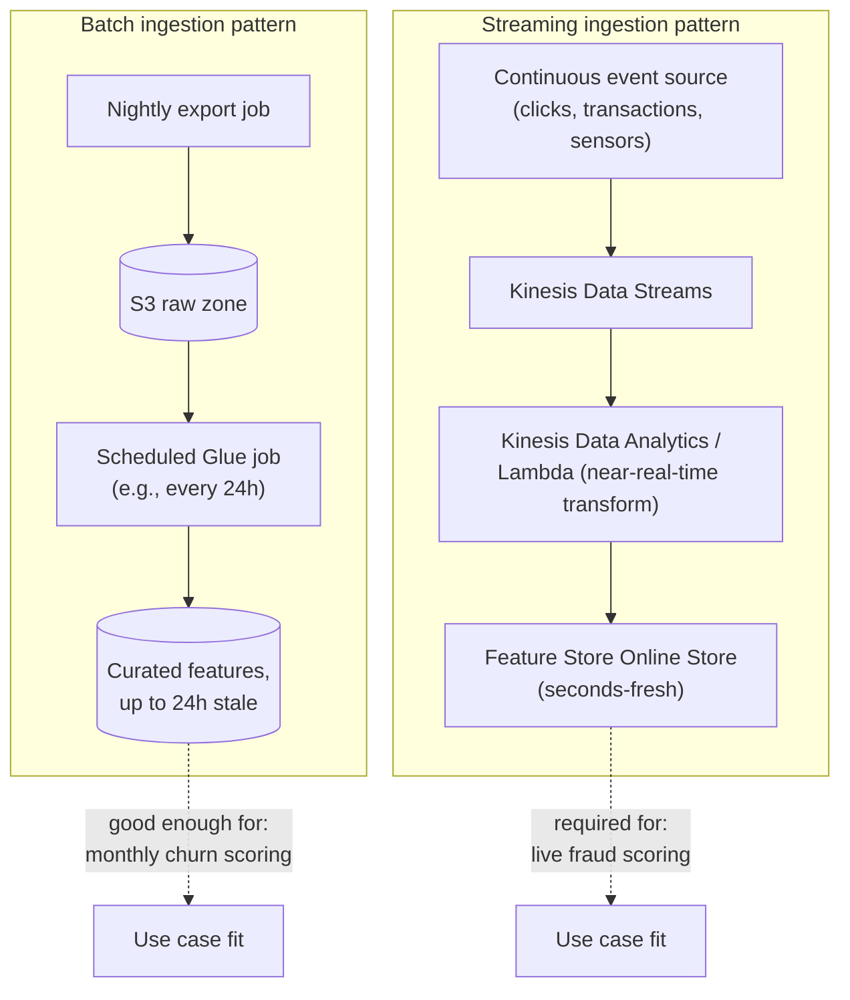
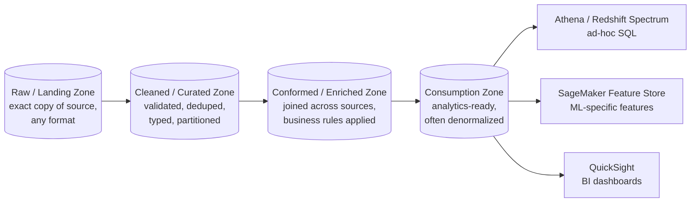
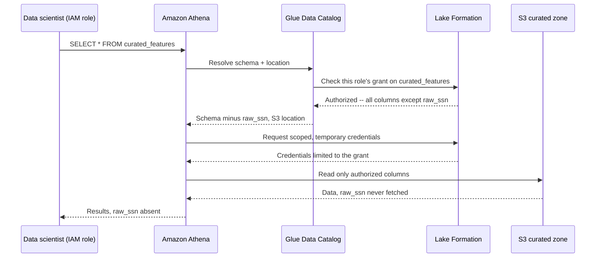

# Domain 1: Data Preparation for ML and AI (28%)

*MLA-C02 · heaviest-weighted domain · the exam's core belief: a model is only as good as the
data pipeline that fed it. This domain is "everything that happens before you call `fit()` or
`InvokeModel`."*

## Plain-English summary

Before any machine learning or generative AI model can be trained, fine-tuned, or queried, raw
data has to be collected, stored, cleaned, transformed, and shaped into whatever format the next
step needs. For classic ML that means tables of numbers ready for an algorithm. For generative
AI (new in C02) that also means documents turned into **embeddings** — numeric representations a
foundation model can search over — for **RAG** (Retrieval-Augmented Generation). This domain
tests whether you know *which AWS service to reach for at each stage* and *why*.

Why does this domain carry the single largest weight (28%) of any domain in the exam? Because
AWS's own field experience backs up an old data-science saying: most ML projects that
underperform in production didn't fail because of a bad algorithm choice — they failed because
of a data problem nobody caught early (a skewed sample, a leaking feature, a silent
training/serving mismatch). Testing this domain heavily is AWS's way of making sure certified ML
engineers internalize that discipline before they ever touch a training job.

## Plain-English analogies for every core service in this domain

Before the task-statement table below, it helps to have one durable mental picture per service —
these are the analogies referenced throughout this domain's docs, collected here in one place:

| Service | Analogy |
|---|---|
| **S3 / Data lake** | A giant, cheap warehouse where you can drop boxes of any size/shape as they arrive, and label them only when someone actually needs to find something — versus a filing cabinet (a warehouse) where every folder must be pre-labeled before anything goes in. |
| **Glue** | A librarian (the Crawler) who walks the archive and writes an index card for every shelf (the Data Catalog), so a worker (an ETL job) knows exactly where to find what it needs without re-discovering the warehouse's contents from scratch every time. |
| **Lake Formation** | The finer internal lock system inside the warehouse — IAM/S3 policies are the front-door lock (in or out); Lake Formation is "you may enter, but only open this cabinet, and within it, only this drawer." |
| **Athena** | A librarian who, instead of making you check out a book, lets you point at a shelf and ask a question — she reads only the relevant pages and charges you for exactly what she had to read. |
| **EMR** | A construction crew AWS assembles on demand — you specify the tools (Spark? Hive?) and crew size, they show up pre-wired, and you send them home (terminate) the moment the job's done. |
| **Kinesis Data Streams** | A conveyor belt with numbered slots (shards) — producers drop records on, consumers read off in order, at their own pace, able to re-read recent history if they fall behind. |
| **Data Firehose** | A forklift that automatically takes items off the belt and stacks them neatly in a warehouse (S3) — nobody drives it; you point it at a destination once and it runs forever. |
| **OpenSearch** | A card catalog built to answer "find everything related to X, ranked by relevance" — not "look up record #4521," which is what a plain database does. |
| **SageMaker Data Wrangler** | A spreadsheet with a recorded macro — point, click, preview the before/after, and it remembers the whole transformation as a reusable recipe. |
| **SageMaker Feature Store** | A shared filing cabinet with two drawers: one slow drawer with the complete history (training), one fast drawer with only the latest value (real-time inference) — both filled from the same single filing action, so they can never disagree. |
| **Bedrock / RAG** | Giving a well-read substitute teacher a one-page briefing right before class, instead of making them re-read the entire textbook every time a fact changes. |
| **Embeddings** | Plotting every sentence you've ever read as a dot on a map, where similar-meaning sentences cluster in the same neighborhood — "find what's relevant" becomes "find the closest dots." |

## Task-statement-level content (from the official exam guide)

The C02 exam guide groups Domain 1 into these task statements. Each maps to a linked doc below.

| Task statement | What it covers | Where it's covered |
|---|---|---|
| **1.1 — Ingest and store data** | Batch vs. streaming ingestion; choosing a storage layer (S3, EFS, FSx) for ML workloads; streaming data with Kinesis for near-real-time features; zero-code managed delivery of streaming data into S3/data-lake destinations | [`services/analytics/kinesis-family.md`](../../../services/analytics/kinesis-family.md), [`services/analytics/data-firehose.md`](../../../services/analytics/data-firehose.md) |
| **1.2 — Transform data and perform feature engineering** | Cleaning, deduplication, normalization/standardization, encoding categoricals, handling missing values; building and serving reusable features | [`services/analytics/glue.md`](../../../services/analytics/glue.md), [`services/machine-learning-ai/sagemaker-data-wrangler-and-feature-store.md`](../../../services/machine-learning-ai/sagemaker-data-wrangler-and-feature-store.md) |
| **1.3 — Ensure data integrity and prepare for modeling (bias, compliance)** | Detecting class imbalance, labeling quality, bias in training data, train/validation/test splitting, shuffling, data augmentation; fine-grained row/column/tag-based access control over the data lake itself so only the right people/pipelines can even see the training data | [`services/analytics/data-lake-concepts.md`](../../../services/analytics/data-lake-concepts.md) (governance/cataloging side), [`services/analytics/lake-formation.md`](../../../services/analytics/lake-formation.md) (permissions layer) |
| **1.4 — NEW: Prepare data for generative AI / RAG** | What an embedding is, chunking documents, vector stores, why foundation models need retrieval instead of retraining | [`embeddings-and-rag-data-prep.md`](embeddings-and-rag-data-prep.md) *(new doc, written for this domain)* |
| **1.1.7 — NEW: Configure scalable vector databases** | Choosing/configuring OpenSearch Service, Amazon RDS with pgvector, or Amazon S3 vector search for a given scale/latency/budget spec | [`embeddings-and-rag-data-prep.md`](embeddings-and-rag-data-prep.md#vector-database-deep-comparison----opensearch-service-vs-amazon-rds-pgvector-vs-amazon-s3-vector-search) and this doc's ["Vector Database Options"](#new-skill-11--configuring-scalable-vector-databases-for-ai-applications) section below |
| **1.1.8 — NEW: Ingest/store diverse data types** | Text, image, and audio ingestion/storage for AI/ML, not just tabular data | this doc's ["Ingesting Multimodal Data"](#new-skill-118--ingesting-and-storing-diverse-data-types-text-images-audio) section below |
| **1.2.5 — NEW: Embedding models for text/image** | Configuring and using embedding models to turn raw content into numeric vectors | [`embeddings-and-rag-data-prep.md`](embeddings-and-rag-data-prep.md) |
| **1.2.6 — NEW: Advanced text pre-processing** | Tokenization, domain-specific text augmentation beyond basic cleaning | this doc's ["Advanced Text Pre-processing"](#new-skill-126--advanced-text-pre-processing-tokenization--domain-specific-augmentation) section below |
| **1.2.7 — NEW: Prepare documents for RAG** | Chunking strategies, metadata extraction | [`embeddings-and-rag-data-prep.md`](embeddings-and-rag-data-prep.md) |
| **1.2.8 — NEW: Mask/redact/anonymize data** | PII detection and removal before data reaches training or a foundation model | this doc's ["Masking, Redacting, and Anonymizing Data"](#new-skill-128--masking-redacting-and-anonymizing-sensitive-data) section below |
| **1.2.9 — NEW: Prepare data for FM fine-tuning/pre-training/distillation** | Prompt-completion pair formatting, continuous pre-training corpora, teacher/student distillation datasets | this doc's ["Preparing Data for FM Fine-Tuning"](#new-skill-129--preparing-data-for-fm-fine-tuning-continuous-pre-training-and-model-distillation) section below |
| **1.3.4 — NEW: Multimodal bias metrics** | Checking bias across numeric, text, and image data together, not only tabular features | this doc's ["Multimodal Bias Metrics"](#new-skill-134--optimizing-multimodal-data-distributions-with-bias-metrics) section below |
| **1.3.6 — NEW: Validate AI training data integrity** | Prompt-response pair validation, content safety screening before fine-tuning | this doc's ["Validating AI Training Data Integrity"](#new-skill-136--validating-ai-training-data-integrity) section below |
| **1.3.7 — NEW: Clean data** | Outlier detection, imputation, deduplication | this doc's ["Cleaning Data"](#new-skill-137--cleaning-data-outlier-detection-imputation-deduplication) section below |

## Linked service docs — the deep dives

Don't duplicate content here; read the linked doc for depth. This README is the map.

- **[`services/analytics/kinesis-family.md`](../../../services/analytics/kinesis-family.md)** —
  Kinesis Data Streams / Firehose / Data Analytics. Use when data must be ingested continuously
  (clickstream, IoT sensor, transaction feed) and you need low-latency features (e.g., a fraud
  model scoring a transaction within seconds of it happening).
- **[`services/analytics/data-firehose.md`](../../../services/analytics/data-firehose.md)** —
  the dedicated Firehose deep dive: zero-code, fully managed delivery of streaming data into S3
  (as Parquet, partitioned), Redshift, or OpenSearch — the right Task 1.1 answer whenever a
  scenario needs raw ML training data landing in the lake continuously with no consumer code
  written at all, as opposed to needing custom per-record feature computation in flight (which
  points to Kinesis Data Streams + a custom consumer instead, per `kinesis-family.md`'s
  side-by-side comparison).
- **[`services/analytics/glue.md`](../../../services/analytics/glue.md)** — serverless ETL
  (Extract, Transform, Load — moving data from a source, reshaping it, and writing it somewhere
  new). Glue DataBrew (visual, no-code cleaning) and Glue Jobs (Spark-based, code-driven) are both
  in scope. The Glue Data Catalog is also how most other AWS analytics/ML services discover what
  data exists and its schema.
- **[`services/analytics/data-lake-concepts.md`](../../../services/analytics/data-lake-concepts.md)**
  — the storage philosophy underneath all of this: raw data lands in S3 in its native format,
  gets organized into zones (raw → curated → consumption), and is cataloged so ML pipelines know
  where to find it and what's in it.
- **[`services/analytics/athena.md`](../../../services/analytics/athena.md)** — serverless SQL
  directly over S3 data (via the Glue Data Catalog's schema), useful for a data scientist's quick
  exploratory query against curated data before committing to a full training job.
- **[`services/analytics/emr.md`](../../../services/analytics/emr.md)** — managed Spark/Hadoop
  for transformation jobs too large or too custom for Glue's serverless model; relevant when a
  scenario specifically needs distributed processing control Glue doesn't expose.
- **[`services/machine-learning-ai/sagemaker-data-wrangler-and-feature-store.md`](../../../services/machine-learning-ai/sagemaker-data-wrangler-and-feature-store.md)**
  — the ML-specific layer: Data Wrangler is a visual tool for exploring and transforming data
  specifically for ML (built-in bias reports, quick visualizations); Feature Store is where you
  save a transformed "feature" (e.g., `customer_lifetime_value`) once and reuse it consistently
  across training and real-time inference, instead of recomputing it differently in two places
  and getting subtly different answers (this mismatch is called **training/serving skew**).

## New topic doc for this domain

- **[`embeddings-and-rag-data-prep.md`](embeddings-and-rag-data-prep.md)** — embeddings, vector
  stores, chunking strategies, and why generative AI needs a different kind of "data prep" than
  classic ML. This concept doesn't belong to one AWS service (it spans S3, Bedrock, OpenSearch,
  and SageMaker), so it gets its own doc rather than being buried inside `bedrock.md`.

## NEW skill 1.1.7 — Configuring scalable vector databases for AI applications

The official C02 guide names this as its own task statement rather than folding it into
"embeddings and RAG" generically — it specifically expects you to be able to **choose and
configure the vector database itself** against a stated scale/latency/budget spec, not just know
that "a vector store" is needed somewhere. The full side-by-side comparison with pricing/
operational tradeoffs lives in
[`embeddings-and-rag-data-prep.md`](embeddings-and-rag-data-prep.md#vector-database-deep-comparison----opensearch-service-vs-amazon-rds-pgvector-vs-amazon-s3-vector-search)
— this section gives the Domain 1 "configure it correctly" framing specifically:

| Configuration decision | OpenSearch Service/Serverless | Amazon RDS/Aurora + `pgvector` | Amazon S3 Vector Buckets |
|---|---|---|---|
| Capacity model | Provisioned (Service) or auto-scaling OCUs (Serverless) | Provisioned DB instance (vCPU/RAM you size) | Fully serverless, no capacity to size at all |
| Index type to configure | HNSW or IVF (k-NN plugin) | HNSW or IVFFlat (`pgvector` index types) | Managed internally, no index tuning exposed |
| Typical config knobs tested | Shard count, `ef_search`/`ef_construction` (HNSW recall/speed tradeoff), replica count | `lists` (IVFFlat) or `m`/`ef_construction` (HNSW), `maintenance_work_mem` for index builds | Bucket/vector-index name, dimension, distance metric only |
| Scale ceiling | Very high (billions of vectors, horizontally shardable) | Bound by a single instance's vertical scaling (still high, but not horizontally sharded like OpenSearch) | Designed for very large, cost-sensitive corpora; AWS's newest, most "just works" option |
| When the exam expects this answer | "Needs to scale to hundreds of millions of vectors with tunable recall/latency tradeoffs" | "Already has relational data and wants vectors joined to it in the same SQL queries" | "Wants the lowest-ops, lowest-cost option and doesn't need sub-10ms latency" |

The configuration-specific exam trap: a scenario naming a *specific* recall/latency requirement
(e.g., "95%+ recall within 20ms, at a scale of 50M vectors") is testing whether you'd reach for
OpenSearch's `ef_search` tuning knob (raising it improves recall at a latency cost) — not whether
you can merely name "OpenSearch" as the service.

## NEW skill 1.1.8 — Ingesting and storing diverse data types (text, images, audio)

**Plain English:** classic ML data prep assumes rows and columns. GenAI data prep routinely has
to ingest and store three structurally different kinds of raw content side by side — free text
(documents, tickets, chat logs), images (product photos, scanned forms, medical images), and
audio (call-center recordings, voice assistant input) — often for the *same* downstream use case
(e.g., a multimodal support assistant that can read a photo of a damaged product AND a customer's
typed description of what went wrong).

Step by step: (1) every modality still lands in S3 first, organized by source and modality (not
dumped into one undifferentiated prefix — a scenario describing "we can't tell which bucket
prefix holds call-center audio vs. product photos" is a storage-organization failure, not a
modeling one); (2) text-bearing non-text content gets converted to text first — **Amazon
Textract** for scanned documents/forms/images containing text, **Amazon Transcribe** for audio —
before it can be chunked and embedded the same way as native text; (3) content that needs to be
*understood visually* rather than just read (e.g., "does this product photo show visible damage")
uses **Amazon Rekognition** for pre-built detection tasks or a **multimodal embedding model**
(e.g., Bedrock Titan Multimodal Embeddings) when the goal is similarity search across images
directly, not text extraction. The exam-relevant distinction: OCR (Textract) answers "what text
is in this image," while a multimodal embedding model answers "what does this image mean/look
like, comparable to other images or text" — picking Textract when the real need is visual
similarity search (or vice versa) is exactly the kind of wrong-tool trap this task statement
tests.

## NEW skill 1.2.6 — Advanced text pre-processing: tokenization & domain-specific augmentation

**Tokenization, plain English:** before any text reaches an embedding model or an LLM, it has to
be chopped into **tokens** — not necessarily whole words. A word like "unbelievable" might become
three tokens (`un`, `believ`, `able`) under common subword tokenization schemes. This matters for
two very practical reasons: (1) foundation models bill and limit context by *token* count, not
word or character count, so the same sentence can cost meaningfully different amounts depending
on tokenizer efficiency; (2) a tokenizer trained mostly on English text badly over-fragments
non-English text or niche technical jargon (e.g., chemical compound names, legal citations),
inflating token counts and sometimes losing meaning at sub-word boundaries.

- **Byte-Pair Encoding (BPE)** and **WordPiece** — the two dominant subword tokenization
  algorithms behind most modern LLMs; both build a vocabulary of common sub-word fragments from a
  large corpus so rare/compound words still decompose into familiar pieces rather than becoming a
  single opaque "unknown" token.
- **Domain-specific tokenization risk** — a tokenizer never exposed to a domain's vocabulary
  during its own training (e.g., a general-purpose tokenizer seeing pharmaceutical compound
  names, legal case citations, or a company's internal product SKUs for the first time) will
  fragment those terms into many small, low-information tokens, inflating cost and sometimes
  degrading retrieval/generation quality — a real reason a scenario might call for choosing a
  domain-adapted embedding/foundation model over a general-purpose one.
- **Domain-specific text augmentation** — plain English: artificially creating more training
  examples by rephrasing existing ones in ways realistic for the target domain, rather than
  generic augmentation (random word swaps). Examples: back-translation (translate a customer
  support ticket to another language and back, producing a natural paraphrase), synonym
  substitution scoped to domain vocabulary (swapping "myocardial infarction" with "heart attack"
  in a *medical* dataset, but not introducing that swap into an unrelated dataset), and
  template-based augmentation for structured domains (generating many realistic variations of
  "My order #{id} hasn't arrived" from one template). This is the direct generative-AI-era
  evolution of Domain 2's classic image-rotation/flipping augmentation, applied to text and
  intentionally scoped to a specific business domain's realistic vocabulary and phrasing rather
  than generic, domain-agnostic transformations.

## NEW skill 1.2.8 — Masking, redacting, and anonymizing sensitive data

**Plain English:** before any document, transcript, or table reaches a training job or a
foundation model's context window, personally identifiable information (PII) and other sensitive
content often has to be found and either removed (**redaction** — deleted entirely), replaced
with a realistic-but-fake placeholder (**masking/anonymization** — e.g., replacing a real name
with a consistent fake name so referential structure survives), or flagged for human review.

- **Amazon Comprehend's PII detection** — a pre-built NLP service that finds and labels PII
  entities (names, emails, SSNs, credit card numbers, addresses, phone numbers) directly in text,
  usable both for one-off redaction jobs and as a step inside a Glue/Data Wrangler pipeline.
- **Amazon Macie** — operates at the S3/account level rather than per-document: scans buckets to
  discover and classify where sensitive data *exists* in the first place (a prerequisite audit
  step before you even know what needs masking), distinct from Comprehend's per-document
  detection-and-redaction role. A scenario asking "how do we even know which of our 200 S3
  buckets contain sensitive data" is Macie; "redact the PII inside this specific set of
  documents before they're embedded" is Comprehend (or Bedrock Guardrails' sensitive-information
  filters, applied at the GenAI input/output boundary rather than the data-prep stage — see
  Domain 4's `responsible-ai-and-guardrails.md`).
- **Masking vs. redaction — the choice matters for downstream utility:** redaction is simpler and
  safer but destroys information a model might legitimately need (e.g., deleting a name entirely
  can break a chatbot evaluation scenario that needs *a* name, just not the *real* one); masking
  with consistent synthetic substitutes (the same fake name every time the real name appears)
  preserves referential structure for training/evaluation while still protecting the real
  individual — the right choice depends on whether downstream tasks need the *presence* of an
  entity of that type, not just its absence.
- **Why this is a Domain 1 skill, not only a Domain 4 one:** Domain 4's Guardrails filter content
  at inference time, per-request, as a safety net — but by the time an LLM request reaches
  Guardrails, the underlying training/RAG corpus may have already had PII baked into stored
  embeddings or a fine-tuning dataset. Masking/redaction during data prep (this section) is the
  upstream fix; Guardrails (Domain 4) is the downstream safety net — mature pipelines use both,
  not one instead of the other.

## NEW skill 1.2.9 — Preparing data for FM fine-tuning, continuous pre-training, and model distillation

These three GenAI-era training modes each need **differently shaped** source data — conflating
them (treating all three as "just feed it documents") is the exact trap this task statement tests.

| Technique | What it needs, in plain English | Typical data format | Typical data volume |
|---|---|---|---|
| **Supervised fine-tuning** | Examples of exactly the input→output behavior you want the model to learn | **Prompt-completion pairs** — JSONL, one `{"prompt": "...", "completion": "..."}` object per line | Hundreds to low thousands of high-quality, representative pairs |
| **Continuous pre-training** | A large volume of raw, domain-specific *unlabeled* text, to extend the base model's knowledge of a domain's vocabulary/style before any task-specific fine-tuning | Raw text corpus (no prompt/completion structure needed) — e.g., a company's full internal documentation, cleaned but unlabeled | Large — hundreds of thousands to millions of tokens, closer to classic pre-training scale than fine-tuning scale |
| **Model distillation** | Example outputs from a larger "teacher" model, used to train a smaller "student" model to approximate the teacher's behavior at a fraction of the inference cost | Prompt + the teacher model's own generated response as the target completion (not human-written ground truth) | Enough examples to cover the task's input variety — often similar order of magnitude to supervised fine-tuning |

- **Prompt-completion pair quality matters more than quantity** — a few hundred genuinely
  representative, correctly-formatted examples reliably outperform a much larger set containing
  inconsistent formatting, contradictory examples, or examples that don't match the real
  production distribution of requests (see "Validating AI Training Data Integrity" below for the
  checks that catch this before a fine-tuning job wastes money on bad data).
- **Continuous pre-training is the right call when the gap is *vocabulary/style*, not task
  behavior** — e.g., a foundation model that's never seen a company's internal jargon-heavy
  documentation benefits from continuous pre-training on that raw corpus before fine-tuning it to
  perform a specific task on top of that newly-absorbed vocabulary; skipping straight to
  fine-tuning on a small labeled set when the real gap is vocabulary produces weaker results than
  pre-training first.
- **Distillation's data-prep-specific twist** — the "ground truth" completions come from running
  the expensive teacher model over a representative prompt set and capturing its own outputs,
  **not** from human-written answers; this makes distillation data prep cheaper to generate (no
  human labeling needed) but entirely dependent on the teacher model's own quality — a student
  distilled from a teacher with a systematic blind spot inherits that exact blind spot.
- **A format mismatch is the most common real-world failure** — a fine-tuning job expecting
  `{"prompt": ..., "completion": ...}` JSONL silently produces a poorly-performing model (not an
  outright error) if fed data in a different shape (e.g., raw unstructured chat logs with no
  clear prompt/completion boundary) — validating the actual data format against the target
  service's expected schema is a real, testable pre-flight step, not a formality.

## NEW skill 1.3.4 — Optimizing multimodal data distributions with bias metrics

Task statement 1.3's classic-ML bias checking (class imbalance, label-rate disparities) extends,
in C02, to **multimodal** assets — a dataset combining numeric/tabular fields, free text, and
images together needs bias checked across *all* of those asset types, not just the tabular
columns Domain 2's `ml-fundamentals-glossary.md` and SageMaker Clarify traditionally focus on.

- **Numeric bias metrics** — the familiar class imbalance and disparate-label-rate checks from
  task statement 1.3's classic form, unchanged.
- **Text bias metrics** — checking whether certain demographic groups are described using
  systematically different *sentiment* or *vocabulary* in free-text fields feeding a model (e.g.,
  performance-review text describing women using more "communal" language and men using more
  "agentic" language for comparable achievements, which a downstream promotion-prediction model
  could absorb as a biased signal even if no numeric field names gender at all).
- **Image bias metrics** — checking whether an image dataset's class/demographic representation
  is skewed (e.g., a facial-recognition training set drawn overwhelmingly from one skin-tone
  range), which produces a model that's measurably less accurate for underrepresented groups in
  production even though the training process itself had no "bug."
- **Why this matters as a distinct skill, not just "run Clarify again":** a single-modality bias
  check can pass cleanly while a cross-modality one fails — e.g., tabular fields alone might show
  no demographic skew, while the free-text complaint descriptions paired with those same records
  carry a sentiment skew that a tabular-only bias report would never surface; the multimodal
  checking task statement exists specifically because a model trained on text+tabular+image
  together can absorb bias from *any* of the three, and checking only one is a false sense of
  security.

## NEW skill 1.3.6 — Validating AI training data integrity

Separate from checking data for *bias* (above), this task statement is about checking data for
basic *soundness* before it's trusted for fine-tuning or as a RAG source — two concrete checks:

- **Prompt-response pair validation** — before a fine-tuning job runs, validate that every
  prompt-completion pair is actually well-formed and internally consistent: the completion
  genuinely answers the prompt (not a mismatched pair from a data-pipeline bug), required fields
  aren't empty, formatting matches the target service's expected schema exactly, and there are no
  exact-duplicate or near-duplicate pairs inflating the effective weight of a handful of examples
  (see "Cleaning Data" below for the deduplication mechanics). A fine-tuning job that "succeeds"
  on malformed or inconsistent pairs doesn't error out — it just quietly produces a worse model,
  which is exactly why this has to be checked *before* the training job, not diagnosed after the
  fact from a confusing evaluation result.
- **Content safety screening** — scanning training/fine-tuning data itself (not just model
  *output*, which is Domain 4's Guardrails territory) for content that shouldn't be reinforced
  into a model's learned behavior at all — hate speech, graphic violence, or other disallowed
  content accidentally present in a scraped or user-generated training corpus. Amazon
  Comprehend's toxicity/content-moderation detection and Bedrock Guardrails' standalone
  `ApplyGuardrail` API (see Domain 4) can both be run *against a prepared dataset itself*, as a
  data-prep gate, not only at live inference time — the same mechanism, applied one stage
  earlier in the pipeline.
- **The exam-relevant distinction between this and task statement 1.3's bias checking:** bias
  checking asks "is the *distribution* of outcomes/representation fair across groups"; integrity
  validation asks "is each individual record *correctly formed and safe*, independent of any
  group comparison" — a dataset can pass every bias metric while still containing malformed
  prompt-completion pairs or unsafe content, which is why both checks are named as distinct task
  statements rather than one combined step.

## NEW skill 1.3.7 — Cleaning data: outlier detection, imputation, deduplication

Task statement 1.3 also names general data-cleaning mechanics explicitly, worth treating as their
own checklist distinct from the bias/integrity checks above, since they answer a more basic
question: is each value plausible, present, and not a redundant copy of another record?

- **Outlier detection** — plain English: finding values so far outside the normal range that
  they're more likely a data-entry error or a sensor malfunction than a genuine extreme
  observation. **IQR (interquartile range) method**: flag anything more than 1.5× the IQR beyond
  the 25th/75th percentile — simple, interpretable, a reasonable default for roughly
  single-peaked numeric distributions. **Isolation Forest** / **Random Cut Forest**: tree-based
  anomaly detection that handles multi-dimensional outliers (a record that's only unusual when
  *several* features are considered jointly, even though no single feature looks extreme alone) —
  the right choice when outliers aren't simply "one column has a crazy number" but "this
  combination of otherwise-normal-looking values together is implausible."
- **Imputation** — filling in missing values rather than dropping incomplete records outright
  (dropping is only safe when missingness is rare and random; dropping aggressively on data where
  missingness correlates with something real silently biases the remaining dataset). Common
  choices: **mean/median imputation** (simple, fast, reasonable for data missing at random),
  **mode imputation** for categorical fields, and **a separate "was this value missing" indicator
  feature** alongside the imputed value — preserving the fact that something was originally
  missing, which can itself be predictive (e.g., a skipped survey question often correlates with
  the very outcome being predicted).
- **Deduplication** — **exact deduplication** (byte-identical records, the easy case) versus
  **near-duplicate detection** (records that are almost but not quite identical — a support
  ticket submitted twice with a typo fixed, or two product descriptions differing only in
  formatting). Near-duplicate detection for text at scale commonly uses **MinHash/LSH (Locality-
  Sensitive Hashing)** for fast approximate matching across millions of documents, or comparing
  **embedding similarity** directly (two chunks whose embeddings are nearly identical are very
  likely near-duplicates) — directly reusing the embeddings infrastructure from
  `embeddings-and-rag-data-prep.md` as a deduplication tool, not only a retrieval tool.
- **Why deduplication matters specifically for GenAI data prep:** a RAG corpus or fine-tuning
  dataset with many near-duplicate documents doesn't just waste storage — it skews retrieval
  (the same near-duplicate content dominates top-K results, crowding out genuinely different
  relevant chunks) and skews fine-tuning (over-represented near-duplicate examples get
  disproportionate influence on the fine-tuned model's behavior, a text-data analog of the class
  imbalance problem covered elsewhere in this domain).

## How This Domain's Services Work Together — The Big Picture

Zooming out from each individual task statement above, Domain 1's services form one continuous
pipeline with two parallel tracks that converge at the model-development boundary (Domain 2).
**Track one (structured/classic ML):** raw records land in S3, get crawled and cataloged by Glue,
transformed by Glue ETL/DataBrew/Data Wrangler, checked for bias and class imbalance, cleaned
(outlier detection, imputation, deduplication), and written to Feature Store's offline/online
split. **Track two (unstructured/GenAI):** raw documents, images, and audio also land in S3,
get OCR'd/transcribed into text where needed, sanitized of PII (Comprehend/Macie), chunked,
tokenized and embedded (with domain-specific augmentation applied where vocabulary demands it),
written into a vector database sized and configured for the application's actual scale (OpenSearch,
RDS pgvector, or S3 vector search), and — for teams going further than RAG alone — also shaped
into prompt-completion pairs or raw corpora for fine-tuning, continuous pre-training, or
distillation, each validated for integrity and safety before ever reaching a training job. Both
tracks share the same underlying philosophy (raw → validated/cleaned → shaped for the specific
consumer) even though the concrete services differ, and a mature real-world pipeline routinely
runs both tracks over the *same* source systems simultaneously — the MegaMart case study below
shows exactly this, with one company's clickstream data flowing through Track one while its
policy documents flow through Track two, converging only when both outputs reach a shared
customer-facing product surface.

## How It Works — raw data to feature store, step by step

Step by step:
1. **Raw data sources** — application databases, log files, IoT sensors, or purchased
   third-party datasets. At this stage nothing has been cleaned or validated.
2. **Ingestion** — if data arrives continuously (clicks, sensor readings, transactions), it comes
   in through **Kinesis Data Streams/Firehose**; if it arrives as periodic file drops (a daily
   export), it's a **batch upload** straight to S3. Choosing streaming vs. batch here is itself a
   tested decision — streaming costs more operational complexity but gives you near-real-time
   features.
3. **S3 Raw Zone** — the data lands exactly as it arrived, untouched. This "keep the original"
   step matters: if a downstream transformation turns out to be wrong, you can always re-derive
   from the raw copy instead of having destroyed information.
4. **Glue Crawler** scans the raw zone and infers the schema (column names, data types,
   partitions), writing that metadata into the **Glue Data Catalog** — without this, nobody
   (human or service) knows what's actually in the S3 bucket.
5. **Transformation** happens via **Glue ETL jobs** (code/Spark, for complex or large-scale
   transforms), **Glue DataBrew** (visual, no-code, good for quick exploratory cleaning), or
   **SageMaker Data Wrangler** (visual, ML-specific — includes built-in bias and data-quality
   reports). This step cleans missing values, removes duplicates, joins tables, encodes
   categorical columns into numbers, and normalizes numeric ranges.
6. **S3 Curated Zone** — the output of transformation: cleaned, ML-ready data, but still just
   files in S3, not yet "features" tied to a specific entity.
7. **Bias check & splitting** — before modeling, check whether any class or demographic group is
   badly under/over-represented (class imbalance), and split the data into training, validation,
   and test sets (with shuffling, so the split isn't accidentally ordered by time or category in
   a way that skews results).
8. **SageMaker Feature Store** — named, versioned features (e.g., `customer_avg_order_value`) are
   written here *once*, split into an **Offline Store** (S3-backed, cheap, used for bulk training
   jobs and batch scoring) and an **Online Store** (low-latency key-value store, used so a live
   inference request can fetch the same feature value in milliseconds). Using one Feature Store
   for both guarantees the number a model trained on matches the number it sees in production —
   this is the fix for training/serving skew.

*Figure: AWS's own diagram of exactly the "raw data → transform → ingest into Feature Store →
serve for exploration, training, and real-time/batch inference" shape described above. Source:
AWS SageMaker Developer Guide, "Create, store, and share features with Feature Store" —
docs.aws.amazon.com/sagemaker/latest/dg/feature-store.html.*

### A second diagram — batch vs. streaming ingestion, side by side

The choice between batch and streaming ingestion at step 2 above is itself tested often enough to
deserve its own picture, because the "right" answer depends entirely on how fresh the resulting
features need to be:

The exam-relevant takeaway: picking streaming ingestion when batch would have been perfectly
adequate is itself a wrong answer on cost/complexity-optimization questions — streaming isn't
"the better option," it's "the option that costs more operational complexity in exchange for
freshness you only need if the use case genuinely requires near-real-time decisions."

### A third diagram — the data lake zone pattern in detail

Because "raw zone" and "curated zone" get used loosely above, it's worth seeing the fuller,
standard three (or four)-zone pattern this repo's data-lake content uses, since exam scenarios
sometimes name a specific zone by role rather than by this document's simplified two-zone version:

A scenario that says "a data engineering team wants one shared, governed copy of cleaned data
that both BI dashboards and ML training jobs draw from" is describing exactly this shape — the
Consumption Zone feeding both QuickSight and Feature Store from the same conformed data, rather
than each team building its own separate, inconsistent cleaning pipeline.

## A fourth diagram and image — governed access across the whole pipeline

Every diagram so far shows data *moving*; it's worth seeing, once, where *permissions* sit
relative to that movement, since a scenario naming multiple teams with different column/row
visibility needs is testing this specific layer:

The step worth internalizing: Athena never gets broader S3 access than the specific Lake
Formation grant, **even if** its own underlying IAM role would technically permit more — this
**credential vending** mechanism is why a restriction enforced in Athena can't be bypassed by the
same analyst switching to an EMR notebook under the identical role. This matters directly for
Domain 1's Task 1.3 (data integrity/compliance) because sensitive training-data columns (SSNs,
health information, salary) often need exactly this kind of enforcement before a feature pipeline
is even allowed to read them.

*Figure: AWS's own diagram of the exact sequence above — note the engine never talks to S3
directly until Lake Formation has vended it scoped, temporary credentials. Source: AWS Lake
Formation Developer Guide, "How it works" —
docs.aws.amazon.com/lake-formation/latest/dg/how-it-works.html. Verified live via `curl -o
/dev/null -w "%{http_code}"` → `200`.*

*Figure: Athena's own console breakdown of queuing/planning/execution stages for a completed
query — useful for distinguishing "waiting for capacity" from "actually scanning files" when a
query feels slower than expected, a distinction the exam's cost-optimization questions lean on.
Source: AWS Athena User Guide, "View statistics and execution details for completed queries" —
docs.aws.amazon.com/athena/latest/ug/query-stats.html. Verified live via curl → `200`.*

## Full worked case study — a retail company building real-time personalization

To see every piece of this domain working together on one concrete business problem, walk
through a single scenario end to end, the way an exam case-study question would frame it.

**The business problem:** "MegaMart," an online retailer, wants to show each shopper
personalized product recommendations on their homepage, updated in near-real-time as they browse
(not just from last week's purchase history), and also wants a customer-support chatbot that can
answer "what's your return policy for electronics" using MegaMart's actual, frequently-updated
policy documents, not a generic answer.

**Why this is a Domain 1 problem before it's anything else:** both halves of this ask — the
recommendation model and the chatbot — are completely blocked until the data feeding them is
ingested, cleaned, and shaped correctly. Jumping straight to "train a model" or "call Bedrock"
without this groundwork produces a system that's either stale, wrong, or ungrounded.

**Part A — the recommendation feature pipeline:**
1. **Ingestion:** clickstream events (page views, add-to-cart, purchases) arrive continuously as
   users browse — this is a **streaming**, not batch, ingestion problem, so it goes through
   **Kinesis Data Streams**, with **Kinesis Data Analytics** computing rolling features (e.g.,
   "items viewed in the last 10 minutes") in near-real time.
2. **Storage:** the raw clickstream also lands in an **S3 Raw Zone** so the full history is
   preserved for later retraining, even though live scoring only needs the last few minutes.
3. **Transformation:** a nightly **Glue ETL job** joins the clickstream history with the product
   catalog and past purchase history, producing engineered features like
   `category_affinity_score` and `avg_session_length` into the **S3 Curated Zone**.
4. **Bias/quality check:** before training, the team checks for class imbalance in "purchased
   vs. not purchased" labels (purchases are naturally rare relative to views) — this is flagged
   for Domain 2's training step to handle (class weighting), not something Domain 1 silently
   fixes on its own.
5. **Feature Store:** `category_affinity_score` and similar engineered features are written to
   **SageMaker Feature Store** — the **Offline Store** feeds the nightly retraining job; the
   **Online Store** is read in single-digit milliseconds the moment a shopper loads the homepage,
   so the recommendation reflects what they clicked five minutes ago, not last week.

**Part B — the chatbot's RAG data pipeline (see `embeddings-and-rag-data-prep.md` for full
depth):**
1. MegaMart's return-policy documents (which change whenever policy changes) are stored in S3 and
   **chunked** into passages of a few hundred tokens each.
2. Each chunk is converted into an **embedding** using Bedrock Titan Embeddings and stored in a
   vector store (Amazon OpenSearch Serverless, or Bedrock Knowledge Bases managing this
   end-to-end).
3. When a customer asks "what's your return policy for electronics," that question is embedded
   with the *same* embedding model, the closest-matching chunks are retrieved, and both the
   question and the retrieved policy text are sent to the foundation model — producing an answer
   grounded in MegaMart's actual, current policy, not a hallucinated guess.

**Why this worked example matters for the exam:** a real exam case study is very likely to
present exactly this kind of two-headed scenario (a classic-ML half and a GenAI half in the same
company), and expects you to recognize that *both halves start in Domain 1* with different
pipelines (Feature Store for structured features; embeddings + vector store for unstructured
documents) even though they converge on "serve a prediction/response to the same homepage."

## A second worked example — a healthcare provider's batch pipeline, and why it looks different

Not every Domain 1 pipeline looks like MegaMart's streaming/RAG hybrid above. Contrast it with a
regional hospital network building a **readmission-risk model** — a deliberately different shape
to show how the same domain's toolset adapts to different constraints.

**The business problem:** predict, at discharge, which patients are at high risk of readmission
within 30 days, so care coordinators can prioritize follow-up calls. Patient records are
historical (updated nightly from the hospital's electronic health record system, not streaming),
and the data is subject to HIPAA — it must never leave a private network boundary, even
transiently, during processing.

1. **Ingestion is batch, not streaming** — a nightly export job drops that day's discharge
   records into an **S3 Raw Zone**, inside a bucket with no public access and default
   server-side encryption. There's no clickstream-style urgency here; freshness of "last night's
   data" is entirely sufficient for a model that informs tomorrow's follow-up calls.
2. **Transformation happens inside a VPC with no internet egress** — the Glue ETL job (or
   SageMaker Processing job) that cleans and joins the discharge records runs with VPC-only
   networking, no NAT gateway, so sensitive health data is never exposed to the public internet
   even in transit between AWS services — a direct Domain 4 security requirement that shapes a
   Domain 1 pipeline's configuration.
3. **Feature engineering here is almost entirely about missingness, not freshness** — clinical
   records routinely have missing lab values; the pipeline's dominant task statement 1.2 work is
   imputation strategy (e.g., median-fill a missing lab value, or add a separate "was this value
   missing" indicator feature) rather than low-latency streaming features.
4. **Bias checking here is a compliance-mandated step, not optional** — before training, the team
   runs SageMaker Clarify's pre-training bias metrics specifically checking whether readmission
   labels correlate suspiciously with a protected attribute like age band or insurance type in a
   way not explained by genuine clinical risk factors — because a biased readmission-risk model
   making real care-prioritization decisions is a direct patient-harm and regulatory risk, not an
   abstract fairness nicety.
5. **Feature Store's Online Store is far less critical here** — because predictions run as a
   nightly batch job against yesterday's discharges, not live per-request, the Offline Store
   alone (feeding both training and the nightly batch scoring job) covers the entire use case;
   standing up an Online Store would be unused infrastructure cost for this particular workload.

**Why contrasting these two worked examples matters:** the exam does not reward memorizing "use
Kinesis" or "use Feature Store's Online Store" as universal defaults — it rewards recognizing
*which* constraints (freshness requirement, network sensitivity, batch vs. real-time consumption)
are present in a given scenario and picking the configuration that actually fits those
constraints, even when it means deliberately NOT reaching for the more sophisticated-sounding
option.

## Use Cases — Real Scenarios

1. A grocery delivery app ingests continuous clickstream via Kinesis to power near-real-time
   "customers also bought" features, while a separate nightly Glue job builds slower-changing
   features like `lifetime_order_count` — two ingestion speeds for two different feature
   freshness needs, both landing in the same Feature Store.
2. A law firm's internal chatbot needs to cite the exact clause of the exact contract it answers
   from — chunked and embedded contract text in OpenSearch, with metadata (`client_id`,
   `matter_id`) filtering every query so one client's contracts never leak into another's answer.
3. An insurance company masks policyholder SSNs and names with Amazon Comprehend PII detection
   before any claims-adjustment-notes text is embedded into a RAG knowledge base, while keeping a
   separate, tightly access-controlled unmasked copy for the legally-mandated audit trail.
4. A telecom provider fine-tunes a foundation model on a curated set of 800 prompt-completion
   pairs built from its best historical customer-service transcripts, after first running
   continuous pre-training on its full (unlabeled) technical support wiki so the model already
   understands telecom-specific jargon before the task-specific fine-tuning begins.
5. A photo-sharing marketplace ingests user-submitted product photos and descriptions together,
   using Textract to pull any visible text off photographed labels and a multimodal embedding
   model so a shopper's text search ("blue vintage lamp") can retrieve visually matching listings
   even when the listing's written description never used the word "vintage."
6. A hospital system runs SageMaker Clarify-style bias checks not only on its numeric readmission
   features but also on the free-text discharge notes feeding the same model, discovering that
   notes for one demographic group systematically omit a risk-relevant detail clinicians
   routinely included for other groups — a text-modality bias finding a tabular-only check would
   have missed entirely.
7. A customer support team deduplicates five years of ticket history using MinHash before
   building a RAG knowledge base, after discovering the same canned response had been pasted into
   thousands of near-identical tickets, which was silently dominating every similarity search's
   top-K results regardless of the actual question asked.
8. A fintech startup distills a large, expensive foundation model into a small, cheap model
   specialized only for categorizing transaction descriptions, generating its distillation
   training set by running the large model over a year of real (sanitized) transaction text and
   capturing its categorizations as the training targets.
9. A logistics company stands up a small-scale RDS PostgreSQL + `pgvector` vector store (not
   OpenSearch) specifically because its RAG application needs to join retrieved shipment-policy
   chunks against live relational shipment-status rows in the same SQL query — a case where the
   "already have relational data, want vectors joined to it" decision factor is the deciding one.
10. A nonprofit with no dedicated data-engineering team adopts Amazon S3 Vector Buckets for its
    small (under 100K document) grant-guideline knowledge base specifically because it needs
    zero database administration and the lowest possible fixed cost, trading away OpenSearch's
    sub-10ms latency ceiling it doesn't actually need for occasional staff lookups.

## Troubleshooting / Common Issues

- **A Glue Crawler runs successfully but Athena queries against the resulting table return no
  rows.** Usually a partition-registration issue — new partitions written directly to S3 don't
  automatically appear in the Data Catalog; run `MSCK REPAIR TABLE` (or re-run the crawler, or use
  Glue's partition indexes) rather than assuming the data itself is missing.
- **Data Wrangler's bias report flags severe class imbalance, but the team is confident the
  underlying population genuinely is that skewed (e.g., fraud really is rare).** This is a signal
  to carry the imbalance information forward into Domain 2's training step (class weighting,
  resampling, or choosing a metric like recall/F1 over accuracy) rather than something to "fix"
  in the data itself — genuine rarity isn't a data quality bug.
- **A Feature Store Online Store lookup returns an older value than expected.** Check that the
  `event_time` on the ingested record is actually newer than what's currently stored — the Online
  Store keeps only the latest record per identifier by event time, so a backfill job writing
  historical timestamps won't overwrite what's currently being served.
- **A RAG pipeline's retrieved chunks are technically relevant but the generated answer still
  seems to ignore them.** Check prompt assembly, not retrieval — a common root cause is the
  retrieved chunks being truncated or buried too far into an overly long prompt, not a retrieval
  failure; see `embeddings-and-rag-data-prep.md` for chunk-size/prompt-assembly guidance.
- **Kinesis-based streaming ingestion is falling behind (growing `IteratorAge` in CloudWatch).**
  Usually under-provisioned shard count relative to incoming throughput — add shards (or switch
  to on-demand capacity mode) rather than assuming the consumer application has a bug.
- **A Glue ETL job's cost is far higher than expected for what seems like a small dataset.**
  Check the configured number of DPUs (Data Processing Units) and job timeout — a job
  over-provisioned on workers for a small dataset burns compute unnecessarily; right-size before
  assuming Glue itself is expensive for this workload.
- **A target-encoded categorical feature produces unrealistically high validation metrics that
  collapse on fresh data.** Almost always target-encoding leakage — the encoding was computed on
  the full dataset instead of per-fold, letting each row's own label leak into its own feature's
  value; see `feature-engineering-deep-dive.md` for the correct k-fold approach.
- **A multimodal RAG pipeline's image-similarity search returns results that look nothing like
  the query photo.** Confirm every embedded image used the exact same multimodal embedding model
  and version — the identical mismatched-embedding-space failure mode that affects text RAG
  manifests on the image side too, and is the first thing to check before assuming the model
  itself performs poorly.
- **A Lake Formation grant is in place, but an analyst still sees unrestricted data through an
  EMR notebook using the same IAM role that works correctly through Athena.** Check whether EMR's
  Lake Formation integration is actually enabled for that specific cluster — EMR needs explicit
  configuration to participate in credential vending; without it, the cluster may fall back to
  the role's own broader IAM permissions.

## Common exam scenarios

1. **"A streaming source of clickstream data must feed near-real-time fraud features"** → Kinesis
   Data Streams (or Firehose if near-real-time batching to S3/Redshift is acceptable), not a
   nightly Glue batch job.
2. **"A model performs well in training but poorly in production, and the team suspects the
   feature values differ between training and inference"** → classic training/serving skew; the
   fix is SageMaker Feature Store (one source of truth for both offline training and online
   inference).
3. **"Data scientists need a no-code way to visually explore and clean tabular data before
   modeling, with built-in bias detection"** → SageMaker Data Wrangler, not raw Glue Jobs.
4. **"A dataset has 95% of samples in one class and 5% in another, and the model only predicts
   the majority class"** → class imbalance; fix with resampling (oversample minority / undersample
   majority), class weighting, or SMOTE-style augmentation, covered as part of task statement 1.3.
5. **"Need to catalog data scattered across S3 so Athena/Redshift Spectrum/SageMaker can query it
   with a consistent schema"** → Glue Crawler + Glue Data Catalog, not manual schema definitions
   in each service.
6. **"Want to answer questions using an LLM grounded in a company's internal documents without
   retraining the model"** → RAG: chunk the documents, embed them, store vectors (e.g., in
   OpenSearch or Bedrock Knowledge Bases), retrieve relevant chunks at query time. See
   `embeddings-and-rag-data-prep.md`.
7. **"PII (personally identifiable information) must be removed before data reaches a training
   job"** → Glue/DataBrew transforms or Macie for discovery, applied to the raw→curated step, not
   after the model is already trained.
8. **"A table's schema changes over time (new columns added) and downstream jobs keep breaking"**
   → re-run Glue Crawlers on schedule, use schema evolution support in the Data Catalog, rather
   than hardcoding schemas in every consumer.
9. **"A data science team wants to sanity-check whether a handful of candidate features predict
   the target at all, before writing a training job"** → Data Wrangler's **Quick Model** feature —
   a fast, disposable model trained directly inside the data-prep tool, specifically to avoid
   spending real training compute on a feature set that might not even be predictive.
10. **"Training data for a loan-approval model contains a proxy for a protected attribute (e.g.,
    zip code correlating with race) and the team wants to check before training even starts"** →
    SageMaker Clarify's **pre-training** bias metrics (class imbalance, difference in label
    proportions), run against the *data*, not the trained model — see also
    `../domain-4-monitoring-security/responsible-ai-and-guardrails.md` for the post-training half.
11. **"A company's support tickets, product manuals, and wiki pages all need to be searchable by
    meaning, not just keyword, for an internal chatbot"** → this is the chunk → embed → vector
    store pipeline, and specifically a case for **Bedrock Knowledge Bases** if the team wants the
    whole pipeline managed rather than hand-building it.
12. **"Two different chunk sizes are being considered for a RAG pipeline over long legal
    contracts, and answers are coming back missing context"** → chunks are too small (losing
    surrounding context, e.g., a clause referencing "the aforementioned party" with no antecedent
    in the chunk) — increase chunk size and/or chunk overlap, covered in
    `embeddings-and-rag-data-prep.md`.
13. **"A nightly ETL job needs distributed Spark processing at a scale Glue's serverless jobs
    can't handle cost-effectively, with full cluster-level tuning control"** → Amazon EMR, not
    Glue — EMR trades Glue's serverless simplicity for direct cluster control when a job's scale
    or custom Spark tuning needs genuinely demands it.
14. **"An ML team wants ad-hoc SQL exploration directly against curated S3 data without standing
    up a database"** → Amazon Athena, querying through the Glue Data Catalog's schema — no ETL or
    database provisioning needed for exploratory analysis.
15. **"A company ingests both structured transaction records and unstructured scanned PDF
    receipts, and both need to feed the same fraud-detection effort"** → two parallel Domain 1
    pipelines converging on one use case: the structured data goes through the classic
    Glue/Data Wrangler/Feature Store path, while the PDFs may first need Amazon Textract (a
    pre-built AI service, see `services/machine-learning-ai/ai-services-overview.md`) to extract
    text before either classic feature engineering or embedding/RAG treatment applies.
16. **"A high-cardinality categorical column (thousands of zip codes) is exploding a feature
    table's width after one-hot encoding, and training time has tripled"** → switch to target
    encoding (ideally k-fold, to avoid leaking label information into the encoded feature) rather
    than continuing to one-hot encode a column with that many distinct values — see
    `feature-engineering-deep-dive.md` for the worked numbers.
17. **"A fraud model achieves 99.4% accuracy but a post-launch audit finds it essentially never
    predicts fraud at all"** → classic class-imbalance trap; the fix is evaluating with
    recall/precision/F1/AUC-PR instead of trusting accuracy, plus resampling or class weighting
    during training — see `class-imbalance-and-bias-in-training-data.md` for the full mechanics.
18. **"A RAG pipeline needs to search both scanned insurance claim forms and typed adjuster
    notes, with the forms containing handwritten annotations"** → Amazon Textract extracts text
    (including handwriting) from the scanned forms first; the adjuster notes go straight to
    chunking; both resulting text streams are embedded with the *same* embedding model before
    either reaches the vector store — see `multimodal-data-ingestion-patterns.md`.
19. **"A loan-approval model's pre-training bias check shows a large Difference in Proportions of
    Labels (DPL) between two demographic groups, before any model has even been trained"** →
    this is specifically a pre-training (data-level) bias signal, distinct from a post-training
    Disparate Impact check on the model's actual predictions — both are named, separately-tested
    checks, not interchangeable terms for "the model is biased."
20. **"A vector store needs to support both a similarity search over product description
    embeddings AND an exact-match filter on `in_stock = true` joined against a live inventory
    table updating every few minutes, in the same query"** → the relational-join requirement is
    the deciding factor pointing at Amazon RDS/Aurora with `pgvector`, not OpenSearch or S3
    Vector Buckets, which don't support arbitrary SQL joins against other business data.

## A second GenAI-focused worked case study — building a multimodal insurance claims assistant

To see the classic-ML and GenAI tracks converge on genuinely multimodal input (not just text),
walk one more concrete scenario end to end.

**The business problem:** "ClearPath Insurance" wants an assistant that lets an adjuster type or
speak a question about a claim ("what's the total approved amount for claim #4471, and does the
attached damage photo match the described incident?") and get back an answer drawing on three
different source types: the structured claims database, a stack of scanned claim forms, and
photos attached to each claim.

1. **Structured data (classic ML track):** claim amounts, dates, and status codes live in a
   relational source, periodically exported into the S3 raw zone, cataloged by a **Glue
   Crawler**, and cleaned via **Glue ETL** into the curated zone — no different from the
   classic-ML pipeline described earlier in this README.
2. **Scanned forms (multimodal ingestion):** each claim's scanned intake form is processed by
   **Amazon Textract**, extracting the claim amount, date, and adjuster notes as structured text
   — these become candidate chunks for the RAG pipeline, tagged with the claim ID as metadata.
3. **Damage photos (multimodal embeddings):** each photo is embedded with a multimodal embedding
   model (e.g., Bedrock Titan Multimodal Embeddings), landing in the *same* vector space as text
   embeddings of the adjuster's written damage description — letting a similarity search confirm
   whether the photo's embedded "look" is consistent with the text description's embedded
   "meaning," a genuinely cross-modal check neither modality alone could answer.
4. **Voice input (audio-to-text):** when an adjuster speaks a question instead of typing it,
   **Amazon Transcribe** converts it to text first, which then follows the identical embed →
   retrieve → generate path as a typed question — there is no separate "voice RAG" pipeline, only
   a transcription step bolted onto the front of the existing text pipeline.
5. **Retrieval and generation:** the assistant embeds the adjuster's question, retrieves the most
   relevant chunks — whether sourced from Textract'd forms, the structured claims data (surfaced
   via a tool call rather than embedding, since it's an exact-match lookup, not a similarity
   search), or photo embeddings — and Bedrock generates a grounded answer citing the specific
   claim and source.

**Why this case study matters for the exam:** a genuinely advanced case-study question is likely
to combine *all four* modalities (structured, scanned-text, image, voice) in one scenario and
expect you to route each to its correct Domain 1 pipeline — Textract for scanned-but-readable
content, a multimodal embedding model for visual similarity (not OCR), Transcribe before
embedding for voice, and the classic Glue/Feature Store path for anything genuinely structured and
exact-match — rather than forcing every modality through one single tool.

## Related Terms

See the companion [`glossary/README.md`](../../../glossary/README.md) for one-line definitions of
every cross-cutting term, and [`00-fundamentals/`](../../../00-fundamentals) for AWS basics this
domain assumes (S3 storage classes, IAM basics, VPC).

- [`MASTER-CHUNK.md`](MASTER-CHUNK.md) — a single, standalone file covering all 11 Domain 1
  services/topics in full depth (Definition, Analogy, Use Cases, diagrams, images, Exam Tips
  each), for readers who want one file instead of this whole folder.
- [`feature-engineering-deep-dive.md`](feature-engineering-deep-dive.md) — worked encoding/
  scaling/temporal/interaction feature techniques with real numbers, expanding Task 1.2.
- [`class-imbalance-and-bias-in-training-data.md`](class-imbalance-and-bias-in-training-data.md)
  — worked pre-/post-training bias metrics (CI, DPL, DI) and mitigation (oversampling, SMOTE,
  undersampling, class weighting) with real numbers, expanding Task 1.3.
- [`multimodal-data-ingestion-patterns.md`](multimodal-data-ingestion-patterns.md) — worked
  text/image/audio ingestion pipelines (Textract, Transcribe, Rekognition, multimodal embeddings),
  expanding Tasks 1.1.8 and 1.2.5.
- [`labs.md`](labs.md) — hands-on exercises for this domain (Floci + real free-tier alternatives).
- [`../domain-2-model-development/README.md`](../domain-2-model-development/README.md) — what
  happens to this domain's cleaned data and engineered features next.
- [`../domain-4-monitoring-security/README.md`](../domain-4-monitoring-security/README.md) — data
  drift detected here is often traced back to an upstream change in this domain's pipelines.
- [`services/machine-learning-ai/sagemaker-overview.md`](../../../services/machine-learning-ai/sagemaker-overview.md)
  — the umbrella SageMaker document, useful context before any individual sub-service doc above.
- [`services/analytics/opensearch.md`](../../../services/analytics/opensearch.md) — one of the
  vector store backends used by the embeddings/RAG pipeline in `embeddings-and-rag-data-prep.md`.
