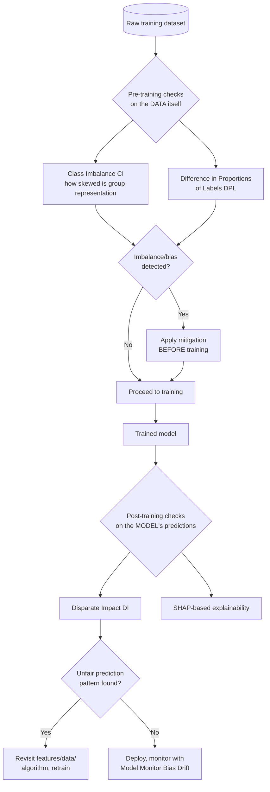
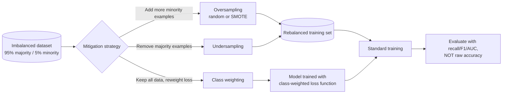
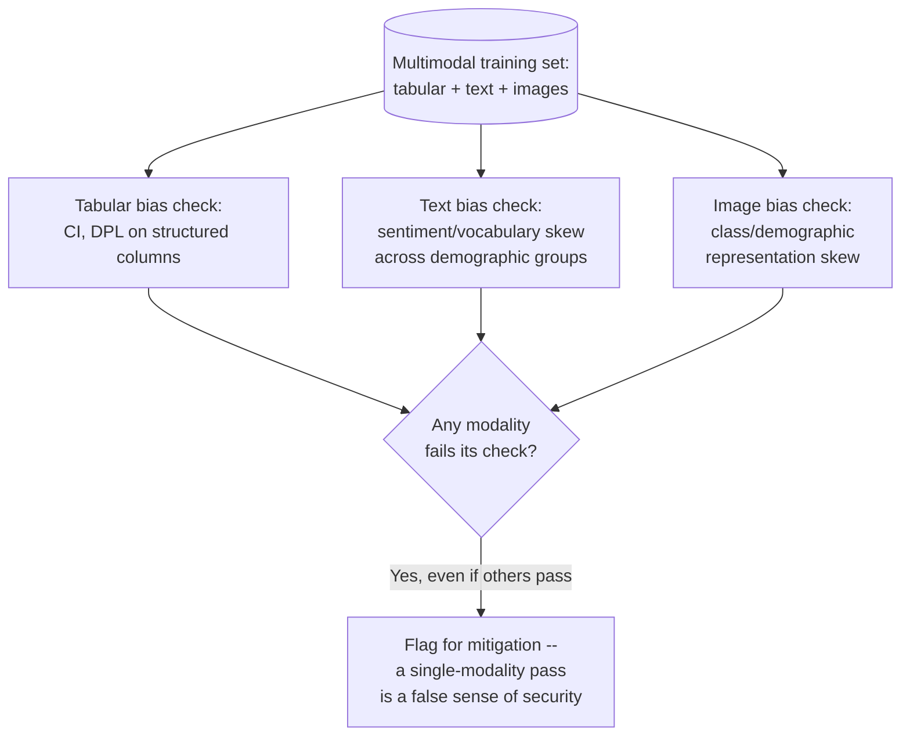

# Handling Class Imbalance and Bias in Training Data

*Machine Learning concept · MLA-C02 Domain 1, Task Statement 1.3 ("Ensure data integrity and
prepare data for modeling by identifying and mitigating sources of bias, ... detecting class
imbalance") — this domain's README covers this at summary depth; this doc works real numbers and
real detection/mitigation mechanics through, including the multimodal (text/image) extension new
to C02.*

## Definition

**Class imbalance** is when one outcome class in a training set is dramatically rarer than
another — fraud at 1% of transactions, a rare disease at 0.3% of patients, churners at 15% of
customers. **Bias in training data** is when a dataset's composition systematically
under- or over-represents a group (demographic, geographic, or otherwise) in a way that produces
a model whose accuracy or fairness differs measurably across that group — not necessarily the
same thing as imbalance, though the two interact and are frequently tested together.

## Plain-English Analogy

Imagine training a wildlife-spotting guide by showing them 9,900 photos of squirrels and only 100
photos of foxes. Even a mediocre, lazy trainee guide can achieve "99% accuracy" by simply
answering "squirrel" every single time — technically correct 99 times out of 100, and completely
useless for the one job that actually mattered: spotting the fox. Class imbalance tricks the
*metric* (accuracy) into looking great while the *model* has learned nothing about the minority
class it was actually built to detect.

## Purpose

Standard training procedures (and standard accuracy metrics) implicitly assume classes are
roughly balanced. When they're not, both the **training process** (the model finds it easy to
minimize loss by just predicting the majority class) and the **evaluation process** (accuracy
looks deceptively high) silently fail to surface the real problem. AWS built SageMaker Clarify
and Data Wrangler's bias/imbalance reports specifically so this failure mode gets caught *before*
a training job burns compute on a dataset that will produce a model useless for its actual
purpose, and so demographic bias gets caught before a model's unfairness becomes a legal or
reputational problem in production.

## How It Works — Detection

The diagram's structural point worth internalizing: bias/imbalance checking happens at **two
distinct points**, and they catch different problems. **Pre-training** checks (CI, DPL) look at
the *data itself*, before any model exists — catching a skewed dataset before compute is wasted
training on it. **Post-training** checks (Disparate Impact, SHAP) look at the *model's actual
predictions* — catching a model that turned out unfair even if the input data's own metrics
looked acceptable, or confirming that a data-level fix actually solved the problem at the
model-output level too.

### Pre-training bias metrics, worked with real numbers

**Class Imbalance (CI)**: measures how skewed the representation of one group is relative to
another. A simplified formula: `CI = (n_a - n_d) / (n_a + n_d)`, where `n_a` and `n_d` are the
counts of the advantaged and disadvantaged groups. A loan-approval dataset with 8,000 applications
from Group A and 2,000 from Group D: `CI = (8,000 - 2,000) / (8,000 + 2,000) = 0.6`. CI ranges from
-1 (completely disadvantaged-group-dominated) to +1 (completely advantaged-group-dominated); a
value of 0.6 signals meaningful under-representation of Group D worth investigating before
training, not an automatic disqualifier but a flag demanding explanation.

**Difference in Proportions of Labels (DPL)**: measures whether the *positive outcome rate*
differs between groups, independent of representation count. If Group A has a 40% loan-approval
rate and Group D has a 15% approval rate: `DPL = 0.40 - 0.15 = 0.25`. A large DPL is a stronger,
more direct bias signal than CI alone — it's not just that one group has fewer applicants, it's
that the *outcome itself* is distributed unevenly between groups, which is exactly the kind of
training-data pattern that bakes an unfair decision boundary into the resulting model.

### Post-training bias metric, worked with real numbers

**Disparate Impact (DI)**: compares the rate of *favorable model predictions* between groups,
analogous to DPL but measured on the trained model's actual output instead of the training
labels. `DI = (favorable rate for disadvantaged group) / (favorable rate for advantaged group)`.
If the model approves 60% of Group A applicants and only 30% of Group D applicants:
`DI = 0.30 / 0.60 = 0.5`. The commonly cited **four-fifths rule** (from US employment-
discrimination law, used as a rule of thumb more broadly) flags a DI below 0.8 as a disparate
impact concern — `0.5` is well below that threshold and demands investigation into whether a
legitimate, non-protected factor explains the gap, or whether the model has absorbed bias from
its training data.

## How It Works — Mitigation

### Mitigation technique 1 — Random oversampling and SMOTE, worked with real numbers

A fraud dataset has 98,000 legitimate transactions and 2,000 fraudulent ones (2% minority class).
**Random oversampling** duplicates existing minority-class rows until the classes are closer to
balanced — e.g., duplicating the 2,000 fraud rows 20x produces 40,000 fraud rows against 98,000
legitimate ones (roughly 29% minority), a far less extreme imbalance a standard training loop can
learn from without just defaulting to "always predict legitimate." The real risk: naive
duplication can cause the model to **overfit to the exact duplicated examples** rather than
learning a generalizable fraud pattern, since it's literally seeing the same 2,000 original rows
repeated many times.

**SMOTE (Synthetic Minority Oversampling Technique)** addresses that overfitting risk directly:
instead of duplicating existing minority rows verbatim, it generates **new, synthetic** minority
examples by interpolating between existing minority examples and their nearest minority-class
neighbors in feature space — each synthetic fraud example is a plausible "in-between" point, not
an exact copy of a real one, giving the model more genuine variety to learn from.

### Mitigation technique 2 — Undersampling, worked with real numbers

The same 98,000-legitimate / 2,000-fraud dataset, undersampled instead: randomly dropping
legitimate transactions down to, say, 10,000 rows, against the full 2,000 fraud rows, produces an
83%/17% split. **The real cost**: discarding 88,000 legitimate transactions throws away
potentially useful information about what "normal" looks like across its full diversity —
undersampling is the right call specifically when the majority class is so large that training
time/cost on the full dataset is itself a constraint, not merely because imbalance exists.

### Mitigation technique 3 — Class weighting, worked with real numbers

Rather than touching the dataset at all, class weighting tells the training algorithm's loss
function to penalize a minority-class misclassification more heavily than a majority-class one.
For the 98,000/2,000 example, a common weighting scheme sets each class's weight inversely
proportional to its frequency: `weight_fraud = total / (2 * 2,000) = 25`, `weight_legit = total /
(2 * 98,000) ≈ 0.51`. In practice, this means a single misclassified fraud case contributes
roughly 49x more to the training loss than a single misclassified legitimate case — the model is
mathematically incentivized to get the rare class right, without ever duplicating or discarding a
single row.

**Why the exam tests all three, not just one "the" answer**: the correct mitigation depends on
constraints a scenario names — oversampling/SMOTE when training-set size itself isn't the
bottleneck and genuine variety matters; undersampling when the majority class's sheer volume is
the actual cost/time constraint; class weighting when you want zero changes to the dataset itself
(useful when the data pipeline downstream of this step must remain untouched, e.g., for audit
reasons).

## Real AWS Image, Discussed

*Source: AWS SageMaker Developer Guide, "Analysis Results" (SageMaker Clarify) —
docs.aws.amazon.com/sagemaker/latest/dg/clarify-processing-job-analysis-results.html. Verified
live via `curl -o /dev/null -w "%{http_code}"` → `200`.*

This is a real SageMaker Clarify SHAP report — the kind of output a **post-training** check
produces, ranking each feature by how much it pushed the model's predictions up or down on
average across the dataset. The reason this specific image matters for a bias discussion rather
than pure explainability: if a feature that's a known legal proxy for a protected attribute (e.g.,
zip code correlating strongly with race, or a specific employer name correlating with age) shows
up with disproportionately high SHAP importance, that's a direct, visual signal the model may be
leaning on a biased proxy even if no protected attribute was ever explicitly included as an input
column — a pattern purely numeric Disparate Impact metrics alone might not immediately surface as
clearly as seeing the actual feature ranking.

## The Multimodal Extension — Bias Beyond Tabular Data (C02-New)

MLA-C02 extends bias checking beyond numeric/tabular columns to **text and image** data together
— a dataset combining structured fields, free text, and images needs bias checked across *all*
asset types, not just the columns Clarify's classic tabular metrics traditionally focus on.

- **Text bias**: checking whether certain demographic groups are described using systematically
  different *sentiment* or *vocabulary* in free-text fields — e.g., performance-review text
  describing women using more "communal" language and men using more "agentic" language for
  comparable achievements, which a downstream promotion-prediction model could absorb as a biased
  signal even though no numeric field names gender at all.
- **Image bias**: checking whether an image dataset's demographic representation is skewed — e.g.,
  a facial-recognition training set drawn overwhelmingly from one skin-tone range, producing a
  model measurably less accurate for underrepresented groups in production even though the
  training process itself ran with no bug.
- **Why a single-modality pass is a false sense of security**: a dataset's tabular fields can
  show zero demographic skew while its free-text complaint descriptions paired with the same
  records carry a real sentiment skew a tabular-only check would never surface — multimodal bias
  checking exists specifically because a model trained on text + tabular + image together can
  absorb bias from *any one* of the three, and checking only one is incomplete, not merely
  "good enough."

## Use Cases — Real Scenarios

1. A credit card issuer's fraud model, trained on a 99.3%/0.7% imbalanced dataset, is switched
   from accuracy to **recall and F1 score** as its primary evaluation metric after discovering the
   model had been achieving 99.3% "accuracy" by never predicting fraud at all.
2. A hiring-screening model's pre-training bias check reveals a large DPL between two demographic
   groups' historical "advanced to interview" rate in the training data — the team pauses
   training to investigate whether that gap reflects genuine qualification differences or a
   biased historical screening process the model would otherwise learn to replicate.
3. A hospital's readmission-risk model applies SMOTE to its rare "readmitted within 30 days" class
   rather than random oversampling, specifically to avoid the model memorizing a small number of
   duplicated real patient records verbatim.
4. A loan-approval model's post-training Disparate Impact metric comes back at 0.55 — well under
   the four-fifths rule's 0.8 threshold — triggering a mandatory fairness review before the model
   can be deployed, independent of its overall accuracy score.
5. A content-moderation team discovers their text-based toxicity classifier flags comments from
   one dialect/vernacular at a disproportionately higher rate than standard-dialect comments
   carrying equivalent sentiment, a text-modality bias finding a tabular-only review process had
   never been built to catch.
6. An HR analytics team runs SageMaker Clarify's bias report during Data Wrangler-stage prep and
   discovers their class-weighting scheme (set once, years ago) no longer matches the current,
   shifted class distribution — a reminder that imbalance mitigation isn't a one-time setup but
   needs periodic revalidation as the underlying population changes.

## When NOT to "Fix" Imbalance

- **When the imbalance reflects genuine real-world rarity** (fraud really is rare; a specific
  disease really does affect under 1% of patients) — the fix is **not** artificially forcing
  balance in a way that misrepresents the real-world base rate the model will actually encounter
  in production; the fix is choosing evaluation metrics (recall, precision, F1, AUC-PR) that don't
  reward ignoring the minority class, and optionally class weighting, while leaving the true
  prevalence reflected honestly in validation/test sets.
- **When oversampling a tiny minority class risks the synthetic/duplicated examples outnumbering
  genuinely distinct real signal** — a minority class with fewer than a few dozen real examples
  may not have enough underlying diversity for SMOTE's interpolation to produce meaningfully new,
  useful synthetic points; in that regime, collecting more real minority-class data (even if slow
  and expensive) can be the more honest fix than algorithmic oversampling.

## Troubleshooting / Common Issues

- **A model shows 99%+ accuracy but recall on the minority class is near zero.** This is the
  textbook imbalance symptom — switch the evaluation metric to recall, precision, F1, or AUC-PR
  before concluding the model is "good," and revisit mitigation (class weighting, resampling).
- **Disparate Impact looks acceptable overall but a specific sub-group still shows a large gap.**
  Aggregate DI across a whole population can mask a severe gap concentrated in one intersectional
  sub-group (e.g., a specific age-and-region combination) — slice the metric by relevant
  sub-populations, not only the top-level groups, before declaring the model fair.
- **SMOTE-generated synthetic examples make validation performance worse, not better.** This can
  mean the minority class had too few real examples for interpolation to produce plausible points,
  or that SMOTE was applied before a train/validation split (contaminating validation with
  synthetic points derived from training data) — always split first, then apply SMOTE only to the
  training partition.
- **A bias metric that passed last quarter now fails, with no code changes.** The underlying
  population's distribution has likely shifted — re-run pre-training checks against current data
  rather than assuming a one-time bias clearance holds indefinitely as the data evolves.

## Why It's Important

**Real-world:** a model that "looks accurate" but has silently learned to ignore the minority
class entirely is one of the most expensive classic-ML failure modes to discover late — often only
after it's already caused real financial loss (undetected fraud) or real harm (a biased lending
or hiring decision triggering regulatory action). **Exam:** Task Statement 1.3 names this
explicitly, and it's one of the most frequently recurring scenario shapes across the entire
exam — a dataset described with a skewed class split, or a model described with disproportionate
outcomes across groups, is testing whether you can name the specific metric (CI, DPL, DI) and the
specific mitigation (oversampling, undersampling, class weighting) the scenario is actually
pointing at, not a vague "fix the bias" answer.

## Exam Tips

- **Accuracy is a trap metric for imbalanced data** — a question describing a model with "high
  accuracy" on a known-imbalanced dataset is testing whether you'd reach for recall/precision/F1/
  AUC-PR instead of trusting the headline accuracy number.
- **Pre-training (CI, DPL) vs. post-training (DI, SHAP)** is a direct, repeatedly tested
  distinction — pre-training checks the *data*, post-training checks the *model's actual
  predictions*; a dataset can pass one and fail the other.
- **Genuine rarity isn't a bug to "fix" by force-balancing** — a question confirming the team is
  confident the underlying population really is that skewed (fraud really is rare) is testing
  whether you'd carry that imbalance forward into Domain 2's training step (class weighting,
  resampling, or the right metric) rather than artificially over-correcting it.
- **Multimodal bias checking (text, image) alongside tabular** is explicitly new to MLA-C02 — a
  single-modality bias pass described in a scenario isn't automatically a clean bill of health if
  text or image data is also part of the same training set.

## Related Terms

- [`README.md`](README.md) — Task Statement 1.3's summary-depth coverage this doc expands on.
- [`feature-engineering-deep-dive.md`](feature-engineering-deep-dive.md) — the companion
  transformation-focused deep dive (Task 1.2), covering what happens before bias/imbalance
  checking.
- [`../domain-2-model-development/README.md`](../domain-2-model-development/README.md) —
  how class weighting and resampling decisions here connect to Domain 2's training step.
- [`../domain-4-monitoring-security/README.md`](../domain-4-monitoring-security/README.md) —
  Model Monitor's Bias Drift, the post-deployment continuation of the post-training checks
  described here.
- [`../../../glossary/README.md`](../../../glossary/README.md) — one-line definitions of class
  imbalance, disparate impact, and related cross-cutting terms.
