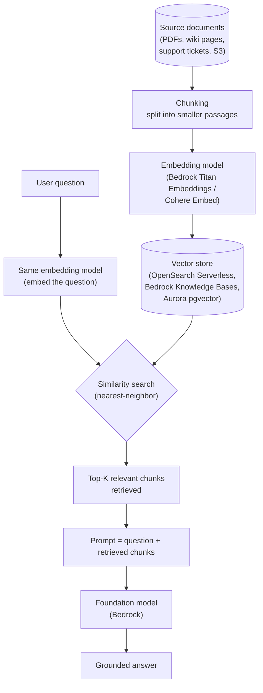

# Embeddings and RAG Data Preparation

*Machine Learning / Generative AI concept · MLA-C02 Domain 1, Task Statement 1.4 — the single
biggest net-new topic area added going from MLA-C01 to MLA-C02. This doc lives in Domain 1
(data preparation) rather than inside `bedrock.md` because it's a data-shaping concept that
applies across several services (S3, OpenSearch, Bedrock Knowledge Bases, SageMaker), not a
single service's feature.*

## Definition

**RAG** stands for **Retrieval-Augmented Generation**. In plain terms: instead of retraining a
large language model (LLM) every time your company's documents change, you keep the model as-is
and, at the moment someone asks it a question, you first **retrieve** the most relevant pieces
of your own documents and hand them to the model as extra context — then the model **generates**
its answer using that context. "RAG data preparation" is everything you do to your documents
*before* that retrieval step can work: turning text into **embeddings** and storing them in a
**vector store**.

An **embedding** is a list of numbers (a vector — think "an arrow with hundreds or thousands of
components," not a single value) that represents the *meaning* of a piece of text, image, or
other data. Two pieces of text with similar meaning get embeddings that are numerically close to
each other; two unrelated pieces of text get embeddings that are far apart. This is the entire
trick that makes RAG work: "find text similar in meaning" becomes "find vectors that are close
together," which is a fast, well-understood math problem (nearest-neighbor search).

## Purpose

Foundation models (the large pretrained models behind Bedrock, ChatGPT-style assistants, etc.)
know only what was in their training data, frozen at some cutoff date. They don't know your
company's internal wiki, your product catalog updated yesterday, or last night's support
tickets. You have three options to fix that: (1) retrain/fine-tune the model on your data —
expensive, slow, and has to be redone every time the data changes; (2) paste the relevant
documents directly into every prompt — doesn't scale past a tiny amount of text, and most of a
large document is irrelevant to any one question; or (3) **RAG** — keep the documents in a
searchable form, and at question time, pull out only the relevant snippets. RAG exists because
it is dramatically cheaper and faster than retraining, and dramatically more scalable than
pasting everything into the prompt. It also solves a real accuracy problem called
**hallucination** (a model confidently generating a plausible-sounding but false answer) by
grounding the model's answer in actual retrieved text instead of asking it to recall facts from
memory alone.

## How It Works

Plain-English: cut your documents into bite-sized pieces, convert each piece into a vector
(embedding), store the vectors in a database built for fast similarity search (a vector store),
and at query time convert the *question* into a vector too, so you can find the stored pieces
whose vectors are closest to it.

Step by step:
1. **Source documents** live wherever your raw data already is — most commonly S3, but also
   wikis, ticketing systems, or databases pulled in through a connector.
2. **Chunking** splits each document into smaller passages (for example 300–500 tokens each,
   often with some overlap between chunks so a sentence that straddles a chunk boundary isn't
   lost). Chunk size is a real design decision: chunks too large dilute relevance (the vector
   represents an average of many ideas); chunks too small lose context (a pronoun like "it"
   with no antecedent in the chunk).
3. **Embedding model** turns each chunk into a vector. Bedrock offers **Titan Embeddings** and
   third-party options like **Cohere Embed**; the same model must be used consistently for both
   the stored chunks and incoming questions, or the vectors won't be comparable.
4. **Vector store** persists the vectors plus a pointer back to the original chunk text. Options
   covered elsewhere in this repo include **Amazon OpenSearch Serverless** (general-purpose
   vector search) and **Amazon Bedrock Knowledge Bases**, which bundles chunking + embedding +
   vector storage + retrieval into one managed workflow so you don't have to wire the pieces
   together yourself. **Aurora PostgreSQL with the `pgvector` extension** is another option when
   you already run Aurora and want vectors alongside relational data.
5. **User question → embedding** — exactly the same embedding model converts the live question
   into a vector, so it lives in the same numeric space as the stored chunks.
6. **Similarity search** finds the stored vectors closest to the question's vector — typically
   using cosine similarity or Euclidean distance — and returns the **top-K** (e.g., top 5) most
   relevant chunks.
7. **Prompt assembly** combines the original question with the retrieved chunks into one prompt
   sent to the foundation model — this is the "augmented" part of Retrieval-**Augmented**
   Generation.
8. **Generation** — the foundation model (via Bedrock) reads the question plus the grounding
   context and produces an answer that's tied to the actual retrieved text, not just whatever it
   memorized during pretraining.

## Key Features / Components

- **Chunking strategies** — fixed-size (simplest, same token count every time), sentence/
  paragraph-based (respects natural language boundaries), and semantic chunking (split at
  meaning boundaries using an embedding model itself to detect topic shifts). Larger documents
  usually need overlap (e.g., 10–20%) between consecutive chunks so context isn't lost at the
  cut point.
- **Embedding dimensionality** — each embedding model outputs vectors of a fixed length (e.g.,
  1536 numbers). Higher dimensionality can capture more nuance but costs more storage and
  compute per comparison; this is a cost/accuracy tradeoff, not a free upgrade.
- **Vector store / vector database** — a database optimized for nearest-neighbor search over
  high-dimensional vectors, instead of exact-match lookups like a traditional database index.
- **Metadata filtering** — most vector stores let you attach metadata (e.g., `department: HR`,
  `date: 2026`) to each chunk and filter the similarity search to a subset — critical for
  multi-tenant or access-controlled RAG systems so one user's query can't retrieve another
  user's private documents.
- **Bedrock Knowledge Bases** — AWS's managed end-to-end RAG pipeline: point it at an S3 data
  source, it handles chunking, embedding, vector storage, and retrieval, and exposes a simple
  "ask a question, get a grounded answer with citations" API.

## Use Cases — When to Use It

- A support chatbot needs to answer questions using your product documentation, which changes
  weekly → RAG, because retraining a model weekly is impractical.
- Legal/compliance requires the model's answers to cite their source → RAG naturally provides
  this, since you know exactly which chunk was retrieved (fine-tuning does not give you
  citations).
- You need the model to reason about data created *after* its training cutoff → RAG (fine-tuning
  can't inject genuinely new facts efficiently; it's better for teaching style/format/behavior).

## When NOT to Use It / Alternatives

- **You need the model to learn a new skill, tone, or output format consistently** (e.g., always
  responding in a specific JSON schema, or writing in your brand's voice) → that's **fine-tuning**
  a foundation model, not RAG; RAG changes what facts the model has access to, not how it
  behaves.
- **Your entire knowledge base is small enough to fit directly in the prompt** (a few pages) →
  skip the vector store entirely and just include the text — RAG's retrieval step adds
  complexity with no benefit if there's nothing to filter down.
- **You need exact-match lookups** (customer ID → order history) → use a regular database query,
  not similarity search; vector search finds things that are *similar in meaning*, not identical.

## Why It's Important

Real-world: RAG is the dominant pattern for making generative AI useful on private/current data
without the cost of retraining, and getting chunking/embedding wrong is one of the most common
reasons a RAG system gives bad answers in practice (too-large chunks, mismatched embedding
models between indexing and querying, no metadata filtering causing data leakage across users).
Exam weight: this is explicitly called out as new content differentiating MLA-C02 from MLA-C01,
and sits in the highest-weighted domain (28%) — expect several questions testing whether you
know when RAG beats fine-tuning, and basic vector-store/embedding vocabulary.

## Pricing Model (summary)

Embedding models are billed per unit of input text processed (Bedrock: per 1,000 input tokens,
model-dependent). Vector storage costs depend on the chosen store — OpenSearch Serverless bills
by OCU (OpenSearch Compute Unit) hours; Bedrock Knowledge Bases bills for the underlying storage
and embedding calls it makes on your behalf. See
[`services/machine-learning-ai/bedrock.md`](../../../services/machine-learning-ai/bedrock.md)
and the official Bedrock pricing page for current numbers.

## Hands-on Lab (Floci)

See [`labs.md`](labs.md) in this folder — Floci does not emulate Bedrock or vector embedding
generation; the lab uses a free local Hugging Face `sentence-transformers` model plus a local
FAISS or `pgvector`-on-Docker index instead, with Floci only staging the source documents in S3.

## Exam Tips

- If a question describes "grounding answers in private/current documents without retraining" —
  that's RAG, every time.
- If a question describes "teaching the model a new output format/tone/style" — that's
  fine-tuning, not RAG; don't default to RAG for every GenAI customization question.
- Know that the *same* embedding model must be used to embed both the stored documents and the
  incoming query — a common wrong-answer trap is mixing two different embedding models.
- Chunk size and overlap are plain-English concepts the exam tests without requiring math —
  you just need to reason about "too big loses precision, too small loses context."

## Related Terms

- [`services/machine-learning-ai/bedrock.md`](../../../services/machine-learning-ai/bedrock.md)
  — foundation models, Knowledge Bases, Agents.
- [`services/analytics/opensearch.md`](../../../services/analytics/opensearch.md) — one of the
  vector store backends.
- [`responsible-ai-and-guardrails.md`](../domain-4-monitoring-security/responsible-ai-and-guardrails.md)
  — filtering/validating what a RAG-grounded model is allowed to output.
