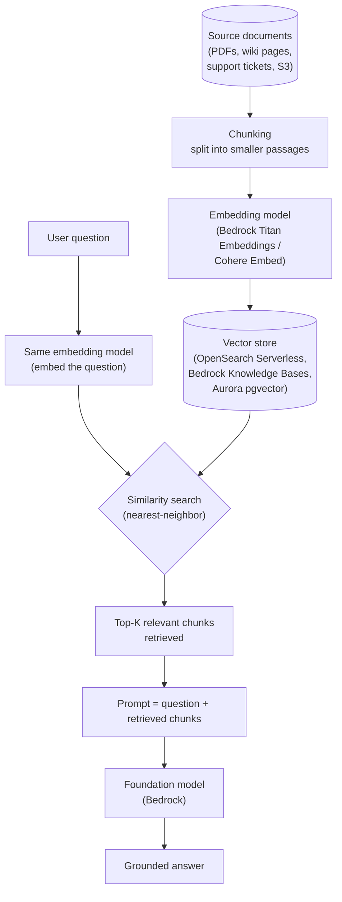
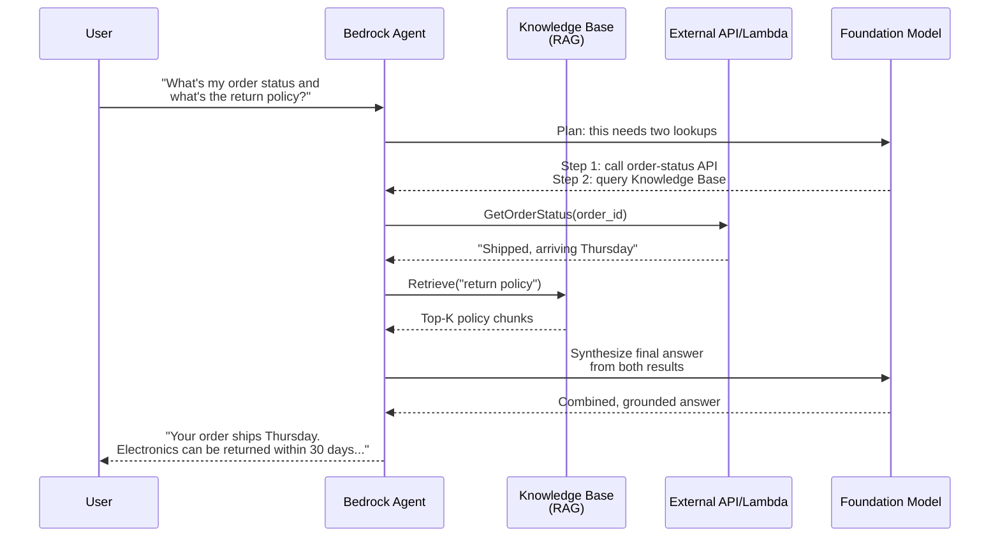

# Embeddings and RAG Data Preparation

*Machine Learning / Generative AI concept · MLA-C02 Domain 1, Task Statement 1.4 — the single
biggest net-new topic area added going from MLA-C01 to MLA-C02. This doc lives in Domain 1
(data preparation) rather than inside `bedrock.md` because it's a data-shaping concept that
applies across several services (S3, OpenSearch, Bedrock Knowledge Bases, SageMaker), not a
single service's feature.*

## Definition

**RAG** stands for **Retrieval-Augmented Generation**. In plain terms: instead of retraining a
large language model (LLM) every time your company's documents change, you keep the model as-is
and, at the moment someone asks it a question, you first **retrieve** the most relevant pieces
of your own documents and hand them to the model as extra context — then the model **generates**
its answer using that context. "RAG data preparation" is everything you do to your documents
*before* that retrieval step can work: turning text into **embeddings** and storing them in a
**vector store**.

An **embedding** is a list of numbers (a vector — think "an arrow with hundreds or thousands of
components," not a single value) that represents the *meaning* of a piece of text, image, or
other data. Two pieces of text with similar meaning get embeddings that are numerically close to
each other; two unrelated pieces of text get embeddings that are far apart. This is the entire
trick that makes RAG work: "find text similar in meaning" becomes "find vectors that are close
together," which is a fast, well-understood math problem (nearest-neighbor search).

A simple mental model, no math required: imagine plotting every sentence you've ever read as a
single dot on a huge map, where sentences about "returns and refunds" all cluster in one
neighborhood of the map, sentences about "shipping times" cluster in a different neighborhood, and
so on. An embedding is just that sentence's coordinates on the map. Finding "what's relevant to
this question" becomes "what dots are closest to the question's own coordinates on the same map"
— nothing more exotic than that, even though the real map has hundreds of dimensions instead of
two.

## Purpose

Foundation models (the large pretrained models behind Bedrock, ChatGPT-style assistants, etc.)
know only what was in their training data, frozen at some cutoff date. They don't know your
company's internal wiki, your product catalog updated yesterday, or last night's support
tickets. You have three options to fix that: (1) retrain/fine-tune the model on your data —
expensive, slow, and has to be redone every time the data changes; (2) paste the relevant
documents directly into every prompt — doesn't scale past a tiny amount of text, and most of a
large document is irrelevant to any one question; or (3) **RAG** — keep the documents in a
searchable form, and at question time, pull out only the relevant snippets. RAG exists because
it is dramatically cheaper and faster than retraining, and dramatically more scalable than
pasting everything into the prompt. It also solves a real accuracy problem called
**hallucination** (a model confidently generating a plausible-sounding but false answer) by
grounding the model's answer in actual retrieved text instead of asking it to recall facts from
memory alone.

### RAG vs. fine-tuning vs. prompting — a direct comparison

This three-way comparison is tested constantly, because the exam's favorite trap is applying the
wrong one of these three to a scenario that clearly calls for a different one:

| Dimension | Prompting alone | RAG | Fine-tuning |
|---|---|---|---|
| What it changes | Nothing about the model — just gives it instructions/examples in the prompt | What *facts* the model has access to at answer time | How the model *behaves* (tone, format, domain vocabulary, task-specific skill) |
| Good for | Simple tasks, small amount of context, quick iteration | Grounding answers in current/private documents, needing citations | Teaching a consistent output format, a persona, or a narrow skill not well covered out of the box |
| Bad for | Large private knowledge bases — doesn't scale | Changing *how* the model writes/behaves, not just what it knows | Injecting frequently-changing facts — requires retraining every time data changes |
| Update cost when data changes | N/A (no stored data) | Cheap — re-embed and re-index changed documents | Expensive — requires a new fine-tuning run |
| Gives you citations/source attribution | No | Yes, naturally (you know which chunk was retrieved) | No |
| Typical AWS implementation | Just the model invocation itself | Bedrock Knowledge Bases / OpenSearch + Bedrock | Bedrock fine-tuning / SageMaker JumpStart fine-tuning |

## How It Works

Plain-English: cut your documents into bite-sized pieces, convert each piece into a vector
(embedding), store the vectors in a database built for fast similarity search (a vector store),
and at query time convert the *question* into a vector too, so you can find the stored pieces
whose vectors are closest to it.

Step by step:
1. **Source documents** live wherever your raw data already is — most commonly S3, but also
   wikis, ticketing systems, or databases pulled in through a connector.
2. **Chunking** splits each document into smaller passages (for example 300–500 tokens each,
   often with some overlap between chunks so a sentence that straddles a chunk boundary isn't
   lost). Chunk size is a real design decision: chunks too large dilute relevance (the vector
   represents an average of many ideas); chunks too small lose context (a pronoun like "it"
   with no antecedent in the chunk).
3. **Embedding model** turns each chunk into a vector. Bedrock offers **Titan Embeddings** and
   third-party options like **Cohere Embed**; the same model must be used consistently for both
   the stored chunks and incoming questions, or the vectors won't be comparable.
4. **Vector store** persists the vectors plus a pointer back to the original chunk text. Options
   covered elsewhere in this repo include **Amazon OpenSearch Serverless** (general-purpose
   vector search) and **Amazon Bedrock Knowledge Bases**, which bundles chunking + embedding +
   vector storage + retrieval into one managed workflow so you don't have to wire the pieces
   together yourself. **Aurora PostgreSQL with the `pgvector` extension** is another option when
   you already run Aurora and want vectors alongside relational data.
5. **User question → embedding** — exactly the same embedding model converts the live question
   into a vector, so it lives in the same numeric space as the stored chunks.
6. **Similarity search** finds the stored vectors closest to the question's vector — typically
   using cosine similarity or Euclidean distance — and returns the **top-K** (e.g., top 5) most
   relevant chunks.
7. **Prompt assembly** combines the original question with the retrieved chunks into one prompt
   sent to the foundation model — this is the "augmented" part of Retrieval-**Augmented**
   Generation.
8. **Generation** — the foundation model (via Bedrock) reads the question plus the grounding
   context and produces an answer that's tied to the actual retrieved text, not just whatever it
   memorized during pretraining.

*Figure: AWS's own illustration of the pre-processing (indexing) half of RAG — documents are
chunked, converted to embeddings, and written to a vector index while keeping a pointer back to
the original document. This is steps 1-4 above, in AWS's own diagram form. Source: Amazon Bedrock
User Guide, "How Amazon Bedrock knowledge bases work" —
docs.aws.amazon.com/bedrock/latest/userguide/kb-how-it-works.html.*

*Figure: the runtime half — the user's query is embedded with the same model, the vector index is
searched for semantically similar chunks, and the retrieved context augments the prompt sent to
the foundation model. This is steps 5-8 above. Source: same Bedrock User Guide page.*

### A second diagram — Bedrock Knowledge Bases wired into an Agent

RAG rarely stands alone in a real deployment; it's commonly one capability inside a larger
Bedrock Agent that can also call tools/APIs. Seeing where RAG sits in that bigger picture avoids
a common exam confusion between "Knowledge Bases" (the RAG piece) and "Agents" (the broader
orchestration piece, covered fully in Domain 3):

The exam-relevant distinction: a Knowledge Base alone answers "what does our documentation say" —
it has no ability to call an external system. An Agent is the layer that can combine a Knowledge
Base lookup *and* a live API call (like checking real order status) into one multi-step answer.
A scenario describing only "answer questions from our documents" is Knowledge Bases; a scenario
describing "also take an action or look up live system state" needs an Agent on top.

## Key Features / Components

- **Chunking strategies** — fixed-size (simplest, same token count every time), sentence/
  paragraph-based (respects natural language boundaries), and semantic chunking (split at
  meaning boundaries using an embedding model itself to detect topic shifts). Larger documents
  usually need overlap (e.g., 10–20%) between consecutive chunks so context isn't lost at the
  cut point.
- **Embedding dimensionality** — each embedding model outputs vectors of a fixed length (e.g.,
  1536 numbers). Higher dimensionality can capture more nuance but costs more storage and
  compute per comparison; this is a cost/accuracy tradeoff, not a free upgrade.
- **Vector store / vector database** — a database optimized for nearest-neighbor search over
  high-dimensional vectors, instead of exact-match lookups like a traditional database index.
- **Metadata filtering** — most vector stores let you attach metadata (e.g., `department: HR`,
  `date: 2026`) to each chunk and filter the similarity search to a subset — critical for
  multi-tenant or access-controlled RAG systems so one user's query can't retrieve another
  user's private documents.
- **Bedrock Knowledge Bases** — AWS's managed end-to-end RAG pipeline: point it at an S3 data
  source, it handles chunking, embedding, vector storage, and retrieval, and exposes a simple
  "ask a question, get a grounded answer with citations" API.
- **Multimodal embeddings** — some embedding models (and Bedrock Knowledge Bases' newer "smart
  parsing" features) can embed images and tables extracted from documents alongside text, so a
  question can retrieve a relevant diagram or table, not only prose paragraphs.

### Multimodal embeddings — images and audio, in the same vector space as text

**Plain English:** a multimodal embedding model (e.g., Bedrock Titan Multimodal Embeddings) maps
*both* images and text onto the same coordinate map described at the top of this document, so "a
photo of a red sneaker" and the sentence "red running shoe" can land close together even though
one is pixels and the other is words. This is what makes text-to-image search ("find photos
matching this description") and image-to-image search ("find products that look like this photo")
both possible using the exact same nearest-neighbor mechanism as text-only RAG.

- **Audio isn't embedded directly in most AWS workflows today** — the standard pattern is
  **Amazon Transcribe** converts speech to text first, and *that* text is embedded with a normal
  text embedding model; a scenario describing "search call-center recordings by what was said"
  is a transcribe-then-embed pipeline, not a direct audio-embedding model, in the overwhelming
  majority of real and exam scenarios.
- **Images with embedded text** (a scanned form, a product label) still usually go through
  **Amazon Textract** first if the goal is to search the *text content* of the image; a
  multimodal embedding model is the right tool specifically when the goal is visual similarity
  (what the image *looks like*), not text extraction (what the image *says*) — conflating these
  two is the most common multimodal exam trap.
- **A concrete worked example:** an interior-design marketplace wants shoppers to upload a photo
  of a room they like and get back similar-looking furniture listings. This is a pure image-to-
  image similarity search — Textract would find zero relevant text (there's no text to find), so
  the correct pipeline is: embed the uploaded photo and every listing photo with the *same*
  multimodal embedding model, then run nearest-neighbor search exactly as described earlier in
  this document, just with image vectors instead of text vectors.

- **Hybrid search** — combining traditional keyword search (exact-term matching, useful for
  product codes, names, or acronyms that embeddings alone might blur together) with vector
  similarity search in the same query, improving recall for queries that mix a precise term with
  a conceptual question.
- **Re-ranking** — an optional second pass after the initial top-K similarity search, using a
  more expensive but more accurate model to re-order the retrieved candidates by true relevance
  before they're sent to the generation step — a lever for improving answer quality when plain
  vector similarity alone surfaces technically-close-but-not-actually-useful chunks.

### Choosing a vector store — a decision guide

A recurring scenario shape asks you to pick the right vector store backend for a given
constraint. A quick reference:

| If the scenario says... | Consider |
|---|---|
| "Want the whole RAG pipeline (chunk/embed/store/retrieve) managed end-to-end with minimal setup" | Bedrock Knowledge Bases |
| "Already running OpenSearch for log/search workloads, want vector search alongside it" | Amazon OpenSearch Service/Serverless with the k-NN plugin |
| "Already running Aurora PostgreSQL, want vectors alongside existing relational data with joins" | Aurora PostgreSQL + `pgvector` |
| "Need serverless, pay-per-use vector search with no cluster management" | OpenSearch Serverless or Bedrock Knowledge Bases (both scale down automatically) |
| "Need hybrid keyword + vector search in one query" | OpenSearch (supports both natively) |
| "Experimenting locally, no AWS account/cost yet" | FAISS (free, local, in-memory — see `labs.md`) |

### Vector Database Deep Comparison — OpenSearch Service vs. Amazon RDS (pgvector) vs. Amazon S3 Vector Search

The quick-reference table above is enough for most scenario questions, but the official C02 guide
names **configuring** a vector database (task statement 1.1.7) as its own skill — meaning the
exam can test *operational* and *pricing* tradeoffs between these three options, not only "which
one fits this use case." A full side-by-side:

| Dimension | Amazon OpenSearch Service/Serverless | Amazon RDS (or Aurora) PostgreSQL + `pgvector` | Amazon S3 Vector Search (S3 Vector Buckets) |
|---|---|---|---|
| What it fundamentally is | A purpose-built search engine with a vector (k-NN) plugin | A general-purpose relational database with a vector extension bolted on | Object storage (S3) with a native, serverless vector index feature |
| Best-fit mental model | "A search engine that also happens to do vectors" | "A SQL database that also happens to do vectors" | "Cheap, massive-scale object storage that also happens to do vectors" |
| Setup/ops burden | Moderate (Service: cluster sizing/patching; Serverless: zero capacity planning) | Low-moderate if you already run RDS/Aurora; real DBA overhead if not | Lowest — no cluster, no instance, no capacity planning at all |
| Query flexibility | Vector similarity + full-text/keyword hybrid search in one query | Vector similarity *and* arbitrary SQL joins against relational tables in one query | Vector similarity search only — no joins, no keyword hybrid |
| Latency profile | Lowest, most consistently tunable (via `ef_search`, shard count) | Good, but shares the instance's general query load/resources | Higher and less tunable than the other two — optimized for cost/scale over minimum latency |
| Cost shape | Pay for provisioned capacity (Service) or OCU-hours (Serverless) | Pay for the underlying RDS/Aurora instance, whether used for vectors heavily or not | Pay per request + storage, true pay-as-you-go with no idle floor |
| Scale ceiling | Very high — designed to shard horizontally to billions of vectors | Bound by a single database instance's vertical limits | Very high — S3's underlying storage scale, by design |
| Picks this when scenario says... | "hybrid search," "already on OpenSearch," "need the lowest, most tunable latency" | "already relational," "need vectors joined with other business data," "small-to-mid team already comfortable with Postgres" | "lowest ops," "lowest fixed cost," "very large corpus," "latency isn't the binding constraint" |
| Exam trap to watch for | Assuming OpenSearch is *always* the default RAG answer — it's the right answer only when hybrid search or sub-10ms latency is actually named | Assuming pgvector can't scale — it scales fine for the large majority of real workloads, just not to OpenSearch's horizontal-sharding ceiling | Assuming S3 vector search is "not a real vector database" — in the current guide it's a first-class, explicitly testable option, not a workaround |

**A worked configuration scenario:** "A retailer's product-recommendation RAG assistant needs to
combine a vector similarity search over product descriptions with an exact-match filter on
`in_stock = true` and `price < 50`, joined against a live inventory table that updates every few
minutes." Walking the table above: this needs relational joins against frequently-changing
structured data *in the same query* as a vector search — the deciding factor is the join
requirement, not raw scale or latency, so **RDS/Aurora + `pgvector`** is the correct configuration
choice here, even though OpenSearch could technically also serve the vector half alone.

### Worked example — sizing a RAG pipeline for a real company

To make the abstract cost/chunking tradeoffs concrete, walk through actual numbers. Suppose
"MegaMart" (same company as the Domain 1 README's case study) wants to index its 2,000-page
policy and product-manual corpus for the support chatbot.

1. **Chunking:** at ~400 tokens per chunk with 15% overlap, 2,000 pages (roughly 1,000,000 words,
   ~1.3M tokens) produces on the order of 3,500-4,000 chunks.
2. **Embedding cost:** at a representative Bedrock Titan Embeddings rate of a few cents per
   million input tokens, embedding the entire initial corpus is a one-time cost measured in
   single-digit dollars — trivially cheap compared to a fine-tuning run over the same corpus,
   which would be priced as a full training job.
3. **Ongoing cost:** when the returns policy page changes, only that one document's chunks (a
   handful, not the full corpus) need re-embedding and re-indexing — this incremental-update
   property is the single biggest operational reason RAG wins over fine-tuning for frequently
   changing source material.
4. **Storage:** ~4,000 chunks at a 1,536-dimension embedding (a common Titan Embeddings output
   size) is a small vector index by any vector database's standards — well within OpenSearch
   Serverless's or Bedrock Knowledge Bases' baseline capacity, meaning this specific workload's
   bottleneck is almost never storage cost, it's getting chunking and retrieval quality right.

This is the shape of math a "most cost-effective way to keep a chatbot's knowledge current"
exam question is testing — not exact numbers, but the *qualitative* fact that RAG's incremental
update cost scales with how much content changed, while fine-tuning's cost resets to "the whole
training job" regardless of how small the change was.

## Advanced Text Pre-processing for Embeddings — Tokenization & Domain-Specific Augmentation

Before chunking and embedding even begin, raw text goes through pre-processing that's easy to
skip over conceptually but is itself a tested skill (task statement 1.2.6):

- **Tokenization choice affects both chunk sizing and cost** — chunk size (discussed above in
  tokens, not characters or words) is only meaningful once you know *how* text is tokenized;
  the same 500-word passage can be, say, 650 tokens under one tokenizer and 900 under another
  less-efficient one for that language/domain, directly changing how many chunks a document
  produces and what it costs to embed.
- **Domain vocabulary and tokenizer mismatch** — a general-purpose embedding model's tokenizer
  fragments unfamiliar domain terms (drug names, legal citations, internal product codes) into
  many small sub-word tokens; this doesn't break retrieval outright, but it dilutes how precisely
  that specific term is represented in the resulting vector, which is a real, diagnosable reason
  a domain-heavy corpus sometimes retrieves worse than a general-content corpus using the exact
  same embedding model and chunking strategy.
- **Domain-specific augmentation for retrieval, not just fine-tuning** — generating paraphrased
  variants of frequently-asked questions (e.g., "how do I return an item" / "what's your return
  process" / "can I send this back") and embedding them alongside the canonical chunk improves
  recall for queries phrased differently than the source document's own wording — a lightweight,
  data-prep-side improvement that doesn't require touching the embedding model or vector store
  configuration at all.

## Troubleshooting / Common Issues

- **Retrieved chunks are relevant by topic but the generated answer is still wrong or vague.**
  Check prompt assembly and top-K count before assuming retrieval failed — too few retrieved
  chunks (K too small) can starve the model of needed context; too many can bury the genuinely
  relevant chunk among irrelevant ones.
- **The same question returns different top chunks on different days with no data changes.**
  Check whether the vector store's index was rebuilt or the embedding model version changed —
  switching embedding model versions silently invalidates the geometric relationship between old
  stored vectors and newly embedded queries; a full re-embedding of the corpus is required after
  any embedding model change, not just new documents.
- **A multi-tenant RAG system occasionally returns another tenant's content.** This is a metadata
  filtering bug, not a retrieval-quality issue — audit that every query path (not just the "happy
  path" UI) enforces the `tenant_id` (or equivalent) filter before the similarity search runs.
- **Embedding costs are higher than expected for a corpus that "shouldn't have changed much."**
  Check whether the ingestion pipeline is re-embedding the *entire* corpus on every scheduled run
  instead of only new/changed documents — this is a common, expensive default to leave
  unconfigured in a hand-rolled pipeline (Bedrock Knowledge Bases handles incremental sync
  automatically when pointed at a versioned S3 data source).
- **Chunking at a fixed token count cuts tables and code blocks in half, producing unusable
  chunks.** Switch to a structure-aware or semantic chunking strategy for content types where
  fixed-size splitting breaks meaningful structural units (tables, numbered lists, code) rather
  than forcing every document type through the same naive splitter.

## Use Cases — Real Scenarios

- A support chatbot needs to answer questions using your product documentation, which changes
  weekly → RAG, because retraining a model weekly is impractical.
- Legal/compliance requires the model's answers to cite their source → RAG naturally provides
  this, since you know exactly which chunk was retrieved (fine-tuning does not give you
  citations).
- You need the model to reason about data created *after* its training cutoff → RAG (fine-tuning
  can't inject genuinely new facts efficiently; it's better for teaching style/format/behavior).
- A multi-tenant SaaS product needs each customer's chatbot answers grounded only in that
  customer's own documents → RAG with metadata filtering (e.g., `tenant_id`) scoping every
  similarity search to the requesting customer's data only.
- An internal search tool needs to let employees find the right internal wiki page using natural
  language rather than exact keyword matches → RAG's retrieval half alone (without necessarily
  generating a synthesized answer) is a legitimate standalone use case.
- An interior-design marketplace lets shoppers upload a photo of a room and get back visually
  similar furniture listings → multimodal embeddings mapping both the uploaded photo and every
  listing photo into the same vector space, with no text extraction step involved at all.
- A call center wants supervisors to search thousands of hours of recorded calls by topic ("find
  every call where a customer mentioned cancelling") → Amazon Transcribe converts audio to text
  first, then the transcript is chunked and embedded exactly like any other text source.
- A pharmaceutical company's RAG assistant over clinical trial documents performs worse than a
  similar assistant built over general news articles, using the identical embedding model and
  chunk size → investigate tokenizer fragmentation of domain-specific drug/compound names before
  assuming the retrieval architecture itself is at fault.
- A retailer wants a RAG system that can also filter by `in_stock` and `price` against a live,
  frequently-updated inventory table in the same query as the similarity search → RDS/Aurora with
  `pgvector`, chosen specifically for the relational join capability OpenSearch and S3 vector
  search don't offer.
- A nonprofit with a small, slow-changing grant-guidelines corpus and no dedicated infrastructure
  team wants the cheapest possible RAG backend with zero cluster management → Amazon S3 Vector
  Buckets, accepting a higher latency ceiling than OpenSearch in exchange for near-zero ops
  overhead and true pay-per-use pricing.

## When NOT to Use It / Alternatives

- **You need the model to learn a new skill, tone, or output format consistently** (e.g., always
  responding in a specific JSON schema, or writing in your brand's voice) → that's **fine-tuning**
  a foundation model, not RAG; RAG changes what facts the model has access to, not how it
  behaves.
- **Your entire knowledge base is small enough to fit directly in the prompt** (a few pages) →
  skip the vector store entirely and just include the text — RAG's retrieval step adds
  complexity with no benefit if there's nothing to filter down.
- **You need exact-match lookups** (customer ID → order history) → use a regular database query,
  not similarity search; vector search finds things that are *similar in meaning*, not identical.
- **The underlying facts never change and are small in volume** (a fixed set of 10 FAQ answers)
  → a simple rules-based lookup or even a static prompt may outperform a full RAG pipeline on
  both cost and latency, with far less operational surface area to maintain.
- **Answers need to be guaranteed deterministic and auditable to the letter** (e.g., a regulated
  numeric calculation) → RAG still generates text probabilistically; a deterministic calculation
  belongs in actual code/business logic, with the foundation model only explaining the result in
  natural language, not computing it.

## Why It's Important

Real-world: RAG is the dominant pattern for making generative AI useful on private/current data
without the cost of retraining, and getting chunking/embedding wrong is one of the most common
reasons a RAG system gives bad answers in practice (too-large chunks, mismatched embedding
models between indexing and querying, no metadata filtering causing data leakage across users).
Exam weight: this is explicitly called out as new content differentiating MLA-C02 from MLA-C01,
and sits in the highest-weighted domain (28%) — expect several questions testing whether you
know when RAG beats fine-tuning, and basic vector-store/embedding vocabulary.

## Pricing Model (summary)

Embedding models are billed per unit of input text processed (Bedrock: per 1,000 input tokens,
model-dependent). Vector storage costs depend on the chosen store — OpenSearch Serverless bills
by OCU (OpenSearch Compute Unit) hours; Bedrock Knowledge Bases bills for the underlying storage
and embedding calls it makes on your behalf. See
[`services/machine-learning-ai/bedrock.md`](../../../services/machine-learning-ai/bedrock.md)
and the official Bedrock pricing page for current numbers.

**Worked cost-shape comparison:** re-embedding a 10,000-document corpus after every minor policy
update is far cheaper than fine-tuning a foundation model on the same corpus every time it
changes — embedding is billed per token processed once per document (and only changed documents
need re-embedding), while a fine-tuning run bills for the full training compute job regardless of
how small the change was. This cost asymmetry is exactly why RAG, not fine-tuning, is the default
answer whenever a scenario describes frequently-changing source documents.

## Hands-on Lab (Floci)

See [`labs.md`](labs.md) in this folder — Floci does not emulate Bedrock or vector embedding
generation; the lab uses a free local Hugging Face `sentence-transformers` model plus a local
FAISS or `pgvector`-on-Docker index instead, with Floci only staging the source documents in S3.

## Exam Tips

- If a question describes "grounding answers in private/current documents without retraining" —
  that's RAG, every time.
- If a question describes "teaching the model a new output format/tone/style" — that's
  fine-tuning, not RAG; don't default to RAG for every GenAI customization question.
- Know that the *same* embedding model must be used to embed both the stored documents and the
  incoming query — a common wrong-answer trap is mixing two different embedding models.
- Chunk size and overlap are plain-English concepts the exam tests without requiring math —
  you just need to reason about "too big loses precision, too small loses context."
- Distinguish Knowledge Bases (the RAG/retrieval piece) from Agents (the broader multi-step,
  tool-using orchestration layer) — a scenario needing only "answer from our documents" is
  Knowledge Bases; a scenario needing "also take an action" needs an Agent.
- Metadata filtering is the specific mechanism for multi-tenant data isolation in a shared vector
  store — if a scenario says "customer A must never see customer B's retrieved content," this is
  the keyword answer, not a separate vector store per customer (though that's also valid, just
  usually more operationally expensive than the exam's expected answer).

### More sample exam scenarios, worked

**Scenario 1:** "A company's product manual is 400 pages and changes every time a new product
ships. Customer support wants a chatbot that always reflects the latest manual." *Answer:* RAG —
chunk and re-embed only the changed sections of the manual as it's updated, rather than
retraining a model on 400 pages every release cycle.

**Scenario 2:** "A legal team requires every chatbot answer to show exactly which paragraph of
which source document it came from." *Answer:* RAG, specifically because retrieval naturally
preserves a pointer back to the original chunk/document — fine-tuning has no equivalent
traceability mechanism.

**Scenario 3:** "A multi-tenant HR SaaS platform's chatbot must answer each customer's employees
using only that customer's own HR policy documents, never another customer's." *Answer:*
metadata filtering on the vector store (e.g., filter by `tenant_id` at query time), not a
company-wide shared index with no isolation.

**Scenario 4:** "An engineering team wants a model that always outputs valid JSON matching a
specific internal schema for every response, regardless of what's asked." *Answer:* fine-tuning
(or strict prompt engineering with output validation) — this is a behavior/format requirement,
not a factual-grounding requirement, so RAG alone doesn't solve it.

## Related Terms

- [`services/machine-learning-ai/bedrock.md`](../../../services/machine-learning-ai/bedrock.md)
  — foundation models, Knowledge Bases, Agents.
- [`services/analytics/opensearch.md`](../../../services/analytics/opensearch.md) — one of the
  vector store backends.
- [`../domain-2-model-development/README.md`](../domain-2-model-development/README.md) — the
  RAG-vs-fine-tuning decision continues directly into this domain's foundation-model development
  task statements.
- [`../domain-3-deployment-orchestration/README.md`](../domain-3-deployment-orchestration/README.md)
  — how Knowledge Bases and Agents get deployed/orchestrated as production components.
- [`responsible-ai-and-guardrails.md`](../domain-4-monitoring-security/responsible-ai-and-guardrails.md)
  — filtering/validating what a RAG-grounded model is allowed to output.
- [`labs.md`](labs.md) — the local, free hands-on exercise for this exact pipeline.
