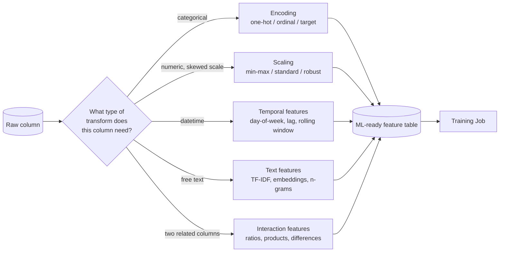
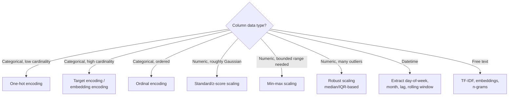
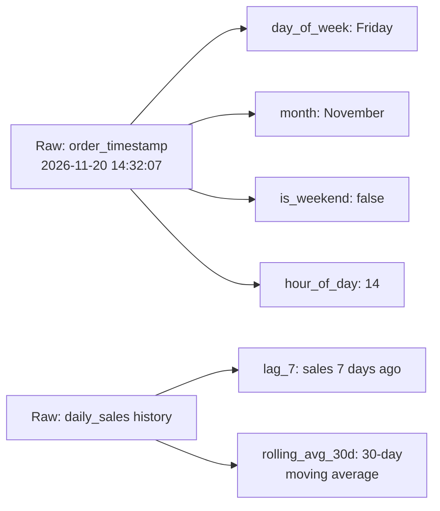

# Feature Engineering Techniques — Deep Dive, With Worked Examples

*Machine Learning concept · MLA-C02 Domain 1, Task Statement 1.2 ("Transform data and perform
feature engineering") — this domain's own README and the SageMaker Data Wrangler/Feature Store
service doc both treat feature engineering as a single bullet point ("encoding, scaling,
handling missing values"); this doc is the missing depth layer, with real numbers worked through
for each technique rather than just naming it.*

## Definition

**Feature engineering** is the process of transforming raw data columns into the numeric inputs
a machine learning algorithm can actually learn from — deciding what information matters,
reshaping it into a usable form, and sometimes inventing entirely new columns (features) that
weren't in the raw data at all but capture a pattern the raw columns alone don't expose. It's
widely considered the single highest-leverage activity in a classic ML project: a mediocre
algorithm trained on excellent features reliably beats a brilliant algorithm trained on raw,
poorly-engineered ones.

## Plain-English Analogy

Imagine handing a chef (the algorithm) a box of whole, unprepared ingredients — a whole chicken,
unwashed vegetables, raw spices in their pods. The chef *could* eventually make a meal, but most
of their time goes to prep work that has nothing to do with cooking skill. Feature engineering is
the prep cook's job: washing, chopping, measuring, pre-mixing — turning raw ingredients into
exactly the form the chef needs, so the chef's actual skill (the algorithm) is the thing that
determines how good the final dish is, not how much time got wasted on unprepared ingredients.

## Purpose

Most real-world raw data arrives in a shape no ML algorithm can consume directly: text categories
instead of numbers, wildly different numeric scales (a column of ages 0-100 next to a column of
account balances 0-10,000,000), missing values, and dates that hide patterns (day of week,
seasonality) invisible as a raw timestamp. Feature engineering exists because algorithms are
mathematically limited to numbers in consistent, comparable ranges — everything else has to be
translated into that form, and *how* you translate it measurably changes model accuracy, often
more than which algorithm you pick.

## How It Works

Step by step: every raw column gets routed to the transform category matching its actual data
type and the pattern you suspect it holds. A categorical column (e.g., `contract_type`) needs
**encoding** into numbers a model can use arithmetically without accidentally implying a false
order. A numeric column with wildly different scale than its neighbors needs **scaling** so no
single feature dominates a distance-based algorithm purely because of its raw magnitude. A
datetime column almost never helps a model as a raw timestamp — it needs **decomposition** into
day-of-week, month, or a lag/rolling-window feature that actually exposes the temporal pattern.
Free text needs **vectorization** before any numeric algorithm can touch it at all. And sometimes
the most predictive feature isn't in any single raw column — it's the **interaction** between two
columns (a ratio, product, or difference) that the raw columns alone never expose.

### A second diagram — the feature engineering decision tree, by data type

This decision tree is the practical, exam-relevant version of "which transform for which column" —
the trap worth naming explicitly is applying **one-hot encoding to a high-cardinality categorical
column** (e.g., a `zip_code` field with 40,000 distinct values): one-hot encoding would explode
into 40,000 new columns, most of them nearly all-zero, bloating the feature table and often
*hurting* model performance through the curse of dimensionality — **target encoding** (replacing
each category with a statistic of the target variable for that category, e.g., average churn rate
per zip code) or embedding-based encoding handle high cardinality without that explosion.

## Worked Example 1 — Encoding categorical variables, with real numbers

A telecom churn dataset has a `contract_type` column with three values: `month-to-month`, `one-
year`, `two-year`. Three encoding choices, worked through:

**One-hot encoding** (the default, safe choice for low-cardinality, unordered categories):

| customer_id | contract_month | contract_one_year | contract_two_year |
|---|---|---|---|
| 1 | 1 | 0 | 0 |
| 2 | 0 | 1 | 0 |
| 3 | 0 | 0 | 1 |

Three new binary columns replace the one text column. No encoding implies a false numeric
ordering between categories — `one-year` isn't "between" `month-to-month` and `two-year` in any
arithmetic sense a model should assume, and one-hot encoding correctly avoids implying one.

**Ordinal encoding** (the right choice *only* when categories have a genuine, meaningful order):

| contract_type | encoded |
|---|---|
| month-to-month | 0 |
| one-year | 1 |
| two-year | 2 |

This is defensible here specifically because contract length genuinely *is* ordered (longer
commitment = higher encoded value) — but applying ordinal encoding to an **unordered** category
like `favorite_color` would wrongly imply "blue (2) is twice green (1)," a real, common mistake.

**Target encoding** (the right choice for high-cardinality categories, e.g., `zip_code` with
thousands of values): replace each category with the mean of the target variable for that
category — e.g., `zip_code=90210` becomes `0.23` if 23% of customers in that zip code churned.
The real risk this introduces: target encoding computed naively on the *full* dataset leaks label
information into the feature (the row's own label contributed to the mean it's being encoded
with) — the standard fix is **k-fold target encoding**, computing each fold's encoding only from
the *other* folds, never including a row's own label in its own feature's computation.

## Worked Example 2 — Scaling numeric features, with real numbers

A dataset has `age` (range 18–85) and `annual_income` (range $15,000–$500,000). Any
distance-based algorithm (k-NN, k-means, SVM with an RBF kernel) computing Euclidean distance
between two customers would have its distance calculation **dominated by income purely because
of its larger raw numeric range** — a $10,000 income difference contributes far more to total
distance than a 10-year age difference, even if age is actually the more predictive feature.

**Standard (z-score) scaling**: `(x - mean) / std_dev`. For `age` with mean 45, std dev 15, a
customer aged 60 becomes `(60-45)/15 = 1.0`. For `income` with mean $80,000, std dev $40,000, a
customer earning $120,000 becomes `(120,000-80,000)/40,000 = 1.0` — both features now live on a
comparable scale, each measured in "standard deviations from the mean" rather than raw units.

**Min-max scaling**: `(x - min) / (max - min)`, rescaling everything to [0, 1]. Age 60 with
range 18–85 becomes `(60-18)/(85-18) = 0.627`. Min-max is the right choice when an algorithm
needs a bounded range specifically (e.g., some neural network input layers), but it's highly
sensitive to outliers — one customer with a $5,000,000 income would compress every other
customer's scaled income value into a tiny sliver near 0.

**Robust scaling** (median/IQR-based): `(x - median) / IQR`, resistant to the exact outlier
problem min-max scaling has, because it doesn't use the min/max at all — a single extreme value
doesn't distort the scale of every other value.

**Why this matters for the exam:** a question describing "one feature with a much larger raw
numeric range is dominating a distance-based or gradient-based algorithm's behavior" is testing
scaling specifically — and a dataset with known, extreme outliers in the numeric column being
scaled is testing whether you'd reach for robust scaling instead of min-max, which the outlier
would otherwise distort.

## Worked Example 3 — Temporal / time-series feature engineering

A raw `order_timestamp` column, by itself, tells a demand-forecasting model almost nothing useful
— it's effectively a unique ID per row, not a pattern. Decomposed into derived features, it
becomes genuinely predictive:

- **`day_of_week`, `month`, `is_weekend`, `hour_of_day`** — decomposed calendar features that
  expose seasonality and weekly/daily cyclical patterns a raw timestamp hides entirely.
- **Lag features** (`lag_7` = the value 7 periods ago) — directly expose autocorrelation (the
  idea that tomorrow's sales are correlated with last week's), which a model can't infer from a
  single row's raw timestamp alone.
- **Rolling window aggregates** (`rolling_avg_30d`, `rolling_std_30d`) — smooth out day-to-day
  noise and expose the underlying trend a single day's raw value doesn't reveal.
- **The exam-relevant trap**: computing a rolling average using *future* data relative to the row
  being featured (e.g., a centered window including days after the prediction point) is a form of
  data leakage — rolling/lag features for a forecasting use case must only ever look backward in
  time relative to the row they're attached to.

## Worked Example 4 — Interaction features

A ride-sharing pricing model has `distance_km` and `time_of_day` as separate raw columns. Neither
alone fully explains surge pricing — the *combination* does: a 5 km trip at 2am (low traffic) costs
very differently from a 5 km trip at 6pm rush hour (high traffic) covering the same distance.

- **Ratio feature**: `price_per_km = total_price / distance_km` — often more predictive of
  "was this trip unusually expensive" than either raw column alone.
- **Product/interaction feature**: `distance_km * is_rush_hour` — creates a feature that's zero
  outside rush hour and scales with distance during rush hour, directly exposing the
  distance-times-congestion effect no single raw column captures.
- **Why this is worth a model's compute budget**: tree-based algorithms (XGBoost, Random Forest)
  can *sometimes* discover simple interactions on their own by splitting on both columns in
  sequence, but linear/logistic regression models cannot discover a multiplicative interaction
  automatically — they need it engineered explicitly as its own column, or the pattern is
  invisible to them regardless of how much data they see.

## Real AWS Image, Discussed

*Source: AWS SageMaker Developer Guide, "Create, store, and share features with Feature Store" —
docs.aws.amazon.com/sagemaker/latest/dg/feature-store.html. Verified live via `curl -o /dev/null
-w "%{http_code}"` → `200`.*

Every worked example above — encoding, scaling, temporal decomposition, interaction features —
produces the "engineered features" box this official AWS diagram shows flowing into Feature
Groups, then into both the Offline and Online Store. The depth this doc adds is entirely upstream
of that diagram: *how* those features get computed correctly in the first place, before they're
ever written to Feature Store at all. Getting the engineering wrong (leaking target information
into a target-encoded column, scaling with min-max on outlier-heavy data, computing a rolling
average that peeks into the future) produces a Feature Store full of confidently-wrong numbers —
Feature Store solves *consistency*, not *correctness*, which is exactly the gap this document
fills.

## When to Use Each Technique — Quick Reference

| Situation | Technique | Avoid |
|---|---|---|
| Low-cardinality, unordered category (3-10 values) | One-hot encoding | Ordinal encoding (implies false order) |
| High-cardinality category (hundreds-thousands of values) | Target encoding (k-fold) or embeddings | One-hot (dimensionality explosion) |
| Genuinely ordered category (contract length, education level) | Ordinal encoding | One-hot (loses the order information) |
| Numeric features feeding a distance/gradient-based algorithm, roughly normal distribution | Standard (z-score) scaling | Leaving unscaled (dominated by largest-range feature) |
| Numeric features needing a bounded [0,1] range, few outliers | Min-max scaling | Min-max with heavy outliers present (compresses the rest) |
| Numeric features with known heavy outliers | Robust scaling | Min-max scaling (outlier-sensitive) |
| Datetime column for a forecasting/seasonal use case | Lag + rolling window + calendar decomposition | Using the raw timestamp directly as a numeric feature |
| Two columns whose *combination* plausibly drives the outcome | Interaction feature (ratio/product) | Assuming a linear model will discover it automatically |

## Use Cases — Real Scenarios

1. A telecom churn model's accuracy improves measurably after switching `contract_type` from
   accidental ordinal encoding (implying `two-year` is "twice" `one-year`) to correct one-hot
   encoding, removing a false numeric relationship the model had been quietly learning around.
2. A ride-sharing pricing model's error rate drops substantially after adding a
   `distance_km × is_rush_hour` interaction feature, because the linear component of the model
   had no way to discover that multiplicative relationship from the two raw columns alone.
3. A retail demand-forecasting team catches a data leakage bug where a "7-day rolling average"
   feature had been computed using a centered window that included 3 future days — fixing it to a
   strictly backward-looking window causes offline accuracy to drop (correctly), revealing the
   model had been quietly cheating during evaluation.
4. A fraud-detection team switches a high-cardinality `merchant_category_code` column from
   one-hot (which had ballooned the feature table to over 10,000 columns) to k-fold target
   encoding, cutting training time and memory substantially with no accuracy loss.
5. A healthcare analytics team applies robust scaling instead of min-max scaling to a lab-value
   column known to contain rare, extreme outlier readings (equipment malfunctions), preventing
   those outliers from compressing every other patient's scaled value into a narrow sliver.
6. A subscription business adds `days_since_last_login` and `login_frequency_rolling_30d` as
   engineered features on top of a raw `last_login_timestamp` column, directly exposing the
   engagement-decay pattern the raw timestamp alone never revealed to the churn model.

## When NOT to Over-Engineer

- **Don't engineer dozens of interaction features speculatively** without a domain-driven
  hypothesis for why a specific combination should matter — this inflates dimensionality, slows
  training, and risks overfitting to noise in the engineered combinations themselves.
- **Don't scale features a tree-based algorithm doesn't need** — XGBoost, Random Forest, and
  other tree-based models split on raw feature *values* (thresholds), not distances, so scaling
  numeric features for them is usually unnecessary work (harmless, but not the lever it is for
  k-NN, SVM, or neural networks).
- **Don't one-hot encode a genuinely ordered category "to be safe"** — this discards real
  information (the order) a model could otherwise use directly, trading a correct, compact
  representation for a larger, less informative one.

## Troubleshooting / Common Issues

- **A target-encoded feature produces unrealistically high validation accuracy that collapses on
  a fresh holdout set.** This is almost always leakage from encoding on the full dataset instead
  of k-fold — each row's own label contributed to the encoding it was given, letting the model
  effectively "see" the label through the feature. Re-encode with proper k-fold separation.
- **A min-max-scaled feature has most values crushed into a narrow sliver near 0 or 1.** Check
  for a small number of extreme outliers setting the min/max bounds — switch to robust scaling,
  which doesn't let a handful of extreme values compress every other value's effective range.
- **A linear/logistic regression model underperforms a tree-based model on the same features by
  a wide margin, and a known interaction effect exists in the business domain.** Check whether
  that interaction was engineered explicitly as its own column — linear models can't discover
  multiplicative interactions between raw features on their own the way tree-based splits can.
- **A time-series model's offline backtest accuracy looks implausibly strong.** Audit every
  lag/rolling-window feature for whether its computation window could include data from *after*
  the row's own timestamp — a centered or forward-looking window is a specific, common form of
  leakage distinct from label leakage.

## Why It's Important

**Real-world:** the data science adage "feature engineering beats algorithm choice" holds up
repeatedly in practice — a well-engineered feature set with a simple algorithm routinely
outperforms a sophisticated algorithm fed poorly-shaped raw columns. **Exam:** Task Statement 1.2
names "transform data and perform feature engineering" explicitly, and scenario questions
frequently describe a *symptom* (a distance-based model performing poorly, a linear model missing
an obvious interaction, a forecasting model that looks great offline but fails in production) that
maps directly to one specific technique from this document, not a vague "clean the data better"
answer.

## Exam Tips

- A distance-based or gradient-sensitive algorithm performing poorly with numeric features on
  wildly different scales points to **scaling**, not a different algorithm choice.
- A high-cardinality categorical column exploding a feature table's width points to **target
  encoding**, not forcing one-hot encoding through anyway.
- A forecasting model performing suspiciously well offline but poorly once deployed is worth
  checking for a **lag/rolling-window feature that leaked future data** — a classic, specific
  form of data leakage distinct from the general leakage concept covered in `README.md`.
- Tree-based algorithms (XGBoost, Random Forest) generally don't need numeric scaling — know this
  as a recognizable exception to "always scale your numeric features."

## Related Terms

- [`README.md`](README.md) — this domain's task-statement map; Task 1.2 is where feature
  engineering sits.
- [`class-imbalance-and-bias-in-training-data.md`](class-imbalance-and-bias-in-training-data.md)
  — the companion data-integrity deep dive (Task 1.3), covering what happens *after* features are
  engineered but before training.
- [`../../../services/machine-learning-ai/sagemaker-data-wrangler-and-feature-store.md`](../../../services/machine-learning-ai/sagemaker-data-wrangler-and-feature-store.md)
  — where engineered features get stored, versioned, and served consistently.
- [`../../../glossary/README.md`](../../../glossary/README.md) — one-line definitions of
  training/serving skew, data leakage, and related cross-cutting terms.
