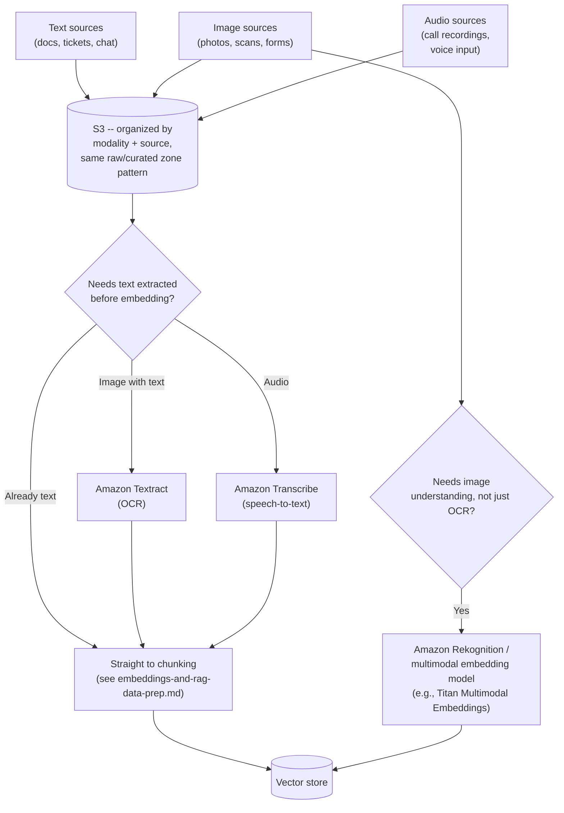
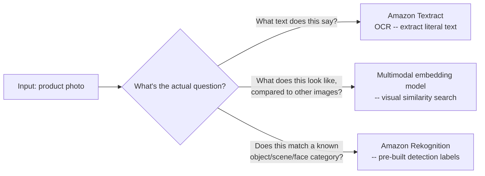
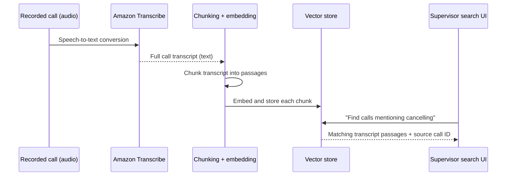

# Multimodal Data Ingestion Patterns — Text, Image, and Audio Together

*Machine Learning / Generative AI concept · MLA-C02 Domain 1, Task Statements 1.1.8 ("ingest and
store diverse data types") and 1.2.5 ("embedding models for text/image") — new skills added going
from MLA-C01 to MLA-C02. This domain's README covers this at summary depth in its "Ingesting
Multimodal Data" section; this doc is the dedicated expansion, with worked pipelines for each
modality pairing and the specific wrong-tool traps the exam tests around them.*

## Definition

**Multimodal data ingestion** is the practice of capturing, storing, and preparing structurally
different kinds of raw content — free text, images, and audio — side by side, often for the same
downstream use case, rather than assuming every pipeline only ever deals with rows and columns.
Classic ML data prep (the other documents in this domain) largely assumes tabular data; generative
AI and modern multimodal ML routinely need text, image, and audio treated as first-class, equally
important input types feeding the *same* application.

## Plain-English Analogy

A classic tabular data pipeline is like a mail sorting facility that only ever receives standard
letters — one shape, one size, one set of rules for sorting. A multimodal pipeline is a shipping
depot that receives letters, packages, and pallets all at once — each needs a genuinely different
handling process (a letter goes through a slot, a package goes on a conveyor, a pallet needs a
forklift) before any of them can be routed onward, even though all three are ultimately "things
to deliver." Treating a package like a letter (or an image like plain text) doesn't just fail —
it actively breaks the handling process downstream.

## Purpose

A multimodal support assistant that can read a photo of a damaged product *and* a customer's
typed description of what went wrong, or a RAG system that needs to search both scanned PDF
contracts and plain-text emails, needs an ingestion design that treats each modality correctly
from the start — rather than forcing every content type through one pipeline built with only text
(or only images) in mind. AWS built dedicated services for each modality's specific pre-processing
need (Textract for extracting text from images, Transcribe for converting audio to text,
Rekognition and multimodal embedding models for visual understanding) precisely because "ingest
diverse data types" is not one problem with one solution — it's several related but genuinely
different problems.

## How It Works — the Full Multimodal Ingestion Flow

Step by step: (1) **every modality still lands in S3 first**, organized by source and modality —
not dumped into one undifferentiated prefix; a scenario describing "we can't tell which bucket
prefix holds call-center audio vs. product photos" is a storage-organization failure, not a
modeling one. (2) **Text-bearing non-text content gets converted to text first** — Textract for
scanned documents/forms/images containing text, Transcribe for audio — before it can be chunked
and embedded the same way as native text. (3) **Content that needs to be understood visually**
rather than just read (e.g., "does this product photo show visible damage") uses Rekognition for
pre-built detection tasks or a multimodal embedding model when the goal is similarity search
across images directly, not text extraction.

### The core exam-relevant distinction

The single most-tested distinction in this document: **OCR (Textract) answers "what text is in
this image"; a multimodal embedding model answers "what does this image mean/look like, comparable
to other images or text."** Picking Textract when the real need is visual similarity search — or
picking a multimodal embedding model when the real need is reading printed text off a label — is
exactly the kind of wrong-tool trap this task statement tests.

## Worked Pipeline 1 — Image-with-text (scanned forms, product labels)

A logistics company receives thousands of photographed delivery receipts with handwritten and
printed text. The goal: extract the tracking number, delivery date, and recipient signature
presence into structured fields.

1. **Ingestion**: photos land in S3, organized under `raw/receipts/<date>/`.
2. **Textract** processes each image, extracting both printed and (with Textract's handwriting
   recognition) handwritten text, returning structured key-value pairs where the form layout is
   recognized, or raw text blocks otherwise.
3. **Post-processing** maps the extracted text to expected fields (tracking number format
   validation, date parsing) — this is where a Glue job or Lambda function applies the
   business-specific structure Textract's generic extraction doesn't know about on its own.
4. **The wrong-tool trap this scenario tests**: reaching for a multimodal embedding model here
   would find zero relevant signal for "what does the tracking number say" — embeddings answer
   similarity questions, not literal text-extraction questions; Textract is the only correct
   answer when the goal is reading specific text off an image.

## Worked Pipeline 2 — Pure visual similarity search (no text involved)

An interior-design marketplace wants shoppers to upload a photo of a room they like and get back
similar-looking furniture listings, with no text description involved on either side.

1. **Ingestion**: every listing photo and every user-uploaded photo lands in S3.
2. **Multimodal embedding model** (e.g., Bedrock Titan Multimodal Embeddings) converts every
   image — listing photos and the user's uploaded photo alike — into vectors living in the same
   numeric space described in `embeddings-and-rag-data-prep.md`.
3. **Nearest-neighbor search** runs exactly the same mechanism as text-only RAG, just with image
   vectors instead of text vectors, retrieving the most visually similar listings.
4. **The wrong-tool trap this scenario tests**: Textract would find **zero** relevant text here —
   there's no text to find in either the room photo or the furniture listing photos — so reaching
   for OCR on this specific scenario is a guaranteed dead end; the correct tool is a multimodal
   embedding model from the very first step.

## Worked Pipeline 3 — Audio-to-text for searchable call recordings

A call center wants supervisors to search thousands of hours of recorded customer calls by topic
("find every call where a customer mentioned cancelling").

1. **Amazon Transcribe** converts each recorded call to a full text transcript — this is the
   standard pattern for "search audio by what was said": **audio isn't embedded directly** in
   the overwhelming majority of real and exam scenarios; it's transcribed first, and the
   resulting *text* is embedded with a normal text embedding model.
2. The transcript is chunked and embedded exactly like any other text source, following the same
   mechanics `embeddings-and-rag-data-prep.md` describes for documents.
3. A supervisor's natural-language search ("calls mentioning cancelling") runs the same
   embed-the-query → nearest-neighbor-search pipeline as any text RAG system, just sourced from
   transcribed audio instead of written documents.
4. **The wrong-tool trap this scenario tests**: assuming a dedicated "audio embedding model" is
   needed — for the standard "search by what was said" use case, transcribe-then-embed is both
   simpler and the exam's expected answer; a direct audio-embedding approach would be reserved for
   a genuinely different need (e.g., matching audio by acoustic similarity — tone, music, not
   semantic content — which is a much rarer, more specialized scenario).

## Worked Pipeline 4 — A single multimodal support assistant, all three pathways at once

A product company's support assistant must handle: a customer's typed complaint, an uploaded
photo of a damaged product, and (for premium support) a recorded voice message describing the
issue — and answer using a combination of understanding all three.

| Input | Pipeline | Why this pathway |
|---|---|---|
| Typed complaint text | Chunk → embed directly | Already text; no pre-processing needed |
| Photo of damaged product | Multimodal embedding model (visual similarity to known defect categories) OR Rekognition (pre-built damage/defect detection labels if available) | The question is "what does this look like," not "what text is on it" |
| Recorded voice message | Amazon Transcribe → chunk → embed the resulting transcript | Standard audio-to-searchable-text pattern |

The complete pipeline converges all three into the **same vector space** (text embeddings and the
transcript's text embeddings share one embedding model; image embeddings live in a separate but
related multimodal space depending on the chosen model's capabilities) so a single retrieval step
can pull relevant context from whichever modality actually holds the answer — a photo's visual
similarity to a known "cracked casing" defect category, or a typed/transcribed description's
textual similarity to a known resolution procedure.

## Real AWS Image, Discussed

*Source: AWS Reference Architecture Diagrams, "Content moderation and compliance" —
docs.aws.amazon.com/reference-architecture-diagrams/latest/content-moderation-compliance/content-moderation-compliance.html.
Verified live via `curl -o /dev/null -w "%{http_code}"` → `200`.*

This official reference architecture shows exactly the multimodal fan-out this document describes
in practice: **Amazon Transcribe** and **Amazon Rekognition** process video/audio streams,
**Amazon Comprehend** performs NLP analysis on the resulting/native text, and **Amazon Textract**
extracts document content — four different AWS services, each handling one modality's specific
pre-processing need, all feeding into a shared downstream review process (with human review via
Amazon A2I for cases the automated services aren't confident about). The structural lesson this
diagram reinforces: a real multimodal pipeline is a **fan-out to several specialized services**,
not one general-purpose "AI service" that happens to handle every modality equally well.

A second official reference diagram worth knowing by name — the Healthcare Interoperability Stack
(docs.aws.amazon.com/reference-architecture-diagrams/latest/healthcare-interoperability-stack/images/healthcare-interoperability-stack.png,
verified `200`) — shows **Amazon Textract** as one stage in a larger EventBridge/Step Functions/
HealthLake pipeline converting scanned medical documents of varying formats into a standardized
HL7 FHIR data shape, a concrete applied instance of Worked Pipeline 1 above at a larger,
production, multi-service-orchestrated scale.

## Use Cases — Real Scenarios

1. A photo-sharing marketplace ingests user-submitted product photos and descriptions together,
   using Textract to pull any visible text off photographed labels and a multimodal embedding
   model so a shopper's text search ("blue vintage lamp") can retrieve visually matching listings
   even when the listing's written description never used the word "vintage."
2. An insurance company's claims-intake pipeline runs Textract on scanned claim forms to extract
   structured fields, while a separate Rekognition step flags whether an attached vehicle-damage
   photo shows damage consistent with the claimed incident type.
3. A call-center analytics team transcribes six months of recorded calls with Amazon Transcribe,
   then runs the resulting transcripts through the same chunk-embed-search pipeline used for
   written support tickets, giving supervisors one unified search experience across both
   modalities.
4. A real-estate platform embeds both listing photos (via a multimodal embedding model) and
   listing descriptions (via a text embedding model) into a shared index, letting a buyer's text
   query ("bright kitchen with an island") retrieve visually matching photos even when the
   listing text itself doesn't mention "bright."
5. A manufacturing quality-control team uses Rekognition Custom Labels (rather than a general
   multimodal embedding model) specifically because the need is a **pre-built, fast classification
   decision** ("does this part pass or fail inspection") rather than an open-ended similarity
   search across an unbounded catalog.
6. A multilingual customer support operation transcribes voice messages with Transcribe, then
   routes the transcript through Amazon Translate before embedding, ensuring every chunk lands in
   the vector store in one consistent language regardless of which language the customer actually
   spoke.

## When NOT to Use a Multimodal Pipeline

- **When the actual need is single-modality** — a scenario describing only text documents doesn't
  need Textract, Transcribe, or multimodal embeddings at all; reaching for the full multimodal
  pattern when only one modality is genuinely in play adds unneeded pipeline complexity.
- **When a pre-built, narrow classification task is the actual need** (e.g., "does this image
  contain a weapon," "is this part defective") — **Rekognition's purpose-built detection
  categories (or Custom Labels)** are a faster, cheaper answer than embedding every image and
  running a similarity search, which is built for open-ended retrieval, not a fixed yes/no
  classification decision.
- **When audio needs to be matched by acoustic properties, not spoken content** (e.g., matching
  music by melody, not matching calls by topic) — the standard transcribe-then-embed pattern
  doesn't apply; that's a specialized audio-fingerprinting problem outside this document's and the
  exam's typical scope.

## Troubleshooting / Common Issues

- **Textract returns no text for an image expected to contain visible text.** Check image
  resolution and orientation first — Textract's accuracy degrades sharply on rotated, low-
  resolution, or heavily compressed images; a pre-processing step normalizing orientation/
  resolution often resolves this before assuming the document type itself is unsupported.
- **A multimodal embedding-based similarity search returns visually unrelated results.** Confirm
  every embedded image (listings and query alike) used the *exact same* multimodal embedding
  model and version — exactly the same mismatched-embedding-space failure mode covered for
  text-only RAG, just manifesting on the image side instead.
- **Transcribe output has unexpectedly high word-error-rate on domain-specific audio.** Check
  whether a custom vocabulary (naming domain-specific terms, product names, or jargon) was
  configured — Transcribe's default vocabulary underperforms on specialized terminology it was
  never tuned for, the audio-domain analog of the tokenizer-fragmentation issue covered for text.
- **A Rekognition Custom Labels model performs poorly on a narrow defect-detection task.** Audit
  training image count and class balance first — Custom Labels, like any trained classifier,
  needs a reasonably balanced, sufficiently large labeled set per class; a handful of example
  images per defect type is rarely enough for a production-grade model.

## Why It's Important

**Real-world:** customer support, e-commerce, insurance, and healthcare all increasingly need to
reason across text, image, and audio simultaneously, and picking the wrong pre-processing step for
a modality doesn't just underperform — it can fail outright and silently (running Textract against
an image with no extractable text returns nothing useful, without raising an obvious error).
**Exam:** Task Statements 1.1.8 and 1.2.5 are explicitly named additions in MLA-C02, and scenario
questions reliably test the OCR-vs-multimodal-embedding distinction and the "audio needs
transcription before embedding" pattern as concrete, specific traps rather than abstract
awareness.

## Exam Tips

- **OCR (Textract) answers "what does this image say"; a multimodal embedding model answers "what
  does this image mean/look like."** A scenario needing visual similarity search when Textract is
  offered as an answer choice is the classic trap, and vice versa.
- **Audio is transcribed before embedding, not embedded directly**, in the overwhelming majority
  of real and exam scenarios — know Transcribe → chunk → embed as the default pattern.
- **A multimodal pipeline is several specialized services fanning out, not one general AI service**
  — a scenario naming text, image, and audio together is very likely expecting you to name
  Comprehend/Textract/Transcribe/Rekognition (or a multimodal embedding model) as distinct,
  cooperating pieces, not a single catch-all tool.
- **Rekognition vs. multimodal embeddings**: a fixed, pre-defined classification/detection task
  points to Rekognition; an open-ended similarity-search task points to a multimodal embedding
  model — naming the wrong one for the described task shape is a recurring distractor.

## Related Terms

- [`embeddings-and-rag-data-prep.md`](embeddings-and-rag-data-prep.md) — the core chunk/embed/
  vector-store mechanics every modality in this document ultimately feeds into.
- [`README.md`](README.md) — the domain map's own "Ingesting Multimodal Data" section (Task
  1.1.8), which this document expands with worked pipelines.
- [`../../../services/machine-learning-ai/ai-services-overview.md`](../../../services/machine-learning-ai/ai-services-overview.md)
  — the full reference for Textract, Transcribe, Rekognition, and Comprehend as standalone
  services, beyond their role in this document's ingestion patterns.
- [`../../../services/machine-learning-ai/bedrock.md`](../../../services/machine-learning-ai/bedrock.md)
  — Titan Multimodal Embeddings and other foundation-model-based embedding options.
- [`../../../glossary/README.md`](../../../glossary/README.md) — one-line definitions of OCR,
  embedding, and related cross-cutting terms.
