# MASTER CHUNK — Domain 2: ML Model and Foundation Model Development (24%)

*MLA-C02 Domain 2, full self-contained reference. This single document covers every core ML
concept and every AWS service tested in this domain — Amazon Bedrock, Amazon SageMaker
(overview), SageMaker JumpStart, SageMaker Model Monitor & Model Registry, and SageMaker Training
& Tuning — plus algorithm families, evaluation metrics, hyperparameter tuning, overfitting/
underfitting and the bias-variance tradeoff, and foundation-model customization options. It is
written to be read start to finish with no other file open, for exam review or offline study. For
even deeper numeric worked examples on any one topic, the companion topic docs in this same
folder ([`ml-fundamentals-glossary.md`](ml-fundamentals-glossary.md),
[`algorithm-selection-decision-framework.md`](algorithm-selection-decision-framework.md),
[`evaluation-metrics-deep-dive.md`](evaluation-metrics-deep-dive.md),
[`hyperparameter-tuning-strategies.md`](hyperparameter-tuning-strategies.md),
[`rag-vs-finetuning-vs-prompting-decision-tree.md`](rag-vs-finetuning-vs-prompting-decision-tree.md),
[`bias-variance-tradeoff-and-regularization.md`](bias-variance-tradeoff-and-regularization.md))
go further on each individual subtopic; this chunk is the single entry point that needs none of
them to make sense.*

## How to use this document

Domain 2 has only five named AWS services but is the most conceptually dense domain in the
exam — the services themselves are comparatively simple to describe; the *decisions* around them
(which algorithm, which metric, which tuning strategy, which customization technique) carry most
of the real difficulty. This document is organized in two parts for that reason:

- **Part A — Core ML Concepts.** The algorithm-agnostic, service-agnostic knowledge every other
  section of this domain assumes: algorithm families, evaluation metrics, hyperparameter tuning,
  overfitting/underfitting and bias-variance, and the foundation-model customization menu
  (prompting, RAG, fine-tuning, pre-training).
- **Part B — The Five Services.** Bedrock, SageMaker (overview), JumpStart, Model Monitor &
  Model Registry, and Training & Tuning — each following the same structure: Definition, Plain-
  English Analogy, Purpose, When to Use, When NOT to Use, Use Cases, Why Important, a Mermaid
  diagram explained, a real AWS image with discussion (where one exists), and Exam Tips with
  worked numeric examples.
- **Part C** ties the whole domain together as a single decision funnel, and **Part D** is a
  compiled exam-scenario quick-reference.

---

# Part A — Core ML Concepts

## A1. Algorithm Families (Classic ML)

### Definition

An **algorithm family** is a category of modeling approach that shares a common underlying
mechanism for turning input features into a prediction — linear models, tree-based models,
neural networks, clustering algorithms, and anomaly-detection algorithms are the five families
tested in this domain.

### Plain-English analogy

Think of algorithm families as different *tools in a toolbox*, not different *brands of the same
tool*. A linear model is a ruler — fast, precise, but only useful for drawing straight lines. A
tree ensemble is a flexible measuring tape that can trace curves and corners. A neural network is
a full 3D scanner — able to capture almost any shape, but requiring far more raw material (data)
and time to calibrate properly than the simpler tools. Clustering and anomaly detection are
different tools entirely — not measuring devices at all, but *sorting* devices: one groups
similar objects together without being told the categories in advance, the other flags objects
that don't belong to any familiar group.

### Purpose

To match a problem's true shape (linear vs. non-linear, structured vs. unstructured, labeled vs.
unlabeled) to a modeling mechanism capable of representing that shape efficiently, rather than
defaulting to one tool for every problem.

### When to use which family

| Family | Use when |
|---|---|
| Linear/Logistic Regression | Tabular data, a plausibly linear/monotonic relationship, or interpretability is a hard requirement |
| Tree-based (XGBoost, Random Forest) | Tabular data, relationship shape unknown or non-linear, strong default baseline |
| Neural networks | Unstructured data (images, raw text, audio), or very large tabular datasets where tree ensembles plateau |
| Clustering (K-Means) | No labels exist, the goal is discovering groups, not predicting a known target |
| Anomaly detection (Random Cut Forest) | Rare/novel-pattern detection with too few or zero labeled examples of the thing being detected |

### When NOT to use (common mismatches)

- **Neural networks on small tabular datasets** — high risk of overfitting (high variance) without
  the large data volume neural networks need to generalize; a tree ensemble or linear model will
  usually out-generalize a deep network here.
- **Linear models when the scenario explicitly describes non-linear feature interactions** — a
  straight-line assumption cannot represent genuine curvature or interaction effects, regardless
  of how much data or tuning is applied (high bias that no amount of data fixes).
- **K-Means when true groupings are non-convex or very different in density/size** — K-Means
  assumes roughly spherical, similarly-sized clusters; a scenario describing irregularly shaped
  natural groupings is signaling a mismatch.
- **Supervised classification for "detect something we've never seen before"** — a model trained
  only on known-labeled examples cannot, by construction, generalize to a pattern type absent
  from its training labels; this is anomaly detection's job, not classification's.

### 5 Use Cases

1. A bank uses **XGBoost** (tree-based) on structured transaction features to predict loan
   default risk, since the relationship between income, credit history, and default is genuinely
   non-linear and interactive.
2. An insurance company uses **logistic regression** for a claims-approval model specifically
   because state regulators require a coefficient-level explanation of every denial decision.
3. A retailer uses **K-Means** to segment 2 million customers into 8 behavioral groups for
   targeted marketing, with no pre-existing "segment" label anywhere in the data.
4. A payments company uses **Random Cut Forest** to flag transactions resembling no previously
   seen fraud pattern, specifically because new fraud techniques emerge faster than labels for
   them can be collected.
5. A radiology startup uses a **convolutional neural network** to classify X-ray images, since
   hand-engineering features out of raw pixel data for this task is impractical.
6. A logistics company uses **DeepAR** (a specialized time-series neural network) to forecast
   demand across 50,000 related SKUs jointly, benefiting from shared patterns across similar
   products that independent per-SKU models would miss.

### Why important

Algorithm-family selection is the single decision every other Domain 2 activity (training,
evaluation, tuning) depends on — picking the wrong family wastes the compute spent training and
tuning a fundamentally mismatched model, and the exam tests this as a *first-principles* skill
(matching data shape and target type to family), not algorithm-name memorization.

### Diagram — the master selection tree

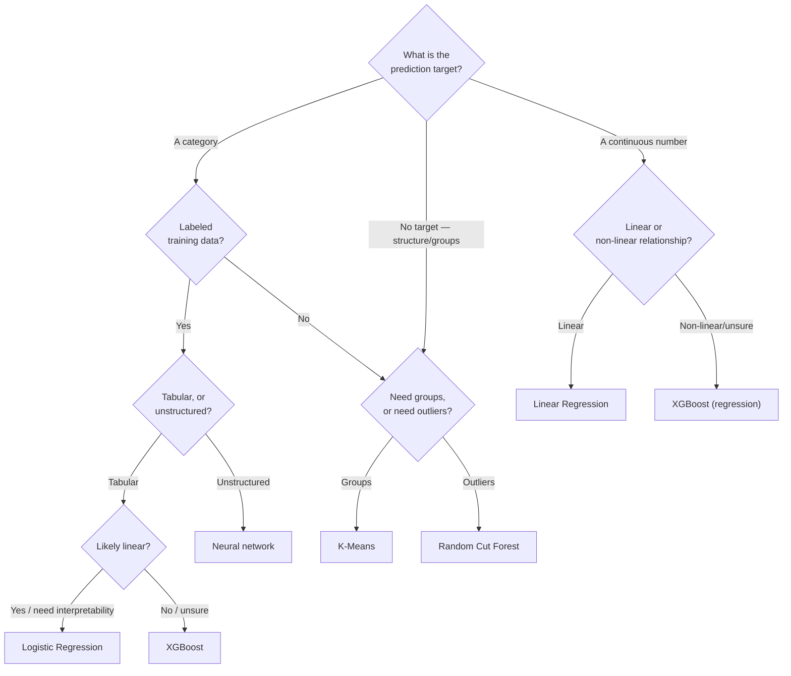

**Explained:** the tree is ordered data-shape-first because that's the order exam scenarios
reveal information in. The first real fork is whether labels exist at all — a scenario that
*sounds* like classification ("segment customers") but has no actual ground-truth label is
silently unsupervised, routing to clustering regardless of the original framing. The second fork
is data shape: unstructured data (pixels, raw audio, raw text) pushes toward neural networks
almost automatically. The final fork, for tabular labeled data, is whether the relationship is
plausibly linear — this is where XGBoost's reputation as "the default" is actually conditional,
not universal.

### Real image — algorithm decision boundaries, side by side


*Figure: several algorithm families' decision boundaries plotted on the same three synthetic
datasets (linearly separable, moderately overlapping, and the classic two-moons non-linear
shape). On the linearly-separable dataset, a simple boundary suffices and extra model flexibility
buys nothing measurable; on the moons dataset, only a model capable of a curved boundary works at
all — visual proof of the "match family to data shape" principle. Source: scikit-learn
documentation, "Classifier comparison" —
scikit-learn.org/stable/auto_examples/classification/plot_classifier_comparison.html.*

### Exam Tips

1. **Worked numeric example — the linear-vs-tree reversal.** On a near-linearly-separable 30-
   feature dataset (real breast-cancer cell measurements), logistic regression scores
   accuracy=0.9825, AUC=0.9958 vs. gradient boosting's accuracy=0.9561, AUC=0.9905 — logistic
   regression *wins*. On a dataset engineered with genuine non-linear feature interactions, the
   same two algorithms score AUC=0.8890 (logistic regression) vs. AUC=0.9312 (gradient boosting)
   — a reversal. **The lesson:** "XGBoost is the default tabular baseline" is conditional on an
   unknown-or-non-linear relationship shape, not an unconditional rule — a scenario explicitly
   describing a simple/monotonic relationship or requiring interpretability can correctly point
   to the linear model instead.
2. **Worked numeric example — choosing k for K-Means without labels.** Sweeping k from 2 to 15 on
   a dataset with a true underlying structure of 10 groups: inertia decreases monotonically
   (149,425 → 56,931) and never signals the right k by itself, but the **silhouette score** rises
   again specifically near k=10 (0.182, a local peak) — this is the data-driven way to choose k
   without ground-truth labels, and the exam expects recognition of the elbow method or
   silhouette score, not an arbitrarily chosen k.
3. **Exam trap:** "detect a brand-new type of fraud pattern with no labeled examples yet" is
   anomaly detection (Random Cut Forest), not supervised classification — a worked comparison
   shows Isolation Forest catching 75% of injected anomalies with **zero label access during
   training**, which a supervised classifier trained on historical fraud types structurally
   cannot do for a genuinely novel pattern.
4. **Worked numeric example — gradient boosting on genuinely non-linear regression.** On the
   California housing dataset (predicting median block house value from location, income, and
   room counts — a relationship with real, non-additive interactions), plain linear regression
   scores RMSE≈$72,560 and R²≈0.576, while a gradient-boosting regressor scores RMSE≈$54,220 and
   R²≈0.764 on identical data with no feature engineering — R² jumps from explaining 58% of price
   variance to 76% purely from the algorithm's ability to capture non-linear interactions,
   directly mirroring the classification-side reversal in tip 1 but on the regression side of A1.
5. **Exam trap — the clustering-shape assumption.** K-Means assumes roughly spherical, similarly-
   sized clusters; a scenario explicitly describing non-convex or very differently-shaped natural
   groupings (two interleaved crescents, concentric rings) is signaling that K-Means's underlying
   assumption doesn't fit the data, even though no other AWS built-in algorithm offers a
   first-class density-based clustering alternative at the same managed-service level — the
   tested skill is recognizing the mismatch, not necessarily naming a replacement service.

---

## A2. Evaluation Metrics

### Definition

**Evaluation metrics** are the quantitative rules used to score whether a trained model is
actually good at its task — different metric families exist for classification (precision,
recall, F1, AUC), regression (RMSE, MAE, R²), and generative text (BLEU, ROUGE, BERTScore,
semantic similarity, LLM-as-a-judge).

### Plain-English analogy

Grading a student's exam with only "percent correct" hides *which* questions they missed and
*why* — a student who aces every easy question and fails every hard one gets the same raw score
as a student with uniformly mediocre performance across the board, even though the first
student's gap is far more actionable and specific. Precision, recall, and the rest are different
*ways of grading* that each surface a different specific kind of mistake a single "percent
correct" score conceals.

### Purpose

To make the question "is this model good enough to ship" answerable with the *specific* kind of
"good" the business actually needs (catch more real fraud, minimize false alarms, report error
in trustworthy units), rather than one generic, frequently misleading number.

### When to use which metric

| Scenario | Correct metric |
|---|---|
| Balanced classes | Accuracy is reasonable |
| Imbalanced classes | Precision, Recall, F1, or AUC — never plain accuracy |
| False positives are costly | Optimize/report Precision |
| False negatives are costly (missed fraud/disease) | Optimize/report Recall |
| Regression, sensitive to large errors | RMSE |
| Regression, robust to outliers | MAE |
| Regression, need "% variance explained" | R² |
| Comparing classifiers across all thresholds | AUC (or Average Precision for rare classes) |
| Generated text, no single correct phrasing | BERTScore / semantic similarity, not BLEU/ROUGE alone |
| Generated text with no fixed reference answer at all | LLM-as-a-judge, with periodic human calibration |
| RAG retrieval quality specifically | Precision@K / Recall@K |

### When NOT to rely on a metric

- **Accuracy on any imbalanced dataset** — a model predicting the majority class for every input
  can score 95-99% accuracy while catching zero of the minority class; this is the exam's single
  most repeated trap.
- **BLEU/ROUGE as the sole quality signal for paraphrase-tolerant generation tasks** — both
  penalize correct paraphrases that use different wording, scoring a valid, accurate answer
  poorly purely because its phrasing differs from the reference.
- **AUC alone on a severely imbalanced dataset** — AUC's false-positive-rate denominator (all
  actual negatives) dilutes false positives more than Precision-Recall's denominator does, making
  AUC look more optimistic than Average Precision on rare-class problems; prefer PR-based metrics
  there.
- **Any single metric without checking calibration**, when the model's actual probability value
  (not just its ranking) feeds a downstream automated decision — a model can have strong AUC and
  still be badly miscalibrated (its "80% confident" predictions only right 60% of the time).

### 6 Use Cases

1. A fraud team reports **recall at a fixed precision floor** rather than accuracy, because a 96%
   accuracy "approve everything" baseline would catch zero actual fraud.
2. A spam filter team raises its classification threshold specifically to improve **precision**
   after users complain about too many legitimate emails being blocked, accepting a recall drop
   as the known tradeoff.
3. A house-price model reports **MAE** instead of RMSE specifically because a handful of unusual
   high-value properties shouldn't dominate the headline error number the business reviews.
4. A machine-translation team tracks **BLEU** release over release, since translation genuinely
   has a fairly fixed "correct" phrasing per language pair, BLEU's original intended use case.
5. A RAG support assistant's team monitors **Precision@5** on retrieval separately from the final
   answer's generation quality, catching a stale vector index even while generation-quality
   scores look stable.
6. A hiring platform runs **LLM-as-a-judge** on a fairness rubric across thousands of generated
   candidate summaries daily, a scale no human review team could sustain, with a 2% human-
   reviewed sample used to calibrate that the judge model's scores still track real human
   judgment.

### Why important

Task statement 2.3 ("Evaluate a model") is tested heavily because choosing the *wrong* metric
produces a model that looks great on paper and fails the actual business need — this is one of
the most reliable, repeatable exam question shapes across the entire MLA-C02 certification.

### Diagram — the confusion matrix and the metrics built from it

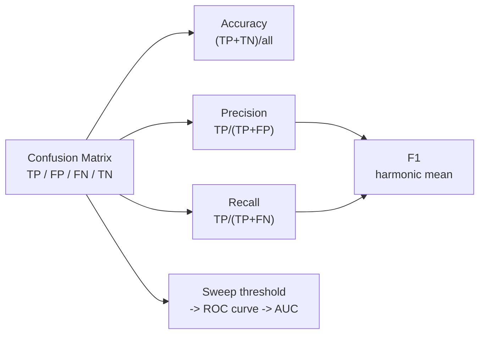

**Explained:** every classification metric above the confusion matrix is *derived* from the same
four counts (TP, FP, FN, TN) — the confusion matrix is the one piece of raw information; every
named metric is a different ratio computed from it. AUC is the odd one out structurally — it
requires sweeping the decision threshold across many values and recomputing the matrix at each
one, rather than reading off a single matrix at one fixed threshold.

### Real image — a rendered confusion matrix


*Figure: an actual confusion matrix for the classic 3-class Iris classification problem — the
diagonal cells are correct predictions; every off-diagonal cell shows specifically which class
got confused with which other, information a single accuracy number discards entirely. Source:
scikit-learn documentation, "Confusion matrix" —
scikit-learn.org/stable/auto_examples/model_selection/plot_confusion_matrix.html.*

### Exam Tips

1. **Worked numeric example — the full fraud confusion matrix.** 1,000 transactions, 50 actually
   fraudulent (5%), model produces TP=35, FN=15, FP=20, TN=930. Accuracy = 965/1000 = **96.5%**.
   Precision = 35/55 ≈ **63.6%**. Recall = 35/50 = **70%**. F1 ≈ **66.6%**. A trivial "always
   predict not-fraud" baseline scores accuracy = 950/1000 = **95%** — only 1.5 points lower while
   catching **zero** fraud — proof that a small accuracy gap can hide the entire difference
   between "catches most fraud" and "catches none."
2. **Worked numeric example — RMSE vs. MAE outlier sensitivity.** Errors `[2,-3,1,4,-2,3,-1,48]`
   ($1,000s): MAE = 64/8 = **$8,000**; RMSE = sqrt(2348/8) ≈ **$17,132** — more than double MAE
   because squaring the single 48 error turns it into 2,304 before averaging. Removing that one
   outlier drops MAE by 71% but drops RMSE by 85% — RMSE is disproportionately driven by a single
   extreme point in a way MAE structurally isn't.
2b. **Worked numeric example — multi-class, accuracy hiding a weak category.** A 3-class
   support-ticket router scores overall accuracy ≈81.3% on 150 tickets, but computing per-class
   precision/recall separately reveals Billing ≈81%/84%, Technical ≈84%/83%, and **Account — the
   smallest category at only 30 tickets — only ≈76%/73%**, a meaningfully weaker category the
   single overall-accuracy number never surfaces. The fix is reporting per-class metrics or a
   macro-averaged F1 (which weighs every class equally regardless of size), not overall accuracy
   alone, whenever a scenario emphasizes per-category performance must be checked.
3. **Worked numeric example — log loss punishing confident wrongness.** Three predictions'
   probability of the true class: 0.95, 0.55, 0.02 → log-loss contributions -ln(p) ≈ 0.0513,
   0.5978, 3.9120. The confidently-wrong prediction (p=0.02) contributes **~76x** the confidently-
   right prediction's penalty — directly demonstrating why two models can tie on accuracy while
   differing sharply on log loss.

---

## A3. Hyperparameter Tuning

### Definition

**Hyperparameters** are settings chosen *before* training starts (learning rate, tree depth,
number of estimators, regularization strength) that shape how a model learns but are not
themselves learned from data. **Hyperparameter tuning** (on AWS, SageMaker Automatic Model
Tuning / AMT) is the systematic process of searching across candidate hyperparameter values to
find the combination that produces the best model, measured by a chosen objective metric.

### Plain-English analogy

Think of hyperparameters as oven settings (temperature, rack position, bake time) rather than
the recipe's ingredients (the model weights themselves, which training *learns*). Tuning is
systematically baking several test batches at different oven settings and tasting each one,
rather than guessing one setting and hoping it's right, or baking at absolutely every conceivable
combination of settings when most of them obviously wouldn't work.

### Purpose

To find hyperparameter values that meaningfully outperform arbitrary defaults, using the fewest
total training runs the chosen search strategy's efficiency allows — since each "test batch" here
is a real, often expensive and slow, training job.

### When to use

- Whenever a model's performance is meaningfully sensitive to settings like learning rate, tree
  depth, or regularization strength, and default values haven't been validated against the
  specific dataset at hand.
- When comparing several candidate hyperparameter combinations by hand would take longer or cost
  more than letting a systematic search strategy run them.

### When NOT to use (or to simplify)

- **When training is extremely cheap and the search space is small** — manual or simple grid
  search may be entirely adequate; the heavier Bayesian machinery solves a problem (minimizing
  total expensive jobs) that doesn't exist here.
- **Before the algorithm/feature set itself is settled** — tuning a fundamentally wrong algorithm
  family (e.g., tuning a linear model on data with strong non-linear interactions) wastes the
  entire search's compute chasing a ceiling the algorithm family itself can't exceed; fix the
  algorithm-selection decision first.
- **As a substitute for fixing a mis-chosen objective metric** — AMT will faithfully optimize
  whatever metric it's given, including a wrong one (e.g., accuracy on a known-imbalanced
  problem); tuning cannot fix an evaluation-metric mistake, it will simply find hyperparameters
  that maximize the wrong number very efficiently.

### 5 Use Cases

1. An XGBoost fraud model's `max_depth`, `eta`, and `scale_pos_weight` are searched via Bayesian
   optimization specifically because each training job costs real money and the team has a hard
   40-job budget.
2. A small grid search (4 values × 3 values = 12 combinations) is run exhaustively for a cheap,
   fast-training linear model, since the combinatorial cost is trivial at this scale.
3. A team re-tunes a production model monthly as fresh data arrives, using **warm start** to
   seed each new search with the previous month's trial history instead of starting blind.
4. A deep-learning image classifier's tuning job uses **Hyperband-style early stopping** to kill
   clearly underperforming candidates after only a few epochs, saving the bulk of each bad
   candidate's remaining training budget.
5. A tuning job's winning `max_depth` value lands exactly at the edge of its searched range (10
   out of a `[3,10]` range), prompting the team to widen the range and re-run with warm start
   rather than accepting the boundary value as truly optimal.
6. A team deliberately chooses the **objective metric** for its fraud-detection tuning job to be
   validation AUC, not accuracy, directly applying the evaluation-metrics discipline from A2
   above to the tuning configuration itself.

### Why important

Hyperparameter tuning is the practical mechanism behind "optimize a model" throughout this
domain — task statement 2.2 explicitly names it, and the exam tests both *recognizing* which
search strategy fits a stated cost/time constraint and *recognizing* the difference between a
tuning failure and a search-space-design failure.

### Diagram — the tuning loop and strategy choice

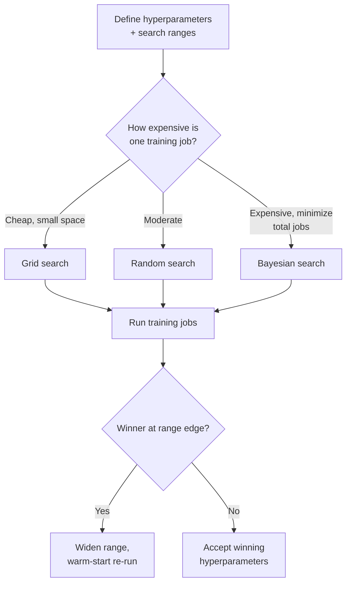

**Explained:** the strategy fork is driven almost entirely by one variable — the cost of a single
training job relative to the total job budget — not by abstract strategy quality. The loop's
final check (is the winner sitting at the edge of its searched range) is a frequently-skipped
step that catches a very specific failure mode: a search that *looks* successful (it found a
clear winner) while the true optimum sits outside the range ever explored.

### Real image — AMT's child training jobs in the console


*Figure: each row is one hyperparameter combination's own training job, with its own final
objective-metric value — literally the "Run training jobs" box in the diagram above, executed N
times before the tuning job selects whichever row scored best. Source: AWS SageMaker Developer
Guide, "Configure and Launch a Hyperparameter Tuning Job" —
docs.aws.amazon.com/sagemaker/latest/dg/automatic-model-tuning-ex-tuning-job.html.*

### Exam Tips

1. **Worked numeric example — the combinatorial explosion.** 3 hyperparameters with 4, 5, and 3
   candidate values respectively require grid search to run `4×5×3 = 60` combinations — and with
   3-fold cross-validation inside the search, **180 total model fits**, not 60. Adding one more
   hyperparameter with 3 more values triples it to 180 combinations (540 fits). This
   multiplicative, not additive, growth is the exact mechanism behind "grid search doesn't scale."
2. **Worked numeric example — Bayesian sample efficiency.** On the same search space, grid search
   (60 combos, 180 fits) reaches best score 0.9718; random search (20 trials, 60 fits) reaches
   0.9701; Bayesian search (10 trials, 30 fits) *also* reaches 0.9701 — statistically
   indistinguishable quality at **a sixth of grid search's compute and half of random search's**.
   This specific ratio is the numeric justification for "Bayesian search when training jobs are
   expensive."
3. **Exam trap:** confusing early stopping *inside one training run* (halting that run once its
   own validation loss plateaus — an overfitting-prevention technique) with early stopping
   *inside a tuning job* (Hyperband-style — killing an underperforming hyperparameter
   *candidate's* job early to save compute across the whole search) — these are two distinct
   mechanisms sharing a name; the scenario's exact wording (one run's own loss vs. one candidate
   underperforming others) determines which is being tested.

---

## A4. Overfitting, Underfitting, and the Bias-Variance Tradeoff

### Definition

**Overfitting** is when a model performs very well on training data but noticeably worse on new
(validation/test) data — it has memorized noise/specifics rather than learning the general
pattern. **Underfitting** is when a model performs poorly on *both* training and new data — it is
too simple, undertrained, or lacking the right features. The **bias-variance tradeoff** formally
decomposes a model's total expected error into bias² (error from overly simplistic assumptions),
variance (error from sensitivity to the specific training sample), and irreducible error (noise
no model can remove) — `Total Error = Bias² + Variance + Irreducible Error`.

### Plain-English analogy

A student who memorizes the exact wording of every practice question's answer aces the practice
set (training data) but fails the real exam, which asks the same concepts differently worded (new
data) — overfitting. A student who barely studied does poorly on both — underfitting. Bias is
"the student's basic understanding is too simplistic for the subject" (always wrong in the same
predictable way); variance is "the student's performance swings wildly depending on which exact
practice questions they happened to study" (unpredictable, sample-dependent).

### Purpose

To correctly diagnose *why* a model isn't performing well before applying a fix — since the fix
for underfitting (add capacity/data/features) is the *opposite* of the fix for overfitting
(regularize/simplify/add data), applying the wrong one actively worsens the problem.

### When to apply which fix

| Symptom | Diagnosis | Fix |
|---|---|---|
| Both train and validation performance low and close together | Underfitting (high bias) | More model capacity, more features, more training time, less regularization |
| Train performance high, validation performance much lower | Overfitting (high variance) | Regularization (L1/L2/dropout), more training data, early stopping, simpler model |
| Both train and validation performance high and close together | Good fit | Proceed to hyperparameter tuning / deployment |

### When NOT to apply regularization

- **When the model is actually underfitting** — applying regularization to an already-too-simple
  model pushes it toward *more* bias, worsening underfitting; regularization is a variance-
  reduction tool specifically, not a universal "make the model better" dial.
- **When performance volatility is coming from the evaluation split, not the model** — if a
  single metric swings wildly across different random train/validation splits, the fix is k-fold
  cross-validation for a more reliable estimate, not necessarily regularizing the model itself.

### 5 Use Cases

1. A team diagnoses "training accuracy 99%, validation accuracy 61%" as overfitting and applies
   L2 regularization and early stopping rather than training for more epochs, which would worsen
   it.
2. A team diagnoses "both training and validation accuracy around 55%, flat across many epochs"
   as underfitting and increases model capacity (more trees/layers) rather than adding
   regularization, which would worsen it.
3. A small-dataset project deliberately avoids training a large neural network from scratch,
   recognizing the high-variance risk, and uses transfer learning (fine-tuning a pretrained
   model, via JumpStart) instead.
4. A team facing wildly different validation scores across different random splits adopts 5-fold
   cross-validation to get a trustworthy, averaged performance estimate before concluding
   anything about the model's quality.
5. A Lasso (L1) regression is chosen over Ridge (L2) specifically because the team also wants
   automatic feature selection (irrelevant features driven to exactly zero), not just shrinkage.
6. A dropout layer is added to a neural network specifically after observing a large train/
   validation gap, forcing the network to not over-rely on any single neuron/path.

### Why important

This is, by the domain README's own description, "the single most foundational, most exam-tested
vocabulary in the entire MLA-C02 cert" — nearly every Domain 2 troubleshooting scenario reduces to
correctly diagnosing bias vs. variance and applying the matching, not the opposite, fix.

### Diagram — the bias-variance tradeoff

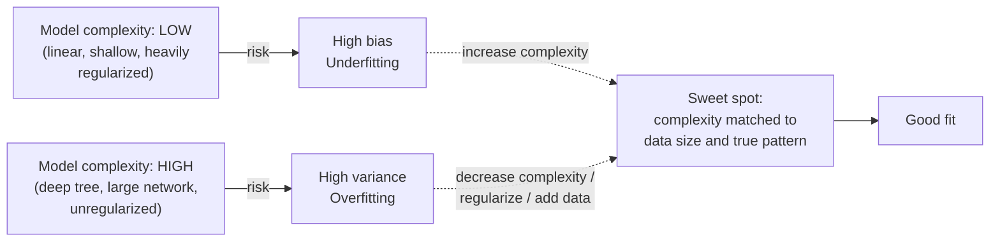

**Explained:** the two failure modes sit at opposite ends of a complexity dial, and the fix for
each is a move in the opposite direction along that same dial — which is exactly why correctly
identifying *which* end you're at (via the train-vs-validation gap, never either score alone) has
to happen before choosing a fix.

### Real image — underfitting vs. good fit vs. overfitting, rendered


*Figure: a degree-1 polynomial (too simple — underfitting), a degree-4 polynomial (a good fit to
the true cosine-shaped pattern), and a degree-15 polynomial (chasing individual noisy points —
overfitting), fit to the exact same data — the clearest single visual proof of this section's
core concept. Source: scikit-learn documentation, "Underfitting vs. Overfitting" —
scikit-learn.org/stable/auto_examples/model_selection/plot_underfitting_overfitting.html.*

### Exam Tips

1. **Worked numeric example — the bias-variance decomposition, proven by resampling.** Training
   the same model type on 200 different random samples from the same population: Linear
   Regression scores bias²=1.7820, variance=0.0164 (total 1.7984) fitting a genuinely curved
   true function; an unconstrained Decision Tree scores bias²=0.0095, variance=1.3822 (total
   1.3917); a depth-2 Decision Tree scores bias²=0.3103, variance=0.1871 (**total 0.4974, the
   lowest of the three**) — numeric proof that the best total error sits at a *moderate*
   complexity, not at either bias-only or variance-only extreme.
2. **Worked numeric example — L1 vs. L2's different mechanical effect.** Ridge (L2) shrinks every
   coefficient smoothly toward zero as `alpha` increases (sum of |coefficients| drops from
   48,291.6 at alpha=0 to 1.1 at alpha=100) without any coefficient hitting exactly zero. Lasso
   (L1) on a 20-feature dataset with only 4 truly informative features lands on **exactly 4
   nonzero coefficients** at alpha=0.5, driving the other 16 to *exactly* zero — the concrete
   proof of L1's feature-selection property, structurally different from L2's shrinkage-only
   behavior.
3. **Exam trap:** a scenario stating "both training and validation accuracy are low and
   mediocre" and proposing regularization as the fix is testing whether you recognize this as
   underfitting (not overfitting) — regularization here is the *wrong* lever and will make
   performance worse, not better; the correct fix is more model capacity or better features.

---

## A5. Foundation Model Customization Options

### Definition

**Foundation model customization** is the set of techniques for adapting a pretrained foundation
model's behavior or knowledge to a specific use case without necessarily retraining it from
scratch: **prompt engineering** (crafting the instructions/context given at inference time),
**RAG** (retrieving and injecting relevant external documents into the prompt), **fine-tuning**
(further training the model's weights, fully or via a lightweight adapter like LoRA/PEFT, on
labeled examples), and **pre-training from scratch** (training an entirely new foundation model
on a massive corpus — the option this exam almost never expects as the answer).

### Plain-English analogy

Imagine hiring a highly capable, widely-read new employee. **Prompt engineering** is writing them
a clear, well-structured task brief. **RAG** is handing them your company's actual internal
documents to read before answering, so they're not relying on general knowledge alone for facts
specific to you. **Fine-tuning** is sending them through company-specific training, after which
their everyday working style and judgment genuinely changes. **Pre-training from scratch** is the
equivalent of raising and educating a person from infancy specifically to become this employee —
technically possible, but a wildly disproportionate response to needing a well-briefed new hire.

### Purpose

To close the gap between what a foundation model does by default and what a specific business
use case needs, using the *cheapest* technique that actually closes that specific gap — not
defaulting to the most powerful (and most expensive) tool available.

### When to use which technique

| Technique | Use when the gap is... |
|---|---|
| Prompt engineering | Wrong instructions/format, the model could plausibly already do this correctly if asked better |
| Few-shot prompting | A behavior/skill gap with only a handful of labeled examples (a dozen or fewer) |
| RAG | A **facts** gap — private, current, or specific knowledge the model wasn't trained on |
| Fine-tuning (PEFT/LoRA default) | A **behavior** gap — tone, format, persona, a narrow skill — with hundreds to low-thousands of labeled examples |
| Full fine-tuning | A deep, pervasive behavior change a lightweight adapter can't achieve, and enough data/budget to justify it |
| Pre-training from scratch | The model's fundamental language/reasoning capability itself is missing — vanishingly rare at the application-building level this exam targets |

### When NOT to use each

- **RAG for a tone/format/persona problem** — RAG only adds retrieved *content* to context; it
  does not reliably constrain output *style*, even when a style guide is itself included in the
  retrieved context.
- **Fine-tuning for a frequently-changing fact** — the fix would need re-running every time the
  fact changes again, and provides no structural guarantee against hallucinating adjacent facts
  never explicitly included in the fine-tuning data.
- **Fine-tuning on under roughly a dozen labeled examples** — too little data to learn a general
  rule; the model is likely to overfit to the specific examples shown (the same mechanism as A4's
  overfitting).
- **Pre-training from scratch for a narrow vocabulary/domain-adaptation problem** — nearly always
  massively over-scoped; fine-tuning or RAG on an existing strong foundation model solves the
  vast majority of real "our domain is specialized" scenarios at a fraction of the cost and time.

### 6 Use Cases

1. A support chatbot stating a wrong, outdated return-policy fact is fixed with **RAG** against
   the current, versioned policy document — the next policy change requires only a document
   update, not retraining.
2. A product-description generator's marketing-speak tone, which persists even with a style
   guide already included in the RAG context, is fixed with **PEFT/LoRA fine-tuning** on 200
   previously-approved examples — a behavior problem, not a facts problem.
3. A new internal ticket-routing scheme with only 9 labeled examples uses **few-shot prompting**
   rather than fine-tuning, avoiding the overfitting risk of training on too little data.
4. A biotech company's proposal to pre-train a foundation model from scratch for proprietary
   chemistry notation is redirected to fine-tuning an existing strong model instead, at a
   fraction of the cost and without needing a billions-of-tokens training corpus the company
   doesn't have.
5. A production enterprise assistant layers **prompt engineering** (consistent system
   instructions) + **RAG** (current internal knowledge) + a light **fine-tune** (brand tone,
   reliable JSON schema) together, since a single system can have gaps of all three kinds
   simultaneously.
6. A team evaluating whether a fine-tune actually helped explicitly re-tests prompts **unrelated**
   to the fine-tuning task, catching a case where narrow-task accuracy improved from 92% to 97%
   while general-question accuracy silently dropped from 92% to 71% — catastrophic forgetting
   that a narrow-task-only evaluation would have missed entirely.

### Why important

Task statements 2.1.2 and 2.2.8 test this decision explicitly, and it is one of the few places
in Domain 2 where choosing a *more* powerful-sounding technique (fine-tuning, or worse,
pre-training) over a cheaper one that would have worked is a scored mistake, not a safe
over-engineering choice — the exam rewards recognizing when the cheapest rung on the ladder
already solves the stated problem.

### Diagram — the full customization decision tree

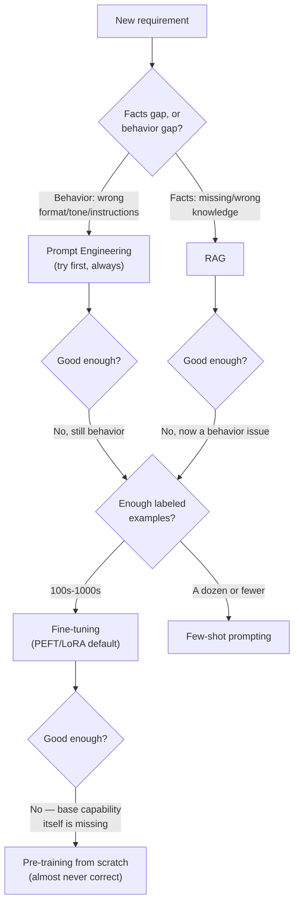

**Explained:** the first fork is facts-vs-behavior, and both branches route through the same
"good enough now?" checkpoint before escalating — RAG that still produces behavior problems
routes into the fine-tuning branch rather than trying harder at retrieval, and prompting that
still has a facts gap routes into RAG rather than trying harder at prompt wording. Pre-training
sits at the very end of the tree, reachable only when fine-tuning itself fails to close a gap in
the model's *fundamental* capability — not a shortcut available earlier in the tree.

### Real image — Bedrock's RAG pipeline in production


*Figure: AWS's own diagram of a Bedrock Knowledge Base's runtime retrieval-augmented-generation
flow — a user query is embedded, matched against a vector store of pre-processed document
chunks, and the top matches are injected into the foundation model's prompt before generation —
the literal mechanism behind the RAG branch of the decision tree above. Source: AWS Bedrock User
Guide, "Retrieve data and generate AI responses with knowledge bases" —
docs.aws.amazon.com/bedrock/latest/userguide/knowledge-base-retrieve-generate.html.*

### Exam Tips

1. **Worked example — the cost ladder.** For a 500,000-requests/month assistant: prompt
   engineering costs roughly $0 setup; RAG costs low thousands of dollars to stand up (vector
   store + embedding); PEFT/LoRA fine-tuning costs low thousands per training run; full
   fine-tuning costs high thousands to tens of thousands; pre-training from scratch costs
   hundreds of thousands to millions. Each rung is roughly an order of magnitude or more above
   the one before it — a scenario naming a tight budget or timeline is implicitly ruling out the
   top rungs without even evaluating whether they'd technically work.
2. **Worked example — catastrophic forgetting, with numbers.** A support bot scores 92% helpful-
   and-accurate (human-rated) on general questions before fine-tuning on 500 narrow examples;
   after fine-tuning, it scores 97% on the narrow task but **drops to 71%** on the same general-
   question set. A team measuring only the narrow-task improvement (92%→97%) would ship a model
   that actually regressed badly elsewhere — only a deliberate before/after check on *unrelated*
   prompts surfaces this.
3. **Exam trap:** "a foundation model fabricates facts not in its training data or provided
   context" is a hallucination problem, fixed with tighter RAG grounding and explicit "only
   answer from provided context" prompting — not fine-tuning, which doesn't reliably eliminate
   hallucination on facts outside the fine-tuning set.

---

# Part B — The Five Services

## B1. Amazon Bedrock

### Definition

**Amazon Bedrock** is a fully-managed, serverless service providing API access to foundation
models from multiple providers (Anthropic Claude, Amazon Titan/Nova, Meta Llama, Mistral, Cohere
Command, AI21, Stability AI, and others) through one unified API, plus managed tooling for
customizing those models (fine-tuning, Knowledge Bases for RAG, Agents for orchestration, and
Guardrails for safety).

### Plain-English analogy

Bedrock is like a single, unified streaming-service subscription that gives you access to many
different studios' content (Anthropic's, Meta's, Amazon's own) through one interface, one
billing relationship, and one API — instead of negotiating separately with each studio, hosting
your own infrastructure to run their models, and learning a different interface for each.

### Purpose

To let a team build generative AI applications (chat, summarization, content generation, RAG,
agentic workflows) without managing any model-hosting infrastructure, provisioning GPUs, or
choosing a single foundation model provider to be permanently locked into — the API shape stays
consistent even when swapping the underlying model.

### When to use

- Building a generative AI feature (chat, summarization, classification via prompting, content
  generation) where time-to-market and avoiding infrastructure management matter more than
  squeezing out the absolute lowest possible per-token cost a self-hosted model might offer at
  very large scale.
- Needing to compare or switch between several foundation model providers without rewriting
  application code for each one.
- Needing managed RAG (Knowledge Bases) or managed agentic orchestration (Agents) without
  building that infrastructure from scratch.
- Needing to fine-tune a foundation model without managing training infrastructure directly.

### When NOT to use

- **Extremely latency-sensitive, air-gapped, or fully on-premises requirements** that a managed,
  cloud-hosted API cannot satisfy — though Bedrock does support provisioned throughput and VPC
  endpoints for many compliance needs, a scenario demanding fully offline inference rules it out.
- **A narrow, well-defined task a purpose-built managed AI service already solves more cheaply**
  (entity extraction → Comprehend, OCR → Textract) — reaching for a Bedrock foundation model here
  is reaching for the more expensive, less reliable tool when a cheaper, purpose-built one
  already fits, per A5's customization-ladder discipline applied one level up to service choice.
- **A classic structured-data prediction task** (fraud scoring, demand forecasting) — this is
  SageMaker's built-in-algorithm territory (B2/B5), not a foundation-model task at all.

### 5 Use Cases

1. A customer-support team builds a RAG chatbot using **Bedrock Knowledge Bases** grounded on
   the company's current policy documents, avoiding the need to build and maintain a separate
   vector-database pipeline.
2. A content team fine-tunes a Bedrock foundation model via **PEFT/LoRA** on 300 approved
   product descriptions to lock in a consistent brand voice, after confirming prompt engineering
   alone couldn't achieve it.
3. A multi-step customer-service workflow (look up an order, check a return policy, issue a
   refund) is built with a **Bedrock Agent**, which plans and calls the right backend tools/APIs
   in sequence rather than requiring a single, monolithic prompt to handle every branch.
4. A healthcare documentation startup selects a Bedrock model primarily by **context-window
   size** over raw benchmark scores, since its core need (summarizing full multi-page patient
   encounters in one pass) is blocked entirely by too-small a context window.
5. A regulated enterprise applies **Bedrock Guardrails** to block a defined set of topics and PII
   categories from model outputs, enforced centrally across every application calling the same
   underlying model, rather than re-implementing filtering logic in each application separately.
6. A team evaluates Claude, Titan, and Llama on 50 of their own representative support-ticket
   prompts using ROUGE and a human rubric before committing, rather than trusting a generic
   public leaderboard to predict performance on their specific jargon-heavy domain.

### Why important

Bedrock is the default entry point for the entire foundation-model half of Domain 2 — nearly
every task statement from 2.1.1 through 2.2.9 either configures something *inside* Bedrock
(model selection, fine-tuning, RAG architecture, retrieval optimization) or makes a decision
*about whether* to use Bedrock at all (vs. a managed AI service, vs. JumpStart, vs. training from
scratch).

### Diagram — Bedrock's model-selection and customization funnel

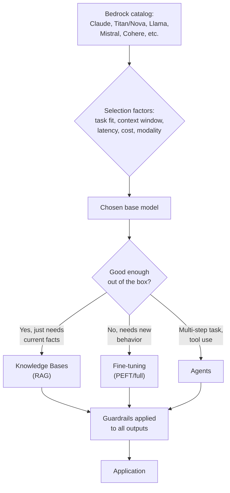

**Explained:** model selection isn't a one-time ranking — it's matched against task fit, context
window, latency, and cost (per A5's cost-ladder framing). Whichever of Knowledge Bases, fine-
tuning, or Agents the use case needs, Guardrails sits as a final, centrally-enforced layer across
all of them — a single safety/compliance configuration applied regardless of which customization
path a given request took.

### Real image — Bedrock Knowledge Bases' ingestion (pre-processing) pipeline


*Figure: AWS's own diagram of the ingestion half of a Bedrock Knowledge Base — source documents
are chunked, embedded, and written into a vector store, the one-time (and ongoing, as documents
change) setup step that has to happen before the runtime retrieval diagram in A5 above can
retrieve anything at all. Source: AWS Bedrock User Guide, "How Amazon Bedrock knowledge bases
work" — docs.aws.amazon.com/bedrock/latest/userguide/knowledge-base-how-it-works.html.*

### Exam Tips

1. **Worked example — model selection isn't "pick the biggest."** A scenario emphasizing a
   sub-2-second response requirement for a simple classification-style chat interaction should
   favor a smaller, faster model even if a larger model would score marginally higher on a
   generic benchmark — per A5's performance/latency/cost tradeoff, a model that merely clears the
   task's actual bar is frequently the *better* answer than one that clears it with unnecessary
   room to spare.
2. **Worked example — fine-tuning strategy choice.** A startup needing three differently-branded
   chatbot variants (one per product line) chooses **LoRA/PEFT** specifically because it can't
   justify three full fine-tuning runs' worth of storage and compute for what's really the same
   base model with three different lightweight adapters — full fine-tuning is reserved for
   scenarios needing deep, pervasive behavior change a small adapter genuinely can't achieve.
3. **Exam trap:** a scenario describing a narrow, well-defined extraction task ("pull dates and
   names from scanned invoices") is a Comprehend/Textract problem, not a reason to stand up a
   Bedrock RAG pipeline — reaching for the generative, more expensive tool when a purpose-built
   managed AI service already solves the stated problem is a commonly tested mismatch.

---

## B2. Amazon SageMaker (Overview)

### Definition

**Amazon SageMaker** is AWS's fully-managed machine learning platform covering the entire
classic-ML lifecycle: data preparation (Domain 1), model building/training/tuning (this domain),
deployment (Domain 3), and monitoring (Domain 4) — SageMaker is the umbrella service name; its
individual components (Training, Automatic Model Tuning, JumpStart, Model Registry, Model
Monitor, Pipelines, Endpoints, Studio, Data Wrangler, Feature Store, Clarify) are each their own
focused tool under that umbrella.

### Plain-English analogy

If Bedrock is a streaming subscription to other studios' finished content, SageMaker is a full
film studio lot — sound stages (training infrastructure), editing suites (tuning/evaluation
tooling), a wardrobe department (feature engineering), a release/distribution pipeline
(deployment), and a post-release audience-tracking system (monitoring) — all under one roof, for
teams that need to actually *produce* a model (not just consume an existing one) and want every
stage of that production connected.

### Purpose

To remove the undifferentiated infrastructure burden (provisioning compute, managing training
clusters, wiring together storage/compute/networking) from the ML lifecycle, so a team's actual
differentiated work is data and modeling decisions, not infrastructure operations.

### When to use

- Building, training, or fine-tuning a model that needs to own its own weights (not just call an
  existing API) — classic ML algorithms, custom script-mode training, or deploying/fine-tuning a
  JumpStart pretrained model.
- Needing an end-to-end, auditable, reproducible ML pipeline (SageMaker Pipelines) connecting
  data prep through deployment with lineage tracking.
- Needing enterprise MLOps capabilities (Model Registry versioning/approval, Model Monitor
  drift detection, Clarify bias/explainability checks) around models of any origin.

### When NOT to use

- **When the entire need is "call an existing foundation model via API"** — Bedrock is the
  purpose-built, serverless path for that; standing up SageMaker training/hosting infrastructure
  for a task Bedrock already serves adds unnecessary operational burden.
- **When a managed AI service already solves the exact stated problem** (Comprehend, Rekognition,
  Textract) — building a custom SageMaker model for a problem a managed service already handles
  well duplicates engineering effort for no accuracy gain.
- **For teams without any ML engineering capacity at all** needing a single narrow prediction
  (e.g., basic sentiment) — the managed AI services' zero-ML-expertise-required design fits that
  need better than standing up a SageMaker training pipeline.

### 5 Use Cases

1. A retailer trains an **XGBoost** fraud-detection model using a SageMaker built-in algorithm
   Training Job, avoiding any custom training-code maintenance burden.
2. A research team brings its own **PyTorch** training script into SageMaker via script mode,
   retaining full control of the model architecture while still benefiting from managed compute
   provisioning and Spot Training cost savings.
3. An ML platform team builds a **SageMaker Pipeline** connecting data preprocessing, training,
   evaluation, and conditional registration into Model Registry, so every model version is
   produced by an identical, auditable, re-runnable process.
4. A compliance team runs **SageMaker Clarify** against a trained credit-risk model to generate
   both pre-training (data) and post-training (predictions) bias reports before approval.
5. A company builds a feature store (**SageMaker Feature Store**) shared across multiple model-
   building teams, ensuring the exact same feature computation logic is used consistently in
   both training and real-time inference, eliminating training/serving skew.
6. A team compares this week's newly trained model against last week's production model using
   **SageMaker Experiments**' side-by-side metric tracking rather than a manual spreadsheet.

### Why important

SageMaker is the connective tissue across all four MLA-C02 domains — understanding it as an
umbrella of composable, individually-named services (rather than one monolithic tool) is a
prerequisite for correctly answering any scenario naming one of its sub-components specifically.

### Diagram — the SageMaker lifecycle across domains

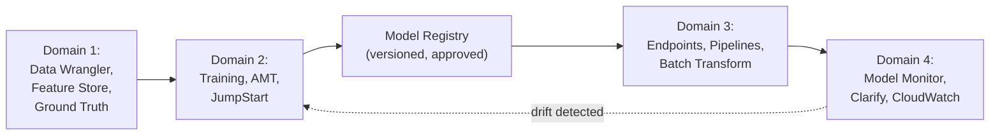

**Explained:** the lifecycle isn't linear-and-done — drift detected in Domain 4's monitoring
loops back into Domain 2's training/tuning stage for a retrain, which then produces a *new*
registered version, closing the loop. This is why Model Registry sits structurally between
Domain 2 and Domain 3: every path through training (built-in algorithm, script mode, fine-tuned
foundation model) converges on the same registration step before deployment, regardless of which
path produced it.

### Real image — a full SageMaker Pipeline, end to end


*Figure: AWS's own rendering of a full SageMaker Pipeline — a directed acyclic graph of
preprocessing, training, evaluation, and a conditional step that only registers the model in
Model Registry if it clears a quality bar — the literal mechanism tying Domain 1's data prep,
this domain's training, and Domain 3's registry hand-off into one auditable, re-runnable
pipeline. Source: AWS SageMaker Developer Guide, "SageMaker Pipelines" —
docs.aws.amazon.com/sagemaker/latest/dg/pipelines.html.*

### Exam Tips

1. **Worked example — recognizing the right sub-component from a scenario's wording.** "Need
   every trained model version tracked with approval status and lineage" → Model Registry, not
   Experiments (which compares metrics, not approval workflow) and not Pipelines (which
   orchestrates the *process*, not the *registry* of outputs). Precisely matching a scenario's
   stated need to the correct named sub-component, rather than a generic "use SageMaker" answer,
   is what case-study questions actually grade.
2. **Worked example — Spot Training savings.** A training job using SageMaker Managed Spot
   Training can realistically save 60-90% versus On-Demand pricing for interruptible,
   checkpoint-able training jobs — the tradeoff being possible interruption, mitigated by
   checkpointing progress periodically so an interrupted job resumes rather than restarting from
   zero; full mechanics live in [`../../../services/machine-learning-ai/sagemaker-training-and-tuning.md`](../../../services/machine-learning-ai/sagemaker-training-and-tuning.md).
3. **Exam trap:** treating "SageMaker" as a single monolithic answer when a scenario asks about a
   *specific* capability (bias detection, feature consistency between training and serving,
   pipeline orchestration) — each of those maps to a specific named sub-component (Clarify,
   Feature Store, Pipelines respectively), and the exam expects the specific name, not the
   umbrella one.

---

## B3. SageMaker JumpStart

### Definition

**SageMaker JumpStart** is a hub of pretrained models — both classic ML models and foundation
models — that can be deployed or fine-tuned directly inside your own SageMaker environment (your
own VPC, your own training/hosting infrastructure, your own model artifacts), as opposed to
Bedrock's fully-managed, serverless, infrastructure-free access to foundation models.

### Plain-English analogy

If Bedrock is renting a fully-serviced apartment (someone else manages the building, you just
move in), JumpStart is buying a mostly-finished house and bringing in your own renovation crew —
you get a real head start (the foundation and structure are already built, i.e., the pretrained
model weights), but you own the property outright, can renovate it however you like (fine-tune
with full control), and are responsible for its own utilities and maintenance (your own
SageMaker training/hosting infrastructure).

### Purpose

To give teams a transfer-learning starting point for both classic ML (pretrained image/text
models) and generative AI (open foundation models) without starting training from random
initialization, while keeping the resulting model artifact, training infrastructure, and
customization process fully inside the team's own AWS environment rather than behind a
third-party managed API.

### When to use

- Needing to fine-tune or deploy a foundation model **inside your own VPC/infrastructure**,
  where full control over the hosting environment (not just the API) is a requirement — e.g.,
  strict network isolation that a purely serverless managed API can't satisfy.
- Needing a pretrained *classic ML* model (image classification, object detection) as a transfer-
  learning starting point, avoiding training an equivalent model from random initialization.
- Wanting to use an open-source/open-weight foundation model specifically, rather than being
  limited to Bedrock's provider catalog.
- Needing fine-grained control over the training job itself (custom training scripts layered on
  top of a JumpStart base model) beyond what Bedrock's managed fine-tuning API exposes.

### When NOT to use

- **When a fully-managed, zero-infrastructure foundation-model experience is sufficient** —
  Bedrock is the simpler, lower-operational-overhead path for teams that don't need to own the
  hosting environment directly.
- **For a narrow, already-solved task a managed AI service handles** — JumpStart's pretrained
  models are a starting point for building/customizing a model, not a replacement for Comprehend/
  Rekognition/Textract when the stated task is exactly what those already do well.
- **When the team has no need for transfer learning at all** — a simple, well-understood tabular
  problem with abundant labeled data may be better served by training a built-in SageMaker
  algorithm (XGBoost, Linear Learner) directly from scratch rather than adapting a pretrained
  model never designed for that exact structured-data shape.

### 5 Use Cases

1. A team deploys a JumpStart **pretrained image classification model** and fine-tunes it on a
   few thousand company-specific labeled images, rather than training a convolutional network
   from random initialization on a comparatively small dataset.
2. An enterprise fine-tunes an **open-weight foundation model via JumpStart** specifically
   because a data-residency requirement mandates the fine-tuned model artifact live entirely
   within the company's own VPC, a constraint a purely serverless API can't satisfy.
3. A team benchmarking foundation models' price-performance for a specific internal workload
   deploys several **JumpStart model options side by side** on their own infrastructure to
   measure real latency and throughput under their own load pattern, rather than relying on
   published, generic benchmark numbers.
4. A research group uses a JumpStart pretrained **BERT-family text model** as the base for a
   custom fine-tuning script with specialized loss functions Bedrock's managed fine-tuning API
   doesn't expose.
5. A startup evaluates JumpStart specifically because it needs an **open-source model with no
   per-token API fee**, planning to amortize hosting cost against very high request volume where
   owning the deployed instance becomes cheaper than per-token managed-API pricing at that scale.

### Why important

JumpStart is the exam's test of recognizing *infrastructure ownership* as a real decision axis
separate from "which model is best" — a scenario explicitly requiring the model and its hosting
environment to live inside the team's own infrastructure (compliance, data residency, deep
customization needs) is a JumpStart signal specifically, distinguishing it from Bedrock even when
both could technically serve the same underlying foundation model family.

### Diagram — Bedrock vs. JumpStart, the infrastructure-ownership fork

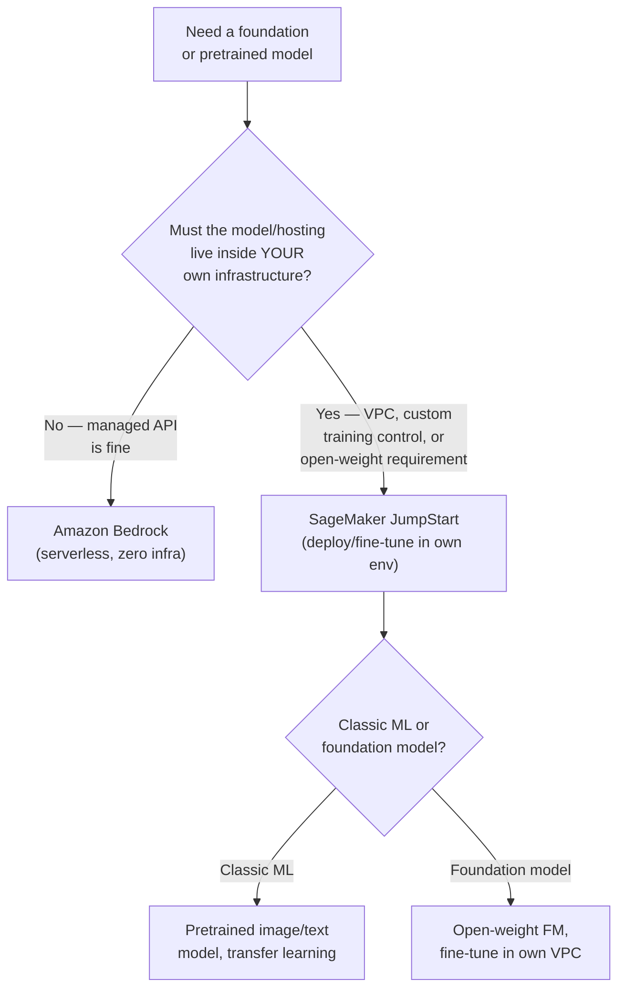

**Explained:** the fork is infrastructure ownership, not model capability — both paths can reach
a comparably capable model; the deciding factor is whether the team needs to *own* the hosting
environment (data residency, custom training scripts, no per-token fee at scale) or is fine with
a managed API abstracting that away entirely.

### Real image — JumpStart's foundation model catalog inside SageMaker Studio


*Figure: AWS's own screenshot of JumpStart's foundation model browsing experience inside
SageMaker Studio — models are deployed or fine-tuned directly into the user's own SageMaker
environment from this catalog, visually distinct from Bedrock's separate, fully-managed console
experience, reinforcing the infrastructure-ownership distinction the diagram above describes.
Source: AWS SageMaker Developer Guide, "Amazon SageMaker JumpStart Foundation Models" —
docs.aws.amazon.com/sagemaker/latest/dg/studio-jumpstart-foundation-models.html.*

### Exam Tips

1. **Worked example — the deciding question.** A scenario stating "the fine-tuned model and its
   serving infrastructure must remain entirely within our VPC for a data-residency requirement"
   contains the exact trigger phrase for JumpStart over Bedrock — Bedrock's underlying
   infrastructure isn't something the customer directly provisions inside their own VPC in the
   same way, even with VPC endpoint support for API calls.
2. **Worked example — transfer learning vs. training from scratch.** A team with 3,000 labeled
   company-specific images fine-tuning a JumpStart pretrained image classifier will typically
   reach strong accuracy with far less data and training time than training an equivalent
   network from random initialization — the practical payoff of transfer learning JumpStart is
   built around, directly connecting to `ml-fundamentals-glossary.md`'s Transfer Learning
   section.
3. **Exam trap:** assuming JumpStart and Bedrock are interchangeable whenever "foundation model"
   appears in a scenario — the correct one depends on the infrastructure-ownership requirement
   stated (or implied by a compliance/data-residency constraint), not on which one sounds more
   advanced or is mentioned first.

---

## B4. SageMaker Model Monitor & Model Registry

### Definition

**SageMaker Model Registry** is a catalog for versioning trained models, tracking their metadata
(metrics, lineage — which data and code produced them), and managing an approval workflow
(`PendingManualApproval` / `Approved` / `Rejected`) before a version is cleared to deploy.
**SageMaker Model Monitor** is the complementary *post-deployment* service that continuously
watches a deployed model's real production input data and predictions for **drift** —
statistical divergence from the data distribution the model was trained and validated on.

### Plain-English analogy

Model Registry is a product's version-control and release-approval system — every build is
tagged, its test results attached, and nothing ships to production without a human or automated
gate signing off. Model Monitor is the equivalent of ongoing post-release user-feedback and
crash-report monitoring — catching the moment real-world usage starts behaving differently from
what was true when the release was approved, even though nothing about the *code itself* changed.

### Purpose

Model Registry exists to make "which exact model version is in production, and why was it
approved" an always-answerable question rather than tribal knowledge. Model Monitor exists to
catch the specific failure mode where a model's *code* is unchanged but the *world feeding it*
has shifted — a problem no amount of pre-deployment testing can catch, since it only manifests
after deployment, as real data evolves.

### When to use

- **Model Registry:** any time more than one person or team needs to agree on which model
  version is cleared for production, or when regulatory/audit requirements demand lineage
  tracking (which dataset + code version produced the model currently serving traffic).
- **Model Monitor:** any production model receiving ongoing live traffic, where the input data
  distribution could plausibly shift over time (seasonality, changing customer behavior, upstream
  data-pipeline changes) — essentially any production-serving model, not an edge case.

### When NOT to use

- **Model Registry for a single-person, single-run experimental project with no deployment
  intent** — the versioning/approval overhead buys little value for a model that will never be
  compared against a future version or require sign-off.
- **Model Monitor without first establishing a baseline** — monitoring for drift *relative to*
  the training data's statistical profile requires that baseline to exist and be correct first;
  skipping baseline configuration makes any later "drift detected" alert meaningless, since
  there's nothing trustworthy to compare against.
- **Treating Model Monitor's drift alert as itself the fix** — drift detection correctly
  identifies *that* something changed, but the fix (retrain on recent data, re-register a new
  version) still routes back through this domain's training/tuning and registry flow — Model
  Monitor diagnoses, it doesn't repair.

### 5 Use Cases

1. A team registers every tuned model version from an Automatic Model Tuning job in **Model
   Registry** with its precision/recall metadata attached, requiring a human reviewer to approve
   the precision/recall tradeoff before the model can be deployed.
2. A fraud-detection model's **Model Monitor** baseline is configured from its validation data's
   statistical profile; three months later, an alert fires when live transaction amounts'
   distribution has shifted meaningfully from that baseline, well before the model's measured
   accuracy itself visibly degrades.
3. An auditor uses **Model Registry's lineage tracking** to confirm exactly which training
   dataset version and code commit produced the model currently serving production traffic,
   satisfying a regulatory audit request.
4. A team compares two competing model versions' registered metrics side by side in **Model
   Registry** before deciding which one to promote to `Approved` status, rather than relying on
   whichever was trained most recently.
5. A retraining pipeline triggered by a **Model Monitor** drift alert produces a new model
   version, which is automatically registered in `PendingManualApproval` status, closing the
   loop back into this domain's training/evaluation/registration flow described in the lifecycle
   diagram above.

### Why important

Task statement 2.4 ("Manage model versions") and Domain 4's drift-monitoring content are two
halves of the same lifecycle concern — a registered-but-unmonitored model can silently degrade in
production with no automated signal; an unregistered, monitored model has no clean mechanism to
trace *which* version is even the one being monitored. The two services are tested together far
more often than either is tested alone.

### Diagram — registry status flow and the monitor-triggered retrain loop

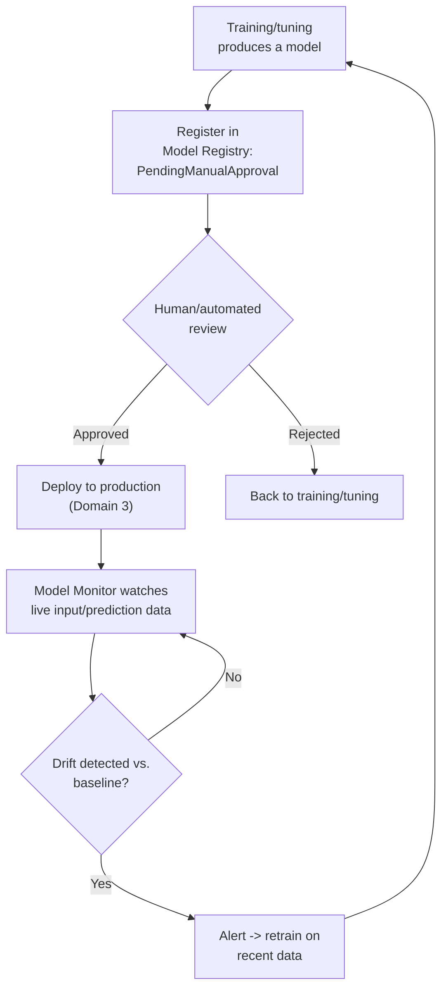

**Explained:** the registry's approval gate (B→C→D/E) and the monitor's drift loop (F→G→H→A) are
two different checkpoints at two different times — registry approval happens *once*, before
first deployment; monitoring runs *continuously*, after deployment, and its failure signal
(drift) routes all the way back to a fresh training/tuning cycle, not to a quick patch.

### Real image — Model Monitor's real-time architecture


*Figure: AWS's own architecture diagram for SageMaker Model Monitor's real-time monitoring —
live inference requests/responses are captured, processed, and statistically compared against
the baseline established from training/validation data, with CloudWatch alarms firing on
detected drift — the literal implementation behind the "Model Monitor watches live input/
prediction data" box in the diagram above. Source: AWS SageMaker Developer Guide, "Monitor
real-time inference" — docs.aws.amazon.com/sagemaker/latest/dg/model-monitor-model-quality.html.*


*Figure: the batch-transform equivalent of the real-time architecture above — Model Monitor
isn't limited to always-on real-time endpoints; the same baseline-comparison mechanism applies
to periodic batch-scored predictions, relevant for scenarios describing scheduled/batch scoring
rather than live request/response traffic. Source: AWS SageMaker Developer Guide, "Monitor data
and model quality for batch transform jobs" —
docs.aws.amazon.com/sagemaker/latest/dg/model-monitor-batch-transform.html.*

### Exam Tips

1. **Worked example — reading registry metadata to make an approval decision.** A scenario
   presenting two registered candidate versions' metadata — version A: precision=0.84,
   recall=0.81; version B: precision=0.91, recall=0.68 — paired with a stated business priority
   ("missing a real violation is costlier than a false alarm") should select version A, since
   its substantially higher recall (0.81 vs. 0.68) better matches a false-negative-averse
   priority, even though version B's precision is higher — reading the *stated business priority*
   against the *actual numbers*, not defaulting to "higher average" or "higher precision."
2. **Worked example — baseline-relative drift, not absolute-value drift.** Model Monitor flags
   drift based on *statistical distance from the training-time baseline*, not any absolute
   threshold — a feature whose values were always widely spread in training won't trigger drift
   just because a new batch also shows spread; drift fires when the *shape* of the distribution
   changes meaningfully relative to what the baseline established as normal for that specific
   feature.
3. **Exam trap:** "a model trained well on last year's data is now underperforming despite no
   code changes" is a Domain 4 concept-drift symptom Model Monitor is built to catch, but the
   *fix* routes back into this domain — retraining on recent data and re-registering a new
   version — a scenario testing this is checking whether you connect monitoring (detection) to
   training/registry (the actual remedy), not treating detection alone as sufficient.

---

## B5. SageMaker Training & Tuning

### Definition

**SageMaker Training** runs the actual model-fitting process — either a **built-in algorithm**
(XGBoost, Linear Learner, K-Means, Random Cut Forest, DeepAR, BlazingText, and others provided
as ready-to-use algorithm containers), **script mode** (your own PyTorch/TensorFlow/scikit-learn
code running inside a managed training job), or **Bring Your Own Container** (a fully custom
Docker image). **SageMaker Automatic Model Tuning (AMT)** wraps training with systematic
hyperparameter search (grid, random, Bayesian, or Hyperband) across many training jobs to find
the best-performing hyperparameter combination.

### Plain-English analogy

Training is the actual cooking — raw ingredients (data) and a recipe (algorithm) go into a
managed kitchen (SageMaker's provisioned compute) and a finished dish (trained model) comes out.
Built-in algorithms are using the kitchen's standard recipes; script mode is bringing your own
recipe but using the kitchen's equipment; Bring Your Own Container is bringing your own
equipment too. Tuning is cooking the same dish many times at slightly different oven settings and
keeping whichever batch tastes best, rather than guessing one setting and hoping.

### Purpose

To run model training without managing the underlying compute cluster directly — provisioning
instances, installing frameworks, handling distributed-training coordination, and tearing down
infrastructure afterward are all handled by the managed training job, leaving the team to focus
on the algorithm/script and data.

### When to use which training approach

| Approach | Use when |
|---|---|
| Built-in algorithm | The problem matches a provided algorithm's intended shape (tabular classification/regression → XGBoost/Linear Learner; clustering → K-Means; time series → DeepAR; text → BlazingText) and no custom modeling logic is needed |
| Script mode | A custom model architecture or training loop is needed (a specific PyTorch/TF network), but standard framework containers and managed infrastructure are otherwise sufficient |
| Bring Your Own Container | Neither a built-in algorithm nor a standard framework container fits — a fully custom runtime/dependency stack is required |
| Automatic Model Tuning | Any of the above, once the algorithm/script is settled and hyperparameter sensitivity hasn't yet been validated against the specific dataset |

### When NOT to use

- **Built-in algorithms for a problem genuinely outside their intended shape** — forcing K-Means
  onto a labeled classification problem, or XGBoost onto unstructured image data, ignores the
  algorithm-family selection work in A1; the built-in container doesn't change what the
  underlying algorithm is fundamentally capable of representing.
- **Script mode/custom containers when a built-in algorithm already solves the problem well** —
  unnecessary engineering and maintenance burden for no accuracy gain over the managed, tested
  built-in option.
- **Automatic Model Tuning before the algorithm/feature set is settled**, or **with a mis-chosen
  objective metric** — per A3, tuning cannot fix either of those upstream mistakes; it will
  efficiently optimize toward whatever (possibly wrong) target it's given.

### 6 Use Cases

1. A team trains a fraud classifier with the **XGBoost built-in algorithm**, configuring
   `scale_pos_weight` directly for the dataset's known 4% positive-class imbalance.
2. A research team brings a **custom PyTorch training script** via script mode to implement a
   novel loss function not available in any built-in algorithm, while still benefiting from
   managed multi-GPU provisioning.
3. A large training job uses **Managed Spot Training** with periodic checkpointing, cutting
   compute cost by roughly 60-90% versus On-Demand pricing while tolerating occasional
   interruption-and-resume.
4. A deep-learning image model's training is distributed across multiple GPU instances using
   **data parallelism**, specifically to reduce wall-clock training time without changing the
   model architecture or algorithm itself.
5. A tuning job for the XGBoost fraud model above runs **Bayesian search** across `max_depth`,
   `eta`, and `scale_pos_weight` with a 40-job budget, optimizing for validation AUC rather than
   accuracy, per the evaluation-metric discipline in A2.
6. A time-series forecasting team uses the **DeepAR built-in algorithm**, deliberately training
   it across thousands of related product SKUs jointly rather than thousands of independent
   per-SKU models, since DeepAR specifically benefits from shared patterns across related series.

### Why important

Training and tuning together are the literal mechanism behind task statement 2.2 ("Train and
tune a model") — nearly every other Domain 2 concept (algorithm families, evaluation metrics,
bias-variance) exists to inform decisions made *at* this stage, and the exam tests both
configuration-level details (built-in algorithm vs. script mode vs. BYOC) and conceptual
reasoning about what the configuration choices actually buy.

### Diagram — the training job's inputs and outputs

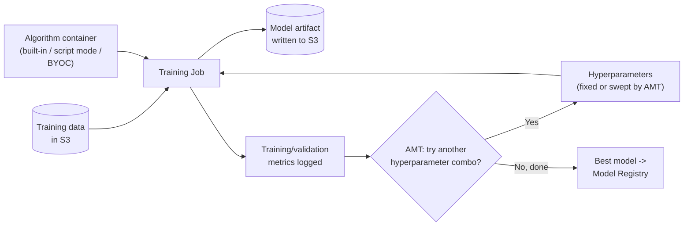

**Explained:** a single training job is a stateless, repeatable function — data and a fixed set
of hyperparameters go in, a model artifact and metrics come out. Automatic Model Tuning is simply
this box run many times with different hyperparameter inputs, with the search strategy (A3)
deciding what to try next based on the metrics each prior run logged.

### Real image — a SageMaker training job's structure


*Figure: AWS's own training-job diagram — training data and an algorithm container go in, a
trained model artifact comes out to S3 — the literal infrastructure the diagram above
represents abstractly, and the same infrastructure a CraftHaven-style XGBoost fraud model (see
`README.md`'s case study) would run on, one job per hyperparameter combination during tuning.
Source: AWS SageMaker Developer Guide, "Train a Model with Amazon SageMaker" —
docs.aws.amazon.com/sagemaker/latest/dg/how-it-works-training.html.*

### Exam Tips

1. **Worked example — choosing a built-in algorithm by problem shape.** A scenario stating
   "predict a category, tabular data, relationship shape unknown" walks straight to XGBoost per
   A1's decision tree; "predict a continuous number over time, many related products" walks to
   DeepAR; "group without labels" walks to K-Means — matching the stated problem type and data
   shape to the specific built-in algorithm name is the direct, repeatable question shape tested.
2. **Worked example — Spot Training's real savings, with checkpointing as the condition.** A
   training job interruptible and checkpoint-able can realistically see 60-90% cost savings via
   Managed Spot Training versus On-Demand — but *without* checkpointing configured, an
   interruption means restarting the entire job from zero, which can erase the cost savings
   entirely if interruptions are frequent; a scenario emphasizing cost savings for a long training
   job should pair Spot Training with an explicit checkpointing strategy, not assume Spot alone
   is risk-free.
3. **Exam trap:** "training a large model on a single GPU instance is too slow, and the team
   wants to speed it up without changing the algorithm" is a distributed-training (data
   parallelism across multiple GPU instances) answer, not a smaller/simpler model — a smaller
   model would change the algorithm's capacity, not just its speed, and risks underfitting
   (A4) as an unintended side effect of solving a speed problem the wrong way.

---

# Part C — Integration: How It All Fits Together

## C1. The full domain funnel, every service and concept in one flow

Domain 2's services and concepts are not a flat toolbox to memorize independently — they form a
single decision funnel every project walks, in roughly the same order, regardless of which
specific branch it ultimately takes:

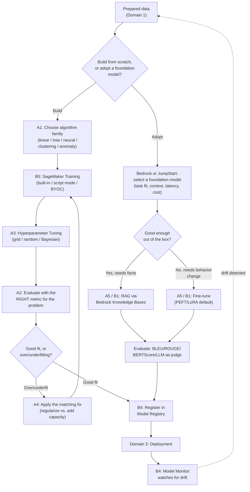

**Walking the whole funnel in words:** every project starts at the same build-vs-adopt fork.
The build branch walks through algorithm-family selection (A1), into SageMaker Training (B5),
into hyperparameter tuning (A3), into evaluation with a problem-appropriate metric (A2) — and if
evaluation reveals over- or under-fitting, the matching fix from A4 routes back into training,
not forward to tuning or registration prematurely. The adopt branch walks through foundation-
model selection (choosing between Bedrock and JumpStart based on the infrastructure-ownership
question from B3), then the facts-vs-behavior customization fork from A5, landing on either RAG
or fine-tuning (both inside B1/B3), each with its own evaluation discipline (generative-text
metrics, not classic accuracy-style metrics). **Both branches converge on the same final step**
— Model Registry (B4) — regardless of which path produced the model, and the whole funnel is a
loop, not a line: Model Monitor's drift detection after deployment (Domain 3/4) feeds back to
the very top of this same funnel for a fresh training/fine-tuning cycle.

## C2. A full worked case study spanning every service and concept

**The business problem:** "Meridian Insurance" needs two capabilities: (1) a claims-triage model
that flags likely-fraudulent auto-insurance claims from structured claim data, and (2) a
customer-facing assistant that explains claim-status and policy details in plain language,
grounded in each customer's actual policy documents.

### Sub-problem 1 — fraud triage (the "build" branch, exercising A1, A2, A3, A4, B2, B4, B5)

1. **Algorithm selection (A1):** Meridian has 80,000 historical claims, each labeled fraudulent
   or legitimate (6% fraud rate), with 25 structured features (claim amount, policy tenure,
   claimant's prior claims count, repair-shop flags). Tabular, labeled, relationship shape
   unknown → per A1's tree, **XGBoost** is the starting point, not assumed without checking —
   the team briefly validates this isn't a near-linear relationship (it isn't: claim amount
   interacts non-additively with policy tenure and prior-claims count) before committing.
2. **Training (B5):** an XGBoost **built-in algorithm** Training Job runs on SageMaker, with
   `scale_pos_weight` set to address the 6% imbalance directly, and **Managed Spot Training**
   with checkpointing enabled to cut compute cost roughly 60-70% on this non-urgent, resumable
   batch job.
3. **Hyperparameter tuning (A3):** given a $15/job training cost and a 50-job budget, the team
   chooses **Bayesian search** over `max_depth`, `eta`, and `scale_pos_weight`, with Hyperband-
   style early stopping enabled to kill clearly underperforming candidates before their full
   training budget completes, stretching the $750 total budget further in practice.
4. **Evaluation (A2):** the team explicitly does **not** report plain accuracy (a trivial
   "approve everything" baseline would score ~94% while catching zero fraud); it reports recall
   at a precision floor of 0.80. The winning tuned model, on a 4,000-claim validation set (240
   actually fraudulent, 6%), produces TP=194, FN=46, FP=43, TN=3,717 — precision = 194/237 ≈
   81.9% (clears the 0.80 floor), recall = 194/240 ≈ 80.8%, F1 ≈ 81.3%.
5. **Bias/variance check (A4):** training accuracy (97.1%) vs. validation accuracy (94.8%) shows
   a modest, acceptable gap — not the large gap that would signal overfitting requiring
   intervention; the team proceeds rather than over-regularizing a model that's already in a
   reasonable fit range.
6. **Registry (B4):** the winning model is registered in **Model Registry** with its precision/
   recall/F1 attached as metadata, status `PendingManualApproval`; a human reviewer confirms the
   81.9%/80.8% tradeoff is acceptable and promotes it to `Approved`.
7. **Monitoring loop (B4, forward reference to Domain 4):** once deployed, **Model Monitor**'s
   baseline is set from this validation data's statistical profile; six months later, a shift in
   claim-amount distributions (inflation-driven) triggers a drift alert well before the model's
   measured precision/recall visibly degrades, prompting a scheduled retrain that re-enters this
   same funnel from the training step.

### Sub-problem 2 — the policy-explainer assistant (the "adopt" branch, exercising A5, B1, B3)

1. **Facts vs. behavior (A5):** the core need — explain a customer's *specific* policy and claim
   status — is a facts gap (the foundation model has no knowledge of Meridian's specific
   customers or policies), not a behavior gap. **Correct first move: RAG**, not fine-tuning.
2. **Service choice (B1 vs. B3):** Meridian has no data-residency requirement mandating the
   model run inside its own VPC, and wants to avoid owning hosting infrastructure — **Amazon
   Bedrock Knowledge Bases** is selected over JumpStart, consistent with B3's infrastructure-
   ownership fork resolving toward the managed, serverless option here.
3. **Model selection (B1):** the team evaluates three Bedrock model families on 50 of their own
   representative policy-explanation prompts, scored with a human rubric, selecting a mid-sized
   model that clears the quality bar at meaningfully lower latency/cost than the largest
   available option — per B1's performance/latency/cost exam tip, not defaulting to "the
   biggest."
4. **Testing "good enough" (A5):** after RAG grounding, factual accuracy (checked against source
   policy documents via human review) is strong, but a secondary issue emerges — the assistant
   occasionally uses legal jargon customers find confusing, despite the RAG context including a
   "write in plain language" instruction. This is now a **behavior/tone** problem, not a facts
   problem, since the facts are already correct.
5. **Escalation to fine-tuning (A5):** with 250 previously-approved plain-language claim
   explanations available, the team fine-tunes via **PEFT/LoRA** (not full fine-tuning — the
   change needed is narrow and the data volume fits PEFT's sweet spot) to lock in the simpler
   tone, layered on top of the already-working RAG grounding.
6. **Evaluation (connects to A2's generative metrics):** the fine-tuned-plus-RAG assistant is
   evaluated with BERTScore against the 250 approved examples (not BLEU/ROUGE, since valid
   paraphrases of plain-language explanations shouldn't be penalized for differing wording), and
   a before/after check on general, unrelated policy questions specifically confirms no
   catastrophic forgetting occurred from the narrow fine-tune.
7. **Registry (B4):** the fine-tuned model is registered in the same Model Registry as
   sub-problem 1's XGBoost model — the Registry treats both identically regardless of which path
   (classic ML training, or foundation-model fine-tuning) produced them.

**Why this case study matters:** a single business need routinely requires *both* branches of
the funnel simultaneously, and the skill the exam actually tests is recognizing which branch
(and which specific node within that branch) a given sub-problem belongs to — not defaulting to
"use Bedrock for everything" or "train everything from scratch."

## C3. Common pitfalls across the whole domain

Collected from every section above, the ten mistakes that recur most often across Domain 2
case-study questions, regardless of which specific service or concept a question names:

1. **Reporting accuracy on an imbalanced dataset without checking the class balance first** — the
   single most repeated trap in the entire domain (A2); always check whether classes are
   balanced before trusting accuracy as the headline number.
2. **Assuming XGBoost (or any single algorithm) is always the right default** — A1's head-to-head
   comparisons prove the "default" reverses on near-linear data; the correct answer is always
   conditional on the data's actual shape, never a fixed ranking.
3. **Applying regularization to an underfitting model** — A4's decision table exists specifically
   because this is the opposite of the correct fix and actively worsens the symptom.
4. **Tuning hyperparameters before the algorithm/objective-metric choice is settled** — A3 can
   only optimize whatever it's given; an upstream mistake in algorithm or metric selection isn't
   fixable by tuning harder.
5. **Reaching for fine-tuning (or worse, pre-training) before confirming prompt engineering and
   RAG have genuinely been tried and ruled out** — A5's cost ladder exists because each rung
   above the cheapest is an order of magnitude or more expensive, and a meaningful share of real
   gaps are fully solved by the cheapest rung alone.
6. **Using RAG to fix a tone/format/behavior problem** — a structural mismatch (A5); RAG adds
   retrieved content, it does not reliably constrain output style even when style instructions
   are part of what's retrieved.
7. **Treating a fine-tune's improved target-task score as sufficient evidence of success** without
   checking for catastrophic forgetting on unrelated prompts (A5) — the single most commonly
   skipped evaluation step in generative-AI customization scenarios.
8. **Confusing Bedrock and JumpStart as interchangeable** whenever "foundation model" appears,
   rather than checking the infrastructure-ownership requirement (B3) that actually distinguishes
   them.
9. **Treating Model Monitor's drift alert as itself the fix** rather than the trigger for a
   retrain-and-re-register cycle that routes back through this entire domain's training/tuning/
   evaluation flow (B4, C1).
10. **Assuming Managed Spot Training is risk-free cost savings** without checkpointing configured
    (B5) — an interruption without checkpointing restarts the entire job from zero, which can
    erase the savings on a frequently-interrupted job.

---

# Part D — Compiled Exam Scenario Quick Reference

*Organized by sub-topic, each scenario paired with the correct answer and the one-line reasoning
— a fast pre-exam review pass across every concept and service in this document.*

### Algorithm selection (A1)

1. **"Tabular data, binary classification, relationship shape unknown"** → XGBoost, the default
   strong baseline for an unknown-or-non-linear shape.
2. **"Tabular data, clearly linear/monotonic relationship, or regulator requires explainable
   coefficients"** → Logistic Regression — interpretability and a genuinely linear relationship
   can make the simpler model the *better*, not just acceptable, choice.
3. **"Segment customers with no pre-existing category label"** → K-Means; confirm it's genuinely
   unsupervised before assuming classification just because the word "segment" was used.
4. **"Detect a brand-new fraud/defect pattern with no labeled examples of it yet"** → Random Cut
   Forest / anomaly detection — supervised classification structurally cannot generalize to a
   pattern type absent from its training labels.
5. **"Classify raw images or free text with no hand-engineered features"** → a neural network
   (CNN for images, transformer/BlazingText-family for text).
6. **"Forecast demand across thousands of related product SKUs"** → DeepAR, which benefits from
   learning shared patterns across related series jointly.
7. **"Small dataset (a few hundred rows), request to use a deep neural network"** → flag the
   mismatch; small tabular data favors a tree ensemble or linear model over a high-variance deep
   network.
8. **"Determine the right number of clusters k without labels"** → elbow method (inertia vs. k)
   or silhouette score, not an arbitrary business-chosen number.

### Evaluation metrics (A2)

9. **"99% accuracy but a rare positive class is mostly missed"** → accuracy is the wrong metric
   for imbalanced classes; report recall, F1, or AUC instead.
10. **"Too many false alarms escalated to human review"** → a precision problem; raise the
    classification threshold, accepting a recall drop as the known tradeoff.
11. **"A regression model's error metric is dominated by a few unusually expensive outlier
    properties"** → switch from RMSE to MAE, which is far less sensitive to a small number of
    extreme errors.
12. **"Need one number for an imbalanced binary classifier without picking a side between false
    positives and false negatives"** → F1 score.
13. **"Comparing classifiers' ranking ability across all thresholds before committing to a
    cutoff"** → AUC — but prefer Average Precision / PR curves specifically on a rare-class
    problem, since AUC can look more optimistic there than PR-based metrics.
14. **"Generated text is accurate but scores low on an automated metric"** → BLEU/ROUGE penalize
    valid paraphrases; use BERTScore or semantic similarity instead.
15. **"No single correct reference answer exists for a generative task at all"** → LLM-as-a-
    judge, with a human-reviewed sample used to calibrate the judge model's scores.
16. **"Deciding the right K for a RAG pipeline's retrieval step"** → tune Precision@K/Recall@K
    against the generator's actual context capacity and measured answer quality.
17. **"Two models tie on accuracy but the business needs to trust the stated confidence
    percentages for an automated downstream threshold"** → check calibration, not accuracy or
    AUC, neither of which verifies whether a stated probability matches real-world frequency.

### Hyperparameter tuning (A3)

18. **"Minimize the total number of expensive training jobs during tuning"** → Bayesian search.
19. **"Small, cheap search space, want a guaranteed-best-within-range result"** → grid search is
    genuinely appropriate here.
20. **"Tuning's best job barely beats the untuned defaults"** → check search-space design (log
    vs. linear scaling, too-narrow a range, an irrelevant hyperparameter included) before
    assuming the strategy itself failed.
21. **"Winning hyperparameter value sits exactly at the edge of its searched range"** → widen the
    range and re-run, ideally with warm start.
22. **"Re-tuning monthly as new data arrives, without repeating the full search each time"** →
    warm start (`TRANSFER_LEARNING` type, since the dataset changes).
23. **"Training jobs are long, but clearly-bad combinations show poor signs early"** →
    Hyperband-style early stopping inside the tuning job — distinct from early stopping inside
    one training run's own loss curve.

### Overfitting, underfitting, bias-variance (A4)

24. **"Training accuracy 99%, validation accuracy 61%"** → overfitting; regularize, add data, or
    stop early — not train longer, which worsens it.
25. **"Both training and validation accuracy are low and similar"** → underfitting; add model
    capacity or better features — not regularization, which worsens it.
26. **"Need automatic feature selection alongside controlling overfitting"** → L1/Lasso
    specifically — L2/Ridge shrinks every coefficient but never zeroes any out.
27. **"Model's performance estimate varies wildly across different random train/val splits"** →
    use k-fold cross-validation for a more reliable estimate before touching the model itself.
28. **"Regularization strength was increased and now both training and validation accuracy
    dropped together"** → regularization set too high, inducing underfitting from the
    regularization itself — reduce `alpha`/`lambda`, don't abandon regularization entirely.

### RAG, fine-tuning, prompting (A5)

29. **"A foundation model fabricates facts not in training data or provided context"** →
    hallucination; fix with tighter RAG grounding, not fine-tuning.
30. **"Model needs to always respond in a specific JSON schema / consistent company tone"** →
    fine-tuning (a behavior/format change) — RAG cannot reliably enforce output format.
31. **"Only a handful of labeled examples (a dozen or fewer) for a new category"** → few-shot
    prompting, not fine-tuning on too little data.
32. **"A team proposes pre-training a foundation model from scratch for a narrow domain-
    vocabulary problem"** → almost certainly over-scoped; try fine-tuning/RAG on an existing
    strong model first.
33. **"Internal knowledge changes frequently (pricing, policy, inventory)"** → RAG, specifically
    because it avoids re-running training every time the underlying facts change.
34. **"A fine-tune improved the target task but the team hasn't checked unrelated capability"**
    → check for catastrophic forgetting with a before/after test on unrelated prompts before
    declaring success.

### Services (B1-B5)

35. **"Need a narrow, well-defined task (entity extraction, OCR) a managed AI service already
    solves"** → Comprehend/Textract, not a Bedrock foundation-model pipeline.
36. **"Fine-tuned model and its hosting infrastructure must remain entirely within our VPC"** →
    SageMaker JumpStart, not Bedrock.
37. **"Need every trained model version tracked with approval status and lineage"** → Model
    Registry, not Experiments (compares metrics only) or Pipelines (orchestrates process only).
38. **"A model trained well on past data is now underperforming, despite no code changes"** →
    Model Monitor's concept-drift detection; the *fix* (retrain, re-register) routes back into
    training/tuning/registry, not a patch to the monitoring configuration.
39. **"Training a large model on one GPU instance is too slow; speed it up without changing the
    algorithm"** → distributed training (data parallelism), not a smaller model.
40. **"A long, resumable training job needs significant cost reduction"** → Managed Spot
    Training with checkpointing — without checkpointing, an interruption restarts from zero and
    can erase the savings.

---

# Appendix E — Quick-Reference Tables

## E1. Algorithm family cheat sheet

| Family | Built-in (SageMaker) | Labels needed | Best for |
|---|---|---|---|
| Linear/Logistic Regression | Linear Learner | Yes | Tabular, linear relationship, interpretability |
| Tree ensemble (XGBoost) | XGBoost | Yes | Tabular, unknown/non-linear relationship, default baseline |
| Neural network | Script mode / BlazingText / built-in CNN | Yes | Images, raw text, audio |
| K-Means | K-Means | No | Segmentation, no existing labels |
| Random Cut Forest | Random Cut Forest | No | Rare/novel anomaly and fraud detection |
| DeepAR | DeepAR | Yes (historical series) | Forecasting across related time series |

## E2. Evaluation metric cheat sheet

| Metric | Problem type | Formula | Use when |
|---|---|---|---|
| Accuracy | Classification | (TP+TN)/all | Classes are balanced |
| Precision | Classification | TP/(TP+FP) | False positives are costly |
| Recall | Classification | TP/(TP+FN) | False negatives are costly |
| F1 | Classification | 2·(P·R)/(P+R) | One balanced number for imbalanced classes |
| AUC | Classification | Area under ROC curve | Threshold-independent comparison |
| RMSE | Regression | sqrt(mean(error²)) | Penalize large errors heavily |
| MAE | Regression | mean(|error|) | Robust to outliers |
| R² | Regression | 1 - (unexplained/total variance) | "% variance explained" |
| BLEU/ROUGE | Generative text | N-gram precision/recall | Fixed-phrasing tasks (translation, summarization vs. reference) |
| BERTScore | Generative text | Embedding similarity | Paraphrase-tolerant scoring |
| Precision@K / Recall@K | RAG retrieval | relevant-in-top-K / K or / total relevant | RAG retrieval quality specifically |

## E3. Hyperparameter search strategy cheat sheet

| Strategy | Sample efficiency | Guarantee | Best when |
|---|---|---|---|
| Grid | Low | Best-within-grid | Small space, cheap jobs |
| Random | Medium | None, good coverage | Quick search, no heavy commitment |
| Bayesian | High | None, learns from history | Expensive jobs, minimize total count |
| Hyperband | High (resource allocation) | None | Many cheap partial runs, kill bad ones early |

## E4. Service comparison cheat sheet

| Service | What it is | Infrastructure ownership | Primary use |
|---|---|---|---|
| Bedrock | Managed FM API + RAG/Agents/Guardrails | Fully managed, zero infra | Fast generative-AI builds, no infra |
| SageMaker (overview) | Full ML platform | Customer-managed (within AWS) | End-to-end classic ML + custom training |
| JumpStart | Pretrained model hub | Customer's own SageMaker env | Transfer learning, FM fine-tuning inside own VPC |
| Model Registry | Version/approval catalog | N/A (metadata service) | Track and gate which model version deploys |
| Model Monitor | Post-deployment drift watcher | N/A (monitoring service) | Catch production data/behavior drift |
| Training & Tuning | Training job execution + AMT | Managed compute, customer config | Run and tune any model, any algorithm |

## E5. Regularization technique cheat sheet

| Technique | Mechanism | Effect on coefficients/weights | Best for |
|---|---|---|---|
| L2 (Ridge) | Penalize squared weights | Shrinks all toward zero, none hit exactly zero | General overfitting control |
| L1 (Lasso) | Penalize absolute weights | Drives some to exactly zero | Automatic feature selection |
| Elastic Net | L1+L2 combined | Some shrink, some zero out | Both goals at once |
| Dropout | Randomly disable neurons during training | N/A (implicit ensembling) | Neural network variance reduction |
| Early stopping | Halt at best validation epoch | N/A (stops before overfitting) | Any iterative training process |
| Data augmentation | Synthetic data diversity | N/A (reduces variance via more effective data) | Small datasets, especially images/text |

---

## Related Terms

- [`README.md`](README.md) — the domain's task-statement-level map and original decision
  diagrams this chunk expands into full standalone detail.
- [`ml-fundamentals-glossary.md`](ml-fundamentals-glossary.md),
  [`algorithm-selection-decision-framework.md`](algorithm-selection-decision-framework.md),
  [`evaluation-metrics-deep-dive.md`](evaluation-metrics-deep-dive.md),
  [`hyperparameter-tuning-strategies.md`](hyperparameter-tuning-strategies.md),
  [`rag-vs-finetuning-vs-prompting-decision-tree.md`](rag-vs-finetuning-vs-prompting-decision-tree.md),
  and [`bias-variance-tradeoff-and-regularization.md`](bias-variance-tradeoff-and-regularization.md)
  — the five topic docs this chunk's Part A condenses; read any one for deeper numeric derivations.
- [`../../../services/machine-learning-ai/bedrock.md`](../../../services/machine-learning-ai/bedrock.md),
  [`../../../services/machine-learning-ai/sagemaker-overview.md`](../../../services/machine-learning-ai/sagemaker-overview.md),
  [`../../../services/machine-learning-ai/jumpstart.md`](../../../services/machine-learning-ai/jumpstart.md),
  [`../../../services/machine-learning-ai/sagemaker-model-monitor-and-registry.md`](../../../services/machine-learning-ai/sagemaker-model-monitor-and-registry.md),
  and [`../../../services/machine-learning-ai/sagemaker-training-and-tuning.md`](../../../services/machine-learning-ai/sagemaker-training-and-tuning.md)
  — the five full service docs this chunk's Part B condenses; read any one for complete
  configuration-level and API-level detail beyond this chunk's exam-focused summary.
- [`labs.md`](labs.md) — hands-on exercises reproducing nearly every numeric example in this
  document with real, runnable code.
- [`../domain-1-data-preparation/README.md`](../domain-1-data-preparation/README.md) — the data
  this domain's training jobs consume.
- [`../domain-3-deployment-orchestration/README.md`](../domain-3-deployment-orchestration/README.md)
  — where Model Registry's approved versions get deployed.
- [`../domain-4-monitoring-security/README.md`](../domain-4-monitoring-security/README.md) — the
  full depth behind Model Monitor's drift detection and SageMaker Clarify's bias/explainability
  checks referenced throughout this chunk.

---

# Appendix F — Runnable Code Reference

*Every "Worked numeric example" above is reproducible. This appendix collects runnable Python
for the headline examples from each Part A section, consolidated in one place for anyone working
through this chunk without the companion topic docs or `labs.md` open. All examples use only
`scikit-learn`, `numpy`, and (for one) `optuna` — `pip install scikit-learn numpy optuna`.*

## F1. A1 — The linear-vs-tree-ensemble reversal

```python
from sklearn.datasets import load_breast_cancer, make_classification
from sklearn.model_selection import train_test_split
from sklearn.linear_model import LogisticRegression
from sklearn.ensemble import GradientBoostingClassifier
from sklearn.metrics import roc_auc_score, accuracy_score

def compare(X, y, label):
    X_train, X_val, y_train, y_val = train_test_split(X, y, test_size=0.2, random_state=42)
    for name, model in [("Logistic Regression", LogisticRegression(max_iter=5000)),
                        ("Gradient Boosting", GradientBoostingClassifier(random_state=42))]:
        model.fit(X_train, y_train)
        probs = model.predict_proba(X_val)[:, 1]
        preds = model.predict(X_val)
        print(f"[{label}] {name}: acc={accuracy_score(y_val, preds):.4f} "
              f"AUC={roc_auc_score(y_val, probs):.4f}")

X1, y1 = load_breast_cancer(return_X_y=True)
compare(X1, y1, "near-linear data")

X2, y2 = make_classification(n_samples=2000, n_features=20, n_informative=15,
                               n_redundant=5, flip_y=0.03, class_sep=0.6, random_state=7)
compare(X2, y2, "non-linear data")
```

## F2. A1 — Choosing k for K-Means with the silhouette score

```python
from sklearn.cluster import KMeans
from sklearn.datasets import load_digits
from sklearn.metrics import silhouette_score

X, _ = load_digits(return_X_y=True)
for k in [2, 5, 8, 10, 15]:
    km = KMeans(n_clusters=k, random_state=42, n_init=10).fit(X)
    print(f"k={k}: inertia={km.inertia_:.1f} silhouette={silhouette_score(X, km.labels_):.4f}")
```

## F3. A2 — The full fraud confusion matrix, every metric computed

```python
from sklearn.metrics import confusion_matrix, classification_report, roc_auc_score
import numpy as np

y_true = np.array([1]*50 + [0]*950)  # 50 fraud, 950 legit — 5% fraud rate
y_pred = np.array([1]*35 + [0]*15 + [1]*20 + [0]*930)  # TP=35 FN=15 FP=20 TN=930

print(confusion_matrix(y_true, y_pred))
print(classification_report(y_true, y_pred, target_names=["Not Fraud", "Fraud"]))
```

## F4. A2 — RMSE vs. MAE outlier sensitivity

```python
import numpy as np

errors = np.array([2, -3, 1, 4, -2, 3, -1, 48])  # $1,000s
mae = np.mean(np.abs(errors))
rmse = np.sqrt(np.mean(errors**2))
print(f"With outlier    -> MAE=${mae*1000:.0f}  RMSE=${rmse*1000:.0f}")

errors_no_outlier = errors[:-1]
mae2 = np.mean(np.abs(errors_no_outlier))
rmse2 = np.sqrt(np.mean(errors_no_outlier**2))
print(f"Without outlier -> MAE=${mae2*1000:.0f} ({(1-mae2/mae)*100:.0f}% drop)  "
      f"RMSE=${rmse2*1000:.0f} ({(1-rmse2/rmse)*100:.0f}% drop)")
```

## F5. A2 — Log loss punishing confident wrongness

```python
import numpy as np

probs = np.array([0.95, 0.55, 0.02])  # predicted probability of the TRUE class
losses = -np.log(probs)
print("Per-example log loss:", np.round(losses, 4))
print(f"Confidently-wrong example is {losses[2]/losses[0]:.1f}x the confidently-right penalty")
```

## F6. A3 — Grid vs. random vs. Bayesian search, timed and compared

```python
import time, itertools
from sklearn.model_selection import GridSearchCV, RandomizedSearchCV, cross_val_score
from sklearn.ensemble import RandomForestClassifier
from sklearn.datasets import load_breast_cancer
import optuna

X, y = load_breast_cancer(return_X_y=True)
optuna.logging.set_verbosity(optuna.logging.WARNING)

param_grid = {"n_estimators": [50, 100, 150, 200], "max_depth": [3, 5, 7, None],
              "min_samples_split": [2, 5, 10]}
n_combos = len(list(itertools.product(*param_grid.values())))
print(f"Grid: {n_combos} combinations x 3-fold CV = {n_combos*3} total model fits")

t0 = time.time()
grid = GridSearchCV(RandomForestClassifier(random_state=42), param_grid, cv=3, n_jobs=-1)
grid.fit(X, y)
print(f"Grid best={grid.best_score_:.4f}  took {time.time()-t0:.1f}s")

t0 = time.time()
rand = RandomizedSearchCV(RandomForestClassifier(random_state=42),
    {"n_estimators": range(50, 250), "max_depth": list(range(3, 15)) + [None],
     "min_samples_split": range(2, 15)}, n_iter=20, cv=3, random_state=42, n_jobs=-1)
rand.fit(X, y)
print(f"Random (20 trials) best={rand.best_score_:.4f}  took {time.time()-t0:.1f}s")

def objective(trial):
    model = RandomForestClassifier(
        n_estimators=trial.suggest_int("n_estimators", 50, 250),
        max_depth=trial.suggest_int("max_depth", 3, 15),
        min_samples_split=trial.suggest_int("min_samples_split", 2, 15),
        random_state=42)
    return cross_val_score(model, X, y, cv=3).mean()

t0 = time.time()
study = optuna.create_study(direction="maximize")
study.optimize(objective, n_trials=10)
print(f"Bayesian (10 trials) best={study.best_value:.4f}  took {time.time()-t0:.1f}s")
```

## F7. A4 — Bias-variance decomposition by resampling

```python
import numpy as np
from sklearn.tree import DecisionTreeRegressor
from sklearn.linear_model import LinearRegression

np.random.seed(0)
true_function = lambda x: np.sin(x * 1.5) * 3

def make_sample(n=30):
    x = np.random.uniform(0, 4, n)
    return x.reshape(-1, 1), true_function(x) + np.random.normal(0, 0.5, n)

x_test = np.linspace(0, 4, 50).reshape(-1, 1)
y_true_test = true_function(x_test).ravel()

def bias_variance(model_factory, n_trials=200):
    preds = np.array([model_factory().fit(*make_sample()).predict(x_test) for _ in range(n_trials)])
    mean_pred = preds.mean(axis=0)
    return np.mean((mean_pred - y_true_test) ** 2), np.mean(preds.var(axis=0))

for name, factory in [("Linear Regression", lambda: LinearRegression()),
                       ("Tree depth=2", lambda: DecisionTreeRegressor(max_depth=2)),
                       ("Tree unlimited", lambda: DecisionTreeRegressor(max_depth=None))]:
    b, v = bias_variance(factory)
    print(f"{name}: bias^2={b:.4f}  variance={v:.4f}  total={b+v:.4f}")
```

## F8. A4 — L1 vs. L2's different mechanical effect

```python
from sklearn.linear_model import Ridge, Lasso
from sklearn.preprocessing import PolynomialFeatures
from sklearn.pipeline import make_pipeline
import numpy as np

np.random.seed(1)
x = np.random.uniform(-3, 3, 25).reshape(-1, 1)
y = (x.ravel() ** 3) * 0.3 + np.random.normal(0, 2, 25)

print("Ridge (L2) -- coefficients shrink, never hit exact zero:")
for alpha in [0.1, 1, 10, 100]:
    model = make_pipeline(PolynomialFeatures(degree=9), Ridge(alpha=alpha)).fit(x, y)
    coefs = model.named_steps["ridge"].coef_
    print(f"  alpha={alpha}: max|coef|={np.max(np.abs(coefs)):.2f}")

print("Lasso (L1) -- coefficients hit EXACT zero (feature selection):")
X2 = np.random.normal(0, 1, (100, 20))
true_coefs = np.zeros(20); true_coefs[[2, 5, 11, 17]] = [3.0, -2.0, 1.5, -4.0]
y2 = X2 @ true_coefs + np.random.normal(0, 0.5, 100)
for alpha in [0.01, 0.1, 0.5, 1.0]:
    model = Lasso(alpha=alpha).fit(X2, y2)
    print(f"  alpha={alpha}: {np.sum(np.abs(model.coef_) > 1e-6)}/20 features kept nonzero")
```

---

# Appendix G — AWS CLI / boto3 Quick Reference

*Practical, runnable-shape commands for each of the five services, for anyone who wants to see
the API surface alongside the conceptual content above. These require a real AWS account and
IAM permissions; they will NOT run against Floci (see `labs.md` for why, and the free-tier
alternatives used instead).*

## G1. Bedrock — list and invoke a foundation model

```bash
aws bedrock list-foundation-models --query "modelSummaries[].modelId"

aws bedrock-runtime invoke-model \
  --model-id anthropic.claude-3-haiku-20240307-v1:0 \
  --body '{"anthropic_version":"bedrock-2023-05-31","max_tokens":200,"messages":[{"role":"user","content":"Summarize SageMaker in one sentence."}]}' \
  --cli-binary-format raw-in-base64-out \
  output.json
```

```python
import boto3, json
client = boto3.client("bedrock-runtime")
response = client.invoke_model(
    modelId="anthropic.claude-3-haiku-20240307-v1:0",
    body=json.dumps({
        "anthropic_version": "bedrock-2023-05-31",
        "max_tokens": 200,
        "messages": [{"role": "user", "content": "Summarize SageMaker in one sentence."}],
    }),
)
print(json.loads(response["body"].read())["content"][0]["text"])
```

## G2. SageMaker — launch a built-in XGBoost training job

```python
import boto3, sagemaker
from sagemaker.estimator import Estimator

session = sagemaker.Session()
role = "arn:aws:iam::123456789012:role/SageMakerExecutionRole"
image_uri = sagemaker.image_uris.retrieve("xgboost", session.boto_region_name, version="1.7-1")

estimator = Estimator(
    image_uri=image_uri, role=role, instance_count=1, instance_type="ml.m5.xlarge",
    output_path="s3://my-bucket/fraud-model/output",
    hyperparameters={"max_depth": 6, "eta": 0.2, "objective": "binary:logistic",
                      "scale_pos_weight": 15, "num_round": 100},
)
estimator.fit({"train": "s3://my-bucket/fraud-model/train", "validation": "s3://my-bucket/fraud-model/val"})
```

## G3. JumpStart — deploy a pretrained model into your own environment

```python
from sagemaker.jumpstart.model import JumpStartModel

model = JumpStartModel(model_id="huggingface-text2text-flan-t5-base")
predictor = model.deploy(initial_instance_count=1, instance_type="ml.g5.2xlarge")
response = predictor.predict({"inputs": "Summarize: SageMaker JumpStart hosts pretrained models."})
print(response)
```

## G4. Model Registry / Model Monitor — register and set a monitoring schedule

```python
from sagemaker.model import Model
from sagemaker.model_metrics import ModelMetrics, MetricsSource

model_metrics = ModelMetrics(
    model_statistics=MetricsSource(
        s3_uri="s3://my-bucket/fraud-model/evaluation/metrics.json", content_type="application/json"
    )
)
model = Model(image_uri=image_uri, model_data="s3://my-bucket/fraud-model/output/model.tar.gz", role=role)
model_package = model.register(
    content_types=["text/csv"], response_types=["text/csv"],
    inference_instances=["ml.m5.large"], transform_instances=["ml.m5.large"],
    model_package_group_name="fraud-triage-models",
    approval_status="PendingManualApproval", model_metrics=model_metrics,
)
```

```python
from sagemaker.model_monitor import DefaultModelMonitor, CronExpressionGenerator

monitor = DefaultModelMonitor(role=role, instance_count=1, instance_type="ml.m5.xlarge",
                                 volume_size_in_gb=20, max_runtime_in_seconds=1800)
monitor.create_monitoring_schedule(
    monitor_schedule_name="fraud-model-drift-check",
    endpoint_input="fraud-triage-endpoint",
    output_s3_uri="s3://my-bucket/fraud-model/monitor-reports",
    statistics=monitor.baseline_statistics(),
    constraints=monitor.suggested_constraints(),
    schedule_cron_expression=CronExpressionGenerator.daily(),
)
```

## G5. Training & Tuning — launch an Automatic Model Tuning job (Bayesian strategy)

```python
from sagemaker.tuner import HyperparameterTuner, ContinuousParameter, IntegerParameter

tuner = HyperparameterTuner(
    estimator=estimator,
    objective_metric_name="validation:auc",
    objective_type="Maximize",
    hyperparameter_ranges={
        "max_depth": IntegerParameter(3, 10),
        "eta": ContinuousParameter(0.01, 0.3, scaling_type="Logarithmic"),
        "scale_pos_weight": ContinuousParameter(1, 30),
    },
    strategy="Bayesian",
    max_jobs=40,
    max_parallel_jobs=4,
    early_stopping_type="Auto",  # Hyperband-style early stopping of weak candidates
)
tuner.fit({"train": "s3://my-bucket/fraud-model/train", "validation": "s3://my-bucket/fraud-model/val"})
print(tuner.best_training_job())
```

---

# Appendix H — Self-Test Before Moving to Domain 3

*Answer each from memory before checking — this is the fastest way to find real gaps before
exam day, not a replacement for the worked examples above.*

1. On a dataset you suspect has strong non-linear feature interactions, which algorithm would
   you reach for first, and what numeric evidence from A1 supports that default?
2. A fraud model scores 96.5% accuracy; what two additional numbers do you need before deciding
   whether it's actually good, and why does accuracy alone mislead here?
3. What's the exact difference between early stopping inside one training run and early stopping
   inside a tuning job — and which one does SageMaker AMT's Hyperband-style option refer to?
4. A model's training and validation accuracy are both 55% and flat across 50 epochs — name the
   diagnosis and two fixes that do NOT involve adding more epochs.
5. Why does L1 regularization's effect on coefficients look structurally different from L2's in
   the worked examples above, and which one would you reach for if a scenario explicitly asks for
   automatic feature selection?
6. A chatbot states an outdated return policy as fact — walk the A5 decision tree out loud and
   name the two "good enough now?" checkpoints it passes through before landing on RAG.
7. What specific trigger phrase in a scenario should make you choose SageMaker JumpStart over
   Amazon Bedrock, even though both can serve the same underlying model family?
8. A deployed model's measured accuracy hasn't visibly dropped yet, but Model Monitor has fired a
   drift alert — explain why this is still worth investigating now rather than waiting for
   accuracy to visibly degrade.
9. Why is Bayesian search described as the most "sample-efficient" hyperparameter search
   strategy, and what's the approximate job-count ratio versus grid search from the worked
   example in A3/F6?
10. A fine-tuning job improves a narrow target task's score but the team hasn't tested anything
    else — what specific failure mode might be hiding, and what test would catch it?

*(Full worked answers to every question above are the corresponding Part A/B sections and
Appendix F code — if any answer doesn't come quickly, re-read that section before moving to
Domain 3.)*

## H1. Answer key

1. **XGBoost (or gradient boosting) first** — A1's head-to-head on an engineered non-linear
   dataset showed a ~4-point AUC gap in gradient boosting's favor (0.9312 vs. 0.8890); a linear
   model is only preferred when the relationship is confirmed close to linear or interpretability
   is explicitly required.
2. **Precision and recall (or F1/AUC)** — because at a 5% fraud rate, a trivial "always predict
   not-fraud" baseline scores 95% accuracy while catching zero fraud; the fraud model's 96.5% is
   barely higher despite catching real cases, so accuracy alone can't distinguish a genuinely
   useful model from a useless one.
3. **Training-run early stopping** halts one run once *its own* validation loss plateaus
   (overfitting prevention); **tuning-job early stopping** (Hyperband-style, what SageMaker AMT's
   early-stopping option refers to) kills an underperforming *candidate's* job early to save
   compute across the whole search — AMT's setting is the second kind.
4. **Underfitting** — fixes: increase model capacity (more layers/trees) or add/engineer better
   features; more epochs alone won't help since the model's basic capacity, not training time, is
   the bottleneck.
5. **L1 (Lasso) drives coefficients to exactly zero** (proven: 4/20 nonzero at alpha=0.5, matching
   the true informative feature count); **L2 (Ridge) only shrinks smoothly**, never hitting exact
   zero no matter how large alpha gets — reach for L1 when automatic feature selection is the
   explicit goal.
6. **Facts vs. behavior fork** (an outdated policy is a facts problem) → first "good enough now?"
   checkpoint after prompt engineering (no, still a facts problem) → routes to RAG → second
   "good enough now?" checkpoint after RAG (yes, since grounding on a current policy document
   fixes a factual staleness problem) — RAG is the landing point.
7. **"The fine-tuned model and its hosting infrastructure must remain entirely within our VPC"**
   (or an equivalent data-residency/infrastructure-ownership requirement) — Bedrock's managed
   infrastructure isn't something a customer directly provisions inside their own VPC the way
   JumpStart's deployment target is.
8. **Because drift measures a leading indicator (input/behavior distribution shift), not a
   lagging one (measured accuracy)** — by the time accuracy visibly drops, the underlying cause
   has often been compounding for a while; catching drift early allows a proactive retrain before
   user-facing quality measurably suffers.
9. **Because it uses prior trial results to choose the next candidate intelligently** rather than
   guessing blindly (random) or checking everything (grid); the worked example showed Bayesian
   search (10 trials, 30 model fits) matching grid search's result (60 combos, 180 fits) at
   roughly **one-sixth** the total compute.
10. **Catastrophic forgetting** — the fix is a before/after test on prompts *unrelated* to the
    fine-tuning task, specifically to catch a case where narrow-task improvement masks a
    regression in general capability, exactly as the 92%→97% (narrow) vs. 92%→71% (general)
    worked example demonstrated.

---

# Appendix I — Official Task Statement Crosswalk

*Maps every MLA-C02 Domain 2 official exam-guide task statement to where it's covered in this
chunk, for anyone cross-referencing against the official exam guide directly.*

| Task statement | What it covers | Covered in |
|---|---|---|
| 2.1 — Choose a modeling approach | Built-in algorithms vs. script mode vs. FM selection | A1, A5, B2, B3, B5, C1 |
| 2.1.1 — Evaluate/select FMs from Bedrock | Task fit, context window, latency, cost, modality | B1 Exam Tips, C2 sub-problem 2 |
| 2.1.2 — Identify fine-tuning strategies | Full fine-tune vs. PEFT/LoRA vs. instruction tuning vs. RLHF | A5, B1 Use Case 2 |
| 2.1.4 — Build vs. managed vs. pretrained vs. FM tradeoffs | Four-way infrastructure/customization decision | A5, B1/B2/B3 "When NOT to use" sections |
| 2.1.5 — Select RAG architecture patterns | Naive/advanced/agentic/graph RAG | A5, B1 (Knowledge Bases) |
| 2.1.7 — FM performance/latency/cost tradeoffs | Balancing capability against speed and cost | B1 Exam Tip 1 |
| 2.2 — Train and tune a model | Epochs, batch size, learning rate, hyperparameter search | A3, A4, B5 |
| 2.2.8 — Customization techniques | Prompt engineering and fine-tuning applied deliberately | A5 |
| 2.2.9 — Optimize retrieval/embedding models | Top-K tuning, reranking, embedding swaps | A2 Part 7 (via `evaluation-metrics-deep-dive.md`), A5 |
| 2.3 — Evaluate a model | Metric selection, overfitting/underfitting, bias detection | A2, A4, Part D (A2/A4 sections) |
| 2.3.7 — Human evaluation frameworks | Human-in-the-loop review of generated quality | A2 (LLM-as-a-judge note), B1 |
| 2.3.8 — NLP evaluation metrics | BLEU, ROUGE, BERTScore, semantic similarity | A2 "When to use which metric" table |
| 2.3.9 — AI evaluation (LLM-as-a-judge, bias) | Rubric-based automated scoring of generated output | A2, A5 C2 sub-problem 2 |
| 2.3.10 — RAG system monitoring (retrieval accuracy) | Precision@K/Recall@K | A2 metric table, cross-referenced to `evaluation-metrics-deep-dive.md` Part 7 |
| 2.4 — Manage model versions | Versioning, approval workflow, lineage | B4 |

*For task statements not fully expanded inline above (2.1.5's full pattern comparison table,
2.2.9's retrieval-optimization levers, 2.3.7-2.3.10's full generative-evaluation depth), see
`README.md`'s "NEW skill" sections and `ml-fundamentals-glossary.md`, which this chunk
deliberately condenses rather than duplicates in full.*