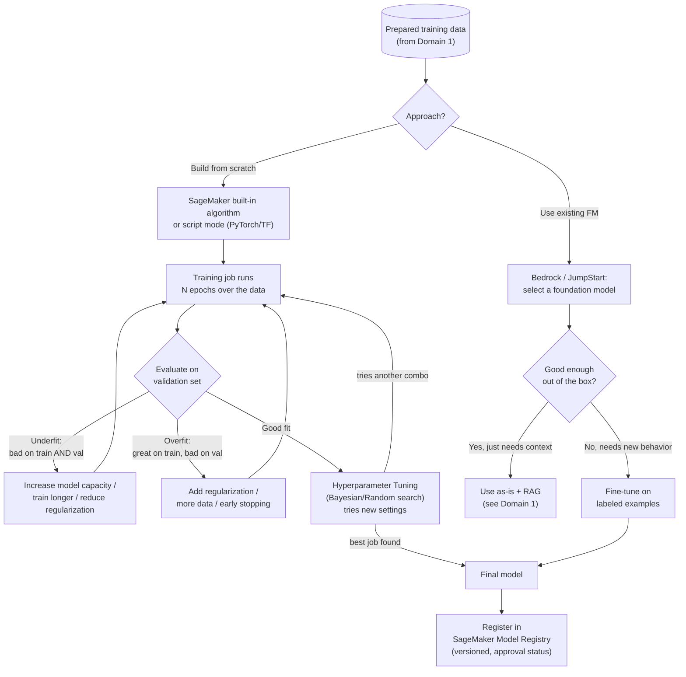
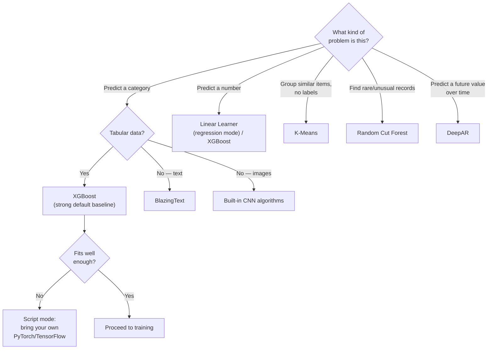
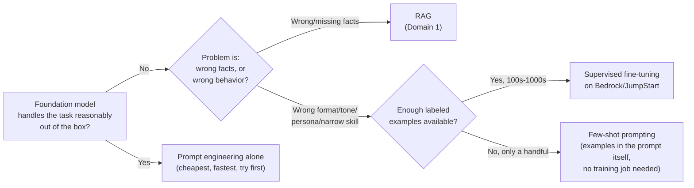

# Domain 2: ML Model and Foundation Model Development (24%)

*MLA-C02 · renamed from C01's "ML Model Development" to explicitly add foundation models — this
is the domain where you actually build or select the model itself.*

## Plain-English summary

Once data is prepared (Domain 1), Domain 2 is about turning it into a working model: picking an
approach (write your own algorithm's training, use an AWS built-in algorithm, or just use/adapt
someone else's pretrained foundation model), training it, tuning it, checking whether it's
actually good, and keeping track of versions so you can compare and roll back. The generative AI
addition here is: sometimes "developing a model" means *not* training one from scratch at all —
instead selecting and lightly customizing (fine-tuning) an existing foundation model.

A useful way to hold this whole domain in your head: every project starts at a fork — **build**
(you have enough labeled data and a genuinely novel problem) or **adopt** (an existing foundation
model already does something close enough to what you need). Nearly every task statement below
is really "what do you do once you've picked one of those two branches."

## Task-statement-level content (from the official exam guide)

| Task statement | What it covers | Where it's covered |
|---|---|---|
| **2.1 — Choose a modeling approach** | Built-in SageMaker algorithms vs. script mode (bring your own TensorFlow/PyTorch code) vs. selecting a foundation model via Bedrock/JumpStart | [`services/machine-learning-ai/sagemaker-training-and-tuning.md`](../../../services/machine-learning-ai/sagemaker-training-and-tuning.md), [`services/machine-learning-ai/bedrock.md`](../../../services/machine-learning-ai/bedrock.md), [`services/machine-learning-ai/jumpstart.md`](../../../services/machine-learning-ai/jumpstart.md) |
| **2.2 — Train and tune a model (or fine-tune a foundation model)** | Epochs, batch size, learning rate, early stopping, distributed training, hyperparameter tuning (random/Bayesian search); for foundation models: prompt engineering, fine-tuning, RAG vs. fine-tune tradeoff | [`services/machine-learning-ai/sagemaker-training-and-tuning.md`](../../../services/machine-learning-ai/sagemaker-training-and-tuning.md), [`ml-fundamentals-glossary.md`](ml-fundamentals-glossary.md) |
| **2.3 — Evaluate a model** | Choosing the right metric, diagnosing overfitting/underfitting, detecting bias in model outputs | [`ml-fundamentals-glossary.md`](ml-fundamentals-glossary.md) |
| **2.4 — Manage model versions** | SageMaker Model Registry — versioning, approval workflows, lineage tracking | [`services/machine-learning-ai/sagemaker-model-monitor-and-registry.md`](../../../services/machine-learning-ai/sagemaker-model-monitor-and-registry.md) |

## Linked service docs — the deep dives

- **[`services/machine-learning-ai/sagemaker-training-and-tuning.md`](../../../services/machine-learning-ai/sagemaker-training-and-tuning.md)**
  — built-in algorithms vs. script mode vs. Bring Your Own Container; Automatic Model Tuning
  (hyperparameter search); distributed training; Managed Spot Training.
- **[`services/machine-learning-ai/bedrock.md`](../../../services/machine-learning-ai/bedrock.md)**
  — foundation model access, model selection (Claude, Titan, Llama, etc. via one API), fine-tuning
  a foundation model, Knowledge Bases, Agents, Guardrails.
- **[`services/machine-learning-ai/jumpstart.md`](../../../services/machine-learning-ai/jumpstart.md)**
  — SageMaker's hub of pretrained models (both traditional ML and foundation models) you can
  deploy or fine-tune directly inside your own SageMaker environment, as opposed to Bedrock's
  fully-managed, serverless API access.
- **[`services/machine-learning-ai/sagemaker-model-monitor-and-registry.md`](../../../services/machine-learning-ai/sagemaker-model-monitor-and-registry.md)**
  — Model Registry half of this doc: registering model versions, approval status (pending/
  approved/rejected), and lineage (which data + code produced this exact model artifact).
- **[`services/machine-learning-ai/sagemaker-overview.md`](../../../services/machine-learning-ai/sagemaker-overview.md)**
  — if the sub-service docs above feel disconnected, this umbrella document shows how training,
  tuning, registry, and deployment chain together across the whole SageMaker lifecycle.

## New topic doc for this domain

- **[`ml-fundamentals-glossary.md`](ml-fundamentals-glossary.md)** — the foundational ML
  vocabulary (epoch, batch, overfitting/underfitting, bias-variance tradeoff, regularization,
  and the evaluation metrics: precision, recall, F1, AUC, RMSE, confusion matrix). These concepts
  are algorithm-agnostic and service-agnostic — they don't belong inside any single SageMaker doc
  — but they are the single most heavily tested *conceptual* knowledge in this domain, so they
  get a dedicated, plain-English-first doc.

## How It Works — the train/evaluate/tune loop (classic ML) and where fine-tuning fits

Step by step:
1. **Prepared data** arrives from Domain 1's pipeline — already cleaned, split into train/
   validation/test sets.
2. **Choosing an approach** is the first real decision: build a model from scratch (full control,
   more work, needed when no existing model fits your exact problem) vs. use an existing
   foundation model (fast, less control, works well when the task is language/vision-general
   rather than deeply domain-specific).
3. **Training runs for a number of epochs** — one epoch means the algorithm has seen every
   training example exactly once; multiple epochs let it refine its internal parameters
   repeatedly. (Full definition in `ml-fundamentals-glossary.md`.)
4. **Evaluation on the validation set** (data the model never trained on) reveals whether the
   model generalizes. **Underfitting** means it does poorly even on data it trained on — the
   model is too simple or trained too little. **Overfitting** means it does great on training
   data but poorly on validation data — it memorized noise/specifics instead of learning the
   general pattern.
5. **Fixing underfitting**: increase model capacity (more layers/trees), train for more epochs,
   or reduce regularization strength. **Fixing overfitting**: add regularization, get more
   training data, or stop training earlier (early stopping) — these are the standard levers.
6. **Hyperparameter tuning** (Automatic Model Tuning) wraps this whole loop, trying different
   hyperparameter values (learning rate, tree depth, number of layers) across many training jobs
   and keeping whichever combination scored best on the chosen metric.
7. **The foundation-model branch**: if an existing model already does the task well once given
   the right context, you don't train anything — you combine it with RAG (Domain 1). If it needs
   to behave differently (new output format, domain-specific terminology, a persona), you
   **fine-tune** it on a labeled example set — this still produces a model artifact that needs
   evaluation just like a from-scratch model.
8. **SageMaker Model Registry** is the final stop for either path — every trained/fine-tuned
   model version gets registered with metadata (who/what data produced it, its metrics) and an
   approval status, so a human or automated pipeline can decide whether it's cleared to deploy
   (Domain 3).

### A second diagram — choosing an algorithm for a from-scratch classic ML model

The "build from scratch" branch above hides a real decision tree worth making explicit, since
"which built-in algorithm fits this problem type" is tested as its own question shape:

A scenario that gives you the problem type (classification vs. regression vs. clustering vs.
anomaly detection vs. forecasting) plus the data shape (tabular vs. text vs. image) can almost
always be walked straight down this tree to the correct built-in algorithm, without needing any
algorithm-internals knowledge.

### A third diagram — the fine-tuning decision inside the foundation-model branch

Because "fine-tune or not" is itself a multi-step decision, not a single yes/no, it's worth
expanding step 7 above into its own flow:

The exam-relevant point this diagram makes explicit: **prompt engineering is always the cheapest
lever to try first**, before reaching for RAG or fine-tuning — a scenario that hasn't mentioned
attempting better prompting yet shouldn't be assumed to need the heavier-weight fix.

## Full worked case study — building a content-moderation system for a marketplace

**The business problem:** "CraftHaven," an online marketplace for handmade goods, needs to (1)
automatically flag listings that violate policy (prohibited materials, counterfeit claims) and
(2) generate SEO-friendly product descriptions from seller-submitted bullet points, in the
seller's own product category tone. Two very different sub-problems, both landing in Domain 2.

**Sub-problem 1 — policy violation flagging (classic ML, build-from-scratch branch):**
1. CraftHaven has 50,000 historical listings, each labeled "approved" or "flagged," with
   flagged listings making up roughly 4% of the total — an imbalanced binary classification
   problem on structured + text features (category, price, description text, seller history).
2. **Algorithm choice:** following the decision tree above — tabular-plus-text classification —
   the team starts with **XGBoost** on engineered features (price percentile within category,
   seller account age, a BlazingText-derived text-risk score) rather than training a deep neural
   network from scratch, since XGBoost is the strong default baseline for this shape of problem
   and the dataset size doesn't obviously demand anything heavier.
3. **Training:** a SageMaker Training Job runs with `max_depth`, `eta`, and `scale_pos_weight`
   (XGBoost's built-in class-imbalance weighting knob) as key hyperparameters.
4. **Evaluation:** given the 4% positive rate, the team deliberately does NOT report plain
   accuracy as the headline metric (a model that always predicts "approved" would hit 96%
   accuracy while catching zero violations) — they report **recall** at a fixed precision target,
   because missing a real policy violation (false negative) is costlier to the business than a
   false alarm that a human reviewer double-checks.
5. **Tuning:** Automatic Model Tuning searches `max_depth` (3-10), `eta` (0.01-0.3), and
   `scale_pos_weight` (1-25) using a Bayesian strategy, optimizing for validation recall at a
   minimum precision floor of 0.85.
6. **Registry:** the winning model version is registered in Model Registry with its precision/
   recall pair attached as metadata, status `PendingManualApproval` — a human reviewer confirms
   the tradeoff is acceptable before flipping it to `Approved`.

**Sub-problem 2 — SEO description generation (foundation-model, adopt branch):**
1. This is a text-generation task a general-purpose foundation model already does reasonably
   well out of the box — the team starts with a Bedrock foundation model and **prompt
   engineering alone**: a prompt template with the category, bullet points, and a style
   instruction ("write a warm, descriptive 2-paragraph product description").
2. **Evaluating "good enough":** a small panel of actual sellers reviews 100 generated
   descriptions; if most read naturally and don't need more than minor edits, the team stops
   here — no fine-tuning needed, which is both cheaper and faster to ship.
3. **If quality isn't sufficient** (e.g., the model inconsistently ignores the requested tone, or
   uses marketplace-prohibited superlative claims like "the best in the world"), the next lever is
   **fine-tuning** on a curated set of several hundred approved description examples — a behavior/
   format problem, not a missing-facts problem, so RAG would not be the right fix here even
   though it's Domain 2's instinctive-sounding answer for "customize a foundation model."
4. **Registry:** the fine-tuned model is also versioned in Model Registry, exactly like the
   classic XGBoost model from sub-problem 1 — the Registry doesn't care whether a model was
   trained from scratch or fine-tuned from a foundation model, it tracks both identically.

**Why this case study matters for the exam:** it's deliberately built to show that a single
business (and sometimes a single exam case-study question) can require *both* branches of the
build-vs-adopt fork simultaneously, and that recognizing which branch a given sub-problem belongs
to — not defaulting to "just use Bedrock for everything" or "just train everything from scratch"
— is the actual skill being tested.

## Evaluating for bias, not just accuracy

Task statement 2.3 explicitly includes "detecting bias in model outputs" alongside the
accuracy-style metrics above — worth a dedicated look because it's a different kind of checking
than precision/recall, and conflating the two is a common exam trap.

*Figure: AWS's own diagram of a SageMaker Clarify processing job — it can analyze either a
dataset (pre-training bias) or a trained model's predictions (post-training bias and
explainability), producing a report rather than a single pass/fail number. Source: AWS SageMaker
Developer Guide, "Fairness, model explainability and bias detection with SageMaker Clarify" —
docs.aws.amazon.com/sagemaker/latest/dg/clarify-configure-processing-jobs.html.*

A quick way to keep accuracy-style metrics and bias metrics mentally separate: accuracy/precision/
recall/F1/AUC/RMSE all answer "is the model *right*, in aggregate, across everyone." Bias metrics
(class imbalance, disparate impact, difference in label/approval rates between groups) answer
"is the model *equally* right (or equally wrong) across different groups of people" — a model can
score very well on the first question while failing badly on the second, which is exactly why
both checks exist as separate, non-substitutable steps. Full depth, including the post-training
SHAP-based explainability half, lives in
[`../domain-4-monitoring-security/responsible-ai-and-guardrails.md`](../domain-4-monitoring-security/responsible-ai-and-guardrails.md)
— it's placed in Domain 4 because bias/explainability checking continues after deployment, not
just at training time, but the *first* bias check (pre-training, on the raw data) is really a
Domain 1/Domain 2 boundary concern, which is why it's referenced from both directions.

## Troubleshooting / Common Issues

- **A training job's loss becomes `NaN` partway through and the job fails.** Almost always a
  learning rate set too high, or unnormalized/extreme-magnitude input features — lower the
  learning rate and confirm features were scaled/normalized in Domain 1's prep step before
  assuming the algorithm itself is broken.
- **Two training runs with identical hyperparameters produce noticeably different metrics.**
  Check whether a random seed was fixed for data shuffling/initialization — without a fixed seed,
  some run-to-run variance is expected and isn't evidence of a bug, but large swings suggest the
  dataset may be too small relative to the model's complexity (high variance, see the
  bias-variance tradeoff in `ml-fundamentals-glossary.md`).
- **A fine-tuning job on a foundation model "succeeds" but the resulting model refuses to answer
  questions it previously handled fine.** This is catastrophic forgetting (see Scenario 15 above)
  — reduce the learning rate/epochs or revisit whether fine-tuning was even the right lever
  versus RAG or prompt engineering for this specific change.
- **Automatic Model Tuning's best job barely beats the default hyperparameters.** The search
  space may be poorly chosen (too narrow around values that don't matter, or missing the
  hyperparameter that actually drives performance) — revisit which hyperparameters are included
  in the search range before assuming tuning itself failed.
- **A registered model's metrics look great on the held-out test set but the team still isn't
  confident deploying it.** This is a legitimate signal to also run a bias/explainability check
  (Clarify) before approval — strong aggregate accuracy metrics say nothing about fairness across
  subgroups, exactly the point of the section above.

## Common exam scenarios

1. **"Training accuracy is 99%, validation accuracy is 61%"** → overfitting; the fix is
   regularization, more data, dropout, or early stopping — NOT training longer (that worsens
   overfitting).
2. **"Both training and validation accuracy are low and similar"** → underfitting; the fix is a
   more complex model, more features, or more training time — NOT regularization (that would
   make it worse).
3. **"A binary classifier for a rare disease (1% positive class) has 99% accuracy but misses
   almost every actual positive case"** → accuracy is the wrong metric for imbalanced classes;
   use **recall** (or F1/AUC) instead — a classic trap tested heavily. See
   `ml-fundamentals-glossary.md`.
4. **"Need a model that generates human-like text for a brand new use case, minimal labeled
   data available"** → start with a Bedrock/JumpStart foundation model rather than training from
   scratch — not enough data to train a competitive model from zero.
5. **"Need the model to always answer in a specific JSON schema / company tone"** → fine-tune the
   foundation model (behavior change), not RAG (RAG only adds facts, doesn't change output
   format reliably).
6. **"Multiple training jobs produced models; need to track exactly which dataset + code version
   produced the one currently in production"** → SageMaker Model Registry's lineage tracking.
7. **"A systematic hyperparameter search is needed but training each job is expensive, so minimize
   total number of jobs run"** → Bayesian search strategy in Automatic Model Tuning (more
   sample-efficient than Random or Grid search).
8. **"A spam classifier flags too many legitimate emails as spam (too many false positives)"** →
   this is a precision problem; raising the classification threshold improves precision at the
   cost of recall — understand the precision/recall tradeoff, covered in
   `ml-fundamentals-glossary.md`.
9. **"A foundation model performs the task well but occasionally fabricates facts not in its
   training data or the provided context"** → this is a hallucination problem; the fix is tighter
   grounding (better RAG retrieval, explicit "only answer from the provided context" prompting),
   not fine-tuning, since fine-tuning doesn't reliably eliminate hallucination on facts outside
   the fine-tuning set.
10. **"Only a handful of labeled examples (a dozen or so) exist for a new classification
    category, not enough for a full fine-tuning run"** → few-shot prompting (including the
    handful of examples directly in the prompt) rather than attempting to fine-tune on too little
    data, which would likely overfit badly on such a small set.
11. **"Training a large model on a single GPU instance is too slow, and the team wants to speed
    it up without changing the algorithm"** → distributed training (data parallelism across
    multiple GPU instances), covered in depth in `sagemaker-training-and-tuning.md` — not a
    smaller/simpler model, which would change the algorithm/capacity, not just the speed.
12. **"A team wants to compare this week's newly trained model against last week's production
    model before deciding whether to replace it"** → Model Registry's versioning plus
    SageMaker Experiments' side-by-side metric comparison, not a manual spreadsheet.
13. **"A regression model for house prices has unusually large errors on a few very expensive
    homes, dragging down its overall error metric"** → check whether RMSE (which squares errors,
    punishing large misses disproportionately) is appropriately chosen here vs. MAE (less
    sensitive to outliers) — the business question of whether large errors *should* be weighted
    more heavily determines which is the right choice, not a universal rule.
14. **"A model trained well on last year's data is now underperforming, despite no code changes"**
    → this is a Domain 4 concept-drift symptom, but the *fix* routes back into this domain:
    retraining the model on recent data, then re-registering a new version.
15. **"Fine-tuning a foundation model on a narrow, company-specific dataset caused it to perform
    worse on general, unrelated questions it used to answer well"** → catastrophic forgetting —
    fine-tuning too aggressively (too many epochs, too high a learning rate, or too narrow a
    dataset) can degrade the base model's broader capability; mitigations include a lower
    learning rate, fewer fine-tuning epochs, or techniques that blend base and fine-tuned behavior
    rather than fully overwriting it.

## Related Terms

See [`ml-fundamentals-glossary.md`](ml-fundamentals-glossary.md) for every ML vocabulary term
used above, and [`glossary/README.md`](../../../glossary/README.md) for the repo-wide index.

- [`labs.md`](labs.md) — hands-on exercises for this domain (Floci + real free-tier alternatives).
- [`../domain-1-data-preparation/README.md`](../domain-1-data-preparation/README.md) — the data
  this domain's training jobs consume, and the RAG vs. fine-tune decision this domain continues.
- [`../domain-3-deployment-orchestration/README.md`](../domain-3-deployment-orchestration/README.md)
  — where the models registered here get deployed to serve real traffic.
- [`../domain-4-monitoring-security/README.md`](../domain-4-monitoring-security/README.md) — how
  the metrics chosen in task statement 2.3 get watched continuously for drift after deployment.
