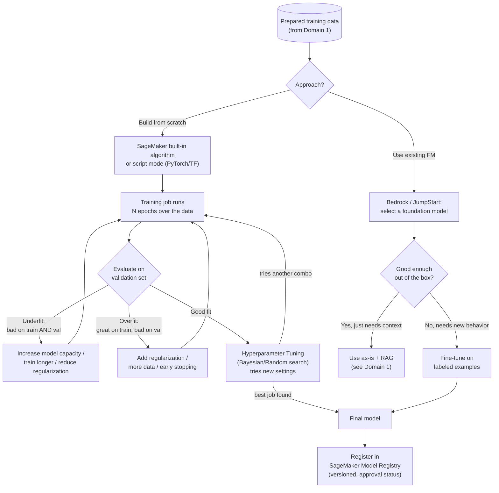

# Domain 2: ML Model and Foundation Model Development (24%)

*MLA-C02 · renamed from C01's "ML Model Development" to explicitly add foundation models — this
is the domain where you actually build or select the model itself.*

## Plain-English summary

Once data is prepared (Domain 1), Domain 2 is about turning it into a working model: picking an
approach (write your own algorithm's training, use an AWS built-in algorithm, or just use/adapt
someone else's pretrained foundation model), training it, tuning it, checking whether it's
actually good, and keeping track of versions so you can compare and roll back. The generative AI
addition here is: sometimes "developing a model" means *not* training one from scratch at all —
instead selecting and lightly customizing (fine-tuning) an existing foundation model.

## Task-statement-level content (from the official exam guide)

| Task statement | What it covers | Where it's covered |
|---|---|---|
| **2.1 — Choose a modeling approach** | Built-in SageMaker algorithms vs. script mode (bring your own TensorFlow/PyTorch code) vs. selecting a foundation model via Bedrock/JumpStart | [`services/machine-learning-ai/sagemaker-training-and-tuning.md`](../../../services/machine-learning-ai/sagemaker-training-and-tuning.md), [`services/machine-learning-ai/bedrock.md`](../../../services/machine-learning-ai/bedrock.md), [`services/machine-learning-ai/jumpstart.md`](../../../services/machine-learning-ai/jumpstart.md) |
| **2.2 — Train and tune a model (or fine-tune a foundation model)** | Epochs, batch size, learning rate, early stopping, distributed training, hyperparameter tuning (random/Bayesian search); for foundation models: prompt engineering, fine-tuning, RAG vs. fine-tune tradeoff | [`services/machine-learning-ai/sagemaker-training-and-tuning.md`](../../../services/machine-learning-ai/sagemaker-training-and-tuning.md), [`ml-fundamentals-glossary.md`](ml-fundamentals-glossary.md) |
| **2.3 — Evaluate a model** | Choosing the right metric, diagnosing overfitting/underfitting, detecting bias in model outputs | [`ml-fundamentals-glossary.md`](ml-fundamentals-glossary.md) |
| **2.4 — Manage model versions** | SageMaker Model Registry — versioning, approval workflows, lineage tracking | [`services/machine-learning-ai/sagemaker-model-monitor-and-registry.md`](../../../services/machine-learning-ai/sagemaker-model-monitor-and-registry.md) |

## Linked service docs — the deep dives

- **[`services/machine-learning-ai/sagemaker-training-and-tuning.md`](../../../services/machine-learning-ai/sagemaker-training-and-tuning.md)**
  — built-in algorithms vs. script mode vs. Bring Your Own Container; Automatic Model Tuning
  (hyperparameter search); distributed training; Managed Spot Training.
- **[`services/machine-learning-ai/bedrock.md`](../../../services/machine-learning-ai/bedrock.md)**
  — foundation model access, model selection (Claude, Titan, Llama, etc. via one API), fine-tuning
  a foundation model, Knowledge Bases, Agents, Guardrails.
- **[`services/machine-learning-ai/jumpstart.md`](../../../services/machine-learning-ai/jumpstart.md)**
  — SageMaker's hub of pretrained models (both traditional ML and foundation models) you can
  deploy or fine-tune directly inside your own SageMaker environment, as opposed to Bedrock's
  fully-managed, serverless API access.
- **[`services/machine-learning-ai/sagemaker-model-monitor-and-registry.md`](../../../services/machine-learning-ai/sagemaker-model-monitor-and-registry.md)**
  — Model Registry half of this doc: registering model versions, approval status (pending/
  approved/rejected), and lineage (which data + code produced this exact model artifact).

## New topic doc for this domain

- **[`ml-fundamentals-glossary.md`](ml-fundamentals-glossary.md)** — the foundational ML
  vocabulary (epoch, batch, overfitting/underfitting, bias-variance tradeoff, regularization,
  and the evaluation metrics: precision, recall, F1, AUC, RMSE, confusion matrix). These concepts
  are algorithm-agnostic and service-agnostic — they don't belong inside any single SageMaker doc
  — but they are the single most heavily tested *conceptual* knowledge in this domain, so they
  get a dedicated, plain-English-first doc.

## How It Works — the train/evaluate/tune loop (classic ML) and where fine-tuning fits

Step by step:
1. **Prepared data** arrives from Domain 1's pipeline — already cleaned, split into train/
   validation/test sets.
2. **Choosing an approach** is the first real decision: build a model from scratch (full control,
   more work, needed when no existing model fits your exact problem) vs. use an existing
   foundation model (fast, less control, works well when the task is language/vision-general
   rather than deeply domain-specific).
3. **Training runs for a number of epochs** — one epoch means the algorithm has seen every
   training example exactly once; multiple epochs let it refine its internal parameters
   repeatedly. (Full definition in `ml-fundamentals-glossary.md`.)
4. **Evaluation on the validation set** (data the model never trained on) reveals whether the
   model generalizes. **Underfitting** means it does poorly even on data it trained on — the
   model is too simple or trained too little. **Overfitting** means it does great on training
   data but poorly on validation data — it memorized noise/specifics instead of learning the
   general pattern.
5. **Fixing underfitting**: increase model capacity (more layers/trees), train for more epochs,
   or reduce regularization strength. **Fixing overfitting**: add regularization, get more
   training data, or stop training earlier (early stopping) — these are the standard levers.
6. **Hyperparameter tuning** (Automatic Model Tuning) wraps this whole loop, trying different
   hyperparameter values (learning rate, tree depth, number of layers) across many training jobs
   and keeping whichever combination scored best on the chosen metric.
7. **The foundation-model branch**: if an existing model already does the task well once given
   the right context, you don't train anything — you combine it with RAG (Domain 1). If it needs
   to behave differently (new output format, domain-specific terminology, a persona), you
   **fine-tune** it on a labeled example set — this still produces a model artifact that needs
   evaluation just like a from-scratch model.
8. **SageMaker Model Registry** is the final stop for either path — every trained/fine-tuned
   model version gets registered with metadata (who/what data produced it, its metrics) and an
   approval status, so a human or automated pipeline can decide whether it's cleared to deploy
   (Domain 3).

## Common exam scenarios

1. **"Training accuracy is 99%, validation accuracy is 61%"** → overfitting; the fix is
   regularization, more data, dropout, or early stopping — NOT training longer (that worsens
   overfitting).
2. **"Both training and validation accuracy are low and similar"** → underfitting; the fix is a
   more complex model, more features, or more training time — NOT regularization (that would
   make it worse).
3. **"A binary classifier for a rare disease (1% positive class) has 99% accuracy but misses
   almost every actual positive case"** → accuracy is the wrong metric for imbalanced classes;
   use **recall** (or F1/AUC) instead — a classic trap tested heavily. See
   `ml-fundamentals-glossary.md`.
4. **"Need a model that generates human-like text for a brand new use case, minimal labeled
   data available"** → start with a Bedrock/JumpStart foundation model rather than training from
   scratch — not enough data to train a competitive model from zero.
5. **"Need the model to always answer in a specific JSON schema / company tone"** → fine-tune the
   foundation model (behavior change), not RAG (RAG only adds facts, doesn't change output
   format reliably).
6. **"Multiple training jobs produced models; need to track exactly which dataset + code version
   produced the one currently in production"** → SageMaker Model Registry's lineage tracking.
7. **"A systematic hyperparameter search is needed but training each job is expensive, so minimize
   total number of jobs run"** → Bayesian search strategy in Automatic Model Tuning (more
   sample-efficient than Random or Grid search).
8. **"A spam classifier flags too many legitimate emails as spam (too many false positives)"** →
   this is a precision problem; raising the classification threshold improves precision at the
   cost of recall — understand the precision/recall tradeoff, covered in
   `ml-fundamentals-glossary.md`.

## Related Terms

See [`ml-fundamentals-glossary.md`](ml-fundamentals-glossary.md) for every ML vocabulary term
used above, and [`glossary/README.md`](../../../glossary/README.md) for the repo-wide index.
