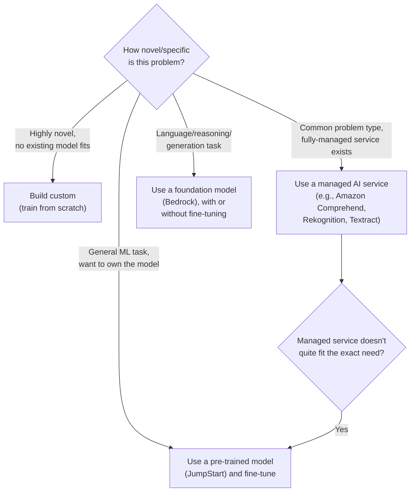
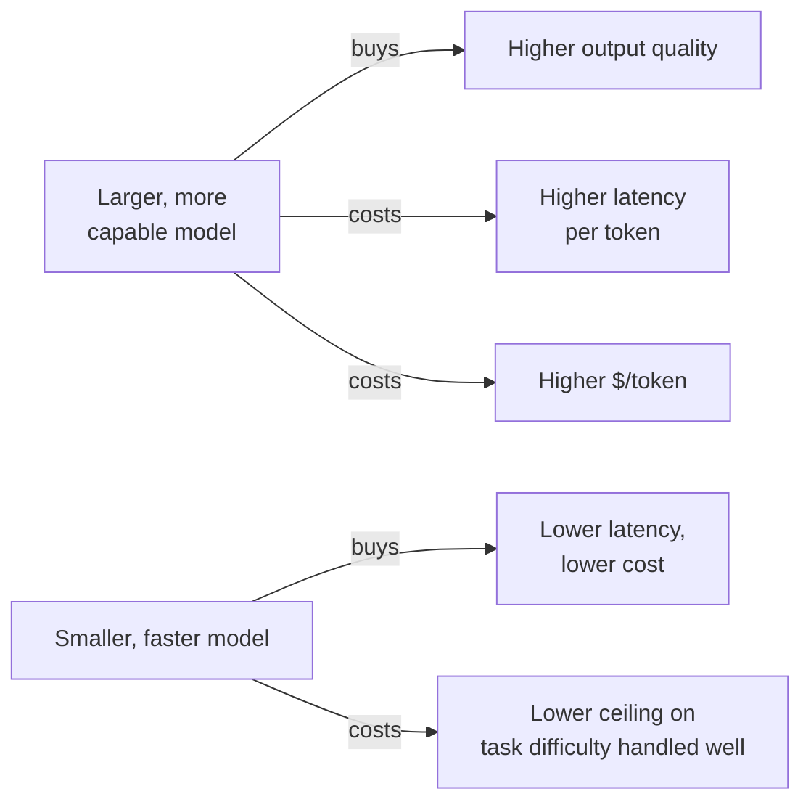
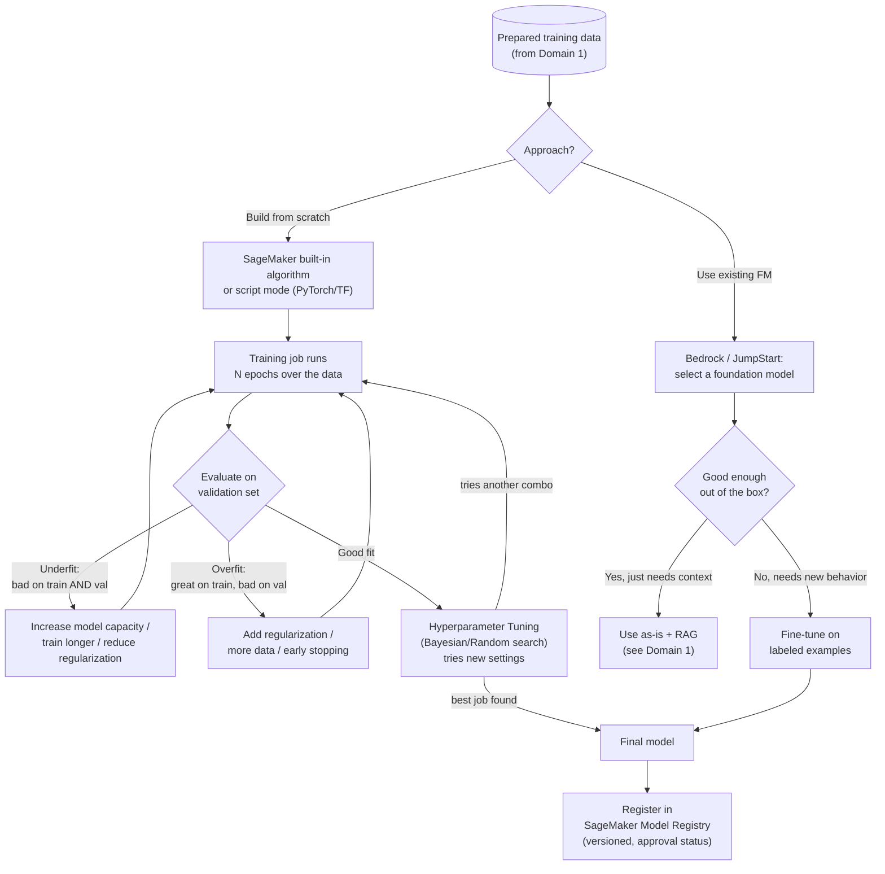
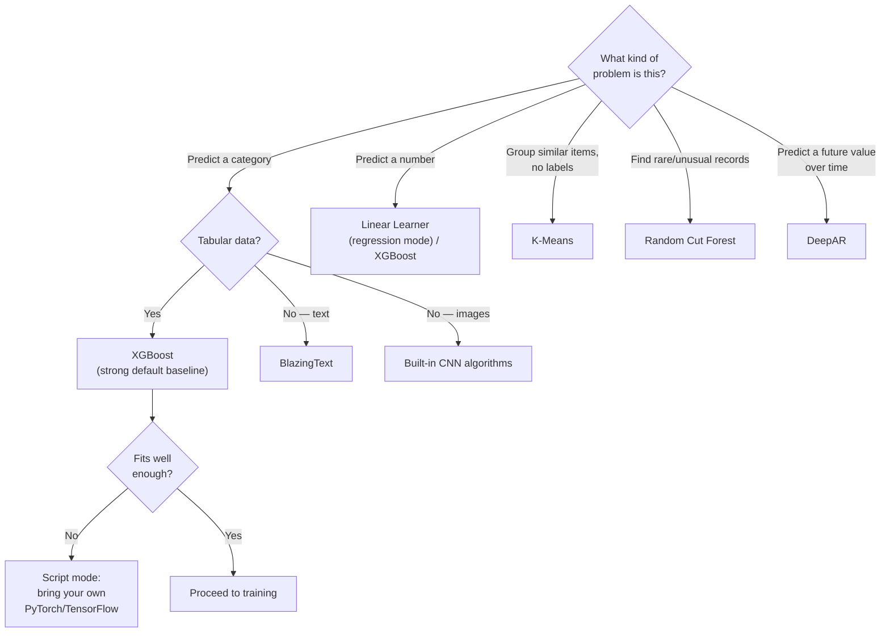
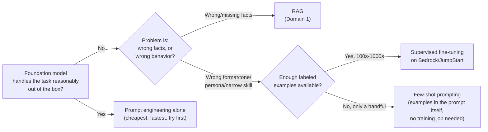
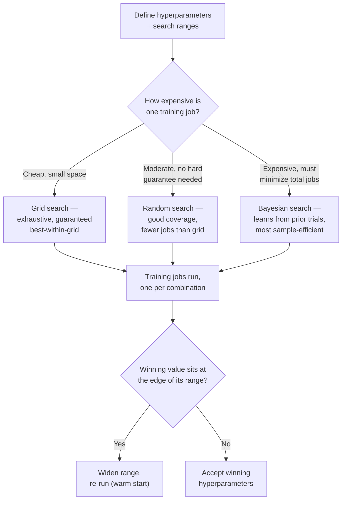

# Domain 2: ML Model and Foundation Model Development (24%)

*MLA-C02 · renamed from C01's "ML Model Development" to explicitly add foundation models — this
is the domain where you actually build or select the model itself.*

## Plain-English summary

Once data is prepared (Domain 1), Domain 2 is about turning it into a working model: picking an
approach (write your own algorithm's training, use an AWS built-in algorithm, or just use/adapt
someone else's pretrained foundation model), training it, tuning it, checking whether it's
actually good, and keeping track of versions so you can compare and roll back. The generative AI
addition here is: sometimes "developing a model" means *not* training one from scratch at all —
instead selecting and lightly customizing (fine-tuning) an existing foundation model.

A useful way to hold this whole domain in your head: every project starts at a fork — **build**
(you have enough labeled data and a genuinely novel problem) or **adopt** (an existing foundation
model already does something close enough to what you need). Nearly every task statement below
is really "what do you do once you've picked one of those two branches."

## Task-statement-level content (from the official exam guide)

| Task statement | What it covers | Where it's covered |
|---|---|---|
| **2.1 — Choose a modeling approach** | Built-in SageMaker algorithms vs. script mode (bring your own TensorFlow/PyTorch code) vs. selecting a foundation model via Bedrock/JumpStart | [`services/machine-learning-ai/sagemaker-training-and-tuning.md`](../../../services/machine-learning-ai/sagemaker-training-and-tuning.md), [`services/machine-learning-ai/bedrock.md`](../../../services/machine-learning-ai/bedrock.md), [`services/machine-learning-ai/jumpstart.md`](../../../services/machine-learning-ai/jumpstart.md) |
| **2.2 — Train and tune a model (or fine-tune a foundation model)** | Epochs, batch size, learning rate, early stopping, distributed training, hyperparameter tuning (random/Bayesian search); for foundation models: prompt engineering, fine-tuning, RAG vs. fine-tune tradeoff | [`services/machine-learning-ai/sagemaker-training-and-tuning.md`](../../../services/machine-learning-ai/sagemaker-training-and-tuning.md), [`ml-fundamentals-glossary.md`](ml-fundamentals-glossary.md) |
| **2.3 — Evaluate a model** | Choosing the right metric, diagnosing overfitting/underfitting, detecting bias in model outputs | [`ml-fundamentals-glossary.md`](ml-fundamentals-glossary.md) |
| **2.4 — Manage model versions** | SageMaker Model Registry — versioning, approval workflows, lineage tracking | [`services/machine-learning-ai/sagemaker-model-monitor-and-registry.md`](../../../services/machine-learning-ai/sagemaker-model-monitor-and-registry.md) |
| **2.1.1 — NEW: Evaluate/select FMs from Bedrock** | Choosing among available foundation models by task fit, performance, and cost | this doc's ["Selecting a Foundation Model from Bedrock"](#new-skill-211--evaluating-and-selecting-foundation-models-from-amazon-bedrock) section below |
| **2.1.2 — NEW: Identify fine-tuning strategies** | Full fine-tuning vs. parameter-efficient fine-tuning (LoRA/PEFT) vs. instruction tuning | this doc's ["Fine-Tuning Strategies"](#new-skill-212--identifying-fine-tuning-strategies-for-pre-trained-fms) section below |
| **2.1.4 — NEW: Custom vs. managed vs. pre-trained vs. FM tradeoffs** | Build-from-scratch vs. managed service vs. pre-trained model vs. foundation model decision | this doc's ["Build vs. Managed vs. Pretrained vs. FM"](#new-skill-214--evaluating-tradeoffs-custom-solutions-vs-managed-services-vs-pre-trained-models-vs-fms) section below |
| **2.1.5 — NEW: Select RAG architecture patterns** | Naive RAG vs. advanced RAG (reranking) vs. agentic RAG, matched to use case | this doc's ["RAG Architecture Patterns"](#new-skill-215--selecting-rag-architecture-patterns-based-on-use-case) section below |
| **2.1.7 — NEW: FM performance/latency/cost tradeoffs** | Balancing model capability against response speed and per-token cost | this doc's ["Performance, Latency, and Cost Tradeoffs"](#new-skill-217--assessing-tradeoffs-between-ai-model-performance-latency-and-cost) section below |
| **2.2.8 — NEW: Customization techniques** | Task-specific prompt engineering and fine-tuning, applied deliberately | this doc's existing fine-tuning decision diagram, below |
| **2.2.9 — NEW: Optimize retrieval components and embedding models** | Tuning top-K, reranking, and embedding model choice for better RAG quality | this doc's ["Optimizing Retrieval and Embedding Models"](#new-skill-229--optimizing-retrieval-components-and-embedding-models) section below |
| **2.3.7 — NEW: Human evaluation frameworks** | Human-in-the-loop review of generated text quality | [`ml-fundamentals-glossary.md`](ml-fundamentals-glossary.md#new-skill-239--ai-evaluation-llm-as-a-judge-content-quality-and-bias-detection-in-outputs) |
| **2.3.8 — NEW: NLP evaluation metrics** | BLEU, ROUGE, BERTScore, semantic similarity | [`ml-fundamentals-glossary.md`](ml-fundamentals-glossary.md#new-skill-238--nlp-evaluation-metrics-for-generative-ai-bleu-rouge-bertscore-semantic-similarity) |
| **2.3.9 — NEW: AI evaluation (LLM-as-a-judge, bias detection)** | Automated rubric-based scoring of generated output quality and fairness | [`ml-fundamentals-glossary.md`](ml-fundamentals-glossary.md#new-skill-239--ai-evaluation-llm-as-a-judge-content-quality-and-bias-detection-in-outputs) |
| **2.3.10 — NEW: RAG system monitoring (retrieval accuracy)** | Precision@K/Recall@K and ongoing retrieval-quality monitoring | [`ml-fundamentals-glossary.md`](ml-fundamentals-glossary.md#new-skill-2310--configuring-rag-system-monitoring-including-retrieval-accuracy) |

## Linked service docs — the deep dives

- **[`services/machine-learning-ai/sagemaker-training-and-tuning.md`](../../../services/machine-learning-ai/sagemaker-training-and-tuning.md)**
  — built-in algorithms vs. script mode vs. Bring Your Own Container; Automatic Model Tuning
  (hyperparameter search); distributed training; Managed Spot Training.
- **[`services/machine-learning-ai/bedrock.md`](../../../services/machine-learning-ai/bedrock.md)**
  — foundation model access, model selection (Claude, Titan, Llama, etc. via one API), fine-tuning
  a foundation model, Knowledge Bases, Agents, Guardrails.
- **[`services/machine-learning-ai/jumpstart.md`](../../../services/machine-learning-ai/jumpstart.md)**
  — SageMaker's hub of pretrained models (both traditional ML and foundation models) you can
  deploy or fine-tune directly inside your own SageMaker environment, as opposed to Bedrock's
  fully-managed, serverless API access.
- **[`services/machine-learning-ai/sagemaker-model-monitor-and-registry.md`](../../../services/machine-learning-ai/sagemaker-model-monitor-and-registry.md)**
  — Model Registry half of this doc: registering model versions, approval status (pending/
  approved/rejected), and lineage (which data + code produced this exact model artifact).
- **[`services/machine-learning-ai/sagemaker-overview.md`](../../../services/machine-learning-ai/sagemaker-overview.md)**
  — if the sub-service docs above feel disconnected, this umbrella document shows how training,
  tuning, registry, and deployment chain together across the whole SageMaker lifecycle.

## New topic docs for this domain

- **[`ml-fundamentals-glossary.md`](ml-fundamentals-glossary.md)** — the foundational ML
  vocabulary (epoch, batch, overfitting/underfitting, bias-variance tradeoff, regularization,
  and the evaluation metrics: precision, recall, F1, AUC, RMSE, confusion matrix). These concepts
  are algorithm-agnostic and service-agnostic — they don't belong inside any single SageMaker doc
  — but they are the single most heavily tested *conceptual* knowledge in this domain, so they
  get a dedicated, plain-English-first doc.
- **[`algorithm-selection-decision-framework.md`](algorithm-selection-decision-framework.md)** —
  a full decision tree plus real head-to-head numeric comparisons (XGBoost vs. linear regression,
  XGBoost vs. logistic regression, K-Means cluster-count selection, Isolation Forest vs.
  supervised fraud detection) for choosing an algorithm family given a described problem and data
  shape — the "which built-in algorithm" diagram below, expanded into full worked proof.
- **[`evaluation-metrics-deep-dive.md`](evaluation-metrics-deep-dive.md)** — full numeric
  derivations beyond the glossary's single worked example: threshold sweeps and ROC/PR curve
  mechanics, multi-class confusion matrices, RMSE vs. MAE outlier sensitivity proven by hand,
  cross-entropy/log-loss arithmetic, calibration, and BLEU n-gram precision computed by hand.
- **[`hyperparameter-tuning-strategies.md`](hyperparameter-tuning-strategies.md)** — grid vs.
  random vs. Bayesian search with real job-count and compute-cost arithmetic, Hyperband, warm
  start, and the distinction between early stopping *inside training* vs. *inside tuning*.
- **[`rag-vs-finetuning-vs-prompting-decision-tree.md`](rag-vs-finetuning-vs-prompting-decision-tree.md)**
  — the full four-way customization decision tree (adding pre-training-from-scratch as the
  fourth, almost-always-wrong option), with a cost/time/data ladder and four fully worked
  scenarios.
- **[`bias-variance-tradeoff-and-regularization.md`](bias-variance-tradeoff-and-regularization.md)**
  — the formal bias²+variance+irreducible-error decomposition proven with a real resampling
  experiment, plus L1/L2/dropout/early-stopping/data-augmentation each demonstrated numerically.

## NEW skill 2.1.1 — Evaluating and selecting foundation models from Amazon Bedrock

**Plain English:** Bedrock offers access to several *families* of foundation models (e.g.,
Anthropic Claude, Amazon Titan/Nova, Meta Llama, Mistral, Cohere Command) through one unified API
— "developing a model" in C02 often means picking the right one from this catalog rather than
training anything. Selection isn't a single "best overall" ranking; it's matching model
characteristics to the task's actual requirements.

| Selection factor | What to check | Exam-relevant signal |
|---|---|---|
| Task fit | Does the model family specialize in this task type (long-context document analysis, code generation, multilingual, vision-input)? | A scenario naming "analyze a 200-page document in one pass" points to a long-context-window model, not just "the most capable" one |
| Context window size | Maximum tokens the model can accept in one request (prompt + retrieved context + conversation history combined) | A RAG pipeline retrieving many large chunks needs a model with a context window that can actually hold them all |
| Output quality for the specific task | Benchmark scores and/or a small evaluation run (see `ml-fundamentals-glossary.md`'s NLP eval metrics) comparing candidate models on *your* representative prompts, not just generic leaderboards | A model that benchmarks well generally can still underperform on a narrow domain-specific task — always validate on representative data |
| Latency | Larger/more capable models are typically slower per token generated | A scenario demanding sub-second response for a simple classification-style task may be better served by a smaller, faster model than the flagship one |
| Cost | Per-token input/output pricing varies significantly across model families and sizes | See ["Performance, Latency, and Cost Tradeoffs"](#new-skill-217--assessing-tradeoffs-between-ai-model-performance-latency-and-cost) below |
| Modality | Text-only vs. multimodal (text+image) input/output support | A scenario needing to reason about an uploaded photo needs a multimodal-capable model, not a text-only one, regardless of how strong its text performance is |

**The exam-relevant discipline:** this task statement expects you to recognize selection as a
genuine *evaluation process* (benchmark on your own representative prompts, compare context
window and modality against the stated requirement) rather than defaulting to "pick the newest or
largest model" — a smaller, cheaper, faster model that clears the task's actual bar is very often
the correct answer over a larger one that merely clears it with more room to spare.

## NEW skill 2.1.2 — Identifying fine-tuning strategies for pre-trained FMs

The domain's existing fine-tuning decision diagram (below) answers *whether* to fine-tune; this
task statement goes one level deeper into *how*, since more than one fine-tuning strategy exists
and they have real cost/data/outcome tradeoffs:

| Strategy | Plain English | What it changes | Data needed | Relative cost |
|---|---|---|---|---|
| **Full fine-tuning** | Retrain all (or nearly all) of the model's internal parameters on your examples | The entire model | Largest — most expensive, most prone to catastrophic forgetting if overdone | Highest |
| **Parameter-efficient fine-tuning (PEFT) / LoRA** | Freeze the base model entirely; train only a small set of additional "adapter" parameters inserted alongside it | A small add-on layer, not the base model itself | Can work with meaningfully less data than full fine-tuning | Much lower — fewer parameters to train and store per fine-tuned version |
| **Instruction tuning** | Fine-tune specifically on (instruction, correct response) pairs to improve how well a model follows explicit directions in general, not just one narrow task | The model's general instruction-following behavior | Broad, diverse instruction/response pairs across many task types | Moderate — this is closer to how base "instruct" model variants are themselves produced |
| **RLHF-style preference tuning** | Fine-tune using *comparisons* between two candidate responses (human or model preferred one over the other) rather than single correct-answer examples | The model's output style/preferences toward what evaluators rated more favorably | Preference-labeled pairs rather than single ground-truth completions | High — requires a preference-labeling process on top of standard fine-tuning infrastructure |

**The exam-relevant distinction most commonly tested:** LoRA/PEFT is the practical default answer
whenever a scenario emphasizes limited budget, limited labeled data, or needing multiple
different fine-tuned variants of the same base model cheaply (since only the small adapter
differs per variant, not the entire model) — full fine-tuning is reserved for scenarios explicitly
describing a need to change deep, pervasive model behavior where a lightweight adapter wouldn't
be sufficient.

## NEW skill 2.1.4 — Evaluating tradeoffs: custom solutions vs. managed services vs. pre-trained models vs. FMs

This generalizes the domain's build-vs-adopt fork (below) into a four-way decision, since "adopt"
itself splits into two meaningfully different options:

| Option | When it wins | What you give up |
|---|---|---|
| **Custom (build from scratch)** | A genuinely novel problem with abundant labeled data and no existing model/service comes close | Full engineering cost and time; highest maintenance burden |
| **Managed AI service** (Comprehend, Rekognition, Textract, Transcribe) | A common, well-defined task (sentiment, OCR, entity extraction) a pre-built service already handles well | Customization — you can't retrain a managed service's internals, only configure its parameters |
| **Pre-trained model (JumpStart), fine-tuned** | A general ML task where you want to own/customize the actual model, with moderate data | More operational ownership than a fully-managed service, less than building from scratch |
| **Foundation model (Bedrock)** | A language/reasoning/generation task, with or without RAG/fine-tuning | Per-token cost scales with usage; less deep customization ceiling than full fine-tuning of an owned model |

**Exam-relevant trap:** reaching for a foundation model (the "exciting" new option) when a
managed AI service already solves the stated problem more cheaply and reliably — e.g., a scenario
asking only "extract entities like dates and names from documents" is a Comprehend/Textract
problem, not a reason to stand up a Bedrock RAG pipeline; conversely, a scenario needing
open-ended natural-language generation or reasoning is *not* solvable by a managed AI service at
all, regardless of how tempting "just use Comprehend, it's cheaper" sounds.

## NEW skill 2.1.7 — Assessing tradeoffs between AI model performance, latency, and cost

Three variables, and improving one generally costs you one of the other two — this is the GenAI-
era analog of the bias-variance tradeoff, with the same "can't have all three for free" shape.

- **When latency dominates the decision** — a real-time, user-facing interaction (live chat,
  voice assistant) where users perceive multi-second delays as broken, even if a larger model
  would answer somewhat better; the correct answer trades some quality ceiling for a model fast
  enough to feel responsive.
- **When cost dominates** — very high request volume where even a small per-token price
  difference compounds into a large total bill; a scenario emphasizing massive scale over
  per-response sophistication favors a smaller, cheaper model, possibly paired with a smaller
  model handling the bulk of requests and a larger model reserved only for requests a routing
  layer flags as genuinely complex (a tiered-model architecture).
- **When performance/quality dominates** — a low-volume, high-stakes task (legal analysis,
  medical summarization) where an incorrect or low-quality answer is far costlier than a slower,
  more expensive one; the correct answer is the most capable model that clears the task's bar,
  with latency/cost treated as secondary.
- **The exam-relevant discipline:** a question naming two or three of these constraints
  explicitly (e.g., "must respond in under 2 seconds, budget is tight, and some quality loss is
  acceptable") is testing whether you correctly rank which constraint is binding and route to the
  model/architecture that satisfies the *stated* priorities — not simply picking the most
  technically impressive-sounding option by default.

## How It Works — the train/evaluate/tune loop (classic ML) and where fine-tuning fits

Step by step:
1. **Prepared data** arrives from Domain 1's pipeline — already cleaned, split into train/
   validation/test sets.
2. **Choosing an approach** is the first real decision: build a model from scratch (full control,
   more work, needed when no existing model fits your exact problem) vs. use an existing
   foundation model (fast, less control, works well when the task is language/vision-general
   rather than deeply domain-specific).
3. **Training runs for a number of epochs** — one epoch means the algorithm has seen every
   training example exactly once; multiple epochs let it refine its internal parameters
   repeatedly. (Full definition in `ml-fundamentals-glossary.md`.)
4. **Evaluation on the validation set** (data the model never trained on) reveals whether the
   model generalizes. **Underfitting** means it does poorly even on data it trained on — the
   model is too simple or trained too little. **Overfitting** means it does great on training
   data but poorly on validation data — it memorized noise/specifics instead of learning the
   general pattern.
5. **Fixing underfitting**: increase model capacity (more layers/trees), train for more epochs,
   or reduce regularization strength. **Fixing overfitting**: add regularization, get more
   training data, or stop training earlier (early stopping) — these are the standard levers.
6. **Hyperparameter tuning** (Automatic Model Tuning) wraps this whole loop, trying different
   hyperparameter values (learning rate, tree depth, number of layers) across many training jobs
   and keeping whichever combination scored best on the chosen metric.
7. **The foundation-model branch**: if an existing model already does the task well once given
   the right context, you don't train anything — you combine it with RAG (Domain 1). If it needs
   to behave differently (new output format, domain-specific terminology, a persona), you
   **fine-tune** it on a labeled example set — this still produces a model artifact that needs
   evaluation just like a from-scratch model.
8. **SageMaker Model Registry** is the final stop for either path — every trained/fine-tuned
   model version gets registered with metadata (who/what data produced it, its metrics) and an
   approval status, so a human or automated pipeline can decide whether it's cleared to deploy
   (Domain 3).

### A second diagram — choosing an algorithm for a from-scratch classic ML model

The "build from scratch" branch above hides a real decision tree worth making explicit, since
"which built-in algorithm fits this problem type" is tested as its own question shape:

A scenario that gives you the problem type (classification vs. regression vs. clustering vs.
anomaly detection vs. forecasting) plus the data shape (tabular vs. text vs. image) can almost
always be walked straight down this tree to the correct built-in algorithm, without needing any
algorithm-internals knowledge.

### A third diagram — the fine-tuning decision inside the foundation-model branch

Because "fine-tune or not" is itself a multi-step decision, not a single yes/no, it's worth
expanding step 7 above into its own flow:

The exam-relevant point this diagram makes explicit: **prompt engineering is always the cheapest
lever to try first**, before reaching for RAG or fine-tuning — a scenario that hasn't mentioned
attempting better prompting yet shouldn't be assumed to need the heavier-weight fix. For the full
four-way version of this tree (adding pre-training from scratch as the fourth, almost-always-
wrong option) with real cost/time numbers and four fully worked scenarios, see
[`rag-vs-finetuning-vs-prompting-decision-tree.md`](rag-vs-finetuning-vs-prompting-decision-tree.md).

### A fourth diagram — the hyperparameter tuning loop itself, expanded

Step 6 of the main diagram above ("Hyperparameter Tuning tries new settings") compresses a real
decision (which search strategy, how many jobs, when to stop) into one box — worth expanding,
since "which tuning strategy for which constraint" is tested as its own question shape:

**Walking it:** the strategy choice is driven almost entirely by one variable — how expensive is
a single training job, relative to how many total jobs the budget allows — not by which strategy
is abstractly "best." A cheap job and small search space can afford grid search's exhaustive
guarantee; an expensive job with a tight job-count budget needs Bayesian search's sample
efficiency. The loop doesn't end when the search finishes, either: checking whether the winning
value landed at the edge of its searched range is a real, frequently-skipped step — a winning
`max_depth` of 10 when the range was `[3, 10]` means the true optimum may sit *outside* the range
tried, not that 10 is definitively best. Full job-count arithmetic proving the relative cost of
each strategy (e.g., Bayesian search matching grid search's result at roughly a sixth of the
total training-job count) lives in
[`hyperparameter-tuning-strategies.md`](hyperparameter-tuning-strategies.md).

*Figure: AWS's own screenshot of where a SageMaker Automatic Model Tuning job's individual
training jobs (one per hyperparameter combination tried) appear in the console, each with its
own final objective-metric value — this is literally what "F" (the training-job box) in the
diagram above produces, N times, before the tuning job picks whichever row scored best. Source:
AWS SageMaker Developer Guide, "Configure and Launch a Hyperparameter Tuning Job" —
docs.aws.amazon.com/sagemaker/latest/dg/automatic-model-tuning-ex-tuning-job.html.*

### A fifth diagram — the algorithm-selection fork, with real numbers behind it

The second diagram above ("choosing an algorithm for a from-scratch classic ML model") gives the
decision tree's *shape*; it's worth being explicit that the tree's branches aren't arbitrary
preferences — each one is backed by a real, reproducible performance gap. For example, running
XGBoost-family gradient boosting against plain logistic regression on a dataset with genuine
non-linear feature interactions produces roughly a 4-point AUC gap in gradient boosting's favor
(0.931 vs. 0.889) — but running the *same two algorithms* on a dataset that happens to be close
to linearly separable **reverses** the result, with logistic regression scoring higher on every
metric (accuracy, AUC, and F1) while training over 10x faster. Full numeric proof of both
directions, plus three more head-to-head comparisons (regression, clustering, anomaly detection),
lives in
[`algorithm-selection-decision-framework.md`](algorithm-selection-decision-framework.md) — the
exam-relevant takeaway stated plainly: "XGBoost is the default tabular baseline" is a *starting
point for an unknown relationship shape*, not an unconditional winner, and a scenario explicitly
describing a simple/monotonic/already-understood relationship or a hard interpretability
requirement is signaling the opposite choice.

## NEW skill 2.1.5 — Selecting RAG architecture patterns based on use case

Domain 1's `embeddings-and-rag-data-prep.md` covers the basic chunk→embed→retrieve→generate
pipeline; this task statement tests choosing *which architecture pattern* fits a given use case,
since "RAG" isn't one single fixed architecture:

| Pattern | Plain English | Adds on top of naive RAG | Use when |
|---|---|---|---|
| **Naive RAG** | Retrieve top-K chunks by similarity, hand them straight to the generator | Nothing — the baseline pipeline | Simple Q&A over a well-structured, non-noisy corpus |
| **Advanced RAG (with reranking)** | Retrieve a larger candidate set, then use a second, more accurate model to re-score and reorder before generation | A reranking step between retrieval and generation | The corpus is large/noisy enough that plain vector similarity surfaces technically-close-but-not-actually-useful chunks |
| **Agentic RAG** | An agent decides, per query, *whether* to retrieve at all, *which* knowledge base/tool to query, and can issue multiple retrieval rounds before answering | Reasoning/planning layer that controls retrieval dynamically, not a fixed always-retrieve step | Multi-step questions needing information from more than one source, or questions that don't need retrieval at all (a greeting shouldn't trigger a knowledge-base lookup) |
| **Graph RAG** | Retrieval traverses a knowledge graph of entity relationships, not just chunk similarity | Structured relationship traversal on top of/instead of vector similarity | Questions depend on multi-hop relationships between entities (e.g., "which suppliers does the company that acquired our main vendor also work with") that plain chunk similarity can't connect |

**The exam-relevant selection logic:** a scenario describing straightforward document Q&A is
naive RAG; a scenario describing noisy/large corpora with quality complaints points to adding
reranking; a scenario describing an assistant that needs to decide *whether and where* to look
things up (and possibly call non-retrieval tools too) is agentic RAG — directly connecting to
Domain 3's Bedrock Agent orchestration; a scenario describing relationship-heavy, multi-hop
reasoning over connected entities is Graph RAG, the pattern most likely to be mistaken for a
simple vector-search problem when it genuinely isn't one.

## NEW skill 2.2.9 — Optimizing retrieval components and embedding models

Once a RAG architecture pattern is chosen, task statement 2.2.9 covers *tuning* the retrieval
half for quality — a distinct, ongoing optimization activity, not a one-time setup decision:

- **Top-K tuning** — raising K retrieves more candidate chunks (more context, more chance of
  including the right one) at the cost of prompt bloat and potentially burying the genuinely
  relevant chunk among noise; lowering K tightens focus but risks missing relevant content spread
  across more chunks than K allows — there's no universally correct K, only a tradeoff tuned
  against real query/answer quality data.
- **Reranking model choice** — a lightweight reranker (fast, cheap, modest quality lift) vs. a
  heavier cross-encoder reranker (slower, more expensive, bigger quality lift) — the right choice
  depends on whether the use case can tolerate the added latency a more thorough reranker
  introduces.
- **Embedding model swaps** — switching to a more domain-adapted or higher-dimensional embedding
  model can measurably improve retrieval relevance, but (as `embeddings-and-rag-data-prep.md`'s
  troubleshooting section stresses) requires re-embedding the *entire* corpus, not just new
  documents — an optimization with a real one-time migration cost that has to be weighed against
  the ongoing relevance improvement it buys.
- **Chunking strategy revisits** — if retrieval optimization plateaus despite reranking and
  embedding-model tuning, the next lever is often revisiting chunk size/overlap/strategy itself
  (back in Domain 1), since a poorly-chunked corpus caps how good retrieval can ever get
  regardless of how well-tuned the embedding model or reranker is.
- **Measuring whether an optimization actually helped** — every lever above should be validated
  against the retrieval-accuracy metrics (Precision@K/Recall@K) covered in
  `ml-fundamentals-glossary.md`'s task statement 2.3.10 section, not just "it feels better" —
  retrieval optimization without a measured before/after comparison is guessing, not tuning.

## Use Cases — Real Scenarios

1. A customer-insights team evaluates Claude, Titan, and Llama models on their own 50
   representative support-ticket-summarization prompts, scoring each with ROUGE and a human
   rubric, rather than trusting a generic public leaderboard to predict performance on their
   specific jargon-heavy domain.
2. A startup fine-tunes a foundation model using LoRA/PEFT specifically because it needs three
   differently-branded chatbot variants (one per product line) and can't justify three full
   fine-tuning runs' worth of storage and compute for what's really the same base model with
   different adapters.
3. A legal-tech company picks Graph RAG over naive RAG after realizing its contract-question
   assistant needs to answer "which clauses in Contract B reference obligations defined in
   Contract A," a multi-hop relationship plain chunk similarity search couldn't reliably surface.
4. A high-volume e-commerce chatbot routes simple order-status questions to a small, fast,
   cheap model and only escalates genuinely complex complaint-resolution conversations to a
   larger, more expensive model — a tiered architecture directly trading cost for capability only
   where it's needed.
5. A manufacturer initially reaches for a Bedrock RAG assistant to extract part numbers and dates
   from scanned invoices, then realizes Amazon Textract alone (a managed AI service) solves the
   actual stated problem more cheaply and without any foundation-model cost at all.
6. A media company's retrieval-quality metrics plateau after several rounds of reranking-model
   upgrades; the team correctly diagnoses the real bottleneck as poor chunking (tables being cut
   mid-row) rather than continuing to tune the reranker further.
7. A fintech company builds an LLM-as-a-judge evaluation pipeline to score thousands of generated
   transaction-dispute explanations daily for both accuracy and tone, reserving human review only
   for a random audit sample and for any response the judge model itself flags as low-confidence.
8. An enterprise software vendor fine-tunes a smaller open model via instruction tuning on a
   broad, diverse set of internal task instructions, rather than narrow single-task fine-tuning,
   specifically because the deployed assistant needs to handle many different request types
   reliably, not just one.
9. A healthcare documentation startup selects a foundation model primarily by context-window size
   over raw benchmark scores, since its core use case (summarizing entire multi-page patient
   encounters in one pass) is blocked entirely by a model that can't hold the full encounter in
   context, regardless of how well that model otherwise benchmarks.
10. A research team validates a newly distilled, much-smaller model against the original large
    teacher model using semantic similarity scoring across a held-out query set before approving
    the smaller model to replace the teacher in production, treating the comparison as a real
    evaluation gate rather than an assumption.

## Full worked case study — building a content-moderation system for a marketplace

**The business problem:** "CraftHaven," an online marketplace for handmade goods, needs to (1)
automatically flag listings that violate policy (prohibited materials, counterfeit claims) and
(2) generate SEO-friendly product descriptions from seller-submitted bullet points, in the
seller's own product category tone. Two very different sub-problems, both landing in Domain 2.

**Sub-problem 1 — policy violation flagging (classic ML, build-from-scratch branch):**
1. CraftHaven has 50,000 historical listings, each labeled "approved" or "flagged," with
   flagged listings making up roughly 4% of the total — an imbalanced binary classification
   problem on structured + text features (category, price, description text, seller history).
2. **Algorithm choice:** following the decision tree above — tabular-plus-text classification —
   the team starts with **XGBoost** on engineered features (price percentile within category,
   seller account age, a BlazingText-derived text-risk score) rather than training a deep neural
   network from scratch, since XGBoost is the strong default baseline for this shape of problem
   and the dataset size doesn't obviously demand anything heavier.
3. **Training:** a SageMaker Training Job runs with `max_depth`, `eta`, and `scale_pos_weight`
   (XGBoost's built-in class-imbalance weighting knob) as key hyperparameters.
4. **Evaluation:** given the 4% positive rate, the team deliberately does NOT report plain
   accuracy as the headline metric (a model that always predicts "approved" would hit 96%
   accuracy while catching zero violations) — they report **recall** at a fixed precision target,
   because missing a real policy violation (false negative) is costlier to the business than a
   false alarm that a human reviewer double-checks.
5. **Tuning:** Automatic Model Tuning searches `max_depth` (3-10), `eta` (0.01-0.3), and
   `scale_pos_weight` (1-25) using a Bayesian strategy, optimizing for validation recall at a
   minimum precision floor of 0.85.
6. **Registry:** the winning model version is registered in Model Registry with its precision/
   recall pair attached as metadata, status `PendingManualApproval` — a human reviewer confirms
   the tradeoff is acceptable before flipping it to `Approved`.

**Sub-problem 2 — SEO description generation (foundation-model, adopt branch):**
1. This is a text-generation task a general-purpose foundation model already does reasonably
   well out of the box — the team starts with a Bedrock foundation model and **prompt
   engineering alone**: a prompt template with the category, bullet points, and a style
   instruction ("write a warm, descriptive 2-paragraph product description").
2. **Evaluating "good enough":** a small panel of actual sellers reviews 100 generated
   descriptions; if most read naturally and don't need more than minor edits, the team stops
   here — no fine-tuning needed, which is both cheaper and faster to ship.
3. **If quality isn't sufficient** (e.g., the model inconsistently ignores the requested tone, or
   uses marketplace-prohibited superlative claims like "the best in the world"), the next lever is
   **fine-tuning** on a curated set of several hundred approved description examples — a behavior/
   format problem, not a missing-facts problem, so RAG would not be the right fix here even
   though it's Domain 2's instinctive-sounding answer for "customize a foundation model."
4. **Registry:** the fine-tuned model is also versioned in Model Registry, exactly like the
   classic XGBoost model from sub-problem 1 — the Registry doesn't care whether a model was
   trained from scratch or fine-tuned from a foundation model, it tracks both identically.

**Why this case study matters for the exam:** it's deliberately built to show that a single
business (and sometimes a single exam case-study question) can require *both* branches of the
build-vs-adopt fork simultaneously, and that recognizing which branch a given sub-problem belongs
to — not defaulting to "just use Bedrock for everything" or "just train everything from scratch"
— is the actual skill being tested.

## How This Domain's Services Work Together — The Big Picture

Domain 2's services form a single decision funnel, not a flat toolbox: every project starts by
walking the build-vs-managed-vs-pretrained-vs-FM fork (task 2.1.4), which routes to either
SageMaker's training/tuning stack (built-in algorithms, script mode, Automatic Model Tuning) or
Bedrock/JumpStart's model-selection stack (comparing FM families on task fit, context window,
latency, and cost per task 2.1.1/2.1.7). If the FM branch is taken, a second fork decides whether
prompting alone suffices, whether RAG is needed (handing off to Domain 1's embedding/vector-store
pipeline and this domain's RAG-architecture-pattern selection and retrieval-optimization work),
or whether fine-tuning is needed (routing to task 2.1.2's strategy choice — full fine-tuning,
LoRA/PEFT, instruction tuning, or RLHF-style preference tuning — and consuming the prompt-
completion pairs Domain 1 prepared). Whichever path a project takes, it converges on the same
evaluation stage: classic metrics (precision/recall/F1/RMSE) for traditional models, NLP-
generation metrics (BLEU/ROUGE/BERTScore/semantic similarity) and LLM-as-a-judge/human review for
generative outputs, and bias/explainability checks for both — and every evaluated, approved
version, regardless of which path produced it, lands in the same SageMaker Model Registry before
handing off to Domain 3 for deployment. The practical consequence for the exam: a case-study
question rarely tests one box in this funnel in isolation — it typically hands you a scenario
already a few forks deep (e.g., "already decided to use a foundation model, already decided
fine-tuning is needed") and tests whether you can correctly navigate the *remaining* forks rather
than re-deriving the entire decision tree from scratch every time.

## A worked numeric evaluation walkthrough — extending the CraftHaven case study with real metric math

The CraftHaven case study above states the team optimizes for recall at a precision floor of 0.85,
without showing the arithmetic. Here it is, made concrete, continuing the same scenario: suppose
the winning tuned XGBoost model, evaluated on a held-out validation set of 5,000 listings (4%
flagged rate, matching the stated imbalance), produces this confusion matrix:

| | Predicted: Flagged | Predicted: Approved |
|---|---|---|
| **Actually Flagged** (200 listings) | TP = 162 | FN = 38 |
| **Actually Approved** (4,800 listings) | FP = 29 | TN = 4,771 |

Computing every metric task 2.3 would expect here:
- **Accuracy** = (162 + 4,771) / 5,000 = 4,933/5,000 = **98.66%** — looks reassuring in
  isolation, exactly the trap the main diagram's troubleshooting entry warns about.
- **Precision** = 162 / (162 + 29) = 162/191 ≈ **84.8%** — just under the team's stated 0.85
  floor, meaning this particular tuning run would be rejected and tuning would continue (or the
  threshold would be raised slightly, trading some recall back for the needed precision).
- **Recall** = 162 / (162 + 38) = 162/200 = **81.0%** — the model catches about 4 in 5 real
  policy violations, missing 38 of them (false negatives a human moderator never sees flagged).
- **F1** = 2 × (0.848 × 0.810) / (0.848 + 0.810) ≈ 2 × 0.687 / 1.658 ≈ **82.9%**.
- **A trivial "approve everything" baseline**, for direct comparison, scores accuracy = 4,800/
  5,000 = **96.0%** — only 2.66 points below this real, tuned model's 98.66%, while catching
  precisely zero policy violations (recall = 0%). The *entire* value this model delivers to the
  business (catching 162 of 200 real violations) is hidden inside a 2.66-point accuracy
  difference — the same structural trap the glossary's standalone fraud example demonstrates,
  now tied directly to this domain's own running case study.
- **What happens next, mechanically:** since measured precision (84.8%) sits fractionally under
  the 0.85 floor, Automatic Model Tuning's next trial would search nearby `scale_pos_weight`
  values (lower, to reduce false positives at some recall cost) rather than accepting this run —
  exactly the loop described in [`hyperparameter-tuning-strategies.md`](hyperparameter-tuning-strategies.md).
  Full threshold-sweep mechanics (what happens to precision/recall at five different cutoffs on
  one fixed model, rather than one fixed cutoff across tuning runs) are worked in
  [`evaluation-metrics-deep-dive.md`](evaluation-metrics-deep-dive.md).

*Figure: AWS's canonical SageMaker training-job diagram — training data and an algorithm
container (built-in XGBoost, in CraftHaven's case) go in, a trained model artifact comes out,
written to S3; this is the literal infrastructure producing the confusion matrix walked through
numerically above, one training job per hyperparameter combination Automatic Model Tuning tries.
Source: AWS SageMaker Developer Guide, "Train a Model with Amazon SageMaker" —
docs.aws.amazon.com/sagemaker/latest/dg/how-it-works-training.html.*

## Evaluating for bias, not just accuracy

Task statement 2.3 explicitly includes "detecting bias in model outputs" alongside the
accuracy-style metrics above — worth a dedicated look because it's a different kind of checking
than precision/recall, and conflating the two is a common exam trap.

*Figure: AWS's own diagram of a SageMaker Clarify processing job — it can analyze either a
dataset (pre-training bias) or a trained model's predictions (post-training bias and
explainability), producing a report rather than a single pass/fail number. Source: AWS SageMaker
Developer Guide, "Fairness, model explainability and bias detection with SageMaker Clarify" —
docs.aws.amazon.com/sagemaker/latest/dg/clarify-configure-processing-jobs.html.*

A quick way to keep accuracy-style metrics and bias metrics mentally separate: accuracy/precision/
recall/F1/AUC/RMSE all answer "is the model *right*, in aggregate, across everyone." Bias metrics
(class imbalance, disparate impact, difference in label/approval rates between groups) answer
"is the model *equally* right (or equally wrong) across different groups of people" — a model can
score very well on the first question while failing badly on the second, which is exactly why
both checks exist as separate, non-substitutable steps. Full depth, including the post-training
SHAP-based explainability half, lives in
[`../domain-4-monitoring-security/responsible-ai-and-guardrails.md`](../domain-4-monitoring-security/responsible-ai-and-guardrails.md)
— it's placed in Domain 4 because bias/explainability checking continues after deployment, not
just at training time, but the *first* bias check (pre-training, on the raw data) is really a
Domain 1/Domain 2 boundary concern, which is why it's referenced from both directions.

## Troubleshooting / Common Issues

- **A training job's loss becomes `NaN` partway through and the job fails.** Almost always a
  learning rate set too high, or unnormalized/extreme-magnitude input features — lower the
  learning rate and confirm features were scaled/normalized in Domain 1's prep step before
  assuming the algorithm itself is broken.
- **Two training runs with identical hyperparameters produce noticeably different metrics.**
  Check whether a random seed was fixed for data shuffling/initialization — without a fixed seed,
  some run-to-run variance is expected and isn't evidence of a bug, but large swings suggest the
  dataset may be too small relative to the model's complexity (high variance, see the
  bias-variance tradeoff in `ml-fundamentals-glossary.md`).
- **A fine-tuning job on a foundation model "succeeds" but the resulting model refuses to answer
  questions it previously handled fine.** This is catastrophic forgetting (see Scenario 15 above)
  — reduce the learning rate/epochs or revisit whether fine-tuning was even the right lever
  versus RAG or prompt engineering for this specific change.
- **Automatic Model Tuning's best job barely beats the default hyperparameters.** The search
  space may be poorly chosen (too narrow around values that don't matter, or missing the
  hyperparameter that actually drives performance) — revisit which hyperparameters are included
  in the search range before assuming tuning itself failed.
- **A registered model's metrics look great on the held-out test set but the team still isn't
  confident deploying it.** This is a legitimate signal to also run a bias/explainability check
  (Clarify) before approval — strong aggregate accuracy metrics say nothing about fairness across
  subgroups, exactly the point of the section above.

## Common exam scenarios

1. **"Training accuracy is 99%, validation accuracy is 61%"** → overfitting; the fix is
   regularization, more data, dropout, or early stopping — NOT training longer (that worsens
   overfitting).
2. **"Both training and validation accuracy are low and similar"** → underfitting; the fix is a
   more complex model, more features, or more training time — NOT regularization (that would
   make it worse).
3. **"A binary classifier for a rare disease (1% positive class) has 99% accuracy but misses
   almost every actual positive case"** → accuracy is the wrong metric for imbalanced classes;
   use **recall** (or F1/AUC) instead — a classic trap tested heavily. See
   `ml-fundamentals-glossary.md`.
4. **"Need a model that generates human-like text for a brand new use case, minimal labeled
   data available"** → start with a Bedrock/JumpStart foundation model rather than training from
   scratch — not enough data to train a competitive model from zero.
5. **"Need the model to always answer in a specific JSON schema / company tone"** → fine-tune the
   foundation model (behavior change), not RAG (RAG only adds facts, doesn't change output
   format reliably).
6. **"Multiple training jobs produced models; need to track exactly which dataset + code version
   produced the one currently in production"** → SageMaker Model Registry's lineage tracking.
7. **"A systematic hyperparameter search is needed but training each job is expensive, so minimize
   total number of jobs run"** → Bayesian search strategy in Automatic Model Tuning (more
   sample-efficient than Random or Grid search).
8. **"A spam classifier flags too many legitimate emails as spam (too many false positives)"** →
   this is a precision problem; raising the classification threshold improves precision at the
   cost of recall — understand the precision/recall tradeoff, covered in
   `ml-fundamentals-glossary.md`.
9. **"A foundation model performs the task well but occasionally fabricates facts not in its
   training data or the provided context"** → this is a hallucination problem; the fix is tighter
   grounding (better RAG retrieval, explicit "only answer from the provided context" prompting),
   not fine-tuning, since fine-tuning doesn't reliably eliminate hallucination on facts outside
   the fine-tuning set.
10. **"Only a handful of labeled examples (a dozen or so) exist for a new classification
    category, not enough for a full fine-tuning run"** → few-shot prompting (including the
    handful of examples directly in the prompt) rather than attempting to fine-tune on too little
    data, which would likely overfit badly on such a small set.
11. **"Training a large model on a single GPU instance is too slow, and the team wants to speed
    it up without changing the algorithm"** → distributed training (data parallelism across
    multiple GPU instances), covered in depth in `sagemaker-training-and-tuning.md` — not a
    smaller/simpler model, which would change the algorithm/capacity, not just the speed.
12. **"A team wants to compare this week's newly trained model against last week's production
    model before deciding whether to replace it"** → Model Registry's versioning plus
    SageMaker Experiments' side-by-side metric comparison, not a manual spreadsheet.
13. **"A regression model for house prices has unusually large errors on a few very expensive
    homes, dragging down its overall error metric"** → check whether RMSE (which squares errors,
    punishing large misses disproportionately) is appropriately chosen here vs. MAE (less
    sensitive to outliers) — the business question of whether large errors *should* be weighted
    more heavily determines which is the right choice, not a universal rule.
14. **"A model trained well on last year's data is now underperforming, despite no code changes"**
    → this is a Domain 4 concept-drift symptom, but the *fix* routes back into this domain:
    retraining the model on recent data, then re-registering a new version.
15. **"Fine-tuning a foundation model on a narrow, company-specific dataset caused it to perform
    worse on general, unrelated questions it used to answer well"** → catastrophic forgetting —
    fine-tuning too aggressively (too many epochs, too high a learning rate, or too narrow a
    dataset) can degrade the base model's broader capability; mitigations include a lower
    learning rate, fewer fine-tuning epochs, or techniques that blend base and fine-tuned behavior
    rather than fully overwriting it.

## Related Terms

See [`ml-fundamentals-glossary.md`](ml-fundamentals-glossary.md) for every ML vocabulary term
used above, and [`glossary/README.md`](../../../glossary/README.md) for the repo-wide index.

- [`algorithm-selection-decision-framework.md`](algorithm-selection-decision-framework.md),
  [`evaluation-metrics-deep-dive.md`](evaluation-metrics-deep-dive.md),
  [`hyperparameter-tuning-strategies.md`](hyperparameter-tuning-strategies.md),
  [`rag-vs-finetuning-vs-prompting-decision-tree.md`](rag-vs-finetuning-vs-prompting-decision-tree.md),
  and [`bias-variance-tradeoff-and-regularization.md`](bias-variance-tradeoff-and-regularization.md)
  — this domain's five deep-dive topic docs, each expanding one conceptually dense area of the
  diagrams and case study above into full numeric worked detail.
- [`MASTER-CHUNK.md`](MASTER-CHUNK.md) — a single, standalone document covering every service and
  core concept in this domain end to end, for linear reading or offline review.
- [`labs.md`](labs.md) — hands-on exercises for this domain (Floci + real free-tier alternatives).
- [`../domain-1-data-preparation/README.md`](../domain-1-data-preparation/README.md) — the data
  this domain's training jobs consume, and the RAG vs. fine-tune decision this domain continues.
- [`../domain-3-deployment-orchestration/README.md`](../domain-3-deployment-orchestration/README.md)
  — where the models registered here get deployed to serve real traffic.
- [`../domain-4-monitoring-security/README.md`](../domain-4-monitoring-security/README.md) — how
  the metrics chosen in task statement 2.3 get watched continuously for drift after deployment.
