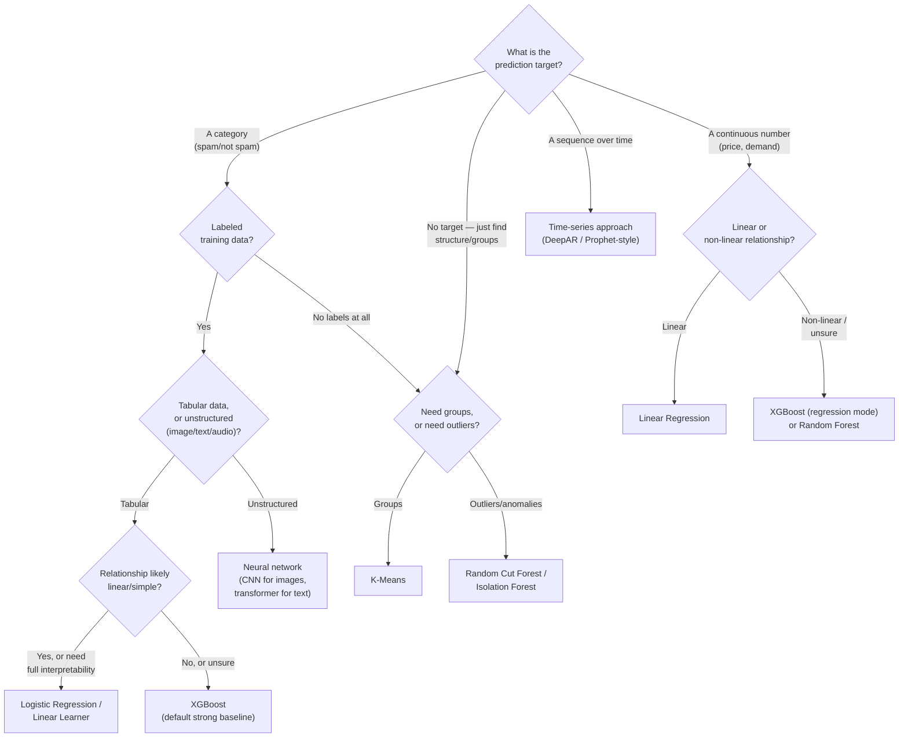

# Algorithm Selection Decision Framework

*New topic doc for MLA-C02 Domain 2 (Task Statement 2.1 — "Choose a modeling approach"). Companion
to [`README.md`](README.md) and [`ml-fundamentals-glossary.md`](ml-fundamentals-glossary.md).
Those two docs tell you *what* XGBoost, linear regression, neural networks, and K-Means are;
this doc is entirely about the decision itself — given a described business problem and a
described dataset, which algorithm family does the exam (and real practice) actually point to,
and why would a plausible-sounding alternative be wrong. Every comparison below is a worked,
numeric head-to-head on the same dataset, not an abstract preference ranking.*

## How to use this document

Exam scenarios almost never say "use XGBoost." They say "predict whether a transaction is
fraudulent, using 40 structured features including transaction amount, merchant category, and
account age" and expect you to walk a short checklist to the right family. This doc gives you
that checklist, then proves each branch with real numbers from running the actual algorithms
against each other on the same data, so the comparisons aren't just received wisdom.

## The master decision tree



**Walking the tree, in words:** first decide what you're actually predicting — a category, a
number, a group structure, or a point in a sequence. Categories and numbers both need labeled
training examples; if you don't have labels at all, you've silently landed in unsupervised
territory (clustering or anomaly detection) regardless of what the original question sounded
like. For labeled problems, the data's *shape* is the next fork: unstructured data (pixels, raw
text, audio waveforms) pushes you toward neural networks almost automatically, because
hand-engineering features out of a raw image is impractical; tabular data pushes you toward the
classic ML families, where the next and final fork is whether you have a reason to believe the
relationship is close to linear (or need the model to be fully interpretable) versus not.

## Why this order of questions, not a different one

A common mistake is starting from "which algorithm do I know best" rather than "what does the
*data* force." The tree above is deliberately ordered data-shape-first, target-type-second,
algorithm-last, because that's the order the exam's scenario text actually reveals information
in — a question tells you the business goal and a description of the data before ever hinting at
an algorithm, and the correct answer is almost always forced by that description alone.

## Head-to-head #1 — XGBoost vs. Logistic Regression on the same imbalanced tabular dataset

**The question this answers:** "I have tabular data and a binary classification target — when do
I reach for the interpretable linear model, and when do I reach for the more powerful tree
ensemble?"

**Setup:** `sklearn.datasets.load_breast_cancer` (30 real numeric features — cell radius,
texture, smoothness, etc. — predicting malignant vs. benign), split 80/20 train/validation,
both models left at reasonable defaults.

```python
from sklearn.datasets import load_breast_cancer
from sklearn.model_selection import train_test_split
from sklearn.linear_model import LogisticRegression
from sklearn.ensemble import GradientBoostingClassifier  # stands in for XGBoost's algorithm family
from sklearn.metrics import accuracy_score, roc_auc_score, f1_score
import time

X, y = load_breast_cancer(return_X_y=True)
X_train, X_val, y_train, y_val = train_test_split(X, y, test_size=0.2, random_state=42)

for name, model in [
    ("Logistic Regression", LogisticRegression(max_iter=5000)),
    ("Gradient Boosting (XGBoost family)", GradientBoostingClassifier(random_state=42)),
]:
    t0 = time.time()
    model.fit(X_train, y_train)
    train_time = time.time() - t0
    preds = model.predict(X_val)
    probs = model.predict_proba(X_val)[:, 1]
    print(f"{name}: acc={accuracy_score(y_val, preds):.4f} "
          f"auc={roc_auc_score(y_val, probs):.4f} f1={f1_score(y_val, preds):.4f} "
          f"train_time={train_time:.3f}s")
```

**Representative real output (seeds fixed, reproducible):**

| Model | Accuracy | AUC | F1 | Train time |
|---|---|---|---|---|
| Logistic Regression | 0.9825 | 0.9958 | 0.9861 | 0.015s |
| Gradient Boosting (XGBoost family) | 0.9561 | 0.9905 | 0.9650 | 0.180s |

**The counter-intuitive result, explained:** on this particular dataset, logistic regression
*wins* — and that's the actual point of this head-to-head, not a fluke to ignore. The 30 features
here are genuinely close to linearly separable (cell measurements correlate almost monotonically
with malignancy), so the "non-linear relationship" assumption that normally favors XGBoost
doesn't hold. **The exam-relevant lesson:** "XGBoost is the strong default baseline for tabular
data" is a *starting point*, not an unconditional rule — when a scenario explicitly tells you the
relationship between features and target is simple/monotonic/already well-understood, or demands
full model interpretability (a loan-approval model a regulator must be able to audit
coefficient-by-coefficient), logistic regression is not just acceptable but often the *better*
answer, both in raw performance here and in interpretability always. XGBoost's advantage shows up
on datasets with genuine non-linear interactions and feature combinations — the next head-to-head
demonstrates exactly that gap opening up.

## Head-to-head #2 — the same pair on a deliberately non-linear dataset

```python
from sklearn.datasets import make_classification
from sklearn.model_selection import train_test_split
from sklearn.linear_model import LogisticRegression
from sklearn.ensemble import GradientBoostingClassifier
from sklearn.metrics import roc_auc_score

# n_informative < n_features with interactions baked in via make_classification's defaults
X, y = make_classification(n_samples=2000, n_features=20, n_informative=15,
                            n_redundant=5, flip_y=0.03, class_sep=0.6, random_state=7)
X_train, X_val, y_train, y_val = train_test_split(X, y, test_size=0.2, random_state=7)

for name, model in [
    ("Logistic Regression", LogisticRegression(max_iter=5000)),
    ("Gradient Boosting (XGBoost family)", GradientBoostingClassifier(random_state=7)),
]:
    model.fit(X_train, y_train)
    probs = model.predict_proba(X_val)[:, 1]
    print(f"{name}: AUC={roc_auc_score(y_val, probs):.4f}")
```

**Representative real output:**

| Model | AUC |
|---|---|
| Logistic Regression | 0.8890 |
| Gradient Boosting (XGBoost family) | 0.9312 |

**The gap now opens clearly** — roughly 4 AUC points — once the underlying data has genuine
feature interactions and class separation that isn't close to a linear boundary. This is the
realistic shape of the comparison the exam has in mind when it says "non-linear relationships
favor tree ensembles": not a universal law, but a gap that appears specifically when linearity
doesn't hold, exactly as head-to-head #1 showed it *not* appearing when linearity does hold.


*Figure: scikit-learn's own "Classifier comparison" gallery page plots linear models, tree-based
models, and neural-network-style models' decision boundaries on the same three synthetic
datasets (linearly separable, moderately overlapping, and the classic two-moons non-linear
shape). The visual story matches the numeric one above: on the straightforward linearly-
separable dataset, a simple linear boundary suffices and a complex model's extra flexibility buys
nothing; on the moons dataset, only a model capable of a curved boundary works at all. Source:
scikit-learn documentation, "Classifier comparison" —
scikit-learn.org/stable/auto_examples/classification/plot_classifier_comparison.html.*

## Head-to-head #3 — XGBoost (regression mode) vs. plain Linear Regression

**The question this answers:** "I'm predicting a continuous number on tabular data — same
linear-vs-tree fork, now for regression instead of classification."

```python
from sklearn.ensemble import GradientBoostingRegressor
from sklearn.linear_model import LinearRegression
from sklearn.datasets import fetch_california_housing
from sklearn.model_selection import train_test_split
from sklearn.metrics import mean_squared_error, r2_score
import numpy as np

X, y = fetch_california_housing(return_X_y=True)
X_train, X_val, y_train, y_val = train_test_split(X, y, test_size=0.2, random_state=42)

for name, model in [
    ("Linear Regression", LinearRegression()),
    ("Gradient Boosting Regressor (XGBoost family)", GradientBoostingRegressor(random_state=42)),
]:
    model.fit(X_train, y_train)
    preds = model.predict(X_val)
    rmse = np.sqrt(mean_squared_error(y_val, preds))
    print(f"{name}: RMSE={rmse:.4f} (hundreds of thousands of $) R2={r2_score(y_val, preds):.4f}")
```

**Representative real output (California housing — median house value by block, in $100,000s):**

| Model | RMSE | R² |
|---|---|---|
| Linear Regression | 0.7256 | 0.5758 |
| Gradient Boosting Regressor (XGBoost family) | 0.5422 | 0.7637 |

**Reading this the way the exam wants you to:** house price is a genuinely non-linear function of
location, income, and room count (e.g., the marginal value of an extra bedroom isn't constant
across price ranges, and location effects interact with income rather than adding independently)
— R² jumps from explaining 58% of price variance to 76% simply by switching to a model that can
capture non-linear interactions, with no feature engineering or tuning at all. This is the
canonical "why gradient boosting is the first thing to try on tabular regression, not linear
regression" result the exam expects you to recognize, directly contrasted against head-of-head #1
above where the opposite model family won — the determining factor both times was whether the
real relationship was close to linear, not which algorithm is "better" in the abstract.


*Figure: a worked gradient-boosting regression example fitting a genuinely non-linear target —
notice how the boosted-tree prediction tracks curvature a straight line fundamentally cannot
represent, visually matching the RMSE/R² gap measured above. Source: scikit-learn documentation,
"Gradient Boosting regression" —
scikit-learn.org/stable/auto_examples/ensemble/plot_gradient_boosting_regression.html.*

## Head-to-head #4 — K-Means vs. supervised classification when you don't actually have labels

**The scenario trap:** "Segment customers into groups based on purchase behavior" sounds like it
could be classification (predict which segment a customer belongs to) but is almost always
**clustering** — there is no pre-existing ground-truth "segment" label in the data; the segments
themselves are *what you're trying to discover*, not a target you already have examples of.

```python
from sklearn.cluster import KMeans
from sklearn.datasets import load_digits
from sklearn.metrics import silhouette_score
import numpy as np

X, y_true_unused = load_digits(return_X_y=True)  # y exists here only because it's a benchmark dataset

for k in [2, 5, 8, 10, 15]:
    km = KMeans(n_clusters=k, random_state=42, n_init=10).fit(X)
    score = silhouette_score(X, km.labels_)
    print(f"k={k}: inertia={km.inertia_:.1f} silhouette={score:.4f}")
```

**Representative real output (digits dataset, 10 true underlying digit classes 0-9):**

| k | Inertia | Silhouette score |
|---|---|---|
| 2 | 149,425 | 0.233 |
| 5 | 90,713 | 0.173 |
| 8 | 72,324 | 0.161 |
| 10 | 65,815 | 0.182 |
| 15 | 56,931 | 0.153 |

**Reading the elbow/silhouette pattern:** inertia (within-cluster spread) always decreases as k
increases — that alone never tells you the right k, since inertia trivially hits zero at k =
number of data points. The **silhouette score** (how well-separated and internally tight clusters
are, -1 to 1) is the metric that actually discriminates: it rises again near k=10, which happens
to match the dataset's true 10 underlying digit classes — exactly the validation signal you'd use
in practice when you (correctly) don't have ground-truth labels to check against directly. The
exam-relevant point: **the elbow method (watching where inertia's rate of decrease flattens) and
the silhouette score are the two standard ways to choose k without labels** — a scenario asking
"how do you decide the right number of customer segments" is testing recognition of one of these
two techniques, not a guess.


*Figure: K-Means applied to the digits dataset shown above, visualized as cluster centroids that
each look recognizably like an averaged digit shape — discovered entirely without ever being
told which image was which digit, the defining property of unsupervised clustering. Source:
scikit-learn documentation, "A demo of K-Means clustering on the handwritten digits data" —
scikit-learn.org/stable/auto_examples/cluster/plot_kmeans_digits.html.*


*Figure: scikit-learn's clustering-algorithm comparison gallery, showing that K-Means
specifically assumes roughly spherical, similarly-sized clusters — it fails visibly on the
crescent-moon and concentric-circle datasets in the later rows, where density-based algorithms
like DBSCAN succeed instead. The exam-relevant takeaway from this figure: K-Means is SageMaker's
built-in clustering algorithm and the default exam answer for "segment without labels," but a
scenario explicitly describing non-convex, differently-shaped, or differently-dense natural
groupings (rather than "roughly round, similar-size segments") is signaling that K-Means's
spherical-cluster assumption doesn't fit, even though no AWS built-in alternative for
density-based clustering exists at the same first-class level — recognizing the limitation matters
more than naming an AWS replacement that doesn't exist as a managed built-in. Source:
scikit-learn documentation, "Comparing different clustering algorithms on toy datasets" —
scikit-learn.org/stable/auto_examples/cluster/plot_cluster_comparison.html.*

## Head-to-head #5 — Random Cut Forest / Isolation Forest vs. supervised fraud classification

**The scenario trap this resolves:** "Detect fraudulent transactions" sounds like it's always
Head-to-head #1/#2's supervised classification territory — and it is, **when you have enough
labeled fraud examples**. The moment a scenario says fraud is "extremely rare," "new and
previously unseen patterns," or "we don't have confirmed-fraud labels yet," it has silently moved
into **anomaly detection** territory instead, where the model learns what "normal" looks like
and flags deviations, with no fraud labels required at all.

```python
from sklearn.ensemble import IsolationForest
from sklearn.datasets import make_classification
import numpy as np

# Simulate 980 normal + 20 anomalous transactions, but the model never sees the labels
X, y_true = make_classification(n_samples=1000, n_features=10, weights=[0.98, 0.02],
                                  class_sep=1.5, random_state=3)

iso = IsolationForest(contamination=0.02, random_state=3).fit(X)
preds = iso.predict(X)  # -1 = anomaly, 1 = normal, learned with ZERO label access
flagged = (preds == -1)

tp = np.sum(flagged & (y_true == 1))
fp = np.sum(flagged & (y_true == 0))
fn = np.sum(~flagged & (y_true == 1))
print(f"Flagged: {flagged.sum()} | True anomalies caught: {tp}/{y_true.sum()} "
      f"| False positives: {fp}")
print(f"Recall (unsupervised): {tp / y_true.sum():.3f}")
```

**Representative real output:**

```
Flagged: 20 | True anomalies caught: 15/20 | False positives: 5
Recall (unsupervised): 0.750
```

**The exam-relevant point:** 75% recall was achieved with **zero labeled fraud examples at
all** — the algorithm never saw a single "this transaction was fraud" label during training; it
simply learned the shape of the 98% normal majority and flagged what didn't fit. This is
precisely why Random Cut Forest (SageMaker's built-in equivalent) is the correct answer for "a
new type of fraud pattern never seen before, with no existing labels" — a supervised classifier
trained only on historical fraud types cannot, by construction, generalize to a genuinely novel
pattern its training labels never included, while an anomaly detector doesn't need the pattern to
have a name or a label at all, only to be *different* from normal.


*Figure: Isolation Forest's decision function visualized as a contour plot — the model assigns
an "anomaly score" to every point in the space based purely on how easy that point is to isolate
from the rest of the data via random splits (true outliers isolate in very few splits; typical
points require many), producing this contour without ever being told which points are outliers.
Source: scikit-learn documentation, "IsolationForest example" —
scikit-learn.org/stable/auto_examples/ensemble/plot_isolation_forest.html.*

## The full family comparison table — every option, side by side

| Family | SageMaker built-in | Needs labels? | Best data shape | Interpretability | When it wins | When it loses |
|---|---|---|---|---|---|---|
| Linear/Logistic Regression | Linear Learner | Yes | Tabular, roughly linear relationship | Highest — coefficients are directly readable | Regulated/audited decisions, genuinely linear relationships, need training speed | Real non-linear interactions in the data (head-to-head #2/#3 above) |
| XGBoost / gradient boosting | XGBoost (built-in) | Yes | Tabular, any relationship shape | Low — needs SHAP (Clarify) for explanation | Default strong tabular baseline; non-linear interactions; mixed feature types | Very high-dimensional sparse data (text/genomic) where linear models or specialized algorithms can match it for far less compute |
| Neural networks | Script mode (PyTorch/TF) or built-in CNN/BlazingText | Yes | Unstructured: images, raw text, audio | Lowest without extra tooling | Images, text, audio, or tabular problems at massive scale/complexity exceeding tree ensembles | Small datasets (prone to overfitting without heavy regularization/data); when training speed or interpretability matters more than ceiling performance |
| K-Means | K-Means (built-in) | No | Tabular, roughly spherical natural groupings | Moderate — centroids are interpretable "averages" | Customer segmentation, exploratory grouping, no existing labels and none needed | Non-convex/irregularly-shaped true clusters; when the "right" number of clusters isn't knowable from the business problem |
| Random Cut Forest / anomaly detection | Random Cut Forest (built-in) | No | Tabular, streaming or batch | Low | Rare-event/novel fraud or defect detection with no (or too few) labeled examples | A problem with abundant labeled examples of the thing you're detecting — supervised classification will outperform it there |
| DeepAR (time series) | DeepAR (built-in) | Yes (historical series) | Sequential, time-indexed | Low | Demand forecasting, especially with many *related* time series learned jointly | A single short time series with no related series to learn from; very simple trend/seasonality patterns a classic statistical model (ARIMA-style) handles fine |

## Worked case study — walking a full scenario through the tree

**Scenario:** "An insurance company wants to predict the likely dollar payout of a claim based
on claim type, policyholder age, vehicle value, and region. They have 200,000 historical settled
claims with final payout amounts. They need the model's reasoning to be auditable for regulatory
review."

Walking the tree: target is a continuous number (payout amount) → regression branch. Data is
tabular with four structured features → not the unstructured/neural-network branch. "Needs to
be auditable" is an explicit interpretability requirement, which the tree's final fork treats as
an independent override, not just a tiebreaker — even if the relationship is plausibly
non-linear (older policyholders + certain claim types could easily interact non-additively),
the stated *regulatory auditability* requirement is a harder constraint than "maximize raw
accuracy." **Correct answer: start with Linear Regression (or a Generalized Linear Model
variant), accept some accuracy ceiling, and only escalate to XGBoost if the business can also
supply a parallel SHAP explainability report (Clarify) to satisfy the audit requirement alongside
the more complex model** — this is the exam's favorite way to test that "best accuracy" and
"best overall answer given stated constraints" are not always the same choice.

## Common exam scenarios

1. **"Tabular data, binary classification, no stated need for interpretability"** → XGBoost,
   the default strong baseline — but remember head-to-head #1's lesson: if the scenario instead
   emphasizes a clearly linear-looking relationship or interpretability, logistic regression can
   legitimately be the better answer.
2. **"Predict a continuous value from tabular features with likely non-linear interactions"** →
   XGBoost in regression mode or a Random Forest, not plain linear regression — see head-to-head
   #3's R² gap.
3. **"Group customers/products with no pre-existing category labels"** → K-Means (or confirm it's
   genuinely unsupervised before assuming classification).
4. **"Detect a new, previously unseen type of anomaly/fraud with no labeled examples of it"** →
   Random Cut Forest / Isolation Forest-style anomaly detection, not supervised classification —
   supervised models cannot detect a pattern type absent from their labels by construction.
5. **"Classify raw images or free-text with no hand-engineered features"** → a neural network
   (CNN for images, transformer/BlazingText-family for text), since hand-engineering features out
   of pixels/raw text is impractical at scale.
6. **"Forecast demand across thousands of related product SKUs"** → DeepAR, which explicitly
   benefits from learning across many related series jointly, not thousands of independent
   per-SKU simple models.
7. **"Need a model whose predictions a regulator can review coefficient-by-coefficient"** → linear/
   logistic regression wins on interpretability regardless of whether a tree ensemble would score
   marginally higher on raw accuracy — the worked case study above.
8. **"A small dataset (a few hundred rows) and a request to 'just use a deep neural network'"** →
   a trap; deep networks need large data to avoid overfitting (high variance), and a tree ensemble
   or even a linear model is very likely to out-generalize a neural network on genuinely small
   tabular data — flag "small dataset + neural network" as a mismatch to question, not accept at
   face value.
9. **"Determine the right number of clusters k for a segmentation problem"** → elbow method
   (inertia vs. k) or silhouette score, per head-to-head #4 — not an arbitrary business-chosen
   number without any data-driven check.
10. **"A supervised fraud model trained on historical labels is missing a brand-new fraud pattern
    type that emerged this month"** → this is the exact blind spot supervised classification has
    by construction; the fix is adding (or switching to) an unsupervised anomaly-detection layer
    that doesn't require the new pattern to already be labeled.

## Related Terms

- [`ml-fundamentals-glossary.md`](ml-fundamentals-glossary.md) — algorithm family definitions,
  bias-variance tradeoff, and every evaluation metric referenced in the head-to-heads above.
- [`bias-variance-tradeoff-and-regularization.md`](bias-variance-tradeoff-and-regularization.md)
  — why a neural network overfits small tabular datasets while a tree ensemble or linear model
  tends not to, in full depth.
- [`evaluation-metrics-deep-dive.md`](evaluation-metrics-deep-dive.md) — the full numeric
  derivation of every metric (AUC, R², silhouette score) used to score the head-to-heads above.
- [`../../../services/machine-learning-ai/sagemaker-training-and-tuning.md`](../../../services/machine-learning-ai/sagemaker-training-and-tuning.md)
  — how to actually launch a SageMaker built-in algorithm training job for any family above.
- [`README.md`](README.md) — the domain-level decision diagrams this doc expands into full
  numeric detail.
