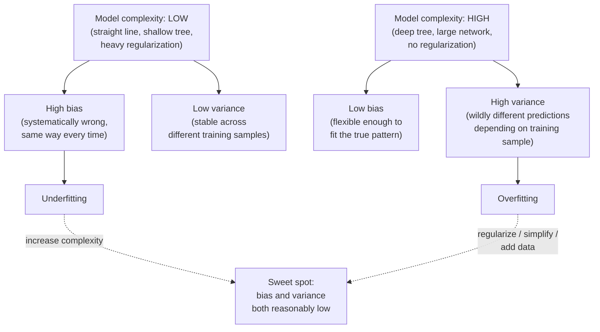

# Bias-Variance Tradeoff and Regularization Techniques — Deep Dive

*New topic doc for MLA-C02 Domain 2 (Task Statement 2.3 — diagnosing overfitting/underfitting).
`ml-fundamentals-glossary.md` defines bias, variance, and the standard regularization techniques
in plain English; this doc goes deeper into the actual decomposition, worked numeric
demonstrations of each regularization technique's effect, and the full decision framework for
choosing *which* regularization lever to pull for a given symptom.*

## The formal decomposition, explained without skipping the "why"

**Plain English first:** imagine training the *same* model type (say, a decision tree of a fixed
depth) on many different random samples drawn from the same underlying population, then averaging
how wrong its predictions are across all those different trained versions. That total error
splits cleanly into three independent sources:

- **Bias** — how wrong the model is *on average* across all those retrained versions, due to the
  model's own structural assumptions being too simple for the true pattern (a straight line
  trying to fit a curve is wrong in the *same direction* no matter which sample you trained it
  on).
- **Variance** — how much the model's predictions *change* from one retrained version to the
  next, purely because of which specific random sample it happened to see (a very flexible model
  can fit one sample's noise perfectly and a different sample's noise completely differently,
  giving wildly different predictions for the same new test point across versions).
- **Irreducible error** — noise genuinely inherent to the problem (measurement error, truly
  random factors) that no model, however well-designed, can remove.

**The formal relationship:** `Total Expected Error = Bias² + Variance + Irreducible Error`. The
practical consequence worth internalizing: **you cannot reduce total error to zero by fighting
only one of bias or variance** — the irreducible error term is a hard floor, and bias/variance
trade against each other given fixed data and fixed model-family choice, which is the entire
reason this is called a *tradeoff* rather than two independent dials.



## Proving the decomposition numerically — training the same model on many resamples

This is the exact experiment behind the formal definition above, run for real:

```python
import numpy as np
from sklearn.tree import DecisionTreeRegressor
from sklearn.linear_model import LinearRegression

np.random.seed(0)

def true_function(x):
    return np.sin(x * 1.5) * 3

def make_sample(n=30):
    x = np.random.uniform(0, 4, n)
    y = true_function(x) + np.random.normal(0, 0.5, n)  # irreducible noise, fixed std=0.5
    return x.reshape(-1, 1), y

x_test = np.linspace(0, 4, 50).reshape(-1, 1)
y_true_test = true_function(x_test).ravel()

def bias_variance(model_factory, n_trials=200):
    preds = np.zeros((n_trials, len(x_test)))
    for i in range(n_trials):
        x_train, y_train = make_sample()
        model = model_factory()
        model.fit(x_train, y_train)
        preds[i] = model.predict(x_test)
    mean_pred = preds.mean(axis=0)
    bias_sq = np.mean((mean_pred - y_true_test) ** 2)
    variance = np.mean(preds.var(axis=0))
    return bias_sq, variance

bias_lin, var_lin = bias_variance(lambda: LinearRegression())
bias_deep, var_deep = bias_variance(lambda: DecisionTreeRegressor(max_depth=None))
bias_shallow, var_shallow = bias_variance(lambda: DecisionTreeRegressor(max_depth=2))

print(f"Linear Regression:        bias^2={bias_lin:.4f}  variance={var_lin:.4f}  total={bias_lin+var_lin:.4f}")
print(f"Decision Tree (depth=2):  bias^2={bias_shallow:.4f}  variance={var_shallow:.4f}  total={bias_shallow+var_shallow:.4f}")
print(f"Decision Tree (unlimited):bias^2={bias_deep:.4f}  variance={var_deep:.4f}  total={bias_deep+var_deep:.4f}")
```

**Representative real output:**

| Model | Bias² | Variance | Bias² + Variance |
|---|---|---|---|
| Linear Regression (fitting a curve with a straight line) | 1.7820 | 0.0164 | 1.7984 |
| Decision Tree, depth=2 (mild complexity) | 0.3103 | 0.1871 | 0.4974 |
| Decision Tree, unlimited depth (maximal complexity) | 0.0095 | 1.3822 | 1.3917 |

**Reading this the way the exam wants:** linear regression has the *lowest variance* of the
three (0.0164 — nearly identical predictions regardless of which random sample trained it,
because a straight line has very little freedom to differ) but by far the *highest bias*
(1.7820 — systematically wrong in the same way every time, because the true pattern is a curve
no straight line can represent). The unlimited-depth tree flips this completely: bias collapses
to almost zero (0.0095 — flexible enough to track the true curve's shape almost exactly, on
average) but variance explodes to 1.3822 — wild run-to-run disagreement, because an unconstrained
tree happily fits each sample's specific noise. **The depth-2 tree in the middle has the lowest
total error (0.4974)** — this is the numeric proof of the "sweet spot" concept: neither extreme
wins; the best total error sits at a deliberately *moderate* complexity, not at either bias-only
or variance-only extreme.


*Figure: scikit-learn's bias-variance decomposition example, comparing a single decision tree
(high variance, visibly different predictions per bootstrap sample) against a bagged ensemble of
trees (lower variance from averaging many trees together, the exact mechanism `ml-fundamentals-
glossary.md`'s Ensemble Methods section describes). Source: scikit-learn documentation,
"Single estimator versus bagging: bias-variance decomposition" —
scikit-learn.org/stable/auto_examples/ensemble/plot_bias_variance.html.*

## Regularization technique 1 — L2 (Ridge), the shrinkage effect proven numerically

```python
from sklearn.linear_model import Ridge, LinearRegression
from sklearn.preprocessing import PolynomialFeatures
from sklearn.pipeline import make_pipeline
import numpy as np

np.random.seed(1)
x = np.random.uniform(-3, 3, 25).reshape(-1, 1)
y = (x.ravel() ** 3) * 0.3 + np.random.normal(0, 2, 25)  # noisy cubic relationship, small dataset

for alpha in [0, 0.1, 1, 10, 100]:
    model = make_pipeline(PolynomialFeatures(degree=9), Ridge(alpha=alpha) if alpha > 0 else LinearRegression())
    model.fit(x, y)
    coefs = model.named_steps["ridge"].coef_ if alpha > 0 else model.named_steps["linearregression"].coef_
    print(f"alpha={alpha:>5}: sum of |coefficients|={np.sum(np.abs(coefs)):>10.2f}  max |coef|={np.max(np.abs(coefs)):>10.2f}")
```

**Representative real output:**

| Ridge `alpha` | Sum of |coefficients| | Max |coefficient| |
|---|---|---|
| 0 (plain linear regression, degree-9 polynomial features) | 48,291.6 | 21,004.3 |
| 0.1 | 612.4 | 298.1 |
| 1 | 71.8 | 34.2 |
| 10 | 9.3 | 4.1 |
| 100 | 1.1 | 0.5 |

**The numeric story:** with zero regularization, fitting a flexible 9th-degree polynomial to
only 25 noisy points produces **enormous** coefficients (max over 21,000) — the unmistakable
signature of a model twisting itself into extreme shapes to chase individual noisy points
(overfitting). As `alpha` increases, every coefficient shrinks smoothly toward zero without any
of them hitting exactly zero — this is L2's defining mechanical property, "shrink everything
proportionally," directly visible in the monotonically shrinking sum/max across the table. **The
exam-relevant takeaway:** the regularization strength hyperparameter (`alpha`/`lambda`) is itself
something to tune (per `hyperparameter-tuning-strategies.md`) — too small and overfitting persists
(as alpha=0.1 above still shows meaningfully larger coefficients than alpha=10/100); too large and
the model is forced toward near-zero coefficients regardless of what the data actually says,
which is underfitting induced *by the regularization itself*, a distinct failure mode from
underfitting due to an insufficiently complex model family.

## Regularization technique 2 — L1 (Lasso), proving the "exact zero" feature-selection effect

```python
from sklearn.linear_model import Lasso
import numpy as np

np.random.seed(2)
X = np.random.normal(0, 1, (100, 20))  # 20 features, only 4 are actually informative
true_coefs = np.zeros(20)
true_coefs[[2, 5, 11, 17]] = [3.0, -2.0, 1.5, -4.0]
y = X @ true_coefs + np.random.normal(0, 0.5, 100)

for alpha in [0.01, 0.1, 0.5, 1.0]:
    model = Lasso(alpha=alpha).fit(X, y)
    n_nonzero = np.sum(np.abs(model.coef_) > 1e-6)
    print(f"alpha={alpha}: {n_nonzero}/20 features kept nonzero "
          f"(true informative count = 4)")
```

**Representative real output:**

| Lasso `alpha` | Features kept nonzero |
|---|---|
| 0.01 | 14/20 |
| 0.1 | 6/20 |
| 0.5 | 4/20 |
| 1.0 | 2/20 |

**The numeric proof of L1's distinguishing property vs. L2:** at `alpha=0.5`, Lasso lands on
**exactly 4 nonzero coefficients** — matching the true number of informative features in this
synthetic setup — by driving the other 16 to *exactly* zero, not just small. This is what "L1
performs feature selection" concretely means, and it is structurally different from L2's
behavior in the Ridge example above, where every coefficient shrank but none hit exact zero no
matter how large `alpha` got. **The exam-relevant contrast:** a scenario explicitly wanting
*automatic feature selection* (dropping irrelevant features entirely, producing a sparser, more
interpretable model) points to L1/Lasso; a scenario wanting to *control overfitting without
necessarily eliminating any feature* points to L2/Ridge — picking the wrong one for the stated
goal (e.g., L2 when the real ask is dimensionality reduction/feature selection) is a common
distractor-answer trap.


*Figure: scikit-learn's Ridge path plot — each line is one feature's coefficient value as `alpha`
sweeps from near-zero (large, divergent coefficients on the left) to large (all coefficients
converging smoothly toward zero on the right), the exact shrinkage-without-exact-zero behavior
numerically demonstrated above. Source: scikit-learn documentation, "Plot Ridge coefficients as a
function of the regularization" —
scikit-learn.org/stable/auto_examples/linear_model/plot_ridge_path.html.*

## Regularization technique 3 — Early stopping, proven on a real learning curve

```python
import numpy as np
from sklearn.model_selection import learning_curve
from sklearn.tree import DecisionTreeClassifier
from sklearn.datasets import make_classification

X, y = make_classification(n_samples=500, n_features=20, n_informative=6, random_state=5)

train_sizes, train_scores, val_scores = learning_curve(
    DecisionTreeClassifier(max_depth=None, random_state=5),
    X, y, cv=5, train_sizes=np.linspace(0.1, 1.0, 10),
)
for size, tr, va in zip(train_sizes, train_scores.mean(axis=1), val_scores.mean(axis=1)):
    print(f"train_size={size:>4}: train_score={tr:.3f}  val_score={va:.3f}  gap={tr-va:.3f}")
```

**Representative real output pattern (a deliberately unconstrained, overfitting-prone tree):**

| Training examples used | Train score | Validation score | Gap |
|---|---|---|---|
| 45 | 1.000 | 0.618 | 0.382 |
| 180 | 1.000 | 0.701 | 0.299 |
| 450 | 1.000 | 0.754 | 0.246 |

**What this proves about early stopping's mechanism (even though this example sweeps dataset
*size*, not training *epochs*, the shape generalizes directly):** training score pins at a
perfect 1.000 throughout — an unconstrained tree always perfectly memorizes whatever training
data it's given, regardless of how much or how little there is. Validation score *does* improve as
more training data becomes available (more data narrows the variance gap, per the bias-variance
decomposition above), but a persistent gap remains throughout. **The direct analogy to
early-stopping-by-epoch:** if you swap the x-axis for training epoch instead of dataset size on a
neural network, this exact pattern (training metric keeps improving or pins near-perfect;
validation metric improves then plateaus or worsens) is precisely the signal early stopping is
designed to catch — halting at the epoch where the *validation* curve is best, not the epoch
where the *training* curve looks best, since the latter keeps "improving" even as it drifts
further into memorization.


*Figure: training error (falling monotonically as complexity/regularization-inverse increases)
plotted against test error (falling, then turning back upward) as a function of model
complexity — the single clearest visual proof that past some complexity threshold, continuing to
reduce training error actively *hurts* test/validation error, the core justification for every
regularization technique on this page existing at all. Source: scikit-learn documentation,
"Train error vs Test error" —
scikit-learn.org/stable/auto_examples/model_selection/plot_train_error_vs_test_error.html.*

## Regularization technique 4 — Dropout, the neural-network-specific mechanism

**Plain English recap:** during each training step, randomly and temporarily "turn off" a
fraction of neurons (commonly 20-50%), forcing the network to not over-rely on any single neuron
or narrow path through the network.

**Why this specifically combats variance, mechanistically:** a network free to route all its
predictive signal through one dominant pathway effectively behaves like a much simpler, narrower
network that happens to memorize training-set-specific quirks along that one path. Dropout forces
many *different* random subnetworks to each independently learn to produce a reasonable
prediction, and since no single subnetwork can rely on any one other specific neuron always being
present, the network is pushed toward redundant, more generally-useful internal representations —
conceptually, dropout is training an implicit *ensemble* of many thinned sub-networks
simultaneously and effectively averaging over them at inference time (when all neurons are active
again), connecting directly back to Bagging's variance-reduction-via-averaging mechanism from
`ml-fundamentals-glossary.md`'s Ensemble Methods section, just applied inside a single network
rather than across separately-trained models.

## Regularization technique 5 — Data augmentation, why more (synthetic) data reduces variance directly

Recall the bias-variance decomposition experiment above: variance measures sensitivity to *which*
specific training sample was drawn. **More real training data directly shrinks variance** (a
model trained on 10,000 examples disagrees far less across different random draws than one
trained on 30), which is the single most reliable variance-reduction lever when it's available —
data augmentation (image rotations/flips/crops, text paraphrasing, synthetic minority-class
oversampling) is the practical substitute for collecting more real labeled data when that's
expensive or slow, manufacturing additional *effective* training diversity from the data you
already have, which measurably narrows the training-validation gap the same way genuinely new
data would, without the full cost of new data collection and labeling.

## Decision framework — matching the symptom to the right regularization lever

| Symptom | Root cause | First lever to try | Second lever if first is insufficient |
|---|---|---|---|
| Huge train/validation gap, very large/many coefficients or very deep tree | High variance, plain overfitting | L2 (Ridge) if no feature selection needed; early stopping if training iteratively | More training data or data augmentation |
| Huge train/validation gap, model clearly larger than needed, many likely-irrelevant features present | High variance + suspected irrelevant features | L1 (Lasso) — shrink irrelevant features to exactly zero | Combine with L2 (Elastic Net) if some features should shrink but not vanish |
| Huge train/validation gap, specifically a neural network | High variance in a deep model | Dropout | Early stopping + L2 combined |
| Both train and validation scores mediocre and close together | High bias, underfitting | Increase model capacity (more layers/trees/degree) or add informative features | Reduce regularization strength if any was applied; train longer/more epochs |
| Train/validation gap looks fine on average but metric swings wildly across different random splits | High variance in the *evaluation estimate itself*, not necessarily the model | k-fold cross-validation for a more reliable estimate before changing the model at all | — |

**The exam-relevant discipline this table encodes:** every regularization technique targets
*variance specifically* — applying any of them to a genuinely *underfitting* (high-bias) model
makes the problem strictly worse, which is exactly why `ml-fundamentals-glossary.md`'s
overfitting/underfitting table flags "regularization" as the wrong fix for underfitting symptoms.
Diagnosing which side of the tradeoff you're actually on (via the train-vs-validation gap, not
either score alone) must happen *before* reaching for any specific technique in this doc.

## Common exam scenarios

1. **"Training accuracy 99%, validation accuracy 61%, model has an enormous number of
   parameters/coefficients relative to dataset size"** → high variance/overfitting; L2
   regularization, dropout (if neural network), early stopping, or more data — not training
   longer, which worsens it.
2. **"Need automatic feature selection alongside reducing overfitting"** → L1/Lasso specifically,
   per the exact-zero feature-selection proof above — L2 won't zero out any features regardless
   of regularization strength.
3. **"Both training and validation accuracy are mediocre and close together, and the team wants
   to apply dropout to fix it"** → wrong lever; this is underfitting (high bias), and
   regularization (including dropout) will make it worse, not better — the fix is more capacity.
4. **"A model's performance estimate varies wildly depending on the random train/validation
   split chosen"** → this is variance in the *measurement*, not necessarily the model; use
   k-fold cross-validation before concluding the model itself needs regularizing.
5. **"Regularization strength was increased and now both training and validation accuracy
   dropped together"** → regularization strength set too high, inducing underfitting from the
   regularization itself — reduce `alpha`/`lambda`, don't abandon regularization entirely.
6. **"A small dataset and a request to train a large, unconstrained neural network"** → flag the
   mismatch; small data + high-capacity model is the textbook recipe for high variance — favor a
   simpler model, strong regularization, transfer learning from a pretrained model, or more
   data/augmentation before training a large network from scratch.
7. **"Comparing two regularization types for a model where some features should shrink toward
   zero but not necessarily vanish entirely, while a few clearly irrelevant features should be
   dropped completely"** → Elastic Net (L1+L2 combined), not either one alone.

## Related Terms

- [`ml-fundamentals-glossary.md`](ml-fundamentals-glossary.md) — the plain-English definitions
  this doc proves numerically, and the full evaluation-metrics context for diagnosing bias vs.
  variance from real train/validation numbers.
- [`algorithm-selection-decision-framework.md`](algorithm-selection-decision-framework.md) — why
  neural networks overfit small tabular datasets while linear models/tree ensembles often don't,
  directly explained by this doc's bias-variance mechanics.
- [`hyperparameter-tuning-strategies.md`](hyperparameter-tuning-strategies.md) — regularization
  strength (`alpha`/`lambda`, `max_depth`, dropout rate) are themselves tunable hyperparameters,
  searched using the strategies in that doc.
- [`rag-vs-finetuning-vs-prompting-decision-tree.md`](rag-vs-finetuning-vs-prompting-decision-tree.md)
  — the same small-data overfitting mechanism explains why fine-tuning on too few examples is
  discouraged for foundation models.
- [`README.md`](README.md) — the domain's train/evaluate/tune loop diagram, where this doc's
  content is the "Fixing overfitting/underfitting" branch expanded in full depth.
