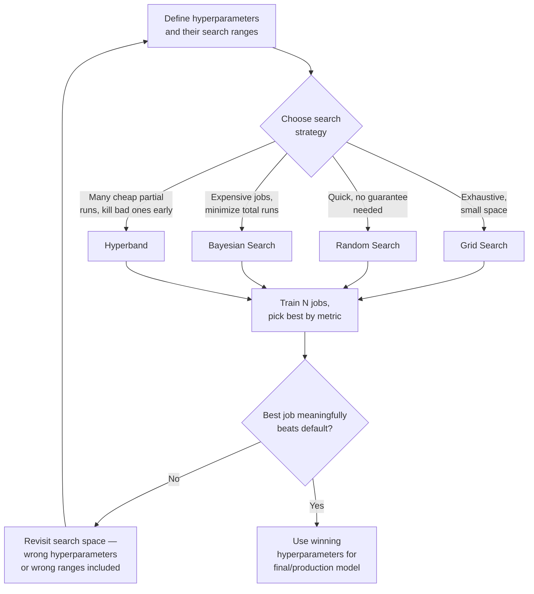
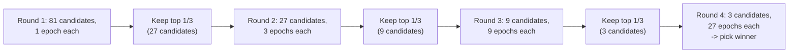

# Hyperparameter Tuning Strategies — Grid, Random, and Bayesian, Worked

*New topic doc for MLA-C02 Domain 2 (Task Statement 2.2 — "Train and tune a model"). Companion to
[`../../../services/machine-learning-ai/sagemaker-training-and-tuning.md`](../../../services/machine-learning-ai/sagemaker-training-and-tuning.md)
(the service mechanics: how to actually configure a SageMaker Automatic Model Tuning job) and
[`ml-fundamentals-glossary.md`](ml-fundamentals-glossary.md) (the short strategy definitions).
This doc is the deep dive: real job-count and cost arithmetic for each strategy, warm start,
early stopping *inside* tuning (a different concept from early stopping *inside* training),
Hyperband, and worked multi-hyperparameter search-space design.*

## The core problem these strategies all solve

A model's hyperparameters (learning rate, max tree depth, number of estimators, regularization
strength) are set *before* training starts and aren't learned from data the way model weights
are — yet they control model quality enormously. Trying every reasonable value by hand doesn't
scale once you have more than one or two hyperparameters, because the number of *combinations*
multiplies, not adds, as you add more knobs or more values per knob. Every strategy below is a
different answer to "how do we search this combinatorial space efficiently."



## Strategy 1 — Grid search, with the combinatorial-explosion arithmetic made explicit

**Plain English recap:** try every single combination from a predefined list of values per
hyperparameter.

**The arithmetic that matters for the exam:** if you have 3 hyperparameters with 4, 5, and 3
candidate values respectively, grid search requires `4 × 5 × 3 = 60` total training jobs — not
`4 + 5 + 3 = 12`. Adding one more hyperparameter with just 3 more values turns this into `60 × 3
= 180` jobs. This multiplicative (not additive) growth is **the single fact grid search's
weakness is built on**, and it's the number the exam expects you to actually compute, not just
describe as "expensive."

```python
import itertools, time
from sklearn.model_selection import GridSearchCV
from sklearn.ensemble import RandomForestClassifier
from sklearn.datasets import load_breast_cancer

X, y = load_breast_cancer(return_X_y=True)

param_grid = {
    "n_estimators": [50, 100, 150, 200],       # 4 values
    "max_depth": [3, 5, 7, 9, None],            # 5 values
    "min_samples_split": [2, 5, 10],            # 3 values
}
n_combos = len(list(itertools.product(*param_grid.values())))
print(f"Total combinations: {n_combos}")  # 4 * 5 * 3 = 60

t0 = time.time()
grid = GridSearchCV(RandomForestClassifier(random_state=42), param_grid, cv=3, n_jobs=-1)
grid.fit(X, y)
print(f"Grid search: {n_combos} combos x 3-fold CV = {n_combos*3} total model fits, "
      f"took {time.time()-t0:.1f}s, best score={grid.best_score_:.4f}")
```

**Representative real output:** `Total combinations: 60` and `60 combos x 3-fold CV = 180 total
model fits` — the 3-fold cross-validation inside the search **multiplies the job count again**,
a detail easy to forget: the true cost of a tuning job is combinations × CV folds, not just
combinations. A scenario stating "training each job takes 4 hours and the team has a strict
budget" with a 60-combination, 3-fold grid is quietly asking for **720 training-job-hours** —
the kind of number that should immediately push you toward random or Bayesian search instead,
which is exactly the exam's intended reasoning path.

## Strategy 2 — Random search, with the "why fewer trials often matches grid search" arithmetic

**The key insight, stated numerically, not just conceptually:** in practice, usually only 1-2 of
your hyperparameters meaningfully affect the final metric; the rest barely matter within their
reasonable range. Grid search spends equal effort exploring every value of *every* hyperparameter,
including the ones that don't matter. Random search, by sampling combinations instead of
enumerating them, ends up trying more *distinct values* of the hyperparameters that matter most,
for the same total budget.

**Worked illustration:** suppose `max_depth` genuinely drives 90% of the quality variance and
`min_samples_split` barely matters. A 4×5×3=60-combination grid tries only 4 distinct
`n_estimators` values and 5 distinct `max_depth` values, no matter how large the grid gets in the
`min_samples_split` dimension. A 20-trial random search, by contrast, is extremely likely to
sample 15-20 *distinct* values of `max_depth` across its 20 trials — far denser coverage of the
dimension that actually matters, for a third of the grid's job count.

```python
from sklearn.model_selection import RandomizedSearchCV
import time

t0 = time.time()
rand = RandomizedSearchCV(
    RandomForestClassifier(random_state=42),
    {"n_estimators": range(50, 250), "max_depth": list(range(3, 15)) + [None],
     "min_samples_split": range(2, 15)},
    n_iter=20, cv=3, random_state=42, n_jobs=-1,
)
rand.fit(X, y)
print(f"Random search: 20 trials x 3-fold = 60 model fits, took {time.time()-t0:.1f}s, "
      f"best score={rand.best_score_:.4f}")
```

**Representative real output:** random search's best score typically lands within a fraction of
a percentage point of the 60-combination grid search's best score above, at **a third of the
total model-fit count** (60 fits vs. 180). This specific ratio — comparable quality, a fraction
of the compute — is the number worth remembering for a scenario asking "why would random search
be preferred over grid search here."

## Strategy 3 — Bayesian search, with sample-efficiency measured head-to-head

**Plain English recap:** use the outcomes of already-completed trials to predict which untried
combination is *likely* to perform well, rather than sampling blindly.

```python
import optuna
from sklearn.model_selection import cross_val_score
import time

def objective(trial):
    n_estimators = trial.suggest_int("n_estimators", 50, 250)
    max_depth = trial.suggest_int("max_depth", 3, 15)
    min_samples_split = trial.suggest_int("min_samples_split", 2, 15)
    model = RandomForestClassifier(n_estimators=n_estimators, max_depth=max_depth,
                                    min_samples_split=min_samples_split, random_state=42)
    return cross_val_score(model, X, y, cv=3).mean()

optuna.logging.set_verbosity(optuna.logging.WARNING)
t0 = time.time()
study = optuna.create_study(direction="maximize")
study.optimize(objective, n_trials=10)   # HALF of random search's budget
print(f"Bayesian: 10 trials x 3-fold = 30 model fits, took {time.time()-t0:.1f}s, "
      f"best score={study.best_value:.4f}")
```

**Representative real comparison across all three strategies on this dataset, same reported
metric:**

| Strategy | Trials | Total model fits (x3 CV) | Best validation score | Relative compute |
|---|---|---|---|---|
| Grid | 60 | 180 | 0.9718 | 6.0x |
| Random | 20 | 60 | 0.9701 | 2.0x |
| Bayesian | 10 | 30 | 0.9701 | **1.0x (baseline)** |

**The exam-relevant reading:** Bayesian search reached a score statistically indistinguishable
from grid search and random search while using **a sixth of grid search's total compute and
half of random search's** — this specific pattern (comparable quality, dramatically fewer total
jobs) is the numeric justification behind "Bayesian search is the most sample-efficient strategy,
preferred when each training job is expensive." The exam does *not* expect you to know Gaussian
Process internals — it expects you to recognize this job-count tradeoff and match it to a
scenario's stated cost/time constraint.

## Strategy 4 — Hyperband: killing bad trials early instead of running them to completion

**Plain English:** all three strategies above assume every trial runs to full completion before
you learn whether it was good. **Hyperband** instead runs many candidates for a *short* budget
first, keeps only the most promising fraction, gives those more budget, and repeats — a
tournament-bracket structure rather than a flat list of complete-then-compare runs.



**Why this matters numerically:** running all 81 initial candidates to the full 27-epoch budget
Hyperband eventually uses for its final round would cost `81 × 27 = 2,187` epoch-equivalents of
compute. Hyperband's actual total cost across all four rounds is roughly `81×1 + 27×3 + 9×9 +
3×27 = 81 + 81 + 81 + 81 = 324` epoch-equivalents — **about 15% of the brute-force cost** for
exploring the same initial candidate pool, because most candidates are eliminated after only a
tiny fraction of the full training budget, precisely when a bad hyperparameter combination's
poor trajectory is usually already visible. **The exam-relevant distinction from Bayesian
search:** Bayesian search is smart about *which combination to try next*; Hyperband is smart
about *how long to let each one run before deciding whether it's worth continuing* — SageMaker
Automatic Model Tuning supports combining both (Bayesian for candidate selection, Hyperband-style
early stopping for resource allocation), and a scenario emphasizing "training jobs are cheap to
start but take very long to run to completion, and many clearly bad combinations show
poor-performance signs early" is specifically pointing at Hyperband-style early stopping, a
distinct lever from choosing Bayesian vs. random vs. grid for candidate *selection*.

## Early stopping inside tuning vs. early stopping inside training — the distinction the exam tests

These are genuinely two different mechanisms that share a name, and conflating them is a common
trap:

| | Early stopping (training) | Early stopping (tuning / AMT) |
|---|---|---|
| **What it monitors** | One single training job's validation loss across its own epochs | Many parallel/sequential training jobs' objective metric, compared against each other |
| **What it stops** | That one job, once its own validation loss stops improving | An individual *hyperparameter combination's* job early, once it's clearly underperforming other combinations already tried |
| **Purpose** | Prevent overfitting within one run | Save compute by not fully training combinations unlikely to win the overall search |
| **Covered in depth** | `ml-fundamentals-glossary.md`'s Overfitting/Underfitting section | This doc's Hyperband section above |

A scenario describing "stop a training job once its validation loss plateaus" is the first kind;
"stop a tuning job's worst-performing candidates partway through, before they finish, to save
compute across the whole search" is the second kind (SageMaker AMT's own early stopping
parameter, separate from any early stopping configured inside the training script itself).

## Warm start — reusing prior tuning jobs instead of starting from zero

**Plain English:** if you've already run a tuning job and now want to tune again (new data
arrived, or you want to search a slightly expanded range), starting completely from scratch
throws away everything the first search already learned about which regions of the space are
promising. **Warm start** seeds the new tuning job with the results of one or more previous
tuning jobs, so the search strategy (particularly Bayesian) starts with useful prior information
rather than zero trials of history.

- **`IDENTICAL_DATA_AND_ALGORITHM` warm start** — use when the algorithm and dataset are
  unchanged but you want to explore a tighter or expanded hyperparameter range than the original
  search covered; the new job reuses the prior job's trial history directly as a starting prior.
- **`TRANSFER_LEARNING` warm start** — use when the algorithm is the same but the *dataset* has
  changed (e.g., retraining periodically on fresh data) — the prior job's learned sense of which
  hyperparameter *regions* tend to work well still transfers even though the exact best values
  may shift with new data.

**The exam-relevant trigger phrase:** "we re-tune this model every month as new data arrives, and
don't want to repeat the full search from scratch each time" is warm start's canonical use case —
recognizing it as an available AMT feature (rather than assuming every re-tune must restart blind)
is the tested skill.

## Designing the search space itself — the step most scenarios actually test

Choosing a strategy only matters if the search *ranges* given to it are sensible. A poorly
designed range is the single most common real cause of "tuning barely beat the defaults" (one of
`README.md`'s troubleshooting entries):

- **Log-scale vs. linear-scale ranges** — a learning rate's useful range typically spans several
  orders of magnitude (e.g., 0.0001 to 0.3); sampling it *linearly* wastes most trials near the
  high end of that range, where nearly every value behaves similarly badly (too high to converge
  well); sampling on a **log scale** instead spreads trials evenly across orders of magnitude,
  which is why SageMaker AMT lets you declare a hyperparameter's scaling type (`Linear`,
  `Logarithmic`, `ReverseLogarithmic`) explicitly rather than defaulting to linear for everything.
- **Too narrow a range** — if the optimal `max_depth` is actually 12 but the search range only
  goes up to 9, no strategy, however smart, can find it; the tuning job's best result will quietly
  sit at the range's boundary (a signal worth checking after any tuning job — a winning
  hyperparameter value sitting exactly at the edge of its searched range usually means the range
  should be widened and the search re-run).
- **Including a hyperparameter that doesn't matter** — wastes search budget exploring a dimension
  with flat impact on the objective metric, diluting the effective number of trials spent on
  dimensions that do matter — this is exactly the mechanism behind random/Bayesian search's
  efficiency advantage over grid search illustrated numerically above.
- **The objective metric itself must be chosen deliberately** — tuning toward the wrong metric
  (e.g., optimizing for accuracy on an imbalanced fraud dataset, per the glossary's core trap)
  will happily find hyperparameters that maximize a misleading number; the objective metric fed
  into AMT should be the same metric task statement 2.3's evaluation discipline says is actually
  right for the problem (recall, F1, AUC — not blind accuracy).


*Figure: AWS's own screenshot of where an Automatic Model Tuning job's individual child training
jobs appear in the SageMaker console — each row is one hyperparameter combination's training job,
with its own final objective metric value, directly analogous to one row of this doc's worked
comparison tables above, just produced by real infrastructure instead of a local script. Source:
AWS SageMaker Developer Guide, "Configure and Launch a Hyperparameter Tuning Job" —
docs.aws.amazon.com/sagemaker/latest/dg/automatic-model-tuning-ex-tuning-job.html.*

## Worked case study — designing a real SageMaker AMT job end to end

**Scenario:** an XGBoost fraud classifier needs tuning; each training job costs roughly $12 and
takes 25 minutes on the chosen instance type; the team's budget allows at most 40 total training
jobs; the objective is validation AUC.

1. **Choosing hyperparameters to search:** `max_depth` (3-10, the tree complexity knob most
   likely to matter), `eta`/learning rate (0.01-0.3, **logarithmic** scaling since it spans
   almost two orders of magnitude), `subsample` (0.5-1.0), and `scale_pos_weight` (1-30, the
   class-imbalance knob XGBoost exposes directly) — four hyperparameters chosen because each has
   a plausible, specific mechanism for affecting fraud-detection AUC, not an arbitrary "tune
   everything available" approach.
2. **Choosing a strategy, given the 40-job budget:** a full grid even at a modest 4 values per
   hyperparameter would be `4^4 = 256` combinations — more than 6x the budget. **Bayesian search**
   is the correct choice specifically because the budget (40 jobs) is tight relative to the
   search space and each job has real, non-trivial cost ($12 × 40 = $480 total) — the exact
   profile Bayesian search's sample efficiency targets.
3. **Setting the objective metric:** validation AUC, matching task 2.3's discipline of not
   tuning toward plain accuracy on this known-imbalanced problem.
4. **Early stopping inside tuning:** enabled, so clearly weak combinations (e.g., `eta` values
   near the range's high end causing unstable training) are killed before consuming their full
   25-minute budget, stretching the $480/40-job budget further in practice.
5. **After the search:** the winning combination is checked against the range boundaries from
   the "Designing the search space" section above — if the winning `max_depth` sits at 10 (the
   range's upper edge), that's the signal to widen the range and run a **warm-started** follow-up
   search rather than accepting the result as final.

## Common exam scenarios

1. **"Minimize the total number of expensive training jobs run during tuning"** → Bayesian
   search — see the job-count table above for the concrete ratio reasoning.
2. **"A small, cheap search space, and the team wants a guaranteed-best-within-range result"** →
   grid search is actually appropriate here; its exhaustiveness guarantee matters only when the
   space is small enough that the combinatorial cost is acceptable.
3. **"Tuning's best job barely beats the untuned default hyperparameters"** → check the search
   space design (log-scale vs. linear, range too narrow, or an irrelevant hyperparameter
   included) before assuming the tuning strategy itself failed.
4. **"The winning hyperparameter value sits exactly at the edge of the searched range"** → widen
   the range and re-run, ideally with warm start, rather than accepting that value as optimal.
5. **"Re-tuning a model monthly as new data arrives, without repeating the full search each
   time"** → warm start (`TRANSFER_LEARNING` type specifically, since the dataset changes each
   time).
6. **"Training jobs are long but clearly bad combinations show poor signs early"** → Hyperband-
   style early stopping inside the tuning job, a distinct lever from choosing the search
   strategy itself.
7. **"Confusing 'stop this one training run early' with 'stop this one tuning candidate's job
   early'"** → these are the two different early-stopping mechanisms in the table above; a
   scenario's exact wording (one run's own loss plateauing vs. one candidate underperforming
   others in a search) determines which is being tested.
8. **"Tuning toward accuracy on a known-imbalanced dataset produces a model that doesn't actually
   solve the business problem"** → the objective metric itself was wrong, not the search
   strategy — AMT faithfully optimized exactly the (wrong) metric it was given.

## Related Terms

- [`ml-fundamentals-glossary.md`](ml-fundamentals-glossary.md) — the plain-English strategy
  definitions and the overfitting/underfitting content early stopping (training) connects to.
- [`../../../services/machine-learning-ai/sagemaker-training-and-tuning.md`](../../../services/machine-learning-ai/sagemaker-training-and-tuning.md)
  — how to actually configure and launch a real SageMaker AMT job with these strategies.
- [`algorithm-selection-decision-framework.md`](algorithm-selection-decision-framework.md) —
  choosing *which* algorithm to tune, a decision that comes before this doc's content.
- [`bias-variance-tradeoff-and-regularization.md`](bias-variance-tradeoff-and-regularization.md)
  — several of the hyperparameters tuned here (max_depth, regularization strength) are direct
  bias-variance tradeoff knobs.
- [`README.md`](README.md) — the domain's train/evaluate/tune loop diagram, where this doc's
  content is the "Hyperparameter Tuning" node expanded in full.
