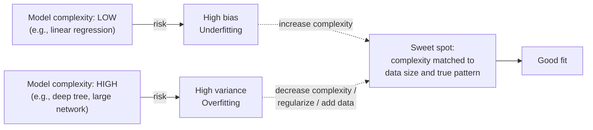
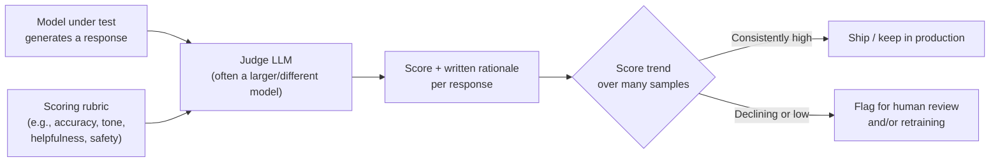

# ML Fundamentals Glossary

*Figure: a real, rendered example of underfitting (degree 1, too simple a curve to fit the data),
a good fit (degree 4), and overfitting (degree 15, chasing noise instead of the true pattern) —
the single clearest visual explanation of this document's most important concept. Source:
scikit-learn documentation, "Underfitting vs. Overfitting" —
scikit-learn.org/stable/auto_examples/model_selection/plot_underfitting_overfitting.html.*

*Machine Learning concept · MLA-C02 Domain 2, Task Statements 2.2–2.3 — this is the single most
foundational, most exam-tested vocabulary in the entire MLA-C02 cert. These terms are
algorithm-agnostic (they apply whether you're using SageMaker's XGBoost, a PyTorch script, or
fine-tuning a Bedrock foundation model), which is why they get their own doc instead of living
inside a SageMaker service page. Every term below is explained in plain English first, then
with the technical/mathematical detail, in that order, deliberately.*

## How to use this document

This glossary is organized in the order a model actually moves through its life: how it sees
data during training → whether it learned the right thing → why you can't just make it bigger →
how you deliberately handicap it to generalize better → how you measure whether it's actually
good → which metric for which problem. Read it in order once, then use the tables throughout as
quick lookups during review. Every term also appears, cross-linked, wherever it's used elsewhere
in this repo — this document is the canonical definition; other docs link here rather than
re-explaining.

## Epoch and Batch — how a model actually "sees" data during training

**Plain English:** Imagine studying a textbook for an exam. An **epoch** is one complete
read-through of the entire textbook, cover to cover. A **batch** is how many pages you read
before stopping to quiz yourself and adjust your study notes, rather than waiting until you've
finished the whole book.

**Technical:** Training a model (specifically, neural-network-style training using gradient
descent) works by repeatedly: (1) feeding it some training examples, (2) measuring how wrong its
predictions were (the **loss**), and (3) nudging its internal parameters slightly to reduce that
wrongness. Doing this nudge after *every single example* would be extremely slow and noisy;
doing it only after seeing *all* examples would be extremely memory-hungry and slow to improve.
The compromise is the **batch**: a subset of examples (e.g., 32, 64, 128 at a time) processed
together before one parameter update happens. One **epoch** = the model has processed every
training example in the dataset exactly once, which usually means many batches (dataset size ÷
batch size = number of batches per epoch). Models are typically trained for many epochs (seeing
the same data repeatedly), because one pass usually isn't enough to learn the pattern well.

- **Larger batch size** → more stable/accurate gradient estimates per update, faster wall-clock
  training (more parallelism), but requires more memory and can sometimes generalize slightly
  worse.
- **Smaller batch size** → noisier updates (can help escape bad local solutions), less memory,
  but slower overall and less stable.
- **Too few epochs** → the model hasn't seen the data enough times to learn the pattern
  (contributes to underfitting, below).
- **Too many epochs** → the model starts memorizing noise/quirks specific to the training set
  instead of the general pattern (contributes to overfitting, below) — this is exactly what
  **early stopping** (halting training once validation performance stops improving) prevents.

### Learning rate — the lever that works alongside epoch and batch

**Plain English:** if epochs and batches are "how much studying," the **learning rate** is "how
drastically you rewrite your notes after each quiz." A learning rate that's too high means you
overreact to every new piece of information (rewriting your whole understanding of a topic after
one practice question); too low means you barely update at all, no matter how much you study.

**Technical:** the learning rate scales how large a step the model's parameters take in the
direction that reduces loss, on every update. Too high and training can **diverge** (loss
oscillates wildly or explodes to `NaN`); too low and training **converges** extremely slowly,
potentially needing far more epochs than is practical to reach a good result. A **learning rate
schedule** (starting higher, decreasing over time) is a common practical compromise — fast
early progress, fine-grained refinement later.

## Overfitting and Underfitting — is the model actually learning the right thing?

**Plain English:** Imagine a student preparing for an exam by memorizing the exact wording of
every practice question's answer, instead of understanding the underlying concept. They'll ace
the practice questions (training data) but fail the real exam, which asks the same concepts in
different words (new/validation data). That's **overfitting**. The opposite — a student who
barely studied at all and does poorly on both the practice questions and the real exam — is
**underfitting**.

**Technical:**
- **Underfitting**: the model performs poorly on *both* the training data and new (validation/
  test) data. This means the model is too simple, hasn't trained long enough, or lacks the
  right features to capture the real pattern in the data at all.
- **Overfitting**: the model performs very well on training data but noticeably worse on
  validation/test data. This means the model has learned noise and incidental quirks specific
  to the training examples (memorization) rather than the general, transferable pattern.
- **Good fit**: training and validation performance are both strong and reasonably close to each
  other.

| Symptom | Training performance | Validation performance | Diagnosis | Common fixes |
|---|---|---|---|---|
| Both bad | Low | Low | Underfitting | More model capacity, more training time/epochs, better/more features, reduce regularization |
| Train great, val bad | High | Low | Overfitting | More training data, regularization, dropout, early stopping, simpler model |
| Both good, close together | High | High | Good fit | Proceed to hyperparameter tuning / deployment |

**How you detect it on the exam:** a question gives you two numbers (training accuracy/loss and
validation accuracy/loss) and asks what's wrong and how to fix it — match the pattern against
the table above. A huge gap between the two numbers (train much better than validation) is the
overfitting signature; both numbers being mediocre is the underfitting signature.

**Learning curves — the visual version of the same diagnosis:** plotting training loss and
validation loss against epoch number on the same chart is the standard way this is diagnosed in
practice, not just read off two final numbers. Three recognizable shapes:
- Both curves decrease and converge close together, flattening out → good fit, training can stop.
- Training loss keeps dropping while validation loss flattens, then starts *rising* → overfitting
  began at the epoch where validation loss started rising; early stopping should have fired there.
- Both curves stay high and flat from early on → underfitting; more epochs alone won't help.

## Bias–Variance Tradeoff — why you can't just always make the model "bigger"

**Plain English:** **Bias** is "the model's basic assumptions are too simple to capture reality"
— like trying to fit a straight line through data that actually curves. **Variance** is "the
model is overly sensitive to the exact training examples it happened to see" — like a model that
gives wildly different answers if you'd trained it on a slightly different random sample of the
same underlying data. A high-bias model underfits; a high-variance model overfits. You cannot
drive both to zero simultaneously with a fixed amount of data — reducing one tends to increase
the other, which is the "tradeoff."

**Technical:** Formally, a model's total expected prediction error can be decomposed into:
**bias²** (error from overly simplistic assumptions), **variance** (error from sensitivity to
the specific training set), and **irreducible error** (noise inherent to the problem that no
model can remove). Simple models (e.g., linear regression) tend to have high bias, low variance.
Complex models (e.g., deep neural networks, unpruned decision trees) tend to have low bias, high
variance. The practical goal is finding the sweet spot — a model complex enough to capture the
real pattern (low bias) but not so flexible that it chases noise (low variance) — which is
exactly what regularization and proper hyperparameter tuning are trying to achieve.

## Regularization — the deliberate "handicap" that prevents overfitting

**Plain English:** Regularization is like giving the student a rule: "you're not allowed to use
more than N index cards of notes." It forces simplicity, which prevents them from just
memorizing everything verbatim and pushes them toward understanding the general concept instead.

**Technical:** Regularization adds a penalty to the training objective that discourages the
model from becoming overly complex/extreme, in exchange for better generalization to new data.
Common forms:
- **L1 regularization (Lasso)** — penalizes the sum of absolute values of model weights; tends
  to push some weights to exactly zero, effectively performing feature selection.
- **L2 regularization (Ridge)** — penalizes the sum of squared weights; shrinks weights toward
  zero smoothly without necessarily eliminating any.
- **Dropout** (neural networks specifically) — randomly "turns off" a fraction of neurons during
  each training step, preventing the network from relying too heavily on any single neuron/path.
- **Early stopping** — halting training once validation performance stops improving, even if
  training performance would keep improving further — a simple, very commonly tested form of
  regularization that doesn't require changing the loss function at all.
- **Data augmentation** — artificially expanding the effective training set (e.g., rotating/
  flipping images, paraphrasing text) so the model sees more variation without collecting new
  real data; this reduces overfitting by making memorization harder and the general pattern
  relatively easier to learn than any one specific example.

## Cross-validation — getting a trustworthy estimate of generalization

**Plain English:** instead of one single train/validation split (which might, by chance, put an
unusually easy or unusually hard subset into validation), **k-fold cross-validation** splits the
data into k equal parts, trains k times (each time holding out a different part as validation),
and averages the results — giving a more reliable performance estimate than any single split.

**Technical:** with k=5 (a common choice), the data is split into 5 folds; 5 separate training
runs each use 4 folds for training and 1 (a different one each time) for validation; the final
reported metric is the average across all 5 runs, along with its variance across folds (a high
variance across folds is itself informative — it suggests the model's performance is sensitive
to which specific data it sees, a variance-related red flag). This matters for the exam mainly as
a vocabulary item — recognizing "cross-validation" as the answer to "get a more robust estimate
of model performance than a single train/test split" rather than confusing it with hyperparameter
tuning itself (cross-validation is often used *inside* a tuning loop to score each candidate
hyperparameter combination, but the two concepts are distinct).

## Evaluation Metrics — how do you know if the model is actually good?

**Plain English first, for all of these:** imagine a model that screens emails and flags some as
spam. Every prediction falls into one of four buckets, which together form the **confusion
matrix**:

|  | Predicted: Spam | Predicted: Not Spam |
|---|---|---|
| **Actually Spam** | True Positive (TP) — correctly caught | False Negative (FN) — missed, slipped into inbox |
| **Actually Not Spam** | False Positive (FP) — wrongly flagged, good email blocked | True Negative (TN) — correctly left alone |

The **confusion matrix** is just this 2×2 (or larger, for multi-class) table of counts — it's
called that because it shows you exactly *where* the model gets confused, not just a single
"percent correct" number that can hide serious problems.

*Figure: an actual confusion matrix plotted for a 3-class classification problem (the classic
Iris dataset) — the diagonal cells are correct predictions, every off-diagonal cell shows
specifically which class got confused with which other class. Source: scikit-learn documentation,
"Confusion matrix" — scikit-learn.org/stable/auto_examples/model_selection/plot_confusion_matrix.html.*

- **Accuracy** = (TP + TN) / (everything). Plain English: "what fraction of all predictions were
  correct." **The trap**: with imbalanced classes (e.g., 99% of emails are legitimate), a model
  that predicts "not spam" for literally everything scores 99% accuracy while catching zero spam
  — accuracy alone is dangerously misleading here.
- **Precision** = TP / (TP + FP). Plain English: "of everything the model flagged as spam, what
  fraction actually was spam?" High precision means few false alarms. Matters most when a false
  positive is costly (e.g., blocking a legitimate, important email).
- **Recall** (also called Sensitivity or True Positive Rate) = TP / (TP + FN). Plain English: "of
  all the actual spam that existed, what fraction did the model catch?" High recall means few
  misses. Matters most when a false negative is costly (e.g., a cancer-screening model missing an
  actual case is far worse than a false alarm that gets double-checked).
- **Specificity** (True Negative Rate) = TN / (TN + FP). Plain English: "of all the actual
  legitimate emails, what fraction did the model correctly leave alone?" The mirror image of
  recall, focused on the negative class instead of the positive class — less commonly the
  headline metric, but it's what's being traded away when you push recall very high (a model that
  flags *everything* as spam has perfect recall and terrible specificity).
- **Precision/Recall tradeoff**: raising the model's decision threshold (requiring more
  confidence before flagging "spam") generally increases precision but decreases recall, and
  vice versa — you cannot usually maximize both at once; which one matters more is a business
  decision, not a math one.
- **F1 Score** = the harmonic mean of precision and recall: `2 × (precision × recall) /
  (precision + recall)`. Plain English: "a single number that's only high when BOTH precision
  and recall are reasonably good" — useful when you want one summary metric for an imbalanced
  classification problem and don't want to pick a side between precision and recall.
- **AUC (Area Under the ROC Curve)**: the ROC curve plots true positive rate against false
  positive rate across every possible decision threshold. Plain English: "if you grabbed one
  random actual-positive example and one random actual-negative example, AUC is the probability
  the model correctly ranks the positive one as more likely to be positive." AUC = 1.0 is a
  perfect model; AUC = 0.5 is equivalent to random guessing. It's threshold-independent, which
  makes it useful for comparing models without committing to one cutoff yet.
- **RMSE (Root Mean Squared Error)**: used for **regression** (predicting a number, like a house
  price), not classification. Plain English: "on average, how far off were the model's numeric
  predictions, in the same units as what it's predicting" (e.g., RMSE of $15,000 on house price
  predictions). Technical: square each prediction's error (so bigger misses are punished
  disproportionately more than small ones), average those squared errors, then take the square
  root to bring the units back to the original scale.
- **MAE (Mean Absolute Error)**: also regression-only. Plain English: "the average size of the
  error, treating every miss the same regardless of direction or size." Technical: average the
  absolute value of each prediction's error, with no squaring — a large single outlier error
  doesn't dominate MAE the way it dominates RMSE, which is why MAE is preferred when you don't
  want a few extreme misses to drive the whole metric.
- **R² (coefficient of determination)**: also regression. Plain English: "what fraction of the
  variation in the target variable does the model actually explain, compared to just always
  guessing the average." R² = 1.0 is a perfect model; R² = 0 means the model does no better than
  always predicting the mean; negative R² means the model does *worse* than that trivial baseline
  — a useful sanity-check number precisely because "worse than guessing the average" is such an
  unambiguous red flag.

### Which metric for which problem — the exam's favorite trap

| Problem type | Classes balanced? | Use |
|---|---|---|
| Classification | Balanced | Accuracy is reasonable |
| Classification | Imbalanced | Precision, Recall, F1, or AUC — NOT plain accuracy |
| Classification, false positives very costly | — | Optimize for Precision |
| Classification, false negatives very costly (missed fraud, missed disease) | — | Optimize for Recall |
| Regression (predicting a number) | n/a | RMSE (sensitive to large errors) or MAE (robust to outliers) |
| Regression, need an interpretable "how much of the variance is explained" number | n/a | R² |
| Ranking / threshold-independent comparison of two classifiers | n/a | AUC |

## Classic ML algorithm families — a plain-English map

Domain 2's decision tree (in the domain README) assumes you can place an algorithm family in the
right conceptual bucket. A short map, in plain English, of what each family is actually doing:

- **Linear models** (linear/logistic regression, Linear Learner) — fit a straight line/plane
  through the data; fast, interpretable, high bias/low variance; a strong first baseline before
  reaching for anything more complex.
- **Tree-based models** (decision trees, random forests, XGBoost/gradient boosting) — learn a
  series of "if this, then that" splits; handle non-linear relationships and mixed data types
  well without manual feature engineering; XGBoost in particular is the strongest default
  baseline for tabular data on both SageMaker and in general ML practice.
- **Neural networks / deep learning** — layers of simple mathimatical units that combine to learn
  very complex, non-linear patterns; shine on unstructured data (images, audio, raw text) where
  hand-engineering features is impractical; need more data and compute than the two families
  above, and are more prone to overfitting without careful regularization.
- **Clustering (unsupervised, no labels)** — K-Means and similar algorithms group similar records
  together without being told the "correct" grouping in advance; useful for customer segmentation
  or exploratory structure-finding, not prediction against a known label.
- **Anomaly detection** — Random Cut Forest and similar algorithms learn what "normal" looks like
  and flag records that don't fit, without needing labeled "anomalous" examples in advance — the
  right family when fraud/defect examples are too rare or too varied to label comprehensively.

## Ensemble methods — why "many weak models" often beats "one strong model"

**Plain English:** asking one expert for an opinion is useful; averaging the independent opinions
of several different experts, each with their own blind spots, is usually more reliable — the
individual mistakes tend to cancel out rather than compound. Ensemble methods are this idea
applied to models.

**Technical:**
- **Bagging** (Bootstrap Aggregating) — train many copies of the same algorithm on different
  random subsets of the training data, then average (regression) or vote (classification) their
  predictions. **Random Forest** is the canonical example: many decision trees, each trained on
  a bootstrapped sample with a random subset of features considered at each split, reduces the
  high variance any single deep tree would have on its own.
- **Boosting** — train models *sequentially*, where each new model focuses specifically on
  correcting the mistakes of the ensemble so far, rather than training independently. **XGBoost**
  (Extreme Gradient Boosting) is the canonical example and SageMaker's strongest default tabular
  baseline — it builds trees one at a time, each one targeting the residual error left by the
  trees before it.
- **Stacking** — train several different *kinds* of models (e.g., a linear model, a tree model,
  a neural network) and train a final "meta-model" that learns how to best combine their
  predictions — less common in SageMaker built-in workflows but a recognized technique if a
  scenario describes combining heterogeneous model types.

The exam-relevant distinction between bagging and boosting: bagging trains independently and in
parallel (reduces variance, helps overfitting); boosting trains sequentially and adaptively
(reduces bias, helps underfitting) — if a question frames "models that learn from each other's
mistakes, trained one after another," that's boosting; "many independent models voting together,"
that's bagging.

## Transfer learning and feature scaling — two practical prerequisites often skipped

**Transfer learning, plain English:** instead of teaching someone a skill from absolute zero,
start from someone who already has broad, related experience and teach them only what's specific
to the new task. **Technical:** take a model already trained on a large, general dataset (e.g.,
an image classifier trained on millions of general photos, or a foundation model pretrained on
huge text corpora) and continue training (fine-tune) it on your smaller, specific dataset — this
is the exact same underlying idea as Domain 2's foundation-model fine-tuning, just the
classic-ML-era name for the technique; JumpStart's pretrained-model catalog exists specifically
to make transfer learning the default starting point rather than training any image/text model
completely from scratch.

**Feature scaling, plain English:** if one input feature is measured in dollars (0 to 1,000,000)
and another in a 0-to-1 ratio, many algorithms (especially linear models, neural networks, and
distance-based methods like K-Means) will be dominated by whichever feature happens to have
larger raw numbers, regardless of which one is actually more predictive. **Technical:**
**normalization** (rescaling to a fixed range, e.g., 0 to 1) and **standardization** (rescaling
to zero mean, unit variance) are the two standard fixes, applied during Domain 1's feature
engineering step, before training — tree-based models (XGBoost, random forests) are a notable
exception that generally don't require feature scaling, since they split on raw thresholds rather
than computing distances or weighted sums.

## A fully worked numeric example — computing every metric by hand

Rather than trusting the formulas alone, work through one concrete confusion matrix end to end.
Suppose a fraud-detection model is tested against 1,000 real transactions, of which 50 are
actually fraudulent (a realistic 5% fraud rate), and the model produces this confusion matrix:

| | Predicted: Fraud | Predicted: Not Fraud |
|---|---|---|
| **Actually Fraud** | TP = 35 | FN = 15 |
| **Actually Not Fraud** | FP = 20 | TN = 930 |

Computing every metric from this table directly:
- **Accuracy** = (35 + 930) / 1000 = 965 / 1000 = **96.5%** — sounds great in isolation.
- **Precision** = 35 / (35 + 20) = 35 / 55 ≈ **63.6%** — of everything flagged as fraud, about
  64% actually was fraud; the other 36% were false alarms sent to a human reviewer.
- **Recall** = 35 / (35 + 15) = 35 / 50 = **70%** — the model caught 70% of actual fraud, missing
  the other 30% (15 cases) entirely.
- **F1** = 2 × (0.636 × 0.70) / (0.636 + 0.70) ≈ 2 × 0.445 / 1.336 ≈ **66.6%**.
- **A trivial "always predict not-fraud" baseline**, for comparison, would score accuracy = 950 /
  1000 = **95%** — only 1.5 points lower than the real model's 96.5%, while catching precisely
  zero fraud (recall = 0%). This single comparison is the entire reason accuracy is flagged as a
  dangerous metric for imbalanced problems throughout this document — a 1.5-point accuracy
  difference is hiding the entire difference between "catches 70% of fraud" and "catches none."

Reproduce this exact calculation yourself with `sklearn.metrics.confusion_matrix` and
`classification_report` in `labs.md` — recomputing it independently, rather than trusting the
formula alone, is the fastest way to make these definitions stick before exam day.

## Loss functions — what training is actually trying to minimize

**Plain English:** the loss function is the textbook's answer key — the precise rule for scoring
"how wrong was this one prediction," which the training process is mechanically trying to make as
small as possible, averaged across all examples.

- **Mean Squared Error (MSE)** — the standard loss for regression; squares each error before
  averaging (same squaring behavior as RMSE, just not square-rooted back to the original units) —
  used *during* training, while RMSE is typically how you *report* the final result to a human
  audience in interpretable units.
- **Cross-entropy loss (log loss)** — the standard loss for classification; penalizes a
  confidently wrong prediction far more heavily than a mildly wrong one (predicting 99% confidence
  in the wrong class is penalized much more than 55% confidence in the wrong class) — this
  "confidently wrong is punished harder" property is what pushes a classifier toward well-
  calibrated probability outputs, not just correct top-1 guesses.
- **Hinge loss** — used by Support Vector Machines; focuses specifically on getting the decision
  boundary right with a margin, rather than calibrated probabilities.

The exam rarely asks you to compute a loss function by hand, but does test recognizing that
"MSE/RMSE pairs with regression" and "cross-entropy pairs with classification" — mismatching a
loss function to the wrong problem type is a conceptual error a well-designed distractor answer
will test.

## Gradient descent variants — how the "nudge" in each training step actually works

**Plain English:** recall from the Epoch and Batch section that training nudges the model's
parameters after each batch to reduce the loss. Different **optimizers** are different rules for
exactly how big and in what direction that nudge should be — all pursuing the same goal (reduce
loss fastest and most reliably) with different tradeoffs.

- **Stochastic Gradient Descent (SGD)** — the simplest version: move directly opposite the
  direction of steepest loss increase, scaled by the learning rate. Simple, well-understood, but
  can be slow and can get stuck oscillating in narrow valleys of the loss landscape.
- **SGD with Momentum** — adds a "velocity" term that accumulates across steps, so the optimizer
  keeps moving in a consistent direction rather than reacting only to the current step's gradient
  — like a ball rolling downhill building up speed rather than stopping and recalculating direction
  at every single point.
- **Adam (Adaptive Moment Estimation)** — the most common default optimizer for deep learning in
  practice; adapts the effective learning rate per-parameter based on recent gradient history,
  generally converging faster and more reliably than plain SGD with less manual learning-rate
  tuning required. If a scenario doesn't specify an optimizer and just says "train a neural
  network," Adam is the reasonable default assumption.

The exam rarely asks you to choose between optimizers directly, but does expect you to recognize
that the optimizer is a distinct concept from the learning rate itself (the optimizer is the
*rule* for using the gradient; the learning rate is one *input* to that rule) and from the loss
function (the loss function defines what "wrong" means; the optimizer defines how to act on that
information).

## Activation functions — why neural networks aren't just stacked linear regressions

**Plain English:** if every layer of a neural network only did simple weighted averaging (linear
math), stacking many layers would mathematically collapse into the equivalent of one single
layer — depth would buy you nothing. Activation functions are the small non-linear "twist"
inserted between layers that's exactly what allows depth to actually capture more complex
patterns than a single layer could.

- **ReLU (Rectified Linear Unit)** — outputs the input directly if positive, zero otherwise; the
  most common default in modern deep networks because it's cheap to compute and trains reliably.
- **Sigmoid** — squashes any input into a 0-to-1 range; the standard choice for a *binary*
  classifier's final output layer, since the result is directly interpretable as a probability.
- **Softmax** — the multi-class generalization of sigmoid; squashes a vector of raw scores into a
  probability distribution across all classes that sums to 1 — the standard final-layer choice
  for multi-class classification.

Exam-relevant takeaway: recognizing *why* depth needs non-linearity (without it, many layers
behave like one) is the conceptual point tested, not memorizing every activation function's exact
formula.

## Hyperparameter tuning strategies — grid, random, and Bayesian search, explained plainly

Referenced throughout Domain 2's README as "Automatic Model Tuning," worth defining the three
underlying search strategies explicitly here since they're tested as distinct vocabulary:

- **Grid search** — plain English: try every single combination of hyperparameter values from a
  predefined list, exhaustively, like checking every square on a grid. Guaranteed to find the
  best combination *within the grid you defined*, but the number of combinations explodes
  multiplicatively as you add more hyperparameters or more values per hyperparameter — expensive
  and slow for anything beyond a small search space.
- **Random search** — plain English: instead of trying every combination, randomly sample a fixed
  number of combinations from the possible ranges. Often finds a comparably good result to grid
  search with far fewer total training jobs, because in practice only a few hyperparameters
  usually matter a lot, and random sampling covers the *important* ones' range more efficiently
  than grid search's exhaustive-but-evenly-spread approach.
- **Bayesian search** — plain English: use the results of *already-completed* trials to
  intelligently guess which untried combination is most likely to improve on the best result so
  far, rather than guessing blindly (random) or checking everything (grid). This makes it the
  most sample-efficient strategy — it typically needs the fewest total training jobs to find a
  good result, which matters most when each individual training job is expensive or slow.

| Strategy | Sample efficiency | Guarantees | Best when |
|---|---|---|---|
| Grid | Low (exhaustive) | Finds best within the defined grid | Search space is small and training jobs are cheap |
| Random | Medium | No guarantee, but good coverage in practice | A quick, reasonable search without heavy compute commitment |
| Bayesian | High | No guarantee, but learns from prior trials | Training jobs are expensive/slow and total job count must be minimized |

## Model interpretability, in plain English — a preview of Domain 4's deeper treatment

**Plain English:** a model that's 95% accurate but can't explain *why* it made any individual
decision is a black box — useful for some purposes, unacceptable for others (a loan denial, a
medical risk score). **Interpretability** is the umbrella term for techniques that answer "why
did the model predict this," at two different levels:

- **Global interpretability** — which features matter most *overall*, across the whole model
  (e.g., "income is the single most important feature driving this model's predictions in
  general").
- **Local interpretability** — why the model made *this one specific* prediction for *this one
  specific* record (e.g., "for this specific applicant, income contributed +0.3 toward approval,
  while a short credit history contributed -0.2").

**SHAP (SHapley Additive exPlanations)** is the technique SageMaker Clarify uses for local
interpretability — it answers the local question above for any individual prediction, and is
covered in full implementation depth in
[`../domain-4-monitoring-security/responsible-ai-and-guardrails.md`](../domain-4-monitoring-security/responsible-ai-and-guardrails.md).
It's introduced here, in the glossary, specifically because "explainability" as a concept belongs
alongside accuracy/bias as one of the three questions you should always be able to answer about
a finished model: is it accurate, is it fair, and can it explain itself.

## NEW skill 2.3.8 — NLP evaluation metrics for generative AI: BLEU, ROUGE, BERTScore, semantic similarity

Everything in the "Evaluation Metrics" section above (accuracy, precision, recall, F1, AUC,
RMSE) assumes the model produces a single discrete label or number with one unambiguous correct
answer. **Generative AI breaks that assumption** — a foundation model asked to summarize a
document can produce many differently-worded summaries that are all equally "correct," so none
of the classic metrics above apply directly. This is new, genuinely distinct C02 content: a
separate family of metrics exists specifically for scoring *generated text* against a reference.

**Plain English, all four, before any formula:** imagine grading an essay against a model answer.
**BLEU** asks "how many of the exact same short phrases (n-grams) appear in both the generated
text and the reference?" — like checking how many identical 2-4 word chunks overlap. **ROUGE**
asks almost the same question but from the reference's point of view — "how much of the
reference's content did the generated text manage to cover?" **BERTScore** doesn't require exact
word overlap at all — it compares the *meaning* of each word/phrase using embeddings, so a
generated sentence that's correctly paraphrased (different words, same meaning) can still score
well. **Semantic similarity** generalizes BERTScore's idea to whole sentences/documents: embed
both the generated text and the reference (the exact mechanism from
`embeddings-and-rag-data-prep.md`) and compare how close their vectors are.

| Metric | What it measures | Sensitive to paraphrasing? | Typical use |
|---|---|---|---|
| **BLEU (Bilingual Evaluation Understudy)** | N-gram precision: what fraction of the generated text's phrases appear in the reference | No — penalizes correct paraphrases that use different wording | Machine translation (its original use case), and any task with one fairly fixed "correct" phrasing |
| **ROUGE (Recall-Oriented Understudy for Gisting Evaluation)** | N-gram recall: what fraction of the reference's phrases appear in the generated text | No — same paraphrase-sensitivity issue as BLEU, just measured from the opposite direction | Summarization (its original use case) — "did the summary capture the reference summary's key phrases" |
| **BERTScore** | Token-level semantic similarity using contextual embeddings, not exact string match | Yes — a correct paraphrase scores well | Any generation task where correct answers can be worded many different ways |
| **Semantic similarity (embedding-based)** | Whole-text embedding distance between generated output and reference | Yes — this is its entire purpose | Comparing a generated answer's overall meaning against a reference answer, or scoring RAG answer relevance against the retrieved context |

**The exam-relevant trap:** BLEU and ROUGE look rigorous (they're mathematical, with real
formulas) but systematically *penalize correct paraphrases* — a generated summary that's
perfectly accurate but worded completely differently from the reference can score poorly on both.
A scenario describing "the generated text is clearly accurate but scores low on an automated
metric" is testing whether you recognize this exact BLEU/ROUGE paraphrase-blindness, with the fix
being BERTScore or semantic similarity (or human evaluation, below), not concluding the model
itself is bad.

**A worked numeric intuition (no exact formula required):** reference: "The return window is 30
days." Generated A: "Customers have 30 days to return items." Generated B: "The return window is
30 days." Generated B shares far more exact words/phrases with the reference, so it scores much
higher on BLEU/ROUGE despite being no more *correct* than Generated A — Generated A, a valid
paraphrase, would score noticeably lower on BLEU/ROUGE while scoring comparably high to Generated
B on BERTScore/semantic similarity, which is the entire point of having both metric families.

## NEW skill 2.3.9 — AI evaluation: LLM-as-a-judge, content quality, and bias detection in outputs

**Plain English:** once you accept that BLEU/ROUGE/BERTScore are all still comparing against one
fixed reference answer, a deeper problem remains — for many generative tasks (open-ended
customer support replies, creative content, multi-step reasoning) there often *is no single
reference answer to compare against at all*. **LLM-as-a-judge** solves this by using a second,
typically more capable foundation model to *read and score* the first model's output directly,
against a rubric, instead of comparing strings.

- **Why use a different (often larger) model as judge** — a model judging its own output tends to
  rate itself favorably (a form of self-preference bias); using a separate, typically more
  capable judge model reduces (though doesn't eliminate) this bias, and lets you run evaluation
  at a scale no human review team could sustain.
- **Content quality validation** — the judge model is given an explicit rubric (accuracy,
  completeness, tone, safety) rather than a vague "is this good" prompt, producing a structured,
  comparable score across many outputs rather than a single subjective impression.
- **Bias detection in generated output** — the same LLM-as-a-judge pattern can be pointed at a
  specific bias question (e.g., "does this response describe the male and female candidate
  equally favorably given equivalent qualifications") — a direct GenAI-era extension of
  `responsible-ai-and-guardrails.md`'s classic-ML bias-metric content, applied to free-text
  generation where there's no simple numeric "approval rate" to compare across groups.
- **Human evaluation frameworks (human-in-the-loop) — task statement 2.3.7** — LLM-as-a-judge
  scales cheaply but isn't infallible; mature evaluation pipelines sample a percentage of
  responses for actual human review, using the same rubric the judge model uses, specifically to
  (a) calibrate/validate that the judge model's scores track real human judgment and (b) catch
  the cases a judge model itself might systematically miss (subtle factual errors in a domain the
  judge model also doesn't know well, for instance). Amazon SageMaker Ground Truth supports this
  human-review workflow directly, routing a sample of model outputs to human labelers against a
  defined rubric, the same mechanism it uses for classic ML labeling tasks (Domain 1), now applied
  to evaluating generated text quality instead of labeling raw training data.
- **The exam-relevant layering to remember:** automated string-overlap metrics (BLEU/ROUGE) →
  automated semantic metrics (BERTScore/semantic similarity) → automated rubric-based judgment
  (LLM-as-a-judge) → human review (the ground-truth check on all of the above) — each layer is
  cheaper and faster than the one below it, and each layer the exam can test as the *wrong* answer
  when a scenario's actual need is one layer deeper (e.g., using only BLEU when the real concern
  is tone/safety, which needs LLM-as-a-judge or human review, not a string-overlap metric at all).

## NEW skill 2.3.10 — Configuring RAG system monitoring, including retrieval accuracy

A RAG system (Domain 1/3) can fail in two independent places — the **retrieval** step and the
**generation** step — and task statement 2.3.10 specifically names monitoring the *retrieval*
half, which classic model-quality monitoring (Domain 4's drift detection) doesn't cover at all.

- **Retrieval accuracy metrics** — **Precision@K** (of the top-K retrieved chunks, what fraction
  are actually relevant to the query) and **Recall@K** (of all the genuinely relevant chunks that
  exist in the corpus, what fraction made it into the top-K) — directly analogous in spirit to
  classic precision/recall above, just measured against "was this chunk relevant" instead of "was
  this label correct."
- **Why generation-quality metrics alone can hide a retrieval failure** — a generated answer can
  score well on BERTScore/semantic similarity against a reference *and still be wrong*, if by
  coincidence the model's pretrained general knowledge happened to produce a plausible answer
  despite retrieval returning irrelevant chunks — monitoring retrieval accuracy directly, not only
  the final generated answer's quality, is what catches this specific failure mode.
- **Monitoring retrieval accuracy in production** — logging which chunks were retrieved per query
  alongside periodic human or LLM-as-a-judge relevance scoring of a sample of those retrievals,
  tracked over time the same way Domain 4's Model Monitor tracks drift — a sustained drop in
  retrieval relevance (even with generation quality looking stable) is the leading indicator that
  the underlying corpus has grown stale, a chunking/embedding configuration has degraded, or the
  vector index needs re-tuning — see `../domain-4-monitoring-security/README.md` for where this
  connects to the domain that owns ongoing production monitoring broadly.

## A quick self-test — can you answer these without looking back?

Before moving to `labs.md`, these five questions are a fast way to check whether the plain-
English explanations above actually stuck, independent of the formulas:

1. A friend says "my model's training accuracy and validation accuracy are both around 55%, and
   neither is improving no matter how many more epochs I run." What's wrong, and what are two
   fixes that do NOT involve adding more epochs?
2. Why does a model that always predicts the majority class score high accuracy on an imbalanced
   dataset, and what metric exposes the problem that accuracy hides?
3. In one sentence, what's the actual difference between bagging and boosting?
4. Why would a scenario describing "an expensive, slow-to-train model, and we need to minimize
   the total number of training jobs run during tuning" point you toward Bayesian search instead
   of grid or random search?
5. Why doesn't a tree-based model like XGBoost usually need its input features scaled/normalized,
   while a neural network or linear model generally does?

(Answers: 1 — underfitting; increase model capacity or add/engineer better features, not more
epochs. 2 — because the correct-prediction rate on the dominant class alone can be near 100%,
masking near-zero recall on the rare class; recall or F1 exposes it. 3 — bagging trains many
models independently/in parallel and averages them to reduce variance; boosting trains models
sequentially, each correcting the previous ones' errors, to reduce bias. 4 — Bayesian search uses
prior trial results to intelligently pick the next candidate, needing far fewer total trials than
exhaustively grid-searching or blindly random-sampling. 5 — tree-based models split on raw
threshold comparisons per feature independently, which are unaffected by each feature's scale,
whereas neural networks and linear models compute weighted sums/distances across all features
together, where a feature with a naturally larger numeric range would dominate unless rescaled.)

## Common exam scenarios

1. **"A fraud detection model has 98% accuracy but the business says it's not catching enough
   fraud"** → fraud is a rare/imbalanced class; the real problem metric is likely low **recall**
   — accuracy is hiding it.
2. **"Training loss keeps decreasing every epoch, but validation loss started increasing several
   epochs ago"** → classic overfitting signature; the fix is **early stopping** at the point
   validation loss was lowest, or adding regularization.
3. **"The model's predictions are consistently far off the true value in the same direction, on
   both training and test data"** → high bias / underfitting, not a variance problem — needs a
   more expressive model or better features, not more data alone.
4. **"A spam filter is blocking too many legitimate business emails"** → a precision problem
   (too many false positives); raise the classification threshold to require more confidence
   before flagging spam.
5. **"Need one single number to report model quality for an imbalanced binary classifier without
   picking between false positives and false negatives"** → F1 score.
6. **"Comparing two candidate models' ranking ability across all possible thresholds, before
   deciding on a cutoff"** → AUC.
7. **"A house-price regression model's errors should be reported in dollars, penalizing large
   misses more than small ones"** → RMSE.
8. **"Batch size was increased and training got faster but final model accuracy slightly dropped"**
   → expected tradeoff; larger batches speed up training (more parallel compute per update) but
   can mildly hurt generalization — not a bug, a known tradeoff to reason about.
9. **"A regression model's errors should be reported in a way that isn't dominated by a few
   extreme outlier properties in the dataset"** → MAE, not RMSE — RMSE's squaring is exactly the
   property that over-weights outliers, which is undesirable here.
10. **"A model's training loss becomes `NaN` and training halts"** → learning rate too high (or
    unnormalized input features causing extreme values) — lower the learning rate, not a hardware
    issue, as the first thing to check.
11. **"Model performance varies a lot depending on which random train/validation split is used"**
    → use k-fold cross-validation to get a more reliable, averaged performance estimate rather
    than trusting any single split.
12. **"A model has strong recall but the business is now complaining about too many false
    alarms being escalated to a human review team"** → this is a precision complaint; the fix is
    raising the decision threshold, which the team should recognize will simultaneously lower
    recall — a tradeoff decision, not a free improvement.
13. **"A linear regression model systematically underperforms a gradient-boosted tree model on
    the exact same tabular dataset, across many different hyperparameter settings"** → likely a
    genuine non-linear relationship in the data that a linear model's high bias can't capture
    regardless of tuning — this points toward switching algorithm families (XGBoost), not more
    hyperparameter search on the linear model.
14. **"A newly fine-tuned foundation model now performs worse on tasks unrelated to the
    fine-tuning dataset, despite performing better on the fine-tuned task itself"** → catastrophic
    forgetting; this is the foundation-model-era analog of overfitting to a narrow dataset at the
    expense of general capability — see Domain 2's README for the full fine-tuning discussion.
15. **"Two models score identically on accuracy but one has a much higher recall and lower
    precision than the other"** → accuracy alone can't distinguish genuinely different
    error-tradeoff profiles; always check precision/recall (or F1/AUC) before declaring two
    models "equally good" based on accuracy alone.

## Use Cases — Real Scenarios

1. A machine-translation team reports BLEU scores on every model release, specifically because
   translation genuinely does have a fairly fixed "correct" phrasing per language pair — exactly
   the use case BLEU was designed for.
2. A summarization team discovers ROUGE scores dropped after a model update, investigates, and
   finds the new model produces equally accurate but differently-worded summaries — confirmed by
   running BERTScore on the same outputs and seeing it stay flat, correctly separating "wording
   changed" from "quality dropped."
3. A customer-service QA team uses LLM-as-a-judge to score 100% of generated chat responses for
   tone and policy compliance daily, since no human review team could read every conversation,
   while routing a random 2% sample to actual human reviewers weekly to confirm the judge model's
   scores still track real human judgment.
4. A hiring-platform team runs LLM-as-a-judge specifically on a bias rubric ("are equally
   qualified candidates of different genders described with equally positive language") across
   thousands of generated candidate summaries, a scale no manual review process could sustain.
5. A legal-document RAG assistant's generation-quality scores look stable month over month, but a
   separate Precision@5 retrieval-accuracy check reveals the vector index is increasingly
   returning outdated clauses — caught only because retrieval was monitored as its own metric,
   not inferred from the (currently fine-looking) generated answers.
6. A company evaluating three candidate foundation models for a summarization task runs all three
   against the same reference summaries using ROUGE, BERTScore, and a human-rated rubric
   side-by-side, specifically to see whether the models' rankings agree or diverge across metric
   families before committing to one.
7. An ML team fine-tunes a smaller, specialized model and validates it's "good enough" against
   the much larger foundation model it's replacing using semantic similarity scoring on a held-out
   set of real production queries, rather than assuming parity from training loss curves alone.
8. A content-moderation team builds a human evaluation framework specifically for edge cases an
   automated toxicity classifier flags with low confidence, routing only the genuinely ambiguous
   cases to human reviewers rather than every single flagged item.
9. A RAG system's support team sets up an alert when Recall@K on a sampled query set drops below
   a threshold, treating it exactly like a SageMaker Model Monitor drift alarm — an automatic,
   proactive signal rather than waiting for users to complain that answers feel less accurate.
10. A research team deliberately compares BLEU and BERTScore on the same set of paraphrased
    answers to build their own intuition for the paraphrase-blindness trap before ever answering
    an exam question about it.

## Related Terms

- [`../domain-1-data-preparation/README.md`](../domain-1-data-preparation/README.md) — class
  imbalance is created/fixed upstream in data prep; these metrics are how you detect its effect
  downstream.
- [`services/machine-learning-ai/sagemaker-training-and-tuning.md`](../../../services/machine-learning-ai/sagemaker-training-and-tuning.md)
  — where epochs, batch size, and early stopping are configured in practice.
- [`services/machine-learning-ai/sagemaker-model-monitor-and-registry.md`](../../../services/machine-learning-ai/sagemaker-model-monitor-and-registry.md)
  — these same metrics are what SageMaker Model Monitor watches for *drift* after deployment
  (Domain 4).
- [`../domain-4-monitoring-security/responsible-ai-and-guardrails.md`](../domain-4-monitoring-security/responsible-ai-and-guardrails.md)
  — bias metrics (a different axis than the accuracy-style metrics in this document) covered in
  full depth there.
- [`labs.md`](labs.md) — hands-on exercises that reproduce several of this document's concepts
  (overfitting curves, confusion matrices, cross-validation) with real, runnable code.
