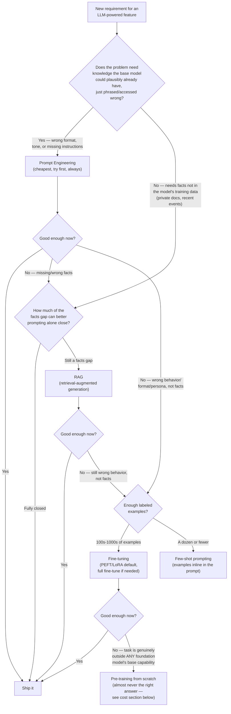
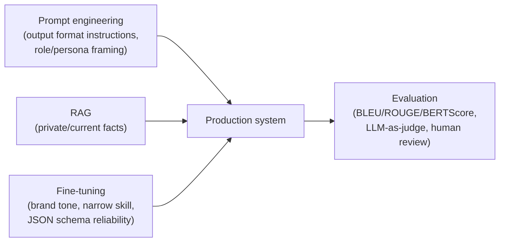

# RAG vs. Fine-Tuning vs. Prompt Engineering vs. Pre-Training — The Full Decision Tree

*New topic doc for MLA-C02 Domain 2 (Task Statements 2.1.2, 2.2.8 — fine-tuning strategies and
customization techniques). `README.md` already has a compact fine-tuning decision diagram; this
doc expands it into the full four-way customization framework (adding pre-training as the fourth,
rarely-correct option), with cost/data/time numbers attached to each branch and worked scenarios
that walk the *entire* tree, not just the fine-tune-vs-RAG fork.*

## Why a fourth option belongs in this tree

Most Domain 2 material (correctly) frames the choice as RAG vs. fine-tuning vs. prompt
engineering. There's a fourth, almost-always-wrong-but-still-tested option: **training a
foundation model from scratch (pre-training)**. It belongs in the tree specifically because the
exam tests recognizing when it's *not* warranted — which requires it to be a visible option you
deliberately rule out, not simply absent from your mental model.

## The full decision tree

**Walking the tree in words:** the first real fork is **facts vs. behavior**. If the model is
missing or wrong on *facts* (doesn't know your return policy, doesn't know about an event after
its training cutoff, doesn't know your internal product catalog), no amount of fine-tuning
reliably fixes that — fine-tuning changes *how* a model behaves, not what it factually knows with
certainty, and a model fine-tuned on a narrow fact set can still hallucinate adjacent facts it
wasn't shown. If the model is missing or wrong on *behavior* (wrong tone, wrong output format,
doesn't follow a persona, doesn't reliably apply a narrow skill), prompting or fine-tuning are the
tools, not RAG — RAG only ever adds retrieved text to the context, it cannot reliably force an
output *format* the way instruction-style fine-tuning can. Both branches start by trying the
cheapest fix (prompting) before escalating.

## The cost/time/data ladder — the numbers behind "cheapest first"

| Option | Typical setup time | Typical data needed | Typical relative cost | Changes the model itself? |
|---|---|---|---|---|
| **Prompt engineering** | Minutes to hours | None (zero training examples) | Lowest — pennies per iteration, same per-token inference cost as using the model normally | No |
| **Few-shot prompting** | Minutes to hours | A handful (2-20) examples, placed directly in the prompt | Low — slightly higher per-request token cost (longer prompt), no training cost at all | No |
| **RAG** | Days to weeks (ingest pipeline, chunking, embedding, vector store) | A document corpus (hundreds to millions of documents), no labeled examples required | Low-moderate — ongoing vector-store hosting + embedding costs, no training compute | No (augments context only) |
| **PEFT/LoRA fine-tuning** | Hours to a few days | Hundreds to low thousands of labeled examples | Moderate — a training job's compute cost, much less than full fine-tuning | Yes — a small adapter |
| **Full fine-tuning** | Days | Thousands to much more | High — full-model training compute and storage per variant | Yes — the entire model |
| **Pre-training from scratch** | Months | Billions of tokens, massive curated corpora | Extremely high — can run into millions of dollars of compute | Yes — creates an entirely new base model |

**The arithmetic that makes "prompt engineering first" non-negotiable:** moving from prompt
engineering to RAG to fine-tuning each step up this ladder multiplies setup time and cost by
roughly an order of magnitude or more, while a meaningful fraction of real customization needs
are fully solved by the cheapest rung alone — which is exactly why skipping straight to
fine-tuning without first establishing that prompting and RAG *can't* close the gap is treated as
a tested mistake, not just an inefficiency.

## Worked scenario 1 — a customer-support bot that "makes things up"

**Symptom:** a Bedrock-backed support chatbot confidently states a 60-day return policy; the
company's actual policy is 30 days and recently changed from 45.

**Walking the tree:** is this a facts problem or a behavior problem? The model is stating a
*specific, checkable fact* that's simply wrong — a textbook facts gap, not a tone/format issue.
Can better prompting alone close it? Only if the correct policy is explicitly included in the
prompt every time, which doesn't scale across every possible question the model might field, and
doesn't help with policies that keep changing. **Correct answer: RAG**, with the current, versioned
policy document as part of the indexed corpus — this also means the *next* policy change requires
only a document update, not retraining or re-prompting, which is the distinguishing practical
advantage of grounding over fine-tuning for frequently-changing facts specifically.
**Why not fine-tuning:** fine-tuning on today's 30-day policy would need to be *re-run* every
time the policy changes again, and worse, provides no guarantee the model won't still hallucinate
an adjacent, never-explicitly-fine-tuned detail (e.g., international shipping return windows) —
RAG's explicit grounding against a live, editable document source is structurally better suited to
a fact that changes and that must never be guessed at when uncertain.

## Worked scenario 2 — a brand voice/format problem RAG cannot fix

**Symptom:** a Bedrock model handles e-commerce product-description generation with factually
accurate content (prices, specs are correctly pulled from provided context via RAG already) but
the tone keeps drifting into generic marketing-speak the brand style guide explicitly forbids
("unparalleled," "revolutionary"), despite the style guide itself being included in the RAG
context alongside the product facts.

**Walking the tree:** this is explicitly a **behavior/format problem, not a facts problem** — the
facts are already correct; adding the style guide as *more retrieved text* hasn't reliably
constrained *how* the model writes, which is RAG's known weak point (grounding facts ≠
controlling style). How many labeled examples of the desired tone exist? Suppose marketing has
200 previously-approved product descriptions. **Correct answer: fine-tuning (PEFT/LoRA)** on
those 200 approved examples — fine-tuning shifts the model's actual *output distribution* toward
the demonstrated style in a way that re-stating a style guide in context, repeatedly, has already
been shown not to reliably achieve. **Why not simply bigger/more repeated prompting first:** the
scenario states prompting (including the style guide in context) was already tried and failed —
per the tree, that's precisely the signal to escalate past prompting, not to iterate on prompt
wording indefinitely.

## Worked scenario 3 — a handful of examples, not enough to fine-tune responsibly

**Symptom:** a new, narrow internal classification need (tag support tickets with one of six new
internal routing codes that didn't exist before) has exactly 9 hand-labeled examples so far,
with more being labeled but not ready yet.

**Walking the tree:** behavior/skill gap (classify into a new scheme), not a facts gap — RAG is
irrelevant here (there's no missing factual knowledge, only a missing demonstrated skill). Enough
labeled examples for responsible fine-tuning? 9 examples is far below the "hundreds to low
thousands" PEFT/LoRA typically needs — attempting to fine-tune on 9 examples risks the model
overfitting hard to those specific 9 tickets' wording rather than learning the general routing
rule (directly the bias-variance tradeoff's small-data overfitting risk, applied to fine-tuning).
**Correct answer: few-shot prompting**, placing several of the 9 examples directly in the prompt
— the tree's explicit "a dozen or fewer" branch — revisited once enough labeled examples
accumulate to justify a real fine-tuning run.

## Worked scenario 4 — when a team wrongly reaches for pre-training

**Symptom:** a biotech company wants a model that deeply understands their proprietary, highly
specialized internal chemistry notation and a junior team member proposes pre-training a
foundation model from scratch specifically trained on internal documents, reasoning that "nothing
off the shelf really knows this notation."

**Walking the tree and the cost ladder:** the actual requirement, read carefully, is "understand
a specialized notation and vocabulary" — this is a vocabulary/domain-adaptation problem, which
both RAG (grounding on internal documents using the notation) and fine-tuning (teaching the model
the notation's rules via labeled examples) are well-suited to solving at a tiny fraction of
pre-training's cost and time. **Correct answer: fine-tuning a strong existing foundation model
on the proprietary notation, or RAG over internal documents containing it, is almost always
sufficient** — pre-training from scratch would require assembling a training corpus at a scale
(billions of tokens) the company's internal documents almost certainly don't reach, at a cost
likely in the high six to seven figures, to re-derive general language understanding the
company's actual problem never needed re-derived in the first place. **The exam-relevant
discipline this scenario tests:** recognizing "nothing off the shelf knows this exact thing" as
*not* automatically implying "so we must build the whole thing from zero" — nearly every
Domain-2 customization scenario resolves at the RAG or fine-tuning rung; pre-training is the
correct answer only when the fundamental language/reasoning capability itself (not a narrow
vocabulary or behavior) is what's missing, a vanishingly rare real scenario at the application-
building level this exam targets.

## Why each wrong answer actually fails — mechanism, not just rule-memorization

| Attempted fix | Why it mechanically fails here |
|---|---|
| Fine-tuning on a frequently-changing fact (scenario 1) | Teaches the specific value present in the fine-tuning data at that moment; the next change requires re-running the entire job, and the model offers no structural guarantee against hallucinating related, never-explicitly-fine-tuned facts |
| RAG for a style/format/tone problem (scenario 2) | RAG only adds retrieved *content* to context; it does not reliably constrain output *style*, which lives in how the model generates, not what facts it's given — demonstrated by the scenario's own prior failed attempt |
| Fine-tuning on under a dozen examples (scenario 3) | Too little data to learn a general rule rather than memorize the specific examples shown — the same overfitting mechanism covered in `bias-variance-tradeoff-and-regularization.md`, applied to fine-tuning instead of from-scratch training |
| Pre-training for a vocabulary/behavior problem (scenario 4) | Massively over-scoped relative to the actual gap; re-derives general capability the problem never lacked, at a cost and time investment orders of magnitude beyond what RAG or fine-tuning needs |

## Combining the levers — the realistic production pattern

Production systems very often end up using **more than one lever simultaneously**, not a single
winner from the tree:

A realistic enterprise assistant commonly layers **prompt engineering** (consistent system
instructions, output format rules) **+ RAG** (current internal knowledge) **+ a light
fine-tune** (consistent brand tone, reliable JSON output schema) together — the tree above is
walked once per *gap*, not once per entire system, and a single production assistant can
legitimately have gaps of all three kinds simultaneously, each resolved by its own branch.

## A worked cost comparison — putting real numbers on the ladder

Numbers make the "cheapest first" discipline concrete rather than a vague preference. Consider a
mid-size company building a customer-support assistant expecting 500,000 requests/month, each
with a roughly 1,000-token response:

| Option | One-time setup cost (rough order of magnitude) | Ongoing monthly cost (rough order of magnitude) | Time to first working version |
|---|---|---|---|
| Prompt engineering | ~$0 (engineer time only) | Same as baseline per-token inference cost — no added infrastructure | Hours |
| Few-shot prompting | ~$0 (engineer time only) | Slightly higher per-request cost from longer prompts (more input tokens billed) | Hours |
| RAG | Low thousands of $ (embedding the initial corpus, standing up a vector store) | Vector-store hosting + embedding cost for new/changed documents + marginally longer prompts (retrieved context) | 1-3 weeks |
| PEFT/LoRA fine-tuning | Low thousands of $ (a training job for the dataset size) | Same per-token inference cost as the base model (adapter adds negligible inference overhead) | Days |
| Full fine-tuning | High thousands to tens of thousands of $ | Possibly higher, if the fine-tuned model requires dedicated hosting instead of shared serverless inference | 1-2 weeks |
| Pre-training from scratch | Hundreds of thousands to millions of $ | Full model hosting costs, no shared-infrastructure economics | Months |

**The exam-relevant reading of this table:** the jump from RAG/PEFT (low thousands) to full
fine-tuning (tens of thousands) to pre-training (six-to-seven figures) is each roughly an order
of magnitude or more — a scenario emphasizing budget or timeline constraints is implicitly ruling
out every rung above wherever the stated constraint can't cover it, which is frequently enough
information alone to eliminate pre-training and full fine-tuning without even evaluating whether
they'd technically work.

## Measuring whether the chosen lever actually worked — don't guess, evaluate

Every branch of the tree ends at a "good enough now?" checkpoint — that checkpoint should be an
actual measurement, not an impression:

- **For a facts/RAG fix:** re-run the failing queries and check Precision@K/Recall@K on retrieval
  (per `evaluation-metrics-deep-dive.md`'s Part 7) plus a factual-accuracy check on the final
  generated answer (LLM-as-a-judge or human review against the source document, per
  `ml-fundamentals-glossary.md`'s task 2.3.9 section) — a RAG fix that still hallucinates on the
  same failing queries needs either better retrieval (reranking, chunking) or a stronger
  "answer only from provided context" instruction, not an escalation straight to fine-tuning.
- **For a behavior/fine-tuning fix:** compare the fine-tuned model's outputs against the base
  model's on a held-out set of representative prompts using BERTScore/semantic similarity against
  approved examples (per the glossary's NLP metrics section) *and* explicitly re-test a sample of
  prompts **unrelated** to the fine-tuning task, specifically to catch catastrophic forgetting
  before shipping — a fine-tune that improves the target behavior by 30 points while silently
  regressing 10 points on unrelated general capability is not an unambiguous win, and only a
  deliberate before/after check on unrelated prompts surfaces that tradeoff at all.
- **A concrete catastrophic-forgetting numeric illustration:** suppose a support bot scored 92%
  "helpful and accurate" (human-rated) on general questions before fine-tuning on 500
  narrow, company-specific examples; after fine-tuning, it scores 97% on the narrow task but
  drops to 71% on that same general-question set — a team that only measured the narrow task's
  improvement (92%→97%, which looks like unambiguous success) would ship a model that's actually
  *regressed* badly on everything else, exactly the failure mode `README.md`'s troubleshooting
  section names and the reason both before/after measurements must be taken, not just the
  target-task one.

## Common exam scenarios

1. **"A foundation model fabricates facts not in its training data or provided context"** →
   hallucination; fix with tighter RAG grounding (and prompting to explicitly refuse answering
   outside provided context), not fine-tuning — fine-tuning doesn't reliably eliminate
   hallucination on facts outside the fine-tuning set, per scenario 1's mechanism.
2. **"The model needs to always respond in a specific JSON schema / consistent company tone"** →
   fine-tuning (a behavior/format change), not RAG — per scenario 2's mechanism, RAG cannot
   reliably enforce output format just by adding more context.
3. **"Only a handful of labeled examples exist for a brand-new category"** → few-shot prompting,
   not fine-tuning on too little data — per scenario 3's overfitting risk.
4. **"A team proposes training a foundation model from scratch for a narrow domain-vocabulary
   problem"** → almost certainly over-scoped; fine-tuning or RAG on an existing strong foundation
   model should be tried and ruled out first, per scenario 4 and the cost-ladder table.
5. **"A company's internal knowledge changes frequently (pricing, policy, inventory)"** → RAG,
   specifically because it avoids needing to re-run training every time the underlying facts
   change — a structural advantage over fine-tuning for volatile facts.
6. **"A scenario describes already having tried better prompting, and it didn't fix a persistent
   format/tone problem"** → this is the signal to escalate to fine-tuning, not to continue
   iterating on prompt wording — the tree's explicit "good enough now?" checkpoints exist
   precisely to recognize when a rung has been exhausted.
7. **"A production assistant needs current internal facts AND a consistent branded tone AND a
   strict output schema"** → this needs RAG + fine-tuning + prompt engineering together, not a
   single winning technique — the "Combining the levers" section's realistic pattern.
8. **"Budget and timeline are both very constrained, and the gap is a formatting/instruction-
   following issue"** → always re-check prompt engineering has been genuinely exhausted before
   accepting a jump straight to fine-tuning — it's categorically the cheapest and fastest lever
   on the entire ladder.

## Related Terms

- [`README.md`](README.md) — the domain's original fine-tuning decision diagram and the
  RAG-architecture-pattern selection content this doc's "facts vs. behavior" fork plugs into.
- [`../domain-1-data-preparation/embeddings-and-rag-data-prep.md`](../domain-1-data-preparation/embeddings-and-rag-data-prep.md)
  — the RAG pipeline mechanics (chunking, embedding, retrieval) this doc assumes.
- [`bias-variance-tradeoff-and-regularization.md`](bias-variance-tradeoff-and-regularization.md)
  — the overfitting mechanism behind scenario 3's "too few examples to fine-tune" rule.
- [`evaluation-metrics-deep-dive.md`](evaluation-metrics-deep-dive.md) — how to actually measure
  whether a chosen lever closed the gap ("good enough now?" checkpoints in the tree above).
- [`../../../services/machine-learning-ai/bedrock.md`](../../../services/machine-learning-ai/bedrock.md)
  — where fine-tuning jobs and RAG Knowledge Bases are actually configured on AWS.
