# MLA-C02 Domain 3 — Master Chunk: Deployment and Orchestration of ML and AI Workflows

*A single, self-contained, standalone-readable review document covering all nine services/topics
tested under MLA-C02 Domain 3 (24% exam weight): **AWS CodePipeline, Amazon Bedrock, Amazon ECR,
Amazon ECS, Amazon EKS, Amazon MWAA, SageMaker Overview, SageMaker Deployment & Endpoints, and
SageMaker Pipelines.** You should be able to read this one file start to finish, with no other
document open, and come away with full working knowledge of this domain. Each service covers:
Definition, a plain-English Analogy, Purpose, When to Use, When NOT to Use, 4-6 Use Cases, Why
Important, at least one explained Mermaid diagram, at least one real, curl-verified AWS
documentation image with discussion, and 2-3 Exam Tips. Cross-references to the shorter topic
docs in this same folder are given for deeper follow-up, but nothing here *requires* reading them.*

## How to use this document

Read top to bottom for a first pass, or jump straight to any one of the nine services below for a
focused review — each section is independently complete. The services are ordered the way a
model's journey through this domain actually flows: code and container plumbing first (ECR, ECS,
EKS, CodePipeline), then the general workflow orchestrator that sits alongside SageMaker (MWAA),
then SageMaker itself (Overview → Deployment & Endpoints → Pipelines), and finally the GenAI layer
(Bedrock) that increasingly sits on top of or alongside all of the above in C02's expanded scope.

## Table of contents

1. [AWS CodePipeline](#1-aws-codepipeline)
2. [Amazon ECR (Elastic Container Registry)](#2-amazon-ecr-elastic-container-registry)
3. [Amazon ECS (Elastic Container Service)](#3-amazon-ecs-elastic-container-service)
4. [Amazon EKS (Elastic Kubernetes Service)](#4-amazon-eks-elastic-kubernetes-service)
5. [Amazon SageMaker — Overview](#5-amazon-sagemaker--overview)
6. [Amazon MWAA (Managed Workflows for Apache Airflow)](#6-amazon-mwaa-managed-workflows-for-apache-airflow)
7. [SageMaker Deployment & Endpoints](#7-sagemaker-deployment--endpoints)
8. [SageMaker Pipelines](#8-sagemaker-pipelines)
9. [Amazon Bedrock (including Agents, Knowledge Bases, AgentCore)](#9-amazon-bedrock-including-agents-knowledge-bases-agentcore)
10. [Closing synthesis — how all nine fit together](#closing-synthesis--how-all-nine-fit-together)

---

## How to read the order below

The nine services are covered in the order they ended up written rather than re-sorted
afterward, specifically so cross-references between sections (e.g., "Section 7" meaning SageMaker
Deployment & Endpoints) stay internally consistent throughout this document: code/container
plumbing first (CodePipeline, ECR, ECS, EKS), then the SageMaker platform overview, then the
general workflow orchestrator (MWAA) that sits alongside it, then SageMaker's deployment options
and Pipelines in depth, and finally the GenAI layer (Bedrock) that increasingly sits alongside or
on top of everything above in C02's expanded scope.

---

## 1. AWS CodePipeline

### Definition

AWS CodePipeline is a fully managed continuous integration/continuous delivery (CI/CD)
orchestration service: it connects Source, Build, Test, and Deploy steps into one automated
pipeline that runs every time code (or, in this domain, a model/container/prompt artifact)
changes, without you hand-writing the glue scripts that wire those steps together.

### Analogy

Think of CodePipeline as an assembly line's conveyor belt and supervisor combined: it doesn't
build anything itself (that's CodeBuild's job, like the machine stations along the belt) and it
doesn't install anything at the destination (that's CodeDeploy's job, like the delivery truck) —
it just makes sure the product moves from station to station in the right order, nothing skips a
required inspection, and a human gets paged if one station rejects the product rather than it
silently rolling through to the next.

### Purpose

Every individual release step (build, test, deploy) can be automated on its own, but someone
still has to wire them together in the correct order, pass artifacts between them, gate progress
on approvals, and handle failures consistently — and hand-rolling that wiring with cron jobs and
shell scripts is itself a maintenance burden and a reliability risk. CodePipeline exists to be
that orchestration layer declaratively: a Stages-containing-Actions model, with an S3-backed
artifact store passing data between stages, intentionally simple and auditable (you can look at
the console and see the entire release path) rather than a full general-purpose workflow
language — a deliberate tradeoff, since truly complex conditional logic needs a custom Lambda
action or, for genuinely general-purpose orchestration, AWS Step Functions instead.

### When to Use

- You need a managed, auditable, multi-stage release process (source → build → test → deploy)
  instead of hand-rolled webhooks and scripts gluing those stages together.
- You need approval gates (a human must sign off before a risky stage) built into the release
  process itself, with notification and timeout handling already solved.
- You're automating an ML retraining-and-redeploy loop and need the *outer* release discipline
  (container build, cross-environment promotion, deployment strategy) wrapping an inner
  SageMaker Pipeline or Bedrock artifact update.
- You need to fan out one build to many AWs accounts/Regions in parallel, each with its own
  approval/deployment path.

### When NOT to Use

- **Your team is fully invested in GitHub and wants pipeline-as-code living next to the repo** —
  GitHub Actions is often simpler to adopt, with a far larger pre-built action ecosystem; many
  teams use GitHub Actions for CI and still call CodeDeploy/CloudFormation from within it.
- **You need a vendor-neutral, multi-cloud pipeline definition** — Jenkins, GitLab CI, or GitHub
  Actions avoid AWS-specific pipeline syntax entirely.
- **Your deployment is a single simple step with no multi-stage gating needed** — directly
  triggering CodeDeploy or a CloudFormation stack update from a webhook can be simpler for
  trivial cases.
- **You need complex conditional branching, long-running waits, or human-task patterns beyond a
  simple approval gate** — AWS Step Functions is purpose-built for general workflow
  orchestration, sometimes used underneath a CodePipeline custom action for the genuinely
  complex parts.

### Use Cases

1. **ML retraining-and-redeploy automation** — an EventBridge/S3-triggered pipeline with a
   custom Lambda validation action implements the full MLOps loop declaratively: rebuild the
   inference container if code changed, trigger a SageMaker Pipeline for the actual training/
   evaluation DAG, gate on its result, and deploy the approved model via a canary or blue/green
   strategy.
2. **Multi-environment approval-gated promotion** — dev auto-deploys on every merge, staging
   needs one manual approval, production needs a second, separate approval plus a scheduled
   deployment window — layering governance progressively as risk increases.
3. **Cross-account/multi-region fan-out deployment** — one build's artifact is deployed in
   parallel to many accounts/Regions, each Deploy action assuming a different cross-account IAM
   role scoped to its own target only, reusing the exact same immutable build artifact everywhere.
4. **Security/compliance-gated releases** — a dedicated stage runs infrastructure-as-code policy
   scanning or container image vulnerability-scan retrieval, failing the pipeline automatically
   on policy violations rather than relying on a human remembering to check.
5. **GenAI artifact CI/CD** — a prompt template, Agent configuration, or Guardrail config change
   is committed, triggers an automated evaluation-suite stage, and only reaches production via a
   gated deploy stage if the evaluation scores clear a defined bar — the same CI/CD shape as a
   model release, applied to a Bedrock-native artifact instead of a model binary.
6. **Hotfix emergency deploys** — a `QUEUED` or `PARALLEL` execution mode (rather than the
   default `SUPERSEDED`) preserves a full audit trail for every individual commit during a fast-
   path release, when every change must be individually, auditably built and deployed.

### Why Important

Real-world: CodePipeline is the backbone that turns "we have tests and deployment automation"
into "every change actually goes through them, every time, with a record of what happened,"
removing the human-error risk of someone skipping a step or deploying an untested artifact — and
the resulting audit trail (exactly which commit, build, and test results led to which production
deploy) is frequently a compliance requirement, not just a convenience. Exam weight: MLA-C02
Domain 3 Task 3.3 names CodePipeline/CodeBuild/CodeDeploy explicitly as the CI/CD trio for ML,
alongside EventBridge-triggered retraining — expect it in nearly every CI/CD-flavored Domain 3
question, often as the outer wrapper around a SageMaker Pipeline rather than the star of the
question itself.

### How It Works, with a Mermaid diagram explained

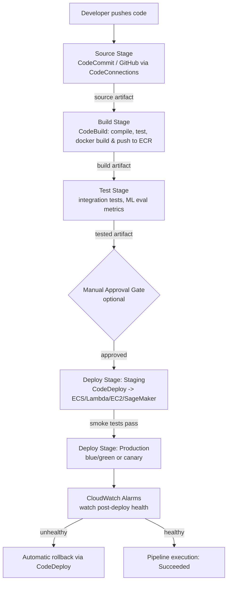

Reading this diagram left to right: a code change is detected at the **Source** stage (via an
EventBridge rule on CodeCommit, or a CodeConnections webhook-style integration for GitHub/GitLab/
Bitbucket), which starts a new pipeline **execution** and pulls the exact commit as the source
artifact. The **Build** stage invokes CodeBuild, which compiles code, runs unit tests, and — for
containerized workloads relevant to this domain — builds and pushes a Docker image to ECR,
producing a build artifact (commonly an `imagedefinitions.json` file naming the pushed image) in
the pipeline's S3 artifact store. The **Test** stage runs integration tests or, in an ML context,
could be where model-evaluation metrics are checked (though in a typical ML pipeline this
evaluation actually lives *inside* a SageMaker Pipeline invoked from here, not directly as a
CodeBuild test action — see Section 8). An optional **Manual Approval** gate pauses the pipeline,
consuming no compute, until a human responds via an SNS notification or the gate times out
(default maximum seven days). **Deploy** stages then push the artifact out, typically staging
first with smoke tests, then production using a blue/green or canary strategy via CodeDeploy.
Post-deploy, CloudWatch alarms continue watching health, and CodeDeploy's automatic rollback
reverts to the last good state if something regresses — closing the loop with no manual
intervention required for a bad deploy to be caught and reversed.

### Real AWS reference image, with discussion


*Figure: a production-promotion reference architecture — a release manager issues a production
deployment request, CodePipeline invokes a build-management tool which calls a database change-
management tool, downloads change scripts, runs them against the target RDS production database,
and CodePipeline then initiates its Deploy action to complete the rollout, with performance
monitoring feeding event notifications. The detail worth internalizing: a CodePipeline "Deploy"
stage is a **generic orchestration concept**, not something that only means "deploy an
application" — this example uses the exact same Source → Build → Deploy shape to orchestrate a
database schema change instead, which is precisely why the same pipeline shape can just as easily
orchestrate a SageMaker Pipeline trigger or a Bedrock Agent configuration update, as this domain's
other documents show concretely. Source: AWS Reference Architecture Diagrams, "Database DevOps on
AWS" Production Workflow.*

### A worked architecture pattern — fan-out to multiple accounts/Regions

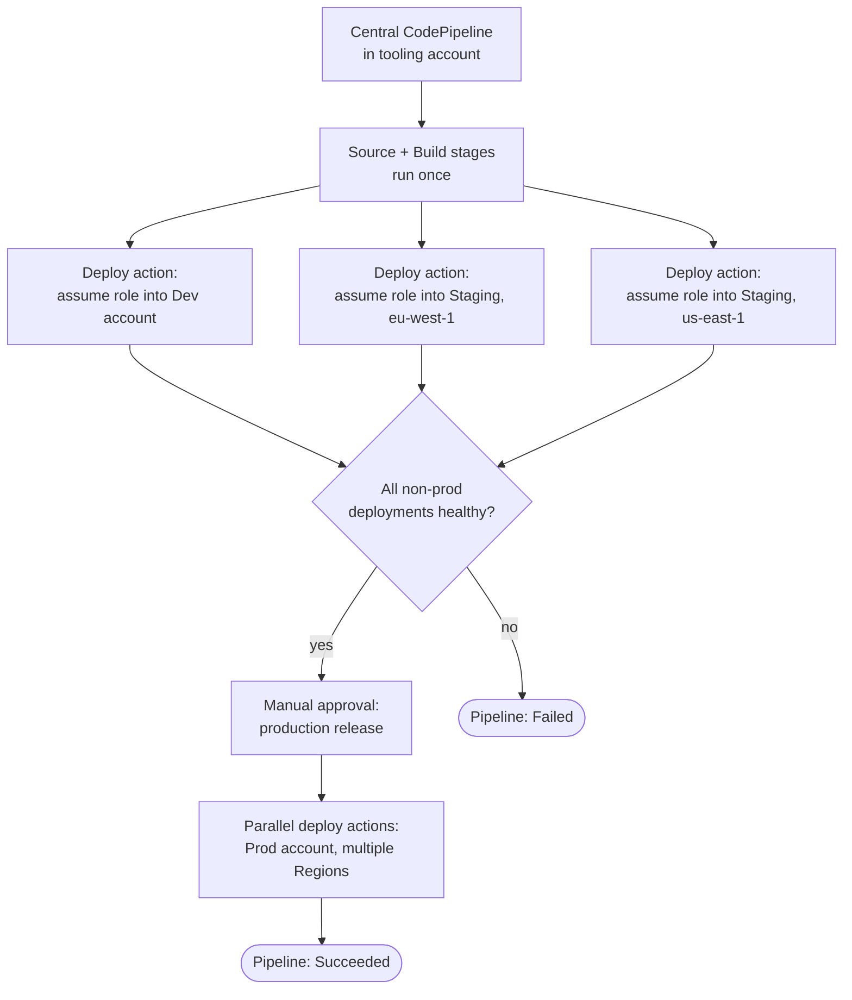

A single Build stage's output artifact can be deployed to many accounts/Regions in parallel
actions within the same stage, each action assuming a different cross-account IAM role scoped
only to its target environment — the artifact itself never changes between targets (build once,
deploy many), only the destination and credentials used to deploy it do. This is the direct
answer to a scenario describing "the same ML inference container needs to reach three regional
production clusters simultaneously, with a single approval gate before any of them go live."

### Exam Tips

- Remember the layering: CodeCommit/GitHub = source, CodeBuild = build/test, CodeDeploy =
  deploy/release strategy, **CodePipeline = the orchestrator tying all three together** — a
  question describing the whole flow is asking about CodePipeline even if it never says the word.
- There is **no built-in CodePipeline action type for triggering a SageMaker Pipeline or updating
  a SageMaker endpoint's traffic split** — both require a custom Lambda-backed (`Invoke`)
  action; know this as a real, tested gap in the built-in action catalog.
- Default execution mode is `SUPERSEDED` (only the latest of several rapid commits gets a full
  run) — a scenario needing every single commit individually built/deployed for audit reasons
  needs `QUEUED` mode explicitly configured instead.

### Troubleshooting / Common Issues

- **Pipeline stuck, not triggering on new commits** — verify the CodeConnections connection (for
  GitHub/GitLab/Bitbucket sources) is in an `Available` state, not `Pending` (a connection
  requiring manual OAuth completion in the console is a very common silent trigger failure).
- **Stage fails with "artifact not found"** — an action's `inputArtifacts` references a name no
  prior action actually produced as an `outputArtifacts` entry; check the exact artifact names
  match across stages.
- **Manual approval notification never arrives** — the SNS topic referenced in the approval
  action's configuration has no subscribed endpoint, or the CodePipeline service role lacks
  `sns:Publish` permission on that topic.
- **Cross-account deploy action fails with access denied** — cross-account pipeline actions
  require both the pipeline's service role to assume a role in the target account *and* that
  target account's role to trust the pipeline account — a one-sided trust relationship is a
  frequent setup mistake.
- **A retraining pipeline's custom validation action never actually blocks a bad model** — check
  that the Lambda behind that action explicitly returns a failure status (non-zero exit / failure
  result) on a metric regression; CodePipeline has no built-in metric-comparison logic of its own,
  so a validation action that merely logs a warning without failing the stage lets a bad model
  through regardless of what the logs say.

### Sample exam scenario, worked

**Scenario:** "A retraining pipeline should only promote a new model to production if its
validation accuracy exceeds the currently deployed model's accuracy by a defined margin. The team
wants this enforced as part of the existing CodePipeline release, not as a separate manual
process." *Answer, worked:* CodePipeline has no built-in action type that compares two models'
metrics — the correct design is a custom Lambda-backed action (category `Invoke`) placed in a
Test/Validate stage, which reads both the new model's evaluation metrics (from the upstream
SageMaker Pipeline's output) and the currently-deployed model's recorded accuracy, computes the
margin, and explicitly calls `put_job_failure_result` if the margin isn't met — exactly the same
custom-action pattern this domain's CI/CD deep-dive document uses to bridge CodePipeline and
SageMaker Pipelines. A wrong but tempting answer is "add a Test action using CodeBuild" — CodeBuild
can run the comparison logic, but the actual gating behavior (stopping the pipeline) still depends
on that build explicitly failing on a bad result, the same underlying requirement either way.

---

## 2. Amazon ECR (Elastic Container Registry)

### Definition

Amazon ECR is a fully managed, private Docker/OCI container image registry — the AWS-hosted
equivalent of Docker Hub, but private by default, tightly integrated with IAM, and built to feed
container images straight into ECS, EKS, Lambda, SageMaker, and Fargate.

### Analogy

ECR is the warehouse between the factory (your CI build) and the stores (ECS/EKS/SageMaker/
Lambda) that actually sell the product to customers. Nobody walks into the warehouse off the
street — access is controlled at the door (IAM), every pallet (image layer) is labeled and
tracked (tags, digests, scanning), and old, unsold stock gets automatically cleared out on a
schedule (lifecycle policies) so the warehouse doesn't silently fill up with inventory nobody
needs anymore.

### Purpose

Container images need to live somewhere between "built by CI" and "run in production," and that
somewhere needs strong access control, reliability, and tight integration with whatever actually
runs the image. Public registries like Docker Hub have rate limits and a separate identity
system to manage; ECR solves this by putting the registry inside your AWS account boundary,
governed by the same IAM policies as everything else — and, specifically relevant to this domain,
by being the place a custom SageMaker inference container (a Bring Your Own Container image) or
an ECS/EKS-hosted model-serving container lives before being pulled at deploy time.

### When to Use

- Any container-based workload on AWS at all — ECS, EKS, Lambda, Fargate, or a SageMaker custom
  inference container all need somewhere to pull their image from.
- You need strict, auditable control over who can push (not just pull) a given image — a
  repository resource policy can scope push access to only the CI pipeline's role.
- You need vulnerability scanning integrated into the deployment gate itself, not a separate,
  easily-skipped manual step.
- You need multi-region/multi-account image availability for disaster recovery or team
  separation, without rebuilding the image per environment.

### When NOT to Use

- **You're deliberately distributing open-source images to the public internet at scale** — ECR
  Public or Docker Hub are built for that; a private ECR repo adds no value there.
- **Your org already has an established registry** (Docker Hub, GitHub Container Registry,
  Harbor, Artifactory) with existing CI integration — migrating just to use ECR isn't
  automatically worth it; ECR's main advantage is IAM-native auth for AWS compute specifically.
- **You need a generic artifact repository for non-container artifacts** (npm packages, Maven
  jars) alongside images, with no container-specific features needed — CodeArtifact or
  Artifactory may be a better single-tool fit.

### Use Cases

1. **Baseline registry for a SageMaker custom inference container** — a Bring Your Own Container
   image implementing the `/ping`/`/invocations` serving contract is built, pushed to ECR, and
   referenced by a SageMaker endpoint configuration, exactly the pattern this domain's
   containerization section describes.
2. **Vulnerability-gated deployment pipeline** — enhanced scanning (Amazon Inspector-powered)
   continuously rescans stored images as new CVEs are published, with EventBridge gating
   promotion on findings rather than a one-time, point-in-time scan at push.
3. **Strict push/pull access control per pipeline** — a repository resource policy grants push
   only to the CI pipeline's IAM role, so every other principal in the account can pull but never
   push, guaranteeing production images only ever originate from the CI pipeline.
4. **Multi-region/multi-account disaster recovery** — replication rules copy images (keeping
   tags and digests identical) automatically on every push, so a failover Region's compute can
   pull the exact same image, not a rebuilt equivalent.
5. **Build-once, deploy-many promotion across environments** — the same image moves from dev to
   staging to production referenced by its immutable digest, guaranteeing bit-for-bit identical
   artifacts across every environment rather than a rebuild-per-environment risk.
6. **Reducing dependency on public base-image registries** — a pull-through cache rule serves
   repeat pulls of a common public base image from inside AWS, immune to a Docker Hub outage or
   rate-limit event affecting production deploys.

### Why Important

Real-world: the registry is the trust boundary between "code someone wrote" and "code running in
production" — a compromised or improperly-scoped registry is a direct path to supply-chain
attacks, and IAM-based auth (no static passwords) plus vulnerability scanning materially reduce
that risk. Lifecycle policies also prevent a very common cost leak: unbounded image storage
growth from CI pushing a new tag on every commit forever. Exam weight: MLA-C02 Domain 3 Task 3.3
explicitly names "containerize (ECR, custom containers)" as part of ML deployment/orchestration —
expect ECR to appear whenever a scenario mentions a custom or Bring Your Own Container for
SageMaker, ECS, or EKS.

### How It Works, with a Mermaid diagram explained

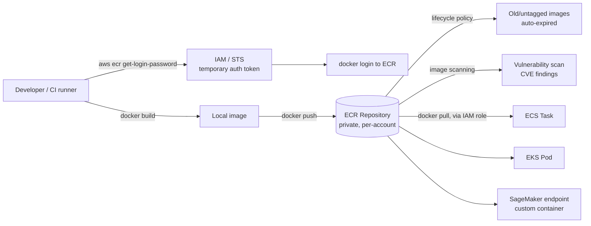

Walking through this: a developer or CI pipeline builds a Docker image, then authenticates to
ECR by exchanging IAM credentials for a short-lived Docker login token (`aws ecr
get-login-password`) — no static registry passwords exist to rotate or leak. The image is tagged
with the repository's URI (`<account-id>.dkr.ecr.<region>.amazonaws.com/<repo>:<tag>`) and
pushed, after which **lifecycle policies** automatically expire old or untagged images
(priority-ordered rules that short-circuit per image — a broad rule placed before a narrow,
protective rule wins, a common misconfiguration), and **image scanning** checks for known CVEs,
either a one-time basic scan at push or continuous enhanced scanning via Amazon Inspector. At
deploy time, ECS, EKS, or a SageMaker endpoint pulls the image using an IAM role with
`ecr:GetDownloadUrlForLayer`/`ecr:BatchGetImage` permissions — no credentials embedded in the
deployment artifact itself.

### Real AWS reference image, with discussion


*Figure: how an ECR lifecycle policy evaluates images against a sequence of numbered rules (each
matching tag status/prefix and an age or count threshold) and expires matches in rule-priority
order. The exam-relevant and real-world-relevant detail: rule evaluation **short-circuits per
image** — once an image matches a rule, later rules don't re-evaluate it, which means a broad
"any tag, 30 days" rule placed at priority 1 can silently expire images a more specific, lower-
priority rule (e.g., "keep the last 10 prod-tagged images") was meant to protect, simply because
it was evaluated first. Source: Amazon ECR User Guide, "Automate the cleanup of images by using
lifecycle policies."*

### A worked architecture pattern — cross-account replication for centralized model-image governance

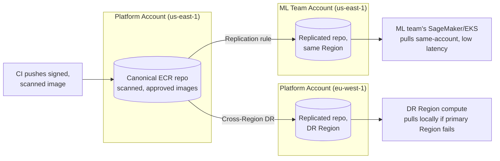

Replication rules are configured once at the registry level and replicate automatically on every
push matching the rule's filters, with replicated images keeping their original tags and digests
— a disaster-recovery failover to the replica Region references the exact same image, not a
rebuilt equivalent. This is the correct answer to a scenario naming both "centralized platform-
team control over which images are approved" and "each ML team's own account pulling with low
latency" as simultaneous requirements.

### Exam Tips

- Common trap: confusing ECR (image **registry**) with ECS/EKS (image **runtime/orchestrator**)
  — ECR never runs your container, it only stores and serves the image.
- Repository push/pull access is an IAM **resource policy** question, distinct from a networking
  control — "restrict which pipeline can push a specific image" points at a repository policy.
- Lifecycle policy rules are **priority-ordered and short-circuit per image** — a broad rule placed
  before a narrow, protective rule will win, a frequently-tested trap.

### Troubleshooting / Common Issues

- **`docker push`/`docker pull` fails with `no basic auth credentials`** — the Docker login token
  from `aws ecr get-login-password` expires after 12 hours; re-authenticate before retrying rather
  than assuming a persistent credentials issue.
- **"denied: User is not authorized to perform ecr:GetDownloadUrlForLayer" at deployment time** —
  the compute's IAM role (ECS execution role, EKS node/IRSA role, SageMaker execution role) lacks
  ECR pull permissions, or a repository resource policy explicitly restricts pulls to a different
  principal.
- **A tag that should be "latest" is actually an old image** — tags are mutable by default;
  without tag immutability enabled, a later push with the same tag silently overwrites what that
  tag points to, a common source of "I deployed the new code but the old version is still
  running" incidents.
- **Lifecycle policy deleted an image that was still needed** — almost always a rule-ordering bug;
  use `PutLifecyclePolicyPreview` (or the console's preview feature) to dry-run a policy's effect
  before applying it for real.
- **Enhanced scanning shows findings that basic scanning didn't** — expected; the two scanning
  tiers use different vulnerability databases and scan depth, and enhanced scanning continuously
  rescans already-stored images as new CVEs are published, not just at push time.

### Sample exam scenario, worked

**Scenario:** "A data science team wants to confirm a custom SageMaker inference container
doesn't contain known OS package vulnerabilities before it's used in production, and wants this
checked continuously, not just once at build time." *Answer, worked:* enable **ECR enhanced
scanning (Amazon Inspector-powered)** on the repository, not basic scanning — basic scanning runs
once, on push, and never re-evaluates a stored image as new CVEs are published against it later;
enhanced scanning's continuous rescan is specifically what "checked continuously" in this scenario
is asking for. Gate actual deployment on scan findings via an EventBridge rule watching for new
Inspector findings on the repository, feeding a CodePipeline approval/validation stage — the same
vulnerability-gated deployment pattern this document's own diagram describes.

---

## 3. Amazon ECS (Elastic Container Service)

### Definition

Amazon ECS is a fully managed service that runs and manages containers on a cluster of compute
without you building your own container-orchestration system — you describe "run N copies of
this container, keep them healthy," and ECS handles scheduling, restarting, and load-balancer
wiring.

### Analogy

ECS is a restaurant's own in-house kitchen management system: the head chef (the ECS Scheduler)
reads each dish's recipe card (a Task Definition — exact ingredients, portion size, prep time)
and assigns cooking stations (EC2 instances or Fargate's "no kitchen to manage at all" option),
keeps a fixed number of each dish always ready to serve (a Service's desired count), and
immediately re-cooks any dish that comes out wrong (a failed health check triggers automatic
Task replacement) — all using AWS's own proprietary kitchen layout rather than an industry-
standard one (which is the Kubernetes/EKS alternative, covered next).

### Purpose

Before container orchestrators existed, running containers at scale meant hand-rolling your own
scheduler — deciding which server runs which container, restarting crashed containers, rolling
out new versions without downtime, wiring up service discovery and load balancing. AWS built ECS
as its own AWS-native answer, deeply integrated with IAM, VPC, ELB, CloudWatch, and Fargate, so
teams who don't need Kubernetes's full feature set and complexity get container orchestration
with a much smaller learning curve.

### When to Use

- You're starting fresh on AWS with no existing Kubernetes investment and want the simplest,
  most deeply AWS-integrated container orchestrator.
- You want to run a custom ML-serving container (e.g., a SageMaker-incompatible framework, or a
  model that needs to sit alongside other non-ML microservices) without adopting Kubernetes.
- You want AWS-native deployment safety features (the deployment circuit breaker, rolling
  updates with configurable min/max healthy percent) with minimal configuration.
- You want the choice between fully self-managed EC2 compute (maximum control) and Fargate
  (zero server management) without changing your application's container definition.

### When NOT to Use

- **Your organization already has Kubernetes expertise, Helm charts, operators, or multi-cloud
  clusters** — EKS (Section 4) gives you the exact same Kubernetes API and tooling instead of
  AWS-proprietary syntax.
- **Your model serving need is fully satisfied by a native SageMaker endpoint** — don't adopt ECS
  just to host a model SageMaker's own inference options already serve well; reserve ECS/EKS
  for genuinely non-SageMaker-fitting serving needs (see Section 7).

### Use Cases

1. **Hosting a custom model-serving container alongside other application microservices** — a
   recommendation model's serving container runs as one ECS Service among several others in the
   same application, sharing the same cluster, IAM, and networking conventions as the rest of
   the system.
2. **Blue/green or canary model rollout via CodeDeploy integration** — ECS's native CodeDeploy
   integration (distinct from EKS, which lacks this native hook) performs a safe, automated
   traffic-shifted rollout of a new serving container version.
3. **Fargate-backed, fully serverless container hosting** — a lightly-used internal model-
   serving container runs on Fargate with no EC2 instances to patch or manage, paying only for
   the task's actual running time.
4. **Deployment circuit breaker self-healing on a bad model-container rollout** — if a newly
   deployed serving container repeatedly fails its health checks, ECS automatically halts the
   rollout and reverts to the last known-good task definition revision, with no human
   intervention or alarm configuration required.
5. **IAM-scoped task roles for least-privilege model access** — a serving container's task role
   (distinct from the execution role that pulls the image/fetches secrets) is scoped to exactly
   the S3/DynamoDB access the application code needs, nothing more.

### Why Important

Real-world: ECS remains the default recommendation for teams starting fresh on AWS with no
existing Kubernetes investment — it launched in 2014, the same year Kubernetes was open-sourced,
and AWS made a deliberate bet that many customers would prefer a simpler, deeply AWS-integrated
orchestrator. Exam weight: MLA-C02 Domain 3 Task 3.2 names ECS explicitly as an alternative model-
hosting target alongside EKS, particularly when a model needs to sit alongside a broader
non-SageMaker application architecture.

### How It Works, with a Mermaid diagram explained

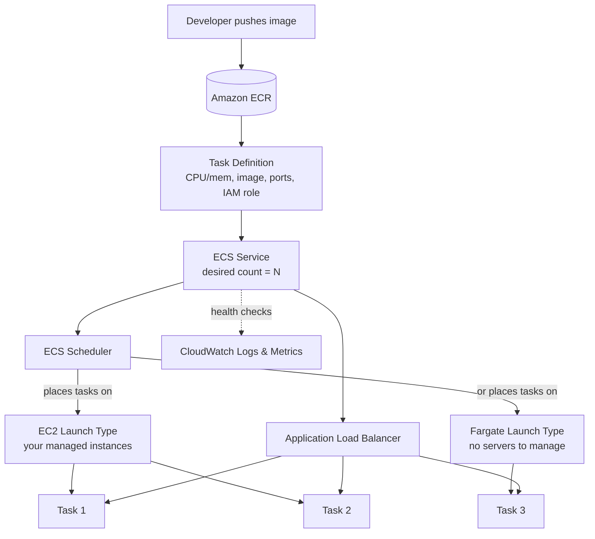

A developer builds a Docker image and pushes it to ECR (Section 2). A **Task Definition**
references that image plus resource requirements, networking mode, and the IAM role the container
assumes — critically, this definition distinguishes the **execution role** (what ECS itself
assumes to pull the image and fetch secrets — infrastructure-facing) from the **task role** (what
your application code inside the container assumes to call other AWS APIs — application-facing),
a distinction that is the single most-confused pair of fields on this exam. An **ECS Service**
created from that Task Definition with a desired count tells the **Scheduler** how many copies
should always be running; the Scheduler places each Task on either your own EC2 fleet (you
provision and patch instances) or Fargate (AWS runs the underlying compute, you pay per task).
The **Application Load Balancer** registers each running Task as a target and distributes
traffic, while ECS continuously health-checks Tasks, replacing any that crash or fail a check.

### Real AWS reference image, with discussion


*Figure: the three logical layers of every ECS deployment — Capacity (the infrastructure, EC2 or
Fargate), Controller (the scheduler that places and manages tasks), and Provisioning (the tools
you use to talk to the scheduler: console, CLI, CloudFormation/CDK, CodePipeline). This three-
layer mental model is the cleanest way to reason about ECS troubleshooting: a problem is almost
always isolable to exactly one of these layers (capacity not scaling, controller not placing
tasks, or a provisioning tool sending a malformed request). Source: Amazon ECS Developer Guide,
"What is Amazon ECS?"*

### A worked architecture pattern — multi-service application on one cluster

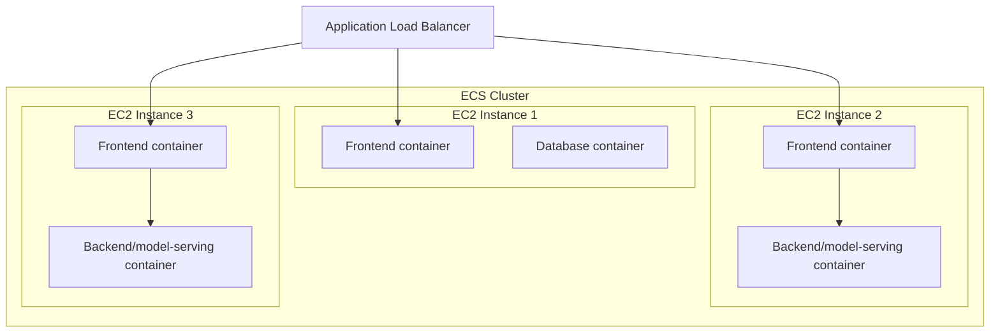

A realistic multi-service ECS application spreads related containers across a cluster of EC2
container instances, grouping related containers into one Task Definition and scaling each
Service independently — a model-serving backend container can scale up or down on its own
Service's desired count, completely independent of the frontend Service's own scaling, even
though both run on the same shared cluster of underlying instances. This is the architectural
answer to "run a model-serving container as one component of a larger, already-running
multi-service application" without standing up an entirely separate cluster just for the model.

### Exam Tips

- `executionRoleArn` (infrastructure-facing: pull image, fetch secrets, write logs) vs.
  `taskRoleArn` (application-facing: your code's own AWS API calls) is the single most-confused
  pair on this exam — a question about "why can't my container reach S3" that already has a
  working image pull is testing the task role, not the execution role.
- The **deployment circuit breaker** is ECS's self-healing feature — automatic rollback on
  repeated health-check failure during a rollout, with no alarm configuration required, distinct
  from (and simpler than) CodeDeploy's alarm-driven rollback.
- ECS has a **native CodeDeploy integration** for blue/green deployments that EKS lacks — a
  scenario needing a managed blue/green rollout without hand-rolling a Kubernetes-native
  equivalent points toward ECS.

### Troubleshooting / Common Issues

- **A container can't reach S3/DynamoDB even though the service deployed successfully** — check
  the **task role**, not the execution role; a working image pull with a failing application-level
  AWS API call is almost always a task role permissions gap, not an execution role problem.
- **Secrets appear in `DescribeTaskDefinition` output or CloudTrail** — a password was placed in
  the `environment` block instead of `secrets`; `secrets` injects the value at container start
  from Secrets Manager/SSM Parameter Store without it ever appearing in the task definition text.
- **A rolling deployment seems stuck mid-rollout** — check `deploymentCircuitBreaker` — if
  disabled, a crash-looping new task definition revision leaves the deployment stuck "in
  progress" indefinitely rather than automatically rolling back, requiring manual intervention.
- **New tasks pass health checks but the ALB still routes some traffic to old, stopped tasks
  briefly after a deployment** — this is the expected connection-draining window, not a bug; old
  tasks are deregistered from the target group and allowed to finish in-flight requests before
  being stopped, by design.

### Sample exam scenario, worked

**Scenario:** "A team deploys a new revision of a model-serving ECS task definition. The new
tasks repeatedly fail their health checks due to a bug, but the service is left running in a
half-migrated, flapping state with both old and new tasks cycling, requiring a manual rollback
each time this happens." *Answer, worked:* enable the **deployment circuit breaker** with
`rollback: true` on the service's `deploymentConfiguration` — this is precisely the self-healing
feature that automatically halts a rollout once new tasks repeatedly fail to reach a steady
healthy state and reverts to the last known-good task definition revision, with no human or
CloudWatch alarm configuration required; the described symptom (manual rollback needed every
time) is the direct signature of this feature being absent, not evidence of a deeper ECS
scheduling bug.

---

## 4. Amazon EKS (Elastic Kubernetes Service)

### Definition

Amazon EKS is a fully managed service that runs upstream, certified Kubernetes for you on AWS —
Kubernetes being the open-source, industry-standard system for running and managing containers
at scale. EKS removes the painful part (running and patching the Kubernetes control plane) while
you keep the standard Kubernetes API, tooling, and ecosystem exactly as it would run anywhere
else.

### Analogy

If ECS is AWS's own in-house kitchen system, EKS is a professional, internationally standardized
kitchen franchise (Kubernetes) where AWS has agreed to run the back-of-house infrastructure
(plumbing, electrical, health inspections — the control plane) to the exact same certified
standard as every other franchise location worldwide, while you still cook using the same
universally-recognized recipe format (Kubernetes manifests) any trained chef from any other
franchise location could walk in and immediately understand and operate.

### Purpose

Kubernetes became the de facto standard for container orchestration across the industry, not
just AWS — many organizations already have Kubernetes expertise, Helm charts, operators, and
multi-cloud or on-prem clusters, and want the *same* API and tooling on AWS rather than learning
AWS's own proprietary orchestrator. Running Kubernetes' own control plane (etcd, API server,
scheduler, controller manager) reliably and securely is genuinely hard; EKS exists so you get
real, conformant Kubernetes with AWS managing the hardest, most failure-sensitive part, plus deep
integration with IAM, VPC networking, and other AWS services.

### When to Use

- Your organization already has Kubernetes expertise, existing manifests/Helm charts/operators,
  or clusters running elsewhere (on-prem, another cloud) and wants workload portability.
- You need Kubernetes-specific orchestration features (custom schedulers, specific CNCF-
  ecosystem tooling, DaemonSets, specific storage drivers) that ECS doesn't expose.
- A model-serving container needs to run inside a broader, already-Kubernetes-standardized
  platform the rest of engineering uses, trading some SageMaker-specific convenience for platform
  consistency.
- You need GPU-backed node groups for self-hosted foundation model inference with full control
  over node-level configuration (DaemonSets, specific NVIDIA driver versions).

### When NOT to Use

- **You're starting fresh on AWS with no existing Kubernetes investment** — ECS (Section 3) has
  a much smaller learning curve and less operational overhead for a team with no Kubernetes
  background.
- **You need a native, managed blue/green deployment integration** — EKS lacks ECS's native
  CodeDeploy hook for Kubernetes-manifest deployments; `kubectl`-driven rolling updates (via
  Kubernetes' own reconciliation loop) are the typical path instead, which doesn't carry the same
  built-in deployment-strategy tooling.
- **Your workload genuinely fits SageMaker's native inference options well** — don't adopt EKS's
  operational complexity just to host a model that a plain SageMaker endpoint already serves
  cleanly.

### Use Cases

1. **Migrating an existing on-prem or multi-cloud Kubernetes ML-serving workload to AWS** — Helm
   charts and manifests for a model-serving Deployment move largely unmodified, preserving the
   team's existing Kubernetes-native tooling and operational playbooks.
2. **IRSA (IAM Roles for Service Accounts) for least-privilege Pod-level permissions** — a model-
   serving Pod assumes a scoped IAM role via its ServiceAccount annotation, the EKS equivalent of
   ECS's task role, without granting the whole worker node broad permissions every Pod inherits.
3. **GPU-backed Managed Node Groups for self-hosted foundation model inference** — a node group
   running `g5` instances hosts a JumpStart foundation model's serving Pods, with full control
   over node-level GPU driver/runtime configuration that EKS Fargate profiles historically don't
   support.
4. **readinessProbe/livenessProbe tuning for a slow-starting model container** — separating
   "ready for traffic" from "alive, don't restart" prevents a slow model-loading startup sequence
   from being mistaken for a crash loop, a distinction ECS's single combined health check doesn't
   make as cleanly.
5. **A full CI/CD pipeline ending in `kubectl` rather than CodeDeploy** — CodeBuild builds and
   pushes an image to ECR, then runs `kubectl set image` (or applies an updated manifest) against
   the cluster's API server, and Kubernetes' own reconciliation loop performs the rolling update
   — the pipeline's job ends at "tell Kubernetes what I want."
6. **EKS Auto Mode for reduced day-two operational burden** — AWS picks instance types, handles
   autoscaling, OS patching, and even built-in load balancing/DNS/storage components, narrowing
   the operational gap with ECS Fargate while keeping the full Kubernetes API.

### Why Important

Real-world: AWS is a CNCF member and ensures EKS passes official Kubernetes conformance tests for
every supported version — meaning a Helm chart, manifest, or Operator that works on GKE or self-
managed Kubernetes works on EKS unmodified, which is EKS's entire value proposition versus ECS:
you are never locked into an AWS-proprietary API at the workload-definition layer, only at the
infrastructure-provisioning layer. Exam weight: MLA-C02 Domain 3 Task 3.2 names EKS alongside ECS
as an alternative model-hosting target, specifically when Kubernetes-specific orchestration
features or an existing Kubernetes-standardized platform are named in a scenario.

### How It Works, with a Mermaid diagram explained

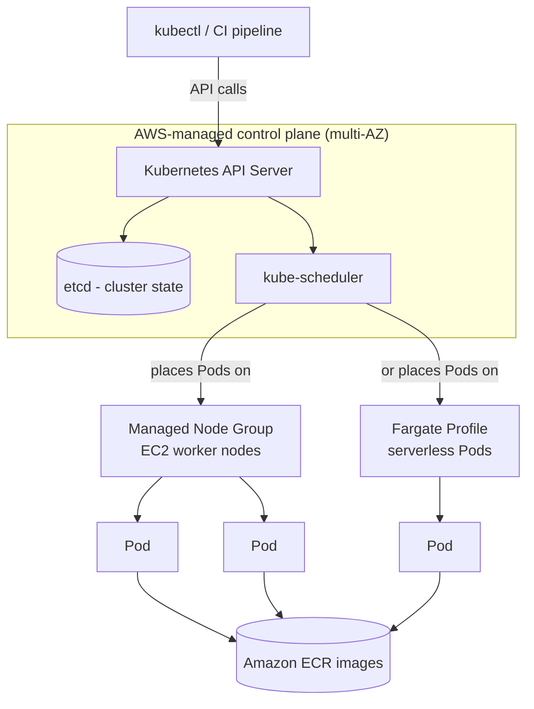

The architecturally important point this diagram makes visible: **the control plane doesn't live
in your VPC at all** — it lives in an AWS-owned, AWS-managed VPC, reaching into your VPC via
cross-account elastic network interfaces EKS provisions in your subnets at cluster creation. You
interact with the cluster purely through standard Kubernetes manifests/`kubectl` — no AWS-
specific syntax required for the workload definition itself. The **scheduler** decides which
worker node runs which Pod based on resource requests and constraints, exactly like standard
Kubernetes anywhere else; worker capacity is either a **Managed Node Group** (AWS automates
provisioning/upgrades, you still pay for and partially configure the EC2 instances), self-managed
EC2, a **Fargate profile** (fully serverless Pods, no node concept at all), or the newer **EKS
Auto Mode** (AWS extends management into the data plane itself — instance selection, autoscaling,
OS patching).

### Real AWS reference image, with discussion


*Figure: a legacy-application-modernization reference architecture — a developer commits to
CodeCommit, triggering CodePipeline; CodeBuild builds and pushes a Docker image to ECR, then uses
`kubectl` to update the image tag in the Kubernetes Deployment manifest, which triggers a native
Kubernetes rolling update of the Pods. The core practical difference from ECS this diagram makes
concrete: **AWS CodeDeploy is not typically in this loop for native Kubernetes-manifest
deployments** — the pipeline's deploy step ends at "tell Kubernetes what I want," and
Kubernetes' own reconciliation loop does the rest, which also means any ML-specific quality gate
(a model's evaluation metric) has to live somewhere explicit upstream of this `kubectl` step,
since Kubernetes' own rolling update only checks infrastructure health (readiness/liveness
probes), never model quality. Source: AWS Reference Architecture Diagrams, "Modernize
Applications with Microservices Using Amazon EKS."*

### A worked architecture pattern — mixed GPU and CPU node groups for a serving platform

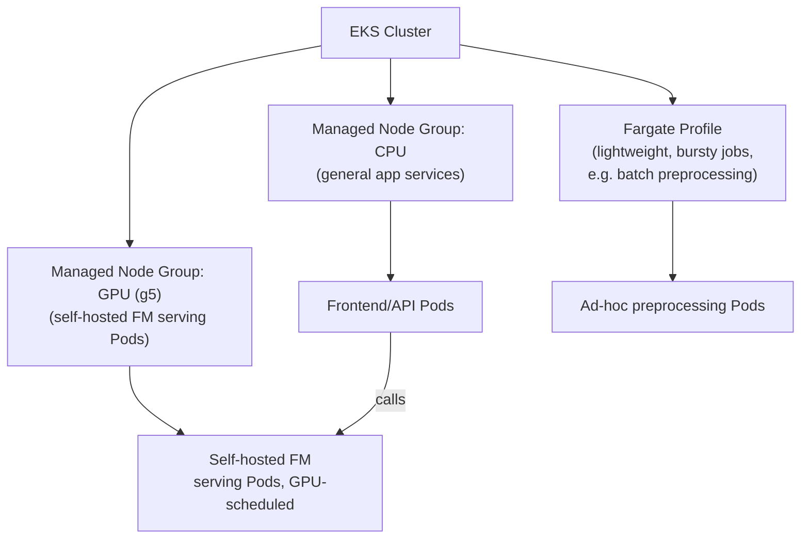

A single EKS cluster can mix compute types across distinct node groups — general application
Pods on CPU-backed Managed Node Groups, a self-hosted foundation model's serving Pods on a
GPU-backed Managed Node Group (Fargate profiles historically don't support GPU, which is why this
workload specifically needs a Managed Node Group rather than Fargate), and bursty, short-lived
preprocessing jobs on a Fargate profile for its serverless simplicity. This directly answers a
scenario naming "one platform, several very different compute shapes" as a requirement, without
needing three separate clusters.

### Exam Tips

- `serviceAccountName` + the `eks.amazonaws.com/role-arn` annotation is **IRSA** — the EKS
  equivalent of ECS's task role; there is no "execution role" concept in Kubernetes (image pulls
  are handled by the node's own IAM role or an image pull secret instead).
- `resources.requests` (scheduler placement) vs. `resources.limits` (hard throttle/OOM-kill
  ceiling) is Kubernetes' split version of ECS's single CPU/memory reservation number — know both
  halves distinctly.
- EKS has **no native CodeDeploy blue/green integration** the way ECS does — a scenario expecting
  a fully managed blue/green strategy on Kubernetes-native deployments is testing whether you
  know this gap exists, not just that EKS "can do deployments."

### Troubleshooting / Common Issues

- **A Pod can't reach S3/DynamoDB despite the node's instance profile having the right
  permissions.** Check IRSA — the `eks.amazonaws.com/role-arn` annotation must be on the specific
  ServiceAccount the Pod actually uses; a Pod using the default ServiceAccount (with no IRSA
  annotation) falls back to the node's own IAM role, which may be deliberately scoped narrower.
- **A Pod restarts constantly during a slow model-loading startup.** Check whether the
  `livenessProbe`'s `initialDelaySeconds` is long enough to cover the real model load time — a
  liveness probe firing before the model finishes loading kills and restarts the container
  repeatedly, mistaking "still starting" for "crashed."
- **`kubectl apply` succeeds but the new image never actually rolls out.** Check that the
  manifest's image tag actually changed — Kubernetes' rolling update only triggers on a detected
  Pod spec change; re-applying an identical manifest (e.g., reusing a mutable `:latest` tag with
  no digest change) does nothing.
- **GPU-backed Pods fail to schedule even though the node group has capacity.** Confirm the
  NVIDIA device plugin is installed and the Pod spec requests the GPU resource explicitly
  (`nvidia.com/gpu: 1`) — a Pod that doesn't request the resource can still land on a GPU node but
  never actually get GPU access.

### Sample exam scenario, worked

**Scenario:** "An ML platform team runs model-serving Pods on EKS and wants each model's Pod to
have access only to the specific S3 prefix and DynamoDB table it needs, without granting that
access to every other Pod running on the same underlying EC2 worker node." *Answer, worked:* this
is a textbook **IRSA** (IAM Roles for Service Accounts) scenario — create a dedicated
ServiceAccount per model-serving Deployment, annotate it with `eks.amazonaws.com/role-arn`
pointing at a narrowly-scoped IAM role for that specific model, and reference that ServiceAccount
in the Pod spec via `serviceAccountName`. The wrong-but-tempting answer is "attach the policy to
the node's instance profile" — that would grant the permission to *every* Pod scheduled on that
node, not just the intended one, exactly the blast-radius problem IRSA exists to solve.

---

## 5. Amazon SageMaker — Overview

### Definition

Amazon SageMaker is AWS's fully managed platform for the entire machine learning lifecycle — one
product bundling everything needed to prepare data, build, train, tune, deploy, and monitor ML
models, so you don't stitch together your own servers, notebooks, and training scripts from
scratch.

### Analogy

Before SageMaker, building and shipping a model was like a chef who had to personally build their
own kitchen from raw lumber, forge their own knives, and grow their own ingredients before cooking
a single meal. SageMaker is a fully-equipped professional kitchen rented by the hour: the stoves
(training compute), the walk-in fridge (Feature Store), the quality-control clipboard (Model
Registry), and the delivery service (deployment endpoints) are all already there, standardized,
and maintained — you show up with your recipe (training code) and your ingredients (data) and
start cooking immediately.

### Purpose

Before SageMaker (launched 2017), a data scientist who wanted to train a model had to provision an
EC2 instance, install Jupyter and every ML library by hand, manage GPU drivers, write their own
code to save/load models, build their own deployment server, and babysit scaling — a lot of
undifferentiated heavy lifting unrelated to the actual data science. SageMaker exists to remove
all of that plumbing: one managed service handling the infrastructure so ML teams spend their time
on data and models, not DevOps, while also standardizing how AWS customers do ML so new
capabilities (distributed training, AutoML, explainability, GenAI) bolt onto one coherent product
instead of raw EC2.

### When to Use

- You need a fully managed, custom-model ML lifecycle — training your own model on your own
  labeled data, not a pre-built AI API's fixed capability.
- You need the full lifecycle's governance pieces (Model Registry's approval workflow, Clarify's
  bias/explainability reports, Pipelines' lineage tracking) for a regulated or audited workload.
- You want one platform spanning data prep, training, tuning, deployment, and monitoring without
  hand-integrating separate point tools for each stage.

### When NOT to Use

- **You just need "AI" results** (sentiment, translation, OCR) with no training involved — use a
  pre-built AI service (Comprehend, Rekognition, Textract) instead of training your own model for
  a problem AWS already solved with a managed API.
- **You want to use or customize a large foundation model without managing any GPU
  infrastructure at all** — use Amazon Bedrock (Section 9) instead; it's serverless by default
  and billed per token, versus SageMaker endpoints billing per instance-hour regardless of
  traffic.
- **Your workload is simple batch scoring of a small dataset on a schedule** — a scheduled Lambda
  or Glue job calling a lightweight model might be cheaper and simpler than standing up SageMaker
  infrastructure for a genuinely small, infrequent job.
- **A single person needs one quick what-if analysis to throw away** — the overhead of creating a
  Feature Group, registering a model version, and setting up monitoring is disproportionate to a
  one-off, disposable analysis.

### Use Cases

1. **Fraud detection (financial services)** — train a custom XGBoost/script-mode model on
   proprietary transaction patterns no off-the-shelf model has seen, deploy to an auto-scaling
   real-time endpoint for near-real-time scoring.
2. **Customer churn prediction (telecom/SaaS)** — a Training Job (XGBoost baseline) plus Feature
   Store centralizes engineered usage features so marketing, retention, and billing teams all
   score against the identical feature definition.
3. **Credit risk / loan approval scoring (banking)** — Clarify's per-prediction SHAP values
   generate the defensible, feature-level explanation a compliance team or regulator can inspect
   for any single denial decision.
4. **Medical imaging diagnosis support (healthcare)** — script mode with a custom CNN/PyTorch
   architecture, trained inside a VPC with no internet egress, keeps PHI inside the network
   boundary end to end.
5. **Predictive maintenance (manufacturing/industrial IoT)** — Random Cut Forest anomaly
   detection or a custom time-series model, compiled via Neo and deployed to a factory-floor edge
   gateway with no reliable connectivity.
6. **Automated, event-driven retraining (any regulated industry)** — Model Monitor's drift alarm
   triggers a SageMaker Pipeline (Section 8) via EventBridge, closing the loop from "the model is
   going stale" to "a new, validated version is registered" without a human remembering to act.

### Why Important

Real-world: SageMaker is the backbone of AWS's ML/AI story for the enterprise — it's what lets a
company go from "we have data in S3" to "we have a monitored, versioned model serving predictions
in production" without hiring an infrastructure team first. Cost control matters a lot: training
jobs and endpoints bill per instance-hour, so an idle real-time endpoint left running is a classic
"surprise AWS bill" story. Exam weight: SageMaker touches all four MLA-C02 domains and is
arguably the single most tested surface area on the exam — Domain 3 specifically covers all
inference options, Neo, and Pipelines.

### How It Works, with a Mermaid diagram explained

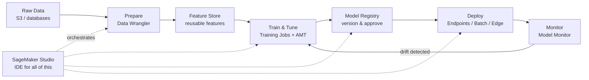

This single diagram is the skeleton every other SageMaker document in this domain hangs off of.
Raw data (almost always S3) is prepared by Data Wrangler (visual, low-code cleaning/
transformation), with engineered features saved centrally in Feature Store so multiple models/
teams reuse the exact same feature definitions. A Training Job spins up managed, ephemeral compute
(CPU or GPU), runs the training code or a built-in algorithm, and saves the resulting model
artifact to S3 — Automatic Model Tuning (AMT) wraps this in a search loop to find the best
hyperparameters. Every trained model version is registered in **Model Registry** with metadata,
metrics, and an approval status — an auditable catalog of "what model is this, and is it approved
for production." An approved model is pushed to one of several deployment options (Section 7)
depending on the actual traffic pattern, and once live, **Model Monitor** continuously compares
incoming traffic to the training data's statistical profile, flagging drift — which, when
detected, is exactly the trigger that should kick off retraining (Section 8's SageMaker
Pipelines), closing the loop without a human babysitting the model's freshness.

### A second diagram — the underlying compute pattern every stage shares

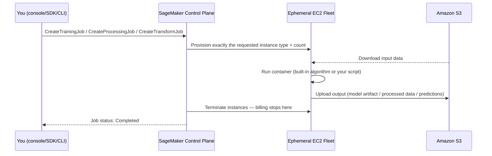

It's worth seeing explicitly that "Training Job," "Processing Job," and "Batch Transform Job" are
really the same underlying mechanic applied at different stages — AWS provisions exactly the
compute you asked for, runs your container, saves the output, and tears the compute back down.
Recognizing this once makes every other SageMaker concept in this domain faster to absorb,
because you're learning a new container and input/output shape each time, not a new
infrastructure model.

### Real AWS reference image, with discussion


*Figure: the basic architecture of a SageMaker job — you bring data in S3 and either a built-in
algorithm or your own training script; SageMaker provisions the EC2 instances behind the scenes,
runs the job, and returns a model artifact. This is precisely the generic pattern the sequence
diagram above makes explicit — and the reason the exam tests "which stage is this" questions so
heavily is that every stage (Processing, Training, Tuning, Batch Transform) is a thin variation on
this exact same provision-run-save-terminate shape, not a fundamentally different architecture
each time. Source: AWS SageMaker Developer Guide, "Model training."*

### Security and governance, concretely

SageMaker resources follow the same IAM/VPC/KMS security model as the rest of AWS, with a few
wrinkles worth knowing explicitly for this domain: every Training Job, Processing Job, and
endpoint runs under an **execution role you specify**, separate from your own console/CLI
identity, needing exactly the S3/KMS/other permissions the job actually requires. Training jobs
and endpoints can be launched **inside your VPC with no internet access at all**, so training
data never has to leave a private network boundary — a common requirement for sensitive data.
S3 data, EBS volumes, and endpoint traffic can all be encrypted with **customer-managed KMS
keys** rather than AWS default keys for organizations requiring key-level audit control, and a
**Model Registry package group can be shared cross-account** under controlled permissions,
supporting organizations that separate ML development and production AWS accounts for governance
reasons — directly relevant to this domain's deployment/promotion content, since a cross-account
promotion flow needs this sharing configured correctly before a CodePipeline-driven cross-account
deploy (Section 1's fan-out pattern) can succeed at all.

### Exam Tips

- A huge fraction of MLA-C02 scenario questions are really "which SageMaker sub-service does this
  job," dressed up in a business scenario — build the mental checklist habit (Data Wrangler for
  prep, Feature Store for shared features, Training Jobs/AMT for model building, Model Registry
  for governance, an inference option for serving, Model Monitor for drift) rather than answering
  "SageMaker" vaguely.
- Real-time endpoints bill continuously whether idle or not — a classic "most cost-effective
  option" question hinges on recognizing this, distinct from training's per-second, job-duration
  billing.
- SageMaker is explicitly **out of scope for DVA-C03** — if a SageMaker-training question appears
  framed as a developer-exam question, that's a signal something is off (or you're actually
  looking at MLA-C02 material).

### Troubleshooting / Common Issues

- **"Why is my AWS bill so high and I'm not even using SageMaker right now?"** — almost always an
  idle real-time endpoint or a Studio notebook instance left running; both bill continuously per
  instance-hour regardless of usage. Check the Endpoints and Notebook Instances console pages for
  anything still "InService"/"Running" that nobody's actively using.
- **A Training Job fails immediately with a permissions error.** The IAM role passed to the
  training job (not your own user's role) needs permission to read the input S3 path and write
  the output S3 path — a very common first-time setup gap.
- **A SageMaker Pipeline execution fails at the Condition Step even though the model trained
  successfully.** This is usually *working as intended*, not a bug — the Condition Step exists
  specifically to stop a pipeline when the new model doesn't clear a configured quality bar.
- **Feature Store ingestion succeeds but the Online Store returns stale data.** Check that writes
  are actually going to both stores and that the `event_time` column is set correctly — the
  Online Store keeps only the record with the latest event time per identifier.

### Sample exam scenario, worked

**Scenario:** "A company's compliance team must be able to prove, for any currently-deployed
model, exactly which training data, code, and hyperparameters produced it, without relying on a
team member's personal notes." *Answer, worked:* **Model Registry** (versioning and approval
status) combined with **Pipelines'** automatic **lineage tracking** (which data/code/parameters
produced each execution) together form the auditable record this scenario needs — naming just
"SageMaker" vaguely under-answers this question; the exam rewards naming the specific
sub-services (Registry + Pipelines lineage) that actually provide the auditable trail, not a
generic platform reference.

---

## 6. Amazon MWAA (Managed Workflows for Apache Airflow)

### Definition

Amazon MWAA is a fully managed service that runs Apache Airflow — the open-source workflow
orchestration tool where complex, multi-step data/ML pipelines are defined as DAGs written in
plain Python — without you installing, patching, scaling, or operating the underlying Airflow
scheduler, web server, or worker infrastructure yourself.

### Analogy

Airflow is a recipe book (your DAGs — Python files describing steps and their dependencies) plus
a kitchen staff that reads the recipes and actually cooks (the scheduler deciding what runs when,
and workers executing each step). Self-hosting Airflow means building and staffing the entire
kitchen yourself; MWAA means AWS runs the kitchen staff and infrastructure for you — you just keep
writing recipes (DAGs) and drop them in an S3 folder, with AWS absorbing all of the plumbing,
electrical, and health-inspection burden of keeping the kitchen itself running.

### Purpose

Apache Airflow is the de facto standard open-source tool for orchestrating complex, Python-coded
workflows with rich dependency graphs — teams already invested in Airflow (existing DAGs,
Airflow-specific operators for dozens of third-party systems, an Airflow-trained data engineering
team) historically had to self-host it, standing up and patching the scheduler, web server,
metadata database, and worker fleet themselves. AWS built MWAA so that same team keeps 100% of
their existing Airflow DAG code and operational mental model, but AWS runs and scales the Airflow
control plane itself.

### When to Use

- You already have Airflow DAGs (an existing self-hosted Airflow deployment) and want to migrate
  to AWS with minimal rewrite.
- You need genuinely Python-expressive orchestration logic — dynamic task generation (a `for`
  loop creating a variable number of parallel tasks based on a runtime database query), complex
  branching, or custom retry logic beyond what a declarative workflow language expresses cleanly.
- You're orchestrating a mix of AWS and non-AWS systems in one pipeline and want to reuse
  Airflow's mature, community-maintained operator ecosystem (Snowflake, Databricks, Salesforce,
  Slack, hundreds more) rather than hand-writing a Lambda wrapper per integration.
- Your organization wants one standardized orchestration tool/skill set across multiple data
  engineering teams rather than mixed tooling.

### When NOT to Use

- **The workflow is purely ML-lifecycle-specific** (process → train → evaluate → register →
  deploy) with no need for Airflow's broader operator ecosystem — SageMaker Pipelines (Section 8)
  is SageMaker-native with zero separate orchestration infrastructure cost.
- **You want zero idle infrastructure cost** — MWAA bills continuously for its scheduler/worker
  Fargate capacity whether or not a DAG is actively running; Step Functions' Standard Workflows
  have zero idle-state cost by comparison.
- **You have no existing Airflow investment and no need for Python-level workflow
  expressiveness** — a team unfamiliar with Airflow wanting the simplest serverless orchestrator
  for native AWS service calls is better served by Step Functions.
- **The workflow definition should be declarative and visual by default**, with minimal custom
  code — Step Functions' Amazon States Language is a better fit than writing arbitrary Python DAG
  logic for a simple, linear sequence of AWS service calls.

### Use Cases

1. **Migrating a self-hosted Airflow deployment to AWS with minimal rewrite** — existing DAG
   Python files generally run with little to no change, versus a full rewrite in a new
   declarative language a Step Functions migration would require.
2. **A dynamically fan-out feature-engineering pipeline** — a DAG generates a variable number of
   parallel tasks at parse time based on how many data partitions exist that day, computed by a
   database query — a `for` loop in plain Python the DAG author writes directly.
3. **Orchestrating Salesforce → Glue → Snowflake → Slack in one pipeline** — Airflow's mature,
   community-maintained provider packages cover each hop without hand-writing and maintaining a
   custom Lambda integration per non-AWS system.
4. **Nightly, interdependent batch ML retraining with conditional branching** — validate data →
   feature engineering in Glue → train in SageMaker → evaluate → conditionally promote to
   production only if a threshold passes, expressed with a `BranchPythonOperator`.
5. **A single standardized orchestration tool across many data engineering teams** — rather than
   some pipelines in Step Functions and others hand-rolled, every team writes and operates
   Airflow DAGs, reducing the total operational surface area of "how many orchestration platforms
   does this org actually run."

### Why Important

Real-world: for an organization already standardized on Airflow, the alternative to MWAA is
either continuing to self-host Airflow's own scaling/HA concerns on top of whatever the pipeline
needs to do, or rewriting a large body of existing, working DAG logic from scratch in a different
workflow language — both genuinely costly options MWAA exists specifically to avoid. Exam weight:
MLA-C02 Domain 3 Task 3.3 names MWAA explicitly for "complex DAG-based orchestration," and the
**MWAA-vs-Step-Functions distinction** is one of the most consistently tested service-selection
contrasts in this entire domain.

### How It Works, with a Mermaid diagram explained

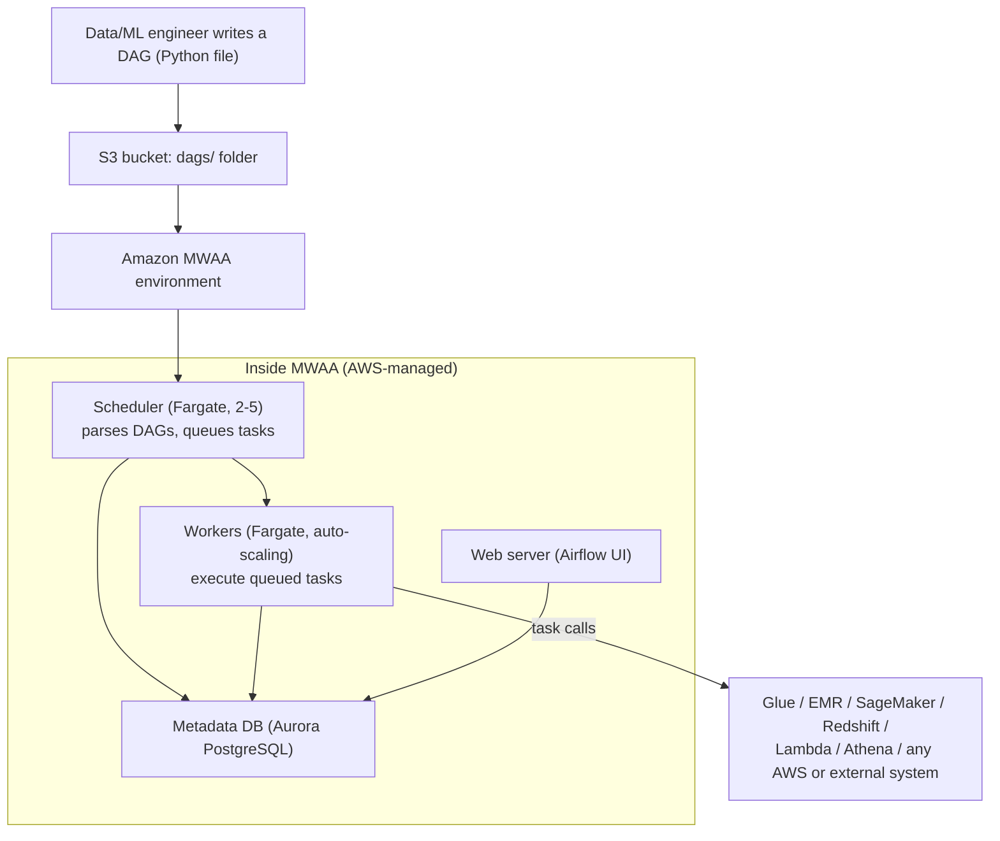

A DAG — a Python file defining tasks and their dependencies via Airflow's built-in operators (for
Glue, EMR, SageMaker, Redshift, and many non-AWS systems) or a plain `PythonOperator` — is
uploaded to a designated S3 prefix tied to the environment; MWAA periodically syncs new/changed
DAG files automatically, with no separate "deploy" step beyond this upload. The **Scheduler**
(Fargate containers, minimum 2 for availability) continuously parses every DAG, determines which
tasks are ready to run based on the dependency graph and schedule, and queues them; **Workers**
(also Fargate, auto-scaling) pick up queued tasks and execute them, calling out to whatever AWS
service or external system the task's operator targets. The **metadata database** (a single-
tenant, AWS-managed Aurora PostgreSQL instance) stores DAG run history and task state, reachable
only via a private VPC endpoint — never exposed publicly, even when the **web server** (the
standard Airflow UI) is configured for public, internet-reachable access (every request is still
authorized against the environment's IAM policy regardless of network reachability).

### Real AWS reference image, with discussion


*Figure: the public-webserver network configuration — the Airflow UI is internet-reachable, but
every request is still authorized against the IAM policy attached to the MWAA environment, the
same access-control model as the fully private configuration. The exam-relevant point this
specific diagram variant makes concrete: "public" here means *network-reachable*, not
*unauthenticated* — a scenario worried about a public-facing Airflow UI's security posture should
recognize that IAM gating, not network isolation alone, is what actually protects it, and that a
private (VPC-only) configuration is a network-layer hardening choice layered on top of, not a
replacement for, that same IAM authorization. Source: AWS MWAA User Guide, "Apache Airflow access
modes."*

### A worked architecture pattern — a branching ML retraining DAG

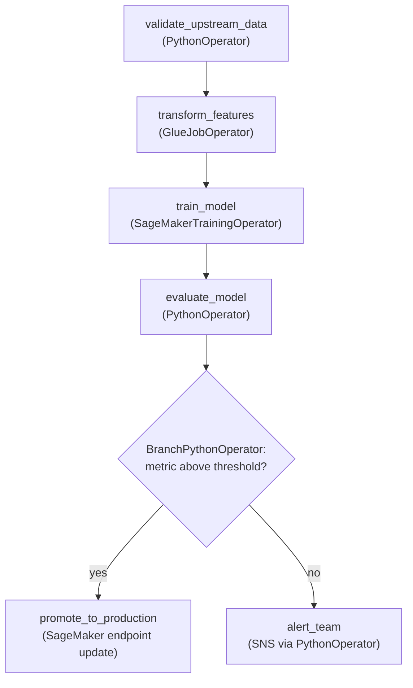

This is the concrete Airflow-native equivalent of a SageMaker Pipeline's Condition Step —
`BranchPythonOperator` lets the DAG author write arbitrary Python logic deciding which downstream
task path executes next, directly answering a scenario needing conditional branching logic
*beyond* what a SageMaker Pipeline's built-in Condition Step expresses (for instance, a branch
condition combining several unrelated signals from different systems, not just one evaluation
metric column).

### Exam Tips

- MWAA's signature, defining keyword is specifically **"Airflow"** (or an existing DAG
  ecosystem/investment) — a question naming only "complex workflow orchestration" with no Airflow
  mention more often points at Step Functions or SageMaker Pipelines instead.
- MWAA bills **continuously for scheduler + minimum worker capacity**, whether or not a DAG is
  actively running right now — a genuinely different pricing shape from Step Functions' Standard
  Workflows (zero idle cost) or SageMaker Pipelines (zero separate orchestration charge at all).
- Know the concrete reason to pick MWAA over Step Functions: **arbitrary Python expressiveness**
  (dynamic task generation via a runtime loop) that Amazon States Language's declarative JSON
  doesn't express as naturally — not "it's more complex" in some vague sense.

### Troubleshooting / Common Issues

- **A DAG uploaded to S3 never appears in the Airflow UI.** MWAA syncs the `dags/` prefix
  periodically, not instantly — check the environment's configured sync interval and the DAG
  file's own Python syntax (a DAG with an import error fails to parse silently from the UI's
  perspective until you check the scheduler logs specifically).
- **A task using a third-party provider's operator fails with an import error.** The provider
  package isn't listed in `requirements.txt` for the environment — unlike self-hosted Airflow
  where you might `pip install` ad hoc, MWAA requires every dependency declared in the
  environment's requirements file and a subsequent environment update to take effect.
- **The Airflow UI is reachable but every action returns an authorization error.** Check the
  IAM policy attached to the MWAA environment itself (distinct from your own IAM user/role) —
  every UI action is still gated by this policy regardless of public or private web server
  configuration.
- **A DAG that should run nightly silently stopped running after a deploy.** Check
  `catchup=False`/`start_date` configuration and whether the DAG was accidentally paused in the
  UI — a paused DAG stops scheduling new runs without raising any visible error elsewhere.

### Sample exam scenario, worked

**Scenario:** "A data engineering team has 200 existing Airflow DAGs orchestrating a mix of Glue,
EMR, SageMaker, and several third-party SaaS integrations (Snowflake, Salesforce), and wants to
move off self-hosted Airflow onto AWS with as little rewrite as possible." *Answer, worked:*
**Amazon MWAA** — the defining signal is "200 existing Airflow DAGs" plus "third-party SaaS
integrations," both of which point at preserving Airflow's own operator ecosystem and DAG syntax
rather than rewriting everything in Step Functions' Amazon States Language, which would require
re-implementing all 200 DAGs' logic (and every third-party integration currently handled by a
community-maintained Airflow provider package) from scratch in a different workflow language.

---

## 7. SageMaker Deployment & Endpoints

### Definition

Deployment is turning a trained model artifact into something that can actually answer questions.
SageMaker gives four different hosting shapes — **real-time**, **serverless**, **asynchronous**,
and **batch transform** — plus **SageMaker Neo** to compile a model for efficient execution on
edge hardware. Picking the right one for a given traffic pattern is one of the highest-value
decisions in an ML system's cost and latency profile.

### Analogy

Think of the four inference options as four ways to get an answer to a question. Real-time is
calling a friend who's always sitting by the phone — instant answer, but you're paying for them to
sit there whether you call or not. Serverless is texting an on-call expert who's doing other things
until you text — a short wait for them to pick up their phone (cold start), but you only pay for
the minutes they actually spend answering you. Asynchronous is submitting a written request to an
office and getting a callback when it's ready — fine for something that takes a while and doesn't
need your immediate attention. Batch transform is mailing an entire filing cabinet of questions to
a research firm and getting back one big report a week later — no one person is "on call" for any
single question in that cabinet at all.

### Purpose

A fraud-check needs an answer in under 100ms; a nightly report scoring 10 million records doesn't
care if it takes an hour but does care about cost per prediction; a document pipeline might need
to handle a 5-minute image analysis without holding a client connection open; a traffic-light
camera doesn't have reliable internet access to call AWS at all. One-size-fits-all hosting would
force overpaying for latency you don't need or underdelivering on latency you do need — these four
options plus Neo exist precisely to match infrastructure cost and shape to the actual traffic
pattern described in a scenario.

### When to Use (each option, concretely)

- **Real-time** — steady, latency-sensitive traffic that's rarely or never actually idle (a
  checkout-page recommendation, a fraud check).
- **Serverless** — spiky, unpredictable, or genuinely low-volume traffic that can tolerate an
  occasional cold-start delay (an internal tool used a handful of times a day).
- **Asynchronous** — large payloads (tens of MB+) or long processing times (minutes) where the
  caller doesn't need an instant response and can be notified later.
- **Batch Transform** — scoring an entire dataset you already have in full, with zero live
  traffic involved at all (a nightly or weekly bulk scoring job).
- **SageMaker Neo** — the model must run on specific edge hardware (a factory sensor, an IoT
  gateway) with no reliable connection back to AWS at inference time.

### When NOT to Use

- **Real-time for occasional/unpredictable traffic** — you'll pay for 24/7 uptime you don't use;
  switch to serverless.
- **Serverless for strict low-latency SLAs with constant heavy traffic** — cold starts and the
  per-request scaling model make serverless a poor fit; use real-time with proper auto scaling.
- **Batch Transform when you need an answer right now for one record** — it's built for bulk, not
  a single synchronous call.
- **Async when the client genuinely needs a synchronous answer** — if your application can't
  tolerate a "come back later" pattern, async adds unnecessary complexity.
- **Neo when you have reliable connectivity and no hardware constraint** — compiling for a narrow
  target adds engineering overhead with no benefit if you can just call a normal cloud endpoint.

### Use Cases

1. **Fraud detection at checkout (payments)** — a real-time endpoint with auto scaling absorbs
   steady, latency-critical traffic and spikes (Black Friday) without manual intervention;
   serverless's cold start would be visible on a fraction of checkouts at this volume.
2. **Customer churn scoring for a nightly report (telecom/SaaS)** — Batch Transform spins up
   compute, scores every row, writes results, and tears down, with zero endpoint existing before
   or after; a real-time endpoint would bill 24/7 for a workload never actually queried live.
3. **Medical imaging analysis (healthcare)** — an asynchronous endpoint handles large payloads
   (50+ MB scans) and multi-minute processing without a client holding a connection open; both
   real-time and serverless have far smaller payload ceilings than async allows.
4. **RAG chatbot backend for internal search (any enterprise)** — a serverless endpoint scales to
   zero overnight and only bills for actual compute during the handful of daily queries; real-time
   bills 24/7 for an endpoint idle more than 95% of the time at this traffic volume.
5. **Predictive maintenance on factory floor sensors (manufacturing)** — SageMaker Neo compiles
   the model for the device's specific hardware, run via AWS IoT Greengrass entirely offline; a
   cloud option is disqualified outright by the connectivity requirement.
6. **Multi-tenant SaaS with per-customer models (B2B SaaS)** — multi-model endpoints consolidate
   many lightly-used models onto shared instances, loaded into memory only when actually called,
   instead of paying for one dedicated, continuously-running endpoint per customer.

### Why Important

Real-world: picking the wrong inference option is one of the most common, most expensive mistakes
in production ML — a forgotten real-time endpoint running 24/7 for a feature used twice a day is a
recurring "why is our AWS bill so high" story. Exam weight: this is the core of Domain 3. Expect
heavy scenario-based questions mapping a traffic description to the correct option — see
`sagemaker-endpoint-autoscaling-cost-math.md` in this folder for the full numeric treatment of
sizing and cost once an option is chosen.

### How It Works, with a Mermaid diagram explained

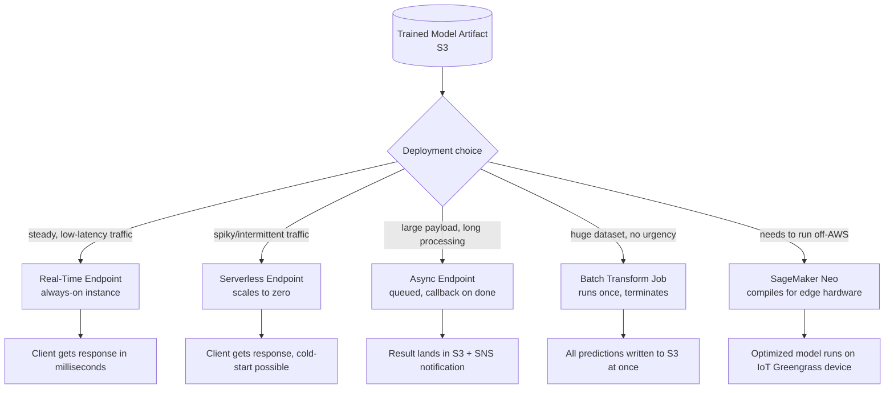

Everything starts from a trained model artifact in S3. **Real-time** provisions one or more
instances that stay running continuously behind a persistent HTTPS endpoint, billed per instance-
hour whether or not it's receiving traffic — the "always-on" option, supporting auto-scaling,
multi-model endpoints, and canary/shadow traffic splitting. **Serverless** sets a memory size and
max concurrency with no instance to provision; AWS scales compute from zero on each request and
back down when idle, with a cold-start penalty but zero cost while idle. **Asynchronous** queues
requests with large payloads or long processing times; the result lands in S3 with an SNS
notification, and it too can scale to zero when there's no queued work. **Batch Transform** points
at an S3 path of input records, scores everything, writes predictions to an S3 output path, and
the compute terminates — no persistent endpoint exists before or after. **SageMaker Neo** compiles
a trained model for a specific target (CPU architecture, edge device, mobile OS), which then runs
via an edge runtime (commonly **AWS IoT Greengrass**) directly on the device, with no live
connection to a SageMaker endpoint needed at inference time at all.

### A second diagram — the four options' request lifecycle, side by side

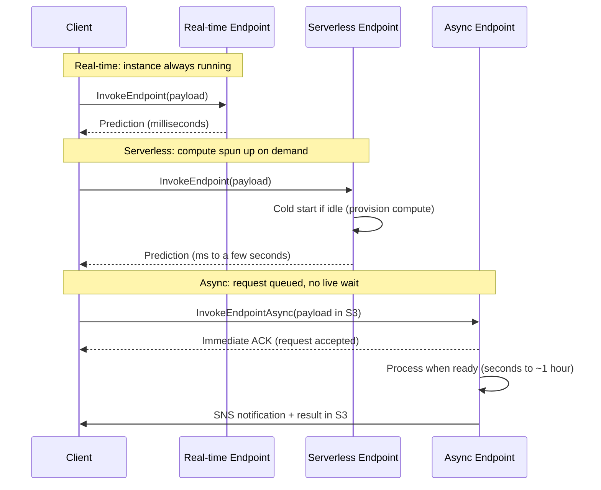

The three all start the same way — the client calls an `Invoke*` API — but what happens next, and
when the client actually learns the answer, differs entirely by design, which is exactly what the
"traffic pattern" framing in exam scenarios is probing: a question's clues about payload size,
latency tolerance, and whether a live caller exists at all map directly onto which of these three
lifecycles (plus Batch Transform's fourth, entirely separate "no live caller ever" shape) applies.

### Real AWS reference image, with discussion


*Figure: AWS's own diagram of Serverless Inference — when you create an on-demand serverless
endpoint, SageMaker provisions and manages the compute resources for you, scaling up and down with
request traffic, billing only for what's used. This is the visual proof of exactly why serverless
has zero idle cost compared to real-time's continuous provisioning — there is no box in this
diagram that exists "just in case" the way a real-time endpoint's always-on instance does. Source:
AWS SageMaker Developer Guide, "Deploy models with Amazon SageMaker Serverless Inference."*

### Worked cost comparison — the same model, three traffic assumptions

To make the inference-option decision concrete rather than abstract, walk through one trained
product-recommendation model under three different traffic assumptions:

**Variant A — storefront homepage, every page load.** Hundreds of requests/second, consistently,
all day, each needing a response well under 200ms. A real-time endpoint sized with auto-scaling
tied to `InvocationsPerInstance`, costing roughly instance-count × 730 hours/month regardless of
traffic shape, is the only option that fits — serverless's cold starts would be visible to real
users at this request rate.

**Variant B — an internal admin tool, five employees, a few times a day.** A handful of requests
scattered through business hours, long idle stretches overnight/weekends. A real-time endpoint
here would bill 24/7 for an endpoint idle more than 95% of the time; **serverless**, billing only
for the actual compute-seconds used (perhaps 50 calls/day × 300ms ≈ 15 seconds/day of real
compute), is a difference of multiple orders of magnitude for the identical model.

**Variant C — a nightly batch job scoring an entire 2-million-row catalog.** No live user waits on
any individual prediction. **Batch Transform** is correct — provisioning any persistent endpoint
(real-time or serverless) for a workload with zero live traffic is pure unnecessary
infrastructure.

The pattern across all three: the *traffic pattern description*, not the model itself, is almost
always what determines the correct inference option — the same trained artifact could legitimately
be deployed via any of the four options depending purely on how it's called. See
`sagemaker-endpoint-autoscaling-cost-math.md` for the full numeric treatment once an option is
chosen and needs to be sized.

### Safe rollout patterns, diagrammed — blue/green, canary, and shadow compared

A recurring point of confusion worth resolving with one diagram: these three safe-deployment
patterns all exist to avoid an instant, all-or-nothing cutover, but differ in whether real users
ever see the new variant's actual output.

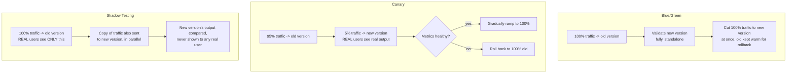

**Blue/green** validates the new version fully before a single, complete cutover — no user sees a
gradual mix, and rollback means reverting to the still-warm old version. **Canary** deliberately
exposes a small, real percentage of users to the new version's actual output, ramping up only if
metrics stay healthy — a genuine risk/learning tradeoff, not risk-free. **Shadow testing** is the
strictest, zero-user-risk option: a copy of live traffic reaches the new version for comparison,
but its output is never actually shown to any real user regardless of how it performs. The
recurring exam distractor: assuming canary and shadow testing are interchangeable because both
involve "testing with real traffic" — the difference (does a real user ever see the new version's
actual response) is precisely what a scenario naming "zero risk to any actual user" vs. "limited,
monitored exposure" is testing you to tell apart.

### Exam Tips

- Build a mental decision tree: steady + low-latency → real-time; spiky/infrequent → serverless;
  large payload/long-running + no immediate response needed → async; huge dataset, no live
  traffic → batch transform; must run off-cloud → Neo.
- "Pay only when used, scales to zero" is the signal phrase for serverless (and also applies to
  async when idle) — "cold start" as a named tradeoff belongs specifically to serverless, know it
  as a downside, not a feature.
- Multi-model endpoints are the answer to "host many models cheaply without one endpoint each" —
  and Neo always pairs conceptually with IoT Greengrass for the actual edge execution runtime.

### Troubleshooting / Common Issues

- **Real-time endpoint returns `ModelError` or times out under load it handled fine in testing.**
  Check whether Application Auto Scaling is actually configured on the endpoint — a fixed
  instance count under a sudden traffic increase behaves like any other under-provisioned
  service; see `sagemaker-endpoint-autoscaling-cost-math.md` for the full sizing math.
- **Serverless endpoint's first request after a quiet period takes multiple seconds.** This is
  expected cold-start behavior, not a bug — if unacceptable for the use case, that's a signal to
  move to a real-time endpoint (possibly with a minimum instance count) or add Provisioned
  Concurrency, not to try to eliminate cold starts from serverless entirely.
- **Async endpoint's SNS notification never arrives even though the job appears to have
  completed.** Check the SNS topic's subscription/permissions and the endpoint's configured
  success/failure topic ARNs separately — these are configured independently, and a misconfigured
  failure topic can silently swallow notifications for failed jobs specifically.
- **A Neo-compiled model behaves differently (lower accuracy) than the original on the edge
  device.** Compilation can involve precision reduction (FP32 → FP16/INT8) as part of the size/
  speed optimization — validate the compiled model's accuracy against a held-out test set on the
  actual target hardware before a full fleet deployment, don't assume compilation is accuracy-
  neutral by default.

### Sample exam scenario, worked

**Scenario:** "A document-processing application needs to run OCR plus a classification model
against uploaded files that can be up to 80MB, with processing taking anywhere from 30 seconds to
several minutes, and the uploading user does not need to wait for the result in real time."
*Answer, worked:* an **asynchronous inference endpoint** — the payload size (80MB) alone already
exceeds both real-time and serverless endpoints' much smaller payload ceilings, independently
disqualifying them before the processing-time or latency-tolerance clues even come into play; the
"doesn't need to wait in real time" detail confirms async's queued, notification-based delivery
(S3 + SNS) is the intended fit, not evidence that batch transform (which implies no live caller
submitting individual requests at all) would also work here.

---

## 8. SageMaker Pipelines

### Definition

SageMaker Pipelines is the MLOps orchestration tool that lets you define an entire ML workflow —
data prep, training, evaluation, registration, deployment — as a single connected sequence of
steps (a DAG) that runs repeatably, automatically, and consistently, instead of manually re-
running a stack of notebooks every time new data arrives.

### Analogy

If a Training Job is one cooking station, a SageMaker Pipeline is the full prep line at a
restaurant that only accepts dishes meeting a strict quality standard before they're allowed to
leave the kitchen: wash and chop the vegetables (processing), cook the dish (training), have the
head chef taste it against a recipe standard (evaluation), and only plate it for a customer
(register/deploy) if it passes that taste test — a dish that fails never reaches a table no matter
how good it smelled while cooking, and the exact same recipe runs identically whether it's
Tuesday's dinner rush or next month's, without the chef re-deciding the process from scratch
each time.

### Purpose

Running an ML workflow by hand once is easy; running it correctly and identically every week, or
automatically the moment new data lands, is not — manual processes drift, steps get skipped under
deadline pressure, and nobody has a clean record of exactly what ran and in what order. Pipelines
exists to turn "a notebook I ran manually last Tuesday" into a versioned, auditable, automatable
piece of infrastructure — the same problem CI/CD pipelines solve for software, applied to ML
workflows specifically.

### When to Use

- Retraining needs to happen automatically and repeatably (new data arrival, a schedule, a drift
  alarm) rather than depending on a human remembering to re-run a notebook.
- You need an automated quality gate that can genuinely stop a worse model from silently
  replacing a better one in production.
- You need an auditable lineage record of exactly which data/code/parameters produced a specific
  deployed model version, for compliance or incident investigation.
- The same workflow logic needs to run against multiple environments (dev with a lenient
  threshold, production with a strict one and mandatory approval) without maintaining separate,
  drifting pipeline definitions.

### When NOT to Use

- **A single, infrequent, manually-run experiment** — if you're not yet retraining regularly, a
  plain notebook is simpler; adopt Pipelines once repeatability and automation actually matter.
- **Orchestration needs span far beyond ML** (non-ML business workflows, human approval chains
  outside AWS, multi-day waits mixed with other AWS services) — AWS Step Functions is a more
  general-purpose state machine, sometimes used as the outer orchestrator with a SageMaker
  Pipeline as one component within it.
- **Pure software CI/CD with no ML-specific steps** — CodePipeline/CodeBuild/CodeDeploy alone,
  without SageMaker Pipelines, is the right tool.
- **An extremely simple, single-step "pipeline"** (just "run one training job") — the
  orchestration overhead of a full Pipeline definition may not be worth it versus a direct SDK
  call.

### Use Cases

1. **Automated fraud-model retraining (financial services)** — an EventBridge-triggered Pipeline
   chains processing, training, evaluation, and a Condition Step gate automatically whenever Model
   Monitor flags drift, removing the risk that manual retraining gets skipped under deadline
   pressure.
2. **Churn model CI/CD with a quality gate (telecom/SaaS)** — a Condition Step checks the new
   model's evaluation metric against a threshold before the Register Model Step ever runs,
   preventing a regression from silently reaching the Registry.
3. **Medical risk-model lineage for audit (healthcare)** — Pipelines' automatic lineage tracking
   records every execution's inputs and outputs, a record that can't be skipped the way manual
   documentation can lapse under deadline pressure.
4. **Demand forecasting triggered by new POS data (retail/CPG)** — an EventBridge rule watching
   for new S3 objects starts the pipeline execution reacting to a fact about the world, rather
   than a fixed calendar schedule that might run before data has actually landed.
5. **Multi-environment model promotion (banking credit models)** — typed Pipeline Parameters let
   one pipeline definition run against a small dev sample with a lenient threshold and the full
   production dataset with a strict threshold and mandatory approval, without maintaining
   near-duplicate pipeline code per environment.
6. **Human sign-off via Callback Step (e-commerce)** — a Callback Step pauses the pipeline for an
   external, non-SageMaker approval system to signal completion, consuming no compute while
   waiting, which a Condition Step (evaluating only data already inside the pipeline) cannot do.

### Why Important

Real-world: the difference between an ML project that stays healthy for years and one that rots
within months is almost always whether retraining is automated and gated by real quality checks,
or depends on someone remembering to do it manually. Exam weight: core to Domain 3 — expect
questions on automating retraining (EventBridge-triggered runs), CI/CD for ML (how Pipelines
relates to CodePipeline/CodeBuild/CodeDeploy), and Condition Steps as quality gates. See
`mlops-cicd-pipeline-retraining-deep-dive.md` in this folder for the full CodePipeline +
SageMaker Pipelines wiring with real configuration files.

### How It Works, with a Mermaid diagram explained

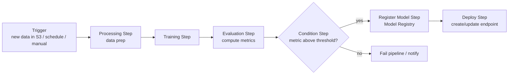

A pipeline execution can start manually, on a schedule (via EventBridge), or automatically when
new data lands in S3 (also via EventBridge). The **Processing Step** runs a SageMaker Processing
job (typically data cleaning/feature engineering, often the same logic exported from Data
Wrangler). The **Training Step** runs a Training Job using the processed data as input — the same
concept as a standalone training job, now wired into the pipeline's dependency graph. The
**Evaluation Step** scores the newly trained model against a held-out test set and outputs metrics
as a file. The **Condition Step** reads those metrics and branches: if the new model clears a
quality bar, proceed; if not, stop the pipeline and alert someone — this is the mechanism that
prevents a worse model from silently replacing a better one. On success, the **Register Model
Step** registers the new version in Model Registry, typically `PendingManualApproval`. Every
execution is tracked — SageMaker Studio's Pipelines UI shows a visual DAG of the run, each step's
status, duration, and artifacts, giving the audit trail a manual notebook-running process never
had.

### A second diagram — a real pipeline execution, in AWS's own UI terms

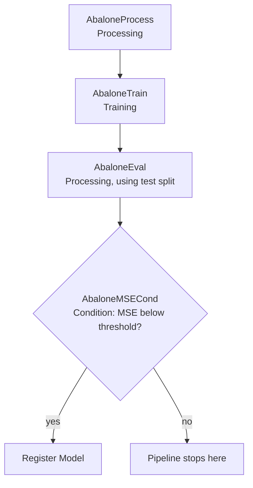

This is the literal shape of AWS's own published Pipelines example — notice that step *names* are
meaningful, specific, and traceable (not generically "Step 1, Step 2"), which is what makes a
Studio Pipelines UI screenshot genuinely readable during an incident investigation months later,
rather than a wall of indistinguishable boxes.

### Real AWS reference image, with discussion


*Figure: a real SageMaker Pipelines DAG — Processing, Training, Evaluation, and a Condition step
gating model registration, rendered in the SageMaker Studio visual editor. This is the literal
AWS-console rendering of the diagram just above, and worth noting precisely because it's also the
same reference diagram `sagemaker-overview.md` reuses to show the automated, event-driven
retraining pattern at the whole-platform level — Pipelines is the piece that makes that platform-
level diagram's feedback loop (drift detected → retrain) actually executable. Source: AWS
SageMaker Developer Guide, "Pipelines overview."*

### Callback Steps, as an actual sequence

Because Callback Steps are the mechanism for genuinely external, non-SageMaker waits, it's worth
seeing the actual round trip:

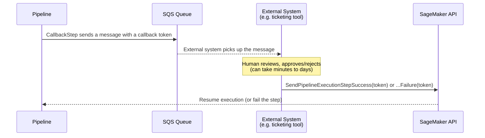

The pipeline genuinely pauses — consuming no compute — for however long the external review
takes; nothing about this architecture requires SageMaker to poll or wait actively, which is
exactly why Callback Steps are the right tool for waits that could plausibly take days, not just
seconds, and why they're architecturally distinct from a Condition Step (which evaluates data
already available inside the pipeline, with no external wait of any kind).

### Exam Tips

- "Automate retraining when new data arrives / on a schedule" → SageMaker Pipelines + EventBridge
  trigger; a Condition Step gating registration on an evaluation metric is the canonical "prevent
  a worse model from reaching production automatically" answer.
- **Pipelines vs. Step Functions:** Pipelines is ML-workflow-specific and SageMaker-native; Step
  Functions is general-purpose and can orchestrate ML steps alongside non-ML AWS services — a
  question involving non-ML steps in the same workflow points to Step Functions.
- Pipelines has **no separate charge** — cost comes entirely from the underlying step resources
  (Processing/Training/Evaluation instance-hours), a common "which pricing is correct" distractor.

### Troubleshooting / Common Issues

- **A pipeline execution fails at the Condition Step even though the model trained fine.** This
  is very often *working as designed* — check the actual evaluation metric value against the
  configured threshold before assuming something's broken.
- **A step fails with a permissions error even though a standalone job with the same
  configuration succeeds.** The pipeline's execution role (not necessarily the same role you'd
  use for a standalone job) needs permissions for every step's S3 paths and any other resources
  it touches.
- **Step caching isn't skipping a step that genuinely didn't change.** Caching keys off the
  step's exact input arguments/code hash — a change elsewhere in the pipeline definition can
  sometimes invalidate a cache entry depending on how dependencies are structured.
- **A Callback Step never resumes even though the external approval was given.** Check that the
  external system is actually sending the `SendPipelineExecutionStepSuccess`/`...Failure` API
  call back to SageMaker with the correct callback token — approving in the external tool's own
  UI alone does nothing unless that tool is wired to call back into the pipeline's API.

### Sample exam scenario, worked

**Scenario:** "A workflow needs to wait for a manual sign-off from a compliance officer,
potentially taking several business days, before a pipeline continues to the next step, without
consuming compute while waiting." *Answer, worked:* a **Callback Step** — specifically designed
to pause a pipeline for an external, non-SageMaker process to signal completion via an SQS message
and a callback token, consuming zero compute during the wait. A Condition Step is the wrong
answer here even though both involve "waiting" conceptually — a Condition Step evaluates data
already available *inside* the pipeline automatically and immediately, with no external,
potentially multi-day wait of any kind.

---

## 9. Amazon Bedrock (including Agents, Knowledge Bases, AgentCore)

### Definition

Amazon Bedrock is AWS's fully managed service for using and customizing **foundation models**
(large pre-trained AI models — the kind behind ChatGPT-style chat, image generation, and text
embeddings) from multiple providers, through one consistent API, without ever provisioning a GPU
or managing infrastructure. In plain terms: Bedrock is "AI models as an API call" — text in, text
(or an image, or a decision) out, with AWS running everything behind the scenes. This section also
covers **Agents** (multi-step, tool-using orchestration), **Knowledge Bases** (managed RAG),
**Guardrails** (content/topic policy), **Prompt Management**, and **AgentCore** (production-scale
agent infrastructure) — the GenAI content C02 added heavily to this domain's scope.

### Analogy

If SageMaker is a professional kitchen you rent and staff yourself, Bedrock is ordering from a
world-class catering service's menu — you pick a dish (a foundation model) from a printed menu
with many kitchens' offerings on it (Anthropic, Amazon, Meta, Mistral, and more), and the food
just arrives; you never see the kitchen, never hire a chef, and pay only for what you actually
order. A Knowledge Base is handing the caterer your own family recipe book to reference so their
chef's answers are grounded in *your* specific recipes, not generic ones. An Agent is upgrading
from "order a dish" to "hire a personal assistant who can read your recipe book, call the grocery
store to check stock, and actually place the order for you" — it doesn't just answer, it acts.

### Purpose

Training a large language model from scratch costs tens to hundreds of millions of dollars and
requires expertise almost no company has in-house. Most businesses don't need to build a
foundation model — they need to *use* one, often customized with their own data, embedded safely
into their own product. Bedrock closes that gap: serverless access to multiple best-in-class
foundation models through one API, with AWS-native security, data privacy (prompts/data aren't
used to retrain the underlying model and stay inside your account boundary), and pay-per-use
pricing — making generative AI something an ordinary application team can integrate in days, not
months. Before any managed service existed, a team that wanted "ChatGPT, but grounded in our own
internal wiki" had to solve four hard problems simultaneously: pick and host a model, build a
search system over their documents, glue the two together correctly, and wrap the whole thing in
enough security/compliance controls to pass legal review. Bedrock collapses all four into
configuration choices on top of one managed service.

### When to Use

- You need generative/conversational AI capability (chat, summarization, content generation, RAG,
  multi-step task automation) without hosting your own model infrastructure.
- You need to ground a model's answers in your own private documents (RAG via Knowledge Bases)
  rather than relying on what the model memorized during training.
- A task requires multiple steps and/or calling external tools/APIs on a user's behalf (Agents),
  not just answering a single question.
- You need content-safety policy (denied topics, PII redaction, hallucination/grounding checks)
  applied consistently regardless of which underlying model is used (Guardrails).
- You need production-scale agent infrastructure — many concurrent users, cross-session memory,
  per-user credential scoping, or step-level execution tracing (AgentCore).

### When NOT to Use

- **A classifier/regressor on structured/tabular data** (fraud score, churn probability) — a
  foundation model is the wrong tool; use SageMaker training with a built-in algorithm instead.
- **Full control over model weights/training infrastructure, or self-hosting an open model with
  custom serving code** — use SageMaker (JumpStart or custom training/hosting) instead; see
  `gpu-instance-selection-scaling-fm-hosting.md` for the self-hosted-GPU alternative and its
  tradeoffs.
- **A narrow, well-defined pattern already solved by a purpose-built AI service** — don't build a
  Bedrock prompt to do OCR or sentiment analysis; Textract and Comprehend are cheaper, faster, and
  more accurate for those specific jobs.
- **Guaranteed low, predictable latency at very high constant volume, with the ML expertise to
  manage it** — self-hosting an open model on SageMaker/EC2 with reserved capacity might be more
  cost-effective at extreme, sustained scale, trading away Bedrock's zero-ops simplicity.
- **A requirement that's actually deterministic business logic in disguise** (e.g., "always reject
  refunds over $500 without a manager code") — enforce hard rules in ordinary application code
  (or inside an Action Group's Lambda), not by asking a foundation model to follow instructions it
  might occasionally phrase around.

### Use Cases

1. **Internal IT/HR helpdesk chatbot (any enterprise)** — Knowledge Bases (RAG) retrieve the exact
   current policy passage and generate a grounded, cited answer, with re-ingestion keeping answers
   current as policies change with zero retraining.
2. **Customer-service "cancel and refund" agent (e-commerce)** — a Bedrock Agent with separate
   Action Groups for order lookup, cancellation, and refund issuance, each independently testable
   and independently IAM-permissioned.
3. **Content moderation and brand-safety filtering (media/UGC platforms)** — Guardrails apply
   denied-topic, content-filter, and PII-redaction policy uniformly across every model call,
   regardless of which underlying foundation model generated the response.
4. **Multi-day insurance claim intake agent (insurance)** — agent state (claim ID, status,
   gathered facts) persists across multiple separate sessions spanning days via a durable,
   namespaced state store (DynamoDB, or AgentCore Memory).
5. **High-volume, brand-voice-sensitive support assistant (any regulated industry)** — a hybrid
   pattern combining a lightly fine-tuned model (consistent tone/format), a Knowledge Base
   (current facts), and Provisioned Throughput (cost/latency predictability at scale) — three
   separate problems, three separate Bedrock features, deliberately composed.
6. **Long-running "deep research" agent (any analyst-support tool)** — AgentCore Runtime's
   extended-session support (hours, not a typical short function's time ceiling) handles a
   genuinely long multi-step research task a plain Lambda-backed Action Group chain couldn't.

### Why Important

Real-world: Bedrock is what lets an ordinary application team ship a genuinely useful generative
AI feature in days rather than months, without hiring ML infrastructure specialists — and getting
the architecture wrong (treating RAG and fine-tuning as interchangeable, or skipping Guardrails
on a customer-facing feature) is a fast way to ship a hallucinating or unsafe product. Exam
weight: Bedrock is this domain's single largest area of *new* C02 content — agent orchestration,
Knowledge Bases as deployable infrastructure, prompt management, agent state management, and GPU
scaling for self-hosted FMs are all explicitly new task statements layered onto this domain's
existing classic-ML deployment content.

### How It Works, with a Mermaid diagram explained — the full RAG architecture

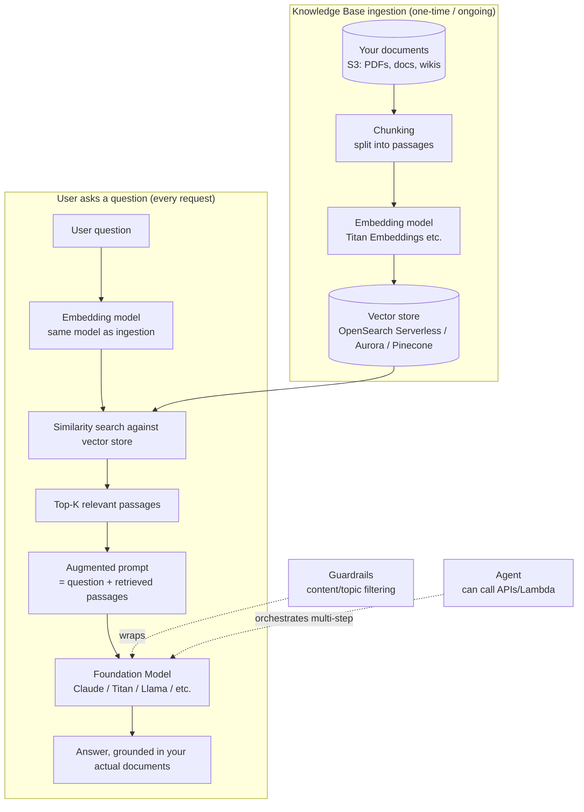

This is the single most important diagram in this entire document, because Domain 1, 2, and 3 all
reference pieces of it. Documents are stored in S3 as a Knowledge Base's source; because a model
can't usefully search across a whole multi-page document as one blob, each document is split into
smaller **chunks** (chunk size is a real tuning parameter — too small loses context, too large
dilutes relevance). Each chunk is converted to an **embedding vector** by an embedding model (e.g.,
Amazon Titan Text Embeddings) and stored in a **vector store**. At query time, the user's question
is converted to an embedding using the *same* embedding model used during ingestion — a mismatch
here produces meaningless similarity scores, a real, tested failure mode. The vector store finds
the chunks whose embeddings are mathematically closest to the question's, and those retrieved
passages are inserted into the prompt sent to the foundation model alongside the original
question. The model generates an answer grounded in the retrieved real content — this is what
makes RAG dramatically reduce hallucination for knowledge the model wasn't trained on, while
keeping proprietary data out of model retraining entirely. **Guardrails** wrap the model call as a
policy layer, and **Agents** sit a layer above a single model call, deciding to call external
tools and looping results back into reasoning before giving a final answer — with a Knowledge Base
commonly being just one tool among several an Agent has available.

### Agents — build-time and runtime architecture, with AWS's own diagrams

An Agent's architecture splits into two halves: **build-time** configuration (foundation model,
instructions, Action Groups, Knowledge Bases — what the agent *can* do) and **runtime**
orchestration (the live, request-by-request reasoning loop that decides what to actually do).


*Figure: AWS's own build-time architecture — an Agent is assembled from a chosen foundation
model, written instructions, one or more Action Groups (each backed by an OpenAPI or function-
detail schema plus a Lambda implementing the logic), and optionally one or more Knowledge Bases.
The `description` fields inside each Action Group's schema are not decoration — they're literally
what the model reads to decide whether and when to call that action, and a vague or overlapping
description across two Action Groups is the most common real-world cause of an agent calling the
wrong tool. Source: Amazon Bedrock User Guide, "How Amazon Bedrock Agents works."*


*Figure: AWS's own runtime process — `InvokeAgent` kicks off pre-processing, then an
orchestration loop where the agent predicts which action or Knowledge Base to invoke next,
invokes it, receives an **observation** (the result), and either loops again or produces a final
response. This loop is the "ReAct" (Reason + Act) prompting pattern underneath Bedrock Agents —
reason about what to do, act, observe the result, repeat. Every single loop iteration is itself a
fresh foundation-model call; the model has no continuity of its own between iterations — the
Agent runtime is what re-sends accumulated context on every call, which is exactly why state
management (below) is a structurally separate concern from the model itself. Source: Amazon
Bedrock User Guide, "How Amazon Bedrock Agents works."*

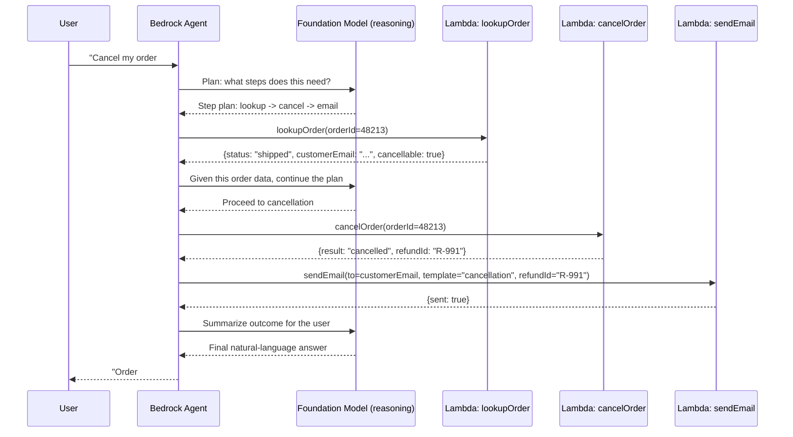

Each Lambda function here is registered with the Agent as an **Action Group** — a formally
described set of operations the model is allowed to call, with clear input/output shapes. The
model itself never touches your database or email system directly; it only ever decides *which*
registered function to call with *what* arguments, and your Lambda code does the actual work
under normal IAM permissions — this separation is exactly what makes Agents auditable and safe to
put in front of a production system. See `bedrock-agent-architecture-state-management.md` in this
folder for the full build-time schema, runtime loop, and state-management design space in depth.

### Knowledge Bases, Agent state management, and AgentCore

**Knowledge Bases**, beyond the conceptual chunk→embed→retrieve pipeline, are operated as
deployable infrastructure: their vector database binding (which OpenSearch collection, RDS
cluster, or S3 vector bucket), data source sync schedule, and retrieval configuration (top-K,
metadata filtering) are all versioned, deployable settings — not one-time setup choices. A
Knowledge Base refresh pipeline (EventBridge-triggered on new/changed S3 documents, or on a fixed
schedule) re-syncs and re-indexes changed documents, ideally running an automated retrieval-
accuracy evaluation after each refresh before fully rolling the update out to production traffic.

**Agent state management** is genuinely new C02 content: a single foundation-model call is
stateless — it only knows what's in the current prompt. A multi-turn agent conversation needs to
remember what happened in earlier turns and *where it is* in a multi-step task, across separate
requests that might hit different compute instances entirely:

```mermaid
flowchart TD
    A["Turn 1: 'Book me a flight to Chicago next Friday'"] --> B["Agent state store:<br/>task=book_flight, destination=Chicago,<br/>date=next Friday, status=searching"]
    B --> C["Turn 2: 'Actually make it Thursday instead'"]
    C --> D{"Load existing state for this session"}
    D --> E["Update: date=Thursday, status=searching<br/>(task NOT restarted)"]
    E --> F["Turn 3: 'Book it'"]
    F --> G{"Load state"}
    G --> H["status=booking -> call booking tool<br/>with full accumulated context"]
    H --> I["status=completed"]
```

State needs to persist independent of any single request's prompt and independent of which
compute instance handles the next turn, requiring an external, durable state store (DynamoDB, or
Bedrock AgentCore's managed session handling) — not just appending to a growing prompt. The
exam-relevant trap: attributing an agent's failure to remember earlier context to the foundation
model being "bad at conversation," when the actual root cause is almost always a missing or
misconfigured state-management layer (most commonly, a missing or inconsistent session ID) — the
model has no memory at all between calls by default; all continuity is the state-management
system's job, not the model's.

**Bedrock AgentCore** is a separate, newer platform layer solving a different problem: *running
agents in production, at scale, safely.*


*Figure: the official AgentCore harness architecture — a per-session, isolated microVM (Runtime)
runs the agent's code (framework-agnostic: LangGraph, Strands, CrewAI, or custom), wired to four
separately deployable managed services: **Identity** (who is this agent acting for, with a token
vault for external credentials), **Memory** (short-term conversation context plus long-term,
per-user-namespaced facts that persist across sessions), **Gateway** (turns existing APIs/Lambda
into MCP-compatible tools, exposing only approved targets), and **Observability** (OpenTelemetry-
standardized, step-level tracing of an agent's reasoning path — the agent equivalent of what
X-Ray does for a distributed request's network hops). When a session ends, its microVM terminates
entirely — no state silently persists in a shared process between unrelated users' sessions,
which is the architectural guarantee that makes multi-tenant agent hosting safe. Source: Amazon
Bedrock AgentCore Developer Guide, "AgentCore harness."*

**The exam-relevant selection logic:** a scenario describing a single, lightly-used, stateless
tool-calling assistant is still just "Agents for Bedrock." A scenario describing *scale* (many
concurrent users), *persistence* (remembering across sessions), *per-user security boundaries*,
or *production-grade step-level debugging* is describing the specific problems AgentCore's
Runtime, Memory, Identity, and Observability components solve, respectively.

### Guardrails and Prompt Management

**Guardrails for Bedrock** apply configurable content filtering to both prompts and model
responses, independent of which underlying foundation model is used: **denied topics** (refuse to
engage with a plain-language-defined topic like "investment advice"), **content filters** (hate,
insults, sexual, violence, misconduct, each with a configurable strictness threshold), **PII
redaction** (detect and mask SSNs, emails, phone numbers in either direction), **word filters**
(exact profanity/competitor-name blocklists), and **contextual grounding checks** (flag a
generated answer unsupported by the retrieved RAG context — a direct hallucination detector).

```mermaid
flowchart LR
    A["Prompt template drafted/edited"] --> B["Saved as a new Prompt Management version"]
    B --> C["Automated eval suite runs against test cases"]
    C --> D{"Scores acceptable?"}
    D -->|No| E["Version rejected, previous version stays live"]
    D -->|Yes| F["New version promoted to production variant"]
    F --> G["Live traffic uses the new prompt version"]
    G --> H["Can instantly roll back to any prior saved version"]
```

A prompt template used in production is a real, versioned artifact that changes over time —
**Bedrock Prompt Management** treats it that way explicitly rather than leaving it as a hardcoded
string buried in application code. Because the prompt lives in Prompt Management rather than
hardcoded in the calling application, a prompt-only change doesn't require a full application
redeploy — every saved prompt gets a version history, with the ability to point production
traffic at a specific version and roll back instantly if a new one underperforms. This same
CI/CD discipline extends to full **agent configurations** (instructions, Action Group schemas,
Knowledge Base bindings) — every change creates a new, versioned Agent **version**, never an
in-place edit of the live configuration, with a production **alias** pointing at a specific
approved version and a separate test alias for validating a candidate version before any
production traffic reaches it.

### A third real image — a production RAG chatbot's full reference architecture


*Figure: solution architecture for a contextual chatbot built on Amazon Bedrock Knowledge Bases —
S3 as the document source, Lambda triggering ingestion, OpenSearch Serverless as the vector store,
and an API Gateway + Lambda layer calling `RetrieveAndGenerate` for the chat frontend. This maps
directly onto the RAG diagram earlier in this section — S3/Lambda/OpenSearch Serverless are
simply the concrete AWS services filling the "Ingestion" and "Query" boxes drawn conceptually
above. Source: AWS Machine Learning Blog, "Build a contextual chatbot application using Amazon
Bedrock Knowledge Bases."*

### Fine-tuning vs. RAG, side by side on the same problem

A recurring exam distinction worth seeing worked through once concretely: take an IT-helpdesk
chatbot scenario and ask whether to fine-tune a model instead of (or alongside) using RAG.
**Fine-tuning** means continuing to train a copy of the base model on labeled example prompt/
completion pairs you provide, shifting its behavior/style/format — it teaches a *response style*
(short, this-company's-tone, always mentioning the right portal name), but does **not** reliably
teach new *facts*, and if an underlying policy URL changes next quarter, every fine-tuned response
is wrong until a slow, expensive re-fine-tune cycle runs. **RAG**, by contrast, just needs the
updated document re-ingested — the next query automatically retrieves the current information, no
retraining required. The exam-relevant takeaway stated plainly: RAG is for facts that change or
that the model never saw; fine-tuning is for behavior/format/tone that should hold steady
regardless of which facts are involved. The strongest real systems typically use both — a lightly
fine-tuned model (consistent tone/format) that also has a Knowledge Base attached (current facts)
— exactly the Pattern 3 hybrid architecture named earlier in this section.

### Prompt engineering, worked side by side

The same question, phrased three different ways, produces measurably different reliability.
**Zero-shot** (just ask) works fine for an easy classification case but gets inconsistent on
ambiguous inputs because the model has no example of your exact convention to anchor on.
**Few-shot** (show 2-3 examples of the exact input/output pattern wanted first) dramatically
improves consistency on edge cases, because the model now has a concrete pattern to match rather
than just a category name to interpret. **Chain-of-thought** (ask the model to reason step by
step before answering, for tasks needing real multi-step reasoning) trades a few extra output
tokens — a small cost increase — for a large reliability improvement on anything resembling a
multi-step decision, a genuine, practical cost/accuracy tradeoff worth knowing rather than a mere
prompting trick.

### Guardrails, worked concretely

To make "content filtering" tangible rather than abstract: a financial-services chatbot configures
a Guardrail with a **denied topic** named "investment advice" (described in plain language, e.g.
"recommendations to buy, sell, or hold a specific security or asset"), a **PII redaction** rule
masking account numbers and SSNs in both the user's input and the model's output, and a
**contextual grounding check** requiring any RAG-sourced answer to be genuinely supported by the
retrieved passages before it's returned.

```mermaid
flowchart TD
    IN["User: 'Should I buy NVDA stock\nright now?'"] --> GR1{"Guardrail: denied-topic\ncheck on INPUT"}
    GR1 -->|matches 'investment advice'| BLOCK["Blocked response:\n'I can't provide investment\nadvice' — model never even\nsees the prompt"]
    GR1 -->|no match| FM["Foundation Model\ngenerates a response"]
    FM --> GR2{"Guardrail: PII redaction +\ngrounding check on OUTPUT"}
    GR2 -->|PII detected| REDACT["Account numbers/SSNs\nmasked before returning"]
    GR2 -->|ungrounded claim detected| FLAG["Flagged as unsupported by\nretrieved context"]
    GR2 -->|clean| ANS["Answer returned to user"]
```

The architecturally important detail this diagram makes explicit: Guardrails check **both** the
input (before the model ever processes it — an input match can block the model call outright,
saving the cost of a generation call that would have been rejected anyway) and the output (after
generation, before it reaches the user) — a scenario asking "can Guardrails stop a disallowed
request before any model cost is incurred" is testing recognition of this input-side check
specifically, not just the output-filtering half most people assume Guardrails only does.

### Exam Tips

- RAG is for facts that change or that the model never saw ("what does OUR current policy say");
  fine-tuning is for behavior/format/tone that should hold steady regardless of which facts are
  involved — the strongest real systems typically use both together, not one instead of the other.
- A Knowledge Base can itself be *one of the tools* an Agent has access to, alongside action-
  taking Lambda functions — RAG and Agents aren't competing patterns; Agents are often built
  *using* a Knowledge Base as one capability among several.
- An agent "forgetting" context is almost always a **session ID / state-management** problem, not
  a model-capability problem — know this as the default first diagnosis on any such scenario.
- Know the AgentCore-vs-plain-Agent selection logic precisely: scale, cross-session persistence,
  per-user credential scoping, and step-level production debugging each point at a *specific*
  AgentCore component (Runtime, Memory, Identity, Observability respectively), not just the word
  "AgentCore" generically.


### Troubleshooting / Common Issues

- **An agent occasionally fails to call the correct tool for a multi-step request.** This is
  usually an under-specified Action Group description/schema, not a model failure — the agent
  decides which tool to call based on the natural-language description and parameter schema
  provided for each tool; vague or overlapping tool descriptions are the common root cause.
- **A RAG chatbot's retrieval returns irrelevant passages even though the documents clearly
  contain the answer.** Check that the same embedding model is used at both ingestion and query
  time — a mismatch produces mathematically meaningless similarity scores, a real, specific
  failure mode distinct from "the chunking is wrong" or "the model is bad."
- **A Guardrail blocks a legitimate request unexpectedly.** Check the specific filter category and
  strictness threshold that triggered the block (denied topic, content filter, PII redaction, or
  grounding check each have independent configuration) — tightening one category too aggressively
  for the actual use case is a common over-correction after a single false positive.
- **An Agent's response cites outdated information despite a recent document update.** Check the
  Knowledge Base's data source sync status — document updates in S3 don't automatically
  re-trigger ingestion unless a sync job (scheduled or EventBridge-triggered) has actually run
  since the update; an unsynced Knowledge Base keeps serving the stale, previously-indexed version.
- **Bedrock API calls fail with an access-denied error for one specific model but not others.**
  IAM permissions for `bedrock:InvokeModel` are scoped **per model ID** — a role permitted to call
  one model family isn't automatically permitted to call another; this is a normal, deliberate
  policy shape, not a bug.
- **A fine-tuned model's behavior seems to regress after a base model update.** Confirm whether
  the fine-tune was built on a now-superseded base model version — a provider-side base model
  update can require re-validating (and potentially re-running) a fine-tune built on the older
  base version, exactly the task 3.3.10 versioning distinction this domain covers.

### Sample exam scenarios, worked

**Scenario 1:** "A customer-support chatbot needs to both answer questions from an internal
policy wiki and look up a customer's live order status from a database, in the same
conversation." *Answer, worked:* a **Bedrock Agent** orchestrating a **Knowledge Base** (for the
wiki, a RAG lookup) and a **Lambda-backed Action Group** (for the live order-status API call)
together — a Knowledge Base alone has no ability to call an external, live API, and an Agent
without a Knowledge Base has no grounded way to answer policy questions from the wiki; the
scenario's two distinct information needs (static documents vs. live data) is exactly what
requires combining both capabilities under one Agent rather than picking just one.

**Scenario 2:** "A team wants to safely roll out an updated chatbot system prompt weekly, with
the ability to instantly revert to the previous week's prompt if the new one produces off-brand
responses, without redeploying the surrounding application each time." *Answer, worked:*
**Bedrock Prompt Management** — every saved prompt edit becomes a new version with full history,
production traffic points at a specific version via a pointer the application never has to
redeploy to change, and reverting is an instant repoint to the prior version rather than a code
change. The wrong-but-tempting answer is "just edit the prompt string in the application code and
redeploy" — that works, but defeats the explicit "without redeploying" requirement and loses the
version history/instant-rollback property Prompt Management provides natively.

**Scenario 3:** "An organization wants to evaluate whether a newly fine-tuned support model is
ready for production, by running it against a fixed set of known test questions and comparing its
answers to the previous model version's answers before any real customer sees it." *Answer,
worked:* **Bedrock's model evaluation tooling** (or a custom automated eval suite using the same
"AI model testing framework" discipline this domain's task 3.3.9 names) — run both the current
production model and the fine-tuned candidate against the identical test set, compare scores
(automatic metrics or human review), and only promote the new version if it clears the bar; this
is the GenAI-artifact equivalent of a SageMaker Pipeline's Condition Step gating model
registration on an evaluation metric, applied to a fine-tuned foundation model version instead of
a classic-ML model.

---

## Closing synthesis — how all nine fit together

### The big picture, in one diagram

```mermaid
flowchart TD
    subgraph Layer1["Infrastructure layer — WHERE compute runs"]
        ECR[(2. ECR<br/>container images)]
        ECS[3. ECS]
        EKS[4. EKS]
        SMEP[7. SageMaker<br/>Deployment & Endpoints]
    end
    subgraph Layer2["Orchestration layer — automating the WORKFLOW"]
        CP[1. CodePipeline]
        MWAA[6. MWAA]
        SMP[8. SageMaker Pipelines]
    end
    subgraph Layer3["Platform & GenAI layer"]
        SM[5. SageMaker Overview]
        BR[9. Bedrock<br/>Agents, KB, AgentCore]
    end
    ECR --> ECS
    ECR --> EKS
    ECR --> SMEP
    SM --> SMEP
    SM --> SMP
    CP --> SMP
    CP -.alternative orchestrator.-> MWAA
    SMP --> SMEP
    BR -.GenAI analog of.-> SMP
    CP -.same CI/CD discipline.-> BR
```

Nine services, three layers. **The infrastructure layer** (ECR, ECS, EKS, SageMaker Deployment &
Endpoints) decides *where compute actually runs* — a container registry, two alternative container
orchestrators, and SageMaker's own four native inference shapes, all ultimately serving the same
purpose: turning a trained artifact into something that answers requests. **The orchestration
layer** (CodePipeline, MWAA, SageMaker Pipelines) decides *how the path from new code/data to a
live, updated model gets automated* — three tools covering overlapping but distinct territory
(general CI/CD, general Python-expressive DAG orchestration, and ML-workflow-specific DAG
orchestration respectively), commonly composed together rather than used in isolation. **The
platform & GenAI layer** (SageMaker Overview, Bedrock) is the umbrella each of the above plugs
into — SageMaker for the classic-ML lifecycle, Bedrock for the generative-AI lifecycle, with
Bedrock's own Agents/Knowledge Bases/AgentCore content increasingly needing the exact same
orchestration (CodePipeline) and infrastructure (container, state-store) thinking the classic-ML
side has always needed.

### Master decision table — nine services, one reference

| If a scenario says... | The answer is | Why not the others |
|---|---|---|
| "Orchestrate source→build→test→deploy with approval gates" | **CodePipeline** | MWAA/SageMaker Pipelines are workflow-DAG tools, not general release orchestrators |
| "Where do custom container images live before deployment" | **ECR** | ECS/EKS run containers, they don't store/version them |
| "Run a model-serving container alongside other AWS-native microservices, simplest option" | **ECS** | EKS is more operationally complex than needed absent existing Kubernetes investment |
| "Run a model-serving container on an existing/standardized Kubernetes platform" | **EKS** | ECS is AWS-proprietary; EKS is the only option preserving Kubernetes-native portability |
| "Orchestrate existing Airflow DAGs / need dynamic Python-level task generation" | **MWAA** | Step Functions' declarative ASL doesn't express arbitrary Python logic as naturally |
| "The whole ML lifecycle, data prep through monitoring, one platform" | **SageMaker (Overview)** | Bedrock is for generative/foundation models, not a custom classic-ML lifecycle |
| "Pick the inference shape matching this exact traffic pattern" | **SageMaker Deployment & Endpoints** | This is the single highest-value, most-tested decision in the whole domain |
| "Automate process→train→evaluate→register as a gated, repeatable DAG" | **SageMaker Pipelines** | MWAA/Step Functions can wrap this, but don't replace its ML-native step types and Model Registry integration |
| "Use/customize a foundation model, RAG, agents, multi-step GenAI tasks" | **Bedrock** | SageMaker/JumpStart is the self-hosted alternative, warranted only for specific control/volume/residency reasons |

### Cross-cutting worked scenario 1 — a full GenAI deployment, naming every service it touches

**The scenario:** "ClaimsCo" wants to deploy a claims-intake chatbot that answers policy questions
from a document library, looks up a live claim's status via an internal API, and must be safely
rollout-able with instant rollback if a bad update ships.

**Walking through every service this actually touches:**
1. **Bedrock Knowledge Base** — ingests ClaimsCo's policy documents (chunked, embedded, stored in
   a vector store) for the RAG half of the chatbot's answers.
2. **Bedrock Agent** — orchestrates the Knowledge Base and a Lambda-backed Action Group (the live
   claim-status lookup) together in one conversational flow.
3. **ECR** — if any custom preprocessing/postprocessing container sits in front of the Agent (not
   always needed, but common for request validation or logging), its image lives here.
4. **CodePipeline** — the outer release process: a prompt/Agent-configuration change is committed,
   triggers an automated evaluation-suite stage, and only reaches a production Agent alias via a
   manual approval gate, exactly this domain's GenAI-CI/CD pattern.
5. **Agent versioning/aliasing** (Bedrock-native, not a separate service) — provides the "instant
   rollback" requirement directly: production traffic points at an alias, and reverting is an
   alias repoint to the prior approved version, not a redeploy.

Notice SageMaker, ECS, EKS, MWAA, and SageMaker Pipelines don't appear at all in this particular
scenario — a mature engineer recognizes when a scenario is purely GenAI-native and doesn't force
classic-ML services into an answer where they add nothing.

### Cross-cutting worked scenario 2 — a full classic-ML deployment, naming every service it touches

**The scenario:** "FreightCo" retrains a route-optimization model weekly from fresh GPS/traffic
data, needs the retrain gated on model quality, needs the approved model served via a custom
container (a proprietary optimization library no SageMaker pre-built container supports) running
alongside FreightCo's existing Kubernetes-based logistics platform, and the whole thing must be
fully automated end to end.

**Walking through every service this actually touches:**
1. **SageMaker (Overview)** — the umbrella platform; Data Wrangler/Feature Store for data prep,
   Training Jobs for the actual model build.
2. **SageMaker Pipelines** — the ML-specific DAG: process → train → evaluate → a Condition Step
   gating registration on the optimization quality metric.
3. **ECR** — the Bring Your Own Container image (the proprietary optimization library) is built
   and stored here, since no SageMaker pre-built container supports it.
4. **EKS** — because FreightCo already runs an existing Kubernetes-based logistics platform, the
   approved model's serving container runs on EKS (not a native SageMaker endpoint and not ECS),
   specifically for platform-consistency reasons.
5. **CodePipeline** — the outer release process: triggers the container rebuild (if the
   optimization library changed) via CodeBuild, triggers the SageMaker Pipeline via a custom
   Lambda action, and on success runs `kubectl` against the EKS cluster to roll out the new image.
6. **An EventBridge rule** (not one of the nine services itself, but the connective tissue
   threading all of the above together) — fires weekly or on new GPS/traffic data arrival,
   starting the whole chain at step 2.

Notice **MWAA and Bedrock don't appear** in this scenario at all — there's no existing Airflow
investment named, and nothing here is generative/foundation-model-related; forcing either into
the answer would be exactly the kind of "named a service that wasn't actually warranted by the
scenario" mistake this exam penalizes.

### Pricing model, summarized across all nine

| Service | Billing shape | Idle cost? |
|---|---|---|
| CodePipeline | Flat monthly fee per active pipeline + underlying CodeBuild/artifact costs | No per-pipeline idle cost beyond the flat fee |
| ECR | Per-GB-month storage + data transfer + optional enhanced scanning per image | Storage cost persists until lifecycle policy expires unused images |
| ECS | Per instance-hour (EC2 launch type) or per-task (Fargate) | EC2 launch type bills continuously; Fargate only while tasks run |
| EKS | Per-cluster-hour control plane fee + worker compute (EC2/Fargate) separately | Control plane fee is continuous regardless of workload; worker cost depends on launch type |
| MWAA | Per environment-hour (scheduler + worker capacity), continuous | **Yes** — bills whether or not any DAG is actively running |
| SageMaker (general) | Per instance-second for Studio/notebooks/training; storage at standard S3 rates | Idle notebook/Studio instances are a classic billing surprise |
| SageMaker Deployment & Endpoints | Real-time/async: per instance-hour continuously; Serverless: per request+duration; Batch Transform: per job runtime only | Real-time/async bill while idle; serverless and batch transform do not |
| SageMaker Pipelines | No separate charge — cost is the sum of underlying step resources | None beyond the steps' own compute |
| Bedrock | Per input/output token (On-Demand) or a flat rate for Provisioned Throughput | On-Demand has no idle cost; Provisioned Throughput is a flat ongoing commitment regardless of usage |

The single most repeated "most cost-effective option" exam pattern across this entire domain:
**identify which of the above genuinely bills while idle, and match that against how idle the
described traffic pattern actually is** — a real-time endpoint, an MWAA environment, an EC2-
launch-type ECS/EKS cluster, and Bedrock Provisioned Throughput all share this same idle-cost
risk shape, while serverless endpoints, Batch Transform, Fargate, and Bedrock On-Demand do not.

### Consolidated list of this domain's most-repeated exam traps

1. **Picking real-time by default when a scenario's actual traffic is spiky/low-volume** —
   serverless almost always wins on cost for genuinely intermittent traffic; real-time wins only
   when a strict, unconditional latency SLA rules serverless's cold start out specifically.
2. **Assuming CodePipeline has a built-in action for triggering a SageMaker Pipeline or updating
   an endpoint's traffic split** — it doesn't; both require a custom Lambda-backed action.
3. **Confusing ECS's execution role with its task role** — infrastructure-facing (pull image,
   fetch secrets) vs. application-facing (your code's own AWS API calls), the single most-confused
   field pair in this domain's container content.
4. **Naming MWAA for "complex orchestration" with no Airflow investment named** — MWAA's signature
   keyword is specifically Airflow/an existing DAG ecosystem, not complexity alone.
5. **Attributing an agent's "forgetting" context to the foundation model itself** — the model has
   no memory between calls by default; a missing/inconsistent session ID or a broken state store
   is almost always the real root cause.
6. **Treating RAG and fine-tuning as interchangeable** — RAG is for facts that change or that the
   model never saw; fine-tuning is for stable behavior/format/tone; strong systems frequently use
   both together, not one as a substitute for the other.
7. **Assuming a SageMaker Pipeline's Condition Step failure is a bug** — it's almost always
   working as designed, deliberately stopping a worse model from reaching the Registry/production.
8. **Picking Inferentia for a training job or Trainium for an inference-only workload** — know
   the split precisely: Inferentia is inference-only custom silicon, Trainium is training-only.
9. **Using `InvocationsPerInstance` as the auto-scaling metric for a GPU-hosted, batching-enabled
   endpoint** — a custom GPU-utilization metric is usually the correct target-tracking metric once
   batching is active, since invocation count under-represents true GPU load.
10. **Forgetting that a SageMaker Pipeline's quality gate doesn't automatically exist on an
    EKS/ECS deployment path** — Kubernetes' or ECS's own rolling-update health checks are
    infrastructure-health checks, not model-quality checks; the quality gate has to live
    somewhere explicit upstream (typically still a SageMaker Pipeline's Condition Step) regardless
    of where the container ultimately runs.

### Final review checklist before moving on from this domain

- Can you place a one-sentence traffic description onto the real-time/serverless/async/batch
  decision tree without hesitating, and justify it with the actual numbers if the scenario
  provides them (see `sagemaker-endpoint-autoscaling-cost-math.md`)?
- Can you explain, precisely, why CodePipeline needs a custom Lambda action to trigger a
  SageMaker Pipeline, and what that Lambda is actually responsible for reporting back?
- Can you distinguish ECS's task role from its execution role, and EKS's IRSA from both, without
  looking any of the three up?
- Can you name the specific AgentCore component (Runtime, Memory, Identity, or Observability)
  that solves a described production-agent problem, not just say "AgentCore" generically?
- Can you explain why a SageMaker Pipeline's Condition Step and a Bedrock Agent's automated
  evaluation gate are the same underlying idea applied to two different kinds of deployable
  artifact (a model version vs. a prompt/agent configuration)?
- Given a GPU-hosted endpoint's batching configuration and a latency budget, can you compute
  whether the batching setup is safe, the way `gpu-instance-selection-scaling-fm-hosting.md`'s
  worked examples do?
- Can you say, for any one of this domain's nine services, one scenario where it is clearly the
  **wrong** choice, not just one where it's the right one?

If every one of these feels answerable without reaching for another document, this domain is in
good shape — proceed to Domain 4 (Monitoring & Security), which picks up exactly where this
domain's Model Monitor and cost-optimization threads leave off.

### Limits & Quotas — a quick reference across all nine services

Exact numeric limits change over time (always verify against the current Service Quotas console
before budgeting a real design around a specific number), but the *categories* of limit worth
knowing by service, because recognizing which category a scenario's symptom belongs to is more
exam-relevant than memorizing the exact figure:

| Service | Limit category worth knowing | Exam-relevant shape |
|---|---|---|
| CodePipeline | Pipelines per account/Region; stages per pipeline; manual approval timeout (7-day max) | A gate waiting "indefinitely" is a misconception — a stalled approval times out and fails the stage |
| ECR | Repositories per Region; image layer size; lifecycle policy rules per repository | Rarely the binding constraint; storage *cost* from poor lifecycle hygiene is the more common real issue |
| ECS | Tasks per service; instance quotas per type/Region | A scaling policy's desired max can be silently capped by an account-level instance quota lower than configured |
| EKS | Pods per node (instance-type dependent); nodes per Managed Node Group | A node too small for its Pod density causes scheduling failures that look like a capacity problem but are really a sizing mismatch |
| MWAA | Scheduler count (2-5); worker min/max; DAG file count per environment | Underlying compute limits are an environment-class sizing decision, not a hard account ceiling in most cases |
| SageMaker (general) | Instance quotas per type/Region; training job max runtime; Feature Store throughput | A burst of parallel AMT trials or distributed training nodes can hit an instance quota before it hits any budget constraint |
| SageMaker Deployment & Endpoints | Real-time payload size (well under 10MB); async payload (up to ~1GB) and runtime (~1hr); serverless concurrency | Payload/timeout limits are what structurally rule an option out of a scenario, not a preference |
| SageMaker Pipelines | Steps per pipeline; concurrent executions per account/Region; Callback Step timeout | A Callback Step waiting *longer* than its configured timeout fails the execution rather than waiting indefinitely |
| Bedrock | Context window size (model-dependent); requests-per-minute/tokens-per-minute quotas; Provisioned Throughput model unit sizing | Under-provisioning Provisioned Throughput causes throttling under real load — size against measured, not guessed, traffic |

### Three more cross-cutting worked scenarios

**Scenario — cost-driven service selection across the whole domain:** "A startup currently runs
five separate always-on real-time SageMaker endpoints for five lightly-used internal tools (each
called a handful of times per day), an MWAA environment that orchestrates a single simple nightly
Glue job with no other DAGs, and a CodePipeline that deploys a single Lambda function with no
multi-stage gating. A cost review flags all three as overspending." *Answer, worked, naming the
fix for each:* (1) the five real-time endpoints should become **serverless endpoints** (or
consolidate onto a **multi-model endpoint**) — low, infrequent traffic is exactly the pattern real-
time's continuous billing wastes money on. (2) The MWAA environment, orchestrating only a single
simple job with no Airflow-specific need (no third-party operators, no dynamic task generation,
no existing DAG investment), should likely become a **plain EventBridge-scheduled Glue job trigger**
or, if genuinely multi-step logic is needed later, **Step Functions** — MWAA's continuous
scheduler/worker billing is unjustified overhead for a single simple job. (3) A CodePipeline
deploying one Lambda with no multi-stage gating might not need CodePipeline's flat monthly fee at
all — a direct CodeBuild-to-Lambda deploy webhook, or GitHub Actions calling the AWS CLI directly,
covers this simpler case without the full pipeline orchestration layer. The shared lesson across
all three: **match the tool's operational/billing shape to the actual, current scale of the
workload**, not the workload's scale from when the tool was first set up.

**Scenario — a mis-selected compute layer causing a real incident:** "A company deployed its
fraud-detection model's custom inference container to EKS specifically because 'Kubernetes is
the industry standard,' with no prior Kubernetes expertise on the team and no other workloads on
the platform. Six months in, the team struggles to diagnose a production incident because nobody
fully understands the cluster's node group autoscaling configuration, and the model itself would
have fit cleanly on a standard SageMaker real-time endpoint from day one." *Answer, worked:* this
scenario is testing recognition of an **over-engineered infrastructure decision**, directly
mirroring this domain's recurring theme that "match the infrastructure to the actual
requirement, don't over-engineer for a requirement that doesn't exist." The correct retrospective
answer is that a plain **SageMaker real-time endpoint** (or ECS, if some non-Kubernetes container
flexibility was genuinely needed) would have fit this team's actual stated need — "industry
standard" alone, with no existing Kubernetes investment or genuine multi-platform need named in
the original requirements, isn't itself a sufficient reason to choose EKS's added operational
complexity.

**Scenario — the full retraining-to-rollback lifecycle, traced end to end:** "A deployed model
begins showing degraded live accuracy. Explain, step by step, every service in this domain
involved from the moment the problem is detected to the moment it's resolved." *Answer, worked,
as a full trace:* (1) **Model Monitor** (Domain 4, not this domain, but the trigger) detects
drift against the live traffic and raises a CloudWatch alarm. (2) **EventBridge** reacts to that
alarm and starts a **CodePipeline** execution. (3) CodePipeline's Build stage (**CodeBuild**,
pulling from **ECR**) rebuilds the inference container if the container itself needs a fix, or
skips straight to step 4 if only the model needs retraining. (4) A custom Lambda action in
CodePipeline triggers a **SageMaker Pipeline** execution — Processing, Training, Evaluation, and a
Condition Step gating whether the new model actually clears the quality bar the *original*,
degraded model no longer meets. (5) If the Condition Step passes, the new model version is
registered in Model Registry and the SageMaker Pipeline reports success back to CodePipeline. (6)
CodePipeline's Manual Approval stage notifies a human reviewer via SNS. (7) On approval,
CodePipeline's Deploy stage updates the live **SageMaker endpoint** (or triggers a `kubectl`
rollout if the model is served on **EKS**, or an ECS service update if served on **ECS**) using a
canary or blue/green strategy, so the fix doesn't risk a second, worse incident during rollout.
(8) Model Monitor resumes watching the newly-deployed version, closing the loop. A strong answer
names every one of these eight steps and the specific service responsible for each, rather than
summarizing the whole thing as "retrain and redeploy the model."

### How this master chunk relates to the shorter topic documents in this folder

This file is deliberately self-contained and standalone-readable — nothing above *requires*
opening another document. For a deeper treatment of any single thread pulled out above, the
dedicated topic documents in this same folder go considerably further:

- **`sagemaker-endpoint-autoscaling-cost-math.md`** — the full numeric treatment of sizing a
  real-time endpoint's auto-scaling policy and computing its actual cost against alternatives,
  expanding Section 7's inference-option content with real arithmetic.
- **`bedrock-agent-architecture-state-management.md`** — the full build-time schema, runtime
  orchestration loop, and state-management design space Section 9's Agent content summarizes.
- **`mlops-cicd-pipeline-retraining-deep-dive.md`** — real CodePipeline CloudFormation, the
  bridging Lambda's actual code, and the SageMaker Pipeline SDK definition it triggers, expanding
  Sections 1 and 8's CI/CD content into buildable configuration files.
- **`gpu-instance-selection-scaling-fm-hosting.md`** — the full GPU instance family comparison,
  batching throughput math, and multi-GPU hosting content behind Section 9's self-hosted-FM
  alternative to Bedrock.
- **`README.md`** — this domain's task-statement-by-task-statement mapping against the official
  exam guide, plus additional worked case studies and exam scenarios not duplicated here.
- **`labs.md`** — hands-on, free/low-cost exercises exercising the concepts in every section above.

## Rapid-fire exam Q&A bank — all nine services, one more pass

A final, fast review format: a one-line question, a one-line answer, and a one-line "why not the
distractor" — read through once right before the exam as a last sanity check across every service
this document covers.

1. **Q:** Traffic is 500 req/s, steady, all day, sub-100ms needed. **A:** Real-time endpoint with
   auto-scaling. **Why not serverless:** cold starts would be visible at this continuous volume.
2. **Q:** A tool is called twice a day by three internal employees. **A:** Serverless endpoint.
   **Why not real-time:** 24/7 billing for a workload idle >99% of the time is pure waste.
3. **Q:** Score 10 million records once a week, no live caller. **A:** Batch Transform. **Why not
   an endpoint:** no persistent endpoint should exist for a workload with zero live traffic.
4. **Q:** A 60MB scanned document needs OCR + classification, result can arrive via notification.
   **A:** Asynchronous endpoint. **Why not real-time/serverless:** payload size alone exceeds both
   their ceilings.
5. **Q:** A factory sensor needs sub-50ms inference with no internet connectivity. **A:**
   SageMaker Neo + AWS IoT Greengrass. **Why not any cloud endpoint:** disqualified outright by
   the connectivity requirement, regardless of latency.
6. **Q:** What built-in CodePipeline action type triggers a SageMaker Pipeline? **A:** None — a
   custom Lambda-backed (`Invoke`) action is required. **Why not a native provider:** CodePipeline
   has no SageMaker-specific action providers at all.
7. **Q:** A container needs to call S3 from inside an ECS task — which role grants that? **A:**
   The task role, not the execution role. **Why not the execution role:** that role is
   infrastructure-facing (pulling the image, fetching secrets), not application-facing.
8. **Q:** A Pod needs scoped IAM permissions distinct from every other Pod on the same EKS node.
   **A:** IRSA — a ServiceAccount annotated with `eks.amazonaws.com/role-arn`. **Why not the
   node's instance profile:** that would grant the permission to every Pod on the node.
9. **Q:** 200 existing Airflow DAGs need to move to AWS with minimal rewrite. **A:** Amazon MWAA.
   **Why not Step Functions:** a full rewrite in Amazon States Language would be required instead.
10. **Q:** An ECR lifecycle policy deleted images it shouldn't have. **A:** Check rule priority
    order — a broad rule likely matched before a narrower, protective rule. **Why not "the
    feature is broken":** short-circuit, priority-ordered evaluation is the designed behavior.
11. **Q:** A SageMaker Pipeline stops at the Condition Step despite a seemingly good model. **A:**
    Working as intended — the evaluation metric didn't clear the configured threshold. **Why not
    a bug report:** this is the Condition Step's entire designed purpose.
12. **Q:** An agent "forgets" what was said three turns ago. **A:** Check session ID consistency
    and the state store first. **Why not "retrain the model":** the foundation model has no
    memory between calls by design; continuity is the state layer's job.
13. **Q:** A chatbot needs to both answer from documents and call a live order-status API. **A:**
    A Bedrock Agent orchestrating a Knowledge Base and a Lambda-backed Action Group together.
    **Why not a Knowledge Base alone:** it cannot call external, live APIs by itself.
14. **Q:** A prompt needs weekly updates with instant rollback, no app redeploy. **A:** Bedrock
    Prompt Management's versioning. **Why not editing the hardcoded string:** that requires a
    full application redeploy for every wording change, and has no version history.
15. **Q:** A GPU-hosted endpoint's auto-scaling reacts too slowly to real load. **A:** Switch the
    scaling metric to a custom GPU-utilization metric. **Why not `InvocationsPerInstance`:** it
    under-represents true load once request batching is active.
16. **Q:** Which AWS chip family is for training, and which is for inference? **A:** Trainium =
    training; Inferentia = inference. **Why this matters:** picking the wrong one for the wrong
    job type is a direct, testable mismatch.
17. **Q:** 300 lightly-used per-customer models currently cost far more than expected on one
    dedicated endpoint each. **A:** Consolidate onto multi-model endpoints or inference
    components. **Why not keep dedicated endpoints:** idle per-endpoint overhead across 300
    endpoints is the actual cost driver, not model size.
18. **Q:** A team wants to validate a new model version against real traffic with zero risk to
    any actual user. **A:** Shadow testing. **Why not canary:** canary does expose a small
    percentage of real users to the new variant's actual output; shadow testing exposes none.
19. **Q:** A workflow needs a multi-day external human-approval wait with zero compute consumed
    while waiting, as part of a SageMaker Pipeline. **A:** A Callback Step. **Why not a Condition
    Step:** a Condition Step only evaluates data already available inside the pipeline, with no
    external wait mechanism at all.
20. **Q:** A fine-tuned model's behavior seems to regress after a provider pushed a base model
    update. **A:** Re-validate (and potentially re-run) the fine-tune against the new base
    version. **Why this is expected, not a bug:** a fine-tune is built on a specific base model
    version, and a base model update can invalidate assumptions the fine-tune relied on.

This closes the full nine-service review. Return to [`README.md`](README.md) for this domain's
task-statement-by-task-statement exam-guide mapping, or to any of the four topic documents listed
in the closing synthesis above for a deeper pass on one specific thread.

## Appendix — full terminology glossary for this domain

Every term below is used somewhere above; collected here as one standalone reference so this
document never requires an external glossary to be fully understood.

- **Latency** — how long a single prediction takes to return after being requested.
- **Cold start** — the delay the first request after idle experiences while compute is
  provisioned from zero; the named, real cost serverless/async endpoints pay for having no idle
  billing.
- **DAG (Directed Acyclic Graph)** — a flowchart where steps connect in one direction with no
  loops back, the structural shape underlying both SageMaker Pipelines and Airflow DAGs.
- **MLOps** — the ML-specific analog of DevOps: versioning, automated evaluation, CI/CD, and
  monitoring applied to keep a model (not just application code) reliable over time.
- **Lineage** — the recorded chain of exactly which data, code, and parameters produced a specific
  model version, the ML equivalent of a software build's exact commit hash and dependencies.
- **Condition Step** — a SageMaker Pipeline step that branches on an evaluation metric, the
  mechanism preventing a worse model from silently replacing a better one.
- **Callback Step** — a SageMaker Pipeline step that pauses execution for an external, non-
  SageMaker system to signal completion, consuming zero compute while waiting.
- **Execution role (ECS)** — the IAM role ECS itself assumes to pull an image and fetch secrets;
  infrastructure-facing, distinct from the task role.
- **Task role (ECS)** — the IAM role the application code inside a container assumes to call
  other AWS APIs; application-facing, distinct from the execution role.
- **IRSA (IAM Roles for Service Accounts, EKS)** — the Kubernetes-native mechanism letting a
  specific Pod assume a scoped IAM role via its ServiceAccount, the EKS equivalent of ECS's task
  role.
- **Deployment circuit breaker (ECS)** — automatic rollback to the last known-good task definition
  revision when a new one repeatedly fails health checks, with no alarm configuration required.
- **Readiness probe vs. liveness probe (Kubernetes/EKS)** — readiness controls whether a Pod
  currently receives traffic; liveness controls whether Kubernetes kills and restarts it entirely.
- **Blue/green deployment** — a full, validated cutover to a new version at once, with the old
  version kept warm for instant rollback.
- **Canary deployment** — a small, real percentage of traffic routed to a new version first,
  ramping up only if metrics stay healthy.
- **Shadow testing** — a copy of live traffic sent to a new version for comparison, with its
  output never actually shown to any real user.
- **Multi-model endpoint (MME)** — many models hosted on shared SageMaker instances, loaded into
  memory on demand, consolidating cost across many lightly-used models.
- **Inference component** — a newer SageMaker real-time endpoint feature allowing multiple models
  on one endpoint with independently managed, independently scaled compute allocation per model.
- **SageMaker Neo** — a compiler that optimizes a trained model for a specific target hardware/
  runtime, typically paired with AWS IoT Greengrass for edge execution.
- **Provisioned Throughput (Bedrock)** — reserved, dedicated foundation-model capacity at a flat
  rate, versus On-Demand per-token pricing; the right fit for steady, high-volume, predictable
  usage.
- **Token** — the basic unit a foundation model reads/writes in, roughly ¾ of an English word on
  average; billing, context limits, and speed are all measured in tokens.
- **Context window** — the maximum number of tokens a model can process in a single call.
- **Embedding** — a numeric vector representation of text capturing its meaning, enabling
  similarity search across a vector store.
- **Chunking** — splitting a long document into smaller passages before embedding, because a model
  can't usefully search across an entire document as one blob.
- **RAG (Retrieval-Augmented Generation)** — retrieving relevant passages at query time and
  inserting them into a model's prompt, grounding its answer in real documents instead of relying
  purely on training-time memorization.
- **Fine-tuning** — continuing to train a copy of a foundation model on labeled examples to shift
  its behavior/style/format; does not reliably teach new facts the way RAG does.
- **Action Group (Bedrock Agents)** — a formally schema-defined set of operations (OpenAPI or
  function-detail schema plus a Lambda) an Agent is allowed to call.
- **Agent state management** — the infrastructure (typically DynamoDB or AgentCore Memory) that
  persists a multi-turn conversation's context and progress across separate requests, since the
  foundation model itself has no memory between calls.
- **AgentCore Runtime** — the per-session, isolated microVM execution environment for production-
  scale agent hosting; supports extended, hours-long sessions beyond a typical function's limit.
- **AgentCore Memory** — short-term (current session) and long-term (cross-session, per-user-
  namespaced) persistent context for an agent, shareable across multiple agents in a session.
- **AgentCore Identity** — authentication/authorization scoping an agent's permissions to the
  specific end user it's acting on behalf of, backed by a Secrets Manager token vault.
- **AgentCore Gateway** — turns existing APIs/Lambda functions into MCP-compatible tools an agent
  can call, exposing only approved targets.
- **AgentCore Observability** — OpenTelemetry-standardized, step-level tracing of an agent's
  reasoning path, the agent equivalent of what X-Ray does for a distributed request's network hops.
- **Guardrails (Bedrock)** — configurable content/topic policy (denied topics, content filters,
  PII redaction, word filters, contextual grounding checks) applied to both prompts and responses.
- **Prompt Management (Bedrock)** — versioning and promotion of prompt templates as deployable
  artifacts, independent of application code redeployment.
- **Knowledge Base (Bedrock)** — the managed RAG pipeline: chunking, embedding, vector store
  management, and retrieval orchestration, operated as deployable, versioned infrastructure.
- **Target-tracking scaling policy** — an Application Auto Scaling policy that adds/removes
  capacity to keep a chosen CloudWatch metric near a target value, with asymmetric scale-out/
  scale-in cooldowns.
- **Scale-out vs. scale-in cooldown** — the wait period after a scaling action before another can
  fire; scale-out cooldowns are deliberately shorter than scale-in cooldowns, biasing toward
  availability over cost.
- **Pipeline Parameters (SageMaker Pipelines)** — typed, reusable inputs letting one pipeline
  definition run against different environments/thresholds without code duplication.
- **Step caching (SageMaker Pipelines)** — skipping re-execution of a step whose inputs/code
  haven't changed since the last successful run, saving time and compute cost.
- **Execution mode (CodePipeline)** — `SUPERSEDED` (default, only the latest of rapid commits gets
  a full run), `QUEUED` (every commit gets its own run, in order), or `PARALLEL` (concurrent runs).
- **Lifecycle policy (ECR)** — priority-ordered, short-circuiting rules automatically expiring
  old/untagged container images to control storage cost.
- **Image digest vs. tag (ECR)** — a digest is immutable and always refers to the same bytes; a
  tag is mutable by default and can be repointed to a different digest by a later push.
- **Pull-through cache (ECR)** — caches images from a public upstream registry through ECR,
  reducing exposure to that public registry's rate limits or outages.
- **Managed Node Group vs. Fargate profile vs. EKS Auto Mode** — three points on a spectrum of how
  much node-level operational control AWS takes over in an EKS cluster.
- **Scheduler/Workers (MWAA)** — the Fargate-backed components parsing DAGs and executing queued
  tasks respectively, billed continuously regardless of whether a DAG is actively running.
- **Managed Spot Training** — training jobs tolerant of interruption running on spare EC2 capacity
  at a steep discount, with automatic checkpoint/resume if reclaimed.
- **Inference Recommender** — automated load testing across candidate instance types, reporting
  the cost/latency/throughput tradeoff for each, replacing guesswork with measured data.
- **Batching (GPU inference)** — grouping multiple requests into one GPU forward pass, raising
  per-instance throughput at the cost of added queuing latency for the earliest-arriving request.
- **Trainium / Inferentia** — AWS's custom silicon for training and inference respectively, both
  requiring Neuron SDK compilation before use.
- **Capacity Reservation** — guarantees physical compute availability for a specific instance
  type/AZ, distinct from a Savings Plan (which discounts a payment commitment, not availability).

## Appendix — what's genuinely new in MLA-C02 vs. the retired MLA-C01 for this domain

For anyone cross-referencing older MLA-C01 material: this domain was renamed from "Deployment and
Orchestration of ML Workflows" to "Deployment and Orchestration of **ML and AI** Workflows,"
and the added word carries real, heavily-tested new content, not a cosmetic rename:

- **Task 3.1.7/3.1.8 (new)** — FM deployment configuration (On-Demand vs. Provisioned Throughput,
  model unit sizing) and applying RAG system configuration at the infrastructure/deployment layer,
  distinct from Domain 1/2's data-prep-time RAG architecture decisions.
- **Task 3.2.7-3.2.11 (new)** — Knowledge Bases as deployable, versioned infrastructure; retrieval
  pipeline operations; **agent state management** (this document's single most emphasized new
  thread); GPU-specific resource scaling; and deploying agentic workflow infrastructure as a
  coordinated multi-piece stack (Identity/Memory/Gateway/Observability in AgentCore terms).
- **Task 3.3.7-3.3.11 (new)** — Bedrock Prompt Management as a versioned CI/CD artifact; automated
  agent deployment pipelines with version/alias management; AI model testing frameworks including
  prompt testing; FM deployment automation with fine-tuned model versioning distinct from base
  model versioning; and AI-specific pipeline orchestration for RAG/Knowledge Base refresh cycles.

Every one of these new task statements is covered in Section 9 (Bedrock) above and in this
folder's `bedrock-agent-architecture-state-management.md` and `gpu-instance-selection-scaling-
fm-hosting.md` topic documents — if your study time is constrained and you already know MLA-C01's
classic-ML deployment content cold (Sections 1-8 above), concentrating remaining review time on
Section 9 and those two topic documents is the highest-leverage use of it for this specific domain.

## Appendix — diagram and image index

A navigation aid listing every Mermaid diagram and real AWS image in this document, in order,
for quickly jumping to a specific visual during review:

| # | Section | Type | What it shows |
|---|---|---|---|
| 1 | CodePipeline | Mermaid flowchart | Full Source→Build→Test→Deploy→Monitor CI/CD flow |
| 2 | CodePipeline | Real AWS image | Database DevOps production workflow reference architecture |
| 3 | CodePipeline | Mermaid flowchart | Cross-account/Region fan-out deployment pattern |
| 4 | ECR | Mermaid flowchart | Build→push→scan→lifecycle→pull registry flow |
| 5 | ECR | Real AWS image | Lifecycle policy priority-ordered rule evaluation |
| 6 | ECR | Mermaid flowchart | Cross-account replication for centralized governance |
| 7 | ECS | Mermaid flowchart | Task Definition→Service→Scheduler→ALB flow |
| 8 | ECS | Real AWS image | The three-layer ECS mental model (Capacity/Controller/Provisioning) |
| 9 | ECS | Mermaid flowchart | Multi-service application spread across one cluster |
| 10 | EKS | Mermaid flowchart | Control plane→scheduler→node group/Fargate Pod placement |
| 11 | EKS | Real AWS image | Full CI/CD-to-EKS reference architecture (CodePipeline→kubectl) |
| 12 | EKS | Mermaid flowchart | Mixed GPU/CPU node groups plus Fargate profile |
| 13 | SageMaker Overview | Mermaid flowchart | Full lifecycle: prep→train→register→deploy→monitor |
| 14 | SageMaker Overview | Mermaid sequence | The provision→run→save→terminate compute pattern |
| 15 | SageMaker Overview | Real AWS image | SageMaker job architecture (EC2 provisioning on your behalf) |
| 16 | MWAA | Mermaid flowchart | DAG upload→scheduler→workers→AWS/external targets |
| 17 | MWAA | Real AWS image | Public web server network configuration (IAM-gated) |
| 18 | MWAA | Mermaid flowchart | A branching retraining DAG with BranchPythonOperator |
| 19 | SageMaker Deployment | Mermaid flowchart | Four inference options' decision branches |
| 20 | SageMaker Deployment | Mermaid sequence | Real-time/serverless/async request lifecycle compared |
| 21 | SageMaker Deployment | Real AWS image | Serverless Inference's scale-to-zero workflow |
| 22 | SageMaker Deployment | Mermaid flowchart | Blue/green vs. canary vs. shadow testing compared |
| 23 | SageMaker Pipelines | Mermaid flowchart | Process→Train→Evaluate→Condition→Register DAG |
| 24 | SageMaker Pipelines | Mermaid flowchart | The same DAG in AWS's own named-step terms |
| 25 | SageMaker Pipelines | Real AWS image | A real Pipelines DAG in the Studio visual editor |
| 26 | SageMaker Pipelines | Mermaid sequence | A Callback Step's external approval round trip |
| 27 | Bedrock | Mermaid flowchart | Full RAG ingestion + query architecture |
| 28 | Bedrock | Real AWS image | Agent build-time architecture (Action Groups, schemas) |
| 29 | Bedrock | Real AWS image | Agent runtime orchestration loop (ReAct pattern) |
| 30 | Bedrock | Mermaid sequence | A multi-step Agent tool-calling walkthrough |
| 31 | Bedrock | Mermaid flowchart | Agent state management across conversation turns |
| 32 | Bedrock | Real AWS image | AgentCore harness architecture (Identity/Memory/Gateway/Observability) |
| 33 | Bedrock | Mermaid flowchart | Prompt Management version→eval→promote→rollback flow |
| 34 | Bedrock | Real AWS image | A production RAG chatbot's full reference architecture |
| 35 | Bedrock | Mermaid flowchart | Guardrails input/output filtering worked example |
| 36 | Closing synthesis | Mermaid flowchart | All nine services' three-layer relationship |

Thirty-six distinct visuals across nine services — every one explained in the surrounding prose
at the point it appears, not left to speak for itself.

## Appendix — recommended reading order by available study time

- **One hour available:** read this document's Closing Synthesis section only (the master
  decision table, the three cross-cutting worked scenarios, the consolidated exam-trap list, and
  the rapid-fire Q&A bank) — it compresses the highest-leverage content from all nine services
  into one pass.
- **Half a day available:** read this entire document start to finish once, pausing to actually
  trace through each Mermaid diagram by hand rather than skimming past it — the diagrams carry as
  much tested content as the surrounding prose, particularly for Section 9's Agent/AgentCore
  architecture.
- **A full study day available:** read this document first for the overview, then read all four
  topic documents in this folder in full (`sagemaker-endpoint-autoscaling-cost-math.md`,
  `bedrock-agent-architecture-state-management.md`, `mlops-cicd-pipeline-retraining-deep-dive.md`,
  `gpu-instance-selection-scaling-fm-hosting.md`) for the worked numeric and configuration-file
  depth this master chunk only summarizes, then work through `labs.md`'s ten hands-on labs to
  exercise the concepts with real, runnable code.
- **Reviewing the night before the exam:** the Rapid-fire Q&A bank and the Consolidated list of
  this domain's most-repeated exam traps, both in the Closing Synthesis section, are the two
  highest-density sections in this entire document for a final pass — every one of this domain's
  recurring question *shapes* is represented in at least one of those two lists.

## Appendix — one last worked cost comparison: self-hosted GPU vs. Bedrock Provisioned Throughput

To close with one final concrete number-driven decision, since this exact comparison recurs
across both Section 9 (Bedrock) and the GPU-hosting topic document: a team processes roughly
**3 million summarization requests/month**, each averaging 800 input tokens and 150 output
tokens.

**Bedrock On-Demand (illustrative rates — confirm current pricing):** at roughly $0.003/1K input
tokens and $0.015/1K output tokens for a mid-tier model, monthly cost is approximately
(3,000,000 × 0.8 × $0.003) + (3,000,000 × 0.15 × $0.015) ≈ $7,200 + $6,750 = **~$13,950/month**.

**Bedrock Provisioned Throughput:** a flat-rate commitment sized to this exact, now-measured
volume commonly discounts meaningfully below the On-Demand equivalent for steady, predictable
usage at this scale — the sizing decision itself (how many model units to commit to) should be
based on the measured requests/minute this volume implies, not a guess, exactly mirroring the
"size against measured, not guessed, traffic" principle this document applies to SageMaker
endpoint auto-scaling throughout.

**Self-hosted on `g5` GPU instances via JumpStart:** requires estimating real throughput per
instance (via a load test, exactly like the GPU batching worked example earlier in Section 9's
companion topic document), provisioning enough instances to cover the volume, and absorbing the
ongoing operational cost of patching, scaling, and monitoring GPU infrastructure — potentially
cheaper in raw instance-hours at sufficient scale, but only a genuine win once that operational
overhead is accounted for honestly, not just the sticker-price instance-hour comparison.

**The exam-relevant conclusion, stated once more because it's this domain's single most repeated
lesson in different clothes:** there is no universal answer among these three options — the
correct choice is whichever one the *actual measured volume and operational capacity* justifies,
computed explicitly, the same discipline this document has applied to the real-time-vs-
serverless decision, the auto-scaling target-tracking value, the GPU batching configuration, and
the CI/CD gating threshold, over and over, because it is genuinely the one skill MLA-C02 Domain 3
tests more than any other single idea.

---

*End of master chunk. This document covered all nine MLA-C02 Domain 3 services/topics —
CodePipeline, ECR, ECS, EKS, SageMaker Overview, MWAA, SageMaker Deployment & Endpoints, SageMaker
Pipelines, and Bedrock (including Agents, Knowledge Bases, Guardrails, Prompt Management, and
AgentCore) — each with a Definition, a plain-English Analogy, Purpose, When to Use, When NOT to
Use, multiple Use Cases, Why It's Important, explained Mermaid diagrams, real curl-verified AWS
documentation images with discussion, Troubleshooting guidance, and Exam Tips, standalone-readable
without any other file open. For hands-on practice, continue to `labs.md`; for deeper numeric and
configuration-file treatment of four specific threads, continue to this folder's four dedicated
topic documents; for the official exam-guide task-statement mapping, continue to `README.md`.*

## Appendix — two edge-case scenarios worth knowing

**Edge case 1:** "A model is deployed on a real-time endpoint with auto-scaling, but the
underlying instance type the scaling policy wants to add to is at its account-level quota limit
during a genuine traffic spike." *Resolution:* this is a **capacity-planning** problem, not a
configuration bug — the fix is a Service Quotas increase request submitted *before* the spike is
anticipated, not a change to the scaling policy itself, which is already behaving correctly by
attempting to scale out; a `max-capacity` set above the account's actual available quota silently
caps real scaling below what the policy's own configuration suggests is possible.

**Edge case 2:** "An organization's compliance team requires that a deployed Bedrock Agent's
every tool call and every retrieved Knowledge Base passage be reconstructable for a specific past
customer interaction, months later, for a regulatory audit." *Resolution:* this requires
**AgentCore Observability**'s session-level and step-level OpenTelemetry tracing retained in
CloudWatch for the audit window required, not just application-level logging of the final
response text — a generic "we log the chatbot's replies" answer misses that the specific audit
requirement (reconstructing *which* tool was called and *which* passages were retrieved, not just
what was said) needs the step-level trace Observability specifically provides, distinct from
Guardrails (which filters content, but doesn't itself provide an audit trail of tool-call history).
