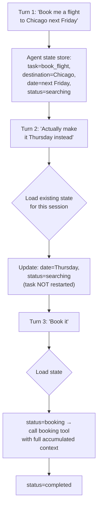
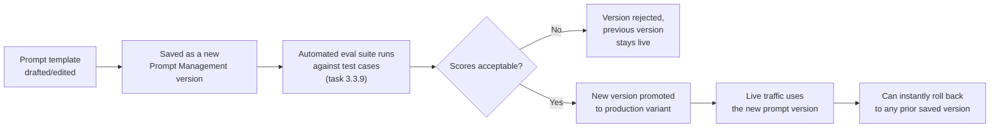
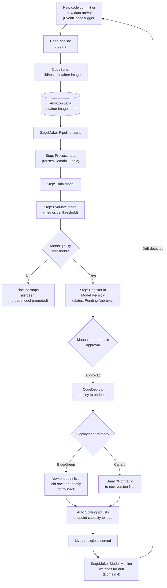
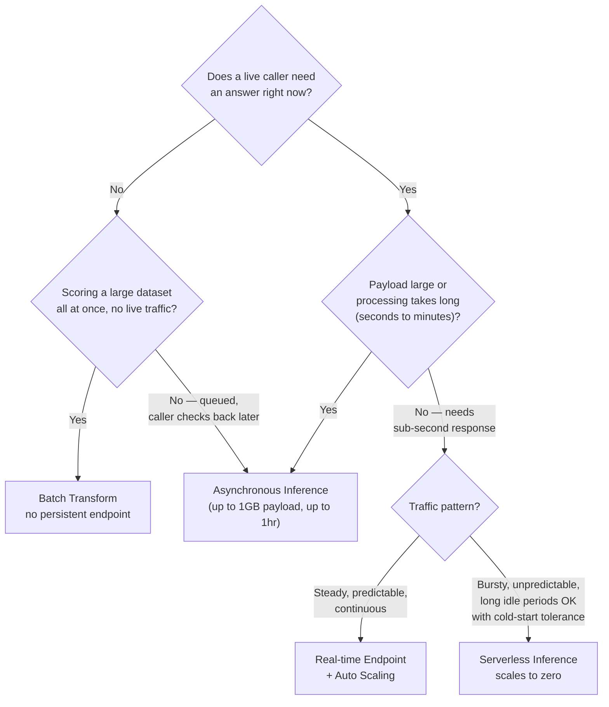
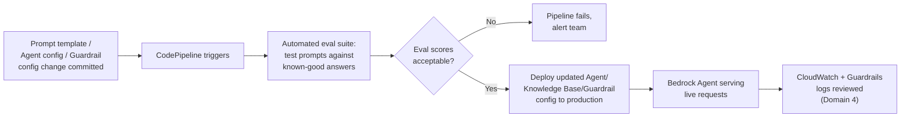
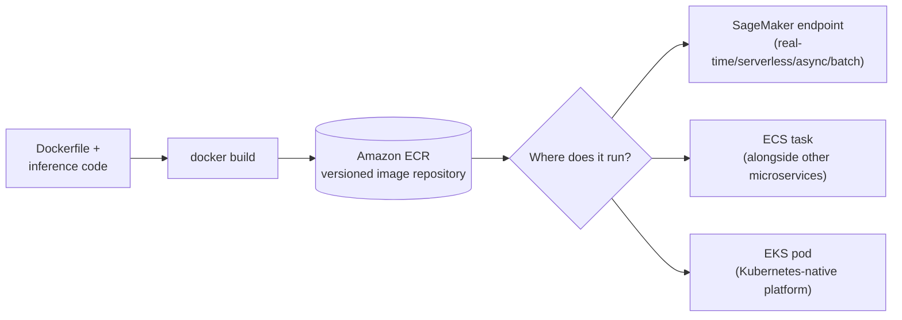
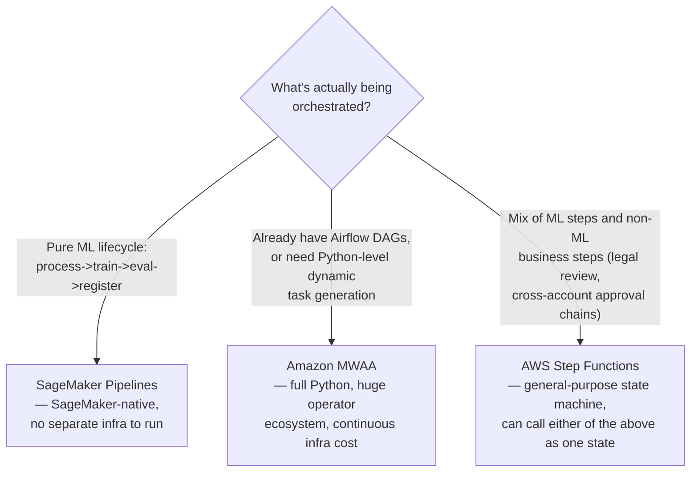
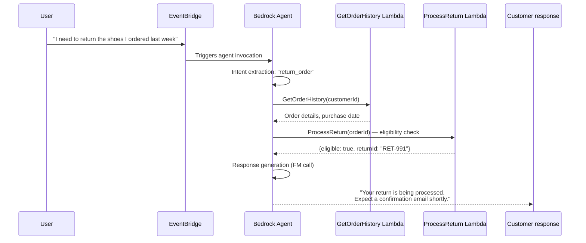

# Domain 3: Deployment and Orchestration of ML and AI Workflows (24%)

*MLA-C02 · renamed from C01's "Deployment and Orchestration of ML Workflows" to add "AI" —
this domain is about getting a finished model (from Domain 2) actually serving predictions in
production, reliably, and automating the pipeline that gets it there repeatedly.*

## Plain-English summary

A trained model sitting in S3 is useless until something can send it input and get a prediction
back. Domain 3 covers *how* that happens (what kind of endpoint, what compute, containerized
how), and *how the whole path from new code/data to a live, updated model* gets automated instead
of done by hand every time (CI/CD for ML — often called **MLOps**). The generative AI addition in
C02 is orchestrating GenAI-specific pieces: Bedrock Knowledge Bases (RAG, see Domain 1) and
Bedrock Agents (multi-step, tool-using AI workflows) as deployable, orchestrated components
alongside traditional model endpoints.

The core tension this entire domain resolves is simple to state: **a model that's never wrong in
a notebook is worthless if it can't reliably answer real requests at the traffic volume, latency,
and reliability the business actually needs** — and conversely, over-engineering deployment
infrastructure for a workload that didn't need it just burns money (Domain 4's territory, but the
decision starts here). Nearly every task statement below is a variation of "match the
infrastructure to the actual traffic shape, don't over- or under-provision."

## Task-statement-level content (from the official exam guide)

| Task statement | What it covers | Where it's covered |
|---|---|---|
| **3.1 — Select deployment infrastructure** | Real-time vs. serverless vs. asynchronous vs. batch transform endpoints; CPU vs. GPU; SageMaker Neo for edge/compiled inference | [`services/machine-learning-ai/sagemaker-deployment-endpoints.md`](../../../services/machine-learning-ai/sagemaker-deployment-endpoints.md) |
| **3.2 — Containerize and package models** | ECR, custom inference containers, Bring Your Own Container | [`services/containers/ecr.md`](../../../services/containers/ecr.md), [`services/containers/ecs.md`](../../../services/containers/ecs.md), [`services/containers/eks.md`](../../../services/containers/eks.md) |
| **3.3 — Automate deployment (CI/CD/IaC)** | CodePipeline/CodeBuild/CodeDeploy, CloudFormation/CDK, SageMaker Pipelines, EventBridge-triggered retraining, Amazon MWAA for complex DAG-based orchestration | [`services/machine-learning-ai/sagemaker-pipelines.md`](../../../services/machine-learning-ai/sagemaker-pipelines.md), [`services/application-integration/mwaa.md`](../../../services/application-integration/mwaa.md) |
| **3.4 — NEW: Orchestrate GenAI workflows** | Bedrock Knowledge Bases (RAG) and Agents as deployable, chainable components | [`services/machine-learning-ai/bedrock.md`](../../../services/machine-learning-ai/bedrock.md), see also Domain 1's [`embeddings-and-rag-data-prep.md`](../domain-1-data-preparation/embeddings-and-rag-data-prep.md) |
| **3.1.7 — NEW: Configure FM deployment/hosting/resource allocation** | Provisioning throughput, choosing hosting options, sizing resources for a deployed FM | this doc's ["FM Deployment Configuration"](#new-skills-317318--fm-deployment-configuration--rag-system-configuration-at-deploy-time) section below |
| **3.1.8 — NEW: Apply RAG system configurations** | Retrieval strategy and reranking choices applied at the deployment/infrastructure layer | this doc's ["FM Deployment Configuration"](#new-skills-317318--fm-deployment-configuration--rag-system-configuration-at-deploy-time) section below |
| **3.2.7 — NEW: Create/manage Bedrock Knowledge Bases** | Vector DB config, document indexing, retrieval optimization as a deployable resource | this doc's ["Knowledge Bases, Retrieval, Agent State, and GPU Scaling"](#new-skills-327-3211--knowledge-bases-retrieval-pipelines-agent-state-management-gpu-scaling-and-agentic-infrastructure) section below |
| **3.2.8 — NEW: Implement retrieval pipelines** | Deploying/operating the retrieval half of RAG as production infrastructure | same section below |
| **3.2.9 — NEW: Implement agent state management systems** | Session/conversation/task state across multi-turn agent interactions | same section below |
| **3.2.10 — NEW: AI-specific resource scaling for GPU workloads** | Scaling GPU capacity for FM hosting/agentic workloads specifically | same section below |
| **3.2.11 — NEW: Deploy agentic workflow infrastructure** | Standing up the infrastructure an agent runs on/within | same section below |
| **3.3.7 — NEW: Manage prompts (Bedrock Prompt Management)** | Versioning, testing, and deploying prompt templates as first-class artifacts | this doc's ["Prompt Management, Agent CI/CD, and RAG Pipeline Orchestration"](#new-skills-337-3311--prompt-management-agent-cicd-prompt-testing-fm-deployment-automation-and-rag-pipeline-orchestration) section below |
| **3.3.8 — NEW: Automated agent deployment pipelines + version management** | CI/CD specifically for agent configurations, with rollback by version | same section below |
| **3.3.9 — NEW: AI model testing frameworks including prompt testing** | Automated test suites for prompts/models before production rollout | same section below |
| **3.3.10 — NEW: FM deployment automation with fine-tuned model versioning** | Automating the rollout of newly fine-tuned FM versions | same section below |
| **3.3.11 — NEW: AI-specific pipeline orchestration for RAG updates** | Scheduling/automating knowledge base refresh cycles as a pipeline | same section below |

## Linked service docs — the deep dives

- **[`services/machine-learning-ai/sagemaker-deployment-endpoints.md`](../../../services/machine-learning-ai/sagemaker-deployment-endpoints.md)**
  — the four deployment shapes: **real-time** (always-on endpoint, lowest latency, pay for
  provisioned capacity continuously), **serverless** (scales to zero, pay per request, some cold
  start), **asynchronous** (for large payloads/long processing where the caller doesn't need an
  instant response), **batch transform** (score an entire dataset at once, no persistent
  endpoint at all).
- **[`services/containers/ecr.md`](../../../services/containers/ecr.md)** — Elastic Container
  Registry: where your custom inference container images live before SageMaker/ECS/EKS pull them.
- **[`services/containers/ecs.md`](../../../services/containers/ecs.md)** /
  **[`services/containers/eks.md`](../../../services/containers/eks.md)** — alternative hosting
  for a model's serving container when you need it alongside a broader non-SageMaker
  application architecture, or need Kubernetes-specific orchestration features.
- **[`services/machine-learning-ai/sagemaker-pipelines.md`](../../../services/machine-learning-ai/sagemaker-pipelines.md)**
  — the ML-specific CI/CD orchestrator: a SageMaker Pipeline chains steps (process data → train →
  evaluate → conditionally register/deploy) as a repeatable, versioned DAG (directed acyclic
  graph — a flowchart where steps run in order with no loops back).
- **[`services/machine-learning-ai/bedrock.md`](../../../services/machine-learning-ai/bedrock.md)**
  — Agents section covers multi-step GenAI orchestration (an agent that can call tools/APIs and
  chain reasoning steps), relevant here as the GenAI analog to a SageMaker Pipeline.
- **[`services/developer-tools/codepipeline.md`](../../../services/developer-tools/codepipeline.md)**
  (if present in this repo) / the general AWS CI/CD trio — CodePipeline orchestrates stages,
  CodeBuild compiles/tests/builds, CodeDeploy performs the actual rollout — the same three
  services DVA-C03's CI/CD domain covers, reused here for ML-specific pipelines.

## NEW skills 3.1.7/3.1.8 — FM deployment configuration & RAG system configuration at deploy time

**Task 3.1.7, plain English:** deploying a foundation model (whether a Bedrock-hosted model or a
self-managed one via SageMaker JumpStart) requires its own configuration decisions, distinct from
classic-ML endpoint deployment:

| Configuration decision | What it controls | Exam-relevant signal |
|---|---|---|
| Hosting option | **On-Demand** (pay per request/token, no commitment) vs. **Provisioned Throughput** (reserved capacity, lower effective per-token cost at high volume) vs. self-hosting a JumpStart FM on a SageMaker endpoint you fully control | Steady, high-volume usage → Provisioned Throughput; unpredictable/low volume → On-Demand; need full infra control (custom scaling policies, VPC specifics) → self-hosted JumpStart endpoint |
| Model unit/throughput sizing | How many requests per minute a given reservation can actually serve | Under-provisioning causes throttling under load; over-provisioning wastes the Provisioned Throughput commitment — size against measured, not guessed, traffic |
| Region/model availability | Not every foundation model is available in every AWS Region | A scenario with a hard data-residency requirement may constrain which models are even selectable, before any performance/cost comparison matters |
| GPU vs. specialized inference hardware (self-hosted) | For a self-hosted FM (JumpStart on SageMaker), choosing GPU instance family/size | See the GPU resource scaling section below — this decision interacts directly with cost and latency |

**Task 3.1.8, plain English:** a RAG system's *retrieval* configuration is itself a deployment-
time decision, not only a Domain 1/2 data-prep concern — once the architecture pattern is chosen
(Domain 2's task 2.1.5), deploying it means configuring:

- **Retrieval strategy at the infrastructure layer** — how many chunks to retrieve (top-K),
  whether hybrid keyword+vector search is enabled, and which vector store backend serves the
  request, all configured as part of the Knowledge Base/retrieval pipeline's deployed
  infrastructure, not just a data-prep-time choice.
- **Reranking deployment** — if the architecture calls for reranking (Domain 2's advanced RAG
  pattern), the reranker itself is a deployed component with its own latency/cost footprint that
  has to be sized and monitored like any other inference endpoint.
- **The exam-relevant connective tissue:** Domain 2 decides *which* RAG pattern and *why*; Domain
  3 (this task statement) is about actually standing up and configuring the infrastructure that
  realizes that choice in production — the same build-vs-operate distinction that runs throughout
  this entire domain's relationship to Domain 2.

## NEW skills 3.2.7–3.2.11 — Knowledge Bases, retrieval pipelines, agent state management, GPU scaling, and agentic infrastructure

**3.2.7 — Creating and managing Bedrock Knowledge Bases as a deployable resource:** beyond the
conceptual chunk→embed→retrieve pipeline (Domain 1), *operating* a Knowledge Base as
infrastructure means configuring its vector database binding (which OpenSearch collection, RDS
cluster, or S3 vector bucket it writes to — see Domain 1's vector database comparison), its data
source sync schedule (how often it re-indexes the underlying S3 documents), and its retrieval
configuration (number of results, metadata filtering rules) — all as versioned, deployable
settings, not one-time setup choices.

**3.2.8 — Implementing retrieval pipelines:** the production-operations view of retrieval — once
deployed, a retrieval pipeline needs health checks (is the vector store reachable and responding
within SLA), the same way any other service dependency does, and its latency is a real component
of the end-to-end response time budget a user-facing chatbot has to meet.

**3.2.9 — Implementing agent state management systems:** this is genuinely new, distinct content.
**Plain English:** a single foundation-model call is stateless — it only knows what's in the
current prompt. A multi-turn **agent** conversation (book a flight → confirm dates → pay) needs
to remember what happened in earlier turns and *where it is* in a multi-step task, across
multiple separate requests that might even hit different compute instances.



- **Why this can't just be "put it in the prompt"** — for a long-running or multi-session task
  (a booking flow a user might pause and resume hours later), state needs to persist independent
  of any single request's prompt, and independent of which compute instance happens to handle the
  next turn — this requires an external, durable state store (e.g., DynamoDB, or Bedrock
  AgentCore's managed session/state handling), not just appending to a growing prompt.
- **What actually gets stored** — the conversation history (or a summarized version of it, since
  unbounded raw history both costs tokens and eventually exceeds the context window — see
  `ml-cost-optimization.md`'s GenAI cost levers), the current task's progress/status, and any
  intermediate results from tool calls already made (e.g., a confirmed flight search result,
  so a later turn doesn't need to re-call the search tool).
- **Session identity** — every multi-turn interaction needs a session ID the client passes back
  on every subsequent request, which the agent uses as the key to load the correct state — a
  missing or inconsistent session ID is the most common real-world root cause of an agent that
  "forgets" context between turns that otherwise looks like a model capability problem.
- **The exam-relevant trap:** attributing an agent's failure to remember earlier context to the
  foundation model itself being "bad at conversation" when the actual root cause is a missing or
  misconfigured state-management layer — the model has no memory at all between calls by default;
  all continuity is the state-management system's job, not the model's.

**3.2.10 — AI-specific resource scaling for GPU workloads:** self-hosted foundation models and
embedding models (via JumpStart, or a self-hosted agent's own compute) commonly run on GPU
instances, which scale differently than CPU-based classic-ML endpoints:

- **GPU capacity is a scarcer, lumpier resource than CPU** — GPU instance types come in large,
  discrete jumps in capability and cost (no fine-grained "a little more compute" option the way
  CPU auto-scaling can add one more small instance), so scaling decisions are coarser and
  capacity availability in a given Region/AZ can itself be a real constraint, not just a cost one.
- **Batching requests to GPU-hosted models** — because a GPU can often process several requests
  together more efficiently than one at a time (up to a point), request batching/queuing in front
  of a GPU-hosted model is a real throughput lever distinct from simply adding more GPU instances.
- **Scaling an agentic workload specifically** — an agent's resource usage is bursty and
  unevenly distributed across its own steps (a planning step might be cheap/fast; a tool-calling
  step might wait on an external API; a final synthesis step might need the most capable, most
  GPU-hungry model) — scaling an agent's infrastructure means scaling each component to its own
  actual load pattern, not provisioning uniform capacity across the whole pipeline.

**3.2.11 — Deploying agentic workflow infrastructure:** the deployable units of an agent-based
system — the agent's own orchestration logic/runtime (e.g., Bedrock Agents, or a self-hosted
framework), its state store (3.2.9), its tool/Lambda integrations, and its Knowledge Base(s) —
all have to be deployed, versioned, and connected together as one coherent infrastructure stack,
typically via the same IaC (CloudFormation/CDK) discipline used for any other production AWS
infrastructure, described later in this document's "Infrastructure as Code" section.

## NEW skills 3.3.7–3.3.11 — Prompt Management, agent CI/CD, prompt testing, FM deployment automation, and RAG pipeline orchestration

**3.3.7 — Managing prompts with Amazon Bedrock Prompt Management:** **plain English:** a prompt
template used in production (e.g., a customer-support chatbot's system prompt) is a real,
versioned artifact that changes over time — Bedrock Prompt Management treats it that way
explicitly, rather than leaving it as a hardcoded string buried in application code.



- **Why version prompts like code, not like configuration** — a prompt change can shift model
  behavior as significantly as a code change can, so it needs the same rollback-ability, review
  gate, and audit trail — Prompt Management gives every saved prompt a version history, with the
  ability to point production traffic at a specific version and roll back instantly if a new one
  underperforms.
- **Separation from the application code** — because the prompt lives in Prompt Management rather
  than hardcoded in the calling application, a prompt-only change doesn't require a full
  application redeploy — a genuine operational win for teams that iterate on prompt wording
  frequently.

**3.3.8 — Automated agent deployment pipelines and agent version management:** agents get the
same CI/CD discipline as any other deployable artifact (directly extending the domain's existing
"GenAI orchestration layered on the same CI/CD shape" diagram below) — every change to an agent's
instructions, its tool definitions, or its Knowledge Base bindings is a new, versioned deployment
that goes through an automated eval gate before reaching production traffic, with the ability to
roll back to a prior agent version exactly like rolling back a model version in Model Registry.

**3.3.9 — AI model testing frameworks including prompt testing:** before any model, prompt, or
agent configuration change reaches production, an automated test suite runs a representative set
of test inputs and checks outputs against expected properties (not necessarily exact string
matches — often using the NLP evaluation metrics and LLM-as-a-judge techniques from Domain 2's
`ml-fundamentals-glossary.md`) — this is what task 3.3.9 means by "AI model testing," and it's the
automated gate referenced in the Prompt Management diagram above and the agent-deployment pipeline
diagram below.

**3.3.10 — FM deployment automation with fine-tuned model versioning:** when a fine-tuning job
(Domain 2) produces a new model version, rolling it into production follows the same automated
pipeline pattern as a classic-ML model (SageMaker Pipeline's evaluate→register→deploy flow
described below), with one GenAI-specific addition: the fine-tuned model version has to be
tracked distinctly from the *base* foundation model version it was fine-tuned from, since a base
model update (a new Bedrock model version) can require re-validating (and potentially
re-running) every fine-tune built on top of the old base version.

**3.3.11 — AI-specific pipeline orchestration for RAG updates/Knowledge Base refresh cycles:** a
Knowledge Base's underlying documents change over time (Domain 1), and keeping the deployed
retrieval system in sync is itself an orchestrated pipeline, not a manual re-upload: a scheduled
or event-triggered pipeline (EventBridge on a new/changed S3 document, or a fixed refresh
schedule) re-syncs the Knowledge Base's data source, re-indexes changed/new documents into the
vector store, and — for a mature pipeline — runs the same automated retrieval-accuracy evaluation
(Domain 2's task 2.3.10 metrics) after each refresh to confirm the update didn't regress
retrieval quality before fully rolling it out to production traffic.

## How It Works — full MLOps CI/CD with SageMaker Pipelines



Step by step:
1. **Trigger** — a new code commit (someone improved the training script) or a new batch of data
   landing (detected via **EventBridge**, AWS's event bus for "when X happens, trigger Y") kicks
   off the pipeline — this is what makes the process automatic instead of manual.
2. **CodePipeline** orchestrates the overall sequence of stages; **CodeBuild** compiles/tests and
   builds the container image that will run training and/or inference.
3. **Amazon ECR** stores that built container image, versioned by tag, ready to be pulled by
   SageMaker, ECS, or EKS.
4. **SageMaker Pipeline** is the ML-specific DAG that runs: process data (the same logic from
   Domain 1, now automated) → train (Domain 2) → evaluate.
5. **Evaluation step** compares the new model's metrics (accuracy, F1, RMSE — see Domain 2's
   `ml-fundamentals-glossary.md`) against a defined quality threshold. This is a genuine fork in
   the automation: a model that doesn't clear the bar never gets anywhere near production — the
   pipeline halts and alerts instead of quietly promoting a worse model.
6. **If it passes**, the model is registered in **SageMaker Model Registry** with status
   "Pending Approval" — versioned and tied to the exact data/code that produced it (lineage).
7. **Approval** can be manual (a human reviews metrics and clicks approve) or automatic (policy-
   based, e.g., "auto-approve if F1 improved over the current production model"). This gap is a
   deliberate control point — you decide how much human oversight your organization wants before
   a new model goes live.
8. **CodeDeploy** pushes the approved model to the endpoint using a **deployment strategy**:
   **blue/green** (stand up the new version fully, cut traffic over, keep the old version briefly
   so you can roll back instantly) or **canary** (send a small percentage of real traffic to the
   new version first, and only ramp up if it behaves well) — both exist to avoid an instant,
   all-or-nothing cutover that could take down production if the new model misbehaves.
9. **Auto Scaling** adjusts how many endpoint instances are running based on incoming traffic,
   so you're not paying for idle capacity or getting overwhelmed during spikes.
10. **Live predictions** are served, and **SageMaker Model Monitor** (Domain 4) continuously
    watches the live data/predictions for drift (the real world changing in ways that make the
    model stale) — which, when detected, is exactly the kind of event that should re-trigger
    step 1, closing the loop.


*Figure: AWS's own reference diagram of a CodePipeline release process — source change detected,
built, tested, deployed to staging, more tests, a manual approval gate, then deployed to
production. This is the generic CI/CD shape that the ML-specific diagram above specializes with
SageMaker Pipeline steps in place of generic build/test stages. Source: AWS CodePipeline User
Guide, "A quick look at CodePipeline" — docs.aws.amazon.com/codepipeline/latest/userguide/welcome-introducing.html.*

### A second diagram — the inference-option decision tree

Task statement 3.1's core skill is matching a traffic pattern to the correct inference option,
worth its own explicit decision tree rather than only a prose description:



Walking this tree against a scenario's described traffic pattern is literally the exam's most
common Domain 3 question shape — the "trick" is almost always in correctly answering the first
one or two branch questions (is there a live caller at all? does it need sub-second response?),
not in some deeper subtlety of any individual option.


*Figure: AWS's own illustration of serverless inference — SageMaker provisions compute only when
a request arrives and scales it back down afterward, which is the entire reason it has zero idle
cost (and some cold-start latency) compared to a real-time endpoint's continuous provisioning.
Source: Amazon SageMaker Developer Guide, "Deploy models with Amazon SageMaker Serverless
Inference" — docs.aws.amazon.com/sagemaker/latest/dg/serverless-endpoints.html.*

### A third diagram — GenAI orchestration layered on top of the same CI/CD shape

The C02-new "orchestrate GenAI workflows" task statement isn't a separate pipeline shape — it
slots into the same CodePipeline/CodeBuild/CodeDeploy CI/CD pattern, just with Bedrock-specific
artifacts instead of (or alongside) a SageMaker model:



The exam-relevant point: even though there's no "training job" in this GenAI pipeline (a Bedrock
Agent configuration isn't trained, it's configured), the same CI/CD discipline — automated
evaluation gating a deployment, versioned configuration, monitored production behavior — applies
identically. A scenario describing "we want to safely roll out an updated chatbot prompt/agent
configuration without risking a bad change reaching all users at once" is testing this same
blue/green or canary thinking, just applied to a GenAI artifact instead of a model binary.

## Full worked case study — a logistics company's multi-pattern deployment

**The business problem:** "SwiftShip," a logistics company, has three distinct prediction needs
that must all go live: (1) a live delivery-time estimate shown to customers at checkout
(must respond in under 200ms), (2) a weekly route-optimization batch job scoring all pending
shipments overnight, and (3) a customer-facing chatbot answering "where's my package" using a
Bedrock Agent that calls a live tracking API.

**Why these three need three different deployment patterns, not one:**

1. **Delivery-time estimate → Real-time endpoint with Auto Scaling.** A customer sees this number
   while checking out; a batch job or a few seconds of serverless cold-start latency would both
   be unacceptable. Traffic is also genuinely continuous during business hours, which is exactly
   the profile a Savings-Plan-backed, continuously-running real-time endpoint fits (Domain 4
   covers the cost side of this choice).
2. **Weekly route optimization → Batch Transform.** There's no live caller at all — a scheduled
   job scores the entire week's pending shipment list once, produces an output file, and the
   compute terminates. Standing up a persistent endpoint for a once-a-week batch job would be
   pure wasted idle cost.
3. **"Where's my package" chatbot → Bedrock Agent, orchestrating a Knowledge Base (policy
   questions) and a live Lambda-backed tool call (real tracking lookups).** This is the GenAI
   orchestration task statement directly: the Agent decides, per user message, whether it needs
   to retrieve from the Knowledge Base, call the live tracking tool, or both, then synthesizes a
   combined answer — exactly the sequence diagram shown in Domain 1's
   `embeddings-and-rag-data-prep.md`, reused here as a Domain 3 deployment/orchestration concern.

**How CI/CD ties all three together:** a single CodePipeline (with three parallel or sequential
stages) is triggered whenever any of the three components changes — a new delivery-time model
version, an updated route-optimization script, or a new Agent/Knowledge Base configuration —
each going through its own evaluation gate before its own deployment strategy (blue/green for the
real-time endpoint, a straightforward batch job re-run for the Transform job, and an automated
eval-suite gate for the Agent configuration) — one shared automation philosophy, three different
concrete deployment shapes underneath it.

**Why this case study matters for the exam:** a case-study question describing multiple
prediction needs within one company is explicitly testing whether you default to one inference
pattern for everything (the common wrong instinct — "just use a real-time endpoint for all of
it") versus correctly differentiating by traffic pattern and latency requirement per sub-problem.

## Containerization — the piece underneath every deployment option

Task statement 3.2 is easy to underweight because it feels like "just Docker," but it's worth
making explicit how it connects to everything above: every SageMaker inference option (real-time,
serverless, async, batch) and every custom ECS/EKS deployment ultimately runs a **container
image** — either a SageMaker pre-built framework container (TensorFlow, PyTorch, XGBoost, already
maintained by AWS) or a **Bring Your Own Container (BYOC)** you build yourself when no pre-built
image fits (a custom framework, an unusual runtime dependency, a licensing requirement).



The exam-relevant takeaway: a pre-built SageMaker container covers the overwhelming majority of
real scenarios (standard frameworks, standard serving patterns) — BYOC is the answer specifically
when a scenario names a requirement a pre-built container can't satisfy (an unsupported
framework version, a proprietary runtime, a non-standard serving protocol), not a default
first choice.

## Infrastructure as Code (IaC) — why "automate deployment" means more than CI/CD alone

Task statement 3.3 also covers CloudFormation/CDK, worth distinguishing clearly from
CodePipeline/CodeBuild/CodeDeploy: **CI/CD tools (CodePipeline etc.) automate the *process* of
getting a change from commit to production; IaC tools (CloudFormation/CDK) define the actual AWS
*resources* (the endpoint, the IAM role, the VPC configuration) as version-controlled code,
rather than created by hand in the console.** A mature ML deployment pipeline uses both together:
CodePipeline orchestrates *when* things happen, while CloudFormation/CDK templates define *what*
gets created at each step — a SageMaker endpoint resource, its auto-scaling policy, and its IAM
role are all expressed as a CloudFormation template (or CDK code that generates one), deployed as
part of the pipeline rather than clicked together manually.

The practical reason this matters beyond convenience: a hand-clicked endpoint configuration has
no record of exactly what was configured, can't be easily reproduced in a second environment
(staging vs. production), and can't be code-reviewed before it takes effect — the same reasons
IaC is standard practice for any production AWS infrastructure, applied here specifically to ML
serving infrastructure.

## Use Cases — Real Scenarios

1. A travel booking assistant maintains per-session state (destination, dates, booking status)
   in DynamoDB across a five-turn conversation, correctly resuming a paused booking flow when the
   user returns an hour later with the same session ID.
2. A retailer's customer-service team edits a chatbot's system prompt weekly to reflect current
   promotions, using Bedrock Prompt Management to version each change and instantly roll back a
   version that produced off-brand responses, without redeploying the surrounding application.
3. A logistics company commits to Bedrock Provisioned Throughput for its steady, high-volume
   delivery-estimate chatbot after six months of stable On-Demand usage data justified the
   commitment, directly reusing the decision discipline from `ml-cost-optimization.md`.
4. A media company deploys a self-hosted, fine-tuned summarization model on GPU instances sized
   specifically for its bursty daily-digest generation window, scaling GPU capacity up before the
   nightly batch and down immediately after, rather than running GPU capacity continuously.
5. A legal-tech platform's Knowledge Base refresh pipeline automatically re-indexes updated
   contract templates every night via an EventBridge-triggered job, then runs an automated
   Precision@K check before promoting the refreshed index to serve live traffic.
6. An insurance company's agent-deployment pipeline rejects a new agent configuration version
   after its automated prompt-testing suite flags it for occasionally skipping a required
   disclosure step, keeping the previous, compliant agent version live instead.
7. A SaaS company's engineering team debugs a chatbot that "forgets" earlier turns, discovering
   the root cause is a missing session ID in one client integration rather than any model
   limitation — directly exercising the agent-state-management exam trap.
8. A healthcare provider configures its Bedrock Knowledge Base's retrieval to combine hybrid
   keyword+vector search specifically because clinicians search using exact drug names that a
   vector-only search sometimes blurs together with similar-sounding alternatives.
9. A fintech startup versions its fine-tuned fraud-explanation model distinctly from the base
   foundation model it was built on, and re-validates all three of its fine-tunes after the base
   model receives a provider-side update, catching a behavior regression in one fine-tune before
   it reached production.
10. A customer support platform batches concurrent GPU-hosted embedding requests during peak
    hours rather than processing them one at a time, measurably increasing throughput on the same
    GPU instance count without any additional compute cost.

## How This Domain's Services Work Together — The Big Picture

Domain 3's services split into three layers that stack on top of each other for any GenAI
deployment. **The infrastructure layer** decides where compute actually runs: real-time/
serverless/async/batch endpoints for classic models, FM hosting (On-Demand or Provisioned
Throughput, possibly self-hosted via JumpStart on sized GPU instances) for foundation models, and
a Knowledge Base's vector database binding for retrieval — all configured against the actual
measured traffic pattern, not guessed. **The orchestration layer** sits on top, coordinating
multiple infrastructure pieces into one coherent interaction: a Bedrock Agent calling a Knowledge
Base and a Lambda tool together, backed by an external state store so a multi-turn conversation
survives across separate requests and even across compute instances. **The automation layer**
wraps both of the layers below in CI/CD: SageMaker Pipelines automate the classic-ML path
(process→train→evaluate→register→deploy); Prompt Management, agent deployment pipelines, and
fine-tuned-model-versioning automation cover the equivalent GenAI path, each gated by an
automated AI-testing suite before any change — a model version, a prompt edit, an agent
configuration change, or a Knowledge Base refresh — reaches production traffic. The throughline
connecting all three layers is the same blue/green or canary discipline this domain's CI/CD
diagrams describe: nothing new ships to all users at once, regardless of whether what shipped is
a retrained XGBoost model, an updated prompt template, or a refreshed vector index.

## Troubleshooting / Common Issues

- **A real-time endpoint deployment succeeds but requests time out or return 5xx errors
  immediately after cutover.** Check Auto Scaling configuration and instance health first — a
  newly deployed endpoint with too few instances for current traffic, or a container that fails
  its health check, both produce exactly this symptom; don't assume the model artifact itself is
  broken before checking infrastructure health.
- **A blue/green deployment's rollback doesn't actually restore the old behavior.** Confirm the
  old endpoint variant was genuinely kept running (not torn down) during the cutover window —
  some deployment configurations default to tearing down the old version immediately, which
  defeats the entire purpose of blue/green; check the deployment configuration's "termination
  wait time" setting.
- **A SageMaker Pipeline's Condition Step unexpectedly stops a pipeline that seems to have trained
  a fine model.** This is very often *working as intended* — re-check the actual evaluation
  metric against the configured threshold before assuming the pipeline itself is broken; a
  Condition Step existing specifically to block below-bar models is the entire point of the
  architecture in this document.
- **A Bring Your Own Container image builds and pushes fine but the SageMaker endpoint fails to
  start.** Check that the container implements SageMaker's expected serving contract (a `/ping`
  health-check endpoint and an `/invocations` prediction endpoint, at minimum) — a generic Docker
  image that runs fine standalone can still fail SageMaker's specific health-check expectations.
- **A Bedrock Agent occasionally fails to call the correct tool for a multi-step request.** This
  is usually an under-specified tool description/schema, not a model failure — the Agent decides
  which tool to call based on the natural-language description and parameter schema you provided
  for each tool; vague or overlapping tool descriptions are a common root cause of wrong-tool
  selection.
- **An EventBridge-triggered pipeline fires far more often than expected, re-training on every
  minor data update.** Check the EventBridge rule's event pattern — a rule matching too broad an
  event type (e.g., any S3 PUT, rather than a specific prefix/pattern matching genuinely new
  training-ready data) will trigger retraining on irrelevant writes, wasting compute on
  unnecessary pipeline runs.

## Common exam scenarios

1. **"Predictions are needed within milliseconds, continuously, at unpredictable volume"** →
   real-time endpoint with Auto Scaling, not batch transform.
2. **"A large PDF needs to be processed by a model and the caller can wait a few minutes for the
   result"** → asynchronous inference endpoint — real-time would waste provisioned capacity, and
   batch transform is for scoring large static datasets, not a single big ad-hoc request.
3. **"Score an entire 10TB dataset once, no live traffic involved, cost efficiency matters most"**
   → batch transform — no reason to keep a persistent endpoint running.
4. **"Traffic is bursty — zero for hours, then spikes — and a few seconds of cold-start latency
   on first request is acceptable"** → serverless inference endpoint, cheapest for this pattern.
5. **"Need to roll back instantly if a newly deployed model performs badly in production"** →
   blue/green deployment keeps the old version live/ready, unlike an in-place update.
6. **"Want to limit exposure of an unproven new model version to a small slice of real traffic
   first"** → canary deployment.
7. **"New training data lands in S3 daily and the model should retrain automatically when it
   does, without a human kicking it off"** → EventBridge rule on the S3 event triggering the
   SageMaker Pipeline.
8. **"Need to run inference on a small edge device (e.g., a factory sensor gateway) with no
   reliable connection back to AWS"** → SageMaker Neo compiles the model for the target
   edge hardware, running inference locally without a live endpoint call.
9. **"A chatbot needs to both answer from internal documents and call a live order-status API in
   the same conversation"** → a Bedrock Agent orchestrating a Knowledge Base (RAG) and a tool/
   Lambda call together, not a Knowledge Base alone (which has no ability to call external APIs).
10. **"A custom inference container with a non-standard ML framework needs to be deployed, and no
    SageMaker pre-built container supports it"** → Bring Your Own Container, built and pushed to
    ECR, then referenced by the SageMaker endpoint/training job configuration.
11. **"An organization wants its model-serving containers to run alongside other, non-ML
    microservices in the same Kubernetes-based platform the rest of engineering already uses"** →
    deploy to EKS rather than a SageMaker-managed endpoint, trading some SageMaker-specific
    convenience for consistency with the existing platform.
12. **"A newly deployed model version is live, but the team has no automated way to verify it's
    actually performing well versus the prior version before fully cutting traffic over"** →
    canary deployment combined with automated evaluation metrics gating further traffic ramp-up,
    not a manual blue/green cutover with no monitoring in between.
13. **"A company wants to update a Bedrock Agent's prompt instructions regularly but is worried a
    bad prompt change could reach all customers at once"** → treat the Agent configuration like
    any other deployable artifact — version it, run an automated eval suite against known test
    prompts, and gate the rollout exactly like a model deployment, rather than editing the live
    configuration directly.
14. **"GPU instances are needed for inference but the team wants to minimize idle GPU cost for
    a workload with long gaps between requests"** → this spans Domain 3 (serverless/async
    inference choice) and Domain 4 (cost optimization) — serverless inference with GPU support
    (where available) or scaling a real-time endpoint to zero during idle windows are the
    relevant levers, not simply accepting a continuously-billed GPU instance by default.
15. **"A deployment pipeline must guarantee that a model failing its evaluation step never
    reaches any production traffic, with no exceptions, even under deadline pressure"** → the
    Condition/Evaluation step in the SageMaker Pipeline (or an equivalent CodePipeline manual
    approval gate) is a hard stop by design — the correct answer treats this as a feature to
    configure correctly, not an obstacle to bypass under time pressure.

## Deep dive — worked traffic-pattern math across all four inference options, side by side

The "Common exam scenarios" list above states the decision rules; this section proves them with
actual numbers, because C02's scenario questions increasingly embed concrete traffic figures
(requests/second, payload size, latency budget) rather than just a qualitative description, and
expect you to reason quantitatively to the right answer, not just pattern-match a keyword.

**Setup:** the same underlying model (a document-risk scorer) considered under four different
traffic descriptions, to see exactly where each option's math stops making sense for the others.

| Variant | Traffic | Payload | Latency need | Correct option | Why the other three fail |
|---|---|---|---|---|---|
| A | 300 req/s, steady, all day | 2 KB | <100ms | **Real-time + auto-scaling** | Serverless: cold starts would hit a meaningful fraction of 300 req/s continuously; Async: adds needless queuing latency to traffic that's never actually bursty; Batch: no live caller exists in this pattern at all |
| B | ~40 req/day, random, 8am-6pm | 2 KB | <2s (cold start OK) | **Serverless** | Real-time: bills 24/7 for a workload idle >99.9% of the time; Async: adds an unneeded queue/notification hop for a request this small and this infrequent; Batch: there's no "whole dataset" to batch — these are independent, unpredictable live requests |
| C | ~500/day, clustered in bursts | 60 MB (scanned documents) | minutes OK | **Asynchronous** | Real-time: payload alone exceeds its ceiling; Serverless: same payload ceiling problem, plus 60MB processing time likely exceeds serverless's short processing window; Batch: these arrive continuously through the day, not as one bulk dataset to process at a single scheduled moment |
| D | 2 million records, once/week | 500 bytes each | hours OK, no live caller | **Batch Transform** | Real-time/Serverless: provisioning any persistent endpoint for a workload with zero live callers is pure wasted infrastructure; Async: async still implies a live caller submitting individual requests and awaiting a notification, which doesn't describe a single bulk weekly job at all |

**The arithmetic behind Variant A's "real-time, not serverless" call, explicitly:** 300 req/s is
300 × 60 = 18,000 invocations/minute. Even a conservative, well-provisioned serverless cold-start
rate (say, 2% of requests hitting cold compute during continuous high-volume traffic, since
serverless scales but doesn't eliminate the possibility of concurrency-limit-driven cold paths
under sustained heavy load) would mean roughly 360 requests/minute experiencing multi-hundred-
millisecond-plus cold-start latency against a <100ms SLA — a real, user-visible violation at this
volume, which real-time with proper auto-scaling (see
[`sagemaker-endpoint-autoscaling-cost-math.md`](sagemaker-endpoint-autoscaling-cost-math.md) for
the full instance-count math) simply doesn't risk, because its instances are already warm and
scaled to the steady load.

**The arithmetic behind Variant B's "serverless, not real-time" call, explicitly:** 40 requests/
day, each perhaps 150ms of actual compute, is 40 × 0.15 = **6 seconds/day of real work** — a
real-time `ml.t2.medium` instance running 24/7 to serve this would bill roughly 24 × 60 × 60 =
86,400 seconds/day of availability for 6 seconds/day of actual use, a **>14,000x** idle-to-used
ratio. This is the exact shape of waste a "most cost-effective" exam question is testing, and the
gap is large enough that no latency argument plausibly justifies it once the described workload
explicitly tolerates occasional cold-start delay.

## Deep dive — an additional real AWS reference architecture for the containerization layer

The "Containerization" section above establishes the SageMaker-vs-ECS-vs-EKS decision
conceptually; it's worth seeing AWS's own reference diagram for what a real EKS-hosted ML serving
layer alongside a full CI/CD pipeline actually looks like end to end, since Domain 3's
containerization task statement (3.2) is tested at exactly this level of concreteness:


*Figure: AWS's own reference architecture for modernizing an application onto EKS — a developer
commits to CodeCommit, triggering CodePipeline; CodeBuild builds and pushes a container image to
ECR, then runs `kubectl` against the EKS cluster's API server to roll out the new image, with
Kubernetes' own reconciliation loop performing the actual rolling update. The exam-relevant detail
this diagram makes concrete: unlike an ECS deploy action, **CodeDeploy is not typically in this
loop for native Kubernetes-manifest deployments** — the pipeline's job ends at "tell Kubernetes
what I want," and Kubernetes' own controller does the rest. Source: AWS Reference Architecture
Diagrams, "Modernize Applications with Microservices Using Amazon EKS."*

This is the same CI/CD shape as the SageMaker-centric pipeline diagram earlier in this document,
with one structural difference worth internalizing precisely: a SageMaker Pipeline's Condition
Step is an explicit, model-quality-aware gate written into the ML workflow itself, while a plain
Kubernetes rolling update (as shown here) has no equivalent model-quality awareness at all — it
only knows "did the new Pods pass their readiness/liveness probes," which is an infrastructure-
health check, not a model-quality check. **A team deploying an ML serving container to EKS still
needs the quality-gating logic to live somewhere explicit** (typically still a SageMaker Pipeline
or a custom CodeBuild validation step upstream of the `kubectl` rollout), because EKS's own
rolling-update mechanism, by itself, cannot tell a less-accurate model from a more-accurate one —
only whether the new container process successfully started and answers its health check.

## Deep dive — the MWAA alternative, with a real concrete comparison

Task 3.3 names SageMaker Pipelines and EventBridge-triggered orchestration as the default MLOps
automation pattern, but also names **Amazon MWAA** (Managed Workflows for Apache Airflow) for
teams whose orchestration needs are genuinely broader or more code-heavy than a SageMaker
Pipeline's step types express cleanly:




*Figure: AWS's own MWAA architecture diagram — the scheduler and workers run on AWS-managed
Fargate inside your VPC's private subnets, with a single-tenant Aurora PostgreSQL metadata
database tracking every DAG run. The exam-relevant cost distinction this diagram makes visible:
unlike a SageMaker Pipeline (billed purely for the underlying step compute, with zero separate
orchestration charge), an **MWAA environment bills continuously for its scheduler/worker Fargate
capacity, whether or not any DAG is actively running right now** — a genuinely different pricing
shape worth knowing explicitly rather than assuming all orchestration tools share SageMaker
Pipelines' zero-idle-cost model. Source: AWS MWAA Migration Guide, "Explore Amazon MWAA network
architecture."*

**The exam-relevant selection rule, stated once more precisely because it's a common trap:** a
scenario mentioning "complex workflow orchestration" alone, with no mention of Airflow or an
existing DAG investment, more often points at Step Functions or plain SageMaker Pipelines than at
MWAA — MWAA's signature, defining keyword is specifically **Airflow** (or an organization's
existing DAG ecosystem), not "complexity" in isolation. See
[`services/application-integration/mwaa.md`](../../../services/application-integration/mwaa.md)
for the full MWAA-vs-Step-Functions comparison table.

## Deep dive — more worked exam scenarios with explicit traffic-pattern numbers

Continuing directly from the "Common exam scenarios" list above, with the arithmetic shown this
time rather than only the final answer — this is deliberately the single most repeated skill in
this entire domain, worth seeing demonstrated many times with different numbers:

**Scenario 16:** "A model is called roughly 2 requests per minute, every minute, 24 hours a day,
with no tolerance for a cold start above 500ms, and every request must complete in under 300ms."
*Worked:* 2 req/min is very low volume by raw count, which might suggest serverless — but "zero
tolerance for a cold start above 500ms" directly conflicts with serverless's fundamental cold-
start tradeoff. The correct read: this is a **real-time endpoint sized to a single small
instance** (e.g., `ml.t2.medium`), not serverless, because the stated latency constraint — not
the request volume — is what actually rules an option out here. This is a deliberately
constructed trap: low volume alone does **not** always mean serverless; a strict zero-cold-start
requirement overrides it.

**Scenario 17:** "A nightly job scores 50,000 records, taking roughly 45 minutes end to end on a
single appropriately-sized instance, and the team currently runs this on a real-time endpoint
left running 24/7 specifically to avoid 'the hassle of configuring batch jobs.'" *Worked:* this
endpoint is receiving real traffic for 45 minutes out of 1,440 minutes/day — a 96.9% idle rate.
Batch Transform, which provisions compute only for the job's actual ~45-minute runtime and
terminates afterward, cuts the billed compute for this workload by roughly the same ~97%,
independent of any auto-scaling configuration on the real-time endpoint (auto-scaling an endpoint
that should not exist at all for this traffic pattern doesn't fix the underlying architectural
mismatch — the fix is switching inference options entirely, not tuning the wrong one).

**Scenario 18:** "An internal tool is called in genuine bursts — zero traffic most of the day,
then 200 requests within a 90-second window once or twice daily when a report is generated — and
the team wants to minimize cost without writing custom queuing infrastructure." *Worked:* 200
requests in 90 seconds is roughly 2.2 req/s during the burst — well within what a single
serverless endpoint's concurrency can absorb without needing custom queuing, and the long zero-
traffic stretches are exactly serverless's strongest cost case (billed only for the ~90 seconds ×
2 occurrences/day of actual compute, out of 86,400 seconds/day total). A real-time endpoint sized
for the burst would sit idle in excess of 99.7% of the day; Provisioned Concurrency on the
serverless endpoint is a reasonable refinement only if the burst's very first requests show an
unacceptable cold-start hit in practice — not a default assumption.

## Deep dive — agent architecture as deployed infrastructure, with AWS's own diagram

Task 3.2.11 ("deploy agentic workflow infrastructure") asks you to see an Agent not as a single
API call but as a small stack of distinct, independently deployable pieces — exactly the
distinction AWS's own AgentCore harness diagram makes visually:


*Figure: the official Bedrock AgentCore harness architecture — a per-session, isolated microVM
runs the actual agent code (framework-agnostic: LangGraph, Strands, CrewAI, or custom), with its
own filesystem and shell so the agent can write and execute code directly, wired to four separate
managed services: Identity (who is this agent acting for), Memory (what does it remember, short-
and long-term), Gateway (what tools can it call), and Observability (what happened, traced step by
step). Source: Amazon Bedrock AgentCore Developer Guide, "AgentCore harness."*

The deployment-relevant reading of this diagram: **each of the four surrounding services (Identity,
Memory, Gateway, Observability) is configured, versioned, and deployed independently of the agent
code itself** — updating which tools a Gateway exposes doesn't require redeploying the agent's own
reasoning code, and rotating which Identity provider an agent trusts doesn't touch Memory at all.
This is precisely the infrastructure-as-multiple-coordinated-pieces property task 3.2.11 is
testing: a question describing "update only the list of tools an agent can call, without touching
anything else" is pointing specifically at a Gateway-layer configuration change, not a full agent
redeployment — recognizing which layer of this stack a described change belongs to is the actual
tested skill, not simply knowing the word "AgentCore."

### A second agent diagram — the full customer-support automation workflow, concretely



This is the deployed shape of exactly the kind of multi-step GenAI orchestration task 3.4 names —
notice the trigger is **EventBridge**, the same event-bus mechanism this domain already uses to
trigger SageMaker Pipeline retraining, reused here to kick off an agent invocation from an
inbound customer message instead of a data-arrival event. The architectural throughline worth
naming explicitly: **EventBridge is this entire domain's general-purpose "something happened,
start the next step" connective tissue**, equally at home triggering a classic-ML retraining
pipeline, a Knowledge Base refresh (task 3.3.11), or — as shown here — a live agent interaction;
it is not a SageMaker-specific or Bedrock-specific mechanism, which is itself a recurring,
testable point across this entire domain's content.

## Deep dive — a fourth worked case study: blue/green vs. canary, with real traffic-split math

The "Common Architectures" section's Pattern 1 (blue/green canary rollout) names the pattern;
this section supplies the arithmetic a Domain 3 scenario expects when it specifies exact
percentages and a time window.

**The scenario:** a credit-scoring endpoint currently serves 5,000 requests/hour on its
production variant. A new model version is deployed as a canary at **10% traffic** for a planned
**2-hour observation window** before a decision to fully promote or roll back.

**The math:** 10% of 5,000 req/hour = **500 requests/hour** reaching the canary variant, or
**1,000 requests** total across the full 2-hour window — the sample size an evaluator actually
has to judge the new variant's real-world behavior on. If the team's acceptance criteria requires
observing at least, say, 200 instances of a specific rare outcome class (e.g., declined
applications, if that's the behavior under particular scrutiny) and that class occurs in roughly
8% of all requests historically, the canary's 1,000-request sample would be expected to contain
only around 80 such cases — **short of the 200 needed for a statistically meaningful read on that
specific rare outcome.** The correct response here is not "ship it anyway because the overall
error rate looks fine" — it's **extending the canary window or raising the canary percentage**
until the sample size covering the outcome class under scrutiny is actually large enough to judge
confidently. This is exactly the scenario this domain's README troubleshooting section already
names ("aggregate metrics can mask problems affecting a specific input pattern... underrepresented
in the canary's traffic slice") — now shown with the sample-size arithmetic behind why that's true,
not just the warning in prose.

**Contrast with blue/green:** a full blue/green cutover for the same endpoint exposes **100% of
the 5,000 req/hour immediately** to the new version (after validation, with the old version kept
warm for instant rollback) — appropriate when the team has already gained confidence through an
earlier canary phase (or through comprehensive offline evaluation) and wants a clean, complete
cutover rather than a prolonged partial-traffic period; it is **not** itself a substitute for the
canary's "learn from a real but limited traffic sample first" function — the two patterns solve
different problems (gradual learning vs. clean full cutover) and a mature rollout commonly uses
canary first, then blue/green for the final complete cutover once canary results are satisfactory.

## Deep dive — the full CodePipeline stage definition behind the diagram above, concretely

The "How It Works" CI/CD diagram names CodePipeline, CodeBuild, and CodeDeploy only as boxes; it's
worth seeing the actual stage-level JSON shape this domain's pipeline would use to wire a
SageMaker Pipeline trigger into a broader release, since task 3.3 explicitly names these services
by their real CLI/API surface, not just conceptually:

```json
{
  "stages": [
    { "name": "Source", "actions": [{ "name": "GitHubSource", "actionTypeId":
      { "category": "Source", "owner": "AWS", "provider": "CodeStarSourceConnection", "version": "1" } }] },
    { "name": "BuildInferenceContainer", "actions": [{ "name": "CodeBuildAction", "actionTypeId":
      { "category": "Build", "owner": "AWS", "provider": "CodeBuild", "version": "1" } }] },
    { "name": "TriggerSageMakerPipeline", "actions": [{ "name": "InvokeTrainingDAG", "actionTypeId":
      { "category": "Invoke", "owner": "AWS", "provider": "Lambda", "version": "1" } }] },
    { "name": "ApproveForProduction", "actions": [{ "name": "ManualApproval", "actionTypeId":
      { "category": "Approval", "owner": "AWS", "provider": "Manual", "version": "1" } }] },
    { "name": "DeployCanary", "actions": [{ "name": "UpdateEndpointVariant", "actionTypeId":
      { "category": "Invoke", "owner": "AWS", "provider": "Lambda", "version": "1" } }] }
  ]
}
```

The detail worth internalizing from this exact shape (expanded in full, with the actual Lambda
code bridging CodePipeline to a SageMaker Pipeline execution, in
[`mlops-cicd-pipeline-retraining-deep-dive.md`](mlops-cicd-pipeline-retraining-deep-dive.md)):
**there is no native CodePipeline action-type provider for "run a SageMaker Pipeline" or "update
a SageMaker endpoint's traffic split"** — both the `TriggerSageMakerPipeline` and `DeployCanary`
stages above use `category: Invoke, provider: Lambda`, the generic custom-action mechanism,
because CodePipeline's built-in action providers don't include SageMaker-specific ones. A question
asking "what built-in CodePipeline action type directly runs a SageMaker Pipeline" has no correct
built-in answer — recognizing that a custom Lambda action is required is itself the tested
knowledge, not a gap to be embarrassed about.

## Related Terms

- [`../domain-2-model-development/README.md`](../domain-2-model-development/README.md) — the
  model being deployed here was trained/registered there.
- [`../domain-4-monitoring-security/README.md`](../domain-4-monitoring-security/README.md) —
  what happens to this deployed model once it's live (drift detection, cost, security).
- [`../domain-1-data-preparation/embeddings-and-rag-data-prep.md`](../domain-1-data-preparation/embeddings-and-rag-data-prep.md)
  — the RAG pipeline that Bedrock Knowledge Bases (orchestrated here) is built on.
- [`services/machine-learning-ai/sagemaker-overview.md`](../../../services/machine-learning-ai/sagemaker-overview.md)
  — the umbrella SageMaker document connecting this domain's deployment options back to training.
- [`labs.md`](labs.md) — hands-on exercises for this domain (Floci + real free-tier alternatives).
- [`sagemaker-endpoint-autoscaling-cost-math.md`](sagemaker-endpoint-autoscaling-cost-math.md) —
  the worked numeric math behind "pick the right auto-scaling configuration and know its cost."
- [`bedrock-agent-architecture-state-management.md`](bedrock-agent-architecture-state-management.md)
  — the full build-time/runtime Agent architecture and state-management design space.
- [`mlops-cicd-pipeline-retraining-deep-dive.md`](mlops-cicd-pipeline-retraining-deep-dive.md) —
  the real CodePipeline + SageMaker Pipelines configuration files behind this domain's CI/CD diagram.
- [`gpu-instance-selection-scaling-fm-hosting.md`](gpu-instance-selection-scaling-fm-hosting.md)
  — instance-family selection and scaling mechanics for self-hosted foundation models.
- [`MASTER-CHUNK.md`](MASTER-CHUNK.md) — one self-contained file covering all nine of this
  domain's services/topics in full depth, for a single uninterrupted review pass.
