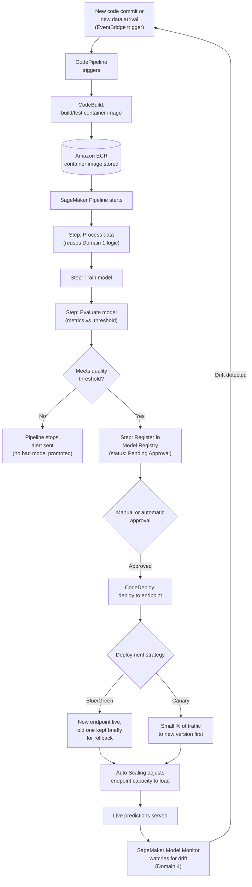

# Domain 3: Deployment and Orchestration of ML and AI Workflows (24%)

*MLA-C02 · renamed from C01's "Deployment and Orchestration of ML Workflows" to add "AI" —
this domain is about getting a finished model (from Domain 2) actually serving predictions in
production, reliably, and automating the pipeline that gets it there repeatedly.*

## Plain-English summary

A trained model sitting in S3 is useless until something can send it input and get a prediction
back. Domain 3 covers *how* that happens (what kind of endpoint, what compute, containerized
how), and *how the whole path from new code/data to a live, updated model* gets automated instead
of done by hand every time (CI/CD for ML — often called **MLOps**). The generative AI addition in
C02 is orchestrating GenAI-specific pieces: Bedrock Knowledge Bases (RAG, see Domain 1) and
Bedrock Agents (multi-step, tool-using AI workflows) as deployable, orchestrated components
alongside traditional model endpoints.

## Task-statement-level content (from the official exam guide)

| Task statement | What it covers | Where it's covered |
|---|---|---|
| **3.1 — Select deployment infrastructure** | Real-time vs. serverless vs. asynchronous vs. batch transform endpoints; CPU vs. GPU; SageMaker Neo for edge/compiled inference | [`services/machine-learning-ai/sagemaker-deployment-endpoints.md`](../../../services/machine-learning-ai/sagemaker-deployment-endpoints.md) |
| **3.2 — Containerize and package models** | ECR, custom inference containers, Bring Your Own Container | [`services/containers/ecr.md`](../../../services/containers/ecr.md), [`services/containers/ecs.md`](../../../services/containers/ecs.md), [`services/containers/eks.md`](../../../services/containers/eks.md) |
| **3.3 — Automate deployment (CI/CD/IaC)** | CodePipeline/CodeBuild/CodeDeploy, CloudFormation/CDK, SageMaker Pipelines, EventBridge-triggered retraining | [`services/machine-learning-ai/sagemaker-pipelines.md`](../../../services/machine-learning-ai/sagemaker-pipelines.md) |
| **3.4 — NEW: Orchestrate GenAI workflows** | Bedrock Knowledge Bases (RAG) and Agents as deployable, chainable components | [`services/machine-learning-ai/bedrock.md`](../../../services/machine-learning-ai/bedrock.md), see also Domain 1's [`embeddings-and-rag-data-prep.md`](../domain-1-data-preparation/embeddings-and-rag-data-prep.md) |

## Linked service docs — the deep dives

- **[`services/machine-learning-ai/sagemaker-deployment-endpoints.md`](../../../services/machine-learning-ai/sagemaker-deployment-endpoints.md)**
  — the four deployment shapes: **real-time** (always-on endpoint, lowest latency, pay for
  provisioned capacity continuously), **serverless** (scales to zero, pay per request, some cold
  start), **asynchronous** (for large payloads/long processing where the caller doesn't need an
  instant response), **batch transform** (score an entire dataset at once, no persistent
  endpoint at all).
- **[`services/containers/ecr.md`](../../../services/containers/ecr.md)** — Elastic Container
  Registry: where your custom inference container images live before SageMaker/ECS/EKS pull them.
- **[`services/containers/ecs.md`](../../../services/containers/ecs.md)** /
  **[`services/containers/eks.md`](../../../services/containers/eks.md)** — alternative hosting
  for a model's serving container when you need it alongside a broader non-SageMaker
  application architecture, or need Kubernetes-specific orchestration features.
- **[`services/machine-learning-ai/sagemaker-pipelines.md`](../../../services/machine-learning-ai/sagemaker-pipelines.md)**
  — the ML-specific CI/CD orchestrator: a SageMaker Pipeline chains steps (process data → train →
  evaluate → conditionally register/deploy) as a repeatable, versioned DAG (directed acyclic
  graph — a flowchart where steps run in order with no loops back).
- **[`services/machine-learning-ai/bedrock.md`](../../../services/machine-learning-ai/bedrock.md)**
  — Agents section covers multi-step GenAI orchestration (an agent that can call tools/APIs and
  chain reasoning steps), relevant here as the GenAI analog to a SageMaker Pipeline.

## How It Works — full MLOps CI/CD with SageMaker Pipelines

Step by step:
1. **Trigger** — a new code commit (someone improved the training script) or a new batch of data
   landing (detected via **EventBridge**, AWS's event bus for "when X happens, trigger Y") kicks
   off the pipeline — this is what makes the process automatic instead of manual.
2. **CodePipeline** orchestrates the overall sequence of stages; **CodeBuild** compiles/tests and
   builds the container image that will run training and/or inference.
3. **Amazon ECR** stores that built container image, versioned by tag, ready to be pulled by
   SageMaker, ECS, or EKS.
4. **SageMaker Pipeline** is the ML-specific DAG that runs: process data (the same logic from
   Domain 1, now automated) → train (Domain 2) → evaluate.
5. **Evaluation step** compares the new model's metrics (accuracy, F1, RMSE — see Domain 2's
   `ml-fundamentals-glossary.md`) against a defined quality threshold. This is a genuine fork in
   the automation: a model that doesn't clear the bar never gets anywhere near production — the
   pipeline halts and alerts instead of quietly promoting a worse model.
6. **If it passes**, the model is registered in **SageMaker Model Registry** with status
   "Pending Approval" — versioned and tied to the exact data/code that produced it (lineage).
7. **Approval** can be manual (a human reviews metrics and clicks approve) or automatic (policy-
   based, e.g., "auto-approve if F1 improved over the current production model"). This gap is a
   deliberate control point — you decide how much human oversight your organization wants before
   a new model goes live.
8. **CodeDeploy** pushes the approved model to the endpoint using a **deployment strategy**:
   **blue/green** (stand up the new version fully, cut traffic over, keep the old version briefly
   so you can roll back instantly) or **canary** (send a small percentage of real traffic to the
   new version first, and only ramp up if it behaves well) — both exist to avoid an instant,
   all-or-nothing cutover that could take down production if the new model misbehaves.
9. **Auto Scaling** adjusts how many endpoint instances are running based on incoming traffic,
   so you're not paying for idle capacity or getting overwhelmed during spikes.
10. **Live predictions** are served, and **SageMaker Model Monitor** (Domain 4) continuously
    watches the live data/predictions for drift (the real world changing in ways that make the
    model stale) — which, when detected, is exactly the kind of event that should re-trigger
    step 1, closing the loop.

## Common exam scenarios

1. **"Predictions are needed within milliseconds, continuously, at unpredictable volume"** →
   real-time endpoint with Auto Scaling, not batch transform.
2. **"A large PDF needs to be processed by a model and the caller can wait a few minutes for the
   result"** → asynchronous inference endpoint — real-time would waste provisioned capacity, and
   batch transform is for scoring large static datasets, not a single big ad-hoc request.
3. **"Score an entire 10TB dataset once, no live traffic involved, cost efficiency matters most"**
   → batch transform — no reason to keep a persistent endpoint running.
4. **"Traffic is bursty — zero for hours, then spikes — and a few seconds of cold-start latency
   on first request is acceptable"** → serverless inference endpoint, cheapest for this pattern.
5. **"Need to roll back instantly if a newly deployed model performs badly in production"** →
   blue/green deployment keeps the old version live/ready, unlike an in-place update.
6. **"Want to limit exposure of an unproven new model version to a small slice of real traffic
   first"** → canary deployment.
7. **"New training data lands in S3 daily and the model should retrain automatically when it
   does, without a human kicking it off"** → EventBridge rule on the S3 event triggering the
   SageMaker Pipeline.
8. **"Need to run inference on a small edge device (e.g., a factory sensor gateway) with no
   reliable connection back to AWS"** → SageMaker Neo compiles the model for the target
   edge hardware, running inference locally without a live endpoint call.

## Related Terms

- [`../domain-2-model-development/README.md`](../domain-2-model-development/README.md) — the
  model being deployed here was trained/registered there.
- [`../domain-4-monitoring-security/README.md`](../domain-4-monitoring-security/README.md) —
  what happens to this deployed model once it's live (drift detection, cost, security).
