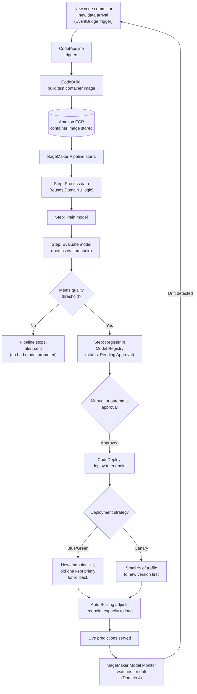
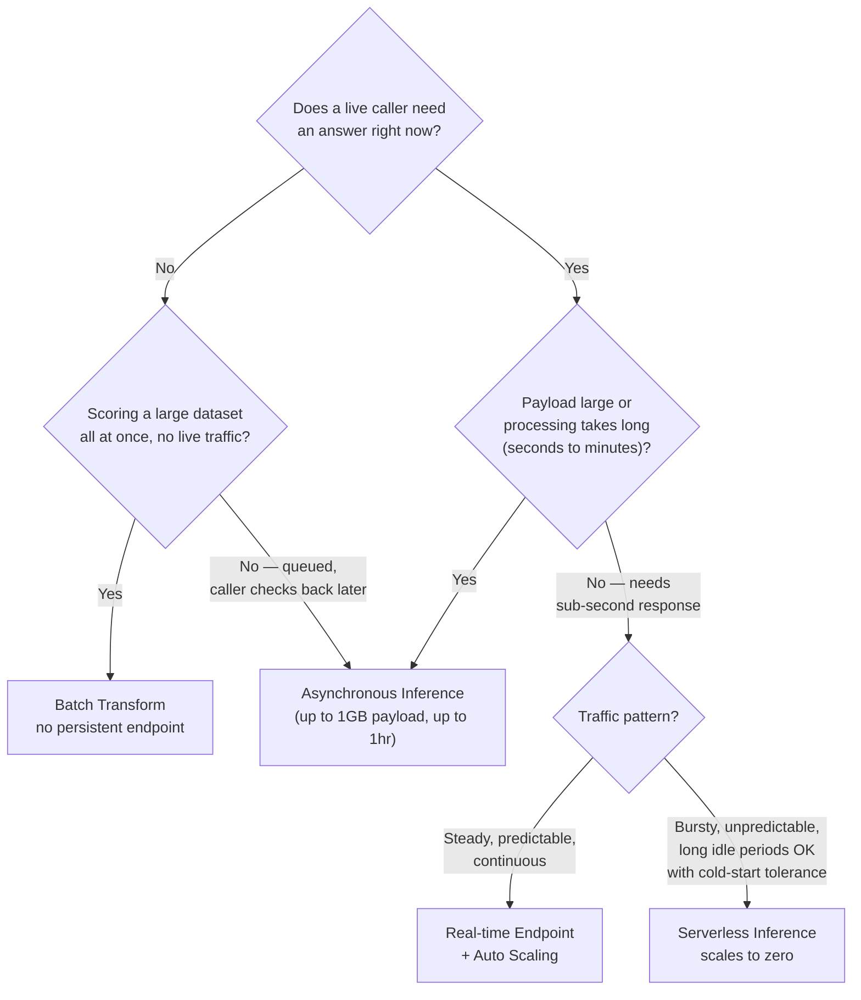
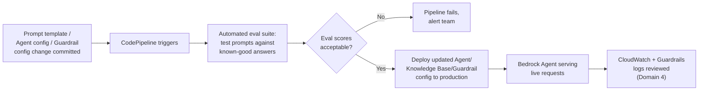
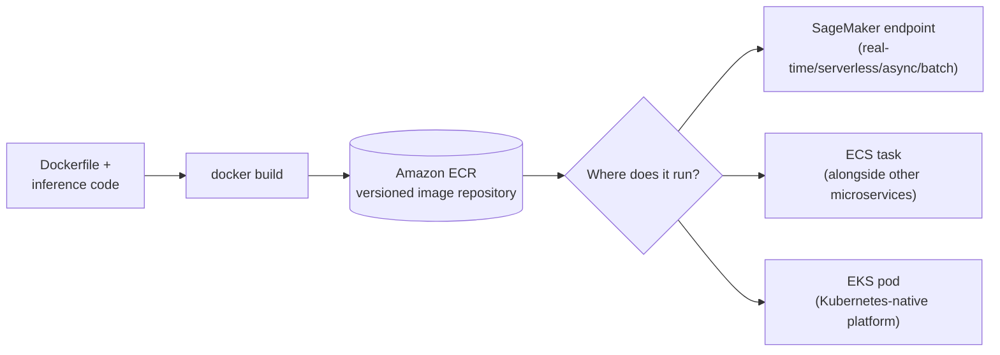

# Domain 3: Deployment and Orchestration of ML and AI Workflows (24%)

*MLA-C02 · renamed from C01's "Deployment and Orchestration of ML Workflows" to add "AI" —
this domain is about getting a finished model (from Domain 2) actually serving predictions in
production, reliably, and automating the pipeline that gets it there repeatedly.*

## Plain-English summary

A trained model sitting in S3 is useless until something can send it input and get a prediction
back. Domain 3 covers *how* that happens (what kind of endpoint, what compute, containerized
how), and *how the whole path from new code/data to a live, updated model* gets automated instead
of done by hand every time (CI/CD for ML — often called **MLOps**). The generative AI addition in
C02 is orchestrating GenAI-specific pieces: Bedrock Knowledge Bases (RAG, see Domain 1) and
Bedrock Agents (multi-step, tool-using AI workflows) as deployable, orchestrated components
alongside traditional model endpoints.

The core tension this entire domain resolves is simple to state: **a model that's never wrong in
a notebook is worthless if it can't reliably answer real requests at the traffic volume, latency,
and reliability the business actually needs** — and conversely, over-engineering deployment
infrastructure for a workload that didn't need it just burns money (Domain 4's territory, but the
decision starts here). Nearly every task statement below is a variation of "match the
infrastructure to the actual traffic shape, don't over- or under-provision."

## Task-statement-level content (from the official exam guide)

| Task statement | What it covers | Where it's covered |
|---|---|---|
| **3.1 — Select deployment infrastructure** | Real-time vs. serverless vs. asynchronous vs. batch transform endpoints; CPU vs. GPU; SageMaker Neo for edge/compiled inference | [`services/machine-learning-ai/sagemaker-deployment-endpoints.md`](../../../services/machine-learning-ai/sagemaker-deployment-endpoints.md) |
| **3.2 — Containerize and package models** | ECR, custom inference containers, Bring Your Own Container | [`services/containers/ecr.md`](../../../services/containers/ecr.md), [`services/containers/ecs.md`](../../../services/containers/ecs.md), [`services/containers/eks.md`](../../../services/containers/eks.md) |
| **3.3 — Automate deployment (CI/CD/IaC)** | CodePipeline/CodeBuild/CodeDeploy, CloudFormation/CDK, SageMaker Pipelines, EventBridge-triggered retraining | [`services/machine-learning-ai/sagemaker-pipelines.md`](../../../services/machine-learning-ai/sagemaker-pipelines.md) |
| **3.4 — NEW: Orchestrate GenAI workflows** | Bedrock Knowledge Bases (RAG) and Agents as deployable, chainable components | [`services/machine-learning-ai/bedrock.md`](../../../services/machine-learning-ai/bedrock.md), see also Domain 1's [`embeddings-and-rag-data-prep.md`](../domain-1-data-preparation/embeddings-and-rag-data-prep.md) |

## Linked service docs — the deep dives

- **[`services/machine-learning-ai/sagemaker-deployment-endpoints.md`](../../../services/machine-learning-ai/sagemaker-deployment-endpoints.md)**
  — the four deployment shapes: **real-time** (always-on endpoint, lowest latency, pay for
  provisioned capacity continuously), **serverless** (scales to zero, pay per request, some cold
  start), **asynchronous** (for large payloads/long processing where the caller doesn't need an
  instant response), **batch transform** (score an entire dataset at once, no persistent
  endpoint at all).
- **[`services/containers/ecr.md`](../../../services/containers/ecr.md)** — Elastic Container
  Registry: where your custom inference container images live before SageMaker/ECS/EKS pull them.
- **[`services/containers/ecs.md`](../../../services/containers/ecs.md)** /
  **[`services/containers/eks.md`](../../../services/containers/eks.md)** — alternative hosting
  for a model's serving container when you need it alongside a broader non-SageMaker
  application architecture, or need Kubernetes-specific orchestration features.
- **[`services/machine-learning-ai/sagemaker-pipelines.md`](../../../services/machine-learning-ai/sagemaker-pipelines.md)**
  — the ML-specific CI/CD orchestrator: a SageMaker Pipeline chains steps (process data → train →
  evaluate → conditionally register/deploy) as a repeatable, versioned DAG (directed acyclic
  graph — a flowchart where steps run in order with no loops back).
- **[`services/machine-learning-ai/bedrock.md`](../../../services/machine-learning-ai/bedrock.md)**
  — Agents section covers multi-step GenAI orchestration (an agent that can call tools/APIs and
  chain reasoning steps), relevant here as the GenAI analog to a SageMaker Pipeline.
- **[`services/developer-tools/codepipeline.md`](../../../services/developer-tools/codepipeline.md)**
  (if present in this repo) / the general AWS CI/CD trio — CodePipeline orchestrates stages,
  CodeBuild compiles/tests/builds, CodeDeploy performs the actual rollout — the same three
  services DVA-C03's CI/CD domain covers, reused here for ML-specific pipelines.

## How It Works — full MLOps CI/CD with SageMaker Pipelines

Step by step:
1. **Trigger** — a new code commit (someone improved the training script) or a new batch of data
   landing (detected via **EventBridge**, AWS's event bus for "when X happens, trigger Y") kicks
   off the pipeline — this is what makes the process automatic instead of manual.
2. **CodePipeline** orchestrates the overall sequence of stages; **CodeBuild** compiles/tests and
   builds the container image that will run training and/or inference.
3. **Amazon ECR** stores that built container image, versioned by tag, ready to be pulled by
   SageMaker, ECS, or EKS.
4. **SageMaker Pipeline** is the ML-specific DAG that runs: process data (the same logic from
   Domain 1, now automated) → train (Domain 2) → evaluate.
5. **Evaluation step** compares the new model's metrics (accuracy, F1, RMSE — see Domain 2's
   `ml-fundamentals-glossary.md`) against a defined quality threshold. This is a genuine fork in
   the automation: a model that doesn't clear the bar never gets anywhere near production — the
   pipeline halts and alerts instead of quietly promoting a worse model.
6. **If it passes**, the model is registered in **SageMaker Model Registry** with status
   "Pending Approval" — versioned and tied to the exact data/code that produced it (lineage).
7. **Approval** can be manual (a human reviews metrics and clicks approve) or automatic (policy-
   based, e.g., "auto-approve if F1 improved over the current production model"). This gap is a
   deliberate control point — you decide how much human oversight your organization wants before
   a new model goes live.
8. **CodeDeploy** pushes the approved model to the endpoint using a **deployment strategy**:
   **blue/green** (stand up the new version fully, cut traffic over, keep the old version briefly
   so you can roll back instantly) or **canary** (send a small percentage of real traffic to the
   new version first, and only ramp up if it behaves well) — both exist to avoid an instant,
   all-or-nothing cutover that could take down production if the new model misbehaves.
9. **Auto Scaling** adjusts how many endpoint instances are running based on incoming traffic,
   so you're not paying for idle capacity or getting overwhelmed during spikes.
10. **Live predictions** are served, and **SageMaker Model Monitor** (Domain 4) continuously
    watches the live data/predictions for drift (the real world changing in ways that make the
    model stale) — which, when detected, is exactly the kind of event that should re-trigger
    step 1, closing the loop.

*Figure: AWS's own reference diagram of a CodePipeline release process — source change detected,
built, tested, deployed to staging, more tests, a manual approval gate, then deployed to
production. This is the generic CI/CD shape that the ML-specific diagram above specializes with
SageMaker Pipeline steps in place of generic build/test stages. Source: AWS CodePipeline User
Guide, "A quick look at CodePipeline" — docs.aws.amazon.com/codepipeline/latest/userguide/welcome-introducing.html.*

### A second diagram — the inference-option decision tree

Task statement 3.1's core skill is matching a traffic pattern to the correct inference option,
worth its own explicit decision tree rather than only a prose description:

Walking this tree against a scenario's described traffic pattern is literally the exam's most
common Domain 3 question shape — the "trick" is almost always in correctly answering the first
one or two branch questions (is there a live caller at all? does it need sub-second response?),
not in some deeper subtlety of any individual option.

*Figure: AWS's own illustration of serverless inference — SageMaker provisions compute only when
a request arrives and scales it back down afterward, which is the entire reason it has zero idle
cost (and some cold-start latency) compared to a real-time endpoint's continuous provisioning.
Source: Amazon SageMaker Developer Guide, "Deploy models with Amazon SageMaker Serverless
Inference" — docs.aws.amazon.com/sagemaker/latest/dg/serverless-endpoints.html.*

### A third diagram — GenAI orchestration layered on top of the same CI/CD shape

The C02-new "orchestrate GenAI workflows" task statement isn't a separate pipeline shape — it
slots into the same CodePipeline/CodeBuild/CodeDeploy CI/CD pattern, just with Bedrock-specific
artifacts instead of (or alongside) a SageMaker model:

The exam-relevant point: even though there's no "training job" in this GenAI pipeline (a Bedrock
Agent configuration isn't trained, it's configured), the same CI/CD discipline — automated
evaluation gating a deployment, versioned configuration, monitored production behavior — applies
identically. A scenario describing "we want to safely roll out an updated chatbot prompt/agent
configuration without risking a bad change reaching all users at once" is testing this same
blue/green or canary thinking, just applied to a GenAI artifact instead of a model binary.

## Full worked case study — a logistics company's multi-pattern deployment

**The business problem:** "SwiftShip," a logistics company, has three distinct prediction needs
that must all go live: (1) a live delivery-time estimate shown to customers at checkout
(must respond in under 200ms), (2) a weekly route-optimization batch job scoring all pending
shipments overnight, and (3) a customer-facing chatbot answering "where's my package" using a
Bedrock Agent that calls a live tracking API.

**Why these three need three different deployment patterns, not one:**

1. **Delivery-time estimate → Real-time endpoint with Auto Scaling.** A customer sees this number
   while checking out; a batch job or a few seconds of serverless cold-start latency would both
   be unacceptable. Traffic is also genuinely continuous during business hours, which is exactly
   the profile a Savings-Plan-backed, continuously-running real-time endpoint fits (Domain 4
   covers the cost side of this choice).
2. **Weekly route optimization → Batch Transform.** There's no live caller at all — a scheduled
   job scores the entire week's pending shipment list once, produces an output file, and the
   compute terminates. Standing up a persistent endpoint for a once-a-week batch job would be
   pure wasted idle cost.
3. **"Where's my package" chatbot → Bedrock Agent, orchestrating a Knowledge Base (policy
   questions) and a live Lambda-backed tool call (real tracking lookups).** This is the GenAI
   orchestration task statement directly: the Agent decides, per user message, whether it needs
   to retrieve from the Knowledge Base, call the live tracking tool, or both, then synthesizes a
   combined answer — exactly the sequence diagram shown in Domain 1's
   `embeddings-and-rag-data-prep.md`, reused here as a Domain 3 deployment/orchestration concern.

**How CI/CD ties all three together:** a single CodePipeline (with three parallel or sequential
stages) is triggered whenever any of the three components changes — a new delivery-time model
version, an updated route-optimization script, or a new Agent/Knowledge Base configuration —
each going through its own evaluation gate before its own deployment strategy (blue/green for the
real-time endpoint, a straightforward batch job re-run for the Transform job, and an automated
eval-suite gate for the Agent configuration) — one shared automation philosophy, three different
concrete deployment shapes underneath it.

**Why this case study matters for the exam:** a case-study question describing multiple
prediction needs within one company is explicitly testing whether you default to one inference
pattern for everything (the common wrong instinct — "just use a real-time endpoint for all of
it") versus correctly differentiating by traffic pattern and latency requirement per sub-problem.

## Containerization — the piece underneath every deployment option

Task statement 3.2 is easy to underweight because it feels like "just Docker," but it's worth
making explicit how it connects to everything above: every SageMaker inference option (real-time,
serverless, async, batch) and every custom ECS/EKS deployment ultimately runs a **container
image** — either a SageMaker pre-built framework container (TensorFlow, PyTorch, XGBoost, already
maintained by AWS) or a **Bring Your Own Container (BYOC)** you build yourself when no pre-built
image fits (a custom framework, an unusual runtime dependency, a licensing requirement).

The exam-relevant takeaway: a pre-built SageMaker container covers the overwhelming majority of
real scenarios (standard frameworks, standard serving patterns) — BYOC is the answer specifically
when a scenario names a requirement a pre-built container can't satisfy (an unsupported
framework version, a proprietary runtime, a non-standard serving protocol), not a default
first choice.

## Infrastructure as Code (IaC) — why "automate deployment" means more than CI/CD alone

Task statement 3.3 also covers CloudFormation/CDK, worth distinguishing clearly from
CodePipeline/CodeBuild/CodeDeploy: **CI/CD tools (CodePipeline etc.) automate the *process* of
getting a change from commit to production; IaC tools (CloudFormation/CDK) define the actual AWS
*resources* (the endpoint, the IAM role, the VPC configuration) as version-controlled code,
rather than created by hand in the console.** A mature ML deployment pipeline uses both together:
CodePipeline orchestrates *when* things happen, while CloudFormation/CDK templates define *what*
gets created at each step — a SageMaker endpoint resource, its auto-scaling policy, and its IAM
role are all expressed as a CloudFormation template (or CDK code that generates one), deployed as
part of the pipeline rather than clicked together manually.

The practical reason this matters beyond convenience: a hand-clicked endpoint configuration has
no record of exactly what was configured, can't be easily reproduced in a second environment
(staging vs. production), and can't be code-reviewed before it takes effect — the same reasons
IaC is standard practice for any production AWS infrastructure, applied here specifically to ML
serving infrastructure.

## Troubleshooting / Common Issues

- **A real-time endpoint deployment succeeds but requests time out or return 5xx errors
  immediately after cutover.** Check Auto Scaling configuration and instance health first — a
  newly deployed endpoint with too few instances for current traffic, or a container that fails
  its health check, both produce exactly this symptom; don't assume the model artifact itself is
  broken before checking infrastructure health.
- **A blue/green deployment's rollback doesn't actually restore the old behavior.** Confirm the
  old endpoint variant was genuinely kept running (not torn down) during the cutover window —
  some deployment configurations default to tearing down the old version immediately, which
  defeats the entire purpose of blue/green; check the deployment configuration's "termination
  wait time" setting.
- **A SageMaker Pipeline's Condition Step unexpectedly stops a pipeline that seems to have trained
  a fine model.** This is very often *working as intended* — re-check the actual evaluation
  metric against the configured threshold before assuming the pipeline itself is broken; a
  Condition Step existing specifically to block below-bar models is the entire point of the
  architecture in this document.
- **A Bring Your Own Container image builds and pushes fine but the SageMaker endpoint fails to
  start.** Check that the container implements SageMaker's expected serving contract (a `/ping`
  health-check endpoint and an `/invocations` prediction endpoint, at minimum) — a generic Docker
  image that runs fine standalone can still fail SageMaker's specific health-check expectations.
- **A Bedrock Agent occasionally fails to call the correct tool for a multi-step request.** This
  is usually an under-specified tool description/schema, not a model failure — the Agent decides
  which tool to call based on the natural-language description and parameter schema you provided
  for each tool; vague or overlapping tool descriptions are a common root cause of wrong-tool
  selection.
- **An EventBridge-triggered pipeline fires far more often than expected, re-training on every
  minor data update.** Check the EventBridge rule's event pattern — a rule matching too broad an
  event type (e.g., any S3 PUT, rather than a specific prefix/pattern matching genuinely new
  training-ready data) will trigger retraining on irrelevant writes, wasting compute on
  unnecessary pipeline runs.

## Common exam scenarios

1. **"Predictions are needed within milliseconds, continuously, at unpredictable volume"** →
   real-time endpoint with Auto Scaling, not batch transform.
2. **"A large PDF needs to be processed by a model and the caller can wait a few minutes for the
   result"** → asynchronous inference endpoint — real-time would waste provisioned capacity, and
   batch transform is for scoring large static datasets, not a single big ad-hoc request.
3. **"Score an entire 10TB dataset once, no live traffic involved, cost efficiency matters most"**
   → batch transform — no reason to keep a persistent endpoint running.
4. **"Traffic is bursty — zero for hours, then spikes — and a few seconds of cold-start latency
   on first request is acceptable"** → serverless inference endpoint, cheapest for this pattern.
5. **"Need to roll back instantly if a newly deployed model performs badly in production"** →
   blue/green deployment keeps the old version live/ready, unlike an in-place update.
6. **"Want to limit exposure of an unproven new model version to a small slice of real traffic
   first"** → canary deployment.
7. **"New training data lands in S3 daily and the model should retrain automatically when it
   does, without a human kicking it off"** → EventBridge rule on the S3 event triggering the
   SageMaker Pipeline.
8. **"Need to run inference on a small edge device (e.g., a factory sensor gateway) with no
   reliable connection back to AWS"** → SageMaker Neo compiles the model for the target
   edge hardware, running inference locally without a live endpoint call.
9. **"A chatbot needs to both answer from internal documents and call a live order-status API in
   the same conversation"** → a Bedrock Agent orchestrating a Knowledge Base (RAG) and a tool/
   Lambda call together, not a Knowledge Base alone (which has no ability to call external APIs).
10. **"A custom inference container with a non-standard ML framework needs to be deployed, and no
    SageMaker pre-built container supports it"** → Bring Your Own Container, built and pushed to
    ECR, then referenced by the SageMaker endpoint/training job configuration.
11. **"An organization wants its model-serving containers to run alongside other, non-ML
    microservices in the same Kubernetes-based platform the rest of engineering already uses"** →
    deploy to EKS rather than a SageMaker-managed endpoint, trading some SageMaker-specific
    convenience for consistency with the existing platform.
12. **"A newly deployed model version is live, but the team has no automated way to verify it's
    actually performing well versus the prior version before fully cutting traffic over"** →
    canary deployment combined with automated evaluation metrics gating further traffic ramp-up,
    not a manual blue/green cutover with no monitoring in between.
13. **"A company wants to update a Bedrock Agent's prompt instructions regularly but is worried a
    bad prompt change could reach all customers at once"** → treat the Agent configuration like
    any other deployable artifact — version it, run an automated eval suite against known test
    prompts, and gate the rollout exactly like a model deployment, rather than editing the live
    configuration directly.
14. **"GPU instances are needed for inference but the team wants to minimize idle GPU cost for
    a workload with long gaps between requests"** → this spans Domain 3 (serverless/async
    inference choice) and Domain 4 (cost optimization) — serverless inference with GPU support
    (where available) or scaling a real-time endpoint to zero during idle windows are the
    relevant levers, not simply accepting a continuously-billed GPU instance by default.
15. **"A deployment pipeline must guarantee that a model failing its evaluation step never
    reaches any production traffic, with no exceptions, even under deadline pressure"** → the
    Condition/Evaluation step in the SageMaker Pipeline (or an equivalent CodePipeline manual
    approval gate) is a hard stop by design — the correct answer treats this as a feature to
    configure correctly, not an obstacle to bypass under time pressure.

## Related Terms

- [`../domain-2-model-development/README.md`](../domain-2-model-development/README.md) — the
  model being deployed here was trained/registered there.
- [`../domain-4-monitoring-security/README.md`](../domain-4-monitoring-security/README.md) —
  what happens to this deployed model once it's live (drift detection, cost, security).
- [`../domain-1-data-preparation/embeddings-and-rag-data-prep.md`](../domain-1-data-preparation/embeddings-and-rag-data-prep.md)
  — the RAG pipeline that Bedrock Knowledge Bases (orchestrated here) is built on.
- [`services/machine-learning-ai/sagemaker-overview.md`](../../../services/machine-learning-ai/sagemaker-overview.md)
  — the umbrella SageMaker document connecting this domain's deployment options back to training.
- [`labs.md`](labs.md) — hands-on exercises for this domain (Floci + real free-tier alternatives).
