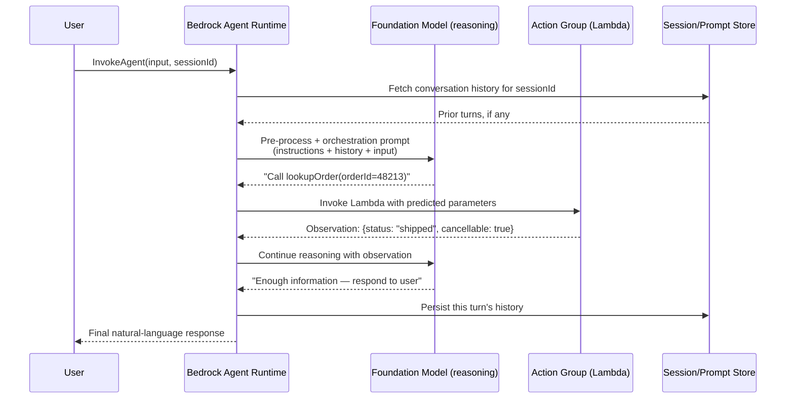
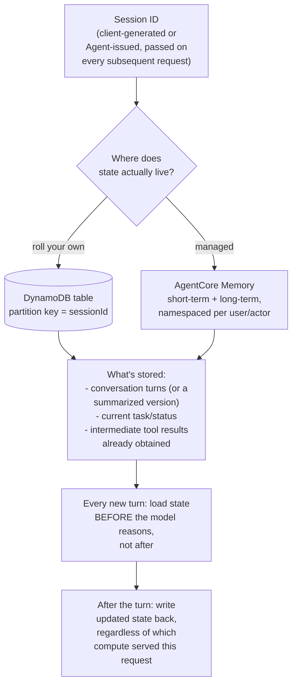
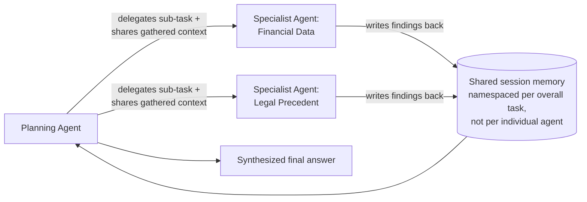
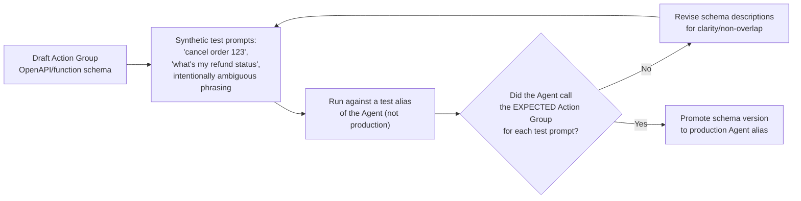

# Bedrock Agent Architecture & State Management — Deep Dive

*Companion deep dive to [`README.md`](README.md) and
[`services/machine-learning-ai/bedrock.md`](../../../services/machine-learning-ai/bedrock.md)'s
Agents and AgentCore sections. Those documents establish *what* an Agent is and *why* AgentCore
exists; this document goes one level deeper into the actual build-time/runtime architecture
(Action Group schemas, the orchestration loop, the prompt-template layers under the hood) and the
state-management design decisions a real production agent deployment has to make — the Domain 3
"3.2.9 agent state management" and "3.2.11 deploy agentic workflow infrastructure" task
statements, treated as an infrastructure design problem rather than a conceptual overview.*

## Definition

A Bedrock Agent's architecture is two separate halves wired together: a **build-time**
configuration (the foundation model, instructions, Action Groups, and Knowledge Bases that
*define* what the agent can do) and a **runtime** orchestration loop (the actual request-by-
request reasoning cycle that decides, live, which of those defined capabilities to invoke and in
what order). Agent state management is the separate, adjacent infrastructure problem of making
that runtime loop's progress — and a multi-turn conversation's accumulated context — durable
across requests that may not even land on the same compute, since neither the foundation model
nor a stateless Lambda-backed Action Group remembers anything on its own between calls.

## Analogy

Think of a Bedrock Agent as a new employee with a detailed job manual (**instructions**) and a
binder of approved forms they're allowed to fill out and submit (**Action Groups**, each one a
specific, schema-defined form). The employee doesn't memorize company policy from scratch for
every question — they can pull the right policy page from a shared reference binder
(**Knowledge Base**) when needed. The employee's **reasoning about which form to fill out next**
happens fresh, in their head, every single time they're asked something (that's the foundation
model doing orchestration) — but if the task spans multiple days (a multi-turn conversation), the
employee needs a case file that gets updated and refiled after every interaction, so a different
shift's employee (or the same one, next Tuesday) can pick the case back up exactly where it left
off. That case file is agent state — and crucially, it lives in a filing cabinet (a durable
external store), not in any one employee's memory, because you can never guarantee the exact same
employee is on shift next time.

## Purpose

Without a formally defined architecture for "what can this agent do" (Action Groups with real
schemas) versus "how does it decide" (the orchestration loop) versus "what does it remember"
(state management as a separate concern), teams building their first production agent tend to
conflate all three into one tangled, hard-to-debug system — prompt text that tries to both
describe available actions *and* carry conversation history *and* implicitly encode business
rules, with no clean separation of concerns. Bedrock's architecture exists specifically to force
that separation: Action Groups are schema-defined and independently testable; the orchestration
loop is a managed, inspectable process; and state management is explicitly pluggable (your own
DynamoDB table, or AgentCore Memory) rather than smuggled into the prompt itself.

## When to Use

- A task genuinely requires **multiple steps and/or external tool calls** (look something up,
  take an action, then respond) rather than a single grounded answer — if the task is "answer a
  question from documents," a Knowledge Base alone (no Agent) is simpler and sufficient.
- The set of things the system is allowed to *do* (not just say) needs to be **formally scoped
  and auditable** — Action Groups' explicit schemas are the mechanism that makes "exactly what
  could this system have done on a user's behalf" an answerable compliance question.
- Interactions are genuinely **multi-turn and stateful** — a user can pause and resume, or refer
  back to something said several messages ago, and the system needs to actually remember it
  rather than treating every message as a fresh, context-free request.
- You need **per-user or per-session isolation** at real scale (many concurrent users, each with
  their own in-flight task) — this is specifically when AgentCore Runtime's microVM-per-session
  model becomes the right infrastructure choice over a simpler, shared-process implementation.

## When NOT to Use

- **A single-turn Q&A system with no actions to take** — don't wrap a plain RAG lookup in Agent
  machinery it doesn't need; a direct `RetrieveAndGenerate` call against a Knowledge Base is
  simpler, cheaper, and has fewer moving parts to debug.
- **Fewer than a handful of truly stateless requests, with no multi-turn requirement at all** —
  building a full state-management layer (DynamoDB schema, session ID plumbing) for a system that
  never actually needs to remember anything between calls is pure unneeded complexity.
- **Hard, non-negotiable business rules** ("never approve a refund over $500 without a manager
  code") — don't encode a hard rule as an instruction you hope the model follows; enforce it in
  the Lambda behind the relevant Action Group, where it's a guaranteed code path, not a
  probabilistic one.
- **A workload with enormous, unbounded conversation history per session and a hard real-time
  latency SLA** — unmanaged long-term memory growth increases prompt size (and therefore cost and
  latency) over a long-running session; a mature design summarizes/prunes history rather than
  appending to it indefinitely, and a system that can't tolerate any growth in latency over a
  session's lifetime needs that summarization built in from day one, not bolted on later.

## Use Cases

1. **Customer-service "cancel and refund" agent (e-commerce):** a single Action Group's Lambda
   looks up order status; a second cancels the order; a third issues a refund — each independently
   testable, independently permissioned via its own Lambda's IAM role, and each individually
   auditable in a trace.
2. **Multi-day insurance claim intake agent:** a user starts a claim, uploads a photo the next
   day, and confirms details on day three — agent state (claim ID, status, gathered facts) persists
   across all three separate sessions via a durable, namespaced store keyed on a case ID.
3. **Internal IT-ops agent restarting a failed service:** an Action Group schema explicitly scopes
   the agent to only call `restart_service(service_name)` on an approved list — the schema itself
   is the enforcement boundary against the agent attempting an unscoped, dangerous action.
4. **Multi-agent research assistant:** a planning agent delegates sub-questions to specialist
   agents (one for financial data, one for legal precedent), each needing to read context the
   planning agent already gathered — exactly the cross-agent shared-memory scenario AgentCore
   Memory is built to support without each specialist agent re-asking the user from scratch.
5. **Compliance-audited loan-advisory chatbot (banking):** every Action Group call and every
   retrieved Knowledge Base passage is captured in a session trace, so a regulator reviewing a
   specific customer interaction can see the exact sequence of what the agent looked up and did,
   not just its final response text.
6. **Long-running "deep research" agent:** a session that runs for an extended period (gathering,
   synthesizing, and re-querying across many steps) needs a runtime that tolerates execution well
   beyond a typical short-lived function's time ceiling — exactly the extended-session support
   AgentCore Runtime provides over a plain Lambda-backed Action Group chain.

## Why Important

Real-world: the single most common reason a first production agent project stalls isn't model
quality — it's the team discovering, mid-build, that they have no clean answer to "where does
conversation state actually live" or "what, precisely, is this agent allowed to do," because both
got implicitly smuggled into free-text prompt engineering instead of being designed as
infrastructure up front. Exam weight: MLA-C02 Domain 3's genuinely new (C02-added) task
statements 3.2.9 (agent state management) and 3.2.11 (deploy agentic workflow infrastructure) are
drawn almost entirely from this exact architecture — expect scenario questions that describe a
state-loss symptom or an access-scoping requirement and expect you to name the specific
architectural component responsible, not just "Bedrock Agents" generically.

## Build-time architecture, in AWS's own diagram


*Figure: AWS's own build-time architecture diagram — an Agent is assembled from a chosen
foundation model, written instructions, one or more Action Groups (each backed by an OpenAPI or
function-detail schema plus a Lambda function implementing the actual logic), and optionally one
or more Knowledge Bases. Nothing here is a runtime decision yet — this is the static configuration
an Agent is built from, analogous to a class definition before any instance runs. Source: Amazon
Bedrock User Guide, "How Amazon Bedrock Agents works" —
docs.aws.amazon.com/bedrock/latest/userguide/agents-how.html.*

A single Action Group's schema is the real unit of architectural discipline here — concretely, an
OpenAPI-style schema for an order-lookup action looks like:

```yaml
openapi: 3.0.0
info:
  title: OrderLookupAPI
  version: 1.0.0
paths:
  /lookupOrder:
    get:
      summary: Look up the current status of a customer order by order ID
      operationId: lookupOrder
      parameters:
        - name: orderId
          in: query
          required: true
          schema:
            type: string
          description: The order ID to look up, e.g. "48213"
      responses:
        '200':
          description: Order status retrieved successfully
          content:
            application/json:
              schema:
                type: object
                properties:
                  status: { type: string, description: "e.g. shipped, processing, cancelled" }
                  cancellable: { type: boolean }
                  customerEmail: { type: string }
```

What matters architecturally about this schema, beyond syntax: the `description` fields are not
decoration — they are literally what the foundation model reads to decide *whether* and *when*
to call this specific action versus another one. A vague or overlapping description across two
Action Groups is the single most common real-world cause of an agent calling the wrong tool —
directly matching the exam trap already named in this domain's README ("occasionally fails to
call the correct tool for a multi-step request" → under-specified tool descriptions, not a model
failure).

## The runtime orchestration loop, in AWS's own diagram


*Figure: AWS's own runtime process diagram — `InvokeAgent` kicks off pre-processing (validating/
categorizing the input), then an orchestration loop where the agent predicts which action or
Knowledge Base to invoke next, invokes it, receives an **observation** (the result), and either
loops again or produces a final response. This loop structure is exactly what the "ReAct"
(Reason + Act) prompting pattern underneath Bedrock Agents implements — reason about what to do,
act, observe the result, repeat. Source: Amazon Bedrock User Guide, "How Amazon Bedrock Agents
works" — docs.aws.amazon.com/bedrock/latest/userguide/agents-how.html.*



The architecturally important detail this sequence makes explicit: **every single loop iteration
is itself a fresh foundation-model call** — the model has no continuity of its own between the
"predict an action" step and the "continue reasoning with the observation" step a moment later;
the Agent runtime is what re-sends the accumulated context (instructions + history + the new
observation) on every iteration. This is precisely why state management is a structurally
*separate* concern from the model itself — statelessness is a property of the foundation model by
design, and everything that *feels* like memory is actually the surrounding runtime re-feeding
context on every single call.

## State management — the design space, concretely

Having established that state never lives in the model, the real design question is: **where does
it live, keyed on what, and what exactly gets stored?**



- **Session identity is the single point of failure for the entire scheme.** A missing,
  inconsistent, or accidentally-regenerated session ID on any one client call is indistinguishable,
  from the user's point of view, from "the agent forgot everything" — and is the most common
  real-world root cause of exactly that complaint, as already called out in this domain's README.
- **What gets stored is a deliberate choice, not "everything."** Raw, unbounded conversation
  history both costs tokens on every subsequent call (since it's re-sent as context) and
  eventually exceeds the context window; a mature design stores a **summarized** running history
  past a certain length, re-summarizing periodically rather than ever truncating silently (a
  silent truncation can drop a fact the user genuinely expects the agent to still know).
- **Intermediate tool results are cached in state specifically to avoid redundant calls.** If
  turn 2 already confirmed a flight search result, turn 4 (after the user changes an unrelated
  detail) shouldn't blindly re-call the search tool — state stores the already-obtained result so
  the orchestration loop can reason "I already have this" instead of re-invoking an Action Group
  needlessly, a real cost and latency saving at scale.
- **Reads happen before reasoning, writes happen after.** The sequence diagram above makes this
  ordering explicit — state is loaded *before* the model's first reasoning step in a turn (so the
  model has the full picture from the start) and written back only *after* the turn completes, not
  incrementally mid-turn, which would risk a partially-updated, inconsistent state record if the
  turn failed partway through.

### A minimal DynamoDB-backed state schema, concretely

```json
{
  "sessionId": "user_42_session_7",
  "lastUpdated": "2026-11-20T14:03:00Z",
  "task": "book_flight",
  "status": "awaiting_payment_confirmation",
  "accumulatedFacts": {
    "destination": "Chicago",
    "date": "2026-11-27",
    "searchResultId": "FR-88213"
  },
  "conversationSummary": "User wants a flight to Chicago on Nov 27; search already performed, awaiting final confirmation before booking.",
  "rawRecentTurns": [
    { "role": "user", "content": "Actually make it Thursday instead" },
    { "role": "agent", "content": "Updated to Thursday, Nov 27 — shall I confirm the booking?" }
  ]
}
```

Notice the split between `conversationSummary` (compact, always re-sent as context) and
`rawRecentTurns` (only the last couple of turns kept verbatim, for short-term continuity) — this
is the concrete implementation of "summarize older history, keep recent turns raw" described
above, and it's a pattern worth recognizing whether you build it by hand on DynamoDB or get it
managed via AgentCore Memory's short-term/long-term split.

## Multi-agent state sharing — when one agent's memory needs to reach another



The architectural point worth internalizing: in a multi-agent system, state is namespaced per
**overall task/session**, not per individual agent — if each specialist agent only wrote to its
own private memory, the planning agent synthesizing a final answer would have no way to see what
either specialist actually found, defeating the entire purpose of delegating in the first place.
This is exactly what AgentCore Memory's "shared across multiple agents within a session" property
(named in `bedrock.md`) is built to provide as a managed capability.

## Testing Action Groups and orchestration before production — a worked validation approach

Because an Action Group's schema is what the foundation model actually reads to decide tool
calls, validating that schema *before* production traffic reaches it is a distinct, testable step
in its own right — not something covered by ordinary Lambda unit testing alone:



This is the Agent-specific instance of the same "AI model testing frameworks including prompt
testing" task statement (3.3.9) this domain's README covers at the general level — the test
cases here are specifically crafted to probe *tool selection* ambiguity (two Action Groups with
similar-sounding purposes), not just output quality, which is a distinct failure mode from a
plain prompt-quality regression and deserves its own test-case category in a mature Agent test
suite.

## Versioning an Agent as a deployable artifact, not a live-edited configuration

Treating an Agent's configuration (instructions, Action Group schemas, Knowledge Base bindings)
as a versioned artifact — exactly like a model version in Model Registry — is what makes task
3.3.8's "automated agent deployment pipelines + version management" concrete rather than abstract:

- **Every change creates a new Agent version**, never an in-place edit of the live configuration
  — this is what makes instant rollback to a prior version possible if the new one underperforms,
  the same operational guarantee blue/green deployment gives a SageMaker endpoint.
- **An Agent alias points at a specific version**, and production traffic is routed by alias, not
  by directly referencing a version number in the calling application — switching which version
  serves production becomes a single alias repoint, not an application redeploy.
- **A test alias can point at a draft/candidate version** simultaneously with a production alias
  pointing at the current approved version, letting the validation flow above run against
  genuinely isolated infrastructure before any production traffic is exposed to the new
  configuration — directly mirroring the shadow-testing pattern this domain's README describes
  for classic SageMaker model variants, applied here to an Agent configuration instead.

## Troubleshooting / Common Issues

- **An agent "forgets" context mid-conversation even though state management is configured.**
  Check that the session ID is identical across every request in the conversation first — a
  client bug regenerating a new session ID per message is indistinguishable from a genuinely
  broken state store, and is the far more common real-world cause.
- **An agent calls the wrong Action Group for an ambiguous request.** Check the `description`
  fields in the relevant OpenAPI/function schemas for vagueness or overlap before assuming a
  model-capability problem — this is schema-design debugging, not model debugging.
- **Session state grows until requests start failing or costing noticeably more over a long
  conversation.** Unbounded raw history accumulation — implement periodic summarization (the
  `conversationSummary` pattern above) rather than storing every turn verbatim indefinitely.
- **A multi-agent system's final synthesized answer ignores a specialist agent's findings.**
  Check whether state is actually namespaced/shared at the task level or accidentally isolated
  per-agent — an isolated-by-default implementation silently drops cross-agent context exactly
  like this.
- **An agent occasionally re-calls a tool it already successfully called earlier in the same
  session.** The accumulated-facts/intermediate-results portion of state isn't being populated or
  isn't being read back into the reasoning prompt — check that tool results are actually written
  to state after a successful call, not just the final response text.

## Exam Tips

- A question describing an agent "forgetting" context is testing **session ID hygiene and state
  persistence**, not model quality — know this as the default first diagnosis, not a last resort.
- Action Group schema quality (clear, non-overlapping descriptions) is the answer to "wrong tool
  called" questions — not a prompt-engineering fix to the Agent's top-level instructions.
- Know the load-then-reason-then-write ordering of a single turn's state lifecycle — a question
  about *when* state should be persisted (mid-turn vs. after) is testing this exact sequence.
- Multi-agent memory sharing is namespaced by **task/session**, not by individual agent — a
  scenario where one agent's findings should inform another's final answer is testing this.
- Distinguish a plain Bedrock Agent (sufficient for a single-session, lightly-used, stateless-
  between-sessions assistant) from AgentCore (warranted once scale, cross-session persistence,
  per-user credential scoping, or step-level production debugging enter the scenario) — naming
  the specific right layer, not just "Bedrock," is the deeper skill being tested.

## Related Terms

- [`README.md`](README.md) — the domain-level summary of agent state management (task 3.2.9)
- [`services/machine-learning-ai/bedrock.md`](../../../services/machine-learning-ai/bedrock.md)
  — Agents and the full AgentCore architecture this document extends
- [`mlops-cicd-pipeline-retraining-deep-dive.md`](mlops-cicd-pipeline-retraining-deep-dive.md) —
  the CI/CD discipline applied to agent configuration versioning (task 3.3.8)
- [`../domain-1-data-preparation/embeddings-and-rag-data-prep.md`](../domain-1-data-preparation/embeddings-and-rag-data-prep.md)
  — the Knowledge Base/RAG pipeline an Agent's Action Groups commonly sit alongside
