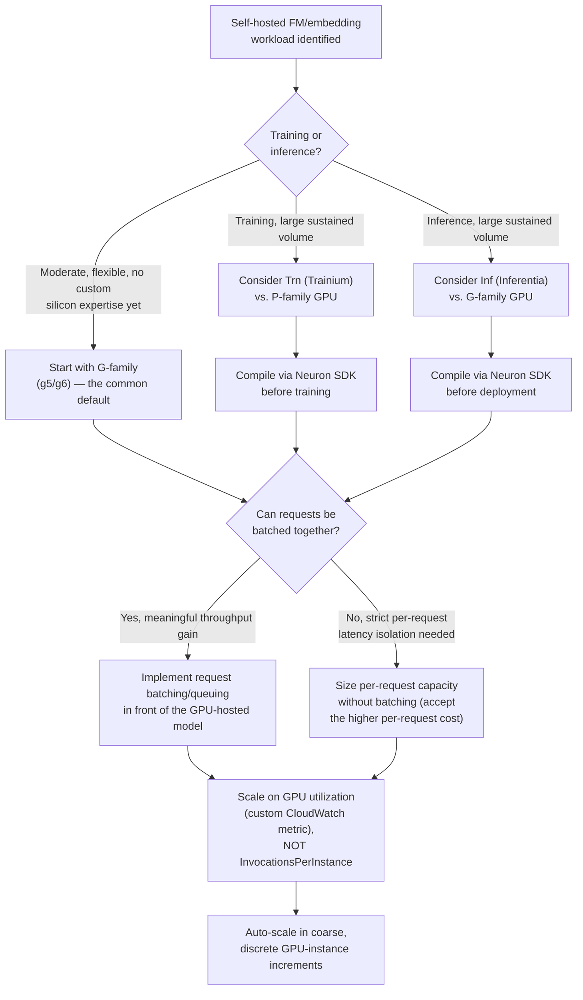
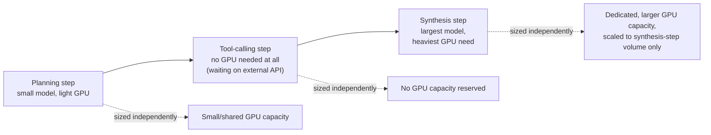
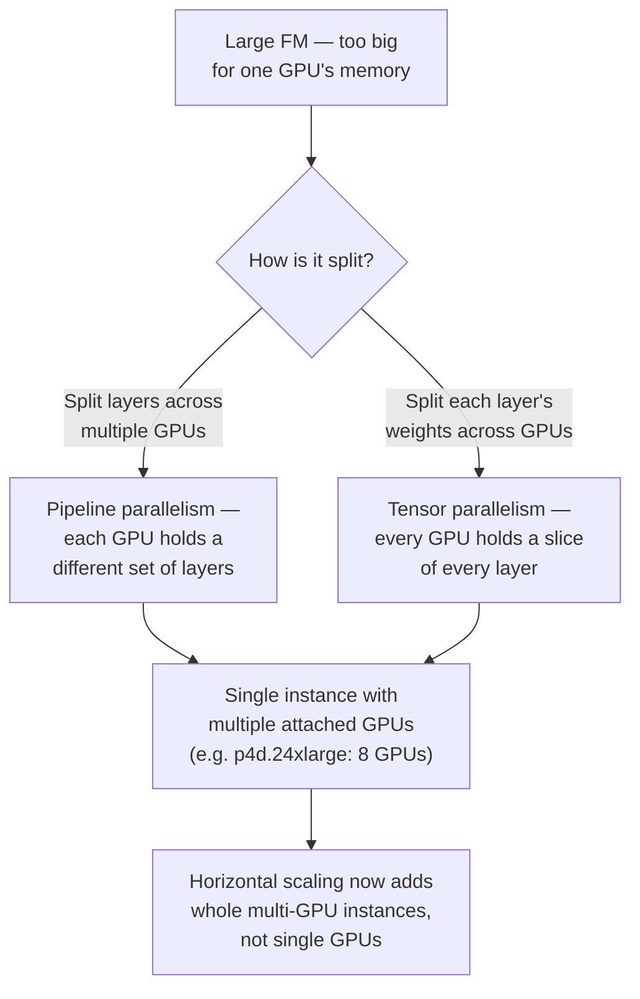

# GPU Instance Selection & Scaling for Foundation Model Hosting

*Companion deep dive to [`README.md`](README.md)'s NEW skill 3.2.10 ("AI-specific resource
scaling for GPU workloads") and
[`sagemaker-endpoint-autoscaling-cost-math.md`](sagemaker-endpoint-autoscaling-cost-math.md)'s
closing section. Those documents establish that GPU scaling behaves differently from CPU scaling;
this document is the concrete instance-family comparison, the batching mechanics, and the actual
selection decision tree a Domain 3 scenario expects you to apply when a question specifies
self-hosting a foundation or embedding model.*

## Definition

GPU instance selection for FM hosting is choosing between general-purpose NVIDIA GPU instances
(the P/G families), AWS's own purpose-built inference silicon (Inferentia, via Inf instances), and
AWS's own training silicon (Trainium, via Trn instances) for a self-hosted foundation or embedding
model — and then scaling whichever you choose against a GPU-specific utilization/batching metric
rather than the CPU-centric metrics the rest of this domain's content defaults to.

## Analogy

Think of CPU instances as a fleet of regular delivery vans — add one more van, get roughly one
more van's worth of capacity, smoothly and predictably. GPU instances are more like chartering
cargo ships: you can't charter "a little bit more ship," you charter in large, discrete, expensive
increments, and a ship that's only a third full on one trip is still paying for the whole hull —
which is exactly why *batching* multiple requests onto one GPU's single trip (processing several
inference requests together) matters so much more here than it ever did for the van fleet.

## Purpose

A classic CPU-bound endpoint's scaling story (described in this folder's auto-scaling document)
assumes capacity is fine-grained and interchangeable — add one more `ml.m5.xlarge`, get roughly
one more unit of throughput, cheaply and incrementally. Self-hosted foundation models break both
halves of that assumption: GPU instance types jump in large, expensive increments (there's no
"slightly bigger than a g5.xlarge" option the way there's a slightly bigger CPU instance), and
GPU compute can often serve *multiple* requests nearly as fast as one, via batching — meaning the
actual unit economics, the correct scaling metric, and even the right instance *family* are all
genuinely different problems from the CPU-bound content elsewhere in this domain. This document
exists because MLA-C02's C02-new GPU-scaling content tests exactly this distinction, not a
restatement of CPU auto-scaling with different instance names.

## When to Use (Self-Hosted GPU, vs. Bedrock)

- Full control over the model's exact weights/version is required, or the specific model isn't
  available on Bedrock at all (an open-weight model only on SageMaker JumpStart, or a fully
  custom fine-tuned architecture).
- Extremely high, sustained, predictable volume makes the economics of owning (or reserving)
  dedicated GPU capacity genuinely cheaper than Bedrock's per-token pricing at that specific
  scale — this crossover point depends on real measured volume, never assumed by default.
- Strict network-isolation requirements (no data leaving a VPC at all, even to a managed AWS
  service boundary) that only a self-hosted endpoint inside your own VPC can satisfy.
- A need for inference-time customization (custom batching logic, a non-standard serving
  protocol, a specialized runtime) a managed API's fixed interface doesn't expose.

## When NOT to Use (prefer Bedrock instead)

- **Default assumption should be Bedrock, not self-hosted GPU**, per `bedrock.md`'s own framing —
  self-hosting trades Bedrock's zero-ops simplicity for real GPU capacity-planning, scaling, and
  patching burden; only take on that burden when one of the "When to Use" reasons genuinely
  applies to the scenario in front of you.
- **Low or unpredictable volume** — GPU instances' coarse, expensive capacity increments are a
  poor fit for traffic that doesn't reliably fill even one instance's throughput; Bedrock's
  per-token billing has no equivalent idle-capacity waste.
- **No in-house GPU/ML-infrastructure expertise to operate the fleet** — GPU driver/runtime
  version management, batching tuning, and capacity planning are genuine, ongoing operational
  work a managed API eliminates entirely.

## Use Cases

1. A media company self-hosts a fine-tuned summarization model on `g5` instances specifically
   because its nightly batch digest window is bursty and predictable, letting it scale GPU
   capacity up before the window and fully down immediately after (already named in this
   domain's README use-case list, expanded here with the actual instance-family reasoning).
2. A healthcare provider self-hosts an embedding model on `inf2` instances inside a VPC with no
   internet egress, satisfying a strict data-residency requirement Bedrock's external API
   boundary can't meet regardless of its other advantages.
3. A research lab trains a custom domain-specific foundation model from a JumpStart base weight
   on `trn1` instances, chosen specifically for Trainium's favorable training-cost-per-token
   versus general-purpose NVIDIA GPU instances at that lab's sustained, large-scale training
   volume.
4. A customer-support platform batches concurrent embedding requests on a shared `g5` fleet during
   peak hours (already named in this domain's README use case list) rather than processing them
   one at a time, measurably raising throughput on the same instance count.
5. A fintech company benchmarks both a Bedrock Provisioned Throughput commitment and a
   self-hosted `g5`/`inf2` JumpStart deployment against its actual measured token volume before
   committing to either, treating the choice as a computed cost comparison rather than a default.

## Instance family comparison

| Family | Silicon | Typical fit | Scaling character |
|---|---|---|---|
| **P (p4d, p5)** | NVIDIA data-center GPUs (A100/H100-class) | Large-scale training, the highest-end inference workloads needing maximum raw GPU performance | Most expensive per-instance-hour; reserve for genuinely large models/volume |
| **G (g5, g6)** | NVIDIA GPUs, smaller/cheaper than the P family | The most common real-world choice for self-hosted FM *inference* and fine-tuning at moderate scale | Good default starting point before considering custom silicon |
| **Inf (inf1, inf2)** | AWS Inferentia (custom inference silicon) | High-volume, cost-sensitive **inference-only** workloads (not training) | Lower cost-per-inference than comparable GPU instances at matched throughput, at the cost of requiring the Neuron SDK's model compilation step |
| **Trn (trn1, trn2)** | AWS Trainium (custom training silicon) | High-volume **training/fine-tuning** workloads | Favorable cost-per-training-token versus general-purpose GPU instances at AWS's own published benchmarks, same Neuron SDK compilation requirement |

The exam-relevant shape of this table, stated plainly: **Inferentia is for inference, Trainium is
for training** — picking an `inf2` instance for a *training* job (or a `trn1` instance thinking
it's the "inference" custom-silicon option) is exactly the kind of mixed-up-families trap a
scenario question tests, and both custom-silicon families require compiling your model through
the **AWS Neuron SDK** first, a real, non-optional step distinct from just launching the instance.

### AWS's own inference-stack layering diagram

*Figure: AWS's own layered view of the generative AI inference stack — serverless (Bedrock) sits
at the top for zero-ops simplicity, with a self-managed layer at the bottom built on EC2 instances
offering Trainium, Inferentia, general-purpose GPU, and CPU options, each trading increasing
operational ownership for increasing control and (at the right volume) potential cost efficiency.
This is the concrete, AWS-drawn version of the "When to Use self-hosted GPU vs. Bedrock" decision
made explicit earlier in this document. Source: AWS Decision Guides, "Choosing a generative AI
service" — docs.aws.amazon.com/decision-guides/latest/decision-guides/genai-guide.html.*

## How It Works — the GPU scaling decision, step by step

Step by step:
1. **Classify the workload as training or inference first** — this single branch determines
   which custom-silicon family (if any) is even relevant; conflating the two is the most common
   real mistake with this instance family set.
2. **Start with general-purpose GPU (G-family) unless volume specifically justifies custom
   silicon** — Inferentia/Trainium's cost advantage is real but requires the Neuron SDK
   compilation investment; at moderate scale, that engineering overhead can outweigh the per-
   token savings, exactly mirroring SageMaker Neo's own "only invest in compilation when edge/
   efficiency is a genuine requirement" framing elsewhere in this domain.
3. **Decide whether requests can be batched.** Batching only helps when individual requests can
   tolerate being grouped and processed together without an unacceptable latency penalty for the
   request that arrived first in the batch and has to wait briefly for others to join it — a
   strict single-request latency SLA (e.g., a live, interactive chat response) may rule out
   aggressive batching even though it would otherwise raise throughput.
4. **Pick the scaling metric deliberately — GPU utilization, not invocation count.** As already
   established in the auto-scaling document, `InvocationsPerInstance` assumes each request
   consumes a roughly fixed, independent slice of capacity — an assumption batching directly
   breaks. A custom CloudWatch metric (published from inside the serving container, reporting
   actual GPU utilization or queue depth) is the correct target-tracking metric for a GPU-hosted
   endpoint's auto-scaling policy.
5. **Accept coarse scaling increments as a real planning constraint, not a bug.** Where a CPU
   fleet can add "just one more small instance," GPU capacity scales in large discrete jumps —
   capacity planning for a GPU-hosted workload has to budget for this lumpiness explicitly
   (reserving slightly more headroom per scale-out event than a CPU fleet would need, since the
   next available increment of capacity is itself large).

## Worked example — batching's real throughput effect, with numbers

**The scenario:** a self-hosted embedding model on a single `g5.xlarge` instance processes one
request at a time in roughly **40ms per request** (unbatched), giving a theoretical ceiling of
about 1000/40 ≈ **25 requests/second** if requests arrived perfectly spaced with zero queuing
overhead. Benchmarking the same instance with **batch size 8** (grouping up to 8 concurrent
requests into one GPU forward pass) shows a batch of 8 completing in roughly **90ms** total —
*not* 8 × 40ms = 320ms, because the GPU processes the batch largely in parallel up to its compute
ceiling.

**The throughput math:** unbatched, 25 req/s per instance. Batched at size 8, each 90ms batch
processes 8 requests, giving roughly 8 ÷ 0.090 ≈ **89 requests/second per instance** — more than
**3x the unbatched throughput on the same instance**, for workloads whose requests can tolerate
the brief queuing delay needed to assemble a batch (here, up to ~90ms of added worst-case latency
for the unlucky request that arrives right as a batch just closed).

**The tradeoff made concrete:** the *first* request into a batch effectively waits for the batch
to fill (or a timeout to elapse) before processing even starts — a strict "every single request
must complete in under 50ms, no exceptions" SLA would be incompatible with this specific batching
configuration, and the correct response to that SLA is a smaller batch size (or no batching at
all), accepting lower per-instance throughput in exchange for meeting the stricter per-request
latency bound — exactly the kind of latency-vs-throughput tradeoff a Domain 3 scenario expects
you to reason through explicitly with the given numbers, not wave away with "enable batching."

## Worked example — Inferentia cost-per-inference vs. general-purpose GPU

**The scenario:** a high-volume product-tagging inference workload processes roughly **5 million
inferences/day**, currently on `g5.2xlarge` instances. AWS's own published Inferentia benchmarks
(confirm current figures before budgeting) suggest up to **~70% lower cost-per-inference** versus
a comparable general-purpose GPU instance at matched throughput for well-suited (inference-only,
compiled) workloads.

**Illustrative math (confirm current rates):** if the current `g5.2xlarge` fleet costs roughly
**$400/day** to serve this volume, a successful migration to a matched `inf2` configuration at a
genuine ~70% reduction would cost roughly **$120/day** — a difference large enough to justify the
one-time Neuron SDK compilation and validation effort for a sustained, high-volume workload like
this one. **The exam-relevant caveat that makes this a real decision, not a free win:** this
return only materializes at genuinely high, sustained volume, and only after the compiled model's
accuracy has been validated against the original on a held-out test set (compilation can involve
precision changes, exactly as SageMaker Neo's own compilation step can, described elsewhere in
this domain) — a scenario describing low or uncertain volume should not default to "always pick
Inferentia," since the compilation/validation overhead may not be justified at that scale.

## Scaling a multi-step agentic workload's GPU usage unevenly

This connects directly to this domain's README section on scaling agentic workloads: a planning
step in an agent pipeline might run on a small, cheap model (little GPU need); a tool-calling step
might be GPU-idle entirely (waiting on an external API); and a final synthesis step might need the
largest, most GPU-hungry model in the whole pipeline.

The exam-relevant takeaway restated precisely: provisioning *uniform* GPU capacity across every
step of an agentic pipeline (as if every step needed the same resources as the heaviest one)
wastes capacity on the lighter steps; the correct architecture sizes **each step's compute
independently against its own actual load pattern**, which is exactly what task 3.2.10 is
testing when it names "AI-specific resource scaling" as distinct from a single, uniform scaling
policy applied blindly across an entire pipeline.

## Multi-GPU and multi-instance hosting for models too large for one GPU

Everything above assumed one model fits comfortably on one GPU. A genuinely large foundation
model (tens of billions of parameters or more) can exceed a single GPU's memory entirely, which
introduces a distinct architectural problem beyond simple horizontal scaling:

The practical implication for this document's scaling discussion: once a model requires multiple
GPUs just to load at all, the *unit* of horizontal scaling stops being "one GPU" and becomes "one
entire multi-GPU instance" (e.g., a `p4d.24xlarge` with 8 attached GPUs) — scaling out by one
instance now means provisioning an entire 8-GPU node, making the "large, discrete, expensive
jumps" property described earlier in this document even more pronounced. This is also exactly why
SageMaker's own multi-GPU/multi-node training and hosting tooling (and, at the largest scale,
**SageMaker HyperPod**, referenced in `sagemaker-overview.md`) exists as a distinct capability
from simply requesting a bigger single-GPU instance — splitting one model across many GPUs/nodes
is a genuinely different engineering problem than horizontally scaling many independent copies of
a model that each fit on one GPU.

## Capacity reservations — planning around GPU availability, not just GPU cost

A detail easy to miss until it actually happens in production: popular GPU instance types/sizes
can be **capacity-constrained** in a given Availability Zone at a given moment, independent of
your account's billing limits or quotas being otherwise sufficient. For a workload with a hard
requirement to scale out GPU capacity reliably (e.g., a planned traffic event, not just an
unplanned spike), an **On-Demand Capacity Reservation** for the specific GPU instance type/AZ
removes this uncertainty — reserving the physical capacity ahead of time, distinct from a Savings
Plan (which discounts a *commitment to pay*, but doesn't itself guarantee physical capacity is
actually available when you need it). The exam-relevant distinction: a Savings Plan answers "how
do I pay less for GPU capacity I'm confident I'll use"; a Capacity Reservation answers "how do I
guarantee this specific GPU capacity is physically available when my scaling policy asks for it"
— a scenario emphasizing guaranteed availability for a known future event (not just cost) is
pointing at the latter, not the former.

## Troubleshooting / Common Issues

- **A newly self-hosted model on Inf/Trn instances fails to deploy or produces wrong-looking
  output.** Confirm the model was actually compiled via the Neuron SDK for the target chip — an
  uncompiled standard PyTorch/TensorFlow model artifact generally cannot run directly on
  Inferentia/Trainium hardware the way it can on a general-purpose GPU instance.
- **Batching is enabled but overall latency got worse, not better.** Check the configured batch
  size/timeout against the actual request arrival rate — a batch size set too large for genuinely
  low request volume means requests wait a long time for a batch that fills slowly, trading
  throughput gains nobody needed for latency nobody wanted.
- **Auto-scaling on a GPU-hosted endpoint reacts too slowly to a real spike.** Check whether the
  scaling metric is still `InvocationsPerInstance` (a CPU-shaped default) rather than a custom
  GPU-utilization metric — the wrong metric can under-represent true load on a batching-enabled
  GPU endpoint, delaying a genuinely needed scale-out.
- **A GPU instance type needed for a scale-out event isn't available in the current AZ/Region.**
  GPU capacity availability is itself a real constraint at times, distinct from a billing/cost
  question — a production design needing guaranteed GPU capacity may need a capacity reservation
  or a multi-AZ fallback strategy, not just a higher `max-capacity` number.
- **A model self-hosted on GPU costs more than expected versus the Bedrock equivalent at measured
  volume.** Recompute the comparison using real measured traffic (tokens/requests per day) against
  current Bedrock on-demand or Provisioned Throughput pricing — self-hosting's cost advantage is
  volume-dependent and not guaranteed at every scale, exactly the caveat in the worked examples
  above.

## Exam Tips

- **Inferentia = inference-only custom silicon; Trainium = training-only custom silicon** — a
  scenario naming the wrong one for the wrong job type is a direct, testable mismatch.
- Both custom-silicon families require **Neuron SDK compilation** before use — know this as a
  real, required step, not an optional optimization.
- GPU capacity scales in **large, discrete jumps**, unlike CPU's fine-grained scaling — a
  scenario about GPU capacity planning is testing this lumpiness explicitly.
- **Batching raises per-instance throughput but adds queuing latency** — a strict per-request
  latency SLA can rule out aggressive batching even when it would otherwise help; know this as a
  genuine tradeoff, not a strictly-better setting to always enable.
- The correct auto-scaling metric for a GPU-hosted endpoint is typically a **custom** metric (GPU
  utilization or queue depth), not the default `InvocationsPerInstance` used for CPU-bound
  endpoints.
- Default to **Bedrock** unless a scenario names a specific reason (volume, control, residency)
  for self-hosting — self-hosted GPU is never presented as a free upgrade over a managed API.

### Sample exam scenario, worked

**Scenario:** "A team self-hosts an embedding model on GPU instances for a document-search
feature. Traffic is bursty during business hours and the team wants to maximize throughput per
instance without breaching a 200ms per-request latency requirement. They are currently scaling on
`InvocationsPerInstance` and finding that the endpoint scales out later than desired during
spikes." *Answer, worked:* two separate fixes apply here, not one. First, implement **request
batching** sized so that the worst-case queuing delay for the unlucky first request in a batch
stays comfortably under the 200ms budget (per the worked batching example above, a batch
completing in ~90ms leaves ample margin under 200ms) — this is the throughput lever. Second,
switch the auto-scaling policy's tracked metric from `InvocationsPerInstance` to a **custom GPU-
utilization CloudWatch metric** published from inside the container — this is the scaling-
responsiveness lever, since invocation count alone under-represents true GPU load once batching
is active. Treating this as a single fix (just "turn on batching" or just "change the metric")
misses that the scenario names two distinct symptoms needing two distinct, complementary changes.

## Related Terms

- [`sagemaker-endpoint-autoscaling-cost-math.md`](sagemaker-endpoint-autoscaling-cost-math.md) —
  the CPU-bound scaling math this document's GPU-specific metric discussion extends
- [`README.md`](README.md) — NEW skill 3.2.10's domain-level summary of GPU resource scaling
- [`services/machine-learning-ai/bedrock.md`](../../../services/machine-learning-ai/bedrock.md)
  — the managed alternative to everything self-hosted described in this document
- [`services/machine-learning-ai/jumpstart.md`](../../../services/machine-learning-ai/jumpstart.md)
  — the usual source of the open-weight models self-hosted on these instance families
- [`../domain-4-monitoring-security/ml-cost-optimization.md`](../domain-4-monitoring-security/ml-cost-optimization.md)
  — Spot/Savings Plan discounts layered on top of whichever GPU family is chosen here
