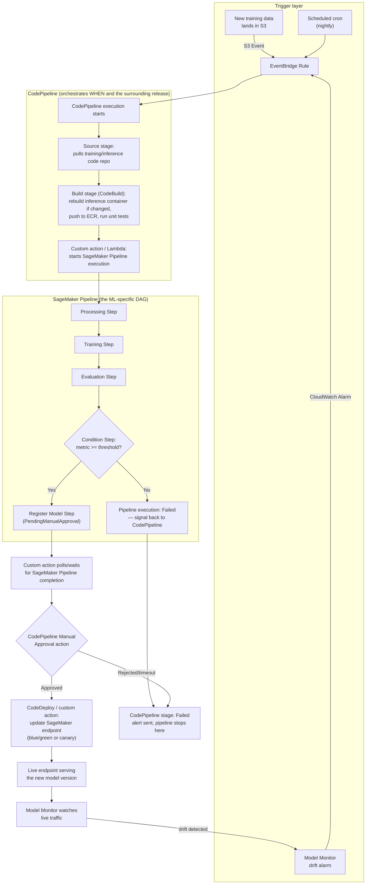
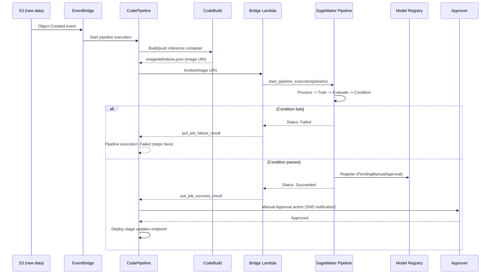

# MLOps CI/CD Pipeline for Retraining — Deep Dive with Real CodePipeline / SageMaker Pipelines Config

*Companion deep dive to [`README.md`](README.md)'s "How It Works — full MLOps CI/CD with
SageMaker Pipelines" section. That section describes the end-to-end shape in prose and a single
diagram; this document is the "now show me the actual files" follow-up — a real CodePipeline
JSON/CloudFormation definition and a real SageMaker Pipelines Python SDK definition, wired
together, plus the EventBridge rule that triggers the whole thing and the Condition Step that can
stop it cold. Task statement 3.3 in full, as an actual buildable artifact set.*

## Definition

An MLOps CI/CD pipeline for retraining is the combination of two distinct, cooperating layers:
**CodePipeline** (orchestrating *when* a retraining cycle starts and *how* its resulting artifact
gets deployed) wrapping **SageMaker Pipelines** (the ML-specific DAG that actually processes data,
trains, evaluates, and registers a new model version). Neither layer alone is the full picture —
CodePipeline doesn't know how to train a model, and a standalone SageMaker Pipeline has no native
concept of a CodeBuild-built container image or a CodeDeploy canary rollout to a non-SageMaker
target — which is exactly why real production MLOps setups use both, each doing the part it's
actually built for.

## Analogy

CodePipeline is the factory's overall production schedule and quality-control office: it decides
when a production run starts, routes the work order to the right department, and holds a
clipboard checking off "did this stage pass" before releasing the next stage. SageMaker Pipelines
is one specific department on that factory floor — the one that actually takes raw material
(data), runs it through specialized machinery (training), inspects the output (evaluation), and
either stamps it "approved, ready to ship" (Model Registry) or rejects it on the spot. The factory
schedule doesn't know how the training machinery works internally; it just knows to kick off that
department's job and wait for a pass/fail signal before moving the approved output to the loading
dock (deployment).

## Purpose

A retraining pipeline that exists only as a SageMaker Pipeline has a real gap: it has no native
way to also rebuild and push a new container image when the inference code itself changes (not
just the model weights), no native cross-environment promotion gate (dev → staging → production
with different approval rigor), and no native way to coordinate a non-ML deployment action (e.g.,
updating an API Gateway stage, or notifying a downstream team) as part of the same release. This
document exists to show the concrete, file-level answer to "how do these two services actually
connect," because a Domain 3 exam scenario describing the full retrain-and-redeploy lifecycle is
testing whether you can place each piece of config in the correct layer, not just that both
services exist.

## When to Use This Combined Architecture

- Retraining must be triggered **automatically** by an event (new data in S3, a schedule, a drift
  alarm) rather than a human remembering to re-run a notebook.
- The release needs a **quality gate** that can genuinely stop a bad model before it reaches
  production, not just log a warning.
- The container image running inference **itself changes over time** (not only the model
  weights) — a genuine CI/CD build step, not just a SageMaker Pipeline on its own.
- Deployment needs to reach **both** a SageMaker endpoint **and** possibly an adjacent non-ML
  system (an API Gateway config, a notification, a cross-account promotion) in the same release.

## When NOT to Use It

- **A single data scientist's personal retraining loop, run manually when convenient** — the full
  two-layer setup is unneeded overhead until retraining is genuinely recurring/automated.
- **A workflow with zero ML-specific steps at all** (pure application code CI/CD) — plain
  CodePipeline/CodeBuild/CodeDeploy, no SageMaker Pipelines layer needed.
- **A workflow needing deep non-AWS, cross-system orchestration with long human-approval waits
  spanning days** — consider AWS Step Functions as the outer orchestrator instead of (or in
  addition to) CodePipeline, with the SageMaker Pipeline as one Step Functions state.

## Use Cases

1. A fraud-detection team's retraining fires automatically when Model Monitor raises a drift
   alarm via EventBridge, with a Condition Step blocking promotion if the new model's AUC doesn't
   clear 0.90.
2. A document-classification team rebuilds its custom inference container (new OCR preprocessing
   library version) through CodeBuild whenever the Dockerfile changes, independent of whether the
   underlying model itself was retrained that week.
3. A retailer promotes a demand-forecasting model through dev (lenient threshold, auto-approve)
   to production (strict threshold, mandatory human sign-off) using the same parameterized
   SageMaker Pipeline definition, invoked by two different CodePipeline stages.
4. A regulated bank's pipeline requires two separate manual approvals (a data science lead, then
   a compliance officer) before a retrained credit-risk model reaches production, implemented as
   two sequential CodePipeline Approval actions wrapping the SageMaker Pipeline's own automated
   Condition Step.
5. A logistics company's nightly retraining pipeline is triggered purely on a schedule (not an
   event), re-running the full process→train→evaluate→register→deploy chain every night
   regardless of whether new data genuinely arrived, deliberately trading a little wasted compute
   for operational simplicity over event-pattern tuning.

## How It Works — the full two-layer architecture



Reading this top to bottom, the layering principle this whole document exists to make concrete:
**CodePipeline owns the trigger, the container build, the cross-stage approval gates, and the
final deployment action; the SageMaker Pipeline owns everything in between — the actual ML-
specific DAG of process→train→evaluate→register.** Neither layer reaches into the other's
internals; they communicate only at two seams — CodePipeline *starts* a SageMaker Pipeline
execution (via a custom Lambda action, since there's no native CodePipeline action type for this)
and later *polls for its completion status* before deciding whether to proceed to the approval/
deploy stages.

## The actual CodePipeline definition (CloudFormation)

```yaml
# retraining-pipeline.yaml — the CodePipeline layer, as a CloudFormation template
AWSTemplateFormatVersion: "2010-09-09"
Resources:
  MLRetrainingPipeline:
    Type: AWS::CodePipeline::Pipeline
    Properties:
      Name: churn-model-retraining-pipeline
      RoleArn: !GetAtt PipelineServiceRole.Arn
      ArtifactStore:
        Type: S3
        Location: !Ref ArtifactBucket
      Stages:
        - Name: Source
          Actions:
            - Name: SourceAction
              ActionTypeId:
                Category: Source
                Owner: AWS
                Provider: CodeStarSourceConnection
                Version: "1"
              Configuration:
                ConnectionArn: !Ref GitHubConnectionArn
                FullRepositoryId: my-org/churn-model-pipeline
                BranchName: main
              OutputArtifacts:
                - Name: SourceOutput

        - Name: BuildInferenceContainer
          Actions:
            - Name: BuildAction
              ActionTypeId:
                Category: Build
                Owner: AWS
                Provider: CodeBuild
                Version: "1"
              Configuration:
                ProjectName: churn-inference-container-build
              InputArtifacts:
                - Name: SourceOutput
              OutputArtifacts:
                - Name: BuildOutput

        - Name: RunSageMakerPipeline
          Actions:
            - Name: TriggerAndWaitForSageMakerPipeline
              ActionTypeId:
                Category: Invoke
                Owner: AWS
                Provider: Lambda
                Version: "1"
              Configuration:
                FunctionName: !Ref TriggerSageMakerPipelineLambda
              InputArtifacts:
                - Name: BuildOutput
              OutputArtifacts:
                - Name: SageMakerPipelineResult

        - Name: ApproveForProduction
          Actions:
            - Name: ManualApproval
              ActionTypeId:
                Category: Approval
                Owner: AWS
                Provider: Manual
                Version: "1"
              Configuration:
                NotificationArn: !Ref ApprovalTopicArn
                CustomData: "Review the retrained churn model's evaluation metrics before production deployment."

        - Name: DeployToEndpoint
          Actions:
            - Name: UpdateEndpointAction
              ActionTypeId:
                Category: Invoke
                Owner: AWS
                Provider: Lambda
                Version: "1"
              Configuration:
                FunctionName: !Ref DeployApprovedModelLambda
              InputArtifacts:
                - Name: SageMakerPipelineResult
```

What matters here structurally, beyond the YAML syntax: **there is no native CodePipeline action
type for "run a SageMaker Pipeline"** — the `RunSageMakerPipeline` stage is a Lambda-backed
custom (`Invoke`/`Provider: Lambda`) action, exactly the same pattern this repo's
`codepipeline.md` describes generically for "a step CodePipeline has no built-in action for."
This is a genuinely tested distinction: a question asking "what AWS CodePipeline action type
directly runs a SageMaker Pipeline" has no correct built-in-action answer — the correct answer is
a custom Lambda action, because CodePipeline's native action providers don't include one.

## The Lambda that bridges the two layers

```python
# trigger_sagemaker_pipeline.py — the CodePipeline custom action's Lambda handler
import boto3
import json

codepipeline = boto3.client("codepipeline")
sagemaker = boto3.client("sagemaker")

PIPELINE_NAME = "churn-retraining-pipeline"

def lambda_handler(event, context):
    job_id = event["CodePipeline.job"]["id"]
    try:
        # Start a new SageMaker Pipeline execution, passing the just-built container's
        # image URI as a Pipeline Parameter (the DAG edge between the two layers)
        response = sagemaker.start_pipeline_execution(
            PipelineName=PIPELINE_NAME,
            PipelineParameters=[
                {"Name": "InferenceContainerImageUri", "Value": _get_built_image_uri(event)},
                {"Name": "AccuracyThreshold", "Value": "0.90"},
            ],
        )
        execution_arn = response["PipelineExecutionArn"]

        # Poll until the SageMaker Pipeline execution reaches a terminal state --
        # CodePipeline itself has no native "wait for an external async process" primitive
        # beyond this custom action continuing to report "InProgress" via PutJobSuccessResult
        # only once this poll loop (run via repeated Lambda invocations or Step Functions
        # in a real production implementation) confirms completion.
        status = _poll_until_terminal(execution_arn)

        if status == "Succeeded":
            codepipeline.put_job_success_result(jobId=job_id)
        else:
            codepipeline.put_job_failure_result(
                jobId=job_id,
                failureDetails={"type": "JobFailed", "message": f"SageMaker Pipeline status: {status}"},
            )
    except Exception as e:
        codepipeline.put_job_failure_result(
            jobId=job_id, failureDetails={"type": "JobFailed", "message": str(e)},
        )

def _poll_until_terminal(execution_arn, max_polls=60, interval_seconds=30):
    import time
    for _ in range(max_polls):
        desc = sagemaker.describe_pipeline_execution(PipelineExecutionArn=execution_arn)
        status = desc["PipelineExecutionStatus"]
        if status in ("Succeeded", "Failed", "Stopped"):
            return status
        time.sleep(interval_seconds)
    return "TimedOut"

def _get_built_image_uri(event):
    # In a real implementation, reads the BuildOutput artifact's imagedefinitions.json
    # (the same file CodeBuild's buildspec produces for an ECS/Fargate deploy action)
    return "123456789012.dkr.ecr.us-east-1.amazonaws.com/churn-inference:latest"
```

The architecturally important detail: `put_job_success_result`/`put_job_failure_result` are what
tells CodePipeline whether the `RunSageMakerPipeline` stage passed or failed — meaning a SageMaker
Pipeline's own internal Condition Step failure (the model didn't clear its accuracy bar) is what
ultimately causes *this* Lambda to report failure back to CodePipeline, which is what then halts
the entire release before it ever reaches the Manual Approval stage. **One failed model
evaluation, deep inside the SageMaker Pipeline, correctly propagates all the way up to stopping
the outer CodePipeline release** — this propagation chain, not any single service in isolation, is
what actually guarantees a bad model can never reach production regardless of which layer you're
looking at when you ask "what stops it."

## The SageMaker Pipeline definition this Lambda starts

```python
# define_pipeline.py — the SageMaker Pipelines layer, parameterized to accept the
# container image URI the CodePipeline Build stage just produced
from sagemaker.workflow.pipeline import Pipeline
from sagemaker.workflow.steps import ProcessingStep, TrainingStep
from sagemaker.workflow.condition_step import ConditionStep
from sagemaker.workflow.conditions import ConditionGreaterThanOrEqualTo
from sagemaker.workflow.parameters import ParameterString
from sagemaker.workflow.model_step import ModelStep

inference_image_uri = ParameterString(name="InferenceContainerImageUri")
accuracy_threshold = ParameterString(name="AccuracyThreshold", default_value="0.90")

process_step = ProcessingStep(
    name="PreprocessChurnData",
    processor=sklearn_processor,
    inputs=[...],
    outputs=[...],
    code="preprocess.py",
)

train_step = TrainingStep(
    name="TrainChurnModel",
    estimator=xgb_estimator,
    inputs={"train": process_step.properties.ProcessingOutputConfig.Outputs["train"].S3Output.S3Uri},
)

eval_step = ProcessingStep(
    name="EvaluateChurnModel",
    processor=sklearn_processor,
    inputs=[train_step.properties.ModelArtifacts.S3ModelArtifacts],
    code="evaluate.py",
)

register_step = ModelStep(
    name="RegisterChurnModel",
    step_args=model.register(
        content_types=["text/csv"],
        response_types=["text/csv"],
        inference_instances=["ml.m5.xlarge"],
        transform_instances=["ml.m5.xlarge"],
        model_package_group_name="churn-detector",
        approval_status="PendingManualApproval",
        image_uri=inference_image_uri,          # <-- the DAG edge from CodePipeline's Build stage
    ),
)

condition = ConditionGreaterThanOrEqualTo(
    left=eval_step.properties.Outputs["accuracy"],
    right=accuracy_threshold,
)
condition_step = ConditionStep(
    name="CheckAccuracy",
    conditions=[condition],
    if_steps=[register_step],
    else_steps=[],
)

pipeline = Pipeline(
    name="churn-retraining-pipeline",
    parameters=[inference_image_uri, accuracy_threshold],
    steps=[process_step, train_step, eval_step, condition_step],
)
pipeline.upsert(role_arn="arn:aws:iam::123456789012:role/SageMakerPipelineRole")
```

Notice `inference_image_uri` is a **Pipeline Parameter**, not a hardcoded value — this is the
literal mechanism by which the container CodeBuild just built in the outer CodePipeline flows
into the model package the SageMaker Pipeline registers, closing the loop between "a new
container was built" and "the new model is registered referencing that exact container," rather
than the two drifting out of sync as two independently-versioned artifacts.

## The EventBridge rule that starts the whole chain

```json
{
  "Name": "trigger-retraining-on-new-data",
  "EventPattern": {
    "source": ["aws.s3"],
    "detail-type": ["Object Created"],
    "detail": {
      "bucket": { "name": ["churn-model-training-data"] },
      "object": { "key": [{ "prefix": "raw/weekly-export/" }] }
    }
  },
  "Targets": [
    {
      "Id": "StartRetrainingPipeline",
      "Arn": "arn:aws:codepipeline:us-east-1:123456789012:churn-model-retraining-pipeline"
    }
  ]
}
```

The `detail.object.key` prefix filter is the exact mechanism this domain's README's
troubleshooting section warns about: a rule matching **any** S3 write to the bucket (no prefix
filter) would trigger retraining on every unrelated object write, not just genuinely new
training-ready exports — this narrow prefix match is what keeps the automation reacting only to
the specific event that should actually trigger it.

## The full chain, as one sequence diagram



## Troubleshooting / Common Issues

- **The CodePipeline stage invoking the bridge Lambda times out before the SageMaker Pipeline
  finishes.** CodePipeline custom actions have their own execution timeout distinct from the
  SageMaker Pipeline's own runtime — a long-running training step can outlast a naively short
  Lambda poll loop; use a longer action timeout, or move the polling logic into a Step Functions
  state machine wrapping the Lambda for genuinely long waits, rather than a single Lambda
  invocation trying to block for the entire duration.
- **A new model is registered, but the wrong container image URI.** Check that the Pipeline
  Parameter (`InferenceContainerImageUri` in the worked example) is actually being populated from
  the Build stage's real output artifact and not left at a stale default value — a parameter with
  a default value silently used instead of the intended override is a common integration bug
  between the two layers.
- **The pipeline retrains on every single S3 write, not just new training exports.** The
  EventBridge rule's `detail.object.key` prefix filter is too broad (or missing) — tighten it to
  match only the specific path new training-ready data actually lands in.
- **A model that failed its Condition Step somehow still shows up as deployed.** This points to a
  broken propagation seam, not a SageMaker Pipelines bug — check that the bridge Lambda actually
  calls `put_job_failure_result` on a failed SageMaker Pipeline status, and that no separate,
  unrelated deployment path exists that bypasses this gate entirely.

## Exam Tips

- There is **no native CodePipeline action type for triggering a SageMaker Pipeline** — the
  correct answer to "how does CodePipeline start a SageMaker Pipeline execution" is a
  **custom Lambda-backed action**, not a built-in provider.
- A SageMaker Pipeline's internal Condition Step failure has to be explicitly propagated back to
  CodePipeline (via the bridge Lambda's failure result) to actually stop the outer release — know
  this as a real integration seam, not an automatic behavior.
- Pipeline Parameters are the mechanism connecting a CodeBuild-produced artifact (a container
  image URI) to a SageMaker Pipeline's model registration step — a question about keeping these
  two artifacts in sync is pointing at parameterization, not separate, independently-versioned
  configuration.
- EventBridge rule event-pattern specificity (prefix/suffix filters) is what prevents an
  automated retraining pipeline from firing on irrelevant writes — a recurring Domain 3
  troubleshooting scenario shape.

## Related Terms

- [`README.md`](README.md) — the domain-level summary this document expands with real config
- [`services/developer-tools/codepipeline.md`](../../../services/developer-tools/codepipeline.md)
  — the full CodePipeline reference (custom actions, execution modes, approval gates)
- [`services/machine-learning-ai/sagemaker-pipelines.md`](../../../services/machine-learning-ai/sagemaker-pipelines.md)
  — the full SageMaker Pipelines reference (step types, Callback Steps, caching)
- [`bedrock-agent-architecture-state-management.md`](bedrock-agent-architecture-state-management.md)
  — the GenAI-artifact analog of this same CI/CD discipline (task 3.3.8)
