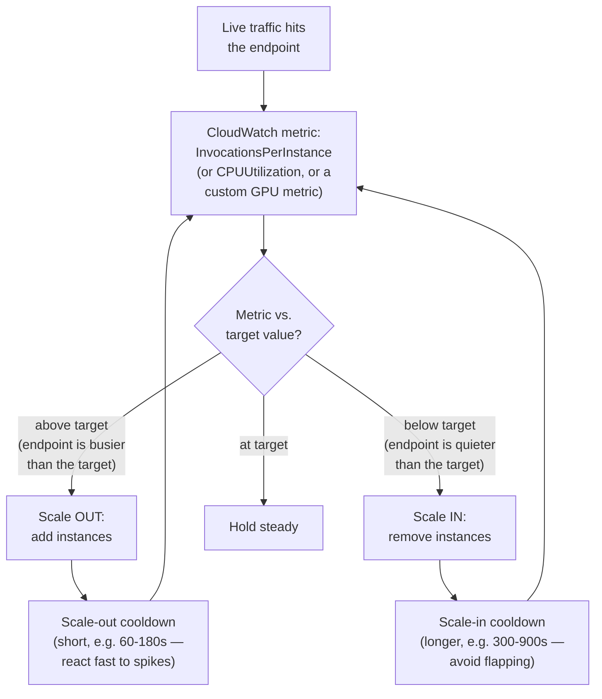
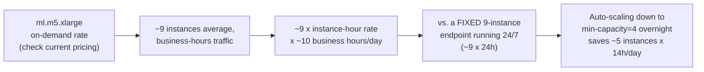

# SageMaker Endpoint Auto-Scaling & Cost-Per-Inference — Worked Math

*Companion deep dive to [`README.md`](README.md) and
[`services/machine-learning-ai/sagemaker-deployment-endpoints.md`](../../../services/machine-learning-ai/sagemaker-deployment-endpoints.md).
That document establishes *which* inference option fits a traffic pattern; this document is
entirely about what happens *after* you've picked real-time or serverless — how the endpoint
actually scales under load, and the real arithmetic behind "is this the cheapest option for my
actual traffic." MLA-C02 Domain 3 scenario questions increasingly give you concrete numbers
(requests/second, instance price, latency target) and expect you to do this exact math, not just
recognize a keyword.*

## Definition

SageMaker endpoint auto-scaling is Application Auto Scaling's target-tracking mechanism applied
to a real-time endpoint's instance count (or, for serverless, its provisioned-concurrency
setting): you pick a CloudWatch metric and a target value, and AWS adds or removes capacity to
keep that metric near the target — automatically, continuously, without anyone manually
resizing the endpoint when traffic shifts. Cost-per-inference is the practical unit this whole
exercise exists to optimize: not "what does an instance cost per hour" in isolation, but "what
does it cost, all-in, to answer one request," which only becomes knowable once you know how many
requests an instance can actually absorb before its latency or error rate degrades.

## Purpose

An endpoint sized for yesterday's traffic is wrong twice: too small during a spike (requests
queue, latency climbs, SageMaker starts returning throttling errors) and too large during a lull
(instances sit mostly idle, billed per instance-hour regardless). Auto-scaling exists to close
that gap automatically — but auto-scaling configured against the wrong metric, or with scaling
cooldowns too slow for the traffic's actual volatility, produces exactly the same bad outcomes a
fixed instance count would, just with extra moving parts. This document exists because "turn on
auto-scaling" is not, by itself, a correct answer to a Domain 3 exam scenario — the *metric*,
*target value*, and *min/max bounds* chosen have to actually match the traffic shape described,
and the resulting cost has to be computed, not assumed.

## How It Works

Plain-English: you tell Application Auto Scaling "keep `InvocationsPerInstance` near 70 per
minute," and it watches that CloudWatch metric, and when it drifts above or below the target by
enough to clear a cooldown period, it adds or removes whole instances to pull the metric back
toward 70.



Step by step:
1. **A target-tracking policy is registered** against a *scalable target* — for SageMaker, this is
   a specific endpoint's production variant (`resource-id:
   endpoint/<endpoint-name>/variant/<variant-name>`, `scalable-dimension:
   sagemaker:variant:DesiredInstanceCount`). Serverless endpoints and inference components have
   their own distinct scalable-dimension strings (provisioned concurrency, and per-component
   compute, respectively) — picking the wrong dimension for the endpoint type is a real,
   testable configuration mistake, not just a cosmetic difference.
2. **A CloudWatch metric and target value are chosen.** `InvocationsPerInstance` (a SageMaker-
   provided metric: how many invocations, on average, each currently-running instance is
   handling per minute) is the most common and most directly meaningful choice, because it
   measures load *per instance* — the exact quantity that determines whether adding an instance
   will actually relieve pressure. `CPUUtilization` is a viable alternative for CPU-bound models;
   a custom CloudWatch metric (e.g., GPU utilization, published via a custom metric from inside
   the container) is the right choice for GPU-hosted models where CPU utilization is a
   meaningless proxy for actual load (see the GPU-specific document in this folder).
3. **Application Auto Scaling creates the underlying CloudWatch alarms for you** — you never
   hand-write the alarm; specifying the metric/target/cooldowns is enough, and AWS manages the
   two alarms (one for scale-out, one for scale-in) that drive the policy.
4. **Scale-out is deliberately more aggressive than scale-in** — this is an AWS design choice
   worth knowing explicitly: when the metric is *above* target, Auto Scaling can add multiple
   instances in one step if the gap is large; when *below* target, it typically removes capacity
   more conservatively. The asymmetry exists because under-provisioning during a real spike costs
   you failed/slow requests (an availability problem), while over-provisioning during a lull
   only costs a little extra money for a short window (a cost problem) — AWS's defaults
   deliberately bias toward the cheaper mistake.
5. **Cooldown periods prevent flapping** — a short scale-out cooldown reacts quickly to a genuine
   spike; a longer scale-in cooldown avoids tearing down an instance just before traffic ticks
   back up again (an instance that was just added and immediately removed accomplishes nothing
   except wasted provisioning churn and potential cold-start-like latency on the next spike).
6. **Minimum and maximum instance counts bound the whole policy** — `min-capacity` protects
   against scaling to zero when you need at least one instance always warm (real-time endpoints
   can't scale below 1; only serverless can genuinely reach zero), and `max-capacity` is both a
   cost ceiling and a real guard against a runaway scaling event (a traffic bug, or a
   misconfigured load test) silently running up an enormous bill.

### AWS's own target-tracking diagram


*Figure: reused here from AWS's own SageMaker inference documentation — the same "AWS provisions
and scales compute automatically" idea applies whether the scaling target is a serverless
endpoint's concurrency or a real-time endpoint's instance count; the mechanism underneath (watch
a metric, compare to target, adjust capacity, respect cooldowns) is the same Application Auto
Scaling engine in both cases. Source: AWS SageMaker Developer Guide, "Deploy models with Amazon
SageMaker Serverless Inference" — docs.aws.amazon.com/sagemaker/latest/dg/serverless-endpoints.html.*

### Registering a real scaling policy — the actual CLI calls

```bash
# Step 1: register the endpoint variant as a scalable target, bounded 1-8 instances
aws application-autoscaling register-scalable-target \
  --service-namespace sagemaker \
  --resource-id endpoint/fraud-detector-endpoint/variant/AllTraffic \
  --scalable-dimension sagemaker:variant:DesiredInstanceCount \
  --min-capacity 1 \
  --max-capacity 8

# Step 2: attach a target-tracking policy keyed on InvocationsPerInstance
aws application-autoscaling put-scaling-policy \
  --service-namespace sagemaker \
  --resource-id endpoint/fraud-detector-endpoint/variant/AllTraffic \
  --scalable-dimension sagemaker:variant:DesiredInstanceCount \
  --policy-name invocations-per-instance-target-70 \
  --policy-type TargetTrackingScaling \
  --target-tracking-scaling-policy-configuration '{
    "TargetValue": 70.0,
    "PredefinedMetricSpecification": {
      "PredefinedMetricType": "SageMakerVariantInvocationsPerInstance"
    },
    "ScaleInCooldown": 600,
    "ScaleOutCooldown": 120
  }'
```

Two details worth internalizing from this exact call: `ScaleOutCooldown` (120s) is deliberately
shorter than `ScaleInCooldown` (600s) — the asymmetry from the diagram above, made concrete — and
`TargetValue: 70.0` means "keep each instance handling about 70 invocations per minute," a number
that only makes sense once you've load-tested (or reasoned about) how many invocations per minute
a *single* instance of your specific model, on your specific instance type, can actually sustain
before latency degrades — which is exactly what the worked math below does.

## Worked math — from a latency budget to an instance count, step by step

This is the single most valuable skill this document teaches: turning a traffic description into
a correctly-sized, correctly-costed endpoint, by hand, the way a Domain 3 scenario question
expects.

**The scenario:** An e-commerce recommendation endpoint must serve personalized rankings at
checkout. Product tells you: average **400 requests/second** during business hours, each request
must return in **under 150ms** p99, and a single `ml.m5.xlarge` instance running this specific
model has been load-tested (via SageMaker Inference Recommender) to sustain **60 requests/second**
at that latency bar before p99 latency breaches 150ms.

**Step 1 — convert requests/second to a per-minute figure**, because
`InvocationsPerInstance` is measured per minute: 400 req/s × 60 = **24,000 invocations/minute**
total, across however many instances are running.

**Step 2 — convert the single-instance sustainable rate to the same unit:** 60 req/s × 60 =
**3,600 invocations/minute** per instance, at the latency bar.

**Step 3 — compute the baseline instance count needed to just meet current average load:**
24,000 ÷ 3,600 ≈ **6.7, round up to 7 instances.** This is the number you'd pick if traffic were
perfectly flat — but real traffic isn't, which is exactly why auto-scaling (not a fixed count of
7) is the right architecture.

**Step 4 — set the target-tracking value with headroom, not at the sustainable ceiling.**
Setting `TargetValue` at exactly 3,600 (the absolute ceiling before latency breaches) leaves zero
margin for the time auto-scaling takes to actually add a new instance (provisioning a new
instance and attaching it to the load balancer isn't instantaneous — commonly a few minutes). A
sane target leaves meaningful headroom, e.g. `TargetValue: 2,800` (≈78% of the measured ceiling)
— the exam-relevant principle: **the target-tracking value should be set below the actual
breaking point, by a margin sized to cover the time it takes a new instance to come online**, not
at the breaking point itself.

**Step 5 — compute the actual required instance count at the chosen target:** 24,000 ÷ 2,800 ≈
**8.6, round up to 9 instances** for steady average load with real operating headroom — notice
this is already more than the "bare minimum" 7 from Step 3, which is the normal, correct shape of
this tradeoff: headroom costs a little more, continuously, in exchange for not breaching the
latency SLA during the minutes it takes to scale out further.

**Step 6 — set `min-capacity` and `max-capacity` around this.** A sane `min-capacity` might be 4
(covering the lowest overnight traffic trough without ever fully scaling to a cold endpoint —
real-time endpoints can't go to zero) and `max-capacity` 20 (covering a 2-3x unplanned spike, e.g.
a flash sale, while still capping worst-case runaway cost).

### Cost sanity check for this exact scenario



Assume (for illustration — always confirm current rates) `ml.m5.xlarge` costs roughly **$0.23/
instance-hour** on demand. A **fixed** 9-instance endpoint running continuously costs 9 × 24 ×
$0.23 ≈ **$49.68/day**. The same workload auto-scaled between `min-capacity=4` overnight (14
off-hours) and ~9 during the 10 business hours costs roughly (9 × 10 × $0.23) + (4 × 14 × $0.23)
≈ $20.70 + $12.88 ≈ **$33.58/day** — a **~32% reduction** purely from letting capacity track the
actual traffic curve instead of provisioning for peak around the clock. This exact shape of
calculation (not these specific dollar figures, which depend on current pricing) is what a
"most cost-effective configuration" Domain 3 exam question is testing: the answer is almost never
"add more instances" or "use a bigger instance type" in isolation, it's "match capacity to the
actual traffic curve over a full day, not to one peak moment."

## A second worked example — serverless provisioned concurrency vs. real-time, at a specific volume

**The scenario:** An internal document-classification tool is called roughly **200 times/day**,
clustered in business hours, each call taking about **400ms** of actual compute. Should this be a
real-time endpoint with auto-scaling, or a serverless endpoint?

**Real-time cost (even auto-scaled to a `min-capacity` of 1 instance):** a single
`ml.m5.large` instance running continuously (auto-scaling can't go below 1 for real-time) costs
roughly 24 × $0.115 ≈ **$2.76/day**, regardless of the 200 calls being a tiny fraction of that
instance's actual capacity — nearly all of that cost is idle time.

**Serverless cost:** 200 calls/day × 0.4 seconds/call = **80 seconds/day of actual billed
compute**. At an illustrative serverless rate of roughly $0.0000166667/GB-second (check current
published rates) and a 2GB memory configuration, that's roughly 80 × 2 × $0.0000166667 ≈
**$0.0027/day** — multiple orders of magnitude cheaper than the real-time option, because almost
none of the real-time endpoint's billed time corresponds to actual work.

**The one caveat worth stating explicitly:** if this tool's 200 calls/day are tightly clustered
(e.g., all 200 happen in a 10-minute window every morning at standup), serverless cold starts
could stack up as several near-simultaneous first-requests-after-idle hit at once; **Provisioned
Concurrency** for the serverless endpoint (keeping a small number of execution environments
pre-warmed) removes that specific risk at a small, flat additional cost — still dramatically
cheaper than a continuously-running real-time instance, and the correct answer when a scenario
specifies both "spiky, low volume" *and* "cannot tolerate any cold start, even occasionally."

## A third worked example — multi-model endpoint consolidation math

**The scenario:** 50 per-customer models, each called on average 3 times/minute, currently each
on its own dedicated `ml.m5.large` real-time endpoint.

**Current cost:** 50 endpoints × 24 instance-hours/day × $0.115 ≈ **$138/day**, for a combined
150 invocations/minute of actual total traffic — a workload that would comfortably fit on a
handful of shared instances.

**Multi-model endpoint (MME) cost:** consolidating onto, say, 3 shared `ml.m5.xlarge` instances
(loading each customer's model into memory on demand) costs roughly 3 × 24 × $0.23 ≈ **$16.56/
day** — a **~88% reduction**, because the fixed per-endpoint idle overhead (49 of those 50
endpoints sitting mostly idle most minutes) is exactly what MME eliminates by sharing
instances across many infrequently-called models instead of dedicating one each.

**The tradeoff, stated precisely (don't let the cost win obscure it):** a model not recently
called gets evicted from the shared instances' memory and must be reloaded on the next request —
a cold-start-like latency penalty *per model*, not per endpoint. If any one of the 50 customers
has a strict, unconditional low-latency SLA regardless of call frequency, that customer's model
is the correct candidate to carve back out onto its own dedicated endpoint, while the other 49
stay consolidated — a mixed architecture, not an all-or-nothing choice, and itself a realistic
exam scenario shape ("49 of 50 tenants have relaxed latency needs, 1 has a strict SLA").

## GPU-hosted endpoints — why the same math needs a different metric

Everything above used CPU-bound instance math (`InvocationsPerInstance`, CPU-adjacent reasoning).
A GPU-hosted foundation model or embedding model breaks this cleanly for one concrete reason:
**GPU capacity comes in large, discrete jumps, and GPU utilization — not invocation count — is
usually the real constraint.** Two requests landing on a GPU instance at once can often be
*batched* and processed together nearly as fast as one alone (up to the GPU's memory/compute
ceiling), which means `InvocationsPerInstance` alone can under- or over-estimate true headroom
compared to a CPU instance, where each request roughly consumes its own independent slice of
compute. The practical implication: GPU-hosted endpoint auto-scaling policies commonly track a
**custom CloudWatch metric for GPU utilization** (published from inside the container, since
SageMaker doesn't expose a built-in `GPUUtilization` predefined metric the way it does for CPU-
adjacent invocation counts) rather than defaulting to the same `InvocationsPerInstance` target
used for a CPU-bound classic-ML endpoint — see this folder's GPU instance selection document for
the full instance-family and batching discussion this connects to.

## Troubleshooting / Common Issues

- **An auto-scaling policy is configured but the endpoint never scales out during an observed
  traffic spike.** Check that the actual CloudWatch metric is genuinely crossing the configured
  target by enough margin and for long enough to clear the alarm's evaluation period — a metric
  that's noisy and briefly spikes above target, then immediately drops back, may never trigger a
  sustained-enough breach to fire the scaling alarm; this is a configuration-tuning problem, not
  evidence that auto-scaling "isn't working."
- **Instances are added during a spike, but requests still fail/timeout for several minutes
  first.** This is the expected lag between a scaling trigger firing and new capacity actually
  coming online (provisioning, health-checking, and load-balancer registration all take real
  time) — the fix is setting the target-tracking value with headroom (Step 4 above), not
  treating the lag itself as a bug.
- **The endpoint "flaps" — scaling out, then immediately back in, repeatedly.** Almost always a
  scale-in cooldown set too short relative to the traffic's actual natural variability; lengthen
  `ScaleInCooldown` so a brief dip doesn't trigger a teardown moments before traffic recovers.
- **Cost is far higher than expected despite auto-scaling being enabled.** Check `min-capacity`
  first — a `min-capacity` set too high (e.g., left at the peak-sized value from an earlier
  manual configuration) means the endpoint never actually scales down during genuinely quiet
  periods, silently defeating the entire point of auto-scaling.
- **A load test shows a much lower sustainable requests/second-per-instance than expected.**
  Confirm the load test's latency target matches the production SLA exactly — a load test
  measuring "requests until errors start" rather than "requests until p99 latency breaches the
  actual SLA" produces a misleadingly high sustainable-rate number that then under-provisions
  the real auto-scaling target.

## Exam Tips

- A scenario giving concrete numbers (requests/second, per-instance sustainable rate, a latency
  target) is explicitly asking you to compute an instance count or a target-tracking value — do
  the arithmetic, don't just name "auto scaling" as a vague answer.
- `InvocationsPerInstance` is the default, most broadly correct metric for CPU-bound real-time
  endpoints; a GPU-hosted endpoint's correct metric is commonly a **custom** GPU-utilization
  metric instead, a frequently-tested distinction.
- Scale-out cooldowns are shorter than scale-in cooldowns by design — know this asymmetry as an
  intentional availability-over-cost bias, not an oversight to "fix."
- "Fixed instance count running 24/7" is almost never the cost-optimal answer when a scenario
  describes any meaningful daily traffic variation — compute the auto-scaled cost against the
  fixed cost explicitly, the way the worked examples above do, rather than assuming auto-scaling
  is automatically cheaper without checking the shape of the traffic.
- Multi-model endpoints' cost advantage comes specifically from eliminating *per-endpoint idle
  overhead* across many lightly-used models — a scenario with few, very high-traffic models does
  **not** benefit the same way, and a dedicated endpoint per hot model remains correct there.

### Sample exam scenario, worked

**Scenario:** "An endpoint currently runs 5 fixed `ml.c5.xlarge` instances continuously. Traffic
averages 1,200 invocations/minute during a 9-hour business day and drops to roughly 150
invocations/minute the rest of the day. A single instance has been measured to sustain 300
invocations/minute at the required latency. What is the most cost-effective configuration?"

*Answer, worked:* daytime need: 1,200 ÷ 300 = 4 instances (plus any headroom margin, say 5);
off-hours need: 150 ÷ 300 = 0.5, rounded up to 1 instance (the real-time minimum). A
target-tracking auto-scaling policy with `min-capacity=1`, `max-capacity` set with headroom above
5 (e.g., 8, to cover unplanned spikes), and `TargetValue` set below 300 with margin (e.g., 240)
replaces the fixed 5-instance configuration — costing roughly the daytime need (~5 instances ×
9h) plus the off-hours need (~1 instance × 15h) instead of 5 instances × 24h continuously, a
direct, computable cost reduction exactly like the worked examples above, not merely "enable auto
scaling" as an unquantified gesture.

## Related Terms

- [`README.md`](README.md) — the broader inference-option decision tree this document assumes
- [`services/machine-learning-ai/sagemaker-deployment-endpoints.md`](../../../services/machine-learning-ai/sagemaker-deployment-endpoints.md)
  — the four endpoint shapes this scaling math applies to
- [`gpu-instance-selection-scaling-fm-hosting.md`](gpu-instance-selection-scaling-fm-hosting.md)
  — the GPU-specific continuation of the scaling-metric discussion above
- [`../domain-4-monitoring-security/ml-cost-optimization.md`](../domain-4-monitoring-security/ml-cost-optimization.md)
  — Savings Plans/Spot pricing layered on top of the instance-count math here
